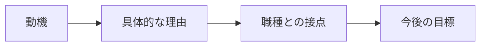

# 第02.01課 — 志望動機・BrSEを選ぶ理由

> **BRSE Interview Master · 日本語 N3–N2** · Draft / Pending reviewer.  
> Câu chính mục tiêu 15–30 giây, câu đào sâu 10–25 giây; thời lượng cần tự bấm giờ. Đây là bài học luyện phỏng vấn, không phải xác nhận kinh nghiệm cá nhân hay bản dịch được người Nhật duyệt.

## ① 学習目標 — Mục tiêu

Hiểu câu hỏi, xác định điều nhà tuyển dụng thực sự muốn biết, đưa ra câu trả lời ngắn có căn cứ, trả lời một câu hỏi đào sâu và tự sửa theo rubric. Chủ đề: **志望動機・BrSEを選ぶ理由**.

## ② 面接質問・質問の意図

**面接官：** なぜBrSEを志望していますか。

**Ý định:** Kiểm tra khả năng diễn đạt rõ ràng, tính thực tế của lý do/kinh nghiệm và cách xử lý tình huống bằng tiếng Nhật. Khi cần bằng chứng CV, phải lấy từ người học chứ không suy đoán.

## ③ 思考プロセス・技術知識

Motivation → Match with role → Contribution; sửa theo động lực thực, tránh khẳng định đã từng làm BrSE.

**Khung sử dụng:** Kết luận hoặc tình trạng thực tế → lý do/tiêu chí → hành động hoặc bằng chứng → giới hạn. Nếu là tình huống giả định, dùng 「〜の場合は」; không biến giả định thành một thành tích đã xảy ra.

**日本語で図を説明：** まず質問の意図を確認し、結論を短く伝えます。その後、理由や具体例を加え、未確認の点は分けて説明します。

**Dịch:** Xác nhận ý định câu hỏi và nêu kết luận ngắn; sau đó bổ sung lý do/ví dụ, tách riêng điều chưa được xác minh.

## ④ 面接対話 — Hội thoại chính + đào sâu

**面接官：** なぜBrSEを志望していますか。

**応募者（Standard）：** 技術とコミュニケーションの両方を使い、お客様と開発チームの認識を合わせる仕事に関心があるからです。要件を正しく理解し、誤解を減らせるエンジニアを目指しています。

**Dịch tiếng Việt:** Tôi quan tâm công việc kết hợp kỹ thuật và giao tiếp để thống nhất nhận thức giữa khách hàng và đội phát triển. Tôi muốn trở thành kỹ sư hiểu đúng yêu cầu và giảm hiểu nhầm.

**面接官（深掘り）：** BrSEにはどんなスキルが必要ですか。

**応募者：** 技術理解だけでなく、要件を整理し、相手に分かりやすく伝える力が必要だと考えています。

**Dịch tiếng Việt:** Theo tôi, ngoài hiểu kỹ thuật cần kỹ năng hệ thống hóa yêu cầu và diễn đạt dễ hiểu.

**Professional / 言い換え:** Trong ngữ cảnh khách hàng, thêm lời mở đầu lịch sự như 「恐れ入りますが」 khi phù hợp; không làm câu trả lời quá dài hoặc dùng kính ngữ phức tạp không cần thiết. Câu đã nêu ở trên là khung luyện tập, không chứng nhận là cách nói duy nhất.

## ⑤ 類似表現比較 — Sắc thái diễn đạt

| Cách nói | Khi dùng | Giới hạn |
|---|---|---|
| 〜と考えています | Quan điểm/định hướng | Không thay cho bằng chứng đã kiểm thử |
| 〜を確認しました | Đã xác nhận | Chỉ khi thực sự kiểm tra |
| 〜を検証しました | Đã kiểm chứng bằng phương pháp | Cần có phép thử/evidence |
| 現時点では未確認です | Hiện chưa xác minh | Phù hợp khi thông tin chưa chắc |
| 〜について確認させていただけますか | Xin xác nhận lịch sự | Dùng khi trao đổi với người cần tôn trọng |

## ⑥ 語彙・文法 — Từ vựng trong bài

| 日本語 | 読み方 | Nghĩa |
|---|---|---|
| 志望動機 | しぼうどうき | Động lực ứng tuyển |
| 認識 | にんしき | Nhận thức |
| 要件 | ようけん | Yêu cầu |
| 誤解 | ごかい | Hiểu nhầm |

**Mẫu có thể tái sử dụng:** 「まず〜を確認します。」「〜のために〜しています。」「〜と考えています。」「〜については、まだ確認できていません。」

## ⑦ 会話練習 — Active recall / Roleplay

1. **Shadowing:** đọc hội thoại và ngắt nhịp tự nhiên theo câu (không khẳng định phát âm chuẩn nếu chưa có audio).
2. **20 giây:** tự trả lời câu chính, không nhìn câu mẫu.
3. **15 giây:** trả lời câu đào sâu và bổ sung một ví dụ hoặc giới hạn.
4. **Transfer:** đổi sang một doanh nghiệp/dự án khác mà vẫn giữ cấu trúc lập luận; không sao chép thông tin chưa đúng.
5. **Prompt luyện với AI:** 「あなたは日本企業のBrSE面接官です。『志望動機・BrSEを選ぶ理由』について一問ずつ質問してください。回答を待ち、その内容に合わせて深掘り質問を一つだけしてください。最後に短い改善点を伝えてください。未確認の経験を事実として扱わないでください。」

## ⑧ 解答のポイント — Điểm cần nhớ

- Trả lời thẳng câu hỏi thay vì kể quá nhiều thông tin.
- Dùng một lý do chính và tối đa một ví dụ ngắn khi luyện 15–30 giây.
- Với phát biểu cá nhân hoặc CV, chỉ nói điều thực sự đúng; các dấu 【】 là chỗ cần điền, không phải câu hoàn chỉnh.
- Với Smart Farm nếu được nhắc tới, backend/database chủ yếu local; chưa xác nhận production hoặc vận hành bơm/van thật.

## ⑨ 評価・改善 — Rubric /20

Mỗi tiêu chí 0–4: **đúng trọng tâm**, **chính xác và trung thực**, **tiếng Nhật tự nhiên**, **giải thích mạch lạc**, **trả lời follow-up**. Mốc tự học 16–20 tốt, 12–15 cần sửa, dưới 12 cần luyện lại. Không phải điểm JLPT hoặc tiêu chí tuyển dụng chính thức. Không chấm phát âm bằng văn bản.

## ⑩ 出典・検証状況

- Nội dung ví dụ được biên soạn để luyện nói, chưa có native Japanese reviewer xác nhận.
- Những nội dung nghề nghiệp/cá nhân phải kiểm tra với CV, JD, hoặc câu trả lời người học.
- Chưa đo thời lượng đọc nói thực tế hoặc kiểm thử render Mermaid.
- Bài này không xác nhận bất cứ production deployment, điểm thi tiếng Nhật hay thành tích không được cung cấp.
