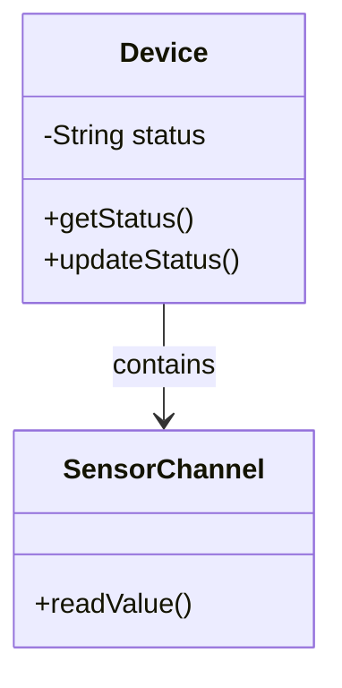

# 第04.01課 — オブジェクト指向・カプセル化

> **BRSE Interview Master · Draft / Pending review**  
> Trình độ N3–N2; mục tiêu hội thoại chính 15–30 giây. Nội dung giải thích kỹ thuật là học liệu; không khẳng định người học từng làm các thao tác nếu chưa có bằng chứng. Các endpoint/sơ đồ minh họa không phải đặc tả dự án khi không được xác nhận.

## ① 学習目標 — Mục tiêu

Hiểu và giải thích được **オブジェクト指向・カプセル化**, trả lời một câu hỏi kỹ thuật chính, xử lý ít nhất một follow-up, sử dụng từ vựng IT tiếng Nhật, và chuyển kiến thức sang tình huống mới.

## ② 面接質問・質問の意図

**面接官：** オブジェクト指向とは何ですか。

**Nhà tuyển dụng đánh giá:** Năng lực hiểu khái niệm, giải thích mục đích sử dụng và phân biệt kiến thức thực tế với giả định.

## ③ 技術知識・思考プロセス

**Cách tư duy:** Định nghĩa / tình huống → công dụng → rủi ro hoặc giới hạn → ví dụ. Khi hỏi về quyết định kỹ thuật của dự án, phải phân biệt *lợi ích chung* với *lý do lựa chọn thực tế được xác nhận*.

Đóng gói hạn chế truy cập trạng thái và công khai thao tác phù hợp.

## ④ 図解 — Hình minh họa

**Chú giải:** Sơ đồ có tính giáo dục. Không suy ra hạ tầng hoặc endpoint tương ứng đang tồn tại trong mã nguồn Smart Farm.

**日本語で説明してみよう：** まず全体の流れを確認します。次に、それぞれの役割を説明します。最後に、データの受け渡しや確認が必要な点をまとめます。

**Dịch:** Nắm luồng tổng thể, giải thích trách nhiệm các tầng, nêu điểm trao đổi dữ liệu và vấn đề cần xác minh.

## ⑤ 面接対話 — Hội thoại Nhật–Việt

**面接官：** オブジェクト指向とは何ですか。

**Dịch câu hỏi:** Lập trình hướng đối tượng là gì?

**応募者（Standard）：** オブジェクト指向は、データと処理をオブジェクトとしてまとめて設計する考え方です。責任を分けることで、変更しやすくなる場合があります。

**ベトナム語訳：** OOP tổ chức dữ liệu và hành vi theo đối tượng; việc phân chia trách nhiệm có thể hỗ trợ thay đổi.

**面接官（深掘り）：** カプセル化とは何ですか。

**Câu hỏi đào sâu (Việt):** Đóng gói là gì?

**応募者：** 内部の状態へのアクセスを制限し、必要な操作を公開することです。

**ベトナム語訳：** Đóng gói là hạn chế truy cập vào trạng thái bên trong và công khai những thao tác cần thiết.

**質問の型:** 何ですか → なぜ必要ですか → 具体的にはどうしますか. Khi có câu hỏi tiếp theo, ưu tiên giải thích một ý mới, không lặp toàn bộ định nghĩa.

## ⑥ 類似表現比較 — Cách diễn đạt phù hợp

- **使っています:** công nghệ đang dùng, không tự bao hàm lý do lựa chọn.
- **採用しました:** đã áp dụng; cần xác minh vai trò quyết định trước khi dùng ở ngôi cá nhân.
- **確認します / 検証します:** kiểm tra thông tin / kiểm chứng qua phương pháp.
- **実現できます / 可能性があります:** có thể thực hiện / có khả năng; không hứa tuyệt đối khi chưa đánh giá rủi ro.

## ⑦ 語彙・文法 — Từ vựng chuyên ngành

| 日本語 | 読み方 | Nghĩa |
|---|---|---|
| オブジェクト指向 | オブジェクトしこう | Lập trình hướng đối tượng |
| カプセル化 | カプセルか | Đóng gói |
| 継承 | けいしょう | Kế thừa |
| 抽象化 | ちゅうしょうか | Trừu tượng hóa |
| 責任 | せきにん | Trách nhiệm |
| 状態 | じょうたい | Trạng thái |

**Mẫu câu phỏng vấn:** オブジェクト指向では、データと処理をまとめて扱います。

**Dịch sát nghĩa:** Trong OOP, dữ liệu và xử lý được gom để quản lý cùng nhau.

## ⑧ 実践練習 — Active recall và chuyển ngữ cảnh

**Bước 1 — 20 giây:** Trả lời câu hỏi phỏng vấn chính của bài mà không nhìn mẫu. Ghi âm và tự kiểm tra có nêu được định nghĩa, công dụng, giới hạn hay chưa.

**Bước 2 — Câu hỏi ứng dụng của nhà tuyển dụng:**

**面接官：** Deviceの状態を外部から自由に変更できる設計には、どんな問題がありますか。

**Dịch câu hỏi:** Nếu bên ngoài sửa trạng thái Device tùy ý, có vấn đề gì?

**応募者（回答例）：** 状態の整合性が崩れる可能性があります。そのため、更新方法を限定します。

**Dịch từng câu:** Trạng thái có thể mất nhất quán. Vì vậy nên giới hạn cách cập nhật.

**Bước 3 — Bài tập thực hành:** Giải thích đóng gói bằng ví dụ class Device và setter kiểm tra điều kiện; không khẳng định class đó đang tồn tại trong dự án.

**Bước 4 — Trả lời cho khách hàng:** Hãy nói lại cùng ý bằng tiếng Nhật dễ hiểu, tránh thuật ngữ chưa giải thích. Không tự đưa ra cam kết về trạng thái production.

**Bước 5 — Chấm:** 0–4 điểm từng tiêu chí: đúng kiến thức, giải thích rõ, tiếng Nhật tự nhiên, nói đúng trọng tâm, xử lý follow-up. Tổng /20; nếu chưa có ghi âm, chỉ tự chấm nội dung, không khẳng định phát âm.

**AI Interviewer:** 面接官として上の質問を一問ずつ出してください。私の回答を待ち、事実と推測を区別させる質問を一つ追加してください。最後に自然な日本語への修正案を示してください。

## ⑨ 評価・改善 — Rubric /20

Tự chấm năm tiêu chí 0–4: đúng trọng tâm, chính xác kỹ thuật, tiếng Nhật tự nhiên, diễn giải mạch lạc, phản xạ follow-up. Thang 16–20 tốt, 12–15 cần chỉnh, dưới 12 học lại là thước đo **nội bộ**. Không tự chấm phát âm khi không có audio.

**Quy trình sửa:** Rút ngắn câu, chỉ ra giới hạn cần xác minh, thử giải thích lại cho khách hàng không chuyên và làm mới ví dụ.

## ⑩ 出典・検証状況

- Kiến thức cơ bản về lập trình / kiến trúc / QA / yêu cầu là **nội dung giáo dục tổng quát**, không trích xuất trực tiếp từ source code.
- Với Smart Farm, brief cung cấp: ESP32/Wokwi, AWS IoT Core, MQTT/TLS/X.509, backend Java 21/Spring Boot/Spring JDBC/modular monolith, PostgreSQL, React/REST/polling, kiểm thử JUnit/Spring Boot Test/Playwright; backend và DB chủ yếu local, luồng ESP32/Wokwi–AWS–backend có bằng chứng chạy thử theo mô tả.
- **Chưa xác nhận:** cấu hình production, khả năng vận hành bơm/van nông nghiệp thật, benchmark, endpoints và triển khai các công nghệ minh họa không có trong brief.
- Cần đối chiếu mã nguồn, kiểm thử render Mermaid, rà soát tiếng Nhật và thử trả lời có bấm giờ trước khi đánh dấu Reviewed.
