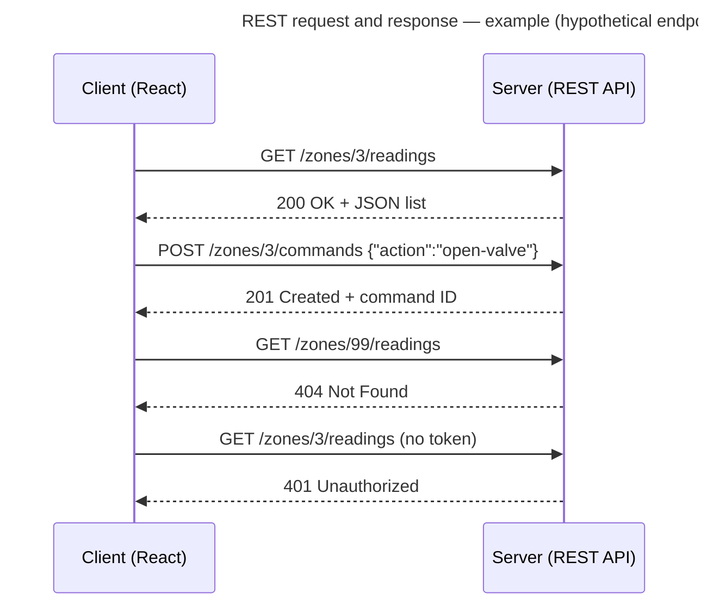

# 第04.01課 — REST API | Giải thích REST API trong phỏng vấn kỹ thuật

> **BRSE Interview Master · 第04章 プログラミング・Web技術**  
> **Đối tượng:** Ứng viên BrSE/SE, tiếng Nhật N3–N2  
> **Trạng thái:** draft — bài mẫu (pilot) theo master prompt; chờ rà soát tiếng Nhật · **Cập nhật:** 2026-10-26  
> **Căn cứ:** RFC 9110 (HTTP Semantics), RFC 5789 (PATCH), luận án Fielding (2000) chương 5 — xem mục 出典  
> **Bài liên quan:** [12.03 — 使用技術](../chapter-12/12-03-technology-choices.md) (REST vs MQTT) · [12.05 — デバイス制御](../chapter-12/12-05-device-control.md) (idempotency khi gửi lại)

> Số bài 04.01 là tạm thời — Chapter 04 chưa có danh sách bài chính thức.

## 学習目標 — Mục tiêu

Sau bài này, người học có thể:

- Định nghĩa REST API trong 20–30 giây theo khung **Definition → Purpose → Example**.
- Giải thích **stateless** (phi trạng thái) bằng một câu tiếng Nhật đúng.
- Phân biệt GET/POST, PUT/PATCH theo **safe** và **idempotent**, có căn cứ RFC.
- Nói đúng nghĩa các mã trạng thái thường gặp, đặc biệt **401 vs 403**.
- Nối kiến thức với kinh nghiệm thật (ví dụ dự án Smart Farm dùng REST giữa web và backend) mà không bịa tên API.

## ① 面接質問 — Câu hỏi phỏng vấn

| Câu hỏi | Dịch |
|---|---|
| **Câu chính:** REST APIとは何ですか。 | REST API là gì? |
| Biến thể: GETとPOSTの違いを説明してください。 | Hãy giải thích khác biệt giữa GET và POST. |
| Biến thể: PUTとPATCHはどう使い分けますか。 | PUT và PATCH dùng phân biệt thế nào? |
| Biến thể: 401と403の違いは何ですか。 | 401 và 403 khác nhau thế nào? |

## ② 質問の意図 — Ý định người phỏng vấn

| Họ kiểm tra | Câu trả lời yếu thường… |
|---|---|
| Hiểu **khái niệm**, không chỉ "đã từng dùng" | 「よく使っています」 mà không định nghĩa được |
| Hiểu **HTTP** ở mức đủ để thiết kế và debug | Nhầm PUT/PATCH, nhầm 401/403 |
| Giải thích **đơn giản, có ví dụ** — kỹ năng BrSE cần khi nói với khách | Liệt kê 6 ràng buộc REST bằng thuật ngữ khó |
| Có **kinh nghiệm thật** không | Nêu ví dụ không trả lời tiếp được khi bị hỏi sâu |

## ③ 技術知識 — Kiến thức nền

### 3.1 Định nghĩa

**REST** (Representational State Transfer) là một **phong cách kiến trúc** do Roy Fielding mô tả năm 2000, gồm các ràng buộc: **client-server**, **stateless**, **cache**, **uniform interface** (giao diện thống nhất), **layered system** (phân tầng), và **code-on-demand** (tùy chọn).

**REST API** (cách hiểu phổ biến trong thực tế): API qua HTTP, trong đó dữ liệu được xem như **tài nguyên (resource)** có địa chỉ **URI**, thao tác bằng **phương thức HTTP** (GET, POST, PUT, PATCH, DELETE), và dữ liệu thường trao đổi bằng **JSON**.

> Trong phỏng vấn, không cần kể đủ 6 ràng buộc. Nêu **resource + URI + HTTP method + stateless** là đủ cho câu trả lời chính; để dành phần còn lại khi bị hỏi sâu.

### 3.2 Stateless — phi trạng thái

Theo Fielding: **mỗi request từ client phải chứa đủ thông tin để server hiểu request đó**, không dựa vào ngữ cảnh lưu trên server; trạng thái phiên được giữ **hoàn toàn ở phía client**.

Ví dụ thực tế: mỗi request gửi kèm token xác thực trong header, thay vì server "nhớ" client đã đăng nhập.

**Lợi ích (theo Fielding):** server dễ mở rộng vì không phải giữ trạng thái giữa các request; mỗi request có thể xử lý độc lập.

### 3.3 Phương thức HTTP: safe và idempotent

- **Safe:** request không nhằm thay đổi trạng thái trên server (chỉ đọc).
- **Idempotent:** gửi nhiều request giống nhau có **hiệu quả dự định trên server** giống như gửi một lần.

| Method | Dùng để | Safe | Idempotent | Căn cứ |
|---|---|---|---|---|
| GET | Lấy tài nguyên | ✓ | ✓ | RFC 9110 |
| POST | Xử lý dữ liệu gửi lên, thường là **tạo mới** | ✗ | ✗ | RFC 9110 |
| PUT | **Thay thế toàn bộ** tài nguyên bằng nội dung gửi lên | ✗ | ✓ | RFC 9110 |
| PATCH | Áp dụng **một tập thay đổi một phần** | ✗ | ✗ (không bảo đảm) | RFC 5789 |
| DELETE | Xóa tài nguyên | ✗ | ✓ | RFC 9110 |

**Vì sao idempotent quan trọng?** RFC 9110 nêu rằng request idempotent **có thể được client tự động gửi lại** khi kết nối lỗi, vì gửi lại không gây hiệu quả khác. POST tạo đơn hàng mà gửi lại có thể tạo **hai** đơn — cùng vấn đề với lệnh thiết bị ở [12.05](../chapter-12/12-05-device-control.md).

### 3.4 Mã trạng thái thường gặp

| Mã | Ý nghĩa (RFC 9110) | Ví dụ |
|---|---|---|
| 200 OK | Request thành công | GET lấy dữ liệu thành công |
| 201 Created | Request đã được thực hiện và tạo ra tài nguyên mới | POST tạo mới thành công |
| 400 Bad Request | Server không xử lý vì lỗi được cho là từ phía client | Thiếu trường bắt buộc, sai định dạng |
| 401 Unauthorized | Thiếu **thông tin xác thực hợp lệ** | Không gửi token, token hết hạn |
| 403 Forbidden | Server **hiểu** request nhưng **từ chối** thực hiện | Đã đăng nhập nhưng không có quyền |
| 404 Not Found | Không tìm thấy tài nguyên (hoặc không muốn tiết lộ là có) | ID không tồn tại |
| 500 Internal Server Error | Server gặp tình huống không lường trước | Exception chưa xử lý |

**401 vs 403 — một câu:** 401 = "**chưa biết bạn là ai**" (xác thực), 403 = "**biết bạn là ai nhưng không cho phép**" (phân quyền).

### 3.5 Ví dụ thiết kế tài nguyên

> ⚠️ Ví dụ **giả định** (`hypothetical`) theo bối cảnh vườn thông minh, để luyện nói. **Không phải** API thật của dự án Smart Farm — nguồn dự án không có tên endpoint.



*Hình: ví dụ request/response REST với endpoint giả định — Not project-specific.*

**① 図の説明:** URI chỉ **tài nguyên** (danh từ: `zones`, `readings`, `commands`), còn **hành động** do method thể hiện. Vì vậy không đặt tên kiểu `/getReadings` hay `/createCommand`. Mỗi response có mã trạng thái cho biết kết quả.

**② 日本語で説明してみよう（約20秒）：**  
「URIでリソースを表し、HTTPメソッドで操作を表します。例えば、GETでセンサーの値を取得し、POSTでコマンドを作成します。結果はステータスコードで返します。」

*Dịch:* Dùng URI để biểu diễn tài nguyên, dùng HTTP method để biểu diễn thao tác. Ví dụ GET để lấy giá trị cảm biến, POST để tạo lệnh. Kết quả được trả về bằng mã trạng thái.

**⑤ 応用質問:** 「コマンドの作成が成功したとき、200と201のどちらを返しますか。」  
*Gợi ý:* 201 Created — vì tạo ra tài nguyên mới. Nhưng nhớ: 201 chỉ nói **lệnh đã được tạo trên server**, không nói thiết bị đã chạy (xem 12.05).

## ④ 思考プロセス — Khung tư duy

**Câu định nghĩa** (master prompt 6.2):

```text
Definition (một câu) → Purpose (để làm gì) → Example (ví dụ ngắn, tốt nhất từ kinh nghiệm thật)
```

**Câu so sánh** (GET/POST, PUT/PATCH, 401/403):

```text
Difference (khác ở tiêu chí nào) → Usage (khi nào dùng cái nào) → Example
```

Mẹo: với câu so sánh, **nêu tiêu chí trước** (「安全性と冪等性が違います」), rồi mới đi vào từng cái.

## ⑤ 面接対話 — Hội thoại phỏng vấn

**面接官：** REST APIとは何ですか。  
**応募者：** HTTPを使って、リソースを操作するためのAPIの設計スタイルです。URIでデータを表し、GETやPOSTなどのメソッドで取得や作成を行います。例えば、Webの画面からバックエンドのデータを取得するときに使います。

*ベトナム語訳:* Là một phong cách thiết kế API để thao tác tài nguyên bằng HTTP. Dữ liệu được biểu diễn bằng URI, và việc lấy hay tạo dữ liệu thực hiện bằng các method như GET, POST. Ví dụ, dùng khi màn hình web lấy dữ liệu từ backend.

**面接官：** ステートレスとは、どういう意味ですか。  
**応募者：** サーバーがリクエスト間の状態を持たないという意味です。各リクエストに、処理に必要な情報をすべて含めます。例えば、毎回トークンを送って認証します。

*ベトナム語訳:* Nghĩa là server không giữ trạng thái giữa các request. Mỗi request chứa đầy đủ thông tin cần để xử lý. Ví dụ, mỗi lần đều gửi token để xác thực.

## ⑥ 模範回答 — Câu trả lời mẫu

### Standard (~20 giây)

Dùng câu trả lời đầu tiên ở mục ⑤. **Khung:** 設計スタイル → URIとメソッド → 例.

### Professional (~30 giây)

**応募者：** RESTは、HTTPの仕組みを生かしたAPIの設計スタイルです。データをリソースとしてURIで表し、取得はGET、作成はPOST、更新はPUTやPATCH、削除はDELETEというように、メソッドで操作を表します。また、サーバーがリクエスト間の状態を持たないステートレスな設計のため、スケールしやすいという特徴があります。

*Dịch:* REST là phong cách thiết kế API tận dụng cơ chế của HTTP. Dữ liệu được biểu diễn như tài nguyên bằng URI, và thao tác được biểu diễn bằng method: lấy là GET, tạo là POST, cập nhật là PUT hoặc PATCH, xóa là DELETE. Ngoài ra, vì thiết kế stateless — server không giữ trạng thái giữa các request — nên dễ mở rộng.

## ⑦ 深掘り質問 — Câu hỏi đào sâu

**Q1 — GET vs POST**  
**面接官：** GETとPOSTの違いは何ですか。  
**応募者：** GETはデータを取得するためのメソッドで、サーバーの状態を変えない安全なメソッドです。POSTは主にデータの作成に使い、同じリクエストを二回送ると、二件作成される可能性があります。

*Dịch:* GET là method để lấy dữ liệu, là method an toàn không làm thay đổi trạng thái server. POST chủ yếu dùng để tạo dữ liệu; gửi cùng request hai lần có thể tạo ra hai bản ghi.

**Q2 — PUT vs PATCH**  
**面接官：** PUTとPATCHは、どう使い分けますか。  
**応募者：** PUTはリソース全体を置き換えるときに使い、PATCHは一部だけを変更するときに使います。また、PUTは冪等ですが、PATCHは冪等であることが保証されていません。

*Dịch:* PUT dùng khi thay thế toàn bộ tài nguyên, PATCH dùng khi chỉ thay đổi một phần. Ngoài ra, PUT là idempotent, còn PATCH không được bảo đảm idempotent.

**Q3 — Vì sao idempotent quan trọng**  
**面接官：** 冪等性は、なぜ重要なのですか。  
**応募者：** 通信エラーのときに、安全に再送できるかどうかに関わるからです。冪等な操作なら、再送しても結果が変わりません。

*Dịch:* Vì nó liên quan tới việc có gửi lại an toàn được khi lỗi kết nối hay không. Với thao tác idempotent, gửi lại thì kết quả không thay đổi.

**Q4 — 401 vs 403**  
**面接官：** 401と403の違いは何ですか。  
**応募者：** 401は認証情報がない、または無効な場合です。403は、誰かは分かっているけれど、その操作の権限がない場合です。

*Dịch:* 401 là khi không có thông tin xác thực hoặc thông tin không hợp lệ. 403 là khi server biết bạn là ai nhưng bạn không có quyền thực hiện thao tác đó.

**Q5 — Kinh nghiệm thật**  
**面接官：** REST APIを使ったことはありますか。  
**応募者 (khung — điền theo sự thật)：** はい。【プロジェクト名】で、【画面】と【バックエンド】の間の通信にREST APIを使いました。私は【担当した内容】を担当しました。

**Ví dụ nối với case study (`hypothetical` về vai trò):** Smart Farm dùng REST API + polling giữa React và Spring Boot (theo nguồn dự án). Có thể nói: 「Smart Farmのプロジェクトでは、React画面とSpring BootのバックエンドをREST APIでつないでいます。」 — **không** nêu tên endpoint hay phần mình phụ trách nếu chưa xác nhận.

## ⑧ 語彙・文法 — Từ vựng và ngữ pháp

| 日本語 | 読み方 | Nghĩa | Ví dụ |
|---|---|---|---|
| 設計スタイル | せっけいスタイル | Phong cách thiết kế | APIの設計スタイルです |
| リソース | リソース | Tài nguyên | リソースをURIで表します |
| 取得する | しゅとくする | Lấy (dữ liệu) | GETで取得します |
| 作成する | さくせいする | Tạo | POSTで作成します |
| 更新する | こうしんする | Cập nhật | PUTで更新します |
| 削除する | さくじょする | Xóa | DELETEで削除します |
| 置き換える | おきかえる | Thay thế | リソース全体を置き換えます |
| 冪等性 | べきとうせい | Tính idempotent | PUTには冪等性があります |
| 安全な | あんぜんな | An toàn (safe method) | GETは安全なメソッドです |
| 認証 | にんしょう | Xác thực (bạn là ai) | 認証情報がありません |
| 認可・権限 | にんか・けんげん | Phân quyền / quyền | 権限がありません |
| 状態を持たない | じょうたいをもたない | Không giữ trạng thái | サーバーは状態を持ちません |
| 再送する | さいそうする | Gửi lại | 安全に再送できます |

**Mẫu câu:**

- **〜を使って〜を操作するための〜です** — Là … để thao tác … bằng …
- **AはBするときに使い、CはDするときに使います** — A dùng khi …, C dùng khi … (câu so sánh)
- **〜ことが保証されていません** — Không được bảo đảm là …
- **〜かどうかに関わるからです** — Vì nó liên quan tới việc có … hay không

## ⑨ 類似表現比較 — So sánh cách diễn đạt

| Cặp | Khác nhau | Câu ngắn |
|---|---|---|
| 認証 vs 認可 | 認証 = xác nhận **bạn là ai** (authentication); 認可 = xác nhận **bạn được làm gì** (authorization) | 401は認証、403は認可の問題です |
| 取得 vs 参照 | 取得 = lấy dữ liệu về; 参照 = tham chiếu, xem | APIでデータを取得します |
| 作成 vs 登録 | 作成 = tạo ra (kỹ thuật); 登録 = đăng ký vào hệ thống (nghiệp vụ, hướng người dùng) | ユーザーを登録する画面で、データを作成します |
| 更新 vs 変更 | 更新 = cập nhật dữ liệu (thuật ngữ CRUD); 変更 = thay đổi nói chung (đặc tả, thiết kế) | データを更新します／仕様を変更します |
| 〜と思います vs 〜です | Với **định nghĩa đã chắc**, dùng です; 〜と思います làm câu định nghĩa nghe thiếu chắc chắn | RESTは設計スタイルです (không nói 〜だと思います) |

## ⑩ 会話練習 — Luyện phản xạ

1. **20 giây, không nhìn mẫu:** 「REST APIとは何ですか。」
2. **Hỏi sâu (10–25 giây mỗi câu):** GETとPOSTの違い → PUTとPATCH → 冪等性はなぜ重要 → 401と403.
3. **Đổi điều kiện:**
   1. 「ネットワークエラーで、POSTのレスポンスが返ってこなかったら、もう一度送りますか。」  
      *Gợi ý:* POST không idempotent → gửi lại có thể tạo trùng. Kiểm tra đã tạo chưa, hoặc thiết kế khóa chống trùng (idempotency key) — nói như phương án đề xuất.
   2. 「非エンジニアのお客様に、APIを一言で説明してください。」  
      *Gợi ý:* 「システム同士がデータをやり取りするための窓口です。」 — luyện giải thích không thuật ngữ, kỹ năng BrSE.
4. **図を見ずに説明:** Không nhìn sơ đồ 3.5, nói ba cặp request/response và mã trạng thái tương ứng.

**AI Mock Interview Prompt:**

> あなたは日本企業のWebエンジニア採用の技術面接官です。REST APIについて日本語で一問ずつ質問してください。定義、ステートレス、GETとPOST、PUTとPATCH、ステータスコードの順に進め、回答に沿って一つずつ深掘りしてください。応募者の代わりに答えないでください。5問後に、関連性・技術的正確さ・日本語の自然さ・明確さ・深掘りへの対応を各4点で評価し、良い点、最大三つの改善点、改善した回答例を示してください。

## ⑪ 評価・改善 — Đánh giá

Chấm theo [thang đánh giá chung](../../../docs/ASSESSMENT_RUBRIC.md) (mỗi tiêu chí 0–4, tổng 20; không phải thang chính thức):

| Tiêu chí | Đạt 4 điểm khi (áp vào bài này) |
|---|---|
| Answer Relevance | Câu đầu là định nghĩa, không mở đầu bằng 「よく使っています」 |
| Technical Accuracy | Đúng safe/idempotent theo RFC; đúng 401/403; không nói PATCH chắc chắn idempotent |
| Japanese Naturalness | Định nghĩa dùng です (không 〜と思います); dùng đúng 取得/作成/更新/削除 |
| Communication Clarity | Theo Definition → Purpose → Example; câu so sánh nêu tiêu chí trước |
| Follow-up Handling | Nối được với kinh nghiệm thật mà không bịa endpoint hay vai trò |

**Điểm chấm riêng của bài:**

- Nói 「POSTは冪等です」 hoặc 「PATCHは必ず冪等です」 → Technical Accuracy tối đa 1.
- Đảo nghĩa 401/403 → Technical Accuracy tối đa 1.
- Nói REST "là một giao thức" (プロトコル) → trừ Technical Accuracy (REST là phong cách kiến trúc; HTTP mới là giao thức).
- Đặt URI kiểu động từ (/getUser) mà không biết vì sao không nên → trừ Follow-up Handling.

**Feedback:** điểm mạnh → tối đa 3 lỗi → câu sửa → vì sao tốt hơn → thử lại.

## 出典・確認状況 — Nguồn và trạng thái

Truy cập ngày 2026-10-26.

| Nhận định | Nguồn | Trạng thái |
|---|---|---|
| REST là phong cách kiến trúc với các ràng buộc client-server, stateless, cache, uniform interface, layered system, code-on-demand | R. T. Fielding, *Architectural Styles and the Design of Network-based Software Architectures*, 2000, [chương 5](https://ics.uci.edu/~fielding/pubs/dissertation/rest_arch_style.htm), mục 5.1 | `verified` |
| Stateless: mỗi request chứa đủ thông tin, không dựa vào ngữ cảnh lưu trên server; trạng thái phiên giữ ở client; khả năng mở rộng tăng vì server không phải lưu trạng thái giữa các request | Như trên, mục 5.1.3 | `verified` |
| GET, HEAD, OPTIONS, TRACE là safe; PUT, DELETE và các method safe là idempotent; định nghĩa idempotent | [RFC 9110 — HTTP Semantics](https://www.rfc-editor.org/rfc/rfc9110.html), mục 9.2.1–9.2.2 | `verified` |
| Request idempotent có thể được tự động gửi lại khi lỗi kết nối | RFC 9110, mục 2.4 và 9.2.2 | `verified` |
| Nghĩa của mã 200, 201, 400, 401, 403, 404, 500 | RFC 9110, mục 15 | `verified` |
| PATCH áp dụng một tập thay đổi; không safe, không idempotent | [RFC 5789 — PATCH Method for HTTP](https://www.rfc-editor.org/rfc/rfc5789.html), mục 1–2 | `verified` |
| Định nghĩa REST (MDN) | [MDN — REST](https://developer.mozilla.org/en-US/docs/Glossary/REST) | `verified` |
| "REST API" theo cách hiểu thực tế (resource + URI + method + JSON); quy ước URI dùng danh từ | Thực hành phổ biến, chưa đối chiếu nguồn chuẩn | `needs-verification` |
| Smart Farm dùng REST API + polling giữa React và Spring Boot | [smart-farm-overview.md](../../../sources/project-evidence/smart-farm-overview.md) | `author-experience—unverified` |
| Endpoint trong sơ đồ 3.5 (/zones/3/readings…) | Ví dụ giả định | `hypothetical` |

## Ghi chú biên tập

- Số bài (04.01) cần xác nhận khi lập danh sách bài cho Chapter 04.
- Có thể bổ sung một bài riêng về JSON và thiết kế URI khi có nhu cầu.
- Câu tiếng Nhật chưa được reviewer bản ngữ kiểm tra.
