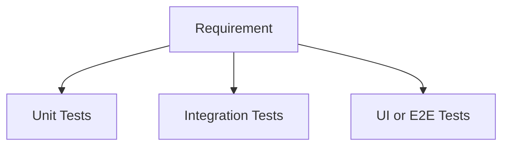

# 第07.03課 — 単体・結合・E2Eテスト

> **BRSE Interview Master · Draft / Pending review**  
> Trình độ N3–N2; mục tiêu hội thoại chính 15–30 giây. Nội dung giải thích kỹ thuật là học liệu; không khẳng định người học từng làm các thao tác nếu chưa có bằng chứng. Các endpoint/sơ đồ minh họa không phải đặc tả dự án khi không được xác nhận.

## ① 学習目標 — Mục tiêu

Hiểu và giải thích được **単体・結合・E2Eテスト**, trả lời một câu hỏi kỹ thuật chính, xử lý ít nhất một follow-up, sử dụng từ vựng IT tiếng Nhật, và chuyển kiến thức sang tình huống mới.

## ② 面接質問・質問の意図

**面接官：** 単体テストと結合テストの違いは何ですか。

**Nhà tuyển dụng đánh giá:** Năng lực hiểu khái niệm, giải thích mục đích sử dụng và phân biệt kiến thức thực tế với giả định.

## ③ 技術知識・思考プロセス

**Cách tư duy:** Định nghĩa / tình huống → công dụng → rủi ro hoặc giới hạn → ví dụ. Khi hỏi về quyết định kỹ thuật của dự án, phải phân biệt *lợi ích chung* với *lý do lựa chọn thực tế được xác nhận*.

Playwright test thao tác/hiển thị UI.

## ④ 図解 — Hình minh họa

**Chú giải:** Sơ đồ có tính giáo dục. Không suy ra hạ tầng hoặc endpoint tương ứng đang tồn tại trong mã nguồn Smart Farm.

**日本語で説明してみよう：** まず全体の流れを確認します。次に、それぞれの役割を説明します。最後に、データの受け渡しや確認が必要な点をまとめます。

**Dịch:** Nắm luồng tổng thể, giải thích trách nhiệm các tầng, nêu điểm trao đổi dữ liệu và vấn đề cần xác minh.

## ⑤ 面接対話 — Hội thoại Nhật–Việt

**面接官：** 単体テストと結合テストの違いは何ですか。

**Dịch câu hỏi:** Unit test và integration test khác nhau thế nào?

**応募者（Standard）：** 単体テストでは小さな処理を確認します。結合テストでは複数の機能や部品の連携を検証します。

**ベトナム語訳：** Unit kiểm tra chức năng nhỏ; integration kiểm tra phối hợp.

**面接官（深掘り）：** Playwrightは何に使いますか。

**Câu hỏi đào sâu (Việt):** Playwright dùng để làm gì?

**応募者：** Web画面の操作や表示を含むテストに使用できます。

**ベトナム語訳：** Playwright có thể dùng để kiểm thử thao tác và hiển thị trên giao diện web.

**質問の型:** 何ですか → なぜ必要ですか → 具体的にはどうしますか. Khi có câu hỏi tiếp theo, ưu tiên giải thích một ý mới, không lặp toàn bộ định nghĩa.

## ⑥ 類似表現比較 — Cách diễn đạt phù hợp

- **使っています:** công nghệ đang dùng, không tự bao hàm lý do lựa chọn.
- **採用しました:** đã áp dụng; cần xác minh vai trò quyết định trước khi dùng ở ngôi cá nhân.
- **確認します / 検証します:** kiểm tra thông tin / kiểm chứng qua phương pháp.
- **実現できます / 可能性があります:** có thể thực hiện / có khả năng; không hứa tuyệt đối khi chưa đánh giá rủi ro.

## ⑦ 語彙・文法 — Từ vựng chuyên ngành

| 日本語 | 読み方 | Nghĩa |
|---|---|---|
| 単体テスト | たんたいテスト | Unit test |
| 結合テスト | けつごうテスト | Integration test |
| 試験項目 | しけんこうもく | Test case |
| 期待結果 | きたいけっか | Kết quả mong đợi |
| 検証 | けんしょう | Kiểm chứng |
| 品質 | ひんしつ | Chất lượng |

**Mẫu câu phỏng vấn:** 結合テストでは複数の機能の連携を確認します。

**Dịch sát nghĩa:** Trong integration test, tôi kiểm tra sự phối hợp giữa nhiều chức năng.

## ⑧ 実践練習 — Active recall và chuyển ngữ cảnh

**Bước 1 — 20 giây:** Tự trả lời câu phỏng vấn chính không nhìn mẫu. Nêu kết luận, lý do, giới hạn và ghi âm để tự đối chiếu.

**Bước 2 — Câu hỏi ứng dụng:**

**面接官：** 単体テストが成功すれば、画面も正しく動きますか。

**Dịch câu hỏi:** Unit test thành công có bảo đảm giao diện chạy đúng không?

**応募者（回答例）：** いいえ。機能間の連携や画面操作については、結合テストやE2Eテストでも確認する必要があります。

**Dịch câu trả lời:** Không. Sự phối hợp giữa chức năng và thao tác giao diện còn cần kiểm tra bằng integration/E2E test.

**Bước 3 — Tình huống chuyên biệt:** Phân loại ba test case minh họa: logic xác nhận dữ liệu, API và thao tác đặt lệnh từ màn hình; không suy ra coverage.

**Bước 4 — BrSE transfer:** Hãy nói lại câu trả lời cho khách hàng bằng tiếng Nhật dễ hiểu, tách điều đã kiểm tra khỏi đề xuất/giả định; không tự cam kết production, an toàn hoặc deadline.

**Bước 5 — Tự đánh giá:** 0–4 cho mỗi tiêu chí: đúng kiến thức, rõ ràng, tiếng Nhật tự nhiên, đúng trọng tâm và phản hồi câu đào sâu. Tổng /20. Không chấm phát âm qua văn bản nếu chưa có ghi âm.

**AI Interviewer:** あなたは日本企業のBrSE面接官です。上記の内容について一問ずつ質問し、私の回答を待ってください。その回答に基づいて深掘りを一つ行い、最後に自然な言い方と事実関係の注意点を教えてください。

## ⑨ 評価・改善 — Rubric /20

Tự chấm năm tiêu chí 0–4: đúng trọng tâm, chính xác kỹ thuật, tiếng Nhật tự nhiên, diễn giải mạch lạc, phản xạ follow-up. Thang 16–20 tốt, 12–15 cần chỉnh, dưới 12 học lại là thước đo **nội bộ**. Không tự chấm phát âm khi không có audio.

**Quy trình sửa:** Rút ngắn câu, chỉ ra giới hạn cần xác minh, thử giải thích lại cho khách hàng không chuyên và làm mới ví dụ.

## ⑩ 出典・検証状況

- Kiến thức cơ bản về lập trình / kiến trúc / QA / yêu cầu là **nội dung giáo dục tổng quát**, không trích xuất trực tiếp từ source code.
- Với Smart Farm, brief cung cấp: ESP32/Wokwi, AWS IoT Core, MQTT/TLS/X.509, backend Java 21/Spring Boot/Spring JDBC/modular monolith, PostgreSQL, React/REST/polling, kiểm thử JUnit/Spring Boot Test/Playwright; backend và DB chủ yếu local, luồng ESP32/Wokwi–AWS–backend có bằng chứng chạy thử theo mô tả.
- **Chưa xác nhận:** cấu hình production, khả năng vận hành bơm/van nông nghiệp thật, benchmark, endpoints và triển khai các công nghệ minh họa không có trong brief.
- Cần đối chiếu mã nguồn, kiểm thử render Mermaid, rà soát tiếng Nhật và thử trả lời có bấm giờ trước khi đánh dấu Reviewed.
