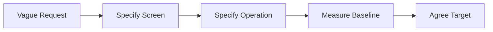

# 第08.02課 — 曖昧な仕様・性能要求

> **BRSE Interview Master · Draft / Pending review**  
> Trình độ N3–N2; mục tiêu hội thoại chính 15–30 giây. Nội dung giải thích kỹ thuật là học liệu; không khẳng định người học từng làm các thao tác nếu chưa có bằng chứng. Các endpoint/sơ đồ minh họa không phải đặc tả dự án khi không được xác nhận.

## ① 学習目標 — Mục tiêu

Hiểu và giải thích được **曖昧な仕様・性能要求**, trả lời một câu hỏi kỹ thuật chính, xử lý ít nhất một follow-up, sử dụng từ vựng IT tiếng Nhật, và chuyển kiến thức sang tình huống mới.

## ② 面接質問・質問の意図

**面接官：** お客様が「画面を速くしてほしい」と言ったら。

**Nhà tuyển dụng đánh giá:** Năng lực hiểu khái niệm, giải thích mục đích sử dụng và phân biệt kiến thức thực tế với giả định.

## ③ 技術知識・思考プロセス

**Cách tư duy:** Định nghĩa / tình huống → công dụng → rủi ro hoặc giới hạn → ví dụ. Khi hỏi về quyết định kỹ thuật của dự án, phải phân biệt *lợi ích chung* với *lý do lựa chọn thực tế được xác nhận*.

Thống nhất baseline và KPI.

## ④ 図解 — Hình minh họa

**Chú giải:** Sơ đồ có tính giáo dục. Không suy ra hạ tầng hoặc endpoint tương ứng đang tồn tại trong mã nguồn Smart Farm.

**日本語で説明してみよう：** まず全体の流れを確認します。次に、それぞれの役割を説明します。最後に、データの受け渡しや確認が必要な点をまとめます。

**Dịch:** Nắm luồng tổng thể, giải thích trách nhiệm các tầng, nêu điểm trao đổi dữ liệu và vấn đề cần xác minh.

## ⑤ 面接対話 — Hội thoại Nhật–Việt

**面接官：** お客様が「画面を速くしてほしい」と言ったら。

**応募者（Standard）：** まず、どの画面で何が遅いか確認します。その後、現在の応答時間と目標を測定・整理し、優先順位を相談します。

**ベトナム語訳：** Xác định màn hình/tác vụ, đo hiện trạng, thống nhất mục tiêu.

**面接官（深掘り）：** 数字がない場合はどうしますか。

**Câu hỏi đào sâu (Việt):** Nếu không có số liệu mục tiêu thì làm sao?

**応募者：** 測定方法を決めて現状を把握し、目標値をお客様と合意します。

**ベトナム語訳：** Tôi sẽ thống nhất cách đo, nắm thời gian phản hồi hiện tại rồi cùng khách hàng thống nhất giá trị mục tiêu.

**質問の型:** 何ですか → なぜ必要ですか → 具体的にはどうしますか. Khi có câu hỏi tiếp theo, ưu tiên giải thích một ý mới, không lặp toàn bộ định nghĩa.

## ⑥ 類似表現比較 — Cách diễn đạt phù hợp

- **使っています:** công nghệ đang dùng, không tự bao hàm lý do lựa chọn.
- **採用しました:** đã áp dụng; cần xác minh vai trò quyết định trước khi dùng ở ngôi cá nhân.
- **確認します / 検証します:** kiểm tra thông tin / kiểm chứng qua phương pháp.
- **実現できます / 可能性があります:** có thể thực hiện / có khả năng; không hứa tuyệt đối khi chưa đánh giá rủi ro.

## ⑦ 語彙・文法 — Từ vựng chuyên ngành

| 日本語 | 読み方 | Nghĩa |
|---|---|---|
| 曖昧 | あいまい | Mơ hồ |
| 具体化 | ぐたいか | Cụ thể hóa |
| 測定 | そくてい | Đo lường |
| 基準値 | きじゅんち | Giá trị chuẩn |
| 応答時間 | おうとうじかん | Thời gian phản hồi |
| 合意 | ごうい | Thống nhất |

**Mẫu câu phỏng vấn:** 曖昧な要求は測定できる条件に具体化します。

**Dịch sát nghĩa:** Tôi cụ thể hóa yêu cầu mơ hồ thành điều kiện có thể đo được.

## ⑧ 実践練習 — Bài tập

1. Trả lời câu chính trong 15–30 giây không nhìn mẫu.
2. Trả lời câu đào sâu trong 10–25 giây.
3. Thống nhất baseline và KPI.
4. Trả lời câu hỏi BrSE: 「お客様に説明するなら、どう言い換えますか。」 bằng từ ngữ dễ hiểu hơn.
5. **AI Interviewer:** あなたは日本企業のBrSE技術面接官です。「曖昧な仕様・性能要求」について一問ずつ質問し、回答を待ってください。内容に沿って一つだけ深掘りし、最後に簡潔な改善点を示してください。

## ⑨ 評価・改善 — Rubric /20

Tự chấm năm tiêu chí 0–4: đúng trọng tâm, chính xác kỹ thuật, tiếng Nhật tự nhiên, diễn giải mạch lạc, phản xạ follow-up. Thang 16–20 tốt, 12–15 cần chỉnh, dưới 12 học lại là thước đo **nội bộ**. Không tự chấm phát âm khi không có audio.

**Quy trình sửa:** Rút ngắn câu, chỉ ra giới hạn cần xác minh, thử giải thích lại cho khách hàng không chuyên và làm mới ví dụ.

## ⑩ 出典・検証状況

- Kiến thức cơ bản về lập trình / kiến trúc / QA / yêu cầu là **nội dung giáo dục tổng quát**, không trích xuất trực tiếp từ source code.
- Với Smart Farm, brief cung cấp: ESP32/Wokwi, AWS IoT Core, MQTT/TLS/X.509, backend Java 21/Spring Boot/Spring JDBC/modular monolith, PostgreSQL, React/REST/polling, kiểm thử JUnit/Spring Boot Test/Playwright; backend và DB chủ yếu local, luồng ESP32/Wokwi–AWS–backend có bằng chứng chạy thử theo mô tả.
- **Chưa xác nhận:** cấu hình production, khả năng vận hành bơm/van nông nghiệp thật, benchmark, endpoints và triển khai các công nghệ minh họa không có trong brief.
- Cần đối chiếu mã nguồn, kiểm thử render Mermaid, rà soát tiếng Nhật và thử trả lời có bấm giờ trước khi đánh dấu Reviewed.
