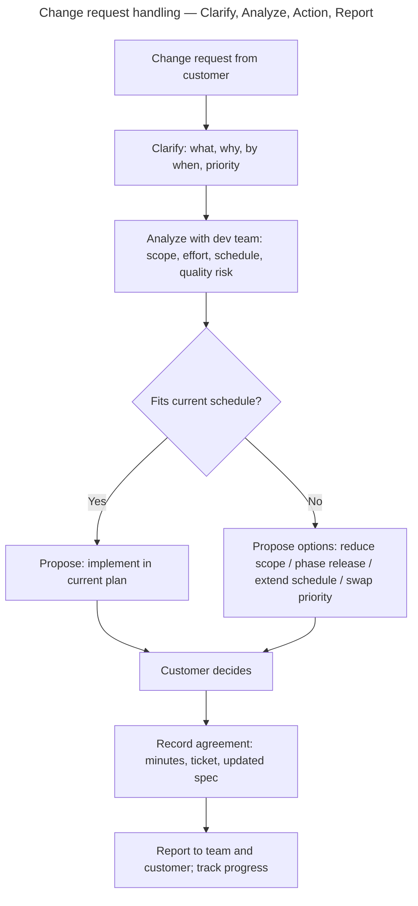

# 第09.01課 — 仕様変更への対応 | Xử lý yêu cầu thay đổi đặc tả

> **BRSE Interview Master · 第09章 顧客対応・問題解決**  
> **Đối tượng:** Ứng viên BrSE, tiếng Nhật N3–N2  
> **Trạng thái:** draft — bài mẫu (pilot "BrSE Problem Solving") theo master prompt; chờ rà soát tiếng Nhật và góp ý của BrSE có kinh nghiệm · **Cập nhật:** 2026-10-26  
> **Căn cứ:** Master prompt R1.3 (khung Problem Solving, Chapter 09) · 文化審議会「敬語の指針」 — xem mục 出典  
> **Bài liên quan:** [12.05 — デバイス制御](../chapter-12/12-05-device-control.md) (tình huống khách báo lỗi, cùng khung Clarify → Analyze → Action → Report)

> ⚠️ **Ranh giới dữ kiện:** Quy trình xử lý thay đổi trong bài là **cách làm phổ biến được đề xuất để trả lời phỏng vấn** (`needs-verification` — chưa đối chiếu quy trình chuẩn của một công ty cụ thể). Bài không chứa kinh nghiệm cá nhân; câu "bạn đã từng gặp chưa" dùng **mẫu điền**.
>
> Số bài 09.01 là tạm thời — Chapter 09 chưa có danh sách bài chính thức.

## 学習目標 — Mục tiêu

Sau bài này, người học có thể:

- Trả lời 「急な仕様変更にどう対応しますか」 trong 30 giây theo **Clarify → Analyze → Action → Report**.
- Giải thích vai trò cầu nối của BrSE: **không nhận ngay, không từ chối ngay**.
- Đưa ra **phương án thay thế** thay vì chỉ nói 「できません」.
- Dùng đúng cách nói lịch sự với khách: 確認いたします, 〜であれば可能です, và hiểu khi nào 〜させていただきます là phù hợp.

## ① 面接質問 — Câu hỏi phỏng vấn

| Câu hỏi | Dịch |
|---|---|
| **Câu chính:** お客様から急に仕様変更を依頼されたら、どう対応しますか。 | Nếu khách hàng đột ngột yêu cầu thay đổi đặc tả, bạn xử lý thế nào? |
| Biến thể: 開発の途中で要件が変わったら、どうしますか。 | Nếu yêu cầu thay đổi giữa chừng khi đang phát triển thì sao? |
| Biến thể: 納期は変えずに機能を追加してほしいと言われたら？ | Nếu được yêu cầu thêm chức năng mà không đổi hạn giao? |

## ② 質問の意図 — Ý định người phỏng vấn

BrSE đứng giữa **khách hàng Nhật** và **đội phát triển** (thường ở Việt Nam). Thay đổi đặc tả là tình huống xảy ra thường xuyên và dễ gây xung đột. Người phỏng vấn kiểm tra:

| Họ kiểm tra | Câu trả lời yếu thường… |
|---|---|
| Bạn có **nhận lời ngay** để làm vừa lòng khách không | 「すぐに対応します」 — chưa biết ảnh hưởng đã hứa |
| Bạn có **từ chối thẳng** không | 「納期があるのでできません」 — khách mất niềm tin |
| Bạn có biết **phân tích ảnh hưởng cùng đội dev** không | Tự ước lượng một mình |
| Bạn có **đưa phương án** cho khách chọn không | Chỉ đưa một hướng |
| Bạn có **ghi lại thỏa thuận** không | Thỏa thuận miệng, sau này tranh cãi |

## ③ 技術知識 — Kiến thức nền

### 3.1 Thay đổi đặc tả ảnh hưởng tới đâu?

Một thay đổi nhỏ trên màn hình có thể kéo theo nhiều thứ. Trước khi trả lời khách, cần biết ảnh hưởng tới:

| Mặt | Câu hỏi cần trả lời | Từ tiếng Nhật |
|---|---|---|
| Phạm vi | Phải sửa màn hình, API, DB, tài liệu nào? | 影響範囲 |
| Công sức | Mất bao nhiêu công (người × ngày)? | 工数 |
| Lịch | Có kịp hạn giao không? Ảnh hưởng việc khác không? | スケジュール・納期 |
| Chất lượng | Phải test lại những gì? Rủi ro hỏng chức năng cũ? | 品質・再テスト |
| Chi phí | Có phát sinh chi phí (theo hợp đồng) không? | 費用 |

BrSE **không tự quyết** các con số này — phải hỏi đội phát triển (và PM khi liên quan lịch/chi phí).

### 3.2 Luồng xử lý



*Hình: luồng xử lý yêu cầu thay đổi đề xuất cho phỏng vấn — Not project-specific; chưa đối chiếu quy trình của một công ty cụ thể.*

**① 図の説明:**

1. **Clarify** — hỏi rõ: thay đổi gì, **vì sao** (lý do nghiệp vụ giúp tìm phương án khác), cần khi nào, ưu tiên so với việc đang làm.
2. **Analyze** — cùng đội dev xác định phạm vi, công sức, ảnh hưởng lịch và chất lượng. **Chưa hứa gì với khách ở bước này.**
3. **Action** — đưa phương án. Nếu không kịp, đưa **nhiều lựa chọn**: giảm phạm vi, chia giai đoạn phát hành, lùi lịch, đổi thứ tự ưu tiên. **Khách là người quyết định.**
4. **Report** — ghi thỏa thuận thành văn bản (biên bản họp, ticket, đặc tả cập nhật), thông báo cho đội, theo dõi tiến độ.

**② 日本語で説明してみよう:** dùng câu trả lời Standard ở mục ⑥.

**⑤ 応用質問:** 「お客様が『すぐに答えがほしい』と言ったら、どうしますか。」  
*Gợi ý:* Không đoán con số. Hẹn thời điểm trả lời cụ thể: 「影響を確認して、本日の〇時までにご回答いたします。」 — nói **khi nào** sẽ trả lời, thay vì trả lời ngay.

### 3.3 Vì sao "hỏi lý do" lại quan trọng?

Khách thường nói **giải pháp** (「このボタンを追加してほしい」) thay vì **vấn đề** (「担当者が毎回同じ操作を繰り返していて大変」). Khi hiểu vấn đề, BrSE có thể đề xuất cách rẻ hơn hoặc nhanh hơn vẫn giải quyết được. Đây là giá trị của BrSE so với người chỉ dịch.

## ④ 思考プロセス — Khung tư duy

Khung **Problem Solving** của master prompt (mục 6.2):

```text
Clarify (確認する) → Analyze (分析する) → Action (提案・対応する) → Report (報告・記録する)
```

Ba nguyên tắc đi kèm:

- **Không hứa trước khi phân tích** — 「確認してから回答します」.
- **Không chỉ nói "không"** — luôn kèm 「〜であれば可能です」.
- **Khách quyết định, BrSE cung cấp thông tin để quyết định.**

## ⑤ 面接対話 — Hội thoại phỏng vấn

**面接官：** お客様から急に仕様変更を依頼されたら、どう対応しますか。  
**応募者：** まず、変更の内容と理由、希望の時期をお客様に確認します。次に、開発チームと影響範囲や工数を確認します。そのうえで、スケジュールへの影響と対応案をお客様にご提示し、合意した内容を記録に残します。

*ベトナム語訳:* Trước tiên, tôi xác nhận với khách nội dung thay đổi, lý do và thời điểm mong muốn. Tiếp theo, tôi cùng đội phát triển xác nhận phạm vi ảnh hưởng và công sức. Sau đó, tôi trình bày cho khách ảnh hưởng tới lịch và các phương án, rồi ghi lại nội dung đã thống nhất.

**面接官：** その場で「できます」と答えることはありますか。  
**応募者：** いいえ、その場では判断しません。影響を確認しないまま答えると、品質や納期に問題が出る可能性があるからです。いつまでに回答できるかをお伝えします。

*ベトナム語訳:* Không, tôi không quyết định ngay tại chỗ. Vì nếu trả lời khi chưa xác nhận ảnh hưởng, có thể phát sinh vấn đề về chất lượng hoặc hạn giao. Tôi sẽ báo cho khách khi nào có thể trả lời.

## ⑥ 模範回答 — Câu trả lời mẫu

### Standard (~25 giây)

Dùng câu trả lời đầu tiên ở mục ⑤. **Khung ghi nhớ:** 確認 → チームと分析 → 案を提示 → 記録.

### Professional (~30 giây)

**応募者：** まず、変更の内容だけでなく、背景にある課題もお客様に確認します。その後、開発チームと影響範囲、工数、品質へのリスクを洗い出します。納期に影響がある場合は、範囲の調整や段階的なリリースなど、複数の案をご提示して、お客様にご判断いただきます。決まった内容は議事録とチケットに残し、チームに共有します。

*Dịch:* Trước tiên, tôi xác nhận với khách không chỉ nội dung thay đổi mà cả vấn đề nằm phía sau. Sau đó, cùng đội phát triển rà soát phạm vi ảnh hưởng, công sức và rủi ro chất lượng. Nếu ảnh hưởng tới hạn giao, tôi đưa ra nhiều phương án như điều chỉnh phạm vi hay phát hành theo giai đoạn để khách quyết định. Nội dung đã quyết được ghi vào biên bản họp và ticket, rồi chia sẻ với đội.

> Bản Professional thêm **背景にある課題** (hỏi vấn đề phía sau), **複数の案** và **お客様にご判断いただきます** (khách quyết định) — ba điểm cho thấy tư duy BrSE.

## ⑦ 深掘り質問 — Câu hỏi đào sâu

**Q1 — Hạn giao không đổi được**  
**面接官：** 納期は変えられないと言われたら、どうしますか。  
**応募者：** 納期を守るために、今回のリリースに入れる機能の優先順位をお客様と相談します。例えば、必要な部分だけ先にリリースして、残りは次の段階で対応する案をご提示します。

*Dịch:* Để giữ hạn giao, tôi bàn với khách về thứ tự ưu tiên các chức năng đưa vào lần phát hành này. Ví dụ, đề xuất phát hành trước phần cần thiết, phần còn lại xử lý ở giai đoạn sau.

**Q2 — Đội dev phản đối**  
**面接官：** 開発チームが「難しい」と言ったら、どうしますか。  
**応募者：** まず、何が難しいのか、理由を具体的に聞きます。技術的な問題なのか、時間の問題なのかを整理して、代わりの方法がないか一緒に考えます。それでも難しい場合は、PMに相談します。

*Dịch:* Trước tiên tôi hỏi cụ thể khó ở đâu, vì sao. Phân loại là vấn đề kỹ thuật hay vấn đề thời gian, rồi cùng suy nghĩ xem có cách khác không. Nếu vẫn khó thì tôi trao đổi với PM.

**Q3 — Ghi lại thỏa thuận**  
**面接官：** 合意した内容は、どのように残しますか。  
**応募者：** 議事録やチケットに、変更内容、影響、決まったスケジュールを書いて、お客様にも確認していただきます。口頭だけで終わらせないようにしています。

*Dịch:* Tôi ghi nội dung thay đổi, ảnh hưởng và lịch đã quyết vào biên bản họp hoặc ticket, và nhờ khách xác nhận. Tôi cố gắng không để chỉ dừng ở thỏa thuận miệng.

> 「〜ようにしています」 diễn tả **thói quen/nguyên tắc** của bản thân — chỉ dùng nếu đúng là bạn làm vậy; nếu chưa có kinh nghiệm, đổi thành 「〜ようにしたいと考えています」.

**Q4 — Kinh nghiệm thật**  
**面接官：** 実際に、仕様変更に対応した経験はありますか。  
**応募者 (khung — điền theo sự thật, Role → Action → Result)：** はい。【プロジェクト】で、【どんな変更】がありました。私は【自分の役割】として、【行ったこと】をしました。その結果、【確認できた結果】。

**Nếu chưa có kinh nghiệm:** 「BrSEとしての経験はまだありませんが、開発者として【似た場面】で【したこと】があります。」 — **không bịa** một tình huống BrSE.

## ⑧ 語彙・文法 — Từ vựng và ngữ pháp

| 日本語 | 読み方 | Nghĩa | Ví dụ |
|---|---|---|---|
| 仕様変更 | しようへんこう | Thay đổi đặc tả | 仕様変更の依頼がありました |
| 依頼する | いらいする | Yêu cầu, nhờ | お客様から依頼されました |
| 背景 | はいけい | Bối cảnh, lý do phía sau | 変更の背景を確認します |
| 影響範囲 | えいきょうはんい | Phạm vi ảnh hưởng | 影響範囲を洗い出します |
| 工数 | こうすう | Công sức (người × thời gian) | 工数を見積もります |
| 見積もる | みつもる | Ước tính | 開発チームと見積もります |
| 洗い出す | あらいだす | Rà soát, liệt kê hết | リスクを洗い出します |
| 納期 | のうき | Hạn giao | 納期に影響があります |
| 優先順位 | ゆうせんじゅんい | Thứ tự ưu tiên | 優先順位を相談します |
| 段階的な | だんかいてきな | Theo giai đoạn | 段階的にリリースします |
| 提示する | ていじする | Trình bày, đưa ra | 対応案をご提示します |
| 合意する | ごういする | Thống nhất | 合意した内容を残します |
| 議事録 | ぎじろく | Biên bản họp | 議事録に記録します |
| 判断する | はんだんする | Phán đoán, quyết định | お客様にご判断いただきます |

**Mẫu câu:**

- **まず〜。次に〜。そのうえで〜。** — Trước tiên … Tiếp theo … Trên cơ sở đó …
- **〜だけでなく、〜も確認します** — Xác nhận không chỉ … mà cả …
- **〜であれば、可能です** — Nếu …, thì có thể làm được
- **〜までにご回答いたします** — Sẽ trả lời trước …
- **お客様にご判断いただきます** — Nhờ khách hàng quyết định

## ⑨ 類似表現比較 — So sánh cách diễn đạt

**Khi không làm được như yêu cầu:**

| Biểu đạt | Sắc thái | Khi nào dùng |
|---|---|---|
| できません | Phủ định thẳng, đóng cuộc trao đổi | Tránh dùng một mình với khách |
| 難しいです | Mềm hơn, nhưng vẫn chưa cho hướng đi | Chỉ dùng khi **kèm** phương án |
| 〜であれば可能です | Đưa điều kiện để làm được | **Nên dùng** — mở ra lựa chọn |
| 〜という案はいかがでしょうか | Đề xuất lịch sự | Khi đưa phương án thay thế |

**確認します / 確認いたします / 確認させていただきます:**

| Biểu đạt | Sắc thái | Ghi chú |
|---|---|---|
| 確認します | Lịch sự (丁寧語) | Đủ trong phỏng vấn |
| 確認いたします | Khiêm nhường, trang trọng hơn | Tự nhiên khi nói với khách hàng |
| 確認させていただきます | Theo 「敬語の指針」, 〜させていただく về cơ bản dùng khi **được bên kia cho phép** và **được hưởng ân huệ** | Hợp khi thực sự xin phép khách (ví dụ: 「内容を確認させていただけますか」); dùng cho mọi câu thì nghe thừa |

**伝えます vs お伝えします:** お伝えします (khiêm nhường) dùng khi hành động hướng tới khách: 「回答の時期をお伝えします」.

## ⑩ 会話練習 — Luyện phản xạ

1. **30 giây, không nhìn mẫu:** 「お客様から急に仕様変更を依頼されたら、どう対応しますか。」 — phải có đủ 4 bước.
2. **Hỏi sâu (10–25 giây mỗi câu):** その場で「できます」と言いますか → 納期は変えられないと言われたら → 開発チームが反対したら → 合意はどう残しますか.
3. **Đổi điều kiện:**
   1. 「変更内容は小さく、半日でできそうです。それでも同じ手順を踏みますか。」  
      *Gợi ý:* Vẫn xác nhận với đội (ước lượng "nửa ngày" có thể sai) và vẫn ghi lại — nhưng có thể làm nhanh, gọn hơn. Nêu được **tỷ lệ với mức độ**.
   2. 「お客様が、追加費用は払えないと言っています。」  
      *Gợi ý:* Không tự quyết về chi phí; đưa phương án trong phạm vi hiện tại (đổi ưu tiên, giảm phạm vi) và báo PM.
4. **Roleplay BrSE (3 phút):** Một người đóng khách hàng Nhật đang vội: 「来週のリリースに、この機能も入れてください。」 Bạn xử lý theo luồng ở 3.2, kết thúc bằng câu hẹn thời điểm trả lời.
5. **図を見ずに説明:** Không nhìn sơ đồ 3.2, nói 4 bước và 4 loại phương án khi không kịp lịch.

**AI Mock Interview Prompt:**

> あなたは日本企業のBrSE採用面接官です。「お客様から急に仕様変更を依頼されたら、どう対応しますか」と聞き、回答を待ってください。応募者の代わりに答えないでください。回答に沿って、納期を変えられない場合、開発チームが反対した場合、合意の残し方について一問ずつ深掘りしてください。その後、あなたが急いでいる顧客役になり、短いロールプレイを一つ行ってください。最後に、関連性・内容の妥当性・日本語の自然さと敬語・明確さ・深掘りへの対応を各4点で評価し、良い点、最大三つの改善点、改善した回答例を示してください。

## ⑪ 評価・改善 — Đánh giá

Chấm theo [thang đánh giá chung](../../../docs/ASSESSMENT_RUBRIC.md) (mỗi tiêu chí 0–4, tổng 20; không phải thang chính thức):

| Tiêu chí | Đạt 4 điểm khi (áp vào bài này) |
|---|---|
| Answer Relevance | Câu đầu nói hành động đầu tiên (確認), không bàn chung chung về tầm quan trọng của giao tiếp |
| Technical Accuracy | *Ở bài này: tính hợp lý của cách xử lý* — phân tích cùng đội dev, không tự hứa, khách quyết định |
| Japanese Naturalness | Kính ngữ đúng với khách (ご提示します, お伝えします, いたします), không lạm dụng させていただく |
| Communication Clarity | Theo Clarify → Analyze → Action → Report, có từ nối まず/次に/そのうえで |
| Follow-up Handling | Đưa được phương án khi hạn giao cố định; xử lý được khi đội dev phản đối |

**Điểm chấm riêng của bài:**

- 「すぐに対応します」 trước khi phân tích → Answer Relevance và Follow-up Handling tối đa 1.
- Chỉ nói 「できません」 không kèm phương án → Follow-up Handling tối đa 1.
- BrSE tự quyết lịch/chi phí không qua đội dev hoặc PM → trừ Technical Accuracy.
- Bịa một tình huống kinh nghiệm cụ thể khi không có → Follow-up Handling = 0.
- Không nhắc ghi lại thỏa thuận → trừ Communication Clarity.

**Feedback:** điểm mạnh → tối đa 3 lỗi → câu sửa → vì sao tốt hơn → thử lại.

## 出典・確認状況 — Nguồn và trạng thái

| Nhận định | Nguồn | Trạng thái |
|---|---|---|
| Khung Problem Solving: Clarify → Analyze → Action → Report; nội dung Chapter 09 (feasibility, escalation, scope change, risk) | Master prompt R1.3, mục 4 (Chapter 09) và 6.2 — [BOOK_SPECIFICATION.txt](../../../sources/technical-reference/BOOK_SPECIFICATION.txt) | `verified` (đúng với đặc tả sách; không phải chuẩn ngành) |
| 「(お・ご)……(さ)せていただく」 về cơ bản dùng khi được cho phép và được hưởng ân huệ; mức chấp nhận khác nhau tùy người | 文化審議会答申「敬語の指針」(2007), [PDF](https://www.bunka.go.jp/seisaku/bunkashingikai/kokugo/hokoku/pdf/keigo_tosin.pdf), tr. 43–44 bản PDF; truy cập 2026-10-26 | `verified` |
| Các mặt ảnh hưởng (phạm vi, công sức, lịch, chất lượng, chi phí); bốn loại phương án; ghi thỏa thuận bằng văn bản; hỏi "vì sao" để tìm vấn đề gốc | Thực hành phổ biến trong quản lý thay đổi, chưa đối chiếu tài liệu chuẩn hoặc quy trình công ty cụ thể | `needs-verification` |
| Sắc thái できません / 難しいです / 〜であれば可能です; 確認します / 確認いたします | Mô tả thường gặp | `needs-verification` (cần reviewer bản ngữ) |
| Kinh nghiệm xử lý thay đổi của người học | Chưa có | `needs-verification` — dùng mẫu điền |

## Ghi chú biên tập

- Nên nhờ một BrSE đang làm việc đọc lại mục ③ và ⑦ để chuyển trạng thái `needs-verification` sang có căn cứ.
- Có thể bổ sung nguồn chuẩn về change control (ví dụ tài liệu quản lý dự án) khi có quyền truy cập.
- Bài liên quan sẽ có ở Chapter 08 (要件定義・仕様確認) và Chapter 10 (報連相) khi biên soạn.
