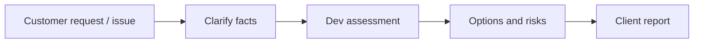

# 第09.02課 — 仕様変更・認識相違 — Thay đổi và bất đồng

> **BRSE Interview Master — Draft / Pending Japanese Review.** Trình độ N3–N2, mục tiêu trả lời chính 15–30 giây. Các câu về cá nhân là **mẫu**; chỉ dùng sau khi điền dữ kiện thật. Không có chứng nhận người Nhật đã duyệt.

## ① 学習目標 — Mục tiêu

Sau bài học, người học nhận biết ý định câu hỏi, trả lời đúng trọng tâm bằng 2–4 câu tiếng Nhật, phân biệt dữ kiện và giả định, phản hồi một câu hỏi đào sâu và sửa câu chưa tự nhiên.

## ② 面接質問・質問の意図

**面接官：** お客様と開発チームの意見が違う場合、どうしますか。

**Người phỏng vấn đang kiểm tra:** BrSE làm rõ cả mục tiêu khách hàng và giới hạn kỹ thuật, không chỉ dịch từ ngữ.

## ③ 知識・思考プロセス — Kiến thức và cách suy nghĩ

Không tự quyết cam kết release khi thiếu quyền/đánh giá.

Cách trả lời: **kết luận → lý do / hành động → bằng chứng / giới hạn**. Với kinh nghiệm cá nhân, chỉ sử dụng sự thật trong CV/commit/test. Với tình huống giả định, dùng các cách nói 〜の場合は / 〜と考えています, tránh giả vờ từng làm.

## ④ 図解 — Sơ đồ tư duy

**日本語で説明（mẫu nói sơ đồ）：** まず質問の目的を確認します。次に、結論を短く伝えます。必要なら理由や具体例を加え、確認できていない点は分けて説明します。

**Dịch:** Xác định mục đích câu hỏi; nêu kết luận ngắn; bổ sung lý do/ví dụ nếu cần và tách riêng thông tin chưa được xác minh. Sơ đồ là công cụ học, không phải architecture thực tế trừ khi nội dung nói rõ.

## ⑤ 面接対話 — Hội thoại hỏi đáp

**面接官：** お客様と開発チームの意見が違う場合、どうしますか。

**応募者（Standard）：** まず、双方の目的と制約を確認します。次に、影響範囲と選択肢を整理し、合意できる対応を相談します。

**ベトナム語訳:** Không tự quyết cam kết release khi thiếu quyền/đánh giá.

**面接官（深掘り）：** お客様が予定どおりのリリースを希望する場合は。

**応募者：** 優先度と対応可能な範囲を調べ、延期や段階的な対応も含めて相談します。

**ベトナム語訳（ý nghĩa）：** Trả lời trực tiếp câu hỏi bổ sung; xác minh đúng bằng chứng trước khi sử dụng câu mẫu như kinh nghiệm cá nhân.

**Professional version:** Giữ cùng ý nhưng điều chỉnh lịch sự và độ chính xác. Không tự động dùng 敬語 phức tạp; không sửa sự thật để tạo ấn tượng.

## ⑥ 類似表現比較 — Cách nói dễ nhầm

- **確認しました** = đã kiểm tra; **検証しました** = đã kiểm chứng bằng phép thử/phương pháp.
- **担当しました** = đã phụ trách; **参加しました** = đã tham gia, không tự đồng nghĩa.
- **〜ができます** = có thể thực hiện theo điều kiện; **本番で運用しています** = đang vận hành production và cần minh chứng.
- **〜を確認した上で回答します** = sẽ trả lời sau khi xác nhận, phù hợp khi chưa đủ dữ liệu.

## ⑦ 語彙・文法 — Từ vựng

| 日本語 | 読み方 | Nghĩa |
|---|---|---|
| 実現可能性 | じつげんかのうせい | Tính khả thi |
| 工数 | こうすう | Khối lượng công sức |
| 影響範囲 | えいきょうはんい | Phạm vi ảnh hưởng |
| 代替案 | だいたいあん | Phương án thay |
| 重大度 | じゅうだいど | Mức độ nghiêm trọng |
| 納期 | のうき | Hạn giao hàng |

Mẫu hữu ích: **まず〜を確認します。次に〜を整理します。その上で〜を説明します。** / **現時点では〜を確認できていません。**

## ⑧ 会話練習 — Luyện phản xạ

1. Trả lời câu chính trong khoảng 20 giây mà không nhìn mẫu.
2. Trả lời câu đào sâu trong khoảng 15 giây.
3. Tự đổi bối cảnh: ứng viên khác, dự án khác hoặc thay đổi yêu cầu; không dùng câu mẫu như sự kiện thật.
4. AI interviewer: 「あなたは日本企業のBrSE面接官です。このテーマについて一問ずつ質問して、私の答えを待ってください。内容に沿って一つだけ深掘りし、最後に簡潔な改善点を教えてください。」

## ⑨ 解答ポイント — Điểm tự kiểm tra

- Nói kết luận trước và không kéo dài câu chính.
- Biết phân biệt vấn đề có thể giải thích ngay với thông tin cần xác minh.
- Với Smart Farm: backend và PostgreSQL chủ yếu local, luồng ESP32/Wokwi–AWS–backend có bằng chứng chạy thử theo mô tả; chưa xác nhận production hoặc bơm/van thật.
- Không thêm thành tích cá nhân, thời gian, số liệu không có căn cứ.

## ⑩ 評価・改善 — Rubric /20

Tự chấm 0–4 cho mỗi tiêu chí: **đúng trọng tâm**, **độ chính xác / tính trung thực**, **tiếng Nhật tự nhiên**, **cấu trúc logic**, **đối đáp câu hỏi đào sâu**. Điểm 16–20: tốt; 12–15: cần chỉnh; dưới 12: luyện lại. Không phải chuẩn chính thức. Với văn bản, không đánh giá phát âm.

**Cách sửa:** ghi câu trả lời → xác định ba lỗi lớn nhất → rút gọn thành 2–4 câu Nhật → thực hành lại không nhìn mẫu.

## 出典とステータス

Bài được biên soạn từ khung BRSE Interview Master và thông tin dự án do người dùng cung cấp. Các tình huống chung là ví dụ sư phạm; chưa qua native Japanese reviewer hoặc kiểm định Mermaid render. Trước khi duyệt, bổ sung bản dịch Việt sát nghĩa theo từng câu, đối chiếu CV và luyện nói có bấm giờ.
