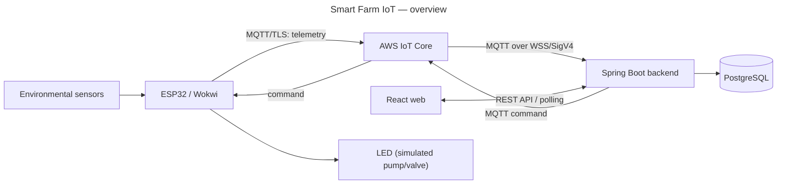

# 第12.01課 — プロジェクト概要 | Giới thiệu dự án Smart Farm IoT

> **BRSE Interview Master · 第12章 技術デモ・プレゼンテーション**  
> **Đối tượng:** Ứng viên BrSE, tiếng Nhật N3–N2  
> **Trạng thái:** draft — chờ rà soát tiếng Nhật và đối chiếu minh chứng kỹ thuật · **Cập nhật:** 2026-10-26  
> **Căn cứ:** [smart-farm-overview.md](../../../sources/project-evidence/smart-farm-overview.md), tổng hợp tại [Project Knowledge Base](../../../knowledge-base/case-studies/smart-farm-iot.md). Không phải kết quả audit mã nguồn hay xác nhận từ reviewer Nhật.  
> **Bài liên quan:** [12.02 — システム構成](12-02-system-architecture.md) · [12.03 — 使用技術](12-03-technology-choices.md)

## 学習目標 — Mục tiêu

Sau bài này, người học có thể:

- Trả lời **どのようなプロジェクトですか** trong khoảng 30 giây.
- Giới thiệu dự án trong khoảng 60 giây theo **mục đích → chức năng → công nghệ → tình trạng hiện tại**.
- Nêu rõ sự khác biệt giữa **đã phát triển**, **đã chạy thử** và **đã vận hành thực tế**.
- Phân biệt chức năng chung của hệ thống với **công việc cá nhân** (chưa được cung cấp).
- Trả lời ngắn và nhất quán khi bị hỏi sâu.

## ① 面接質問 — Câu hỏi phỏng vấn

| Câu hỏi | Dịch |
|---|---|
| **Câu chính:** どのようなプロジェクトですか。 | Đây là dự án như thế nào? |
| Biến thể (bản dài): プロジェクトの概要と使用技術について教えてください。 | Hãy cho biết tổng quan dự án và công nghệ sử dụng. |
| Biến thể: 最近取り組んだプロジェクトについて説明してください。 | Hãy giới thiệu dự án bạn làm gần đây. |

## ② 質問の意図 — Ý định người phỏng vấn

Đây thường là câu mở đầu phần kỹ thuật. Người phỏng vấn **không** cần nghe hết chi tiết. Họ muốn biết:

| Họ kiểm tra | Câu trả lời yếu thường… |
|---|---|
| Bạn có nắm **bản chất** dự án không (làm gì, cho ai) | Liệt kê công nghệ ngay từ câu đầu, không nói hệ thống để làm gì |
| Bạn có **tóm tắt** được không — kỹ năng cốt lõi của BrSE | Nói quá 1 phút, người nghe không còn nhớ ý chính |
| Bạn có **trung thực** về mức hoàn thiện không | Nói như thể hệ thống đang chạy thật ngoài nông trại |
| Câu trả lời có mở ra **chỗ để hỏi sâu** không | Nói hết mọi thứ, không để lại "móc" cho câu tiếp theo |

Các câu hỏi tiếp theo thường gặp và khung trả lời:

| Câu hỏi | Khung trả lời |
|---|---|
| なぜこの技術を使いましたか | Choice → Reason → Limitation (xem [12.03](12-03-technology-choices.md)) |
| 何を担当しましたか | Role → Action → Verified Result |
| 本番運用していますか | Current Status → Evidence → Limitation |
| 問題が起きたらどうしますか | Clarify → Investigate → Report/Options |

## ③ 技術知識 — Kiến thức nền

### 3.1 Thông tin dự án

| Mục | Nội dung theo mô tả dự án |
|---|---|
| Tên | Smart Farm IoT Management System |
| Mục đích | Giám sát môi trường vườn, quản lý thiết bị theo khu vực, hỗ trợ điều khiển và quy trình tưới |
| Thiết bị | ESP32, C/C++, Arduino Framework, PlatformIO |
| Mô phỏng | Wokwi, cảm biến và actuator mô phỏng |
| Kết nối | AWS IoT Core, MQTT, TLS, X.509 |
| Backend | Java 21, Spring Boot, Spring JDBC; modular monolith |
| Frontend | React, TypeScript, Vite, Tailwind CSS |
| CSDL | PostgreSQL 16, Flyway |
| Kiểm thử | JUnit, Spring Boot Test, PostgreSQL integration tests, Playwright |
| Trạng thái hiện tại | Backend và PostgreSQL chủ yếu ở local; luồng ESP32/Wokwi–AWS–backend có bằng chứng chạy thử theo mô tả; các chức năng nâng cao vẫn cần nghiệm thu |
| Chưa có | Triển khai production, số liệu hiệu năng, vận hành bơm/van nông nghiệp thật |
| Đóng góp cá nhân | **Chưa được cung cấp** |

> **Nguyên tắc:** 「開発しました」 (đã phát triển) không đồng nghĩa 「本番環境で運用しています」 (đang vận hành production). Không tự thêm số người dùng, hiệu quả tiết kiệm nước, uptime, sản lượng hay trách nhiệm cá nhân.

### 3.2 Toàn cảnh trong một sơ đồ



*Hình: các thành phần và hướng dữ liệu theo mô tả dự án. Mức hoàn thiện: As Implemented theo mô tả; chỉ luồng ESP32/Wokwi → AWS → backend được ghi là đã chạy thử. Không phải bằng chứng nghiệm thu từng mũi tên.*

**① 図の説明:** Đọc từ trái sang phải. ESP32 lấy dữ liệu cảm biến và gửi qua AWS IoT Core; Spring Boot xử lý và lưu PostgreSQL; React xem dữ liệu và gửi yêu cầu điều khiển qua API. Chiều điều khiển đi ngược lại: backend → AWS → thiết bị → LED thay cho bơm/van.

**② 日本語で説明してみよう:** dùng chính câu trả lời Standard ở mục ⑥ — nó được viết theo thứ tự của sơ đồ.

**⑤ 応用質問:** 「もしWokwiではなく実機を使うとしたら、この図のどこが変わりますか。」  
*Hướng trả lời:* Phần "ESP32 / Wokwi" và "LED" đổi thành thiết bị và bơm/van thật; luồng giao tiếp giữ nguyên. Cần thêm kiểm tra an toàn trên thiết bị thật — đây là nhận định (`hypothetical`), chưa phải việc đã làm.

### 3.3 Thuật ngữ cần hiểu trước khi nói

Người phỏng vấn thường hỏi lại ngay từ thuật ngữ bạn vừa nói. Chỉ đưa vào câu trả lời những từ bạn giải thích được trong một câu.

| Thuật ngữ | Giải thích ngắn | Câu giải thích tiếng Nhật |
|---|---|---|
| **IoT** | Thiết bị vật lý (cảm biến, bộ điều khiển) kết nối mạng để gửi dữ liệu và nhận lệnh | モノをネットワークにつなぎ、データの送信や制御を行う仕組みです。 |
| **ESP32** | Vi điều khiển có Wi-Fi; trong dự án chạy firmware C/C++ để đọc cảm biến và xử lý lệnh | Wi-Fi付きのマイコンで、センサーの読み取りとコマンド処理を行います。 |
| **Wokwi** | Trình mô phỏng mạch điện tử; chạy firmware với cảm biến/actuator ảo | 実機がなくても、回路とセンサーをシミュレーションできるツールです。 |
| **MQTT** | Giao thức nhắn tin publish/subscribe rất nhẹ, chuẩn OASIS dành cho IoT. Thiết bị **publish** bản tin lên một *topic*; bên nào **subscribe** topic đó sẽ nhận | IoT向けの軽量なPublish/Subscribe型の通信プロトコルです。 |
| **AWS IoT Core** | Dịch vụ AWS làm *message broker* — trung gian nhận và chuyển bản tin MQTT giữa thiết bị và backend | デバイスとバックエンドの間でMQTTメッセージを中継するAWSのサービスです。 |
| **TLS / X.509** | TLS mã hóa đường truyền; chứng chỉ X.509 trên thiết bị giúp AWS IoT Core xác thực "đúng là thiết bị này" | TLSで通信を暗号化し、X.509証明書でデバイスを認証します。 |
| **Telemetry** | Dữ liệu đo thiết bị gửi định kỳ (nhiệt độ, độ ẩm…) | デバイスから定期的に送られる測定データです。 |
| **ACK** | Bản tin phản hồi thiết bị gửi lại sau khi nhận lệnh. ACK nghĩa là "đã nhận" hay "đã thực hiện" do ứng dụng định nghĩa; dự án **chưa nêu rõ** (`needs-verification`). Không nhầm với PUBACK của MQTT (xem 12.02) | コマンドに対してデバイスが返す応答です。何を意味するかは、アプリの設計で決めます。 |
| **REST API / polling** | Web gọi API HTTP của backend; *polling* là gọi lặp lại định kỳ để lấy dữ liệu mới | 画面が定期的にAPIを呼び出して、最新データを取得する方式です。 |
| **Modular monolith** | Một ứng dụng triển khai duy nhất, nhưng code chia module theo nghiệp vụ; module không truy cập phần nội bộ của nhau | 一つのアプリの中で、機能ごとにモジュールを分ける構成です。 |

## ④ 思考プロセス — Khung tư duy

```text
目的 (Mục đích) → 主な機能 (Chức năng chính) → 使用技術 (Công nghệ) → 現在の状況 (Tình trạng)
```

1. **目的** — hệ thống giải quyết việc gì, một câu.
2. **主な機能** — tối đa 2–3 chức năng; đừng kể hết.
3. **使用技術** — nói theo luồng dữ liệu (thiết bị → cloud → backend → web), không đọc danh sách.
4. **現在の状況** — luôn kết thúc bằng mức hoàn thiện thật. Câu này vừa trung thực vừa mở đường cho câu hỏi tiếp.

**Vai trò cá nhân** (自分の担当範囲) chỉ thêm khi được hỏi, và chỉ nói điều có chứng cứ.

## ⑤ 面接対話 — Hội thoại phỏng vấn

**面接官：** どのようなプロジェクトですか。  
**応募者：** Smart Farm IoT Management Systemという農園管理システムを開発しています。ESP32で環境データを取得し、AWS IoT Coreを通じてバックエンドに送信します。Web画面では、データの確認やデバイスの制御要求ができます。現在は主にローカル環境とシミュレーションで検証しています。

*ベトナム語訳:* Tôi đang phát triển hệ thống quản lý vườn Smart Farm IoT Management System. ESP32 lấy dữ liệu môi trường và gửi tới backend qua AWS IoT Core. Trên giao diện web có thể xem dữ liệu và gửi yêu cầu điều khiển thiết bị. Hiện hệ thống chủ yếu được kiểm thử ở môi trường local và mô phỏng.

**面接官：** このシステムは本番環境で動いていますか。  
**応募者：** いいえ、本番環境にはまだデプロイしていません。現在は主にローカル環境で開発・検証しています。ESP32やWokwiからAWSを通じてバックエンドにデータを送るテストは行いました。

*ベトナム語訳:* Chưa, hệ thống chưa được triển khai lên production. Hiện chủ yếu phát triển và kiểm thử ở môi trường local. Tôi đã kiểm thử luồng gửi dữ liệu ESP32/Wokwi → AWS → backend.

> **Lưu ý trung thực:** 「開発しています」「テストは行いました」 ngầm nói bạn là người làm. Vai trò cá nhân **chưa được xác nhận** trong nguồn. Nếu bạn chỉ làm một phần, dùng chủ ngữ là hệ thống/nhóm: 「〜という農園管理システムで、私は【担当部分】を担当しています」.

## ⑥ 模範回答 — Câu trả lời mẫu

### Standard (~30 giây)

Dùng câu trả lời ở mục ⑤.

**Khung ghi nhớ:** 何を作る → データ取得 → Webで何ができる → 現在の状況.

### Professional (~45–60 giây — dùng khi được hỏi bản dài)

**面接官：** プロジェクトの概要と使用技術について教えてください。

**応募者：** Smart Farm IoT Management Systemは、農園の環境監視と灌漑管理を支援するシステムです。ESP32で温度や湿度などのセンサーデータを取得し、MQTTを使ってAWS IoT Coreへ送信します。バックエンドはJavaとSpring Bootで構築し、データの検証や履歴保存、アラート判定、制御コマンドの管理を行います。データベースにはPostgreSQL、管理画面にはReactを使用しています。現在、ESP32やWokwiからAWSを経由してバックエンドへデータを送る流れは試験済みです。ただし、本番環境にはまだデプロイしておらず、実際の農業用ポンプやバルブでの動作確認も行っていません。

*Dịch:* Smart Farm là hệ thống hỗ trợ giám sát môi trường và quản lý tưới. ESP32 lấy dữ liệu như nhiệt độ, độ ẩm và truyền bằng MQTT lên AWS IoT Core. Backend Java/Spring Boot xác thực dữ liệu, lưu lịch sử, đánh giá cảnh báo và quản lý lệnh. Hệ thống dùng PostgreSQL và React. Luồng từ ESP32/Wokwi qua AWS đến backend đã được chạy thử. Tuy nhiên, hệ thống chưa được triển khai lên production và cũng chưa kiểm tra hoạt động với bơm/van nông nghiệp thật.

> Bản Professional chỉ tăng độ rõ và độ chuyên nghiệp, **không nâng trạng thái dự án**. Thời gian nói phụ thuộc tốc độ — hãy bấm giờ thực tế.
>
> **Vì sao không dùng 「本番運用は…まだ確認できていません」?** Câu đó dễ hiểu thành "có thể đang chạy production nhưng chưa kiểm tra được". Nguồn nói rõ **chưa triển khai**, nên dùng 「デプロイしていない」「動作確認を行っていない」.

## ⑦ 深掘り質問 — Câu hỏi đào sâu

**Q1 — 目的**  
**面接官：** このシステムの主な目的は何ですか。  
**応募者：** 農園の環境を見える化し、デバイスや灌漑の管理をしやすくすることです。センサーデータの履歴やアラートも確認できるようにしています。

*Dịch:* Mục đích là trực quan hóa môi trường vườn và giúp quản lý thiết bị/tưới thuận tiện hơn; có thể xem lịch sử cảm biến và cảnh báo.

**Q2 — 主な機能**  
**面接官：** 代表的な機能を三つ教えてください。  
**応募者：** センサーデータの監視、エリアごとのデバイス管理、灌漑の制御です。また、履歴やアラートの確認もできます。

*Dịch:* Ba nhóm chức năng tiêu biểu là giám sát cảm biến, quản lý thiết bị theo khu vực và điều khiển tưới; ngoài ra còn xem được lịch sử và cảnh báo.

**Q3 — 本番環境に出すとしたら**  
**面接官：** 本番環境に出すとしたら、何が必要だと思いますか。  
**Hướng trả lời (`hypothetical`, không phải kế hoạch đã có):** nêu 2–3 ý ngắn, ví dụ 「サーバーとデータベースをクラウドに移すこと」「証明書や秘密情報の管理」「監視と障害時の対応」. Mở đầu bằng 「まだ検討段階ですが、」 để không biến ý tưởng thành việc đã làm.

**Q4 — 担当範囲 (không bịa kinh nghiệm)**  
**面接官：** あなたはどの部分を担当しましたか。  
**応募者 — mẫu điền theo sự thật:** 私は主に【実際に担当した機能】を担当しました。具体的には、【自分が実施した作業】を行いました。現在は【確認済みの成果や課題】です。

*Dịch:* Tôi chủ yếu phụ trách [hạng mục thực tế]. Cụ thể tôi đã [công việc bản thân đã làm]. Hiện [kết quả hoặc vấn đề đã xác nhận].

> **Không học thuộc placeholder như câu trả lời hoàn chỉnh.** Điền từ lịch sử công việc, commit, issue hoặc nhật ký dự án. Không nói 「全部一人で開発しました」 nếu chưa xác minh.

**Q5 — Kết quả điều khiển**  
**面接官：** コマンドの送信に成功したら、ポンプも動いたと言えますか。  
**応募者：** いいえ。送信の成功とデバイスの動作は別です。ACKやデバイスから報告された状態を確認します。なお、実際のポンプでの検証はまだ行っていません。

*Dịch:* Không. Gửi lệnh thành công và thiết bị hoạt động là hai việc khác nhau. Cần xem ACK và trạng thái thiết bị báo cáo. Ngoài ra, tôi chưa kiểm chứng với bơm thật. (Chi tiết: [12.02](12-02-system-architecture.md).)

**Q6 — 今後の課題**  
**面接官：** 今後、どのような点を改善したいですか。  
**応募者：** まず、まだ十分に検証できていない機能をテストしたいです。その後、実機での動作や運用上の課題を確認し、安全性と信頼性を高めたいと考えています。

*Dịch:* Trước hết muốn kiểm thử thêm các chức năng chưa được xác minh đầy đủ; sau đó kiểm tra trên thiết bị thật và các vấn đề vận hành để nâng tính an toàn, độ tin cậy. **Đây là định hướng, không phải việc đã hoàn thành.**

> Câu 「主にどのような技術を使っていますか」 được luyện riêng ở [12.03 — 使用技術](12-03-technology-choices.md).

## ⑧ 語彙・文法 — Từ vựng và ngữ pháp

| 日本語 | 読み方 | Nghĩa | Ví dụ |
|---|---|---|---|
| 農園管理 | のうえんかんり | Quản lý vườn/nông trại | 農園管理システム |
| 環境監視 | かんきょうかんし | Giám sát môi trường | 環境監視を行います |
| 灌漑 | かんがい | Tưới tiêu | 灌漑を管理します |
| 見える化 | みえるか | Trực quan hóa | 環境データを見える化します |
| 測定 | そくてい | Đo đạc | 温度を測定します |
| センサーデータ | センサーデータ | Dữ liệu cảm biến | センサーデータを送信します |
| 開発 | かいはつ | Phát triển | システムを開発しています |
| 検証 | けんしょう | Kiểm chứng | 動作を検証します |
| シミュレーション | シミュレーション | Mô phỏng | シミュレーションで検証します |
| 模擬環境 | もぎかんきょう | Môi trường mô phỏng (văn viết hơn) | 模擬環境で試します |
| 実機 | じっき | Thiết bị thật | 実機で確認します |
| 本番環境 | ほんばんかんきょう | Môi trường production | 本番環境ではありません |
| デプロイ | デプロイ | Triển khai (deploy) | 本番環境にデプロイします |
| 通信 | つうしん | Truyền thông | MQTTで通信します |
| 制御 | せいぎょ | Điều khiển | デバイスを制御します |
| 履歴 | りれき | Lịch sử | 履歴を保存します |
| アラート | アラート | Cảnh báo (cách nói thường dùng trong IT) | アラートを判定します |
| 担当 | たんとう | Phụ trách | API連携を担当しました |
| 課題 | かだい | Vấn đề cần giải quyết | 今後の課題です |

**Mẫu câu:**

- **〜というシステムです** — Đây là hệ thống tên là…
- **〜を使って〜します** — Sử dụng … để …
- **〜を通じて / 〜を経由して** — Thông qua …
- **〜ことができます** — Có thể làm …
- **〜を目的としています** — Có mục đích …
- **まだ〜ていません** — Chưa …
- **〜だけでは〜とは言えません** — Chỉ … thì chưa thể kết luận …

## ⑨ 類似表現比較 — So sánh cách diễn đạt

| Câu | Ý nghĩa | Khi nên dùng |
|---|---|---|
| 開発しています | Đang phát triển | Nói về trạng thái đang xây dựng |
| 開発しました | Đã phát triển | Có phần việc thực sự hoàn thành |
| 動作を確認しました | Đã kiểm tra hoạt động | Khi có bằng chứng test cho trường hợp cụ thể |
| 動作を検証しています | Đang kiểm chứng hoạt động | Khi còn kiểm thử |
| 本番運用しています | Đang vận hành production | Chỉ nói khi có chứng cứ triển khai/vận hành thật |
| まだデプロイしていません | Chưa triển khai | Sự thật: hệ thống chưa được đưa lên môi trường đó |
| まだ確認できていません | Chưa xác nhận được | Đã/đang có nhưng chưa kiểm tra được kết quả — **không** dùng cho việc chưa hề làm |

**アラート vs 警告:** Khi mô tả hệ thống IT, 「アラート」 là từ tự nhiên cho cảnh báo do hệ thống phát ra theo điều kiện (ví dụ độ ẩm vượt ngưỡng). 「警告」 nghe mạnh hơn, hay dùng cho thông điệp cảnh báo nguy hiểm hoặc lỗi (警告メッセージ). Bài này dùng thống nhất **アラート**.

**「できるようにしています」:** diễn đạt được một chức năng đã xây dựng, nhưng đừng dùng để khẳng định chức năng đã nghiệm thu hoặc chạy ổn định trên thiết bị thật.

## ⑩ 会話練習 — Luyện phản xạ

1. **10 giây:** Chỉ trả lời 「このシステムは何をするものですか。」
2. **30 giây, không nhìn mẫu:** 「どのようなプロジェクトですか。」 — dùng bốn ý: mục tiêu / ESP32 / AWS & backend / trạng thái kiểm thử.
3. **60 giây:** Bản dài — thêm Java/Spring Boot, PostgreSQL, React và một giới hạn thực tế.
4. **Đổi điều kiện:** 面接官：「農場で実際に使っていますか。」 — trả lời trung thực trong hai câu; không né câu hỏi, không nói đã vận hành ngoài thực địa.
5. **Vai trò cá nhân:** Điền ba thông tin trước khi nói: chức năng mình phụ trách, hành động cụ thể, minh chứng kết quả. Nếu chưa xác định, nói rằng cần xác nhận phạm vi thay vì nhận toàn bộ công lao.
6. **図を見ずに説明:** Không nhìn sơ đồ 3.2, giải thích chiều dữ liệu và chiều điều khiển.

**AI Mock Interview Prompt:**

> あなたは日本企業のBrSE面接官です。Smart Farm IoT Management Systemについて一問ずつ質問し、毎回回答を待ってください。質問はプロジェクト概要、使用技術、本人の担当範囲、開発状況、実機検証の順に進めてください。回答が曖昧なら、関連する深掘り質問を一つだけしてください。未確認の実績を事実として扱わないでください。最後に、関連性・技術的正確さ・日本語の自然さ・明確さ・深掘りへの対応を各4点で評価し、良い点、最大三つの改善点、改善した回答例を示してください。

## ⑪ 評価・改善 — Đánh giá

Chấm theo [thang đánh giá chung](../../../docs/ASSESSMENT_RUBRIC.md) (mỗi tiêu chí 0–4, tổng 20; không phải thang chính thức):

| Tiêu chí | Đạt 4 điểm khi (áp vào bài này) |
|---|---|
| Answer Relevance | Câu đầu nói hệ thống để làm gì, không mở đầu bằng danh sách công nghệ |
| Technical Accuracy | Đúng mục đích, công nghệ, luồng tổng quát; không nâng mức hoàn thiện |
| Japanese Naturalness | Câu đúng, tự nhiên, dùng đúng デプロイしていない / 確認できていない |
| Communication Clarity | Theo khung 目的 → 機能 → 技術 → 状況; 30 giây cho bản ngắn |
| Follow-up Handling | Trả lời được câu production và câu vai trò mà không né, không bịa |

**Điểm chấm riêng của bài:**

- Nói 「本番で運用しています」 hoặc 「農場で使われています」 → Technical Accuracy = 0.
- Nói 「全部一人で開発しました」 khi chưa có chứng cứ → Follow-up Handling tối đa 1.
- Coi 「送信成功」 là bơm đã chạy → trừ Technical Accuracy.
- Kể quá 5 tên công nghệ trong bản 30 giây → trừ Communication Clarity.

**Tự kiểm tra cuối bài:**

- [ ] Giải thích được dự án trong 30 giây mà không đọc bài.
- [ ] Nói được bốn công nghệ chính và đúng vai trò.
- [ ] Trả lời đúng câu "có chạy production chưa?".
- [ ] Không lẫn gửi lệnh thành công với thiết bị thật đã chạy.
- [ ] Không nhận phần việc cá nhân chưa có chứng cứ.

**Feedback:** điểm mạnh → tối đa 3 lỗi → câu sửa → vì sao tốt hơn → thử lại.

## 出典・確認状況 — Nguồn và trạng thái

| Nhận định | Nguồn | Trạng thái |
|---|---|---|
| Mục đích, công nghệ, chức năng, trạng thái local/chưa production của dự án | [smart-farm-overview.md](../../../sources/project-evidence/smart-farm-overview.md) | `author-experience—unverified` |
| Đã phát triển: quản lý thiết bị/khu vực, giám sát, cảnh báo, tưới, theo dõi phiên tưới; đã chạy thử luồng ESP32/Wokwi–AWS–backend | Như trên | `author-experience—unverified` |
| Vai trò cá nhân, thời gian, quy mô nhóm, tên API/topic, kết quả test từng chức năng | Chưa có | `needs-verification` |
| MQTT là giao thức publish/subscribe nhẹ, chuẩn OASIS cho IoT | [mqtt.org](https://mqtt.org/), truy cập 2026-10-26 | `verified` |
| AWS IoT Core trung gian bản tin MQTT; thiết bị xác thực bằng X.509 qua TLS | [AWS — Device communication protocols](https://docs.aws.amazon.com/iot/latest/developerguide/protocols.html); [AWS — X.509 client certificates](https://docs.aws.amazon.com/iot/latest/developerguide/x509-client-certs.html), truy cập 2026-10-26 | `verified` |
| Modular monolith: module logic trong một ứng dụng Spring Boot | [Spring Modulith — Fundamentals](https://docs.spring.io/spring-modulith/reference/fundamentals.html), truy cập 2026-10-26 (khái niệm; dự án không được xác nhận dùng Spring Modulith) | `verified` |
| Ý nghĩa ACK cấp ứng dụng của dự án | Chưa có | `needs-verification` |
| Hướng trả lời Q3 (đưa lên production cần gì), câu 応用質問 về thiết bị thật | Lập luận luyện tập | `hypothetical` |

## Ghi chú biên tập

- Khi có CV/commit/issue chứng minh vai trò cá nhân, cập nhật mục ⑤ và Q4 theo đúng bằng chứng.
- Toàn bộ câu tiếng Nhật chưa được reviewer bản ngữ kiểm tra.
- **Bài kế tiếp:** [12.02 — システム構成](12-02-system-architecture.md) → [12.03 — 使用技術](12-03-technology-choices.md). Bài 12.04–12.10 chưa biên soạn.
