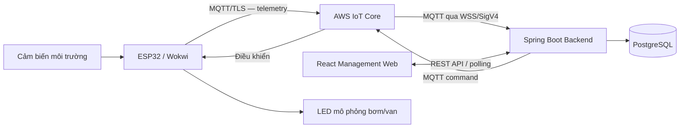

# 第12.01課 — プロジェクト概要 | Giới thiệu dự án Smart Farm IoT

> **BRSE Interview Master · 第12章 技術デモ・プレゼンテーション**  
> **Đối tượng:** Ứng viên BrSE, tiếng Nhật N3–N2  
> **Trạng thái:** Draft — chờ rà soát tiếng Nhật và đối chiếu minh chứng kỹ thuật  
> **Nguồn:** Mô tả Smart Farm IoT Management System do người dùng cung cấp. Không phải kết quả audit mã nguồn hay xác nhận từ reviewer Nhật.  
> **Bài liên quan:** [12.02 — システム構成](12-02-system-architecture.md)

## ① 学習目標 — Mục tiêu

Kết thúc bài học, người học có thể:

- Trả lời **どのようなプロジェクトですか** trong khoảng 30 giây.
- Giới thiệu dự án trong khoảng 60 giây theo **mục đích → tính năng → công nghệ → tình trạng hiện tại**.
- Nêu rõ sự khác biệt giữa **đã phát triển**, **đã chạy thử** và **đã xác minh vận hành thực tế**.
- Phân biệt chức năng chung của hệ thống với **công việc cá nhân** chưa được cung cấp.
- Trả lời ngắn và nhất quán khi người phỏng vấn hỏi sâu.

## ② プロジェクトの基本情報 — Thông tin dự án

| Mục | Nội dung theo mô tả dự án |
|---|---|
| Tên | Smart Farm IoT Management System |
| Mục đích | Giám sát môi trường vườn, quản lý thiết bị theo khu vực và hỗ trợ điều khiển/quy trình tưới |
| Thiết bị | ESP32, C/C++, Arduino Framework, PlatformIO |
| Mô phỏng | Wokwi, cảm biến và actuator mô phỏng |
| Kết nối | AWS IoT Core, MQTT, TLS, X.509 |
| Backend | Java 21, Spring Boot, Spring JDBC; modular monolith |
| Frontend | React, TypeScript, Vite, Tailwind CSS |
| CSDL | PostgreSQL 16, Flyway |
| Kiểm thử | JUnit, Spring Boot Test, PostgreSQL integration tests, Playwright |
| Trạng thái hiện tại | Backend và PostgreSQL chủ yếu ở local; luồng ESP32/Wokwi–AWS–backend có bằng chứng chạy thử theo mô tả; các chức năng nâng cao vẫn cần nghiệm thu |
| Chưa xác nhận | Production deployment, hiệu năng định lượng và vận hành bơm/van nông nghiệp thực tế |
| Đóng góp cá nhân | **Chưa cung cấp đủ** để xác định chính xác từng hạng mục tự thực hiện |

> **Nguyên tắc diễn đạt:** 「開発しました」 (đã phát triển) không đồng nghĩa 「本番環境で運用しています」 (đang vận hành production). Không tự thêm số lượng người dùng, hiệu quả tiết kiệm nước, uptime, sản lượng hay trách nhiệm cá nhân.

## ③ 全体像 — Hình dung dự án trong một sơ đồ

**Giải thích ngắn:** ESP32 lấy dữ liệu cảm biến rồi gửi qua AWS IoT Core; Spring Boot xử lý và lưu PostgreSQL. React cho phép xem thông tin và gửi yêu cầu điều khiển qua API. Đây là **kiến trúc được mô tả**, không phải kết quả nghiệm thu mọi luồng.

**Mẹo nhìn sơ đồ:** Thiết bị → Cloud → Backend → Database/Web; điều khiển đi chiều ngược lại qua Backend → AWS → thiết bị.

## ④ 面接対話 — Giới thiệu dự án bằng tiếng Nhật

### A. Bản 30 giây — Standard (N3–N2)

**面接官：** どのようなプロジェクトですか。

**応募者：**

Smart Farm IoT Management Systemという農園管理システムを開発しています。ESP32で環境データを取得し、AWS IoT Coreを通じてバックエンドに送信します。Web画面では、データの確認やデバイスの制御要求ができます。現在は主にローカル環境とシミュレーションで検証しています。

**Dịch:** Tôi đang phát triển hệ thống quản lý vườn Smart Farm IoT Management System. ESP32 lấy dữ liệu môi trường và gửi tới backend qua AWS IoT Core. Trên giao diện web có thể xem dữ liệu và gửi yêu cầu điều khiển thiết bị. Hiện hệ thống chủ yếu được kiểm thử trong môi trường local và mô phỏng.

**Khung ghi nhớ:** 何を作る → データ取得 → Webで何ができる → 現在の状況.

### B. Bản 60 giây — Professional

**面接官：** プロジェクトの概要と使用技術について教えてください。

**応募者：**

Smart Farm IoT Management Systemは、農園の環境監視と灌漑管理を支援するシステムです。ESP32で温度や湿度などのセンサーデータを取得し、MQTTを使ってAWS IoT Coreへ送信します。バックエンドはJavaとSpring Bootで構築し、データの検証や履歴保存、アラート判定、制御コマンドの管理を行います。データベースにはPostgreSQL、管理画面にはReactを使用しています。現在、ESP32やWokwiからAWSを経由してバックエンドへデータを送る流れは試験していますが、本番運用や実際の農業用ポンプ・バルブの動作は、まだ確認できていません。

**Dịch:** Smart Farm là hệ thống hỗ trợ giám sát môi trường và quản lý tưới. ESP32 lấy dữ liệu như nhiệt độ, độ ẩm và truyền bằng MQTT lên AWS IoT Core. Backend Java/Spring Boot xác thực dữ liệu, lưu lịch sử, đánh giá cảnh báo và quản lý lệnh. Hệ thống dùng PostgreSQL và React. Luồng từ ESP32/Wokwi qua AWS đến backend đã được chạy thử, nhưng chưa xác nhận vận hành production hay điều khiển bơm/van nông nghiệp thật.

**Lưu ý:** Thời gian nói phụ thuộc tốc độ; hãy bấm giờ thực tế và rút gọn khi cần. Bản Professional chỉ tăng tính rõ ràng và mức chuyên nghiệp, **không nâng trạng thái dự án**.

### C. Đối đáp đào sâu (mỗi câu trả lời mục tiêu 15–30 giây)

**Q1 — 目的**

**面接官：** このシステムの主な目的は何ですか。  
**応募者：** 農園の環境を見える化し、デバイスや灌漑の管理をしやすくすることです。センサーデータの履歴やアラートも確認できるようにしています。

*Dịch:* Mục đích là trực quan hóa môi trường vườn và giúp quản lý thiết bị/tưới thuận tiện hơn; có lịch sử cảm biến và cảnh báo.

**Q2 — 主な機能**

**面接官：** 代表的な機能を三つ教えてください。  
**応募者：** センサーデータの監視、エリアごとのデバイス管理、灌漑の制御です。また、履歴やアラートの確認もできます。

*Dịch:* Ba nhóm chức năng tiêu biểu là giám sát cảm biến, quản lý thiết bị theo khu vực và điều khiển tưới; ngoài ra còn có lịch sử và cảnh báo.

**Q3 — 技術**

**面接官：** 主にどのような技術を使っていますか。  
**応募者：** デバイスはESP32、通信はMQTTとAWS IoT Coreを使っています。バックエンドはSpring Boot、データベースはPostgreSQL、Web画面はReactです。

*Dịch:* Thiết bị là ESP32, giao tiếp bằng MQTT/AWS IoT Core; backend Spring Boot, database PostgreSQL, frontend React.

**Q4 — 現在の開発状況**

**面接官：** このシステムは本番環境で動いていますか。  
**応募者：** いいえ、現在は主にローカル環境で開発・検証しています。ESP32やWokwiからAWSを通じてバックエンドにデータを送るテストは行っていますが、本番運用はまだ確認できていません。

*Dịch:* Chưa. Dự án chủ yếu phát triển và thử nghiệm local. Đã thử luồng ESP32/Wokwi → AWS → backend, nhưng chưa xác nhận production.

**Q5 — 担当範囲 (tránh bịa kinh nghiệm)**

**面接官：** あなたはどの部分を担当しましたか。

**応募者 — Mẫu điền theo sự thật:** 私は主に【実際に担当した機能】を担当しました。具体的には、【自分が実施した作業】を行いました。現在は【確認済みの成果や課題】です。

*Dịch:* Tôi chủ yếu phụ trách [hạng mục thực tế]. Cụ thể tôi đã [công việc bản thân đã làm]. Hiện [kết quả hoặc vấn đề đã xác nhận].

> **Không học thuộc placeholder như câu trả lời hoàn chỉnh.** Cần điền từ lịch sử công việc, commit, issue hoặc nhật ký dự án. Không nói 「全部一人で開発しました」 nếu chưa xác minh.

**Q6 — Kết quả điều khiển**

**面接官：** コマンドの送信に成功したら、ポンプも動いたと言えますか。  
**応募者：** いいえ。送信の成功とデバイスの動作は別です。ACKやデバイスから報告された状態を確認します。実際のポンプの動作は、まだ検証できていません。

*Dịch:* Không. Gửi lệnh và thiết bị hoạt động là hai điều khác nhau. Cần xem ACK/trạng thái thiết bị báo cáo; vận hành bơm thật chưa được xác minh.

**Q7 — 将来の課題**

**面接官：** 今後、どのような点を改善したいですか。  
**応募者：** まず、まだ十分に検証できていない機能をテストしたいです。その後、実機での動作や運用上の課題を確認し、安全性と信頼性を高めたいと考えています。

*Dịch:* Trước tiên muốn kiểm thử thêm tính năng chưa được xác minh đầy đủ; sau đó kiểm tra thiết bị thật và vấn đề vận hành để nâng tính an toàn, độ tin cậy. **Đây là định hướng đề xuất, không phải cam kết hoặc công việc đã hoàn thành.**

---

## ⑤ 質問の意図と思考プロセス — Nhà tuyển dụng kiểm tra điều gì?

| Câu hỏi | Ý định nhà tuyển dụng | Khung trả lời |
|---|---|---|
| どのようなプロジェクトですか | Hiểu bản chất dự án, có diễn đạt gọn không | Purpose → Architecture → Function → Status |
| なぜこの技術を使いましたか | Hiểu vai trò, lý do và trade-off không | Choice → Reason → Limitation |
| 何を担当しましたか | Phân biệt đóng góp cá nhân và công việc của nhóm | Role → Action → Verified Result |
| 本番運用していますか | Mức độ trung thực và kiểm thử | Current Status → Evidence → Limitation |
| 問題が起きたらどうしますか | Tư duy xử lý như BrSE | Clarify → Investigate → Report/Options |

**Điểm 80/20:** Bắt đầu bằng ý chính, giải thích tối đa hai ý bổ sung. Dừng lại để nhà tuyển dụng hỏi sâu.

## ⑥ 語彙・文法 — Từ vựng và mẫu diễn đạt

| 日本語 | 読み方 | Nghĩa Việt | Ví dụ ngắn |
|---|---|---|---|
| 農園管理 | のうえんかんり | Quản lý vườn | 農園管理システム |
| 環境監視 | かんきょうかんし | Giám sát môi trường | 環境監視を行います |
| 灌漑 | かんがい | Tưới tiêu | 灌漑を管理します |
| 測定 | そくてい | Đo đạc | 温度を測定します |
| センサーデータ | センサーデータ | Dữ liệu cảm biến | データを送信します |
| 開発 | かいはつ | Phát triển | システムを開発しています |
| 検証 | けんしょう | Kiểm chứng | 動作を検証します |
| 模擬 | もぎ | Mô phỏng | 模擬環境で試します |
| 実機 | じっき | Thiết bị thật | 実機で確認します |
| 本番環境 | ほんばんかんきょう | Môi trường production | 本番環境ではありません |
| 通信 | つうしん | Truyền thông | MQTTで通信します |
| 制御 | せいぎょ | Điều khiển | デバイスを制御します |
| 履歴 | りれき | Lịch sử | 履歴を保存します |
| 警告 | けいこく | Cảnh báo | 警告を表示します |
| 担当 | たんとう | Phụ trách | API連携を担当しました |
| 課題 | かだい | Vấn đề cần giải quyết | 今後の課題です |

### Cấu trúc dùng được ngay

- **〜というシステムです**: Đây là hệ thống tên là…
- **〜を使って〜します**: Sử dụng … để …
- **〜を通じて / 〜を経由して**: Thông qua …
- **〜ことができます**: Có thể làm …
- **〜を目的としています**: Có mục đích …
- **まだ〜ていません**: Chưa …
- **〜だけでは〜とは言えません**: Chỉ … thì chưa thể kết luận …

### 類似表現比較 — Phân biệt cách nói

| Câu | Ý nghĩa | Khi nên dùng |
|---|---|---|
| 開発しています | Đang phát triển | Nói về trạng thái xây dựng |
| 開発しました | Đã phát triển | Có phần việc thực sự hoàn thành |
| 動作を確認しました | Đã kiểm tra hoạt động | Khi có bằng chứng test cho trường hợp cụ thể |
| 動作を検証しています | Đang kiểm chứng hoạt động | Khi còn kiểm thử |
| 本番運用しています | Đang vận hành production | Chỉ nói khi có chứng cứ triển khai/vận hành thật |

**Lưu ý:** 「できるようにしています」 có thể diễn đạt một chức năng được xây dựng, nhưng đừng dùng để khẳng định chức năng đã nghiệm thu hoặc chạy ổn định trên thiết bị thực tế.

## ⑦ シャドーイング・反射練習 — Luyện nói ngắn

**Drill 1 — 10 giây:** Chỉ trả lời: このシステムは何をするものですか。

**Drill 2 — 30 giây:** Không nhìn câu mẫu, dùng bốn ý: mục tiêu / ESP32 / AWS & Backend / trạng thái kiểm thử.

**Drill 3 — 60 giây:** Thêm công nghệ Java/Spring Boot, PostgreSQL, React và một giới hạn thực tế.

**Drill 4 — Tình huống BrSE:**

面接官：「農場で実際に使っていますか。」

Yêu cầu trả lời trung thực trong hai câu tiếng Nhật; không né tránh câu hỏi, không nói đã vận hành ngoài thực địa.

**Drill 5 — Vai trò cá nhân:**

Điền ba thông tin trước khi nói: tên chức năng chính mình phụ trách, hành động cụ thể, minh chứng kết quả. Nếu chưa xác định, hãy trả lời rằng cần xác nhận phạm vi thực hiện thay vì nhận toàn bộ công lao.

### Prompt cho AI Interviewer

> あなたは日本企業のBrSE面接官です。Smart Farm IoT Management Systemについて一問ずつ質問し、毎回回答を待ってください。質問はプロジェクト概要、使用技術、本人の担当範囲、開発状況、実機検証の順に進めてください。回答が曖昧なら、関連する深掘り質問を一つだけしてください。未確認の実績を事実として扱わないでください。最後に短い改善案を示してください。

## ⑧ 評価・改善 — Rubric /20

Mỗi tiêu chí 0–4 điểm:

| Tiêu chí | Đạt 4 điểm khi |
|---|---|
| Đúng trọng tâm | Trả lời trực tiếp câu hỏi, không lan man |
| Chính xác kỹ thuật | Nêu đúng mục tiêu, công nghệ và luồng tổng quát |
| Tiếng Nhật | Câu đúng, tự nhiên, dễ hiểu |
| Rõ ràng | Có trình tự và chuyển ý dễ theo dõi |
| Đối đáp trung thực | Phân biệt điều đã làm, đã thử và chưa nghiệm thu |

**Gợi ý đánh giá nội bộ:** 16–20: tốt; 12–15: cần chỉnh; dưới 12: luyện lại. Đây không phải thang điểm tuyển dụng chính thức.

**Cách tự sửa:** (1) Ghi hoặc nói câu trả lời, (2) đánh dấu ba lỗi lớn nhất, (3) nói lại ngắn hơn, (4) trả lời thêm câu hỏi đào sâu. Nếu chỉ có transcript, không tự chấm phát âm.

## ⑨ 確認済み情報・未確認事項 — Ranh giới bằng chứng

**Thông tin theo mô tả người xây dựng:** hệ thống đã phát triển các chức năng quản lý thiết bị/khu vực, giám sát môi trường, cảnh báo, tưới và theo dõi phiên tưới; backend/PostgreSQL chủ yếu local; đã có bằng chứng chạy thử luồng ESP32/Wokwi–AWS–backend.

**Chưa thể kết luận:** toàn bộ tính năng đã nghiệm thu; sản phẩm đã chạy production; bơm/van nông nghiệp thật đã vận hành; có số liệu performance hoặc tác động kinh doanh.

**Chưa đủ dữ liệu để viết câu trả lời cá nhân hóa:** thời gian dự án, quy mô nhóm, chức năng người học trực tiếp đảm nhiệm, tỷ lệ đóng góp, tên API/topic thực tế và kết quả test từng tính năng. Khi có CV/commit/issue, cập nhật Bài 12.01 theo đúng bằng chứng.

## ⑩ 解答・最終チェック — Tự kiểm tra cuối bài

- [ ] Tôi giải thích được dự án trong 30 giây mà không đọc bài.
- [ ] Tôi nói được bốn công nghệ chính và đúng vai trò.
- [ ] Tôi trả lời đúng “có chạy production chưa?”.
- [ ] Tôi không lẫn gửi lệnh thành công với thiết bị thật đã chạy.
- [ ] Tôi không nhận phần việc cá nhân chưa có chứng cứ.
- [ ] Tôi có thể trả lời ít nhất ba câu hỏi đào sâu.

**Câu ghi nhớ cuối bài:**  
**目的 → 主な機能 → 使用技術 → 実装・検証状況 → 自分の担当範囲（事実のみ）**

**Bài kế tiếp:** [12.02 — システム構成](12-02-system-architecture.md), sau đó **12.05 — デバイス制御・ACK**.
