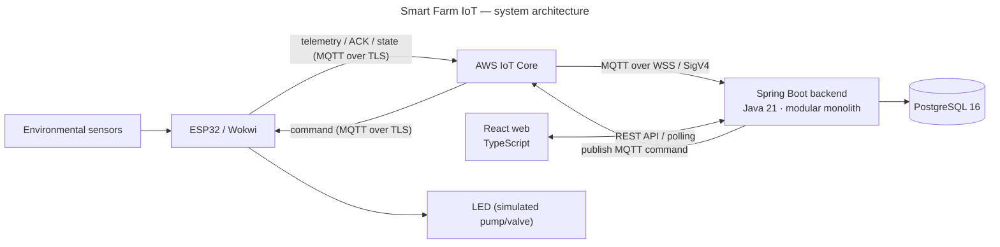
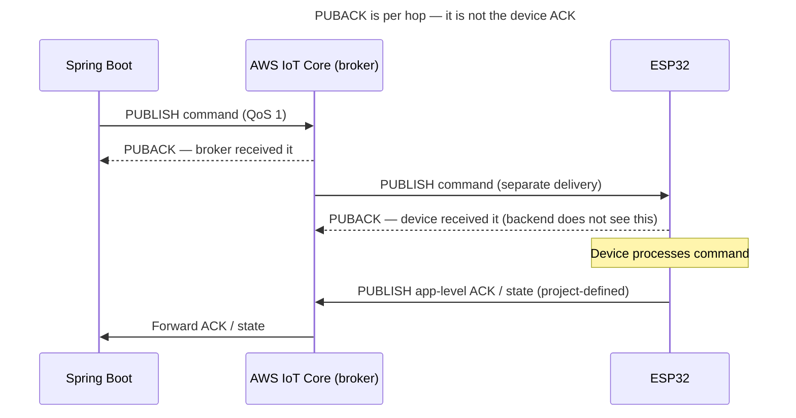
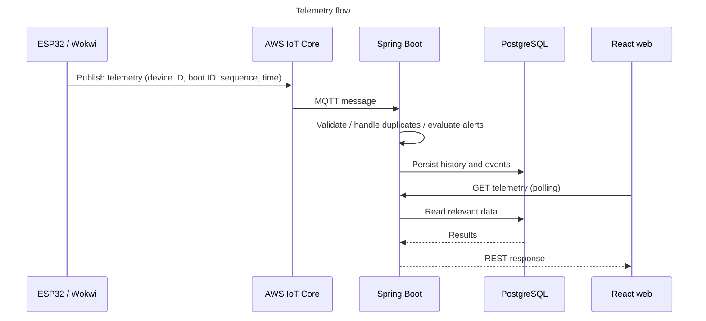
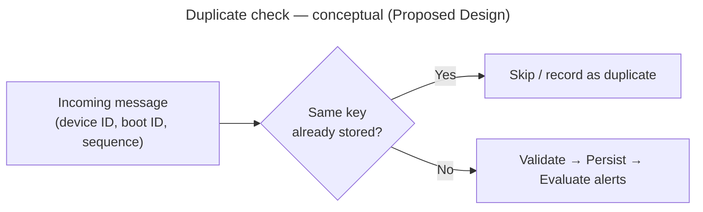
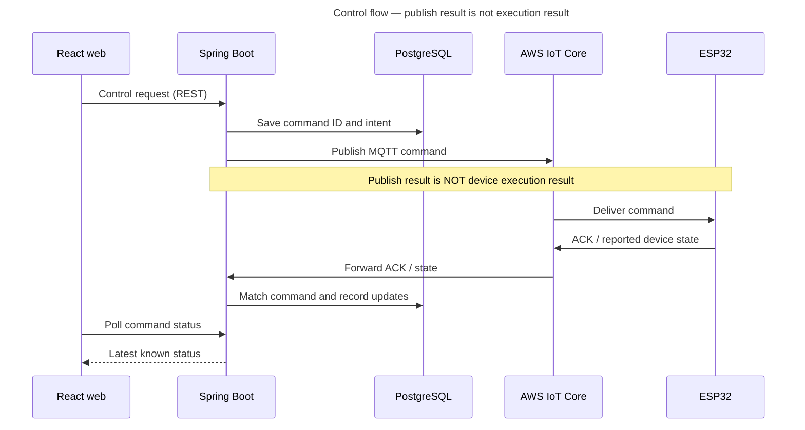

# 第12.02課 — システム構成 | Kiến trúc hệ thống Smart Farm IoT

> **BRSE Interview Master · 第12章 技術デモ・プレゼンテーション**  
> **Đối tượng:** Ứng viên BrSE, tiếng Nhật N3–N2  
> **Trạng thái:** draft — cần kiểm định tiếng Nhật và đối chiếu bằng chứng triển khai trước khi xuất bản · **Cập nhật:** 2026-10-26  
> **Căn cứ:** [smart-farm-overview.md](../../../sources/project-evidence/smart-farm-overview.md) và [Project Knowledge Base](../../../knowledge-base/case-studies/smart-farm-iot.md). Không phải biên bản kiểm toán mã nguồn hay kết quả nghiệm thu. Kiến thức kỹ thuật chung được đối chiếu tài liệu chính thức (mục 出典).  
> **Bài liên quan:** [12.01 — プロジェクト概要](12-01-project-overview.md) · [12.03 — 使用技術](12-03-technology-choices.md)

> **Phạm vi bài:** Bài này dạy **cấu trúc tổng thể** và các luồng chính. Lý do chọn từng công nghệ nằm ở 12.03. Xử lý telemetry (12.04) và điều khiển/ACK (12.05) sẽ đi sâu hơn khi được biên soạn; phần 3.4–3.5 dưới đây chỉ là mức đủ để trả lời khi bị hỏi về kiến trúc.

## 学習目標 — Mục tiêu

Sau bài này, người học có thể:

1. Giải thích kiến trúc tổng thể bằng tiếng Nhật trong khoảng 30 giây.
2. Nói vai trò của ESP32, AWS IoT Core, Spring Boot, PostgreSQL và React, mỗi thành phần một câu.
3. Phân biệt luồng **telemetry**, luồng **REST/polling** và luồng **lệnh/ACK**.
4. Phân biệt **PUBACK của MQTT**, **ACK của thiết bị** và **trạng thái thiết bị báo cáo**.
5. Trả lời câu hỏi đào sâu ngắn, chính xác và trung thực về mức hoàn thiện.

## ① 面接質問 — Câu hỏi phỏng vấn

| Câu hỏi | Dịch |
|---|---|
| **Câu chính:** このシステムの構成を説明してください。 | Hãy giải thích cấu trúc của hệ thống này. |
| Biến thể: システム全体のアーキテクチャを教えてください。 | Hãy cho biết kiến trúc tổng thể của hệ thống. |
| Biến thể (khi đưa sơ đồ): この図の流れを説明してください。 | Hãy giải thích luồng trong sơ đồ này. |

## ② 質問の意図 — Ý định người phỏng vấn

| Họ kiểm tra | Câu trả lời yếu thường… |
|---|---|
| Bạn có hiểu **các thành phần nối với nhau thế nào**, hay chỉ thuộc tên công nghệ | Liệt kê ESP32, AWS, Spring Boot… mà không nói dữ liệu đi đâu |
| Bạn có giải thích theo **một hướng nhất quán** được không — kỹ năng cần khi BrSE trình bày cho khách | Nhảy qua lại giữa frontend, thiết bị, database |
| Bạn có phân biệt **luồng dữ liệu đo** và **luồng điều khiển** không | Gộp làm một, nói "gửi lệnh xong là thiết bị chạy" |
| Bạn có biết **giới hạn** của kiến trúc (không real-time tuyệt đối, chưa production) không | Nói quá về độ tin cậy hoặc tốc độ |

## ③ 技術知識 — Kiến thức nền

### 3.1 Kiến trúc tổng thể

Smart Farm IoT Management System quản lý môi trường vườn và thiết bị tưới thông qua ESP32, AWS IoT Core và ứng dụng web. Backend tổ chức theo **modular monolith** trong **một** ứng dụng Spring Boot. Thiết bị giao tiếp qua MQTT bất đồng bộ; giao diện React truy cập backend qua REST API và polling.



*Hình: kiến trúc theo mô tả dự án. Mức hoàn thiện: As Implemented theo mô tả; chỉ luồng ESP32/Wokwi → AWS → backend được ghi là đã chạy thử. Không phải bằng chứng nghiệm thu từng mũi tên.*

**① 図の説明 — ba chiều cần đọc được:**

- **Chiều đo đạc:** cảm biến → ESP32/Wokwi → AWS IoT Core → Spring Boot → PostgreSQL.
- **Chiều hiển thị:** React gọi REST API định kỳ (polling); backend đọc dữ liệu từ PostgreSQL và trả về.
- **Chiều điều khiển:** React gửi yêu cầu → backend quản lý lệnh → publish qua AWS IoT Core → ESP32 → LED mô phỏng; ACK/trạng thái đi ngược về backend.

**② 日本語で説明してみよう:** dùng câu trả lời Standard ở mục ⑥ — viết theo đúng thứ tự sơ đồ.

> **Phạm vi thực tế:** Backend và PostgreSQL chủ yếu chạy local, có kết nối AWS IoT Core. Các chức năng nâng cao cần nghiệm thu thêm; chưa triển khai production, chưa điều khiển bơm/van nông nghiệp thật.

### 3.2 Vai trò từng thành phần

| Thành phần | Vai trò trong dự án | Điều cần biết thêm |
|---|---|---|
| **ESP32 / Wokwi** | Firmware C/C++ (Arduino Framework, PlatformIO) đọc cảm biến, gửi dữ liệu, xử lý lệnh, gửi ACK/trạng thái. Wokwi mô phỏng cảm biến, điều kiện môi trường, actuator; LED thay cho bơm/van | Mô phỏng ≠ thiết bị thật |
| **AWS IoT Core / MQTT** | Message broker: nhận và chuyển bản tin publish/subscribe giữa thiết bị và backend | Broker chỉ chuyển bản tin; **không** cho biết lệnh đã được thực hiện |
| **Spring Boot** | Java 21, Spring JDBC, modular monolith. Module: thiết bị, telemetry, cảnh báo, tự động hóa, điều khiển, báo cáo. Cung cấp REST API, xử lý bản tin MQTT, kiểm tra dữ liệu, lưu lịch sử, quản lý quy trình tưới | Modular monolith = **một** ứng dụng triển khai, code chia module theo nghiệp vụ |
| **PostgreSQL / Flyway** | Lưu dữ liệu cảm biến, cấu hình, lệnh, ACK, sự kiện, lịch sử phiên tưới. Flyway quản lý thay đổi schema bằng migration có phiên bản | Không suy đoán bảng, index, hiệu năng khi chưa xem mã nguồn |
| **React** | TypeScript, Vite, Tailwind CSS: dashboard, khu vực, cảm biến, cảnh báo, điều khiển. Lấy dữ liệu bằng REST API/polling | **Không** giao tiếp trực tiếp với thiết bị |

**Vì sao thiết bị và backend dùng hai cách xác thực khác nhau?** Theo tài liệu AWS, MQTT trực tiếp (MQTT over TLS) xác thực bằng **chứng chỉ X.509 của client**, còn **MQTT over WebSocket Secure (WSS)** xác thực bằng **AWS Signature Version 4 (SigV4)** — chữ ký tạo từ thông tin xác thực AWS (IAM). Vì vậy ESP32 mang chứng chỉ riêng, còn backend có thể kết nối bằng thông tin AWS. *Lý do dự án chọn cách này chưa được chủ dự án giải thích* (`needs-verification`).

### 3.3 QoS và PUBACK — bẫy hay gặp khi bị hỏi sâu

**QoS** (Quality of Service) là mức bảo đảm giao bản tin. MQTT định nghĩa QoS 0, 1, 2, nhưng **AWS IoT Core chỉ hỗ trợ QoS 0 và 1**. QoS 1 gửi *ít nhất một lần* cho tới khi nhận **PUBACK**; QoS 0 có thể giao 0 hoặc nhiều lần. Hệ quả: **bản tin có thể đến trùng**, nên ứng dụng phải tự xử lý trùng lặp (3.4). Dự án dùng QoS nào **chưa được cung cấp**.

Theo đặc tả MQTT, việc giao bản tin theo QoS chỉ tính **giữa một bên gửi và một bên nhận**; broker chuyển cho **từng client một cách độc lập**. Vì vậy khi backend publish lệnh với QoS 1, **PUBACK mà backend nhận được là của AWS IoT Core**, không phải của ESP32.



*Hình: PUBACK chỉ xác nhận từng chặng. Luồng ACK cấp ứng dụng theo nguồn dự án; QoS thực tế chưa được cung cấp nên hình minh họa trường hợp QoS 1.*

| Khái niệm dễ nhầm | Ý nghĩa | Không có nghĩa là |
|---|---|---|
| PUBACK mà backend nhận (MQTT QoS 1) | **Broker** đã nhận gói publish từ backend | ESP32 đã nhận hoặc đã thực hiện lệnh |
| ACK của ứng dụng (dự án) | Thiết bị gửi bản tin phản hồi theo định nghĩa của dự án. ACK nghĩa là "đã nhận" hay "đã thực hiện" thì dự án **chưa nêu rõ** (`needs-verification`) | Bơm/van vật lý chắc chắn đã chạy |

**② 日本語で説明してみよう（約20秒）：**  
「バックエンドが受け取るPUBACKは、ブローカーであるAWS IoT Coreからの応答です。デバイスがコマンドを受け取ったかどうかは分からないので、デバイスから返されるACKを別に確認しています。」

*Dịch:* PUBACK mà backend nhận được là phản hồi từ broker AWS IoT Core. Nó không cho biết thiết bị đã nhận lệnh hay chưa, nên hệ thống kiểm tra riêng ACK do thiết bị gửi về.

**⑤ 応用質問:** 「デバイスがオフラインのときにコマンドを送ったら、どうなりますか。」  
*Gợi ý:* Theo tài liệu AWS, với persistent session, broker có thể lưu bản tin QoS 1 và gửi khi thiết bị kết nối lại, nhưng có giới hạn và bản tin có thể bị bỏ. Dự án có dùng persistent session hay không **chưa được cung cấp**, nên trả lời ở mức nguyên tắc: 「設定によって異なるので、ACKが返るまでは未確認として扱います。」

### 3.4 Luồng telemetry: cảm biến → database → web



*Hình: luồng telemetry theo mô tả dự án (As Implemented theo mô tả).*

**① 図の説明:** Thiết bị publish bản tin có device ID, boot ID, sequence và thời gian đo. Backend kiểm tra dữ liệu, loại bản tin trùng, lưu lịch sử và đánh giá cảnh báo. Web không nhận dữ liệu trực tiếp mà gọi API định kỳ. **Không khẳng định exactly-once hay dữ liệu không thể mất** khi chưa kiểm chứng thiết kế, QoS và triển khai thực tế.

**Vì sao cần cả boot ID lẫn sequence? (giải thích khái niệm, `hypothetical` với dự án):** Sequence là số thứ tự tăng dần của bản tin. Khi ESP32 khởi động lại, bộ đếm có thể quay về 0 — nếu chỉ dùng sequence, bản tin mới có thể bị nhầm là bản tin cũ. Thêm *boot ID* (định danh mỗi lần khởi động) giúp phân biệt "sequence 5 của lần khởi động trước" với "sequence 5 của lần này". Quy tắc chính xác trong dự án cần đối chiếu mã nguồn.



*Hình: logic khái niệm của xử lý trùng lặp — Proposed Design, minh họa cách nghĩ, không phải sơ đồ mã nguồn.*

**② 日本語で説明してみよう（約15秒）：**  
「メッセージが届いたら、デバイスID、起動ID、連番の組み合わせで、すでに受信済みかどうかを確認します。重複していなければ、検証して保存します。」

*Dịch:* Khi bản tin đến, kiểm tra tổ hợp device ID, boot ID và sequence xem đã nhận chưa. Nếu không trùng thì kiểm tra dữ liệu rồi lưu.

### 3.5 Luồng điều khiển: gửi lệnh không đồng nghĩa thiết bị đã thực hiện

> Phần đi sâu (mã lệnh, bốn mức bằng chứng, timeout, gửi lại, tình huống BrSE) nằm ở [12.05 — デバイス制御](12-05-device-control.md).



*Hình: luồng lệnh theo mô tả dự án (As Implemented theo mô tả). Timeout và retry không được thể hiện vì chưa có dữ liệu.*

**① 図の説明:** Backend lưu mã lệnh và ý định **trước khi gửi**, sau đó đối chiếu riêng kết quả gửi, ACK và trạng thái thiết bị. Ba tầng cần phân biệt:

| Tầng | Có thể kết luận gì? | Không thể kết luận gì? |
|---|---|---|
| Publish result | Bước gửi/publish trả về kết quả | Thiết bị đã nhận hay thực hiện |
| Device ACK | Thiết bị đã phản hồi theo ý nghĩa ACK được định nghĩa | Trạng thái vật lý đúng |
| Reported device state | Thiết bị báo cáo trạng thái | Bơm/van thật đã được xác minh độc lập |

## ④ 思考プロセス — Khung tư duy

```text
目的 (1 câu) → 構成要素 (theo hướng dữ liệu) → 2つの流れ (đo đạc / điều khiển) → 現在の検証範囲
```

1. **Mục đích** — hệ thống để làm gì, một câu.
2. **Thành phần theo hướng dữ liệu** — đi một chiều: thiết bị → cloud → backend → database → web. Không nhảy qua lại.
3. **Hai luồng** — nói rõ dữ liệu đo đi lên, lệnh đi xuống. Câu hỏi đào sâu thường bám vào đây.
4. **Phạm vi kiểm chứng** — kết thúc bằng tình trạng thật.

Khi bị hỏi sâu về **một thành phần**: 役割 (vai trò) → つながり (nối với thành phần nào, bằng gì) → 制約 (giới hạn).

## ⑤ 面接対話 — Hội thoại phỏng vấn

**面接官：** このシステムの構成を説明してください。  
**応募者：** このシステムは、IoT機器とAWS、Webアプリを連携させた農園管理システムです。ESP32がセンサーデータをAWS IoT Coreに送信し、Spring Bootのバックエンドがデータを処理してPostgreSQLに保存します。Reactの画面から環境データを確認したり、デバイスへの制御要求を送ったりできます。現在は主にローカル環境とシミュレーションで検証しています。

*ベトナム語訳:* Đây là hệ thống quản lý vườn kết nối thiết bị IoT, AWS và ứng dụng web. ESP32 gửi dữ liệu cảm biến lên AWS IoT Core; backend Spring Boot xử lý và lưu vào PostgreSQL. Từ màn hình React có thể xem dữ liệu môi trường và gửi yêu cầu điều khiển thiết bị. Hiện dự án chủ yếu được kiểm thử ở môi trường local và mô phỏng.

**面接官：** 画面はデバイスと直接通信しますか。  
**応募者：** いいえ。画面はバックエンドのAPIと通信します。デバイスへのコマンドは、バックエンドからAWS IoT Coreを経由して送ります。

*ベトナム語訳:* Không. Giao diện gọi API của backend. Lệnh tới thiết bị được backend gửi qua AWS IoT Core.

## ⑥ 模範回答 — Câu trả lời mẫu

### Standard (~30 giây)

Dùng câu trả lời ở mục ⑤.

**Mẹo nhớ:** 目的 → データ送信 → データ処理・保存 → Web操作 → 現在の検証範囲.

### Professional (~30 giây)

**応募者：** 本システムは、ESP32、AWS IoT Core、Spring Bootのバックエンド、Reactの管理画面で構成されています。デバイスとはMQTTで非同期に通信し、画面とバックエンドはREST APIでやり取りします。バックエンドはモジュラーモノリスで、テレメトリーや制御などの機能をモジュールに分けています。現在は主にローカル環境で検証しています。

*Dịch:* Hệ thống gồm ESP32, AWS IoT Core, backend Spring Boot và màn hình quản lý React. Giao tiếp với thiết bị bất đồng bộ bằng MQTT; màn hình và backend trao đổi qua REST API. Backend là modular monolith, chia các chức năng như telemetry, điều khiển thành module. Hiện chủ yếu kiểm thử ở môi trường local.

> Bản Professional nói theo **cấu trúc kỹ thuật** (thành phần + giao thức + cách tổ chức backend), phù hợp khi người phỏng vấn là kỹ sư. Bản Standard nói theo **câu chuyện dữ liệu**, dễ nhớ hơn.

## ⑦ 深掘り質問 — Câu hỏi đào sâu

### Nhóm A — Thành phần

**A1. 面接官：** ESP32は、このシステムでどのような役割を持っていますか。  
**応募者：** ESP32はセンサーデータを取得し、MQTTで送信する役割を持っています。また、受信した制御コマンドを処理し、ACKや状態を返します。

*Dịch:* ESP32 thu nhận và gửi dữ liệu cảm biến qua MQTT. Nó cũng xử lý lệnh điều khiển nhận được và gửi lại ACK hoặc trạng thái.

**A2. 面接官：** Wokwiを使う理由は何ですか。  
**応募者：** 実機がなくても、センサーや制御処理の一部をシミュレーションして、通信の流れを確認できるからです。

*Dịch:* Vì có thể mô phỏng một phần cảm biến và xử lý điều khiển, kiểm tra luồng giao tiếp mà chưa cần thiết bị thật.

**A3. 面接官：** なぜデバイスとの通信にMQTTを使っていますか。  
**応募者：** デバイスはデータを送るだけでなく、コマンドを受け取る必要があるからです。MQTTはPublish/Subscribe型の軽量なプロトコルで、非同期でやり取りできます。

*Dịch:* Vì thiết bị không chỉ gửi dữ liệu mà còn phải nhận lệnh. MQTT là giao thức publish/subscribe nhẹ, trao đổi được bất đồng bộ. (So sánh MQTT với HTTP và lý do chọn: [12.03](12-03-technology-choices.md). Lý do này là lập luận kỹ thuật, `hypothetical` với dự án.)

**A4. 面接官：** バックエンドでは何を処理しますか。  
**応募者：** Spring BootでREST APIを提供し、センサーデータの検証や保存、アラートの判定、制御コマンドの管理などを行います。

*Dịch:* Spring Boot cung cấp REST API, kiểm tra và lưu dữ liệu cảm biến, đánh giá cảnh báo và quản lý lệnh điều khiển.

**A5. 面接官：** モジュラーモノリスとは何ですか。  
**応募者：** 一つのアプリケーションの中で、機能ごとにモジュールを分ける構成です。このシステムでは、デバイス管理やテレメトリーなどを分けています。

*Dịch:* Là cấu trúc chia module theo chức năng bên trong một ứng dụng. Hệ thống này tách quản lý thiết bị, telemetry…

**A6. 面接官：** データベースには何を保存していますか。なぜ履歴が必要ですか。  
**応募者：** センサーの測定履歴や設定、制御コマンド、ACK、灌漑セッションの履歴などです。環境の変化を確認したり、アラートや制御結果を後から調査したりするためです。

*Dịch:* Lịch sử đo cảm biến, cấu hình, lệnh điều khiển, ACK, lịch sử phiên tưới… Để xem biến động môi trường và tra cứu lại cảnh báo, kết quả điều khiển về sau.

### Nhóm B — Luồng dữ liệu

**B1. 面接官：** センサーデータは、どのように画面に表示されますか。  
**応募者：** ESP32からMQTTで送信したデータを、バックエンドで検証して保存します。その後、Reactの画面がREST APIを呼び出して、データを表示します。

*Dịch:* Dữ liệu ESP32 gửi qua MQTT được backend kiểm tra và lưu. Sau đó màn hình React gọi REST API để hiển thị.

**B2. 面接官：** 同じデータが複数回届いたらどうしますか。  
**応募者：** MQTTでは同じメッセージが複数回届く可能性があります。そのため、バックエンドではデバイスIDや起動ID、連番を使って重複を判定する設計にしています。

*Dịch:* Với MQTT, cùng một bản tin có thể đến nhiều lần. Vì vậy backend được thiết kế để dùng device ID, boot ID và sequence nhận diện bản tin trùng.

**B3. 面接官：** なぜ連番だけでは足りないのですか。  
**Hướng trả lời:** 「デバイスが再起動すると連番がリセットされる可能性があるため、起動IDと組み合わせて区別します。」 — Nếu chưa xem code xác nhận bộ đếm có reset hay không, giữ 「〜可能性があるため」, không khẳng định chắc chắn.

**B4. 面接官：** QoS 1で送れば、デバイスに届いたことは保証されますか。  
**応募者：** いいえ、QoS 1のPUBACKは送信側と受信側の一区間だけの確認です。バックエンドから見ると、確認できるのはブローカーに届いたところまでです。そのため、デバイスからのACKで確認します。

*Dịch:* Không. PUBACK của QoS 1 chỉ xác nhận một chặng giữa bên gửi và bên nhận. Nhìn từ backend, chỉ biết bản tin đã tới broker. Vì vậy cần xác nhận bằng ACK từ thiết bị.

**B5. 面接官：** MQTTで送信できたら、制御は成功したと言えますか。  
**応募者：** いいえ、送信できただけでは成功とは言えません。デバイスからのACKと報告された状態を確認する必要があります。実機が正しく動いたかどうかは、別の確認が必要です。

*Dịch:* Không. Chỉ gửi được lệnh thì chưa đủ. Cần kiểm tra ACK và trạng thái thiết bị báo cáo; thiết bị thật có chạy đúng hay không phải xác minh riêng.

**B6. 面接官：** ACKが返らない場合は、どう説明しますか。  
**応募者：** ACKを確認できていないため、実行結果は未確認だと説明します。通信状況とコマンドの記録を調べます。再送する場合は、重複実行のリスクも確認します。

*Dịch:* Giải thích rằng kết quả thực hiện chưa được xác nhận; kiểm tra kết nối và lịch sử lệnh; nếu gửi lại thì xem xét nguy cơ thực hiện lặp. **Đây là cách xử lý đề xuất trong phỏng vấn, không khẳng định tính năng retry tự động đã triển khai.**

### Nhóm C — Quyết định kiến trúc

**C1. 面接官：** なぜマイクロサービスではなく、モジュラーモノリスにしたのですか。  
**応募者：** 一つのアプリケーションとして管理しながら、機能ごとにコードを分けられるからです。現在の開発段階では、構成を複雑にしすぎないことも重要だと考えています。

*Dịch:* Vì vừa quản lý được như một ứng dụng, vừa tách code theo chức năng. Ở giai đoạn phát triển hiện tại, tôi cho rằng tránh làm cấu trúc quá phức tạp cũng quan trọng. **Lập luận luyện tập (`hypothetical`), chưa phải lý do đã được chủ dự án xác nhận.**

**C2. 面接官：** Web画面のデータは完全なリアルタイムですか。  
**応募者：** いいえ。現在の画面はREST APIとポーリングを使用しているため、更新には間隔があります。ほぼリアルタイムの監視を目指していますが、遅延の数値はまだ提示できません。

*Dịch:* Không. Màn hình dùng REST API và polling nên cập nhật theo chu kỳ. Hướng tới giám sát gần thời gian thực nhưng chưa có số đo độ trễ để đưa ra.

**C3. 面接官：** デバイスとの通信は、どのように保護していますか。  
**応募者：** ESP32とAWS IoT Coreの接続にはTLSとX.509証明書を使用しています。通信相手の認証と、通信内容の保護が目的です。

*Dịch:* Kết nối ESP32–AWS IoT Core dùng TLS và chứng chỉ X.509, nhằm xác thực bên kết nối và bảo vệ nội dung truyền.

## ⑧ 語彙・文法 — Từ vựng và ngữ pháp

| 日本語 | 読み方 | Nghĩa | Ví dụ |
|---|---|---|---|
| システム構成 | システムこうせい | Cấu trúc hệ thống | システム構成を説明します |
| 構成要素 | こうせいようそ | Thành phần cấu thành | 主な構成要素は四つです |
| 測定値 | そくていち | Giá trị đo | 測定値を保存します |
| 取得する | しゅとくする | Thu nhận, lấy dữ liệu | センサーデータを取得します |
| 送信する / 受信する | そうしんする / じゅしんする | Gửi / nhận | コマンドを受信します |
| 連携する | れんけいする | Kết nối, phối hợp giữa các hệ thống | AWSとWebアプリを連携させます |
| 経由する | けいゆする | Đi qua, thông qua | AWS IoT Coreを経由して送ります |
| 非同期 | ひどうき | Bất đồng bộ | 非同期でやり取りします |
| 検証する | けんしょうする | Kiểm chứng | ローカル環境で検証しています |
| 重複 | ちょうふく／じゅうふく | Trùng lặp | 重複を判定します |
| 起動ID | きどうアイディー | Boot ID — định danh mỗi lần khởi động | 起動IDと組み合わせます |
| 連番 | れんばん | Số thứ tự liên tiếp (sequence) | 連番で順序を確認します |
| 制御コマンド | せいぎょコマンド | Lệnh điều khiển | 制御コマンドを送ります |
| 応答 | おうとう | Phản hồi | ブローカーからの応答です |
| 未確認 | みかくにん | Chưa xác nhận | 実行結果は未確認です |
| 証明書 / 認証 | しょうめいしょ / にんしょう | Chứng chỉ / xác thực | 証明書で認証します |
| 一区間 | いちくかん | Một chặng, một đoạn | 一区間だけの確認です |

**Mẫu câu:**

- **〜を使って〜を送信します** — Gửi … bằng …
- **〜を経由して〜に送ります** — Gửi đến … thông qua …
- **〜と連携させた〜です** — Là … kết nối với …
- **〜だけでは、〜とは言えません** — Chỉ … thì chưa thể nói là …
- **〜については、まだ確認できていません** — Về …, hiện vẫn chưa xác minh được.

## ⑨ 類似表現比較 — So sánh cách diễn đạt

| Biểu đạt | Sắc thái / mức trang trọng | Khi nào dùng |
|---|---|---|
| 確認します | Xác nhận, kiểm tra; trung tính | Phỏng vấn thông thường |
| 確認いたします | Khiêm nhường, trang trọng hơn | Nói về hành động của mình với người cần tôn trọng (khách hàng). Trong phỏng vấn, 確認します là đủ |
| 検証します | Kiểm chứng bằng bước kiểm tra/bằng chứng | Chức năng, giả thuyết |
| 送信しました | Đã gửi | Không tự suy ra bên nhận đã thực thi |
| 実行が完了しました | Đã thực hiện xong | Chỉ dùng khi có bằng chứng phù hợp |
| 〜を通じて | Thông qua (phương tiện, kênh) — trung tính | 「AWS IoT Coreを通じて送信します」 |
| 〜を経由して | Đi qua một điểm trung gian trên đường đi — nhấn mạnh tuyến đường | Mô tả luồng đi qua broker: 「AWS IoT Coreを経由して」 |

## ⑩ 会話練習 — Luyện phản xạ

1. **30 giây, không nhìn mẫu:** 「このシステムの構成を説明してください。」 theo thứ tự ESP32 → AWS IoT Core → Spring Boot → PostgreSQL → React; thêm một câu về MQTT và REST.
2. **Hỏi sâu (mỗi câu 10–25 giây):**
   1. Reactの画面とESP32は直接通信しますか。
   2. ACKが届かなかった場合、制御は成功したと言えますか。
   3. QoS 1のPUBACKは、何を保証しますか。
   4. 本番環境での運用実績はありますか。
3. **Đổi điều kiện (BrSE):** Khách hàng Nhật hỏi: 「画面に『送信成功』と表示されていますが、なぜポンプが動かないのですか。」 Trả lời 2–4 câu, giải thích khác biệt giữa gửi lệnh, ACK và trạng thái thực tế. Không hứa rằng bơm đã chạy.
4. **図を見ずに説明:** Vẽ lại sơ đồ 3.1 và 3.5 từ trí nhớ; giải thích vì sao React không giao tiếp MQTT trực tiếp với ESP32 trong kiến trúc này.

**AI Mock Interview Prompt:**

> あなたは日本企業のBrSE技術面接官です。Smart Farm IoT Management Systemのアーキテクチャについて、日本語で一問ずつ質問してください。回答を待ち、その内容に沿って一つだけ深掘り質問をしてください。応募者の代わりに答えないでください。5問後に、関連性・技術的正確さ・日本語の自然さ・明確さ・深掘りへの対応を各4点で評価し、良い点、最大三つの改善点、改善した回答例を示してください。未確認の実績を事実として扱わないでください。

## ⑪ 評価・改善 — Đánh giá

Chấm theo [thang đánh giá chung](../../../docs/ASSESSMENT_RUBRIC.md) (mỗi tiêu chí 0–4, tổng 20; không phải thang chính thức):

| Tiêu chí | Đạt 4 điểm khi (áp vào bài này) |
|---|---|
| Answer Relevance | Câu đầu nói hệ thống gồm những phần nào và để làm gì |
| Technical Accuracy | Không nhầm telemetry, REST, MQTT, PUBACK, ACK và trạng thái thiết bị |
| Japanese Naturalness | Câu tự nhiên, dùng đúng 経由して / 連携させた; phù hợp N3–N2 |
| Communication Clarity | Đi một chiều theo luồng dữ liệu, không nhảy qua lại; khoảng 30 giây |
| Follow-up Handling | Trả lời được câu ACK/QoS; nói rõ điều chưa xác minh (QoS, retry, production) |

**Điểm chấm riêng của bài:**

- Nói React nhận MQTT trực tiếp từ thiết bị → trừ Technical Accuracy.
- Nói PUBACK là xác nhận của thiết bị → trừ Technical Accuracy.
- Nói "hệ thống tự retry" hoặc nêu QoS cụ thể khi chưa có nguồn → trừ Follow-up Handling.
- Gọi hệ thống là microservices → trừ Technical Accuracy.
- Trả lời câu BrSE (bài 3) bằng cách hứa "bơm sẽ chạy" → trừ Follow-up Handling.

**Feedback:** điểm mạnh → tối đa 3 lỗi → câu sửa → vì sao tốt hơn → thử lại.

## 出典・確認状況 — Nguồn và trạng thái

| Hạng mục dự án | Trạng thái được phép trình bày |
|---|---|
| Firmware ESP32/Wokwi, backend và các nhóm tính năng đã mô tả | Đã phát triển theo mô tả; mức nghiệm thu từng tính năng có thể khác nhau |
| ESP32/Wokwi → AWS IoT Core → backend | Có bằng chứng chạy thử theo mô tả; chưa kiểm chứng độc lập |
| Backend / PostgreSQL | Chủ yếu chạy local |
| Dashboard, điều khiển, cảnh báo, tự động hóa nâng cao | Đã phát triển theo mô tả; một số chức năng cần nghiệm thu thêm |
| Production deployment | Chưa triển khai |
| Bơm/van nông nghiệp thật | Chưa vận hành |
| Số liệu latency, throughput, availability | Chưa được cung cấp; không tự suy đoán |
| Vai trò và đóng góp cá nhân | Chưa được mô tả; không tự nhận toàn bộ dự án |

**Nguồn dự án:** [smart-farm-overview.md](../../../sources/project-evidence/smart-farm-overview.md) — mô tả do chủ repository cung cấp (`author-experience—unverified`).

**Nguồn kỹ thuật (truy cập 2026-10-26):**

| Nhận định trong bài | Nguồn | Trạng thái |
|---|---|---|
| MQTT là giao thức publish/subscribe nhẹ cho IoT | [mqtt.org](https://mqtt.org/) | `verified` |
| MQTT over TLS dùng X.509; MQTT over WSS dùng SigV4; HTTPS chỉ publish | [AWS — Device communication protocols](https://docs.aws.amazon.com/iot/latest/developerguide/protocols.html) | `verified` |
| AWS IoT Core hỗ trợ QoS 0/1, không hỗ trợ QoS 2; bản tin có thể đến nhiều lần; persistent session lưu bản tin QoS 1 khi client offline, có giới hạn | [AWS — MQTT](https://docs.aws.amazon.com/iot/latest/developerguide/mqtt.html) | `verified` |
| Giao bản tin theo QoS chỉ tính giữa một bên gửi và một bên nhận; broker giao cho từng client độc lập; PUBACK là phản hồi cho PUBLISH QoS 1 | [OASIS — MQTT Version 3.1.1](https://docs.oasis-open.org/mqtt/mqtt/v3.1.1/os/mqtt-v3.1.1-os.html), mục 3.4 và 4.3 | `verified` |
| X.509 xác thực thiết bị qua TLS client authentication | [AWS — X.509 client certificates](https://docs.aws.amazon.com/iot/latest/developerguide/x509-client-certs.html) | `verified` |
| Modular monolith: module logic có API công khai và phần nội bộ trong một ứng dụng Spring Boot | [Spring Modulith — Fundamentals](https://docs.spring.io/spring-modulith/reference/fundamentals.html) | `verified` (khái niệm) |
| Flyway quản lý thay đổi schema bằng migration có phiên bản | [Flyway — Migrations](https://documentation.red-gate.com/fd/migrations-271585107.html) | `verified` |
| Lý do chọn MQTT (A3) và modular monolith (C1); vai trò boot ID khi reboot; sơ đồ xử lý trùng | Lập luận luyện tập | `hypothetical` |
| Ý nghĩa ACK cấp ứng dụng, QoS, persistent session, topic, chu kỳ polling, timeout ACK của dự án | Chưa có | `needs-verification` |

## Ghi chú biên tập

- Cần trước khi xuất bản: README và mã nguồn thực tế, tên API/topic MQTT, bằng chứng test và ảnh demo, trạng thái từng chức năng, vai trò cá nhân; reviewer tiếng Nhật/IoT kiểm tra bài.
- 12.05 đã có (draft). Khi 12.05 được duyệt: rút gọn 3.5 và câu B5–B6 ở đây, trỏ sang 12.05. Khi viết 12.04: làm tương tự với 3.4 và câu B1–B3.

---

**Ghi nhớ cuối bài:**  
**送信成功 ≠ ACK受信 ≠ 実機動作の確認**  
Gửi thành công ≠ Nhận ACK ≠ Xác minh thiết bị thật đã vận hành.
