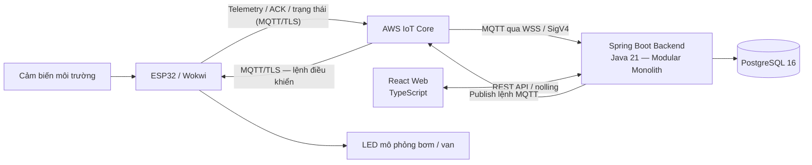
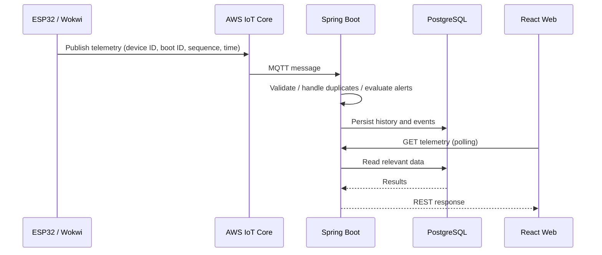
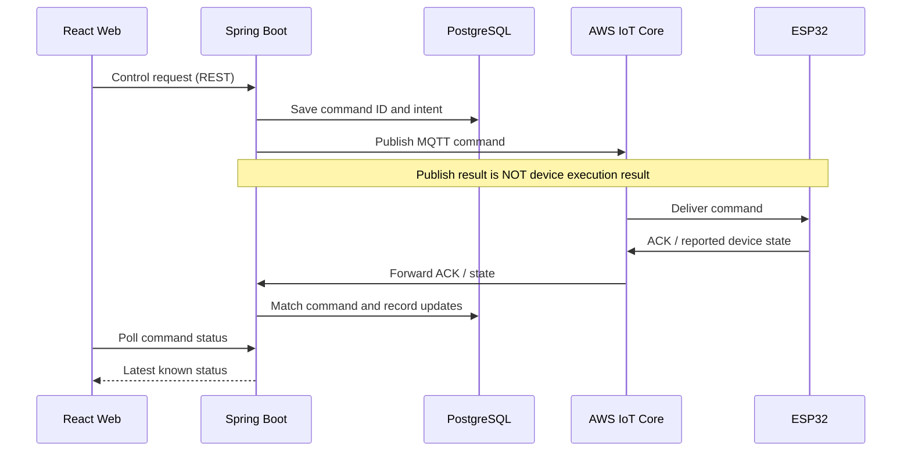

# 第12.02課 — システム構成 | Kiến trúc hệ thống Smart Farm IoT

> **BRSE Interview Master — 第12章 技術デモ・プレゼンテーション**  
> Trình độ luyện nói: N3–N2 · Case study: Smart Farm IoT Management System  
> **Trạng thái học liệu:** Draft — cần kiểm định tiếng Nhật và đối chiếu bằng chứng triển khai trước khi xuất bản.  
> **Căn cứ:** Mô tả dự án do người xây dựng cung cấp. Không phải biên bản kiểm toán mã nguồn hay kết quả nghiệm thu.

## ① 学習目標 — Mục tiêu học tập

Sau bài này, người học có thể:

1. Giới thiệu kiến trúc tổng thể bằng tiếng Nhật trong khoảng 30 giây.
2. Giải thích vai trò của ESP32, AWS IoT Core, Spring Boot, PostgreSQL và React.
3. Phân biệt luồng **telemetry**, luồng **REST/polling** và luồng **command/ACK**.
4. Phân biệt **MQTT publish được gửi**, **thiết bị trả ACK** và **trạng thái thiết bị được báo cáo**.
5. Trả lời câu hỏi đào sâu bằng câu ngắn, chính xác và trung thực về mức độ hoàn thiện.

## ② システム概要 — Kiến trúc tổng thể

**Tóm tắt:** Smart Farm IoT Management System quản lý môi trường vườn và thiết bị tưới thông qua ESP32, AWS IoT Core và ứng dụng web. Backend được tổ chức theo **modular monolith** trong một ứng dụng Spring Boot. Giao tiếp với thiết bị qua MQTT bất đồng bộ; giao diện React truy cập backend qua REST API và polling.

**Cách đọc sơ đồ:**

- **Chiều đo đạc:** cảm biến → ESP32/Wokwi → AWS IoT Core → Spring Boot → PostgreSQL.
- **Chiều hiển thị:** React gọi REST API; backend lấy dữ liệu liên quan để hiển thị, giao diện polling cập nhật.
- **Chiều điều khiển:** React yêu cầu điều khiển → backend quản lý lệnh → publish qua AWS IoT Core → ESP32 → actuator mô phỏng; bản tin ACK/trạng thái được đưa ngược về backend.

> **Phạm vi thực tế:** Backend và PostgreSQL chủ yếu chạy local và có kết nối AWS IoT Core. Luồng ESP32/Wokwi–AWS–backend đã có bằng chứng chạy thử theo mô tả dự án. Các chức năng nâng cao cần nghiệm thu thêm; chưa xác nhận triển khai production hay điều khiển bơm/van nông nghiệp thật. Sơ đồ biểu diễn kiến trúc được mô tả, **không phải bằng chứng nghiệm thu từng mũi tên**.

### 日本語で30秒説明 — Giải thích sơ đồ trong khoảng 30 giây

**応募者：**

このシステムは、IoT機器とAWS、Webアプリを連携させた農園管理システムです。ESP32がセンサーデータをAWS IoT Coreに送信し、Spring Bootのバックエンドがデータを処理してPostgreSQLに保存します。Reactの画面から環境データを確認したり、デバイスへの制御要求を送ったりできます。現在は主にローカル環境とシミュレーションで検証しています。

**Dịch:** Đây là hệ thống quản lý vườn kết nối thiết bị IoT, AWS và ứng dụng web. ESP32 gửi dữ liệu cảm biến lên AWS IoT Core; backend Spring Boot xử lý và lưu vào PostgreSQL. Từ màn hình React có thể kiểm tra dữ liệu môi trường và gửi yêu cầu điều khiển thiết bị. Hiện dự án chủ yếu được kiểm thử ở môi trường local và mô phỏng.

**Mẹo nhớ:** 目的 → データ送信 → データ処理・保存 → Web操作 → 現在の検証範囲.

---

## ③ 主要コンポーネント — Vai trò từng thành phần và hội thoại phỏng vấn

### A. ESP32 / Wokwi — センサーとデバイス

**Kiến thức cốt lõi:** ESP32 chạy firmware C/C++ (Arduino Framework/PlatformIO), thu nhận dữ liệu cảm biến và xử lý lệnh. Wokwi dùng để mô phỏng cảm biến, điều kiện môi trường và actuator; LED đại diện thao tác bơm/van trong mô phỏng.

**面接官：** ESP32は、このシステムでどのような役割を持っていますか。

**Dịch câu hỏi:** ESP32 có vai trò gì trong hệ thống này?  
**応募者：** ESP32はセンサーデータを取得し、MQTTで送信する役割を持っています。また、受信した制御コマンドを処理し、ACKや状態を返します。

*Dịch:* ESP32 thu nhận và gửi dữ liệu cảm biến qua MQTT. Nó cũng xử lý lệnh điều khiển nhận được và gửi ACK hoặc trạng thái.

**深掘り — 面接官：** Wokwiを使う理由は何ですか。  
**応募者：** 実機がなくても、センサーや制御処理の一部をシミュレーションして、通信の流れを確認できるからです。

*Dịch:* Vì có thể mô phỏng một phần cảm biến và điều khiển, kiểm tra luồng giao tiếp mà chưa cần thiết bị thật.

### B. AWS IoT Core / MQTT — デバイスとの通信

**Kiến thức cốt lõi:** Thiết bị kết nối qua MQTT/TLS và chứng chỉ X.509. Backend sử dụng kết nối MQTT qua WSS/SigV4 theo kiến trúc được mô tả. AWS IoT Core làm trung gian publish/subscribe giữa thiết bị và backend; không tự động có nghĩa một lệnh đã được thực thi.

**面接官：** なぜMQTTを使用していますか。  
**応募者：** MQTTは軽量な通信プロトコルで、IoT機器に適しています。Publish/Subscribe方式により、センサーデータや制御コマンドを非同期でやり取りできます。

*Dịch:* MQTT là giao thức nhẹ phù hợp cho IoT; publish/subscribe cho phép trao đổi dữ liệu và lệnh bất đồng bộ.

**深掘り — 面接官：** MQTTとREST APIはどう使い分けていますか。  
**応募者：** デバイスとの通信にはMQTTを使い、Web画面とバックエンドの通信にはREST APIを使っています。

*Dịch:* MQTT dùng cho trao đổi với thiết bị; REST API dùng giữa giao diện web và backend.

### C. Spring Boot — バックエンド

**Kiến thức cốt lõi:** Backend Java 21/Spring Boot sử dụng Spring JDBC, tổ chức dạng modular monolith. Các nhóm nghiệp vụ: thiết bị, telemetry, cảnh báo, tự động hóa, điều khiển và báo cáo. Backend cung cấp REST API, xử lý bản tin MQTT, kiểm tra dữ liệu, lưu lịch sử và quản lý quy trình tưới.

**面接官：** バックエンドでは何を処理しますか。  
**応募者：** Spring BootでREST APIを提供し、センサーデータの検証や保存、アラートの判定、制御コマンドの管理などを行います。

*Dịch:* Spring Boot cung cấp REST API, xác thực và lưu dữ liệu cảm biến, đánh giá cảnh báo và quản lý lệnh điều khiển.

**深掘り — 面接官：** モジュラーモノリスとは何ですか。  
**応募者：** 一つのアプリケーションの中で、機能ごとにモジュールを分ける構成です。このシステムでは、デバイス管理やテレメトリーなどを分けています。

*Dịch:* Modular monolith là ứng dụng thống nhất nhưng phân chia module theo chức năng như quản lý thiết bị, telemetry.

### D. PostgreSQL / Flyway — データ保存

**Kiến thức cốt lõi:** PostgreSQL 16 lưu dữ liệu cảm biến, cấu hình, lệnh, ACK, sự kiện và lịch sử phiên tưới. Flyway quản lý thay đổi schema. Không suy đoán bảng, index hay chỉ số hiệu năng cụ thể nếu chưa xem source code.

**面接官：** データベースには何を保存していますか。  
**応募者：** PostgreSQLにはセンサーの測定履歴や設定情報、制御コマンド、ACK、灌漑セッションの履歴などを保存しています。

*Dịch:* PostgreSQL lưu lịch sử đo cảm biến, cấu hình, lệnh, ACK và phiên tưới.

**深掘り — 面接官：** なぜ履歴データが必要ですか。  
**応募者：** 環境の変化を確認したり、アラートや制御結果を後から調査したりするためです。

*Dịch:* Để kiểm tra biến động môi trường và tra cứu cảnh báo, kết quả điều khiển về sau.

### E. React / REST / Polling — 管理画面

**Kiến thức cốt lõi:** Frontend React, TypeScript, Vite và Tailwind CSS hiển thị dashboard, khu vực, cảm biến, cảnh báo và thao tác điều khiển. Web sử dụng REST API/polling, không mặc định có WebSocket trực tiếp với thiết bị.

**面接官：** Web画面は、どのようにデータを取得しますか。  
**応募者：** Reactの画面からREST APIを呼び出します。また、ポーリングによって新しいセンサーデータやコマンドの状態を確認します。

*Dịch:* React gọi REST API và dùng polling để kiểm tra dữ liệu cảm biến, trạng thái lệnh mới.

**深掘り — 面接官：** 画面はデバイスと直接通信しますか。  
**応募者：** いいえ。画面はバックエンドのAPIと通信し、デバイスへのコマンドはバックエンドからAWS IoT Coreを経由して送ります。

*Dịch:* Không. Giao diện gọi API của backend; lệnh tới thiết bị được gửi qua backend và AWS IoT Core.

---

## ④ データの流れ — Luồng xử lý cần hiểu sâu

### 4.1 Telemetry: Cảm biến → Database → Web

Dữ liệu có device ID, boot ID, sequence và thời gian đo giúp backend nhận diện nguồn và xử lý dữ liệu lặp theo logic của ứng dụng. **Không khẳng định bảo đảm exactly-once hoặc dữ liệu không thể mất** khi chưa kiểm chứng thiết kế, QoS và triển khai thực tế.

**面接官：** センサーデータは、どのように画面に表示されますか。  
**応募者：** ESP32からMQTTで送信したデータを、バックエンドで検証して保存します。その後、Reactの画面がREST APIを呼び出して、データを表示します。

*Dịch:* ESP32 gửi dữ liệu qua MQTT; backend kiểm tra và lưu. React gọi REST API để hiển thị dữ liệu.

**深掘り — 面接官：** 同じデータが複数回届いたらどうしますか。  
**応募者：** バックエンドではデバイスIDや起動ID、連番などを使って、重複データを判定する設計です。判定条件の詳細は実装を確認して説明します。

*Dịch:* Backend dùng các thông tin như device ID, boot ID, sequence để nhận diện dữ liệu trùng; điều kiện cụ thể cần đối chiếu mã nguồn.

### 4.2 Control: Lệnh gửi đi không đồng nghĩa thiết bị đã thực hiện

**Ba tầng cần phân biệt:**

| Tầng | Có thể kết luận gì? | Không thể kết luận gì? |
|---|---|---|
| Publish result | Bước gửi/publish trả về kết quả | Không chứng minh thiết bị đã nhận hay thực hiện |
| Device ACK | Thiết bị đã phản hồi theo ý nghĩa ACK được định nghĩa | Chưa chắc trạng thái vật lý đúng |
| Reported device state | Thiết bị báo cáo trạng thái | Chưa đồng nghĩa bơm/van thực tế đã được xác minh độc lập |

**面接官：** MQTTで送信できたら、制御は成功したと言えますか。  
**応募者：** いいえ、送信できただけでは成功とは言えません。デバイスからのACKと報告された状態を確認する必要があります。実機が正しく動いたかどうかは、別の確認が必要です。

*Dịch:* Không. Chỉ gửi được lệnh chưa đủ. Cần kiểm tra ACK và trạng thái thiết bị báo cáo; vận hành thực tế phải xác minh riêng.

**深掘り — 面接官：** ACKが返らない場合は、どう説明しますか。  
**応募者：** ACKを確認できていないため、実行結果は未確認だと説明します。通信状況とコマンドの記録を調べます。再送する場合は、重複実行のリスクも確認します。

*Dịch:* Giải thích rằng kết quả thực hiện chưa được xác nhận; kiểm tra kết nối và lịch sử lệnh, đồng thời xem xét nguy cơ thực hiện lặp trước khi gửi lại. **Đây là cách xử lý đề xuất trong phỏng vấn, không khẳng định tính năng tự động retry đã triển khai.**

---

## ⑤ 技術判断 — Câu hỏi kiến trúc nâng cao, trả lời ngắn

### Q1 — Vì sao Modular Monolith?

**面接官：** なぜマイクロサービスではなく、モジュラーモノリスにしたのですか。  
**応募者（Standard）：** 一つのアプリケーションとして管理しながら、機能ごとにコードを分けられるからです。現在の開発段階では、構成を複雑にしすぎないことも重要だと考えています。

*Dịch:* Vì có thể quản lý dưới một ứng dụng đồng thời phân chia code theo tính năng; giai đoạn hiện tại nên tránh phức tạp hóa không cần thiết.

**Lưu ý:** Đây là **lập luận kiến trúc hợp lý để luyện phỏng vấn**, chưa phải lý do lựa chọn đã được tác giả dự án xác nhận.

### Q2 — Có phải dữ liệu real-time tuyệt đối?

**面接官：** Web画面のデータは完全なリアルタイムですか。  
**応募者：** いいえ。現在の画面はREST APIとポーリングを使用しているため、更新には間隔があります。ほぼリアルタイムの監視を目指していますが、遅延の数値はまだ提示できません。

*Dịch:* Không. Web dùng REST và polling nên có khoảng cập nhật; hướng đến giám sát gần thời gian thực nhưng chưa có số đo độ trễ để công bố.

### Q3 — Bảo mật thiết bị thế nào?

**面接官：** デバイスとの通信は、どのように保護していますか。  
**応募者：** ESP32とAWS IoT Coreの接続にはTLSとX.509証明書を使用しています。通信相手の認証と、通信内容の保護が目的です。

*Dịch:* Kết nối ESP32–AWS IoT Core sử dụng TLS và chứng chỉ X.509 nhằm xác thực và bảo vệ dữ liệu truyền.

---

## ⑥ 語彙・文法 — Từ vựng và biểu đạt phỏng vấn

| 日本語 | 読み方 | Nghĩa tiếng Việt |
|---|---|---|
| システム構成 | システムこうせい | Cấu trúc/kiến trúc hệ thống |
| 農園管理 | のうえんかんり | Quản lý vườn/nông trại |
| センサー | センサー | Cảm biến |
| 測定値 | そくていち | Giá trị đo |
| 取得する | しゅとくする | Thu nhận/lấy dữ liệu |
| 送信する | そうしんする | Gửi/truyền |
| 受信する | じゅしんする | Nhận |
| 保存する | ほぞんする | Lưu |
| 連携する | れんけいする | Kết nối, tích hợp phối hợp |
| 非同期 | ひどうき | Bất đồng bộ |
| 検証する | けんしょうする | Kiểm chứng/kiểm tra |
| 重複データ | ちょうふくデータ／じゅうふくデータ | Dữ liệu trùng |
| 制御コマンド | せいぎょコマンド | Lệnh điều khiển |
| 応答 | おうとう | Phản hồi |
| 状態 | じょうたい | Trạng thái |
| 未確認 | みかくにん | Chưa xác nhận |
| 実機 | じっき | Thiết bị thật |
| 模擬環境 | もぎかんきょう | Môi trường mô phỏng |
| 実現可能性 | じつげんかのうせい | Tính khả thi |
| 影響範囲 | えいきょうはんい | Phạm vi ảnh hưởng |

### Cụm câu ứng dụng

- **〜を使ってデータを送信します。** — Gửi dữ liệu bằng…
- **〜を経由して〜に送ります。** — Gửi đến… thông qua…
- **〜に保存します。** — Lưu vào…
- **〜だけでは、〜とは言えません。** — Chỉ… thì chưa thể nói là…
- **〜については、まだ確認できていません。** — Về…, hiện vẫn chưa xác minh được.

### 類似表現比較 — Cách nói dễ nhầm

| Biểu đạt | Sắc thái / Cách dùng |
|---|---|
| 確認します | Xác nhận, kiểm tra; phù hợp phỏng vấn thông thường |
| 確認いたします | Khiêm nhường, trang trọng hơn khi nói về hành động của mình với người cần tôn trọng |
| 検証します | Kiểm chứng bằng bước kiểm tra/bằng chứng, thường dùng cho chức năng hoặc giả thuyết |
| 送信しました | Đã gửi; không tự suy ra bên nhận đã thực thi |
| 実行が完了しました | Đã hoàn thành thực thi; chỉ dùng khi có bằng chứng phù hợp |

---

## ⑦ 会話練習 — Luyện phản xạ

**Bài A — 30秒説明:** Không nhìn bài, giải thích sơ đồ theo thứ tự **ESP32 → AWS IoT Core → Spring Boot → PostgreSQL → React**. Nói thêm một câu về MQTT và REST.

**Bài B — Hỏi sâu:** Trả lời bằng tiếng Nhật, mỗi câu 15–30 giây:

1. なぜデバイス通信にMQTTを使いますか。
2. Reactの画面とESP32は直接通信しますか。
3. ACKが届かなかった場合、制御は成功したと言えますか。
4. なぜPostgreSQLに履歴を保存するのですか。
5. 本番環境での運用実績はありますか。

**Bài C — Thay đổi bối cảnh (BrSE):** Khách hàng Nhật hỏi: 「画面に『送信成功』と表示されていますが、なぜポンプが動かないのですか。」 Hãy trả lời 2–4 câu, giải thích khác biệt giữa gửi lệnh, ACK và trạng thái thực tế. Không hứa rằng bơm đã chạy.

**Bài D — Tự vẽ:** Vẽ lại hai sơ đồ trên chỉ từ trí nhớ; giải thích vì sao React không giao tiếp MQTT trực tiếp với ESP32 trong kiến trúc này.

### AI Mock Interview Prompt

> あなたは日本企業のBrSE技術面接官です。Smart Farm IoT Management Systemのアーキテクチャについて、日本語で一問ずつ質問してください。回答を待ち、その内容に沿って一つだけ深掘り質問をしてください。5問後に技術的な正確さ、日本語、簡潔さ、説明の論理性を評価してください。未確認の実績を事実として扱わないでください。

---

## ⑧ 解答のポイント — Gợi ý tự kiểm tra

- **MQTT:** giao tiếp publish/subscribe bất đồng bộ giữa thiết bị và hệ thống.
- **React:** gọi REST API/polling với backend; không mô tả kết nối MQTT trực tiếp nếu nguồn không nói có.
- **ACK:** là phản hồi được định nghĩa ở cấp thiết bị; chưa tự chứng minh vận hành vật lý.
- **PostgreSQL:** phục vụ lưu lịch sử và truy tra dữ liệu, lệnh, sự kiện.
- **Production:** chưa xác nhận triển khai production hoặc vận hành bơm/van nông nghiệp thật.
- **Câu BrSE:** nêu đúng trạng thái chưa xác nhận, đề xuất kiểm tra publish, ACK, trạng thái báo cáo và tín hiệu vật lý nếu có; không khẳng định nguyên nhân khi thiếu dữ liệu.

## ⑨ 評価・改善 — Rubric 20 điểm

Mỗi tiêu chí chấm từ **0 đến 4**:

| Tiêu chí | Mức 4/4 |
|---|---|
| Technical Accuracy | Không nhầm telemetry, REST, MQTT, ACK và trạng thái thiết bị |
| Answer Relevance | Trả lời đúng câu hỏi ngay đầu, không lan man |
| Japanese Naturalness | Câu tự nhiên, đúng ngữ pháp, phù hợp N3–N2 |
| Explanation Clarity | Trình bày được luồng theo thứ tự, dễ hiểu |
| Follow-up Handling | Trả lời câu hỏi đào sâu, biết nói rõ điều chưa xác minh |

**Mốc luyện tập nội bộ:** 16–20: tốt; 12–15: cần chỉnh; dưới 12: học lại phần còn yếu. Đây không phải thang điểm chính thức của JLPT hay doanh nghiệp Nhật.

**Quy trình sửa:** ghi âm hoặc tự gõ câu trả lời → tự so với câu mẫu → xác định tối đa ba lỗi quan trọng → trả lời lại không nhìn mẫu. Nếu chỉ có văn bản, không tự đánh giá phát âm.

## ⑩ 実装状況・出典 — Mức độ xác minh và nguồn

| Hạng mục | Trạng thái được phép trình bày |
|---|---|
| Firmware ESP32/Wokwi, backend và các nhóm tính năng đã mô tả | Đã phát triển theo mô tả của người dùng; mức nghiệm thu từng tính năng có thể khác nhau |
| ESP32/Wokwi → AWS IoT Core → Backend | Có bằng chứng chạy thử theo thông tin người dùng cung cấp; chưa kiểm chứng độc lập trong bài này |
| Backend / PostgreSQL | Chủ yếu chạy local |
| Dashboard, điều khiển, cảnh báo, tự động hóa nâng cao | Có nội dung đã phát triển; một số chức năng cần nghiệm thu thêm |
| Production deployment | Chưa xác nhận |
| Bơm/van nông nghiệp vật lý | Chưa xác nhận vận hành |
| Số liệu latency, throughput, availability | Chưa được cung cấp; không tự suy đoán |
| Vai trò và đóng góp cá nhân | Chưa được mô tả đủ; không tự nhận toàn bộ dự án là đóng góp cá nhân |

**Nguồn:** Project brief “Smart Farm IoT Management System” do người dùng cung cấp trong cuộc trao đổi biên soạn Chương 12.

**Cần kiểm tra trước khi publish:** README và mã nguồn thực tế, tên API/topic MQTT, bằng chứng test và ảnh demo, trạng thái từng chức năng, vai trò cá nhân trong dự án; đồng thời nhờ reviewer tiếng Nhật/IoT kiểm tra bài học nếu có điều kiện.

---

**Ghi nhớ cuối bài:**  
**送信成功 ≠ ACK受信 ≠ 実機動作の確認**  
Gửi thành công ≠ Nhận ACK ≠ Xác minh thiết bị vật lý đã vận hành.
