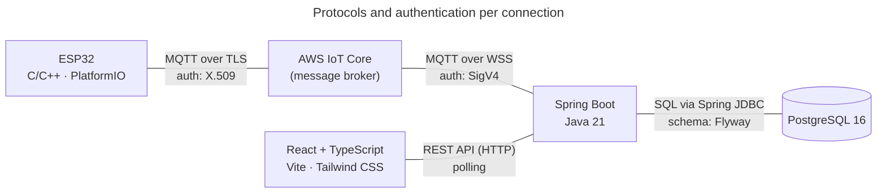

# 第12.03課 — 使用技術 | Công nghệ sử dụng và lý do lựa chọn

> **BRSE Interview Master · 第12章 技術デモ・プレゼンテーション**  
> **Đối tượng:** Ứng viên BrSE, tiếng Nhật N3–N2  
> **Trạng thái:** draft — chờ rà soát tiếng Nhật và xác nhận lý do chọn công nghệ với chủ dự án · **Cập nhật:** 2026-10-26  
> **Căn cứ:** [smart-farm-overview.md](../../../sources/project-evidence/smart-farm-overview.md) · [Project Knowledge Base](../../../knowledge-base/case-studies/smart-farm-iot.md)  
> **Bài liên quan:** [12.01 — プロジェクト概要](12-01-project-overview.md) · [12.02 — システム構成](12-02-system-architecture.md)

> ⚠️ **Đọc trước:** Nguồn dự án cho biết **dùng công nghệ gì**, nhưng **chưa cho biết vì sao chọn**. Mọi "lý do" trong bài là **lập luận phù hợp kỹ thuật để luyện tập** (`hypothetical`). Trước khi phỏng vấn, hãy đối chiếu với lý do thật của bạn; nếu khác, nói lý do thật.

## 学習目標 — Mục tiêu

Sau bài này, người học có thể:

- Liệt kê công nghệ theo **từng tầng** trong 20–30 giây, không đọc danh sách dài.
- Giải thích **MQTT khác HTTP/REST thế nào** và vì sao mỗi bên được dùng ở một đoạn khác nhau.
- Trả lời 「なぜ〜を選んだのですか」 theo khung **選択 → 理由 → 制約** (Lựa chọn → Lý do → Giới hạn).
- Nói được **trade-off** của polling, Spring JDBC và modular monolith.
- Phân biệt "lý do kỹ thuật hợp lý" với "lý do đã được quyết định trong dự án".

## ① 面接質問 — Câu hỏi phỏng vấn

| Câu hỏi | Dịch |
|---|---|
| **Câu chính:** このプロジェクトの使用技術について教えてください。 | Hãy cho biết công nghệ sử dụng trong dự án này. |
| Biến thể: なぜMQTTを使ったのですか。HTTPではだめですか。 | Vì sao dùng MQTT? HTTP không được sao? |
| Biến thể: なぜその技術を選んだのですか。 | Vì sao chọn công nghệ đó? |
| Biến thể: もう一度選ぶとしたら、同じ技術を選びますか。 | Nếu chọn lại, có chọn như cũ không? |

## ② 質問の意図 — Ý định người phỏng vấn

| Câu hỏi | Người phỏng vấn muốn kiểm tra |
|---|---|
| 使用技術について教えてください | Có nắm cấu trúc tổng thể, nói gọn theo tầng không |
| なぜMQTTを使ったのですか | Hiểu bản chất giao thức hay chỉ thuộc tên |
| なぜSpring JDBCを使ったのですか | Hiểu trade-off, không chọn theo cảm tính |
| もう一度選ぶとしたら | Khả năng tự đánh giá, nhìn ra giới hạn |

**Điểm chung:** Người phỏng vấn thường không cần câu trả lời "đúng tuyệt đối". Họ đánh giá **lý do có logic** và **biết giới hạn**. Câu 「〜が流行っているからです」 (vì đang thịnh hành) là câu trả lời yếu.

## ③ 技術知識 — Kiến thức nền

### 3.1 Bản đồ giao thức theo từng đoạn kết nối



*Hình: giao thức theo nguồn dự án; cách xác thực theo tài liệu AWS. Không thể hiện topic, QoS hay chu kỳ polling vì chưa có dữ liệu.*

**① 図の説明:** Thiết bị và backend **không** nói chuyện trực tiếp với nhau — cả hai đều kết nối tới AWS IoT Core. Web chỉ nói chuyện với backend. Mỗi đoạn dùng giao thức và cách xác thực khác nhau.

**② 日本語で説明してみよう（約20秒）：**  
「デバイスとAWS IoT Coreの間は、X.509証明書で認証するMQTTです。バックエンドとAWSの間は、SigV4で認証するWebSocket上のMQTTです。画面とバックエンドは、REST APIでつながっています。」

*Dịch:* Giữa thiết bị và AWS IoT Core là MQTT xác thực bằng chứng chỉ X.509. Giữa backend và AWS là MQTT chạy trên WebSocket, xác thực bằng SigV4. Màn hình và backend kết nối bằng REST API.

**⑤ 応用質問:** 「スマホアプリを追加するとしたら、どこにつなぎますか。」  
*Hướng trả lời (`hypothetical`):* Giống React, app gọi REST API của backend; không kết nối trực tiếp tới thiết bị — giữ nguyên nguyên tắc "giao tiếp với thiết bị đi qua backend".

### 3.2 Bảng công nghệ

| Tầng | Công nghệ | Nó là gì | Vai trò trong dự án (theo nguồn) |
|---|---|---|---|
| Thiết bị | ESP32, C/C++, Arduino Framework, PlatformIO | Vi điều khiển có Wi-Fi; Arduino Framework là bộ thư viện lập trình; PlatformIO là công cụ build/quản lý firmware | Đọc cảm biến, gửi dữ liệu, xử lý lệnh |
| Mô phỏng | Wokwi | Trình mô phỏng mạch và vi điều khiển | Mô phỏng cảm biến và actuator |
| Kết nối | MQTT | Giao thức nhắn tin **publish/subscribe** rất nhẹ, chuẩn OASIS cho IoT | Telemetry, lệnh, ACK |
| Kết nối | AWS IoT Core | Message broker được quản lý; MQTT hỗ trợ publish và subscribe, **HTTPS chỉ publish** | Trung gian giữa thiết bị và backend |
| Backend | Spring Boot (Java 21) | Framework xây dựng ứng dụng Java | REST API, tiếp nhận dữ liệu, cảnh báo, quy trình tưới |
| Backend | Spring JDBC | `JdbcTemplate` lo tạo/đóng kết nối và chạy câu lệnh; **code ứng dụng tự viết SQL** và lấy kết quả | Truy cập PostgreSQL |
| CSDL | PostgreSQL 16 | CSDL quan hệ; transaction gộp nhiều bước thành một thao tác *all-or-nothing* | Lưu cảm biến, cấu hình, lệnh, ACK, sự kiện, phiên tưới |
| CSDL | Flyway | Áp dụng migration có phiên bản theo thứ tự; ghi migration đã chạy vào *schema history table* | Quản lý thay đổi schema |
| Frontend | React, TypeScript, Vite, Tailwind CSS | TypeScript = JavaScript có cú pháp kiểu, giúp phát hiện lỗi sớm trong editor | Dashboard, quản lý khu vực, điều khiển |
| Kiểm thử | JUnit, Spring Boot Test, PostgreSQL integration tests, Playwright | Unit test Java; test tích hợp với Spring; test với CSDL thật; test giao diện trên trình duyệt | Kiểm tra nghiệp vụ, API, giao diện |

> Mức hoàn thiện, phạm vi test và số liệu từng công nghệ **chưa được cung cấp**. Không nói 「テストカバレッジは○%です」.

### 3.3 MQTT và HTTP/REST — khác nhau ở đâu?

| Tiêu chí | MQTT (qua AWS IoT Core) | HTTP / REST API |
|---|---|---|
| Mô hình | Publish/Subscribe qua broker | Request/Response: client hỏi, server trả lời |
| Nhận dữ liệu chủ động | Có — client đã subscribe được đẩy bản tin tới | Không — client phải gọi lại (polling) |
| Trên AWS IoT Core | Publish và Subscribe | **Chỉ publish** |
| Overhead / điện năng (AWS so sánh) | Thấp hơn | Cao hơn |
| Phù hợp trong dự án | Thiết bị ↔ cloud: thiết bị cần **nhận lệnh** | Web ↔ backend: xem/ghi theo thao tác người dùng |

**Ý chính:** Thiết bị không chỉ gửi dữ liệu mà còn phải **nhận lệnh điều khiển**. Trên AWS IoT Core, HTTPS không subscribe được, nên MQTT phù hợp hơn cho chiều điều khiển.

### 3.4 Trade-off cần biết

| Lựa chọn | Được | Mất / giới hạn |
|---|---|---|
| **Polling** (Web gọi API định kỳ) | Đơn giản, chỉ cần REST API | Dữ liệu cập nhật theo chu kỳ, không tức thời; tốn request khi không có dữ liệu mới. WebSocket cho phép nhận phản hồi không cần polling, nhưng dự án **không được mô tả là dùng WebSocket ở phía Web** |
| **Spring JDBC** (thay vì ORM như JPA) | Kiểm soát SQL trực tiếp, thấy rõ câu truy vấn | Phải tự viết SQL và ánh xạ kết quả |
| **Modular monolith** (thay vì microservices) | Một ứng dụng triển khai, code tách module theo nghiệp vụ | Không scale riêng từng module; cần kỷ luật để module không phụ thuộc phần nội bộ của nhau |

## ④ 思考プロセス — Khung tư duy

**Câu liệt kê công nghệ:** 層ごとに — thiết bị → kết nối → backend → database → màn hình. Tối đa 5 tên ở câu đầu.

**Câu hỏi "vì sao chọn":**

```text
選択 (Lựa chọn)  →  理由 (1–2 ý, gắn với yêu cầu hệ thống)  →  制約 (Giới hạn)
「〜を使いました」      「〜ため、〜に適しています」              「ただし、〜という課題もあります」
```

- **Lý do phải gắn với yêu cầu của hệ thống** (thiết bị cần nhận lệnh, cần lưu lịch sử…), không gắn với sở thích.
- **Giới hạn** cho thấy bạn hiểu trade-off. Một câu là đủ.
- Nếu lý do thật là 「学習のため」 (để học), có thể nói thẳng — với dự án cá nhân/học tập, đây là lý do trung thực và chấp nhận được. *Bối cảnh dự án (cá nhân, đồ án hay công ty) chưa được cung cấp — hãy tự xác nhận.*

## ⑤ 面接対話 — Hội thoại phỏng vấn

**面接官：** このプロジェクトの使用技術について教えてください。  
**応募者：** 層ごとに説明します。デバイスはESP32で、C/C++で開発しました。通信はMQTTとAWS IoT Coreです。バックエンドはJava 21とSpring Boot、データベースはPostgreSQLとFlywayを使いました。管理画面はReactとTypeScriptです。

*ベトナム語訳:* Tôi xin giải thích theo từng tầng. Thiết bị là ESP32, phát triển bằng C/C++. Giao tiếp dùng MQTT và AWS IoT Core. Backend là Java 21 và Spring Boot; cơ sở dữ liệu dùng PostgreSQL và Flyway. Màn hình quản lý là React và TypeScript.

**面接官：** なぜデバイスとの通信にMQTTを使ったのですか。HTTPではだめですか。  
**応募者：** デバイスはデータを送るだけでなく、制御コマンドを受け取る必要があるからです。AWS IoT CoreではHTTPSはPublishのみで、Subscribeできません。MQTTなら、デバイスがコマンドを待ち受けることができ、通信のオーバーヘッドも小さいです。

*ベトナム語訳:* Vì thiết bị không chỉ gửi dữ liệu mà còn phải nhận lệnh điều khiển. Trên AWS IoT Core, HTTPS chỉ publish được, không subscribe được. Với MQTT, thiết bị có thể chờ nhận lệnh, và overhead truyền thông cũng nhỏ.

*Trạng thái:* các ý kỹ thuật `verified` (tài liệu AWS); "đây là lý do dự án chọn" là `hypothetical`.

> **Lưu ý trung thực:** 「開発しました」 ngầm nói bạn là người viết code đó. Vai trò cá nhân **chưa được xác nhận**; nếu bạn không viết firmware, đổi thành 「デバイスはESP32で、ファームウェアはC/C++です」.

## ⑥ 模範回答 — Câu trả lời mẫu

### Standard (~25 giây)

Dùng câu trả lời đầu tiên ở mục ⑤.

**Mẹo:** Mở bằng 「層ごとに説明します」 để người nghe biết cấu trúc trước. Không liệt kê Vite, Tailwind, Maven… ở câu đầu — để dành khi được hỏi thêm.

### Professional (~30 giây)

**応募者：** デバイスから画面まで、層ごとにご説明します。デバイスはESP32で、ファームウェアはC/C++です。デバイスとの通信には、MQTTとAWS IoT Coreを使っています。バックエンドはJava 21とSpring Bootで、データアクセスにはSpring JDBC、データベースにはPostgreSQLとFlywayを使用しています。管理画面はReactとTypeScriptで構築しています。

*Dịch:* Tôi xin trình bày theo từng tầng, từ thiết bị đến màn hình. Thiết bị là ESP32, firmware viết bằng C/C++. Giao tiếp với thiết bị dùng MQTT và AWS IoT Core. Backend là Java 21 và Spring Boot; truy cập dữ liệu bằng Spring JDBC, cơ sở dữ liệu là PostgreSQL và Flyway. Màn hình quản lý xây dựng bằng React và TypeScript.

> Bản Professional dùng chủ ngữ trung tính (「〜を使っています」) nên **không ngầm nhận vai trò cá nhân**, và nêu rõ hướng trình bày (デバイスから画面まで).

## ⑦ 深掘り質問 — Câu hỏi đào sâu

**Q1 — Nhược điểm của MQTT**  
**面接官：** MQTTのデメリットは何ですか。  
**応募者：** ブローカーが必要なことと、同じメッセージが重複して届く可能性があるので、アプリ側で重複を処理する必要があることです。

*Dịch:* Cần có broker ở giữa, và vì cùng một bản tin có thể đến trùng nên phía ứng dụng phải tự xử lý trùng lặp. (AWS IoT Core chỉ có QoS 0/1 — xem [12.02](12-02-system-architecture.md).)

**Q2 — Vì sao Web dùng REST chứ không dùng MQTT?**  
**面接官：** Web画面もMQTTでデータを受け取らないのですか。  
**応募者：** 現在の構成では、Web画面はREST APIでバックエンドと通信しています。デバイスとの通信はバックエンドにまとめることで、画面側の実装をシンプルにできると考えています。ただし、ポーリングなので更新には間隔があります。

*Dịch:* Trong cấu trúc hiện tại, màn hình Web giao tiếp với backend bằng REST API. Tôi cho rằng gom giao tiếp với thiết bị về backend giúp phần giao diện đơn giản hơn. Tuy nhiên vì dùng polling nên cập nhật có độ trễ theo chu kỳ.

*Trạng thái:* REST/polling theo nguồn dự án; lý do 「シンプルにできる」 là `hypothetical` (dùng 「と考えています」 để thể hiện đây là nhận định).

**Q3 — Tăng tính thời gian thực**  
**面接官：** リアルタイム性を高めるなら、どうしますか。  
**Hướng trả lời (`hypothetical`, chưa triển khai):** 「WebSocketなどで、サーバーから画面へ更新を送る方法を検討します。」 Không nói 「対応済みです」.

**Q4 — Spring JDBC**  
**面接官：** JPAではなく、Spring JDBCを使った理由は何ですか。  
**応募者 (mẫu — điền lý do thật)：** 【SQLを直接確認しながら開発したかった／時系列データの検索を自分で制御したかった など、実際の理由】ためです。Spring JDBCでは、接続の管理はフレームワークに任せて、SQLは自分で書きます。その分、マッピングのコードは増えます。

*Dịch:* Vì [lý do thật, ví dụ: muốn vừa phát triển vừa kiểm soát trực tiếp SQL / muốn tự điều khiển truy vấn dữ liệu chuỗi thời gian…]. Với Spring JDBC, việc quản lý kết nối giao cho framework, còn SQL thì tự viết. Đổi lại, code ánh xạ kết quả nhiều hơn.

> Ví dụ trong 【 】 là `hypothetical`. Câu thứ hai và thứ ba là mô tả kỹ thuật `verified` (tài liệu Spring).

**Q5 — Flyway**  
**面接官：** Flywayは何のために使っていますか。  
**応募者：** データベースのスキーマ変更をバージョン管理するためです。マイグレーションを順番に適用し、どこまで適用したかを履歴テーブルで管理できます。

*Dịch:* Để quản lý phiên bản các thay đổi schema. Migration được áp dụng theo thứ tự, và có thể biết đã áp dụng tới đâu nhờ bảng lịch sử.

**Q6 — TypeScript**  
**面接官：** なぜJavaScriptではなく、TypeScriptを使ったのですか。  
**応募者：** 型を使って、APIから受け取るデータの形をコードで定義できるからです。間違いをエディタの段階で早く見つけられます。

*Dịch:* Vì có thể dùng kiểu để định nghĩa hình dạng dữ liệu nhận từ API ngay trong code, và phát hiện lỗi sớm ngay trong editor.

*Trạng thái:* "TypeScript bắt lỗi sớm trong editor" `verified` (typescriptlang.org); "đây là lý do dự án chọn" `hypothetical`.

**Q7 — Kiểm thử**  
**面接官：** テストはどのように行っていますか。  
**応募者：** バックエンドの業務ロジックはJUnitとSpring Boot Testで確認しています。データベースとの連携は、PostgreSQLを使った統合テストで確認しています。画面はPlaywrightでテストしています。

*Dịch:* Logic nghiệp vụ ở backend được kiểm tra bằng JUnit và Spring Boot Test. Phần làm việc với cơ sở dữ liệu được kiểm tra bằng test tích hợp dùng PostgreSQL. Màn hình được test bằng Playwright.

> Công cụ và phạm vi (nghiệp vụ, API, giao diện) theo nguồn dự án. **Số lượng test, coverage, kết quả từng chức năng chưa được cung cấp** — nếu bị hỏi, nói 「具体的な数値は、今は手元にありません」 thay vì đoán.

**Q7-深掘り — 面接官：** なぜ統合テストで実際のPostgreSQLを使うのですか。  
**Hướng trả lời (`hypothetical`):** 「SQLを自分で書いているので、実際のデータベースでSQLやマイグレーションが正しく動くかを確認するためです。」 — gắn với việc dùng Spring JDBC (tự viết SQL).

**Q8 — Tự đánh giá**  
**面接官：** もう一度選ぶとしたら、同じ技術を選びますか。  
**応募者（khung）：** 基本的には同じ構成を選びます。【理由1つ】。ただ、【改善したい点1つ】は見直したいです。

**Ví dụ điền (`hypothetical`):** 「基本的には同じ構成を選びます。デバイスがコマンドを受け取る必要があるので、MQTTは適していると思います。ただ、画面の更新はポーリングなので、リアルタイム性が必要になればWebSocketも検討したいです。」

*Dịch ví dụ:* Về cơ bản tôi vẫn chọn cấu trúc như cũ. Vì thiết bị cần nhận lệnh nên tôi nghĩ MQTT là phù hợp. Tuy nhiên, màn hình đang cập nhật bằng polling, nên nếu cần tính thời gian thực cao hơn thì tôi muốn cân nhắc cả WebSocket.

## ⑧ 語彙・文法 — Từ vựng và ngữ pháp

| 日本語 | 読み方 | Nghĩa | Ví dụ |
|---|---|---|---|
| 使用技術 | しようぎじゅつ | Công nghệ sử dụng | 使用技術について説明します |
| 層 | そう | Tầng (layer) | 層ごとに説明します |
| 採用する | さいようする | Chọn đưa vào sử dụng | MQTTを採用しました |
| 選定する | せんていする | Đánh giá và lựa chọn | 複数の候補から選定しました |
| 待ち受ける | まちうける | Chờ nhận (lệnh, kết nối) | コマンドを待ち受けます |
| 軽量 | けいりょう | Nhẹ (lightweight) | 軽量なプロトコルです |
| 双方向 | そうほうこう | Hai chiều | 双方向で通信します |
| 間隔 | かんかく | Khoảng thời gian, chu kỳ | 更新には間隔があります |
| 移行 | いこう | Chuyển đổi (migration) | スキーマを移行します |
| 履歴テーブル | りれきテーブル | Bảng lịch sử | 履歴テーブルで管理します |
| 型 | かた | Kiểu (type) | 型でデータの形を定義します |
| 統合テスト | とうごうテスト | Test tích hợp | PostgreSQLで統合テストを行います |
| 見直す | みなおす | Xem xét lại | 構成を見直したいです |
| 検討する | けんとうする | Cân nhắc | WebSocketも検討します |
| デメリット | デメリット | Nhược điểm | MQTTのデメリットは〜です |

**Mẫu câu:**

- **〜だけでなく、〜必要があります** — Không chỉ … mà còn cần …
- **その分、〜** — Đổi lại / bù lại thì … (nêu trade-off)
- **〜が必要になれば、〜も検討したいです** — Nếu cần … thì muốn cân nhắc cả …
- **〜は〜に任せて、〜は自分で〜** — Giao … cho …, còn … thì tự làm

## ⑨ 類似表現比較 — So sánh cách diễn đạt

| Biểu đạt | Sắc thái | Khi nào dùng |
|---|---|---|
| 使いました／使用しました | Trung tính: đã dùng | Liệt kê công nghệ |
| 採用しました | Đã **chọn đưa vào** sau khi cân nhắc | Khi thật sự có quá trình lựa chọn; nếu công nghệ do người khác quyết định, đừng dùng với chủ ngữ "tôi" |
| 選定しました | Đã **đánh giá và chọn** giữa nhiều phương án — trang trọng, nặng hơn 採用 | Chỉ dùng khi bạn thực sự so sánh phương án |
| 〜に適しています | Phù hợp về mặt kỹ thuật/khách quan | 「MQTTはIoTに適しています」 |
| 〜に向いています | Hợp với… (khẩu ngữ hơn, nói về tính chất) | 「小さいデバイスに向いています」 |
| 〜からです | Nêu lý do, khẩu ngữ, trực tiếp | Trả lời 「なぜ」 trong hội thoại |
| 〜ためです | Nêu lý do/mục đích, trang trọng hơn | Câu giải thích nghiêm túc |
| 〜と考えています | Đây là **nhận định** của tôi | Khi lý do chưa được xác nhận là quyết định của dự án — giúp không nói quá |

**Lỗi hay gặp:** 「MQTTを選定しました」 trong khi chỉ làm theo hướng dẫn có sẵn → nói 「MQTTを使いました」 và giải thích vì sao nó phù hợp.

## ⑩ 会話練習 — Luyện phản xạ

1. **20 giây, không nhìn mẫu:** 「使用技術を教えてください」 theo tầng, **tối đa 5 tên công nghệ**.
2. **Hỏi sâu liên tục:** Nhờ bạn học (hoặc AI) hỏi 「なぜ？」 ba lần liên tiếp sau câu trả lời về MQTT. Mục tiêu: lần thứ ba vẫn trả lời có căn cứ, hoặc nói rõ 「そこまではまだ確認できていません」.
3. **Đổi điều kiện (30 giây mỗi câu, khung 選択 → 理由 → 制約):**
   1. もしデバイスがデータを送るだけで、コマンドを受け取らないなら、HTTPでもいいですか。  
      *Gợi ý:* Có thể cân nhắc — AWS IoT Core vẫn hỗ trợ HTTPS publish; nhưng MQTT vẫn có overhead thấp hơn. Không có đáp án tuyệt đối.
   2. デバイスが数千台に増えたら、今の構成で問題はありますか。  
      *Gợi ý:* Chưa có số liệu kiểm chứng → nói 「まだ検証していません」, rồi nêu điểm sẽ kiểm tra (backend xử lý bản tin, ghi DB, chi phí). **Không đoán số.**
   3. 画面にデータが表示されるまで遅いと言われたら、どこを確認しますか。  
      *Gợi ý:* Chu kỳ polling, thời gian xử lý ở backend, truy vấn DB — theo thứ tự luồng dữ liệu.
4. **図を見ずに説明:** Không nhìn sơ đồ 3.1, nói giao thức và cách xác thực của từng đoạn kết nối.

**AI Mock Interview Prompt:**

> あなたは日本企業のBrSE技術面接官です。Smart Farm IoT Management Systemの使用技術について、一問ずつ日本語で質問してください。必ず「なぜその技術を選んだのか」と「デメリットは何か」を含めてください。回答を待ち、応募者の代わりに答えないでください。回答に根拠がない場合は、一度だけ深掘りしてください。応募者が確認していない数値や実績を事実として扱わないでください。5問後に、関連性・技術的正確さ・日本語の自然さ・明確さ・深掘りへの対応を各4点で評価し、良い点、最大三つの改善点、改善した回答例を示してください。

## ⑪ 評価・改善 — Đánh giá

Chấm theo [thang đánh giá chung](../../../docs/ASSESSMENT_RUBRIC.md) (mỗi tiêu chí 0–4, tổng 20; không phải thang chính thức):

| Tiêu chí | Đạt 4 điểm khi (áp vào bài này) |
|---|---|
| Answer Relevance | Câu "vì sao" trả lời bằng lý do ngay câu đầu, không kể lại công nghệ |
| Technical Accuracy | Không nhầm MQTT/HTTP, PUBACK/ACK, JDBC/ORM; không nêu số liệu test chưa có |
| Japanese Naturalness | Dùng đúng 使いました / 採用しました / 選定しました và 〜と考えています |
| Communication Clarity | Liệt kê theo tầng, tối đa 5 tên; câu "vì sao" theo 選択 → 理由 → 制約 |
| Follow-up Handling | Nêu được ít nhất một giới hạn; phân biệt lý do thật với nhận định |

**Điểm chấm riêng của bài:**

- Lý do là 「流行っているから」「有名だから」 → trừ Answer Relevance.
- Nói 「選定しました」 khi không có quá trình so sánh → trừ Japanese Naturalness và Follow-up Handling.
- Không nêu được nhược điểm nào khi bị hỏi → Follow-up Handling tối đa 2.
- Nêu coverage, số test hay độ trễ cụ thể không có nguồn → Technical Accuracy = 0.

**Feedback:** điểm mạnh → tối đa 3 lỗi → câu sửa → vì sao tốt hơn → thử lại.

## 出典・確認状況 — Nguồn và trạng thái

Truy cập ngày 2026-10-26.

| Nhận định | Nguồn | Trạng thái |
|---|---|---|
| Danh sách công nghệ, vai trò, REST/polling, modular monolith, công cụ và phạm vi kiểm thử trong dự án | [smart-farm-overview.md](../../../sources/project-evidence/smart-farm-overview.md) | `author-experience—unverified` |
| Lý do chọn từng công nghệ; số lượng test, coverage | Chưa có | `needs-verification` — các lý do trong bài là `hypothetical` |
| MQTT: giao thức publish/subscribe nhẹ, chuẩn OASIS cho IoT | [mqtt.org](https://mqtt.org/) | `verified` |
| AWS IoT Core: MQTT pub/sub, HTTPS chỉ publish; MQTT overhead và điện năng thấp hơn; X.509 với MQTT/TLS, SigV4 với WSS | [AWS — Device communication protocols](https://docs.aws.amazon.com/iot/latest/developerguide/protocols.html) | `verified` |
| AWS IoT Core chỉ QoS 0/1; bản tin có thể đến nhiều lần | [AWS — MQTT](https://docs.aws.amazon.com/iot/latest/developerguide/mqtt.html) | `verified` |
| JdbcTemplate quản lý tài nguyên; code ứng dụng cung cấp SQL | [Spring Framework — Using the JDBC Core Classes](https://docs.spring.io/spring-framework/reference/data-access/jdbc/core.html) | `verified` |
| Flyway: versioned migration theo thứ tự, schema history table | [Flyway — Migrations](https://documentation.red-gate.com/fd/migrations-271585107.html) | `verified` |
| PostgreSQL transaction là all-or-nothing | [PostgreSQL 16 — Transactions](https://www.postgresql.org/docs/16/tutorial-transactions.html) | `verified` |
| TypeScript là JavaScript có cú pháp kiểu, bắt lỗi sớm trong editor | [typescriptlang.org](https://www.typescriptlang.org/) | `verified` |
| WebSocket cho phép giao tiếp hai chiều, nhận phản hồi không cần polling | [MDN — WebSockets API](https://developer.mozilla.org/en-US/docs/Web/API/WebSockets_API) | `verified` |
| Modular monolith: module có API cung cấp và phần nội bộ trong một ứng dụng Spring Boot | [Spring Modulith — Fundamentals](https://docs.spring.io/spring-modulith/reference/fundamentals.html) | `verified` (khái niệm) |
| Mô tả ngắn ESP32, PlatformIO, Wokwi, Playwright trong bảng 3.2 | Kiến thức chung, chưa đối chiếu tài liệu chính thức | `needs-verification` |

## Ghi chú biên tập

- Cần trước khi xuất bản: xác nhận lý do chọn công nghệ và vai trò cá nhân với chủ dự án; reviewer tiếng Nhật kiểm tra mục ⑤–⑨.
- Câu "vì sao MQTT" cũng xuất hiện ngắn gọn ở 12.02 (A3); bài này là nơi luyện đầy đủ.

---

**Ghi nhớ cuối bài:** **選択 → 理由（システムの要件）→ 制約** — Lý do tốt luôn gắn với yêu cầu của hệ thống.
