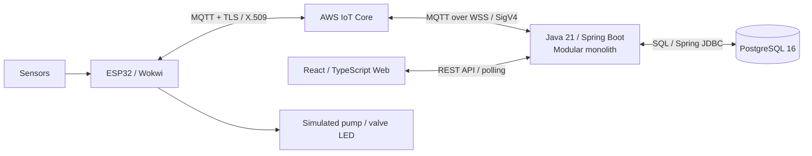
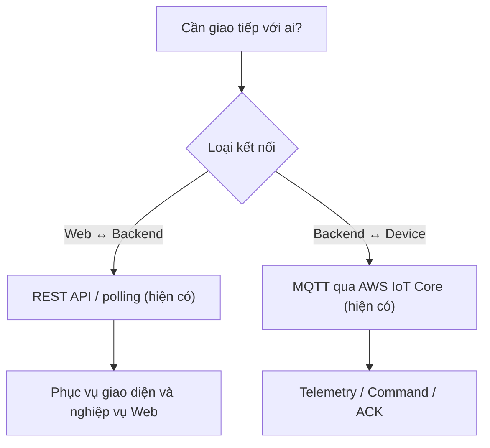

# 第12.03課 — 使用技術と選定理由 | Công nghệ sử dụng và lý do lựa chọn

> **BRSE Interview Master · 第12章 技術デモ・プレゼンテーション**  
> Đối tượng: N3–N2 · Câu trả lời chính: 15–30 giây · **Status: Draft / Pending technical & Japanese review**  
> Case study: Smart Farm IoT Management System. Dựa trên mô tả do tác giả cung cấp, **không thay thế đối chiếu mã nguồn, tài liệu thiết kế hoặc phỏng vấn tác giả kiến trúc**.  
> Bài trước: [12.02 — システム構成](12-02-system-architecture.md). Bài liên quan: [12.05 — デバイス制御・ACK](12-05-device-control-ack.md).

## ① 学習目標 — Mục tiêu

Sau bài học, người học có thể:
- Nói đúng vai trò của ESP32, AWS IoT Core, MQTT, Spring Boot, PostgreSQL và React.
- Giải thích **MQTT và REST API không phải hai lựa chọn thay thế hoàn toàn**: chúng được dùng ở những đoạn kết nối khác nhau trong kiến trúc này.
- Đưa ra **lập luận có điều kiện** khi được hỏi “vì sao chọn công nghệ?”, không bịa lý do lịch sử của nhóm.
- Trả lời và bảo vệ quan điểm ngắn bằng tiếng Nhật, có câu hỏi đào sâu, trade-off và giới hạn xác minh.

## ② 使用技術一覧 — Công nghệ trong hệ thống

| Layer | Công nghệ theo mô tả dự án | Vai trò có cơ sở |
|---|---|---|
| Firmware | ESP32, C/C++, Arduino Framework, PlatformIO | Đọc cảm biến, gửi bản tin, xử lý lệnh |
| Mô phỏng | Wokwi | Mô phỏng cảm biến, điều kiện môi trường và LED đại diện actuator |
| Device messaging | AWS IoT Core, MQTT, TLS, X.509 | Kết nối xác thực, trao đổi telemetry / command / ACK |
| Backend device connection | MQTT qua WSS / SigV4 | Backend kết nối AWS IoT Core theo mô tả kiến trúc |
| Backend | Java 21, Spring Boot, Spring JDBC, AWS IoT Device SDK | REST API, xử lý nghiệp vụ IoT, lưu và quản lý lệnh |
| Architecture | Modular monolith | Một ứng dụng backend, tách module nghiệp vụ |
| Web | React, TypeScript, Vite, Tailwind CSS | Dashboard, quản lý khu vực, cảm biến, điều khiển |
| Web communication | REST API / polling | Web gọi backend; lấy dữ liệu và cập nhật trạng thái theo chu kỳ |
| Persistence | PostgreSQL 16, Flyway | Lưu dữ liệu lịch sử, cấu hình, lệnh, ACK, event; quản lý migration |
| Development / testing | Git, Maven, Docker Compose, Python, JUnit, Spring Boot Test, PostgreSQL integration tests, Playwright | Công cụ phát triển, kiểm thử và tự động hóa thao tác |

**Phân biệt:** Công nghệ **được dùng** là dữ kiện từ project brief; **lý do lựa chọn ban đầu** chưa được cung cấp đầy đủ. Phần trade-off bên dưới là **giải thích kỹ thuật để luyện phỏng vấn**, không được phát biểu là quyết định lịch sử của nhóm nếu chưa đối chiếu.

## ③ 図解 — Công nghệ hoạt động cùng nhau thế nào?

*Đây là sơ đồ kiến trúc mô tả, không xác nhận khả năng production hoặc vận hành bơm/van thật.*

### 日本語で30秒説明 — Giải thích sơ đồ

**応募者：** デバイス側ではESP32を使い、AWS IoT CoreとMQTTで通信します。バックエンドはJavaとSpring Bootで開発し、データをPostgreSQLに保存します。Web画面はReactで作り、REST APIを通じてバックエンドと通信します。現在は主にローカル環境とシミュレーションで検証しています。

**Dịch:** Phía thiết bị sử dụng ESP32, giao tiếp MQTT với AWS IoT Core. Backend dùng Java/Spring Boot và lưu PostgreSQL. Web dùng React, trao đổi REST API với backend. Hiện dự án chủ yếu kiểm thử trong môi trường local và mô phỏng.

**Định hướng tư duy:** **Layer → Technology → Responsibility → Limitation**.

## ④ 面接対話 — Hội thoại phỏng vấn theo từng kiến thức

### Q1 — なぜMQTTですか。 (Vì sao MQTT?)

**質問の意図:** Hiểu đặc trưng giao tiếp thiết bị và asynchronous messaging.

**面接官：** なぜIoT機器との通信にMQTTを使っていますか。  
**応募者（Standard）：** MQTTは軽量で、IoT機器との通信に適しています。Publish/Subscribe方式を使うことで、データや制御コマンドを非同期にやり取りできます。

**Dịch:** MQTT nhẹ và phù hợp giao tiếp IoT. Pub/Sub cho phép trao đổi dữ liệu và lệnh bất đồng bộ.

**深掘り — 面接官：** MQTTなら、コマンド送信後に必ず実行されますか。  
**応募者：** いいえ。送信と実行は別です。デバイスからのACKや状態を確認する必要があります。

**Dịch:** Không. Gửi và thực thi khác nhau; cần kiểm tra ACK và trạng thái thiết bị.

**Trade-off:** MQTT phù hợp messaging thiết bị; không có nghĩa mặc định đảm bảo exactly-once ở cấp nghiệp vụ, hoặc thiết bị thật đã vận hành.

### Q2 — MQTTとHTTP/RESTの違い (MQTT so với REST)

**質問の意図:** Có hiểu mỗi protocol được dùng ở đâu, không so sánh hời hợt.

**面接官：** このシステムでは、MQTTとREST APIをどう使い分けていますか。  
**応募者（Standard）：** デバイスとの通信にはMQTTを使っています。一方、Reactの画面はREST APIでバックエンドと通信します。用途に合わせて使い分けています。

**Dịch:** MQTT dùng để trao đổi với thiết bị. React dùng REST API để giao tiếp với backend; mỗi cách phục vụ một mục đích.

**深掘り — 面接官：** REST APIだけではだめですか。  
**応募者：** HTTPでも実現できる場合はあります。ただ、この構成ではMQTTのPublish/Subscribe方式をデバイス通信に利用しています。

**Dịch:** Có trường hợp HTTP cũng làm được. Nhưng kiến trúc này sử dụng pub/sub MQTT cho thiết bị.

**Lưu ý:** REST là phong cách kiến trúc API, thường sử dụng HTTP; MQTT là giao thức messaging. Đừng khẳng định mọi HTTP đều đồng bộ hay MQTT tự động tốt hơn trong mọi tình huống.

### Q3 — AWS IoT Coreの役割 (Vai trò AWS IoT Core)

**面接官：** AWS IoT Coreは何のために使っていますか。  
**応募者：** ESP32とバックエンドの間で、MQTTメッセージをやり取りするために使っています。TLSや証明書を使ったデバイスの接続にも対応しています。

**Dịch:** AWS IoT Core giúp trao đổi MQTT giữa ESP32 và backend, hỗ trợ kết nối thiết bị sử dụng TLS và chứng chỉ.

**深掘り — 面接官：** バックエンドもAWS上で動いていますか。  
**応募者：** いいえ。現在、バックエンドとPostgreSQLは主にローカル環境で動かし、AWS IoT Coreに接続しています。

**Dịch:** Không. Backend và PostgreSQL chủ yếu chạy local, kết nối tới AWS IoT Core.

**Không được nói:** Hệ thống đã deploy hoàn chỉnh trên AWS nếu không có minh chứng.

### Q4 — Spring Bootを使う理由 (Vì sao Spring Boot?)

**面接官：** バックエンドにSpring Bootを使うメリットは何ですか。  
**応募者（Standard）：** Spring BootはJavaでREST APIや業務処理を実装しやすいフレームワークです。このシステムでは、APIやセンサーデータの処理、制御コマンドの管理に使っています。

**Dịch:** Spring Boot hỗ trợ xây dựng REST API và xử lý nghiệp vụ Java. Trong hệ thống này, nó phục vụ API, xử lý dữ liệu và quản lý lệnh.

**深掘り — 面接官：** なぜマイクロサービスにしていないのですか。  
**応募者：** 現在は一つのアプリケーション内で機能ごとにモジュールを分けています。構成を複雑にしすぎず、機能を整理できる点がメリットです。

**Dịch:** Hiện hệ thống chia module trong một ứng dụng; thuận lợi là tổ chức nghiệp vụ mà chưa tăng độ phức tạp triển khai.

**Tính trung thực:** Đây là lợi ích có cơ sở của kiến trúc, **không xác nhận động cơ ra quyết định của team**.

### Q5 — PostgreSQLの役割 (Tại sao PostgreSQL?)

**面接官：** PostgreSQLには、どのような情報を保存していますか。  
**応募者：** センサーデータの履歴、設定情報、コマンド、ACK、灌漑セッションなどを保存しています。あとから状態や処理結果を調査できるようにしています。

**Dịch:** CSDL lưu lịch sử cảm biến, cấu hình, lệnh, ACK, phiên tưới; hỗ trợ kiểm tra trạng thái và kết quả sau này.

**深掘り — 面接官：** MongoDBではなくPostgreSQLを使う理由は何ですか。  
**応募者（Professional）：** PostgreSQLはリレーショナルデータやトランザクションを扱うのに適しています。ただし、MongoDBとの比較を含めた正式な選定理由は、設計資料を確認して説明します。

**Dịch:** PostgreSQL phù hợp dữ liệu quan hệ và transaction. Tuy nhiên, lý do quyết định chính thức so với MongoDB cần đối chiếu tài liệu thiết kế.

**Không được tự khẳng định:** PostgreSQL luôn nhanh hơn MongoDB, hoặc dự án đã benchmarking.

### Q6 — ReactとSpring Bootの連携 (Frontend/Backend)

**面接官：** Reactはバックエンドとどのように連携していますか。  
**応募者：** ReactからREST APIを呼び出して、センサーデータやデバイス情報を取得します。状態の更新にはポーリングを使っています。

**Dịch:** React gọi REST API lấy dữ liệu cảm biến, thông tin thiết bị; polling được dùng để cập nhật trạng thái.

**深掘り — 面接官：** WebSocketによるリアルタイム更新ですか。  
**応募者：** 現在説明しているWeb画面はREST APIとポーリング方式です。WebSocketによる画面更新は確認できていません。

**Dịch:** Theo mô tả hiện có, giao diện dùng REST và polling; chưa xác nhận cơ chế WebSocket cho cập nhật web.

### Q7 — Security: TLS / X.509

**面接官：** TLSとX.509証明書は何のために使っていますか。  
**応募者：** デバイスとAWS IoT Coreの通信を保護するためです。TLSで通信を暗号化し、証明書を使って接続相手を認証します。

**Dịch:** Để bảo vệ giao tiếp thiết bị–AWS, TLS mã hóa đường truyền và chứng chỉ phục vụ xác thực.

**深掘り — 面接官：** これでシステム全体のセキュリティは十分ですか。  
**応募者：** いいえ。通信の保護だけでは不十分です。アクセス権限やAPIの認証なども別に確認する必要があります。

**Dịch:** Không, bảo vệ kết nối chưa đủ; còn phải xem phân quyền và xác thực API. **Đây là nguyên tắc an toàn, không khẳng định các cơ chế khác đã triển khai**.

### Q8 — Spring JDBC / Flyway

**面接官：** Spring JDBCとFlywayは、どのような役割ですか。  
**応募者：** Spring JDBCはJavaからデータベースを操作するために使っています。Flywayはデータベースの構造変更を管理するために使っています。

**Dịch:** Spring JDBC truy cập database từ Java; Flyway quản lý các lần thay đổi schema.

**深掘り — 面接官：** データベースの構造を変更するとき、何に注意しますか。  
**応募者：** 既存データへの影響や、アプリとの互換性を確認します。必要なテストも行います。

**Dịch:** Kiểm tra ảnh hưởng tới dữ liệu cũ, tương thích ứng dụng và kiểm thử cần thiết. Đây là **cách làm khuyến nghị**, không tự nhận đã thực hiện migration production.

### Q9 — Testing stack

**面接官：** どのようなテスト技術を使っていますか。  
**応募者：** バックエンドのテストにはJUnitやSpring Boot Testを使っています。PostgreSQLを使った結合テストや、Playwrightによる画面テストもあります。

**Dịch:** Dùng JUnit/Spring Boot Test cho backend, integration test với PostgreSQL và kiểm thử giao diện bằng Playwright.

**深掘り — 面接官：** すべての機能のテストが終わっていますか。  
**応募者：** いいえ。高度な機能の一部は、まだ追加の検証が必要です。テスト範囲と結果を確認してから報告します。

**Dịch:** Chưa. Một số chức năng nâng cao cần kiểm tra thêm, và chỉ báo cáo sau khi xác nhận phạm vi/kết quả.

## ⑤ 技術比較 — Bảng so sánh kiến thức cần nắm

| So sánh | Trọng tâm | Tránh nói |
|---|---|---|
| MQTT vs REST | MQTT pub/sub thiết bị; REST API cho web/backend trong hệ thống này | MQTT luôn tốt hơn REST |
| Spring Boot vs framework khác | Java backend/REST, hệ sinh thái Spring | Spring Boot tự động đảm bảo hiệu năng |
| PostgreSQL vs MongoDB | Data model, quan hệ, transactions và truy vấn; lựa chọn phụ thuộc yêu cầu | SQL luôn nhanh hơn NoSQL |
| Modular monolith vs microservices | Một deployment backend với module tách biệt; đổi lại giới hạn độc lập triển khai | Microservices luôn hiện đại hơn |
| Polling vs Push | Polling lấy dữ liệu theo khoảng, có đánh đổi về độ trễ/lưu lượng; push khác về cơ chế | Polling là cập nhật tức thì |
| MQTT publish vs Device ACK | Gửi lệnh khác phản hồi thiết bị | Publish thành công = bơm đã chạy |

## ⑥ 語彙・表現 — Từ vựng và cách nói

| 日本語 | 読み方 | Nghĩa |
|---|---|---|
| 使用技術 | しようぎじゅつ | Công nghệ sử dụng |
| 採用する | さいようする | Lựa chọn, áp dụng |
| 選定理由 | せんていりゆう | Lý do lựa chọn |
| 用途 | ようと | Mục đích sử dụng |
| 通信方式 | つうしんほうしき | Phương thức giao tiếp |
| 軽量 | けいりょう | Nhẹ |
| 非同期 | ひどうき | Bất đồng bộ |
| 送信する | そうしんする | Gửi |
| 取得する | しゅとくする | Lấy/thu nhận |
| 保存する | ほぞんする | Lưu |
| 検証する | けんしょうする | Xác minh/kiểm chứng |
| 構成 | こうせい | Cấu trúc/kiến trúc |
| 拡張性 | かくちょうせい | Khả năng mở rộng |
| 保守性 | ほしゅせい | Tính bảo trì |
| 暗号化 | あんごうか | Mã hóa |
| 認証 | にんしょう | Xác thực |
| 権限 | けんげん | Quyền truy cập |
| 結合テスト | けつごうテスト | Kiểm thử tích hợp |
| 本番運用 | ほんばんうんよう | Vận hành production |
| 未確認 | みかくにん | Chưa xác minh |

### 類似表現比較 — So sánh cách diễn đạt

- **使っています**: trung tính “đang sử dụng”; phù hợp nói về công nghệ hiện có.
- **採用しました**: “đã chọn/áp dụng”; dùng khi xác nhận được quyết định lựa chọn.
- **〜に適しています**: “phù hợp với…”; không tuyệt đối hóa thành tốt nhất.
- **〜と考えています**: “tôi cho rằng…”; thể hiện đánh giá cá nhân, khác với bằng chứng đã kiểm thử.
- **〜については確認が必要です**: “cần xác nhận về…”; diễn đạt trung thực khi chưa có thông tin.

## ⑦ 会話練習 — Luyện phản xạ

**Drill A — 20 giây:** 「MQTTとREST APIはどう使い分けていますか。」 Trả lời hai câu.

**Drill B — 30 giây:** Giải thích sơ đồ bằng tiếng Nhật theo 5 thành phần ESP32 → AWS → Spring Boot → PostgreSQL ↔ React.

**Drill C — 15 giây:** 「バックエンドはAWS上で動いていますか。」 Trả lời đúng tình trạng local.

**Drill D — 25 giây:** 「なぜMongoDBではなくPostgreSQLですか。」 Nêu ưu điểm phù hợp **và giới hạn chưa biết lý do quyết định ban đầu**.

**Drill E — BrSE roleplay:** Khách hàng hỏi: 「この仕組みは通信が切れても必ず安全に動きますか。」 Không được khẳng định hệ thống đã đảm bảo fail-safe. Trả lời điều có thể xác nhận, câu hỏi cần làm rõ, và cách trao đổi đội dev.

**Drill F — Interview transfer:** Người phỏng vấn đổi bối cảnh sang thiết bị ở xa kết nối không ổn định. Giải thích các tiêu chí nên đánh giá (kết nối, độ trễ, phản hồi, trạng thái), **không bịa thiết kế offline/retry đã có**.

### AI Mock Interview Prompt

> あなたは日本企業のBrSE技術面接官です。Smart Farmの技術選定について、一問ずつ質問してください。回答を待ってから、理由・トレードオフ・未確認事項に関する深掘り質問を一つだけしてください。5問後に技術的な正確さ、日本語の自然さ、説明の分かりやすさ、正直さを評価してください。回答は15〜30秒を目標にしてください。

## ⑧ 解答のポイント — Đáp án định hướng

1. **MQTT:** giao tiếp pub/sub giữa thiết bị và backend qua AWS IoT.
2. **REST:** giao diện React ↔ backend; polling để cập nhật trạng thái.
3. **AWS:** IoT Core được sử dụng; **backend và PostgreSQL chủ yếu vẫn local**.
4. **Spring Boot:** backend Java, REST và nghiệp vụ; modular monolith.
5. **PostgreSQL:** lưu dữ liệu quan hệ, lịch sử, lệnh/ACK; không suy ra tốt hơn tất cả NoSQL.
6. **Security:** TLS/X.509 ở thiết bị–AWS; không đồng nghĩa toàn hệ thống bảo mật hoàn chỉnh.
7. **Testing:** có công nghệ kiểm thử được liệt kê; một số chức năng vẫn cần nghiệm thu thêm.

## ⑨ 評価・改善 — Rubric /20

| Tiêu chí (0–4) | Đạt 4 điểm |
|---|---|
| Answer Relevance | Trả lời trực tiếp câu hỏi, không kể lan man tên công nghệ |
| Technical Accuracy | Nêu đúng vai trò và giới hạn công nghệ |
| Japanese Naturalness | Tiếng Nhật ngắn, đúng, tự nhiên |
| Explanation Clarity | Có thể giải thích theo layer/sơ đồ |
| Follow-up Handling | Biết phân tích trade-off, trả lời trung thực khi chưa xác minh |

Mốc luyện tập **nội bộ**: 16–20 tốt, 12–15 cần sửa, dưới 12 cần luyện lại. Không phải thang điểm tuyển dụng chính thức. Nếu không có audio, không chấm phát âm.

**Feedback:** chỉ ra tối đa ba lỗi chính; đề xuất câu sửa ngắn hơn; yêu cầu trả lời lại không nhìn mẫu.

## ⑩ 出典・検証状況 — Nguồn và trạng thái xác minh

| Nội dung | Trạng thái |
|---|---|
| Danh sách ESP32, MQTT, AWS IoT Core, Java/Spring Boot, React, PostgreSQL, Flyway, bộ công cụ kiểm thử | Thông tin dự án do người dùng cung cấp |
| Kết nối ESP32/Wokwi–AWS–backend | Có bằng chứng chạy thử theo mô tả, chưa kiểm toán độc lập |
| Backend và PostgreSQL chạy production trên AWS | **Không xác nhận**; phần lớn đang local |
| Lý do chính thức ban đầu chọn MQTT/Spring Boot/PostgreSQL | **Chưa cung cấp**; các lập luận “vì sao” là giải thích kỹ thuật có điều kiện |
| Hiệu năng, số user đồng thời, SLA, benchmark | **Chưa được cung cấp** |
| Toàn bộ chức năng nâng cao đã nghiệm thu | **Chưa xác nhận** |
| Bơm và van nông nghiệp thật | **Chưa xác nhận vận hành** |
| Cấu hình bảo mật chi tiết, policies, topic permissions | Cần đối chiếu repository và cấu hình |
| Tiếng Nhật được native reviewer xác nhận | **Chưa xác nhận** |

**Quality gate trước khi publish:** rà soát câu chữ, thời lượng nói thực tế, Mermaid render, đối chiếu code/architecture decision record (nếu có), chính xác trạng thái test và giới hạn sản phẩm.

---

**Ghi nhớ cuối bài:** **「何を使っていますか」khác với「なぜそれを選びましたか」**. Hãy phân biệt *công nghệ đang dùng* với *lý do lựa chọn thực tế đã xác minh*.
