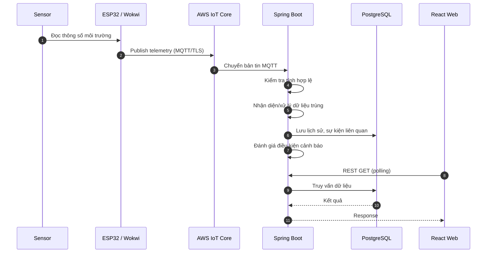

# 第12.04課 — センサーデータ処理 | Xử lý dữ liệu cảm biến (Telemetry)

> **BRSE Interview Master · 第12章 技術デモ・プレゼンテーション**  
> **Trình độ:** JLPT N3–N2 · **Thời lượng trả lời chính:** mục tiêu 15–30 giây  
> **Học liệu:** Draft / Pending Japanese & Technical Review  
> **Căn cứ:** Mô tả *Smart Farm IoT Management System* do tác giả cung cấp; không phải biên bản kiểm toán mã nguồn hoặc chứng cứ nghiệm thu độc lập.  
> **Bài liên quan:** [12.02 システム構成](12-02-system-architecture.md) · [12.03 使用技術](12-03-technology-selection.md) · [12.05 デバイス制御・ACK](12-05-device-control-ack.md)

## ① 学習目標 — Mục tiêu

Sau bài học, bạn có thể:
1. Trình bày luồng **cảm biến → ESP32/Wokwi → MQTT → AWS IoT Core → Spring Boot → PostgreSQL → React**.
2. Giải thích mục đích của **device ID, boot ID, sequence và thời gian đo**.
3. Phân biệt **data validation**, **duplicate handling**, **lưu lịch sử**, **đánh giá cảnh báo** và **hiển thị gần thời gian thực**.
4. Trả lời câu hỏi đào sâu về dữ liệu lặp, dữ liệu đến chậm, mất kết nối và tình trạng kiểm thử — không bịa triển khai.
5. Giải thích sơ đồ bằng tiếng Nhật trong khoảng 30 giây.

## ② 技術知識 — Kiến thức cốt lõi

**Telemetry (テレメトリーデータ)** là dữ liệu thiết bị gửi về hệ thống nhằm phục vụ giám sát và phân tích trạng thái môi trường. Trong Smart Farm, nguồn là ESP32 hoặc Wokwi mô phỏng cảm biến nhiệt độ, độ ẩm không khí, độ ẩm đất và các thông tin môi trường/nguồn nước được mô tả. Không giả định tất cả loại cảm biến hoặc giá trị đều đã được xác minh ngoài thực địa.

Theo tài liệu mô tả, mỗi bản tin có:

| Trường | Tác dụng chính | Không được tự kết luận |
|---|---|---|
| **device ID** | Xác định thiết bị gửi | Không tự chứng minh danh tính thiết bị đã được xác thực end-to-end |
| **boot ID** | Phân biệt các lần khởi động | Không đảm bảo duy nhất toàn cục nếu chưa biết thuật toán |
| **sequence** | Hỗ trợ nhận biết thứ tự và kiểm tra bản tin lặp trong phạm vi phù hợp | Không mặc định tăng liên tục mãi hoặc không bao giờ mất |
| **measurement timestamp** | Thời điểm thiết bị ghi nhận phép đo | Không mặc định đồng hồ ESP32 luôn chính xác hoặc đồng bộ |

**Backend theo mô tả:** tiếp nhận bản tin MQTT từ AWS IoT Core, kiểm tra dữ liệu, xử lý dữ liệu trùng, lưu lịch sử và đánh giá điều kiện cảnh báo. React gọi REST API/polling để xem dữ liệu gần thời gian thực và lịch sử. Không giả định web đăng ký MQTT trực tiếp.

> **Giới hạn xác minh:** Chưa được cung cấp payload JSON chính xác, MQTT topic thực tế, thuật toán chống trùng, điều kiện cảnh báo cụ thể, database schema, tần suất gửi hay số đo latency. Ví dụ kỹ thuật bên dưới chỉ minh họa khái niệm, **không phải payload đã được xác nhận của dự án**.

## ③ 図解 — Sơ đồ luồng Telemetry

*Sơ đồ là thứ tự logic dựa trên mô tả hệ thống. Thứ tự chính xác giữa lưu dữ liệu và đánh giá cảnh báo, transaction boundaries và hành vi từng nhánh lỗi cần kiểm tra code.*

### 日本語で30秒説明

**面接官：** センサーデータの処理の流れを説明してください。

**応募者：** ESP32がセンサーデータを取得し、MQTTでAWS IoT Coreに送信します。バックエンドはデータの内容と重複を確認し、PostgreSQLに履歴を保存します。Reactの画面ではREST APIを使ってデータを取得し、環境の状態を確認できます。

**Dịch:** ESP32 lấy dữ liệu cảm biến rồi gửi bằng MQTT tới AWS IoT Core. Backend kiểm tra nội dung và dữ liệu trùng, lưu lịch sử PostgreSQL. Giao diện React dùng REST API để lấy dữ liệu và xem trạng thái môi trường.

**Khung nói:** 取得 → 送信 → 確認 → 保存 → 表示.

---

## ④ 面接対話 — Hội thoại ngắn theo kiến thức

### Q1 — テレメトリーとは何ですか。 (Telemetry là gì?)

**質問の意図:** Có hiểu dữ liệu IoT được gửi về để làm gì không?

**面接官：** テレメトリーデータとは何ですか。  
**応募者：** デバイスから送られる測定データや状態情報のことです。このシステムでは、温度や湿度、土壌の水分などを監視するために使っています。

*Dịch:* Telemetry là dữ liệu đo hoặc trạng thái được thiết bị gửi về; ở đây dùng để giám sát nhiệt độ, độ ẩm không khí và độ ẩm đất.

**深掘り — 面接官：** そのデータを保存する理由は何ですか。  
**応募者：** 現在の状態だけでなく、過去の変化や異常が起きた時の状況を確認するためです。

*Dịch:* Để xem biến động lịch sử và tình trạng khi có bất thường, không chỉ dữ liệu hiện tại.

### Q2 — データはどこを通りますか。 (Dữ liệu đi qua đâu?)

**面接官：** ESP32からデータベースまで、どうやってデータを送りますか。  
**応募者：** ESP32がMQTTでAWS IoT Coreにデータを送信します。バックエンドがそのデータを受信して処理し、PostgreSQLに保存します。

*Dịch:* ESP32 gửi MQTT tới AWS IoT Core, backend nhận và xử lý rồi lưu PostgreSQL.

**深掘り — 面接官：** ReactはAWS IoT Coreに直接接続していますか。  
**応募者：** いいえ。現在の構成では、ReactはバックエンドのREST APIからデータを取得します。

*Dịch:* Không; trong kiến trúc hiện tại React lấy dữ liệu qua REST API của backend.

### Q3 — device ID・boot ID・sequence

**面接官：** なぜデバイスIDや起動ID、連番を入れていますか。  
**応募者：** どのデバイスから送られたデータか分かるようにするためです。起動IDと連番は、再起動後のデータを区別したり、重複を確認したりする時にも役立ちます。

*Dịch:* Device ID xác định thiết bị; boot ID và sequence hỗ trợ phân biệt dữ liệu sau khởi động lại và kiểm tra dữ liệu trùng.

**深掘り — 面接官：** 連番だけで必ず重複を判定できますか。  
**応募者：** いいえ。再起動や連番のリセットも考える必要があります。実際の判定条件は、実装を確認して説明します。

*Dịch:* Không; phải xét khởi động lại hoặc reset sequence, cần đối chiếu điều kiện code thực tế.

### Q4 — 重複データ (Dữ liệu trùng)

**面接官：** 同じセンサーデータが二回届いた場合、どうしますか。  
**応募者：** バックエンドで、デバイスIDや起動ID、連番などを使って重複を確認します。重複と判断したデータは、設計した処理ルールに従って扱います。

*Dịch:* Backend dựa trên các thông tin như device ID, boot ID và sequence để kiểm tra trùng; dữ liệu được xác định là trùng xử lý theo quy tắc thiết kế.

**深掘り — 面接官：** その判定は完全ですか。  
**応募者：** 判定方法の詳細と例外ケースは、コードやテスト結果を確認する必要があります。現時点では完全だとは断言できません。

*Dịch:* Cần kiểm tra thuật toán, các trường hợp ngoại lệ và test; hiện không khẳng định hoàn hảo.

### Q5 — バリデーション (Kiểm tra dữ liệu)

**面接官：** 受信したセンサーデータは、そのまま保存しますか。  
**応募者：** いいえ。まずデータの内容を確認し、適切に処理してから保存します。具体的なチェック条件は、実装を確認して説明します。

*Dịch:* Không, backend kiểm tra nội dung trước khi xử lý/lưu. Điều kiện kiểm tra cụ thể cần xem mã nguồn.

**深掘り — 面接官：** 例えば、何を確認する必要がありますか。  
**応募者：** 一般的には、必須項目や値の形式、異常な値などを確認します。ただし、このシステムでの具体的なルールは別途確認が必要です。

*Dịch:* Về nguyên tắc có thể kiểm tra trường bắt buộc, định dạng và giá trị bất thường; chưa khẳng định những rule đó đã được triển khai.

### Q6 — アラート判定 (Cảnh báo)

**面接官：** アラートはどこで判定していますか。  
**応募者：** バックエンドでセンサーデータを処理し、設定された条件に基づいてアラートを判定します。結果は履歴やイベントの管理にも利用します。

*Dịch:* Backend đánh giá cảnh báo theo điều kiện cấu hình, dùng kết quả cho quản lý lịch sử và sự kiện.

**深掘り — 面接官：** 土壌が乾いていたら、必ず自動で水を出しますか。  
**応募者：** いいえ。水分だけでなく、許可された時間帯や水の状態、雨などの条件も考慮する設計です。すべての動作が実機で検証されたわけではありません。

*Dịch:* Không; thiết kế còn xét lịch cho phép, tình trạng nước, mưa. Chưa xác nhận mọi hoạt động được kiểm thử với thiết bị thật.

### Q7 — ほぼリアルタイム (Gần thời gian thực)

**面接官：** ダッシュボードのデータはリアルタイムで更新されますか。  
**応募者：** Web画面はREST APIとポーリングを使っています。そのため、更新には一定の間隔があります。具体的な遅延時間は、測定結果を確認する必要があります。

*Dịch:* Web dùng REST và polling, nên cập nhật có khoảng thời gian; số liệu độ trễ cần đo/đối chiếu.

**深掘り — 面接官：** 更新が遅いと言われたら、どうしますか。  
**応募者：** まず、どの画面でどのくらい遅いか確認します。その後、デバイスの送信からAPIの応答までを分けて調べます。

*Dịch:* Làm rõ trang nào chậm và mức độ, rồi kiểm tra từng chặng từ thiết bị đến API.

### Q8 — 通信障害 (Mất kết nối)

**面接官：** デバイスがオフラインになった場合、どうしますか。  
**応募者：** まず、最後に受信した時刻と通信状況を確認します。オフライン中のデータをどう扱うかは、仕様と実装を確認して判断します。

*Dịch:* Kiểm tra thời điểm nhận cuối và tình trạng kết nối; việc xử lý dữ liệu khi offline cần dựa trên spec/triển khai.

**深掘り — 面接官：** データは自動的に再送されますか。  
**応募者：** 自動再送の仕組みについては、まだ確認できていません。動作を断言せず、ファームウェアとバックエンドの仕様を調べます。

*Dịch:* Chưa xác minh cơ chế gửi lại tự động; sẽ kiểm tra firmware và backend thay vì khẳng định.

---

## ⑤ 技術深掘り — Phân tích kỹ thuật để trả lời câu hỏi khó

### Duplicate detection và tính chính xác

Một chiến lược **ứng viên** là xét tổ hợp (device ID, boot ID, sequence) để nhận dạng bản tin; tuy nhiên hiệu lực phụ thuộc cách sinh boot ID, quy tắc sequence, thay đổi firmware và transaction/database constraints. **Không khẳng định dự án sử dụng chính xác composite key hoặc unique index này khi chưa xem code.**

### Đến chậm và ngoài thứ tự

Timestamp đo và thời gian backend nhận có ý nghĩa khác nhau. Khi bản tin đến chậm hoặc ngoài thứ tự, cần tránh mặc định bản tin đến sau là số đo mới hơn. Cơ chế xử lý thực tế của dự án đối với các trường hợp này **chưa có bằng chứng chi tiết**.

### Validity không đồng nghĩa authenticity

Dữ liệu có đầy đủ trường và đúng định dạng chưa chứng minh người gửi hợp lệ. ESP32 giao tiếp AWS IoT Core qua TLS/chứng chỉ X.509 theo mô tả, nhưng chính sách topic, phân quyền và bảo vệ dữ liệu xuyên suốt backend cần kiểm tra cấu hình thực tế.

### Event, alert và water usage

Hệ thống được mô tả có lưu cảnh báo, sự kiện và ước tính lượng nước theo độ phủ dữ liệu. Không suy ra thuật toán tính lượng nước, ngưỡng cảnh báo hoặc độ chính xác cảm biến cụ thể nếu chưa có tài liệu/kiểm thử.

### Cách trình bày giới hạn một cách chuyên nghiệp

**応募者：** その処理の基本的な流れは説明できますが、細かい判定条件についてはコードとテスト結果を確認した上でお答えします。

*Dịch:* Tôi có thể giải thích luồng tổng thể, còn điều kiện xử lý chi tiết sẽ xác nhận code và kết quả test trước khi trả lời.

---

## ⑥ 語彙・文法 — Từ vựng IT

| 日本語 | 読み方 | Nghĩa |
|---|---|---|
| センサーデータ | センサーデータ | Dữ liệu cảm biến |
| テレメトリー | テレメトリー | Telemetry |
| 測定値 | そくていち | Giá trị đo |
| 温度 | おんど | Nhiệt độ |
| 湿度 | しつど | Độ ẩm |
| 土壌水分 | どじょうすいぶん | Độ ẩm đất |
| 取得する | しゅとくする | Thu nhận |
| 送信する | そうしんする | Gửi |
| 受信する | じゅしんする | Nhận |
| 起動ID | きどうアイディー | Mã phiên khởi động |
| 連番 | れんばん | Số thứ tự liên tiếp |
| 測定時刻 | そくていじこく | Thời gian đo |
| 重複 | ちょうふく／じゅうふく | Trùng lặp |
| 判定する | はんていする | Đánh giá/xác định |
| 検証する | けんしょうする | Kiểm chứng |
| 保存する | ほぞんする | Lưu |
| 履歴 | りれき | Lịch sử |
| 異常値 | いじょうち | Giá trị bất thường |
| 警告 | けいこく | Cảnh báo |
| 更新間隔 | こうしんかんかく | Khoảng cập nhật |
| 通信障害 | つうしんしょうがい | Sự cố kết nối |
| 未確認 | みかくにん | Chưa xác minh |

### 類似表現比較 — Các cách nói cần phân biệt

| Biểu đạt | Ý nghĩa và ngữ cảnh |
|---|---|
| 取得する / 受信する | 取得する nhấn mạnh lấy/thu thập dữ liệu; 受信する nhấn mạnh nhận qua kết nối |
| 確認する / 検証する | 確認する: xác nhận/kiểm tra; 検証する: kiểm chứng một giả thuyết hoặc tính đúng bằng quy trình |
| 測定時刻 / 受信時刻 | Thời điểm cảm biến đo / thời điểm hệ thống nhận |
| ほぼリアルタイム / リアルタイム | Gần thời gian thực / thời gian thực; không khẳng định realtime nếu chỉ có polling |
| 〜に基づいて | Dựa trên… (例: 設定された条件に基づいて判定します) |
| 〜だけでは〜とは言えません | Chỉ với… chưa thể kết luận… |

---

## ⑦ 会話練習 — Tự trả lời không nhìn mẫu

1. **15 giây:** 「テレメトリーとは何ですか。」
2. **30 giây:** 「ESP32のデータはどうやってWeb画面に表示されますか。」
3. **20 giây:** 「なぜ起動IDと連番が必要ですか。」
4. **30 giây:** 「重複したメッセージが届いたら、どう対応しますか。」
5. **20 giây:** 「このダッシュボードは完全なリアルタイムですか。」
6. **BrSE transfer:** Khách hàng nói「昨日の測定データが一部ありません。原因は何ですか。」 Hỏi làm rõ phạm vi/thời gian/thiết bị, kiểm tra evidence, không bịa nguyên nhân.

### Prompt AI Mock Interview

> あなたは日本企業のBrSE技術面接官です。Smart Farmのセンサーデータ処理について一問ずつ質問してください。毎回回答を待ち、その内容に応じて関連する深掘り質問を一つだけしてください。テレメトリー、デバイスID、起動ID、連番、重複、バリデーション、保存、アラート、ポーリングを評価してください。回答は15〜30秒を目標とし、5問後にフィードバックをしてください。未確認の仕様や実績を事実として扱わないでください。

## ⑧ 解答・チェックポイント

- Sensor/ESP32 → AWS IoT Core/MQTT → Spring Boot → PostgreSQL; React qua REST/polling.
- Device ID + boot ID + sequence hỗ trợ xác định bản tin, nhưng **không tự đảm bảo chống trùng hoàn hảo**.
- Measurement timestamp khác thời điểm nhận dữ liệu ở server.
- Validate, duplicate handling và alert được mô tả là có trong backend; **chi tiết code và test chưa được đối chiếu**.
- Polling không phải dữ liệu thời gian thực tức thì.
- Nếu offline, không được tự nhận dữ liệu sẽ được buffer/retry nếu chưa có bằng chứng.
- Dữ liệu từ mô phỏng không đồng nghĩa vận hành cảm biến ngoài vườn thật.

## ⑨ 評価・改善 — Rubric /20

| Tiêu chí (0–4) | Mức tốt nhất (4 điểm) |
|---|---|
| Answer Relevance | Trả lời thẳng trọng tâm trong 15–30 giây |
| Technical Accuracy | Đúng luồng, không bịa algorithm/QoS/retry |
| Japanese Naturalness | Câu Nhật gọn, tự nhiên, đúng mức N3–N2 |
| Explanation Clarity | Mô tả data flow theo thứ tự dễ hiểu |
| Follow-up Handling | Trả lời được trùng lặp, độ trễ, lỗi kết nối với giới hạn rõ |

**Mốc luyện tập nội bộ:** 16–20 tốt; 12–15 cần sửa; dưới 12 nên ôn lại. Không phải rubric JLPT chính thức. Không chấm phát âm nếu không có bản ghi âm.

## ⑩ 出典・検証状況 — Nguồn và điều cần kiểm tra

| Hạng mục | Trạng thái bằng chứng |
|---|---|
| Gửi telemetry có device ID, boot ID, sequence, measurement time | Thông tin do người xây dựng cung cấp |
| Backend validate, xử lý trùng, lưu lịch sử, đánh giá cảnh báo | Thông tin do người xây dựng cung cấp |
| ESP32/Wokwi–AWS IoT Core–backend | Có bằng chứng chạy thử theo mô tả, chưa kiểm tra độc lập tại đây |
| MQTT topic/payload chuẩn, khóa chống trùng, indexes, QoS, threshold | **Chưa xác minh chi tiết** |
| Xử lý out-of-order / offline buffer / retry | **Chưa được xác nhận** |
| Khoảng polling và độ trễ định lượng | **Chưa được cung cấp** |
| Production và bơm/van nông nghiệp thật | **Chưa được xác nhận** |

**Trước khi publish:** đối chiếu firmware, MQTT payload/topic, service xử lý telemetry, DDL/schema, logic alert, test case và ảnh/recording demo; chạy render Mermaid và nhờ reviewer kỹ thuật/tiếng Nhật rà soát.

---

**Câu ghi nhớ:** **受信できた ≠ 正しいデータ ≠ 重複していない ≠ 最新の測定値**  
*Nhận được dữ liệu ≠ dữ liệu hợp lệ ≠ dữ liệu không trùng ≠ phép đo mới nhất.*
