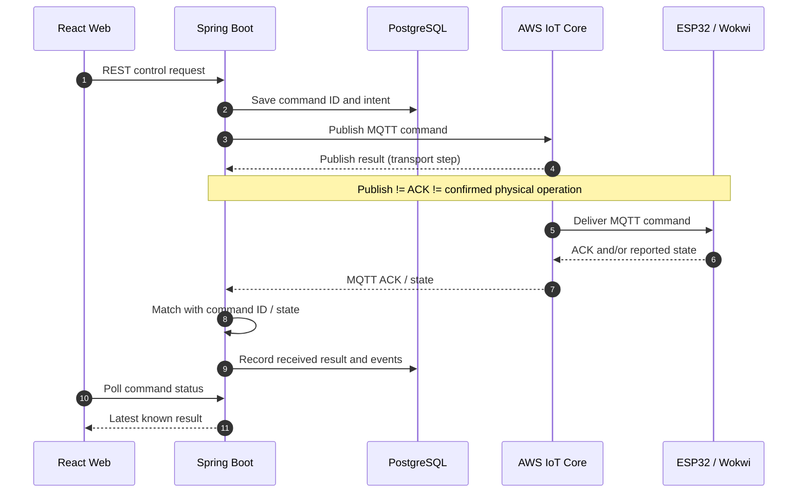
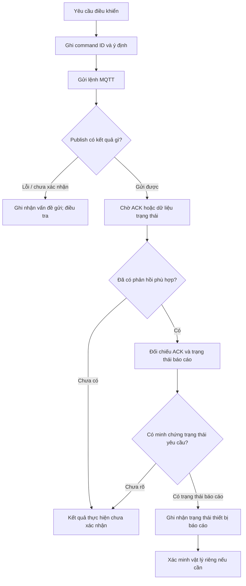

# 第12.05課 — デバイス制御・ACK | Điều khiển thiết bị và xác nhận phản hồi

> **BRSE Interview Master · 第12章 技術デモ・プレゼンテーション**  
> Trình độ: N3–N2 · Câu trả lời chính: mục tiêu 15–30 giây · Học liệu: **Draft / Pending review**  
> Căn cứ: mô tả **Smart Farm IoT Management System** do người xây dựng cung cấp. Không phải kết quả kiểm toán mã nguồn hoặc nghiệm thu thiết bị thực.  
> Bài liên quan: [12.01 プロジェクト概要](12-01-project-overview.md) · [12.02 システム構成](12-02-system-architecture.md)

## ① 学習目標 — Mục tiêu

Sau khi học, người học có thể:

1. Giải thích luồng yêu cầu điều khiển: **React → REST API → Spring Boot → PostgreSQL (lưu ý định và mã lệnh) → AWS IoT Core → ESP32**.
2. Phân biệt **publish result**, **ACK**, **reported device state** và **verified physical state**.
3. Giải thích vì sao thiết kế lưu command ID/ý định trước khi gửi.
4. Trả lời tình huống **không có ACK, timeout, mất kết nối, báo trạng thái không nhất quán** mà không khẳng định những tính năng chưa được xác minh.
5. Giải thích bằng tiếng Nhật trong khoảng 30 giây; xử lý câu hỏi đào sâu theo vai trò BrSE.

## ② まず理解する — Kiến thức nền

### Bốn trạng thái không được đánh đồng

| Thuật ngữ | Điều nó cho biết | Điều **chưa** chứng minh |
|---|---|---|
| **Command intent / command ID** | Backend đã ghi nhận yêu cầu điều khiển và định danh lệnh | Lệnh đã tới thiết bị |
| **Publish result** | Kết quả thao tác gửi/publish theo cơ chế đang dùng | Thiết bị đã nhận và thực hiện lệnh |
| **Device ACK** | Thiết bị gửi phản hồi theo **ngữ nghĩa ACK do firmware quy định** | Thiết bị vật lý đã vận hành đúng; ACK có thể chỉ là đã nhận lệnh |
| **Reported device state** | Trạng thái thiết bị được báo cáo trong thông điệp | Trạng thái vật lý đã được xác minh độc lập |

**Ví dụ:** Giao diện hiện `送信済み` (đã gửi) không đủ căn cứ đổi thành `ポンプが動作しました` (bơm đã hoạt động). Cần có bằng chứng trạng thái tương ứng. Dự án chưa xác nhận vận hành bơm/van nông nghiệp thật.

### Hệ thống thực tế đã được mô tả

- Frontend: **React / TypeScript**, gọi **REST API**, kiểm tra trạng thái bằng **polling**.
- Backend: **Java 21 / Spring Boot**, lưu **command ID và command intent trước khi gửi**, quản lý sự kiện, đối chiếu publish/ACK/state; dùng PostgreSQL.
- Kết nối thiết bị: **AWS IoT Core**, **MQTT**, thiết bị ESP32 dùng **TLS/X.509**; backend kết nối theo mô tả **MQTT over WSS / SigV4**.
- Firmware: **ESP32** nhận lệnh, xử lý theo firmware và gửi **ACK/trạng thái**; **LED** được dùng mô phỏng bơm/van.
- Tưới: có điều khiển có thời hạn, quy tắc theo độ ẩm đất/lịch, theo dõi phiên tưới và điều kiện nước/mưa/lưu lượng theo phạm vi mô tả. **Mức nghiệm thu của từng chức năng nâng cao chưa được xác nhận.**

## ③ 図解 — Sơ đồ điều khiển Command → ACK

**Chú thích:** Đây là **luồng logic tổng hợp từ mô tả dự án**, không xác nhận rằng mọi đường truyền hay mọi nhánh lỗi đều đã được nghiệm thu. Một số MQTT publish API có thể chỉ trả kết quả gọi API hoặc nhận vào broker; ý nghĩa cụ thể cần kiểm tra SDK và code của dự án. ACK là phản hồi cấp ứng dụng, không được tự nhầm với MQTT transport acknowledgment.

### 状態の判断 — Cách đánh giá trạng thái

> Các nhánh **điều tra lỗi/chưa xác nhận, xác minh vật lý** là hướng xử lý/đánh giá nên thực hiện, **không mặc định chức năng tự động retry, timeout, watchdog hoặc kiểm tra vật lý đã được triển khai**.

### 日本語で30秒説明 — Tóm tắt luồng bằng tiếng Nhật

**応募者：**

Web画面から制御要求を送ると、バックエンドはコマンドIDと要求内容を保存してから、MQTTでESP32に送信します。その後、デバイスから届くACKや状態情報を確認し、結果を記録します。送信できただけでは、実際にポンプが動いたとは判断しません。

**Dịch:** Web gửi yêu cầu điều khiển; backend lưu command ID và nội dung yêu cầu trước khi gửi đến ESP32 qua MQTT. Sau đó kiểm tra ACK/trạng thái phản hồi và lưu kết quả. Chỉ gửi thành công không đủ để kết luận bơm thật đã chạy.

**Cách nhớ:** 要求 → 保存 → 送信 → 応答 → 状態確認.

---

## ④ 面接対話 — Hỏi đáp chuẩn phỏng vấn

### Q1. Điều khiển hoạt động như thế nào?

**面接官：** デバイスの制御は、どのような流れで行いますか。

**Dịch câu hỏi:** Việc điều khiển thiết bị diễn ra theo luồng nào?

**応募者（Standard）：** まず、Web画面からバックエンドに制御要求を送ります。バックエンドはコマンドを保存し、MQTTでESP32に送信します。その後、デバイスからのACKや状態を確認します。

**Dịch:** Web gửi yêu cầu tới backend; backend lưu rồi chuyển lệnh qua MQTT đến ESP32, sau đó kiểm tra ACK và trạng thái.

**深掘り — 面接官：** なぜ送信する前にコマンドを保存しますか。  
**応募者：** どの要求を送ったか記録し、後からACKや結果と照合するためです。問題が起きた場合の調査にも役立ちます。

*Dịch:* Để có lịch sử yêu cầu và đối chiếu ACK/kết quả; giúp điều tra khi có lỗi.

### Q2. Gửi MQTT thành công có đồng nghĩa điều khiển thành công?

**面接官：** MQTTの送信が成功すれば、制御も成功したと言えますか。

**応募者（Standard）：** いいえ、送信成功と制御成功は別です。ACKとデバイスから報告された状態を確認する必要があります。実機の動作確認は、さらに別の検証が必要です。

**Dịch:** Không. Gửi và thực thi là khác nhau. Cần ACK, trạng thái báo cáo và nếu cần xác nhận hoạt động vật lý riêng.

**深掘り — 面接官：** ACKがあれば、ポンプの動作まで保証できますか。  
**応募者：** いいえ。ACKの意味は実装によって異なります。実際のポンプの動作を判断するには、対応する状態やセンサーなどの根拠が必要です。

*Dịch:* Không; ý nghĩa ACK tùy firmware. Phải có trạng thái hoặc bằng chứng cảm biến phù hợp để xác minh bơm thật.

### Q3. ACK bị thiếu thì sao?

**面接官：** ACKが返ってこなかった場合、どう対応しますか。

**応募者（Standard）：** まず、制御結果を未確認として扱います。通信状況とコマンドID、デバイスの状態を確認します。再送が必要な場合は、重複実行のリスクを考えて開発チームと判断します。

**Dịch:** Ghi nhận kết quả chưa xác minh, xem kết nối, command ID, trạng thái thiết bị; nếu muốn gửi lại phải xét rủi ro thực hiện trùng với đội dev.

**深掘り — 面接官：** すぐに同じコマンドを再送してもいいですか。  
**応募者：** いいえ、すでに実行されている可能性があります。まず実行状況を調べ、再送時の安全性を確認します。

*Dịch:* Không nên gửi lại ngay: lệnh có thể đã thực thi, nên cần kiểm tra và đánh giá an toàn trước.

> **Ranh giới nguồn:** Đây là **quy trình ứng xử đề xuất trong phỏng vấn**, không khẳng định dự án đã có retry tự động, deduplication cho mọi command hoặc chính sách timeout cụ thể.

### Q4. Trạng thái trên màn hình lệch thiết bị thì sao?

**面接官：** 画面に「送信成功」と表示されていますが、ポンプが動いていません。どう説明しますか。

**応募者（Professional）：** 「送信成功」はコマンドの送信結果であり、ポンプの動作完了を示すものではありません。ACKやデバイスの状態、通信ログを確認し、現時点で分かっている状況をお客様に説明します。

**Dịch:** “Gửi thành công” là kết quả gửi lệnh, không phải bơm đã chạy; cần kiểm tra ACK, trạng thái, log và báo đúng thông tin đã xác minh cho khách hàng.

**深掘り — 面接官：** お客様には、いつ「成功」と伝えますか。  
**応募者：** 成功の判定条件を仕様で明確にし、その条件を確認できた段階で伝えます。確認できない場合は「未確認」と説明します。

*Dịch:* Chỉ thông báo thành công khi điều kiện xác nhận được xác định trong spec và đã có bằng chứng; nếu không thì báo “chưa xác nhận”.

### Q5. Vì sao dùng giao tiếp bất đồng bộ?

**面接官：** なぜデバイスの制御にMQTTを使っていますか。

**応募者（Standard）：** MQTTはIoT機器との通信に適した軽量なプロトコルです。Publish/Subscribe方式を使い、バックエンドとデバイスの間でコマンドや状態を非同期にやり取りできます。

**Dịch:** MQTT nhẹ, phù hợp IoT; sử dụng pub/sub để trao đổi lệnh và trạng thái bất đồng bộ.

**深掘り — 面接官：** Web画面からESP32へ直接送りますか。  
**応募者：** いいえ。Web画面はREST APIでバックエンドと通信し、バックエンドがAWS IoT Coreを経由してデバイスに送ります。

*Dịch:* Không; web gửi yêu cầu qua REST đến backend, backend qua AWS IoT Core chuyển lệnh đến thiết bị.

### Q6. Khi nào có thể nói sản phẩm đã chạy thật?

**面接官：** この制御機能は、実際の農業用ポンプでも動作確認しましたか。

**応募者（Standard）：** いいえ、実際の農業用ポンプやバルブでの動作は、まだ確認できていません。現在の説明は、ESP32やWokwiを使った開発・検証環境に基づいています。

**Dịch:** Chưa xác minh với bơm/van nông nghiệp thật. Những gì đang trình bày dựa trên môi trường phát triển và mô phỏng ESP32/Wokwi.

**深掘り — 面接官：** 今後、何を確認する必要がありますか。  
**応募者：** 実機での動作、安全条件、通信が切れた場合の状態を確認する必要があると考えています。

*Dịch:* Đề xuất kiểm tra vận hành thật, điều kiện an toàn và trạng thái khi mất kết nối — **kế hoạch đề xuất**, không phải những bước đã hoàn thành.

---

## ⑤ 技術深掘り — Hiểu sâu để không học vẹt

### Command ID và correlation

Lưu một mã lệnh giúp định danh yêu cầu điều khiển, theo dõi trạng thái và đối chiếu phản hồi. Tuy nhiên, **chỉ có command ID chưa chứng minh hệ thống idempotent hoặc chống thực thi trùng**. Cần kiểm tra định nghĩa payload, điều kiện xử lý lệnh trùng, persistence và cơ chế tương quan ACK trong mã nguồn.

### Phân biệt ACK của MQTT và ACK cấp thiết bị

Một số cơ chế MQTT có phản hồi ở tầng truyền tải tùy QoS. **ACK cấp ứng dụng** là thông điệp do firmware gửi để báo một sự kiện mà hệ thống đã định nghĩa. Hai loại này không được đánh đồng. Ngữ nghĩa ACK có thể là `received`, `accepted`, `executed` hoặc trạng thái khác; mô tả đầu vào **không xác định đủ chi tiết enum và điều kiện thành công của firmware**.

### Timeout, retry, state reconciliation

Đây là các vấn đề người phỏng vấn có thể hỏi sâu, nhưng **chưa có bằng chứng nguồn về chính sách timeout/retry cụ thể**. Phân biệt:

- **Đã mô tả:** lưu command intent, đối chiếu kết quả gửi/ACK/trạng thái, theo dõi phiên tưới.
- **Cần xác minh:** timeout bao lâu, gửi lại theo chính sách nào, có cơ chế idempotency hay dead-letter handling hay không.
- **Khuyến nghị kỹ thuật:** định nghĩa trạng thái chưa biết rõ và xác minh trước khi gửi lại lệnh điều khiển có thể ảnh hưởng thiết bị.

### Điều kiện tưới và an toàn

Luồng tưới được mô tả có xét độ ẩm đất, lịch cho phép, phản hồi van và điều kiện nước/mưa/lưu lượng. Vì nhiều chức năng nâng cao vẫn cần nghiệm thu, **không tuyên bố đây là hệ thống an toàn chức năng cho thiết bị nông nghiệp thật**. Khi phỏng vấn, nói rõ điều kiện dự kiến, bằng chứng đã thử và những mục chưa xác nhận.

---

## ⑥ 語彙・文法 — Từ vựng trong hội thoại

| 日本語 | 読み方 | Nghĩa Việt |
|---|---|---|
| 制御要求 | せいぎょようきゅう | Yêu cầu điều khiển |
| 制御コマンド | せいぎょコマンド | Lệnh điều khiển |
| 送信結果 | そうしんけっか | Kết quả gửi |
| 受信 | じゅしん | Nhận |
| 応答 | おうとう | Phản hồi |
| 確認応答 | かくにんおうとう | Phản hồi xác nhận (tùy định nghĩa ACK) |
| 状態情報 | じょうたいじょうほう | Thông tin trạng thái |
| 実行結果 | じっこうけっか | Kết quả thực thi |
| 照合する | しょうごうする | Đối chiếu |
| 重複実行 | ちょうふくじっこう／じゅうふくじっこう | Thực thi trùng |
| 通信状況 | つうしんじょうきょう | Tình trạng truyền thông |
| 未確認 | みかくにん | Chưa được xác nhận |
| 再送する | さいそうする | Gửi lại |
| 検証する | けんしょうする | Kiểm chứng |
| 実機 | じっき | Thiết bị thật |
| 非同期 | ひどうき | Bất đồng bộ |
| 影響範囲 | えいきょうはんい | Phạm vi ảnh hưởng |
| 仕様 | しよう | Đặc tả |

### Biểu đạt quan trọng

- **〜だけでは成功とは言えません。** — Chỉ … thì không thể kết luận thành công.
- **〜を確認する必要があります。** — Cần xác nhận …
- **〜として扱います。** — Xử lý/coi như trạng thái …
- **〜と〜は別です。** — … và … là khác nhau.
- **〜た段階で報告します。** — Báo cáo khi đã tới bước …
- **〜可能性があります。** — Có khả năng …
- **まだ確認できていません。** — Vẫn chưa xác minh được.

### 類似表現比較

| Cụm từ | Khác biệt |
|---|---|
| 送信しました | Đã thực hiện thao tác gửi; không suy ra bên nhận đã làm |
| 受信しました | Đã nhận thông tin; không đồng nghĩa thực thi |
| 実行しました | Đã thực thi; cần bằng chứng của bước thực thi |
| 動作を確認しました | Đã kiểm tra hoạt động; chỉ dùng khi có bước xác minh thực tế phù hợp |
| 確認します | Cách nói thông thường “sẽ kiểm tra” |
| 確認いたします | Cách nói khiêm nhường, lịch sự hơn khi phù hợp ngữ cảnh |

---

## ⑦ 会話練習 — Luyện phản xạ có bấm giờ

**Drill A — 15 giây:** 「送信成功と制御成功は同じですか。」 Trả lời tối đa hai câu, không nhìn mẫu.

**Drill B — 30 giây:** Giải thích sơ đồ Command/ACK theo các từ khóa: **要求 → 保存 → 送信 → ACK → 状態**.

**Drill C — 20 giây:** Khách hàng nói 「ACKが来ませんが、もう一度送ってもいいですか。」 Hãy trả lời theo tư duy **trạng thái chưa xác nhận → điều tra → rủi ro trùng lệnh**.

**Drill D — 30 giây:** 「システムは本番環境で稼働していますか。」 Trả lời trung thực về local, Wokwi và chưa xác nhận bơm thật.

**Drill E — Transfer:** Một van có thể đã mở nhưng ACK bị mất. Người học cần đề xuất cách kiểm tra trước khi tự động gửi lại, không suy đoán chắc chắn van đóng hoặc mở.

### Mock interview — Prompt dùng với ChatGPT

> あなたは日本企業のBrSE技術面接官です。Smart Farmのデバイス制御について一問ずつ質問してください。毎回、応募者の回答を待ち、その回答に沿った深掘り質問を一つだけしてください。特に、MQTT送信結果、デバイスACK、状態確認、タイムアウト時の説明、実機未検証の区別を評価してください。回答は15〜30秒を目標とし、最後に簡潔さ・技術的正確さ・日本語・説明の論理性を評価してください。

## ⑧ 解答ポイント — Tự đối chiếu

1. **Gửi thành công ≠ thực thi thành công.**
2. **ACK của thiết bị** phụ thuộc định nghĩa firmware, không tự chứng minh cơ cấu vật lý hoạt động.
3. Thiếu ACK nên ghi **chưa xác nhận**, không vội nói thất bại cũng không vội nói thành công.
4. Gửi lại lệnh thiếu kiểm tra có nguy cơ **thực thi trùng**.
5. React dùng REST API với backend; backend dùng MQTT qua AWS IoT Core tới thiết bị.
6. Chưa xác nhận hệ thống **production** hoặc **bơm/van nông nghiệp thật**.

## ⑨ 評価・改善 — Rubric /20

| Tiêu chí (0–4) | Mức 4 điểm |
|---|---|
| Answer Relevance | Trả lời câu hỏi ngay và đúng trọng tâm |
| Technical Accuracy | Tách rõ publish, ACK, trạng thái và xác minh vật lý |
| Japanese Naturalness | Câu rõ ràng, đúng mức độ lịch sự, không gượng ép |
| Explanation Clarity | Có thứ tự và người nghe theo được luồng xử lý |
| Follow-up Handling | Trả lời tình huống lỗi, biết nói “chưa xác minh” và phân biệt đề xuất với tính năng đã làm |

**Mốc nội bộ:** 16–20: tốt; 12–15: cần sửa; dưới 12: học lại điểm yếu. Không phải tiêu chí tuyển dụng chính thức. Chỉ chấm phát âm khi có dữ liệu giọng nói thực tế.

**Quy trình sửa:** nghe/đọc lại → ghi tối đa ba lỗi chính → nói lại ngắn hơn → thử câu hỏi đào sâu khác.

## ⑩ 出典・検証状況 — Nguồn và giới hạn

| Nội dung | Tình trạng |
|---|---|
| Lưu command ID/intent trước khi publish, tách publish/ACK/state | Được nêu trong mô tả người dùng |
| MQTT AWS IoT Core ↔ ESP32, Wokwi/LED mô phỏng | Được nêu trong mô tả người dùng |
| Luồng ESP32/Wokwi → AWS → backend | Có bằng chứng chạy thử theo mô tả, **chưa được kiểm chứng độc lập trong bài học** |
| Timeout cụ thể, retry, idempotency cho command | **Chưa được cung cấp đủ bằng chứng**; nội dung liên quan chỉ là phân tích/kịch bản thực hành |
| Bơm/van nông nghiệp thật | Chưa xác nhận nghiệm thu hoặc vận hành |
| Production, SLA, độ trễ, tỉ lệ điều khiển thành công | Chưa cung cấp số liệu |
| Vai trò, mức đóng góp cá nhân | Chưa có chứng cứ trong brief; không tự nhận đã triển khai toàn bộ |

**Trước khi publish:** đối chiếu định dạng command và ACK với firmware, topic MQTT, logic lưu DB, trạng thái khi timeout, mã lệnh trùng, màn hình thực tế và bằng chứng kiểm thử; reviewer tiếng Nhật xác nhận cách diễn đạt.

---

**Ghi nhớ cuối bài:** **送信成功 ≠ ACK受信 ≠ 実機動作の確認**  
*Gửi thành công ≠ Nhận phản hồi xác nhận ≠ Xác minh thiết bị vật lý đã hoạt động.*

**Các bài liên quan:** [12.01 — プロジェクト概要](12-01-project-overview.md) · [12.02 — システム構成](12-02-system-architecture.md).
