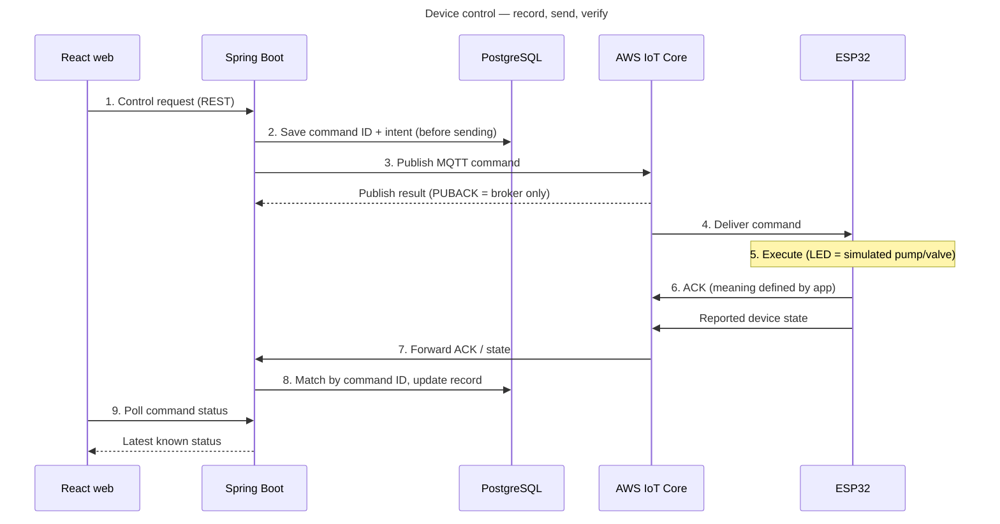
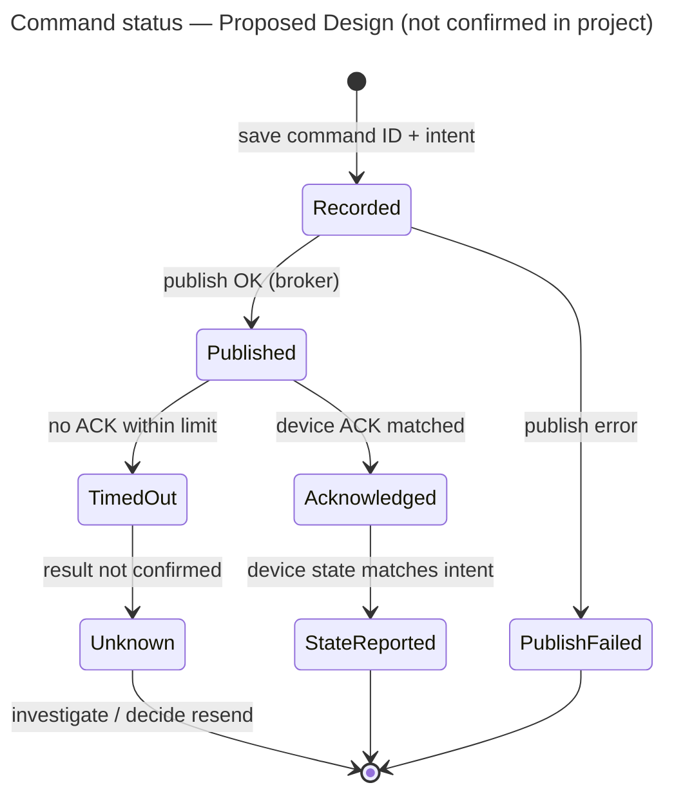

# 第12.05課 — デバイス制御 | Điều khiển thiết bị: lệnh, ACK và trạng thái

> **BRSE Interview Master · 第12章 技術デモ・プレゼンテーション**  
> **Đối tượng:** Ứng viên BrSE, tiếng Nhật N3–N2  
> **Trạng thái:** draft — bài mẫu (pilot) theo master prompt; chờ rà soát tiếng Nhật và đối chiếu mã nguồn · **Cập nhật:** 2026-10-26  
> **Căn cứ:** [smart-farm-overview.md](../../../sources/project-evidence/smart-farm-overview.md) · [Project Knowledge Base](../../../knowledge-base/case-studies/smart-farm-iot.md)  
> **Bài liên quan:** [12.02 — システム構成](12-02-system-architecture.md) (PUBACK, luồng tổng quát) · [12.03 — 使用技術](12-03-technology-choices.md)

> ⚠️ **Ranh giới dữ kiện của bài này**  
> **Có trong nguồn dự án:** hệ thống lưu **mã lệnh và ý định trước khi gửi**, sau đó đối chiếu riêng **kết quả gửi**, **ACK** và **trạng thái thiết bị**; có điều khiển **bật/tắt có thời hạn**; actuator là LED mô phỏng.  
> **Không có trong nguồn:** tên trạng thái lệnh, timeout, retry, cách thiết bị chống thực hiện lặp, ý nghĩa chính xác của ACK. Các phần này trong bài được ghi **Proposed Design** / `hypothetical` — dùng để hiểu và luyện cách nói, **không** được nói như tính năng đã có.

## 学習目標 — Mục tiêu

Sau bài này, người học có thể:

1. Giải thích luồng điều khiển thiết bị trong khoảng 30 giây theo **記録 → 送信 → 確認** (ghi lại → gửi → xác nhận).
2. Phân biệt bốn mức bằng chứng: **kết quả publish**, **ACK của thiết bị**, **trạng thái thiết bị báo cáo**, **trạng thái vật lý đã xác minh**.
3. Giải thích vì sao cần **mã lệnh (command ID)** và vì sao lưu lệnh **trước khi** gửi.
4. Trả lời câu hỏi về **không có ACK / timeout / gửi lại** mà không khẳng định tính năng chưa được xác nhận.
5. Giải thích cho khách hàng Nhật khi "màn hình báo gửi thành công nhưng bơm không chạy" theo khung giải quyết vấn đề của BrSE.

## ① 面接質問 — Câu hỏi phỏng vấn

| Câu hỏi | Dịch |
|---|---|
| **Câu chính:** デバイスの制御は、どのような流れで行っていますか。 | Việc điều khiển thiết bị được thực hiện theo luồng nào? |
| Biến thể: コマンドを送ってから、結果が分かるまでの流れを説明してください。 | Hãy giải thích luồng từ lúc gửi lệnh đến lúc biết kết quả. |
| Biến thể: 制御が成功したかどうかは、どうやって判断しますか。 | Làm sao bạn đánh giá điều khiển đã thành công hay chưa? |
| Biến thể (BrSE): 「送信成功」と出たのにポンプが動かない、と言われたらどうしますか。 | Nếu bị nói "màn hình báo gửi thành công mà bơm không chạy" thì bạn làm gì? |

## ② 質問の意図 — Ý định người phỏng vấn

Điều khiển thiết bị là phần **rủi ro cao nhất** của hệ thống IoT: lệnh sai hoặc chạy hai lần có thể làm ngập nước hay hỏng thiết bị. Người phỏng vấn dùng câu này để kiểm tra:

| Họ kiểm tra | Câu trả lời yếu thường… |
|---|---|
| Bạn có hiểu **hệ thống phân tán bất đồng bộ** — gửi đi và nhận kết quả là hai việc tách rời | Nói "gửi lệnh xong thì thiết bị chạy" |
| Bạn có nghĩ tới **trường hợp lỗi** (mất kết nối, không có ACK, bản tin trùng) | Chỉ mô tả trường hợp mọi thứ chạy đúng |
| Bạn có **trung thực** về điều đã xác minh | Nói "bơm đã chạy" khi chỉ có LED mô phỏng |
| Với BrSE: bạn có **giải thích được cho khách** mà không đổ lỗi, không hứa suông | Trả lời bằng thuật ngữ khó hiểu hoặc khẳng định nguyên nhân khi chưa điều tra |

## ③ 技術知識 — Kiến thức nền

### 3.1 Vì sao điều khiển thiết bị khó hơn gọi API thông thường?

Khi gọi một REST API, client gửi request và **chờ** response trong cùng một kết nối. Với thiết bị IoT qua MQTT:

- Backend **không nói chuyện trực tiếp** với thiết bị; bản tin đi qua broker (AWS IoT Core).
- Thiết bị có thể **đang mất kết nối** (Wi-Fi yếu, khởi động lại).
- Kết quả đến **sau**, trên một bản tin khác (ACK/trạng thái), có thể đến muộn hoặc không đến.
- Với QoS 1, MQTT bảo đảm bản tin đến bên nhận **ít nhất một lần** — nghĩa là **có thể đến hơn một lần**.

Vì vậy "gửi được" và "thực hiện được" phải được theo dõi **riêng**.

### 3.2 Luồng điều khiển theo mô tả dự án



*Hình: các bước 1–9 theo mô tả dự án (As Implemented theo mô tả, chưa đối chiếu mã nguồn). Timeout và retry không có trong hình vì không có trong nguồn — xem 3.5.*

**① 図の説明:** Có ba giai đoạn:

1. **記録 (ghi lại)** — bước 1–2: nhận yêu cầu, lưu mã lệnh và ý định (ví dụ: "bật van khu A trong N phút") **trước khi gửi**.
2. **送信 (gửi)** — bước 3–4: publish qua AWS IoT Core. Kết quả publish chỉ cho biết **broker** đã nhận (xem PUBACK ở [12.02](12-02-system-architecture.md)).
3. **確認 (xác nhận)** — bước 6–9: thiết bị gửi ACK và trạng thái; backend dùng **mã lệnh** để ghép đúng ACK với đúng lệnh; web hỏi lại trạng thái bằng polling.

**② 日本語で説明してみよう（約25秒）:** dùng câu trả lời Standard ở mục ⑥.

### 3.3 Bốn mức bằng chứng — đừng nhảy cóc

| Mức | Nguồn thông tin | Kết luận được | Không kết luận được | Trong dự án |
|---|---|---|---|---|
| ① Publish result | Kết quả khi backend publish | Broker đã nhận bản tin | Thiết bị đã nhận | Có theo dõi (theo nguồn) |
| ② Device ACK | Bản tin ACK từ thiết bị | Thiết bị đã phản hồi lệnh, theo ý nghĩa ACK do ứng dụng định nghĩa | Thiết bị chắc chắn đã chạy đúng | Có theo dõi; **ý nghĩa ACK chưa rõ** |
| ③ Reported state | Thiết bị tự báo trạng thái | Thiết bị **cho rằng** mình ở trạng thái đó | Thiết bị vật lý thật sự ở trạng thái đó | Có theo dõi (theo nguồn) |
| ④ Verified physical state | Bằng chứng độc lập: cảm biến lưu lượng, quan sát thực tế | Thiết bị thật đã hoạt động | — | **Chưa có** — chỉ LED mô phỏng |

> Mức ④ cần nguồn **độc lập** với lệnh. Ví dụ khái niệm: bật van rồi thấy cảm biến lưu lượng tăng. Dự án có dữ liệu lưu lượng và "kiểm tra phản hồi van" trong quy trình tưới (xem 12.06 khi biên soạn), nhưng **chưa được xác nhận trên thiết bị thật**.

### 3.4 Mã lệnh (command ID) dùng để làm gì?

**Có trong nguồn:** backend lưu mã lệnh và ý định trước khi gửi, rồi đối chiếu ACK/trạng thái.

**Vì sao thiết kế như vậy hợp lý (giải thích khái niệm, `hypothetical` với lý do của dự án):**

| Mục đích | Giải thích |
|---|---|
| **Ghép đúng ACK với lệnh** | ACK đến bất đồng bộ, có thể nhiều lệnh đang chờ. Mã lệnh cho biết ACK này của lệnh nào |
| **Không mất dấu khi lỗi** | Nếu backend lưu **sau** khi gửi mà bị lỗi giữa chừng, có thể có lệnh đã gửi nhưng không có bản ghi. Lưu **trước** thì luôn có bản ghi để tra |
| **Chống thực hiện lặp** (Proposed Design) | Vì QoS 1 có thể giao bản tin hơn một lần, thiết bị có thể dùng mã lệnh để nhận ra "lệnh này đã xử lý rồi". Dự án có làm vậy không: **chưa có nguồn** |
| **Truy vết về sau** | Lịch sử lệnh giúp điều tra khi khách hỏi "vì sao van mở lúc đó" |

**Idempotent (冪等, べきとう)** — tính chất "làm một lần hay làm nhiều lần lặp lại thì hiệu quả như nhau". Lệnh 「バルブを開く」 (mở van) gần như idempotent: mở van đang mở thì vẫn là mở. Lệnh 「10分追加で給水」 (tưới thêm 10 phút) thì **không**: chạy hai lần là tưới 20 phút. Vì vậy với lệnh không idempotent, chống thực hiện lặp quan trọng hơn.

### 3.5 Không có ACK: timeout và gửi lại (Proposed Design)

Nguồn **không** nói dự án có timeout hay retry. Phần này là thiết kế đề xuất để bạn trả lời được câu hỏi "nếu…" một cách có logic.



*Hình: mô hình trạng thái lệnh — **Proposed Design**. Tên trạng thái do bài đặt ra để học, không phải tên trong mã nguồn dự án.*

**① 図の説明:** Điểm quan trọng nhất: **TimedOut không phải là Failed**. Không có ACK chỉ có nghĩa là **chưa biết** — thiết bị có thể đã chạy mà ACK bị mất. Vì vậy:

- Không tự động coi là thất bại rồi gửi lại ngay (nguy cơ chạy hai lần với lệnh không idempotent).
- Không tự động coi là thành công.
- Hiển thị cho người dùng là 「未確認」 (chưa xác nhận), rồi kiểm tra trạng thái thiết bị trước khi quyết định gửi lại.

**② 日本語で説明してみよう（約20秒）：**  
「一定時間ACKが返ってこない場合は、失敗ではなく『未確認』として扱うのが安全だと考えています。デバイスが実際には動いている可能性もあるので、状態を確認してから再送を判断します。」

*Dịch:* Nếu không có ACK trong một khoảng thời gian, tôi cho rằng an toàn hơn là coi đó là "chưa xác nhận" chứ không phải thất bại. Vì thiết bị có thể thực tế đã chạy, nên kiểm tra trạng thái trước rồi mới quyết định gửi lại.

**⑤ 応用質問:** 「ACKが二回届いたら、どうしますか。」  
*Gợi ý:* Dùng mã lệnh để nhận ra ACK trùng; cập nhật một lần, bỏ qua lần sau. Nói như thiết kế: 「コマンドIDで照合するので、二回目は重複として扱う設計が考えられます。」

### 3.6 Bật/tắt có thời hạn

**Có trong nguồn:** dự án có điều khiển bật/tắt **có thời hạn** (ví dụ: bật trong một khoảng thời gian nhất định).

**Vì sao có ích (khái niệm, `hypothetical`):** Nếu lệnh chỉ là "bật" mà lệnh "tắt" sau đó bị mất, thiết bị có thể chạy mãi. Lệnh có thời hạn giới hạn được rủi ro này — **với điều kiện thiết bị tự tắt khi hết giờ**, kể cả khi mất kết nối. Dự án xử lý hết giờ ở thiết bị hay ở backend thì **chưa có nguồn**; trước khi nói điều này trong phỏng vấn, hãy kiểm tra mã nguồn.

## ④ 思考プロセス — Khung tư duy

**Câu hỏi về luồng:**

```text
記録 (ghi lại lệnh) → 送信 (gửi qua broker) → 確認 (ACK + trạng thái) → 判断 (thành công / chưa xác nhận)
```

**Câu hỏi "nếu có lỗi" — khung giải quyết vấn đề của master prompt:**

```text
Clarify (確認する) → Analyze (切り分ける) → Action (対応する) → Report (報告する)
```

- **Clarify:** chuyện gì đã xảy ra, lệnh nào, lúc nào.
- **Analyze:** đi theo bốn mức bằng chứng — publish? ACK? trạng thái? thực tế? — dừng ở mức đầu tiên bị đứt.
- **Action:** chỉ hành động phù hợp với mức đã biết (không gửi lại mù quáng).
- **Report:** nói rõ cái đã biết và cái chưa biết.

## ⑤ 面接対話 — Hội thoại phỏng vấn

**面接官：** デバイスの制御は、どのような流れで行っていますか。  
**応募者：** 画面から制御要求を受けると、バックエンドはまずコマンドIDと操作内容をデータベースに保存します。その後、AWS IoT Core経由でMQTTのコマンドを送信します。送信結果、デバイスからのACK、報告された状態は、それぞれ別に確認しています。

*ベトナム語訳:* Khi nhận yêu cầu điều khiển từ màn hình, backend trước hết lưu mã lệnh và nội dung thao tác vào cơ sở dữ liệu. Sau đó gửi lệnh MQTT qua AWS IoT Core. Kết quả gửi, ACK từ thiết bị và trạng thái được báo cáo đều được kiểm tra riêng.

**面接官：** なぜ送信する前に、データベースに保存するのですか。  
**応募者：** 送信に失敗した場合や、ACKが後から届いた場合でも、どのコマンドの結果なのかを追跡できるようにするためです。

*ベトナム語訳:* Để dù gửi thất bại hay ACK đến muộn, vẫn truy được đó là kết quả của lệnh nào.

*Trạng thái:* "lưu trước khi gửi" theo nguồn dự án; lý do là lập luận kỹ thuật (`hypothetical`) — nếu bạn biết lý do thật, dùng lý do thật.

## ⑥ 模範回答 — Câu trả lời mẫu

### Standard (~25 giây)

Dùng câu trả lời đầu tiên ở mục ⑤.

**Khung ghi nhớ:** 保存 → 送信 → 三つを別々に確認.

### Professional (~25 giây)

**応募者：** 制御は、記録・送信・確認の三段階で行っています。まずコマンドIDと意図を保存してから送信し、その後、送信結果、デバイスのACK、デバイスが報告する状態をそれぞれ照合します。送信できただけでは、成功とは扱いません。

*Dịch:* Điều khiển được thực hiện theo ba giai đoạn: ghi lại, gửi và xác nhận. Trước hết lưu mã lệnh và ý định rồi mới gửi; sau đó đối chiếu riêng kết quả gửi, ACK của thiết bị và trạng thái thiết bị báo cáo. Chỉ gửi được thì chưa coi là thành công.

> Bản Professional mở bằng **cấu trúc ba giai đoạn** rồi kết bằng **nguyên tắc** (「送信できただけでは成功とは扱いません」) — câu kết này thường làm người phỏng vấn kỹ thuật hỏi tiếp đúng hướng bạn đã chuẩn bị.

## ⑦ 深掘り質問 — Câu hỏi đào sâu

**Q1 — Command ID**  
**面接官：** コマンドIDは、何に使っていますか。  
**応募者：** デバイスから返ってきたACKや状態を、どのコマンドに対するものか照合するために使っています。

*Dịch:* Dùng để đối chiếu ACK và trạng thái thiết bị gửi về là của lệnh nào.

*Trạng thái:* nguồn nói hệ thống lưu mã lệnh rồi đối chiếu ACK/trạng thái; việc đối chiếu **bằng chính mã lệnh** là cách hiểu hợp lý nhưng chưa đối chiếu mã nguồn (`needs-verification`).

**Q2 — ACK vs trạng thái**  
**面接官：** ACKとデバイスの状態は、何が違いますか。  
**応募者：** ACKはコマンドに対する応答で、状態はデバイスが報告する現在の状態です。ACKがあっても、状態が意図と一致しているかは別に確認します。

*Dịch:* ACK là phản hồi đối với lệnh, còn trạng thái là tình trạng hiện tại thiết bị báo cáo. Dù có ACK, vẫn phải kiểm tra riêng trạng thái có khớp với ý định không.

**Q3 — Không có ACK (timeout)**  
**面接官：** ACKが返ってこない場合は、どうなりますか。  
**Hướng trả lời — chọn theo sự thật của dự án:**

- Nếu **đã xác nhận** có xử lý timeout trong code: 「一定時間ACKがなければ、タイムアウトとして【実際の状態名】にしています。」
- Nếu **chưa xác nhận** (trạng thái hiện tại của nguồn): 「タイムアウトの処理は、まだ詳しく確認できていません。設計としては、失敗ではなく『未確認』として扱い、デバイスの状態を確認してから再送を判断するのが安全だと考えています。」

*Dịch (bản chưa xác nhận):* Phần xử lý timeout tôi chưa xác nhận chi tiết. Về thiết kế, tôi cho rằng an toàn hơn là coi đó là "chưa xác nhận" chứ không phải thất bại, kiểm tra trạng thái thiết bị rồi mới quyết định gửi lại.

**Q4 — Gửi lại có nguy hiểm không?**  
**面接官：** 再送したら、ポンプが二回動きませんか。  
**応募者：** その可能性があります。MQTTのQoS 1は少なくとも一回届ける仕組みなので、同じコマンドが重複して届くこともあります。そのため、コマンドIDで重複を判定するなど、二重実行を防ぐ仕組みが必要だと考えています。

*Dịch:* Có khả năng đó. QoS 1 của MQTT là cơ chế giao ít nhất một lần, nên cùng một lệnh có thể đến trùng. Vì vậy tôi cho rằng cần cơ chế chống thực hiện hai lần, ví dụ dùng mã lệnh để nhận diện bản trùng.

*Trạng thái:* QoS 1 "ít nhất một lần" `verified` (đặc tả MQTT); việc dự án đã có cơ chế chống lặp: `needs-verification` — câu trả lời dùng 「必要だと考えています」 nên không khẳng định đã làm.

**Q5 — Bật/tắt có thời hạn**  
**面接官：** なぜ時間を指定して制御するのですか。  
**Hướng trả lời (`hypothetical` — kiểm tra code trước):** 「オフのコマンドが届かなくても、ずっと動き続けないようにするためです。」 Chỉ nói câu này nếu đã xác nhận **thiết bị tự tắt** khi hết thời gian; nếu backend mới là bên gửi lệnh tắt thì lý do này không còn đúng hoàn toàn.

**Q6 — Thiết bị thật**  
**面接官：** 実際のポンプでも、同じように確認できますか。  
**応募者：** 現在はLEDでポンプやバルブをシミュレーションしているので、実機ではまだ確認していません。実機では、流量センサーなどで実際に動いたかを別に確認する必要があると考えています。

*Dịch:* Hiện đang dùng LED mô phỏng bơm và van, nên chưa kiểm tra trên thiết bị thật. Với thiết bị thật, tôi cho rằng cần xác nhận riêng việc nó có thực sự chạy hay không, ví dụ bằng cảm biến lưu lượng.

**Q7 — Tình huống BrSE**  
**面接官：** お客様から「画面に『送信成功』と出たのに、ポンプが動かない」と言われたら、どう対応しますか。  
**応募者：** まず、どのコマンドか、いつの操作かを確認します。次に、送信結果、ACK、デバイスの状態の順に記録を見て、どこで止まっているかを切り分けます。原因が分かるまでは推測で断定せず、分かったことと未確認のことを分けてご報告します。

*Dịch:* Trước tiên xác nhận đó là lệnh nào, thao tác lúc nào. Tiếp theo xem bản ghi theo thứ tự kết quả gửi → ACK → trạng thái thiết bị để khoanh vùng dừng ở đâu. Khi chưa rõ nguyên nhân thì không phỏng đoán khẳng định; báo cáo tách riêng điều đã biết và điều chưa xác nhận.

> Câu này theo khung **Clarify → Analyze → Action → Report**. Đây là cách xử lý đề xuất trong phỏng vấn, không phải quy trình vận hành đã có của dự án. Dài hơn 30 giây một chút là chấp nhận được với câu tình huống.

## ⑧ 語彙・文法 — Từ vựng và ngữ pháp

| 日本語 | 読み方 | Nghĩa | Ví dụ |
|---|---|---|---|
| 制御要求 | せいぎょようきゅう | Yêu cầu điều khiển | 画面から制御要求を受けます |
| コマンドID | コマンドアイディー | Mã lệnh | コマンドIDで照合します |
| 意図 | いと | Ý định (lệnh muốn làm gì) | 操作の意図を保存します |
| 照合する | しょうごうする | Đối chiếu, ghép khớp | ACKとコマンドを照合します |
| 送信結果 | そうしんけっか | Kết quả gửi | 送信結果を確認します |
| 応答 | おうとう | Phản hồi | コマンドに対する応答です |
| 報告する | ほうこくする | Báo cáo (thiết bị báo trạng thái; người báo cho khách) | デバイスが状態を報告します |
| 一致する | いっちする | Khớp, trùng khớp | 状態が意図と一致しています |
| タイムアウト | タイムアウト | Hết thời gian chờ | タイムアウトとして扱います |
| 未確認 | みかくにん | Chưa xác nhận | 結果は未確認です |
| 再送 | さいそう | Gửi lại | 再送を判断します |
| 二重実行 | にじゅうじっこう | Thực hiện hai lần | 二重実行を防ぎます |
| 冪等性 | べきとうせい | Tính idempotent | 冪等性のある操作です |
| 切り分ける | きりわける | Khoanh vùng nguyên nhân | どこで止まっているか切り分けます |
| 推測 | すいそく | Phỏng đoán | 推測で断定しません |

> 「冪等性」 là từ chuyên ngành ít gặp; trong phỏng vấn có thể nói dễ hơn: 「何回実行しても結果が同じになる性質」.

**Mẫu câu:**

- **まず〜、その後〜** — Trước hết …, sau đó …
- **〜に対する〜** — … đối với … (ACKはコマンドに対する応答です)
- **〜としては扱いません／〜として扱います** — Không coi là … / Coi là …
- **〜までは、〜で断定しません** — Cho tới khi …, không khẳng định bằng …
- **〜と〜を分けてご報告します** — Báo cáo tách riêng … và …

## ⑨ 類似表現比較 — So sánh cách diễn đạt

**Bốn mức "đã xong" — chọn theo bằng chứng bạn có:**

| Biểu đạt | Nghĩa | Chỉ dùng khi có |
|---|---|---|
| 送信しました | Đã gửi | Kết quả publish |
| 届きました／受信されました | Đã đến / đã được nhận | ACK hoặc bằng chứng thiết bị nhận |
| 実行されました | Đã được thực hiện | ACK mang nghĩa "đã thực hiện" + trạng thái khớp |
| 動作を確認しました | Đã xác nhận hoạt động | Bằng chứng độc lập (quan sát, cảm biến) |

**Lỗi và chưa biết:**

| Biểu đạt | Sắc thái | Khi nào dùng |
|---|---|---|
| 失敗しました | Đã thất bại — khẳng định | Có bằng chứng lỗi (ví dụ publish lỗi) |
| 応答がありません | Không có phản hồi — mô tả sự kiện | Khi chưa có ACK |
| 未確認です | Chưa xác nhận | Khi chưa biết kết quả — **an toàn nhất** với timeout |
| 原因は〜だと思われます | Nguyên nhân có lẽ là … | Có căn cứ một phần |
| 原因は〜です | Nguyên nhân là … | Chỉ khi đã xác định |

**再送 vs 再実行:** 再送 = gửi lại bản tin (tầng truyền); 再実行 = thực hiện lại thao tác (tầng nghiệp vụ). Gửi lại một lệnh có thể dẫn tới thực hiện lại — đó chính là rủi ro cần nói ra.

**報告します vs ご報告します:** Với khách hàng, 「ご報告します」 (khiêm nhường) tự nhiên hơn; trong phỏng vấn khi mô tả cách bạn sẽ làm với khách, dùng 「ご報告します」 là phù hợp.

## ⑩ 会話練習 — Luyện phản xạ

1. **25 giây, không nhìn mẫu:** 「デバイスの制御は、どのような流れで行っていますか。」 — phải có đủ 保存 → 送信 → 三つの確認.
2. **Hỏi sâu (10–25 giây mỗi câu):**
   1. コマンドIDは何に使いますか。
   2. ACKがあれば、制御は成功ですか。
   3. ACKが返ってこない場合は、どうしますか。（trả lời theo bản "chưa xác nhận"）
3. **Đổi điều kiện:**
   1. コマンドが「10分間追加で給水」だったら、再送で何が問題になりますか。  
      *Gợi ý:* Lệnh không idempotent → chạy hai lần là tưới 20 phút.
   2. デバイスがオフラインのときに、ユーザーがボタンを押したら、画面には何と表示すべきですか。  
      *Gợi ý:* Không hiển thị "thành công"; hiển thị đã gửi/chờ xác nhận hoặc chưa xác nhận. Không khẳng định giao diện hiện tại hiển thị gì.
4. **Roleplay BrSE (2 phút):** Một người đóng khách hàng Nhật khó chịu: 「送信成功と出ているのに動かないのは、システムの不具合ですよね。」 Bạn trả lời theo Clarify → Analyze → Action → Report, không thừa nhận lỗi khi chưa điều tra, không đổ lỗi cho khách.
5. **図を見ずに説明:** Vẽ lại sơ đồ 3.2 từ trí nhớ, đánh số 9 bước, chỉ ra bước nào là "PUBACK chỉ tới broker".

**AI Mock Interview Prompt:**

> あなたは日本企業のBrSE技術面接官です。Smart Farm IoT Management Systemのデバイス制御について、日本語で一問ずつ質問してください。流れ、コマンドID、ACKと状態の違い、ACKがない場合、再送のリスクの順に進め、最後に顧客対応のロールプレイを一つ行ってください。回答を待ち、応募者の代わりに答えないでください。タイムアウトや再送の処理が実装済みかどうかは未確認なので、応募者が実装済みと断言した場合は根拠を尋ねてください。5問後に、関連性・技術的正確さ・日本語の自然さ・明確さ・深掘りへの対応を各4点で評価し、良い点、最大三つの改善点、改善した回答例を示してください。

## ⑪ 評価・改善 — Đánh giá

Chấm theo [thang đánh giá chung](../../../docs/ASSESSMENT_RUBRIC.md) (mỗi tiêu chí 0–4, tổng 20; không phải thang chính thức):

| Tiêu chí | Đạt 4 điểm khi (áp vào bài này) |
|---|---|
| Answer Relevance | Câu đầu mô tả luồng (保存 → 送信 → 確認), không mở đầu bằng định nghĩa MQTT |
| Technical Accuracy | Phân biệt đúng bốn mức bằng chứng; không coi PUBACK hay ACK là bằng chứng bơm đã chạy |
| Japanese Naturalness | Dùng đúng 送信しました / 実行されました / 動作を確認しました theo bằng chứng; 未確認 cho timeout |
| Communication Clarity | Theo thứ tự thời gian của luồng; câu BrSE theo Clarify → Analyze → Action → Report |
| Follow-up Handling | Trả lời câu timeout/retry bằng thiết kế đề xuất mà không nói là đã triển khai |

**Điểm chấm riêng của bài:**

- Nói 「タイムアウトしたら自動で再送します」 như tính năng đã có → Technical Accuracy tối đa 1, Follow-up Handling tối đa 1.
- Coi timeout là 「失敗」 → trừ Technical Accuracy.
- Nói 「ポンプが動きました」 khi chỉ có LED mô phỏng → Technical Accuracy = 0.
- Câu BrSE khẳng định nguyên nhân khi chưa điều tra, hoặc đổ lỗi cho khách → Follow-up Handling tối đa 1.
- Không nhắc tới rủi ro thực hiện hai lần khi được hỏi về gửi lại → trừ Follow-up Handling.

**Feedback:** điểm mạnh → tối đa 3 lỗi → câu sửa → vì sao tốt hơn → thử lại.

## 出典・確認状況 — Nguồn và trạng thái

Truy cập ngày 2026-10-26.

| Nhận định | Nguồn | Trạng thái |
|---|---|---|
| Lưu mã lệnh và ý định trước khi gửi; đối chiếu riêng kết quả gửi, ACK, trạng thái thiết bị | [smart-farm-overview.md](../../../sources/project-evidence/smart-farm-overview.md) | `author-experience—unverified` |
| Có điều khiển bật/tắt có thời hạn; actuator là LED mô phỏng; chưa vận hành bơm/van thật | Như trên | `author-experience—unverified` |
| Có dữ liệu lưu lượng và kiểm tra phản hồi van trong quy trình tưới | Như trên | `author-experience—unverified` |
| QoS 1 bảo đảm bản tin đến bên nhận ít nhất một lần; cờ DUP khi gửi lại | [OASIS — MQTT Version 3.1.1](https://docs.oasis-open.org/mqtt/mqtt/v3.1.1/os/mqtt-v3.1.1-os.html), mục 3.3.1 và 4.3.2 | `verified` |
| Giao bản tin theo QoS chỉ tính giữa một bên gửi và một bên nhận (PUBACK backend nhận là của broker) | Như trên, mục 4.3 | `verified` |
| AWS IoT Core hỗ trợ QoS 0/1; bản tin có thể đến nhiều lần | [AWS — MQTT](https://docs.aws.amazon.com/iot/latest/developerguide/mqtt.html) | `verified` |
| Định nghĩa idempotent: thực hiện một lần hay nhiều lần giống nhau cho cùng hiệu quả | [MDN — Idempotent](https://developer.mozilla.org/en-US/docs/Glossary/Idempotent) (định nghĩa cho HTTP method; bài áp dụng khái niệm cho lệnh thiết bị) | `verified` (khái niệm) |
| Lý do lưu trước khi gửi; mục đích của mã lệnh; lợi ích của lệnh có thời hạn | Lập luận kỹ thuật | `hypothetical` |
| Mô hình trạng thái lệnh, timeout, retry, chống thực hiện lặp | Proposed Design trong bài | `hypothetical` |
| Ý nghĩa ACK của dự án; dự án có timeout/retry/chống lặp không; thiết bị hay backend xử lý hết giờ; tên topic, QoS | Chưa có | `needs-verification` |

## Ghi chú biên tập

- Đây là một trong năm **bài mẫu** của master prompt (Smart Farm Command/ACK). Dùng bài này để kiểm định template trước khi viết các bài khác.
- Khi có mã nguồn: thay mô hình trạng thái Proposed Design bằng trạng thái thật (nếu có), cập nhật Q3 và Q5, và đổi nhãn các hình tương ứng.
- 12.02 (mục 3.5, câu B5–B6) đang giữ một phần nội dung trùng; khi duyệt bài này, rút gọn phần đó ở 12.02 và trỏ sang đây.
- Toàn bộ câu tiếng Nhật chưa được reviewer bản ngữ kiểm tra.

---

**Ghi nhớ cuối bài:**  
**記録 → 送信 → 確認。タイムアウトは「失敗」ではなく「未確認」。**  
Ghi lại → gửi → xác nhận. Timeout không phải "thất bại" mà là "chưa xác nhận".
