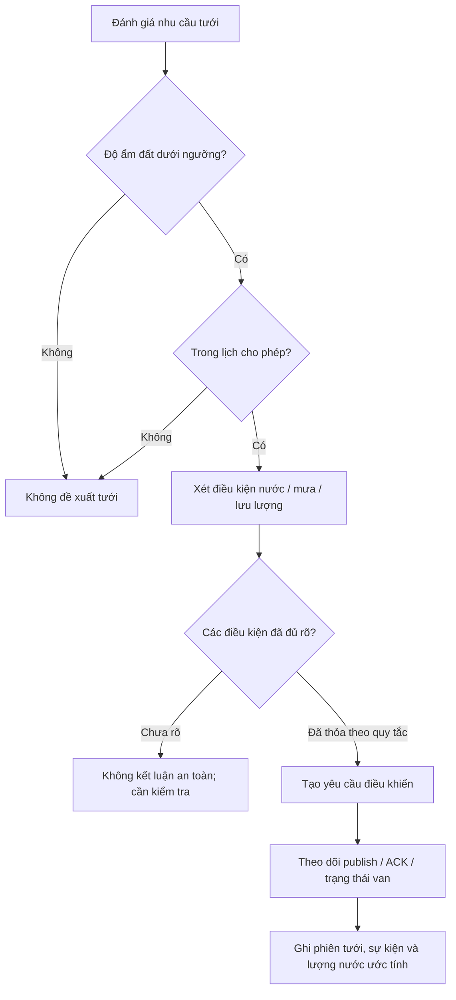

# 第12.06課 — 自動灌漑・安全管理 | Tưới tự động và quản lý an toàn

> **BRSE Interview Master · 第12章 技術デモ・プレゼンテーション**  
> Trình độ N3–N2 · Trả lời chính 15–30 giây · **Draft — Pending Japanese/technical review**.  
> **Nguồn:** Mô tả Smart Farm IoT Management System do người dùng cung cấp. Không thay thế audit mã nguồn, demo thực tế hoặc nghiệm thu. Backend/PostgreSQL chủ yếu local; luồng ESP32/Wokwi–AWS–backend có bằng chứng thử nghiệm theo mô tả; chức năng nâng cao cần nghiệm thu thêm; chưa xác nhận production hay bơm/van nông nghiệp thật.  
> Xem [Kiến trúc 12.02](12-02-system-architecture.md), [Telemetry 12.04](12-04-telemetry-processing.md), [Command/ACK 12.05](12-05-device-control-ack.md).

## ① 学習目標 — Mục tiêu

Trình bày quy tắc tưới theo độ ẩm đất và lịch cho phép; nêu vai trò nước, mưa, lưu lượng, phản hồi van; phân biệt **điều kiện thiết kế**, **đã phát triển** và **đã kiểm thử**; giao tiếp an toàn với khách hàng khi thiếu bằng chứng. Không mặc định hệ thống có interlock fail-safe công nghiệp.

## ② 技術知識 — Phân tích chuyên môn

Theo mô tả, hệ thống có **điều khiển bật/tắt có thời hạn**, quy tắc tưới dựa trên **độ ẩm đất và lịch cho phép**, quy trình xác nhận từng bước có kiểm tra **phản hồi van, nước/mưa/lưu lượng**; theo dõi **phiên tưới, sự kiện, lượng nước ước tính và độ phủ dữ liệu**. Những chức năng nâng cao vẫn cần nghiệm thu.

**Khác biệt quan trọng:** quy tắc tưới xác định *khi nào nên đề nghị tưới*; lệnh MQTT là *yêu cầu điều khiển*; ACK và trạng thái báo cáo *không tự chứng minh* bơm/van ngoài thực địa đã hoạt động.

### Sơ đồ luồng quyết định (minh họa logic, không phải code/đặc tả chính thức)

**Giải thích:** Hình trên thể hiện tiêu chí cần diễn giải trong phỏng vấn. Thứ tự, kiểu ngưỡng, điều kiện khóa an toàn, xử lý thiếu sensor và kết quả phản hồi cụ thể cần xác minh code và các test case.

### 日本語で30秒説明

**応募者：** このシステムでは、土壌の水分と許可された時間帯を使って、灌漑の条件を判断します。また、水の状態や雨、バルブからの応答も考慮する設計です。制御コマンドを送っただけで成功と判断せず、ACKや状態を確認します。実機での安全性は、まだ十分に検証できていません。

**Dịch:** Hệ thống đánh giá điều kiện tưới dựa trên độ ẩm đất và thời gian cho phép; thiết kế còn xét nước, mưa và phản hồi van. Không coi gửi lệnh là đã thành công; cần đối chiếu ACK/trạng thái. An toàn thiết bị thật chưa được xác minh đầy đủ.

## ③ 思考プロセス — Cách trả lời BrSE

**Yêu cầu → Điều kiện → Hành động → Xác minh → Giới hạn.** Khi khách hàng yêu cầu “tưới tự động hoàn toàn”, cần hỏi rõ ngưỡng, thời gian, ưu tiên, tình huống nước cạn, mất mạng, thiếu ACK và tiêu chuẩn nghiệm thu. Không đưa ra cam kết an toàn trước khi thẩm định.

## ④ 面接対話 — Phỏng vấn và câu hỏi đào sâu

### A. いつ水をやりますか — Điều kiện tưới

**面接官：** 自動灌漑はどのような条件で動きますか。

**Dịch câu hỏi:** Hệ thống tưới tự động hoạt động theo những điều kiện nào?  
**応募者：** 土壌の水分と灌漑を許可する時間帯を基準にします。また、水や雨などの条件も確認する設計です。具体的な判定ルールは実装とテストを確認して説明します。  
**Dịch:** Dựa trên độ ẩm đất và thời gian cho phép; còn xét nước/mưa. Rule chi tiết phải xác nhận code/test.

**深掘り：** 土壌が乾燥していたら、必ず水を出しますか。  
**応募者：** いいえ。時間帯や水の状態など、ほかの条件も考える必要があります。  
**Dịch:** Không; còn phải xét lịch và tình trạng nước.

### B. 安全性 — An toàn

**面接官：** この灌漑システムは安全に動作しますか。  
**応募者：** システムには複数の条件を確認する設計があります。ただし、実際の農業用ポンプとバルブでは、まだ十分に検証できていません。安全性を保証するには、実機試験が必要です。  
**Dịch:** Có thiết kế kiểm tra nhiều điều kiện, nhưng chưa thử đủ với bơm/van nông nghiệp thật; cần thử thực tế trước khi cam kết an toàn.

**深掘り：** 通信が切れたら、自動的に停止しますか。  
**応募者：** その動作は、まだ確認できていません。フェイルセーフの要件と実装を調べる必要があります。  
**Dịch:** Hành vi đó chưa xác nhận; cần xem yêu cầu và triển khai fail-safe.

### C. バルブの応答 — Phản hồi van

**面接官：** バルブの制御結果はどう確認しますか。  
**応募者：** コマンドの送信結果とACK、デバイスから報告された状態を分けて確認します。実際にバルブが開いたかどうかは、さらに検証が必要です。  
**Dịch:** Phân biệt kết quả gửi, ACK, trạng thái báo cáo; van thực sự mở vẫn cần kiểm chứng.

**深掘り：** ACKが返らないとき、すぐ再送しますか。  
**応募者：** いいえ。すでに実行された可能性があるため、状態を確認してから判断します。  
**Dịch:** Không; có thể đã thực thi, cần xem trạng thái trước.

### D. 水量の推定 — Lượng nước

**面接官：** 使用した水の量は正確に分かりますか。  
**応募者：** 水量を推定し、データの取得状況も記録する機能があります。ただし、実際の精度や計算方法については、測定結果を確認する必要があります。  
**Dịch:** Có ước tính lượng nước và theo dõi độ phủ dữ liệu, nhưng độ chính xác/công thức cần đối chiếu.

**深掘り：** データが欠けている場合はどうしますか。  
**応募者：** 推定値には不確かさがあることを伝え、データの欠損状況を確認します。  
**Dịch:** Phải nói rõ độ bất định và tình trạng thiếu dữ liệu.

### E. 仕様変更 — Giao tiếp khách hàng

**面接官：** お客様が「雨の日は絶対に水を出さないでほしい」と言ったら、どうしますか。  
**応募者：** まず、雨の判断条件とセンサーの異常時の動作を確認します。その後、開発チームと仕様やテスト方法を検討し、お客様と合意します。  
**Dịch:** Làm rõ định nghĩa “có mưa”, cách xử lý lỗi cảm biến, trao đổi dev về spec/test rồi thống nhất khách hàng.

**深掘り：** 雨のデータが取得できない場合はどうしますか。  
**応募者：** 勝手に動作を決めず、安全側の仕様をお客様と確認します。  
**Dịch:** Không tự quyết; cần thống nhất quy tắc an toàn khi thiếu dữ liệu.

## ⑤ 技術深掘り — Kiến thức ngoài câu trả lời ngắn

- **Threshold:** Chưa có ngưỡng độ ẩm cụ thể; không tạo số %.
- **Scheduling:** Mô tả có “lịch cho phép”, không suy ra engine lập lịch cụ thể.
- **Safety:** Cần xem sensor lỗi, network failure, ACK bị mất, bơm không có nước, van kẹt, quá thời gian, nguồn điện. Đây là **test scenarios đề xuất**, không phải kết quả đã qua kiểm thử.
- **Water usage:** Độ phủ dữ liệu ảnh hưởng độ tin cậy ước tính; không tự nói nước tiết kiệm bao nhiêu phần trăm.
- **Session:** Phân biệt phiên tưới đã ghi nhận với phiên thực sự hoàn thành ở phần cứng vật lý.

## ⑥ 語彙・文法

| 日本語 | 読み方 | Nghĩa |
|---|---|---|
| 自動灌漑 | じどうかんがい | Tưới tự động |
| 土壌水分 | どじょうすいぶん | Độ ẩm đất |
| 閾値 | しきいち | Ngưỡng |
| 時間帯 | じかんたい | Khung giờ |
| 水位 | すいい | Mực nước |
| 流量 | りゅうりょう | Lưu lượng |
| 降雨 | こうう | Mưa |
| バルブ | バルブ | Van |
| 安全性 | あんぜんせい | Tính an toàn |
| 確認応答 | かくにんおうとう | ACK |
| 推定値 | すいていち | Giá trị ước tính |
| 欠損 | けっそん | Thiếu dữ liệu |
| 実機試験 | じっきしけん | Kiểm thử thiết bị thật |

**類似表現:** 確認する (kiểm tra/xác nhận) / 検証する (kiểm chứng bằng thử nghiệm); 動作した (đã hoạt động) / 動作を報告した (thiết bị *báo* đã hoạt động). Mẫu dùng: **〜だけでは〜とは言えません**; **〜を確認した上で判断します**.

## ⑦ 会話練習

1. Giải thích sơ đồ trong 30 giây với các từ: 水分 → 時間帯 → 条件 → コマンド → ACK.
2. Khách hàng nói: 「センサーが壊れても安全ですか。」 Trả lời hai câu, không bịa cơ chế fail-safe.
3. Giải thích vì sao ACK không chứng minh van vật lý mở.
4. Nói một câu phân biệt chức năng đã phát triển và nghiệm thu thiết bị thật.
5. **Mock interviewer prompt:** 「灌漑の仕様について一問ずつ質問し、私の回答を待って深掘りしてください。未確認事項を事実として扱わないでください。」

## ⑧ 解答ポイント

Cần nói rõ: (1) điều kiện tưới nhiều yếu tố; (2) gửi lệnh, ACK, trạng thái báo cáo là các cấp khác nhau; (3) chưa được quyền cam kết fail-safe/production; (4) hỏi rõ tiêu chí nghiệm thu và dữ liệu thiếu.

## ⑨ 評価・改善 — Rubric /20

Chấm mỗi tiêu chí từ 0–4: **đúng trọng tâm**, **chính xác kỹ thuật**, **tiếng Nhật tự nhiên**, **giải thích mạch lạc**, **xử lý câu hỏi đào sâu và trung thực**. 16–20: tốt; 12–15: cần chỉnh; dưới 12: học lại. Mốc nội bộ, không phải tiêu chuẩn tuyển dụng chính thức. Không chấm phát âm nếu chỉ có văn bản.

**Cách luyện:** Trả lời không nhìn mẫu → tự chấm → chọn tối đa ba lỗi quan trọng → sửa và trả lời lại. Giữ câu chính 2–4 câu, nếu tình huống phức tạp hãy tách phần phân tích kỹ thuật ra khỏi câu trả lời.

## ⑩ 出典・確認事項 — Nguồn và phần cần kiểm chứng

- **Đã mô tả:** kiến trúc ESP32/Wokwi ↔ AWS IoT Core ↔ Spring Boot ↔ PostgreSQL; Web React/REST/polling; lưu command, ACK, sự kiện, phiên tưới.
- **Có thông tin về chạy thử:** luồng ESP32/Wokwi–AWS–backend, nhưng bài này chưa tự kiểm định evidence.
- **Chưa chứng minh:** toàn bộ các nhánh lỗi/chức năng nâng cao đã nghiệm thu; production; bơm/van thực tế; performance/SLA định lượng; mọi vai trò cá nhân.
- Khi có mã nguồn, đối chiếu claim tới issue/commit/test/demo và chỉnh bài; nhờ reviewer tiếng Nhật kiểm tra sự tự nhiên.

