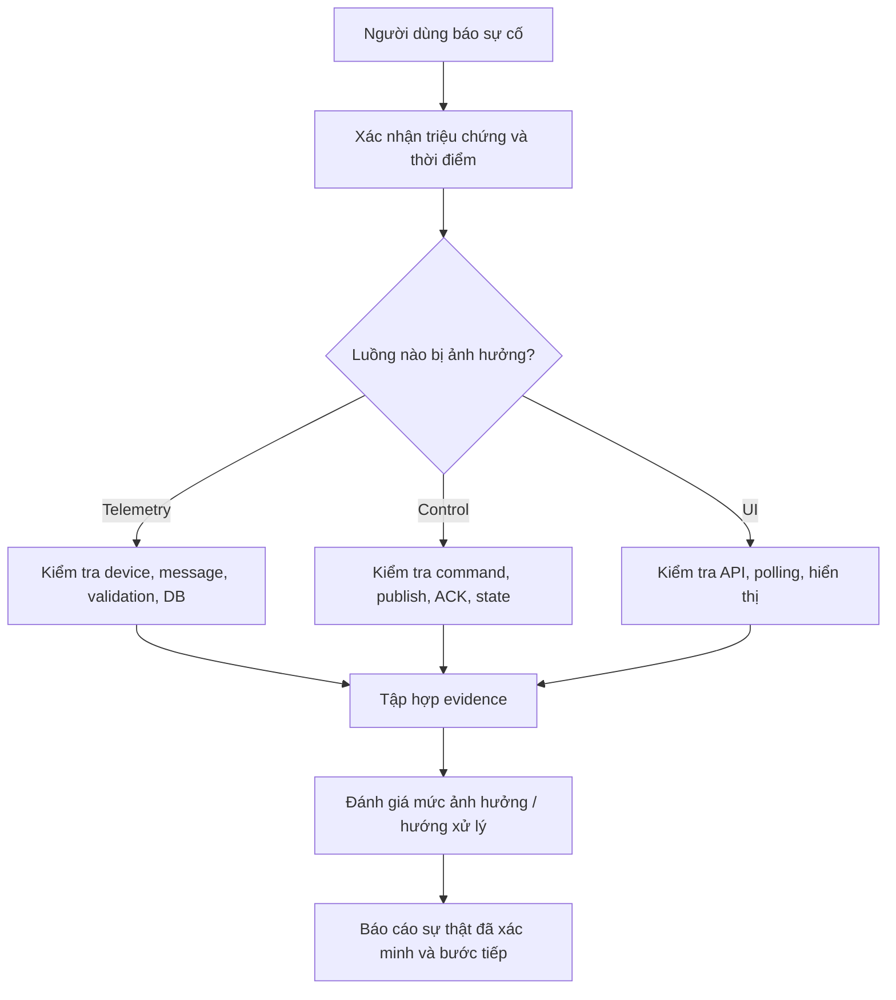

# 第12.07課 — エラー処理・品質管理 | Xử lý lỗi và quản lý chất lượng

> **BRSE Interview Master · 第12章 技術デモ・プレゼンテーション**  
> Trình độ N3–N2 · Trả lời chính 15–30 giây · **Draft — Pending Japanese/technical review**.  
> **Nguồn:** Mô tả Smart Farm IoT Management System do người dùng cung cấp. Không thay thế audit mã nguồn, demo thực tế hoặc nghiệm thu. Backend/PostgreSQL chủ yếu local; luồng ESP32/Wokwi–AWS–backend có bằng chứng thử nghiệm theo mô tả; chức năng nâng cao cần nghiệm thu thêm; chưa xác nhận production hay bơm/van nông nghiệp thật.  
> Xem [Kiến trúc 12.02](12-02-system-architecture.md), [Telemetry 12.04](12-04-telemetry-processing.md), [Command/ACK 12.05](12-05-device-control-ack.md).

## ① 学習目標

Biết mô tả lỗi truyền thông, trùng telemetry, thiếu ACK, lỗi lưu dữ liệu; phân biệt unit/integration/E2E; trao đổi incident với khách hàng Nhật theo hướng **xác minh → đánh giá ảnh hưởng → phương án → báo cáo**, không bịa SLO, số bug đã sửa hoặc production incident.

## ② 技術知識

**Đã được mô tả:** hệ thống có backend kiểm tra telemetry và xử lý trùng; lưu command intent, publish result, ACK, trạng thái và sự kiện; bộ công cụ kiểm thử gồm **JUnit, Spring Boot Test, PostgreSQL integration tests, Playwright**. Một số tính năng nâng cao vẫn cần nghiệm thu. **Chưa xác minh** chính sách retry, dead-letter, recovery time, idempotency toàn hệ thống, alert delivery và ngưỡng fail-safe cụ thể.

### Incident triage (quy trình học tập đề xuất)

*Đây là phương pháp phân tích lỗi nên thực hiện khi phỏng vấn, không phải hệ thống tự động triage đã triển khai.*

### 日本語で30秒説明

**応募者：** 問題が発生したら、まず現象と影響範囲を確認します。次に、デバイス、MQTT、バックエンド、データベース、画面のどこに問題があるかを切り分けます。確認できた事実と未確認の点を整理し、対応方針を報告します。

**Dịch:** Khi có vấn đề, xác nhận triệu chứng và phạm vi ảnh hưởng; chia nhỏ theo thiết bị, MQTT, backend, DB và UI; phân biệt sự thật và điều chưa rõ rồi báo phương án.

## ③ 面接対話 — Hỏi–đáp có đào sâu

### A. MQTT bị gián đoạn

**面接官：** デバイスからデータが届かなくなった場合、どうしますか。

**Dịch câu hỏi:** Nếu không còn nhận được dữ liệu từ thiết bị, bạn làm gì?  
**応募者：** 最後に受信した時刻を確認し、デバイスの接続状況とMQTT通信を調べます。原因を決めつけず、確認した結果を整理します。  
**Dịch:** Xem lần nhận cuối, tình trạng kết nối, MQTT; không đoán nguyên nhân.

**深掘り：** オフライン中のデータは必ず保存されますか。  

**Dịch câu hỏi:** Dữ liệu lúc offline có chắc chắn được lưu không?
**応募者：** 自動保存や再送の仕様は、まだ確認できていません。ファームウェアとテスト結果を調べます。  
**Dịch:** Chưa xác nhận lưu/gửi lại khi offline; cần xem firmware/test.

### B. Trùng telemetry

**面接官：** 同じメッセージを二回受け取ったらどうしますか。  

**Dịch câu hỏi:** Nếu nhận cùng một bản tin hai lần, bạn xử lý thế nào?
**応募者：** デバイスIDや起動ID、連番などを使って、重複を判定する設計です。例外ケースや判定ルールは実装を確認します。  
**Dịch:** Có thiết kế xét device ID, boot ID và sequence; cần xem rule, trường hợp ngoại lệ.

**深掘り：** MQTTのQoSだけで業務上の重複を防げますか。  

**Dịch câu hỏi:** Chỉ MQTT QoS có ngăn được trùng lặp ở nghiệp vụ không?
**応募者：** いいえ。通信の保証と、業務データの重複処理は分けて考える必要があります。  
**Dịch:** Không; QoS giao thức khác với chống trùng dữ liệu nghiệp vụ.

### C. Thiếu ACK

**面接官：** コマンドのACKが届かなかったらどう対応しますか。  

**Dịch câu hỏi:** Nếu không nhận ACK của lệnh điều khiển, bạn làm gì?
**応募者：** 実行結果を未確認として扱い、コマンドIDと通信状況、状態情報を調べます。再送前には二重実行の危険も確認します。  
**Dịch:** Đánh dấu kết quả chưa xác nhận; kiểm tra ID, kết nối, trạng thái; lưu ý thực hiện trùng.

**深掘り：** 送信成功なら画面に「完了」と表示していいですか。  

**Dịch câu hỏi:** Gửi thành công có thể hiển thị 'Hoàn tất' trên màn hình không?
**応募者：** いいえ。送信成功と実行完了は違います。画面の表示は確認できた状態に合わせるべきです。  
**Dịch:** Không; UI phải phản ánh trạng thái thực sự đã xác minh.

### D. Database lỗi

**面接官：** データベースへの保存が失敗したらどうしますか。  

**Dịch câu hỏi:** Nếu lưu vào database thất bại thì sao?
**応募者：** まずエラー内容と影響範囲を確認します。その後、ログやデータの整合性を調べて、修正方法を検討します。  
**Dịch:** Kiểm tra lỗi, phạm vi ảnh hưởng, log, tính nhất quán trước khi chọn sửa.

**深掘り：** メッセージは自動的に再処理されますか。  

**Dịch câu hỏi:** Bản tin có tự động được xử lý lại không?
**応募者：** その仕組みはまだ確認できていません。再処理と重複防止の設計を確認します。  
**Dịch:** Chưa rõ cơ chế reprocess; phải kiểm tra thiết kế và chống trùng.

### E. Các loại kiểm thử

**面接官：** どのようなテストを使用していますか。  

**Dịch câu hỏi:** Bạn sử dụng những loại kiểm thử nào?
**応募者：** JUnitとSpring Boot Testを使っています。また、PostgreSQLを使った結合テストや、Playwrightを使った画面テストもあります。  
**Dịch:** Dùng JUnit/Spring Boot Test; integration tests với PostgreSQL và UI tests Playwright.

**深掘り：** これで実機の安全性も保証できますか。  

**Dịch câu hỏi:** Như vậy có bảo đảm an toàn cho thiết bị thật không?
**応募者：** いいえ。ソフトウェアのテストだけでは、実機の安全性は保証できません。実際のポンプやバルブでの検証が必要です。  
**Dịch:** Không; test phần mềm chưa chứng minh an toàn phần cứng thật.

### F. Deadline gần kề

**面接官：** リリース直前に重大なバグが見つかったらどうしますか。  

**Dịch câu hỏi:** Phát hiện lỗi nghiêm trọng ngay trước phát hành, bạn làm gì?
**応募者：** まず重大度と影響範囲を確認します。開発チームと対応策を検討し、リスクと選択肢をお客様に説明して判断を仰ぎます。  
**Dịch:** Xác định mức độ/phạm vi, trao đổi dev, trình bày rủi ro và phương án để thống nhất quyết định.

**深掘り：** 原因が分からない場合、どう報告しますか。  

**Dịch câu hỏi:** Khi chưa rõ nguyên nhân, bạn báo cáo thế nào?
**応募者：** 原因は調査中だと正直に伝え、分かっている影響と次の確認事項を報告します。  
**Dịch:** Báo nguyên nhân đang điều tra, thông tin đã rõ và các bước kiểm tra tiếp.

## ④ 技術深掘り — Test matrix đề xuất

| Tình huống | Cần thử gì | Trạng thái |
|---|---|---|
| MQTT disconnect | Kết nối mất, UI không hiểu nhầm dữ liệu cũ là mới | Scenario đề xuất, chưa xác nhận test |
| Duplicate telemetry | Cùng dữ liệu gửi nhiều lần | Có chức năng xử lý trùng theo mô tả; test case chưa đối chiếu |
| Lost ACK | Command có thể đã thực thi nhưng không nhận ACK | Scenario đề xuất |
| DB failure | Lỗi lưu, trạng thái command có nhất quán không | Scenario đề xuất |
| Polling delay | UI có thể hiện timestamp/trạng thái đúng | Scenario đề xuất |
| Sensor invalid | Giá trị thiếu/trái định dạng | Backend có validation theo mô tả; quy tắc cụ thể chưa kiểm |
| Physical pump/valve | Hành vi vật lý và fail-safe | Chưa nghiệm thu thực tế |

**Phân biệt test:** Unit kiểm tra logic cục bộ; Integration kiểm tra các phần làm việc cùng nhau; E2E kiểm tra luồng xuyên tầng. Tên tool trong project **không chứng minh** độ phủ hay kết quả passing.

## ⑤ 語彙・文法

| 日本語 | 読み方 | Nghĩa |
|---|---|---|
| 障害 | しょうがい | Sự cố |
| 原因 | げんいん | Nguyên nhân |
| 影響範囲 | えいきょうはんい | Phạm vi ảnh hưởng |
| 切り分け | きりわけ | Khoanh vùng nguyên nhân |
| 重複 | ちょうふく／じゅうふく | Trùng lặp |
| 整合性 | せいごうせい | Tính nhất quán |
| 再処理 | さいしょり | Xử lý lại |
| 再送 | さいそう | Gửi lại |
| 未確認 | みかくにん | Chưa xác nhận |
| 重大なバグ | じゅうだいなバグ | Lỗi nghiêm trọng |
| 結合テスト | けつごうテスト | Kiểm thử tích hợp |
| 対策 | たいさく | Biện pháp |

**類似表現:** 障害 (incident/failure) ≠ バグ (lỗi phần mềm); 推定 (ước đoán có cơ sở) ≠ 確認済み (đã xác minh). **〜について調査中です** = hiện đang điều tra; **現時点では〜を確認できていません** = hiện tại chưa thể xác nhận.

## ⑥ 会話練習

1. 「データが来ない」— hỏi rõ thiết bị, mốc thời gian, phạm vi.
2. 「ACKがない」— diễn đạt “unknown” chứ không tự kết luận thất bại.
3. 「すぐ本番リリースできますか」— trả lời giới hạn chưa có production evidence.
4. Học viên tự thiết kế ba test case cho duplicate, DB unavailable và mất kết nối, ghi rõ **đề xuất**.
5. AI interviewer: 「障害対応とテストについて一問ずつ質問し、回答を待ってから一つだけ深掘りしてください。事実と仮説を区別してください。」

## ⑦ 解答ポイント

Đúng: phân tầng kiểm tra, không đoán nguyên nhân, không đồng nhất MQTT ACK và app ACK, không tự tuyên bố retry/fail-safe, có báo cáo minh bạch và đo phạm vi ảnh hưởng.

## ⑨ 評価・改善 — Rubric /20

Chấm mỗi tiêu chí từ 0–4: **đúng trọng tâm**, **chính xác kỹ thuật**, **tiếng Nhật tự nhiên**, **giải thích mạch lạc**, **xử lý câu hỏi đào sâu và trung thực**. 16–20: tốt; 12–15: cần chỉnh; dưới 12: học lại. Mốc nội bộ, không phải tiêu chuẩn tuyển dụng chính thức. Không chấm phát âm nếu chỉ có văn bản.

**Cách luyện:** Trả lời không nhìn mẫu → tự chấm → chọn tối đa ba lỗi quan trọng → sửa và trả lời lại. Giữ câu chính 2–4 câu, nếu tình huống phức tạp hãy tách phần phân tích kỹ thuật ra khỏi câu trả lời.

## ⑩ 出典・確認事項 — Nguồn và phần cần kiểm chứng

- **Đã mô tả:** kiến trúc ESP32/Wokwi ↔ AWS IoT Core ↔ Spring Boot ↔ PostgreSQL; Web React/REST/polling; lưu command, ACK, sự kiện, phiên tưới.
- **Có thông tin về chạy thử:** luồng ESP32/Wokwi–AWS–backend, nhưng bài này chưa tự kiểm định evidence.
- **Chưa chứng minh:** toàn bộ các nhánh lỗi/chức năng nâng cao đã nghiệm thu; production; bơm/van thực tế; performance/SLA định lượng; mọi vai trò cá nhân.
- Khi có mã nguồn, đối chiếu claim tới issue/commit/test/demo và chỉnh bài; nhờ reviewer tiếng Nhật kiểm tra sự tự nhiên.

