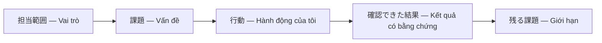

# 第12.08課 — 担当業務・技術的な課題 | Vai trò cá nhân và khó khăn kỹ thuật

> **BRSE Interview Master · 第12章 技術デモ・プレゼンテーション**  
> Trình độ N3–N2 · Trả lời chính 15–30 giây · **Draft — Pending Japanese/technical review**.  
> **Nguồn:** Mô tả Smart Farm IoT Management System do người dùng cung cấp. Không thay thế audit mã nguồn, demo thực tế hoặc nghiệm thu. Backend/PostgreSQL chủ yếu local; luồng ESP32/Wokwi–AWS–backend có bằng chứng thử nghiệm theo mô tả; chức năng nâng cao cần nghiệm thu thêm; chưa xác nhận production hay bơm/van nông nghiệp thật.  
> Xem [Kiến trúc 12.02](12-02-system-architecture.md), [Telemetry 12.04](12-04-telemetry-processing.md), [Command/ACK 12.05](12-05-device-control-ack.md).

## ① 学習目標

Trả lời **何を担当しましたか**, **一番大変だったことは**, **どう解決しましたか**, **結果は** theo PREP/STAR, bảo vệ được đóng góp cá nhân, không tự nhận toàn bộ dự án. Dạy cách nói chưa biết/đang xác minh tự nhiên trong phỏng vấn Nhật.

## ② 事実と仮定 — Nguồn sự thật

Tài liệu đầu vào mô tả kiến trúc và tính năng của **hệ thống**, **chưa cho biết** chính xác người học đã tự code những module nào, quy mô nhóm, thời gian thực hiện, số bug, kết quả có thể đo và số commit. Vì thế:

- Những câu như “Tôi tự build toàn bộ AWS/React/backend” **không được viết như trải nghiệm đã xác nhận**.
- Ví dụ cá nhân hóa dùng **【placeholder】**; phải thay bằng bằng chứng thật.
- Câu trả lời mẫu thuộc tuyến **general/conditional**, không tự suy ra đó là CV của người học.

### Evidence map — Bảng điền trước khi phỏng vấn

| Câu hỏi | Thông tin cần điền | Bằng chứng nên dùng |
|---|---|---|
| Tôi phụ trách gì? | 【Tên module/chức năng】 | Commit, issue, PR |
| Tôi đã làm gì? | 【Một hành động kiểm chứng được】 | File code, test hoặc tài liệu |
| Khó khăn nào? | 【Một tình huống thực tế】 | Issue, debug log |
| Tôi xử lý thế nào? | 【Các bước đã thực hiện】 | Fix commit / test result |
| Kết quả nào? | 【Kết quả thực tế, không bịa số liệu】 | Test/report/demo |
| Giới hạn còn lại? | 【Chưa nghiệm thu gì】 | QA checklist |

### 日本語で30秒説明 — Mẫu có chỗ trống, chỉ dùng sau khi xác minh

**応募者：** このプロジェクトでは、主に【実際に担当した機能】を担当しました。特に【実際の課題】が難しかったため、【自分が行った対応】を行いました。その結果、【確認できた結果】を確認できました。現在も【残っている課題】は、追加の検証が必要です。

**Dịch:** Tôi phụ trách [chức năng thật]. Gặp [khó khăn thật], tôi [hành động thật], đã có [kết quả xác minh]; [hạn chế] vẫn cần kiểm tra. **Không đọc các placeholder trong phỏng vấn.**

## ③ 面接対話 — Hỏi đáp theo mục đích

### A. 担当範囲 — Trách nhiệm

**面接官：** このプロジェクトでは何を担当しましたか。  
**応募者（điền bằng chứng）：** 私は【担当モジュール】を担当しました。具体的には【自分が実施した作業】を行いました。  
**Dịch:** Tôi phụ trách [module], cụ thể đã [công việc]. Cần điền theo sự thật.

**深掘り：** その部分は一人で実装したのですか。  
**応募者（mẫu có điều kiện）：** 【自分とチームの分担】です。私の担当部分は【事実】です。  
**Dịch:** [Phân công thật]; trách nhiệm trực tiếp của tôi là [sự thật].

### B. 技術的に難しかった点 — Khó khăn

**面接官：** 開発で一番難しかったことは何ですか。  
**応募者（cấu trúc, không xác nhận trải nghiệm）：** 【実際の課題】が難しかったです。まず【確認したこと】を調べて、【対応内容】を進めました。  
**Dịch:** Khó nhất là [vấn đề thật]; tôi kiểm tra [bước] và thực hiện [hành động].

**深掘り：** どのように原因を特定しましたか。  
**応募者：** 【調査したログ・テスト・コード】を確認しました。そこから【根拠を示せる原因】を判断しました。  
**Dịch:** Xem [evidence], rút ra [nguyên nhân có căn cứ].

### C. MQTT không ổn định — Tình huống mẫu, không phải kinh nghiệm đã xảy ra

**面接官：** 仮にMQTTの通信が不安定になったら、どう調査しますか。  
**応募者：** まず、デバイスの接続状況と送信ログを確認します。次に、AWS IoT Coreとバックエンドの受信状況を分けて調べます。  
**Dịch:** *Giả sử* MQTT bất ổn: kiểm tra thiết bị/log gửi; chia tầng AWS và backend.

**深掘り：** 原因が分からない場合はどうしますか。  
**応募者：** 再現条件と未確認の点を整理し、チームに相談します。  
**Dịch:** Tổng hợp điều kiện tái hiện và phần chưa rõ, trao đổi đội.

### D. チームとの連携 — Phối hợp

**面接官：** チームの意見が違うときは、どうしますか。  
**応募者：** まず、お互いの理由と制約を確認します。その上で、目的とリスクを整理し、合意できる方法を検討します。  
**Dịch:** Xác nhận lập luận/ràng buộc, tổng hợp mục tiêu/rủi ro và phương án thống nhất.

**深掘り：** すぐに決められない場合はどうしますか。  
**応募者：** 必要な確認事項と期限を整理し、関係者に相談します。  
**Dịch:** Ghi vấn đề và thời hạn cần xác minh, bàn với bên liên quan.

### E. 実績 — Kết quả và số liệu

**面接官：** どんな成果がありましたか。  
**応募者（mẫu trung thực về hệ thống, không nhận công lao cá nhân）：** プロジェクト全体として、ESP32やWokwiからAWSを通じてバックエンドにデータを送る流れを試験しています。私個人の成果については【確認できる担当成果】を説明します。  
**Dịch:** Ở cấp dự án, đã có chạy thử luồng dữ liệu; kết quả cá nhân cần chứng minh riêng.

**深掘り：** 本番環境でも使われていますか。  
**応募者：** いいえ。本番運用や実際の農業用ポンプ・バルブの動作は、まだ確認できていません。  
**Dịch:** Chưa xác nhận production và vận hành phần cứng nông nghiệp thật.

### F. Không biết trả lời

**面接官：** MQTTのQoS設定はいくつですか。  
**応募者：** その設定値は今すぐ正確にお答えできません。設定ファイルを確認した上で、正しい情報をお伝えします。  
**Dịch:** Tôi chưa thể trả lời chính xác giá trị QoS ngay; sẽ kiểm tra cấu hình và phản hồi đúng.

**深掘り：** 確認するなら、どこを見ますか。  
**応募者：** ファームウェアとバックエンドのMQTT設定を確認します。  
**Dịch:** Kiểm tra cấu hình MQTT ở firmware/backend.

## ④ 思考プロセス — STAR và PREP

- **STAR:** Situation → Task → Action → Result. Chỉ dùng khi có trải nghiệm thật.
- **PREP:** Point → Reason → Example → Point. Dùng giải thích ý kiến kỹ thuật tổng quát.
- **Không nhầm:** câu “nếu gặp lỗi tôi sẽ…” là giả định; không được biến thành “tôi đã khắc phục…” khi chưa xảy ra.

## ⑤ 語彙・文法

| 日本語 | 読み方 | Nghĩa |
|---|---|---|
| 担当する | たんとうする | Phụ trách |
| 役割 | やくわり | Vai trò |
| 実装する | じっそうする | Hiện thực hóa/code |
| 課題 | かだい | Vấn đề |
| 原因 | げんいん | Nguyên nhân |
| 調査する | ちょうさする | Điều tra |
| 再現する | さいげんする | Tái hiện |
| 対応する | たいおうする | Xử lý |
| 成果 | せいか | Thành quả |
| 根拠 | こんきょ | Căn cứ |
| 分担 | ぶんたん | Phân công |
| 相談する | そうだんする | Trao đổi |
| 未確認 | みかくにん | Chưa xác nhận |

**類似表現:** 担当しました (tôi phụ trách) ≠ 参加しました (tôi tham gia); 実装しました (đã code) ≠ 検証しました (đã thử/kiểm chứng); 成果 (kết quả) ≠ 予定 (dự kiến). 

**Mẫu:** 〜を担当しました。/ 〜が課題でした。/ 〜を確認した上で判断しました。/ 現時点では正確にお答えできません。

## ⑥ 会話練習

1. Điền evidence map bằng thông tin thật trước khi luyện.
2. Tự giới thiệu vai trò cá nhân trong 20 giây, không kể tên công nghệ không làm.
3. Trả lời 「一番難しかったことは？」 theo STAR 30–45 giây.
4. Phân biệt ba câu: *đã tham gia*, *đã phát triển*, *đã kiểm thử*.
5. AI interviewer: 「職務経歴とSmart Farmの担当範囲を一問ずつ質問し、回答を待って深掘りしてください。裏付けのない実績は確認してください。」

## ⑦ 解答ポイント

Câu có chỗ trống chỉ là **template**; cần xác minh người học thực sự làm gì. Trả lời không biết một cách trung thực tốt hơn suy đoán config; phân biệt kết quả dự án và đóng góp cá nhân.

## ⑨ 評価・改善 — Rubric /20

Chấm mỗi tiêu chí từ 0–4: **đúng trọng tâm**, **chính xác kỹ thuật**, **tiếng Nhật tự nhiên**, **giải thích mạch lạc**, **xử lý câu hỏi đào sâu và trung thực**. 16–20: tốt; 12–15: cần chỉnh; dưới 12: học lại. Mốc nội bộ, không phải tiêu chuẩn tuyển dụng chính thức. Không chấm phát âm nếu chỉ có văn bản.

**Cách luyện:** Trả lời không nhìn mẫu → tự chấm → chọn tối đa ba lỗi quan trọng → sửa và trả lời lại. Giữ câu chính 2–4 câu, nếu tình huống phức tạp hãy tách phần phân tích kỹ thuật ra khỏi câu trả lời.

## ⑩ 出典・確認事項 — Nguồn và phần cần kiểm chứng

- **Đã mô tả:** kiến trúc ESP32/Wokwi ↔ AWS IoT Core ↔ Spring Boot ↔ PostgreSQL; Web React/REST/polling; lưu command, ACK, sự kiện, phiên tưới.
- **Có thông tin về chạy thử:** luồng ESP32/Wokwi–AWS–backend, nhưng bài này chưa tự kiểm định evidence.
- **Chưa chứng minh:** toàn bộ các nhánh lỗi/chức năng nâng cao đã nghiệm thu; production; bơm/van thực tế; performance/SLA định lượng; mọi vai trò cá nhân.
- Khi có mã nguồn, đối chiếu claim tới issue/commit/test/demo và chỉnh bài; nhờ reviewer tiếng Nhật kiểm tra sự tự nhiên.

