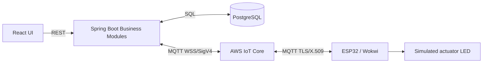

# 第12.09課 — 技術デモ・プレゼンテーション | Demo kỹ thuật Smart Farm

> **BRSE Interview Master · 第12章 技術デモ・プレゼンテーション**  
> Trình độ N3–N2 · Trả lời chính 15–30 giây · **Draft — Pending Japanese/technical review**.  
> **Nguồn:** Mô tả Smart Farm IoT Management System do người dùng cung cấp. Không thay thế audit mã nguồn, demo thực tế hoặc nghiệm thu. Backend/PostgreSQL chủ yếu local; luồng ESP32/Wokwi–AWS–backend có bằng chứng thử nghiệm theo mô tả; chức năng nâng cao cần nghiệm thu thêm; chưa xác nhận production hay bơm/van nông nghiệp thật.  
> Xem [Kiến trúc 12.02](12-02-system-architecture.md), [Telemetry 12.04](12-04-telemetry-processing.md), [Command/ACK 12.05](12-05-device-control-ack.md).

## ① 学習目標

Biết giới thiệu demo **3 phút** và **5–7 phút** bằng tiếng Nhật, giải thích luồng **UI → API → Business Logic → PostgreSQL → AWS IoT → ESP32**, chuẩn bị kế hoạch nếu kết nối AWS/Wokwi không hoạt động. Không dùng demo mô phỏng để tuyên bố hệ thống production.

## ② デモ構成 — Kịch bản, minh chứng và giới hạn

**Dự án có trong brief:** Dashboard giám sát cảm biến, quản lý khu vực/thiết bị, điều khiển thiết bị, cảnh báo, lịch sử, tưới và xuất CSV. Tuy nhiên không có bằng chứng trong cuộc hội thoại về **trạng thái từng màn hình đang chạy lúc demo**. Vì vậy kịch bản dưới đây là **kế hoạch có điều kiện**, không phải mô tả buổi demo đã diễn ra.

**Bộ bằng chứng cần chuẩn bị:** ảnh dashboard, log telemetry, bản ghi dữ liệu database đã ẩn bí mật, MQTT publish/ACK, command status và test results. Không đưa chứng chỉ, mật khẩu, topic nhạy cảm hoặc token vào slide/demo công khai.

### Demo outline theo thời lượng

| Phần | 3 phút | 5–7 phút |
|---|---|---|
| Mục tiêu | 20s | 30s |
| Kiến trúc | 35s | 60s |
| Giám sát sensor | 45s | 90s |
| Luồng điều khiển / ACK | 55s | 90–120s |
| Trạng thái kiểm thử và giới hạn | 25s | 45–60s |
| Q&A | ngoài thời lượng hoặc theo interviewer | phần còn lại |

*Đây là phân bổ mục tiêu luyện tập, không phải thời gian trình diễn đã đo.*

### 3分デモ — Kịch bản lời nói (dùng theo các mốc trình diễn)

**導入:** 本日はSmart Farm IoT Management Systemをご紹介します。農園の環境データを確認し、デバイスや灌漑を管理するためのシステムです。

**構成:** センサーのデータはESP32からAWS IoT Coreに送られ、Spring Bootのバックエンドで処理します。履歴はPostgreSQLに保存し、Reactの画面から確認します。

**監視（mở màn hình đã kiểm chứng):** こちらは管理画面です。【表示できる場合だけ：温度や湿度などの値を確認できます。】データの更新はREST APIとポーリングで行っています。

**制御（chỉ khi demo thực sự chạy):** こちらから制御要求を送ると、バックエンドがコマンドを記録し、MQTTでデバイスに送信します。ただし、送信成功とデバイスの動作成功は別です。ACKと報告された状態を確認します。

**締め:** 現在は主にローカル環境とシミュレーションで検証しています。実際の農業用ポンプ・バルブの動作と本番運用は、まだ確認できていません。

**Dịch tóm tắt:** Giới thiệu mục tiêu Smart Farm; đi qua kiến trúc; mở dashboard nếu đã chạy; gửi lệnh và kiểm tra ACK/state nếu có evidence; kết luận rõ giới hạn local/mô phỏng. **Đọc ở tốc độ phỏng vấn có thể ngắn hơn 3 phút**; thời gian dự kiến bao gồm thao tác và chuyển cảnh, không phải ba phút đọc liên tục.

### 5–7分デモ — Bản mở rộng

Giữ lời dẫn của bản 3 phút và thêm các đoạn chỉ khi có màn hình/bằng chứng:

**エリア管理：** デバイスやセンサーをエリアごとに管理する機能があります。画面で設定内容を確認しながら説明します。

**履歴：** センサーデータの履歴を保存しています。時刻や測定値を確認し、必要に応じてCSVの出力機能も説明します。

**制御結果：** この処理ではコマンドIDで要求と応答を対応付けます。ACKや状態が確認できない場合は、成功と断定しません。

**設計の工夫：** バックエンドはモジュラーモノリスとして、デバイス管理、テレメトリー、制御などの機能を分けています。

**課題：** 今後は未検証の機能を確認し、実機での動作や安全性も検証する必要があります。

*Bất kỳ phần nào chưa sẵn sàng trên môi trường thực tế phải chuyển thành “thiết kế và kế hoạch”, không nói như thao tác demo đã chứng minh.*

## ③ 面接対話 — Hội thoại và câu hỏi đào sâu

### A. Demo thứ tự nào?

**面接官：** デモでは、どの順番で説明しますか。  
**応募者：** まず目的と構成を簡単に説明します。次に、画面で監視機能を紹介し、最後に制御の流れと現在の検証状況を説明します。  
**Dịch:** Nêu mục tiêu/kiến trúc → giám sát trên UI → điều khiển và trạng thái kiểm thử.

**深掘り：** 時間が短い場合はどうしますか。  
**応募者：** 一番重要な監視と制御の流れを優先します。細かい説明は質問に合わせて追加します。  
**Dịch:** Ưu tiên giám sát và điều khiển, chi tiết nói khi bị hỏi sâu.

### B. Button → API → DB → MQTT

**面接官：** ボタンを押した後、何が起こりますか。  
**応募者：** Reactからバックエンドに制御要求が送られます。バックエンドはコマンドを保存し、AWS IoT Coreを経由してESP32に送信します。その後、ACKや状態を確認します。  
**Dịch:** React gửi yêu cầu, backend lưu command rồi gửi AWS đến ESP32, đối chiếu ACK/state.

**深掘り：** すぐに「成功」と表示していいですか。  
**応募者：** いいえ。送信結果と実行結果を区別して表示する必要があります。  
**Dịch:** Không; phân biệt trạng thái gửi và thực thi.

### C. Demo bị lỗi

**面接官：** デモ中にAWSへ接続できなくなったらどうしますか。  
**応募者：** まず接続状況を確認します。復旧できない場合は、事前に用意した構成図や検証記録を使って、処理の流れを説明します。  
**Dịch:** Kiểm tra kết nối; nếu không khôi phục, dùng sơ đồ và bằng chứng đã chuẩn bị để giải thích, không giả live success.

**深掘り：** 録画を使う場合、どう説明しますか。  
**応募者：** これは事前に記録したテスト結果だと明確に伝えます。  
**Dịch:** Nêu rõ đó là bản ghi test trước, không phải demo live.

### D. Người phỏng vấn hỏi production

**面接官：** この画面は本番の農場で使われていますか。  
**応募者：** いいえ、現在は主にローカル環境とシミュレーションで確認しています。実際の農場への導入は、まだ確認できていません。  
**Dịch:** Chưa; chủ yếu local và mô phỏng, chưa xác nhận triển khai ngoài nông trại.

**深掘り：** センサーデータは実測値ですか。  
**応募者：** Wokwiで取得した値はシミュレーションのデータです。実機の測定値とは区別して説明します。  
**Dịch:** Dữ liệu Wokwi là mô phỏng, phải phân biệt với cảm biến thật.

### E. Vai trò cá nhân khi demo

**面接官：** この画面はあなたが作りましたか。  
**応募者（chỉ điền dựa theo CV/commit）：** 【実際に担当した機能】は私が担当しました。【それ以外の担当範囲】については、チームの分担に沿って説明します。  
**Dịch:** Nêu đúng tính năng mình làm; phần khác theo phân công nhóm. **Không dùng placeholder khi phỏng vấn.**

**深掘り：** どの部分を実装しましたか。  
**応募者：** 【ファイル・機能・テストなどで確認できる担当内容】です。  
**Dịch:** Chỉ ra phần việc có bằng chứng.

## ④ プレゼン表現 — Từ vựng và cách dẫn

| 日本語 | 読み方 | Nghĩa |
|---|---|---|
| ご紹介します | ごしょうかいします | Xin giới thiệu |
| 画面 | がめん | Màn hình |
| 操作 | そうさ | Thao tác |
| 処理の流れ | しょりのながれ | Luồng xử lý |
| 構成図 | こうせいず | Sơ đồ kiến trúc |
| 実行結果 | じっこうけっか | Kết quả thực thi |
| 動作確認 | どうさかくにん | Kiểm tra hoạt động |
| 検証記録 | けんしょうきろく | Bản ghi kiểm thử |
| 事前 | じぜん | Từ trước |
| 現時点 | げんじてん | Hiện tại |
| 本番運用 | ほんばんうんよう | Vận hành production |
| 制限 | せいげん | Giới hạn |

**類似表現:** こちらをご覧ください (xin xem phần này) / こちらでご確認いただけます (có thể kiểm tra tại đây); 実行しました (đã thực thi) / 実行できる設計です (thiết kế cho phép, chưa chứng minh đã chạy). Nói 「現在の検証範囲では…」 khi muốn hạn định phạm vi bằng chứng.

## ⑤ 会話練習 — Demo rehearsal

1. Thực hành bản 3 phút có đồng hồ, bao gồm thao tác thật.
2. Giải thích luồng “button → API → database → MQTT → ACK” không nhìn sơ đồ trong 30 giây.
3. Thực hành hai phương án: demo live thành công và demo bị lỗi kết nối.
4. Trả lời câu “Bạn làm phần nào?” chỉ bằng bằng chứng thực.
5. AI interviewer: 「デモの途中で一つずつ質問し、回答を待って深掘りしてください。実機未検証と模擬結果を区別してください。」

## ⑥ 準備チェックリスト — Checklist

- [ ] Màn hình thực tế sẵn sàng hoặc ảnh/video **ghi rõ là recording**.
- [ ] Internet/AWS không được coi là bảo đảm; có sơ đồ backup.
- [ ] Demo không lộ secrets/tokens/certificates.
- [ ] Lệnh gửi/ACK/trạng thái được dán nhãn phân biệt.
- [ ] Không nói mô phỏng là bơm thật.
- [ ] Có một câu kết về giới hạn và bước kiểm thử tiếp.
- [ ] Nếu nhắc kết quả cá nhân, có commit/issue/test làm bằng chứng.

## ⑦ 解答ポイント

Demo tốt nói đúng hệ thống làm gì, ai gửi dữ liệu, backend ghi gì, kết quả nào đã được xác nhận, và cái gì chưa được kiểm chứng. Không đổi video cũ thành live demo trong lời kể.

## ⑨ 評価・改善 — Rubric /20

Chấm mỗi tiêu chí từ 0–4: **đúng trọng tâm**, **chính xác kỹ thuật**, **tiếng Nhật tự nhiên**, **giải thích mạch lạc**, **xử lý câu hỏi đào sâu và trung thực**. 16–20: tốt; 12–15: cần chỉnh; dưới 12: học lại. Mốc nội bộ, không phải tiêu chuẩn tuyển dụng chính thức. Không chấm phát âm nếu chỉ có văn bản.

**Cách luyện:** Trả lời không nhìn mẫu → tự chấm → chọn tối đa ba lỗi quan trọng → sửa và trả lời lại. Giữ câu chính 2–4 câu, nếu tình huống phức tạp hãy tách phần phân tích kỹ thuật ra khỏi câu trả lời.

## ⑩ 出典・確認事項 — Nguồn và phần cần kiểm chứng

- **Đã mô tả:** kiến trúc ESP32/Wokwi ↔ AWS IoT Core ↔ Spring Boot ↔ PostgreSQL; Web React/REST/polling; lưu command, ACK, sự kiện, phiên tưới.
- **Có thông tin về chạy thử:** luồng ESP32/Wokwi–AWS–backend, nhưng bài này chưa tự kiểm định evidence.
- **Chưa chứng minh:** toàn bộ các nhánh lỗi/chức năng nâng cao đã nghiệm thu; production; bơm/van thực tế; performance/SLA định lượng; mọi vai trò cá nhân.
- Khi có mã nguồn, đối chiếu claim tới issue/commit/test/demo và chỉnh bài; nhờ reviewer tiếng Nhật kiểm tra sự tự nhiên.

