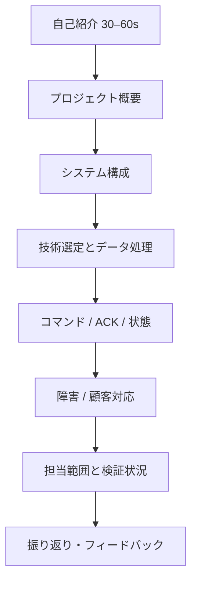

# 第12.10課 — 模擬面接・深掘り質問 | Phỏng vấn giả lập dự án Smart Farm

> **BRSE Interview Master · 第12章 技術デモ・プレゼンテーション**  
> Trình độ N3–N2 · Trả lời chính 15–30 giây · **Draft — Pending Japanese/technical review**.  
> **Nguồn:** Mô tả Smart Farm IoT Management System do người dùng cung cấp. Không thay thế audit mã nguồn, demo thực tế hoặc nghiệm thu. Backend/PostgreSQL chủ yếu local; luồng ESP32/Wokwi–AWS–backend có bằng chứng thử nghiệm theo mô tả; chức năng nâng cao cần nghiệm thu thêm; chưa xác nhận production hay bơm/van nông nghiệp thật.  
> Xem [Kiến trúc 12.02](12-02-system-architecture.md), [Telemetry 12.04](12-04-telemetry-processing.md), [Command/ACK 12.05](12-05-device-control-ack.md).

## ① 学習目標

Ứng viên có thể hoàn thành một buổi phỏng vấn Smart Farm bằng tiếng Nhật, từ tổng quan đến kiến trúc, lý do dùng công nghệ, dữ liệu, điều khiển, sự cố, bảo mật, demo và giới hạn. AI interviewer hỏi **một câu mỗi lượt**, đợi câu trả lời, đào sâu dựa trên nội dung thực tế, sau đó đánh giá.

## ② 面接の流れ — Cấu trúc buổi phỏng vấn

**Mode:** một lượt hỏi → học viên trả lời → một câu đào sâu liên quan → ghi nhận điểm → tiếp tục. Không làm sẵn bài trả lời trước người học. Các hội thoại sau là **mẫu để tự học**, không thay thế phiên tương tác.

## ③ 模擬面接 — Bộ câu hỏi mẫu kèm đáp án ngắn

### Round 1 — Overview

**面接官：** Smart Farm IoT Management Systemについて、簡単に説明してください。

**Dịch câu hỏi:** Hãy giới thiệu ngắn gọn về Smart Farm IoT Management System.  
**応募者：** 農園の環境を監視し、デバイスや灌漑を管理するためのシステムです。ESP32とAWS IoT Core、Spring Boot、PostgreSQL、Reactを使っています。現在は主に開発環境で検証しています。  
**Dịch:** Hệ thống giám sát môi trường, quản lý thiết bị/tưới; dùng ESP32, AWS, Spring Boot, PostgreSQL, React; chủ yếu thử trong môi trường phát triển.

**深掘り：** どの機能が特に重要ですか。  
**応募者：** センサーデータの監視と、制御結果を正しく確認できることが重要だと考えています。  
**Dịch:** Theo tôi, giám sát và xác minh kết quả điều khiển đúng rất quan trọng.

### Round 2 — Architecture

**面接官：** センサーデータは、どのように画面に届きますか。  
**応募者：** ESP32からAWS IoT CoreへMQTTで送信し、バックエンドで処理してPostgreSQLに保存します。画面はREST APIからデータを取得します。  
**Dịch:** ESP32 → AWS MQTT → backend → DB; UI qua REST.

**深掘り：** ReactはMQTTを直接使いますか。  
**応募者：** いいえ。現在の画面はREST APIとポーリングでバックエンドに接続しています。  
**Dịch:** Không; web dùng REST/polling với backend.

### Round 3 — Technology

**面接官：** なぜMQTTを使うのですか。  
**応募者：** 軽量でIoT機器との通信に適しており、Publish/Subscribe方式で非同期にメッセージをやり取りできるためです。  
**Dịch:** MQTT nhẹ và phù hợp IoT, pub/sub bất đồng bộ.

**深掘り：** REST APIはどこで使っていますか。  
**応募者：** Web画面とバックエンドの間です。  
**Dịch:** Giữa UI và backend.

### Round 4 — Telemetry consistency

**面接官：** 同じデータが複数回届いたら、どうしますか。  
**応募者：** バックエンドで重複を確認する処理があります。デバイスIDや起動ID、連番などが判断の手がかりになります。具体的な条件はコードを確認します。  
**Dịch:** Backend có xử lý kiểm tra trùng; ID thiết bị, boot ID, sequence hỗ trợ nhận diện; điều kiện chính xác cần xem code.

**深掘り：** 連番だけで十分ですか。  
**応募者：** いいえ。再起動の影響も考える必要があります。  
**Dịch:** Không; còn phải tính reboot.

### Round 5 — ACK and state

**面接官：** MQTTでコマンドの送信が成功したら、ポンプは動きましたか。  
**応募者：** いいえ、送信成功だけでは判断できません。ACKとデバイスの状態を確認する必要があります。実際のポンプはまだ検証できていません。  
**Dịch:** Không thể kết luận chỉ từ publish; phải xem ACK/state; bơm thật chưa xác minh.

**深掘り：** ACKが届かなかったらどうしますか。  
**応募者：** 結果を未確認として扱い、通信状況とコマンド履歴を調べます。  
**Dịch:** Đánh dấu chưa xác nhận và kiểm tra kết nối/log.

### Round 6 — Safety and irrigation

**面接官：** 土壌が乾いていたら、必ず灌漑しますか。  
**応募者：** いいえ。土壌の水分だけでなく、許可された時間帯や水の状態、雨なども考慮する設計です。  
**Dịch:** Không; thiết kế xét thêm lịch, nguồn nước, mưa.

**深掘り：** 実機でも安全だと保証できますか。  
**応募者：** いいえ、実機での十分な検証はまだできていません。  
**Dịch:** Chưa; chưa đủ xác minh an toàn với thiết bị thật.

### Round 7 — Bug triage

**面接官：** 画面のデータが更新されない場合、どうしますか。  
**応募者：** まず再現条件を確認します。次に、デバイスの送信、MQTT、バックエンド、APIの順に切り分けて調べます。  
**Dịch:** Xác định điều kiện tái hiện rồi kiểm tra từ thiết bị đến API.

**深掘り：** 原因が不明ならどう報告しますか。  
**応募者：** 現時点で分かっていることと未確認の点を分けて報告します。  
**Dịch:** Báo phần đã rõ và phần chưa rõ riêng.

### Round 8 — Security

**面接官：** IoT通信のセキュリティはどうしていますか。  
**応募者：** ESP32とAWS IoT Coreの間では、TLSとX.509証明書を使っています。ただし、システム全体の安全性は別途確認が必要です。  
**Dịch:** ESP32–AWS dùng TLS/X.509; chưa chứng minh đủ an toàn toàn hệ thống.

**深掘り：** 権限は最小になっていますか。  
**応募者：** ポリシーの詳細をまだ確認できていないため、断言できません。設定を確認します。  
**Dịch:** Chưa thể chắc quyền đã tối thiểu nếu chưa đối chiếu policy.

### Round 9 — Personal contribution

**面接官：** このプロジェクトで何を担当しましたか。  
**応募者（chỉ điền sau khi xác minh）：** 主に【自分が担当した機能】を担当しました。具体的には【実際の作業】を行いました。  
**Dịch:** Tôi phụ trách [thật], đã thực hiện [thật]. Không có dữ liệu về đóng góp cá nhân trong nguồn hiện tại.

**深掘り：** それはどのように確認できますか。  
**応募者：** 【対応するPR・Issue・テスト結果】で確認できます。  
**Dịch:** Bằng [PR/issue/test] có thật.

### Round 10 — Limitations & future work

**面接官：** 今後の課題は何ですか。  
**応募者：** 高度な機能の追加検証と、実際のポンプやバルブを使った動作確認が必要です。本番運用についても、まだ確認できていません。  
**Dịch:** Cần nghiệm thu tính năng nâng cao, test thiết bị thật; chưa xác nhận production.

**深掘り：** 何を優先しますか。  
**応募者：** 安全性に関係する条件と、制御結果を正しく確認できるかどうかを優先したいです。  
**Dịch:** Tôi sẽ ưu tiên điều kiện an toàn và xác minh kết quả điều khiển. Đây là lựa chọn ưu tiên đề xuất.

## ④ 追加の難問 — Câu hỏi tình huống chưa có đáp án thuộc lòng

- お客様が「明日から実際の農場で使いたい」と言ったら、どう答えますか。
- 送信に成功したのにACKがない場合、どう判断しますか。
- PostgreSQLに同じ測定値が二回ある場合、どこを調べますか。
- 本番環境ではないことを、失礼にならずにどう説明しますか。
- 開発チームが「安全性は保証できない」と言ったら、どうしますか。

Người học trả lời theo: **事実 → 不明点 → 調査・提案 → 報告**. Không cho đáp án sẵn trước lần thử đầu.

## ⑤ 面接官AIプロンプト — Dùng nguyên văn

> あなたは日本企業のBrSE面接官です。Smart Farm IoT Management Systemについて面接してください。最初に「自己紹介とプロジェクトの概要を教えてください」と一問だけ質問し、必ず私の回答を待ってください。次は回答内容に沿った深掘り質問を一つだけしてください。概要、構成、MQTT/REST、テレメトリー、ACK、灌漑安全性、テスト、担当範囲、本番運用の順に必要に応じて質問してください。未確認の実績や機能を事実として扱わず、分からないことを正直に説明できるかも評価してください。10問の後に20点のルーブリック、特に重要な改善点3つ、改善した日本語回答の例を示してください。文章だけなら発音を採点しないでください。

## ⑥ 重要語彙・表現

| 日本語 | 読み方 | Nghĩa |
|---|---|---|
| 面接官 | めんせつかん | Người phỏng vấn |
| 応募者 | おうぼしゃ | Ứng viên |
| 概要 | がいよう | Tổng quan |
| 構成 | こうせい | Cấu trúc |
| 深掘り質問 | ふかぼりしつもん | Câu hỏi đào sâu |
| 担当範囲 | たんとうはんい | Phạm vi phụ trách |
| 実現可能性 | じつげんかのうせい | Tính khả thi |
| 根拠 | こんきょ | Căn cứ |
| 未確認 | みかくにん | Chưa xác minh |
| 本番環境 | ほんばんかんきょう | Môi trường production |
| 再現条件 | さいげんじょうけん | Điều kiện tái hiện |
| 確認した上で | かくにんしたうえで | Sau khi kiểm tra |

**類似表現:** 分かりません (không biết) / 現時点では確認できていません (chưa xác minh đến hiện tại); 開発しています (đang phát triển) / 本番運用しています (đang vận hành production); 送信成功 (gửi thành công) / 動作確認 (xác nhận hoạt động).

## ⑦ 会話練習 — Tự luyện

1. **Round 1**: đọc hiểu 10 câu hỏi rồi trả lời mà không nhìn mẫu.
2. **Round 2**: AI hỏi ngẫu nhiên 5 câu, mỗi câu 15–30 giây.
3. **Round 3**: mô tả kiến trúc trước một “khách hàng không chuyên kỹ thuật”.
4. **Round 4**: giải thích lỗi publish/ACK/state với interviewer kỹ thuật.
5. **Round 5**: nêu đúng đóng góp cá nhân với bằng chứng, không bịa số liệu.

## ⑧ 解答ポイント — Điều kiện đạt

Người học phân biệt được MQTT/REST, telemetry/control, publish/ACK/state, phát triển/kiểm thử/production, dự án cá nhân vs đóng góp cá nhân. Không tự tạo những công nghệ AWS phụ trợ, ngưỡng cảm biến, benchmark hay thông tin CV chưa cung cấp.

## ⑨ 評価・改善 — Rubric /20

Chấm mỗi tiêu chí từ 0–4: **đúng trọng tâm**, **chính xác kỹ thuật**, **tiếng Nhật tự nhiên**, **giải thích mạch lạc**, **xử lý câu hỏi đào sâu và trung thực**. 16–20: tốt; 12–15: cần chỉnh; dưới 12: học lại. Mốc nội bộ, không phải tiêu chuẩn tuyển dụng chính thức. Không chấm phát âm nếu chỉ có văn bản.

**Cách luyện:** Trả lời không nhìn mẫu → tự chấm → chọn tối đa ba lỗi quan trọng → sửa và trả lời lại. Giữ câu chính 2–4 câu, nếu tình huống phức tạp hãy tách phần phân tích kỹ thuật ra khỏi câu trả lời.

## ⑩ 出典・確認事項 — Nguồn và phần cần kiểm chứng

- **Đã mô tả:** kiến trúc ESP32/Wokwi ↔ AWS IoT Core ↔ Spring Boot ↔ PostgreSQL; Web React/REST/polling; lưu command, ACK, sự kiện, phiên tưới.
- **Có thông tin về chạy thử:** luồng ESP32/Wokwi–AWS–backend, nhưng bài này chưa tự kiểm định evidence.
- **Chưa chứng minh:** toàn bộ các nhánh lỗi/chức năng nâng cao đã nghiệm thu; production; bơm/van thực tế; performance/SLA định lượng; mọi vai trò cá nhân.
- Khi có mã nguồn, đối chiếu claim tới issue/commit/test/demo và chỉnh bài; nhờ reviewer tiếng Nhật kiểm tra sự tự nhiên.

