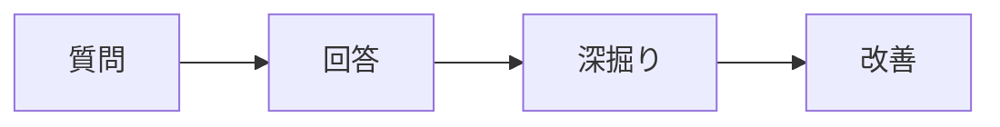

# 第13.03課 — 顧客調整・ケース面接

> **BRSE Interview Master · 日本語 N3–N2** · Draft / Pending reviewer.  
> Câu chính mục tiêu 15–30 giây, câu đào sâu 10–25 giây; thời lượng cần tự bấm giờ. Đây là bài học luyện phỏng vấn, không phải xác nhận kinh nghiệm cá nhân hay bản dịch được người Nhật duyệt.

## ① 学習目標 — Mục tiêu

Hiểu câu hỏi, xác định điều nhà tuyển dụng thực sự muốn biết, đưa ra câu trả lời ngắn có căn cứ, trả lời một câu hỏi đào sâu và tự sửa theo rubric. Chủ đề: **顧客調整・ケース面接**.

## ② 面接質問・質問の意図

**面接官：** お客様から急な仕様変更を依頼されたらどうしますか。

**Dịch câu hỏi:** Nếu khách hàng đột ngột yêu cầu thay đổi đặc tả, bạn sẽ làm gì?

**Ý định:** Kiểm tra khả năng diễn đạt rõ ràng, tính thực tế của lý do/kinh nghiệm và cách xử lý tình huống bằng tiếng Nhật. Khi cần bằng chứng CV, phải lấy từ người học chứ không suy đoán.

## ③ 思考プロセス・技術知識

Case roleplay: clarify → analyze → alternatives → agreement; không tự quyết deadline vượt quyền.

**Khung sử dụng:** Kết luận hoặc tình trạng thực tế → lý do/tiêu chí → hành động hoặc bằng chứng → giới hạn. Nếu là tình huống giả định, dùng 「〜の場合は」; không biến giả định thành một thành tích đã xảy ra.

**日本語で図を説明：** まず質問の意図を確認し、結論を短く伝えます。その後、理由や具体例を加え、未確認の点は分けて説明します。

**Dịch:** Xác nhận ý định câu hỏi và nêu kết luận ngắn; sau đó bổ sung lý do/ví dụ, tách riêng điều chưa được xác minh.

## ④ 面接対話 — Hội thoại chính + đào sâu

**面接官：** お客様から急な仕様変更を依頼されたらどうしますか。

**応募者（Standard）：** まず、変更の目的と優先度を確認します。その後、開発チームと工数や影響範囲を調べ、対応案とリスクをお客様に説明します。

**Dịch tiếng Việt:** Tôi làm rõ mục tiêu và mức ưu tiên, trao đổi dev về effort và phạm vi ảnh hưởng, giải thích phương án và rủi ro cho khách.

**面接官（深掘り）：** 納期に間に合わない場合は。

**Dịch câu hỏi đào sâu:** Nếu không kịp hạn giao hàng thì sao?

**応募者：** 遅れの可能性を早めに共有し、対応範囲や日程の変更を相談します。

**Dịch tiếng Việt:** Tôi thông báo sớm nguy cơ chậm và trao đổi điều chỉnh phạm vi hoặc lịch trình.

**面接時の表現:** Khi bị hỏi sâu, nêu dữ kiện, điều chưa rõ và cách kiểm tra. です・ます đủ lịch sự; không cần thêm kính ngữ không phù hợp trong mọi câu.

## ⑤ 類似表現比較 — Sắc thái diễn đạt

| Cách nói | Khi dùng | Giới hạn |
|---|---|---|
| 〜と考えています | Quan điểm/định hướng | Không thay cho bằng chứng đã kiểm thử |
| 〜を確認しました | Đã xác nhận | Chỉ khi thực sự kiểm tra |
| 〜を検証しました | Đã kiểm chứng bằng phương pháp | Cần có phép thử/evidence |
| 現時点では未確認です | Hiện chưa xác minh | Phù hợp khi thông tin chưa chắc |
| 〜について確認させていただけますか | Xin xác nhận lịch sự | Dùng khi trao đổi với người cần tôn trọng |

## ⑥ 語彙・文法 — Từ vựng trong bài

| 日本語 | 読み方 | Nghĩa |
|---|---|---|
| 仕様変更 | しようへんこう | Thay đổi đặc tả |
| 優先度 | ゆうせんど | Mức ưu tiên |
| 工数 | こうすう | Công sức |
| 納期 | のうき | Hạn giao |

**Mẫu có thể tái sử dụng:** 「まず〜を確認します。」「〜のために〜しています。」「〜と考えています。」「〜については、まだ確認できていません。」

## ⑦ 会話練習 — Active recall / Roleplay

1. **Shadowing:** đọc hội thoại và ngắt nhịp tự nhiên theo câu (không khẳng định phát âm chuẩn nếu chưa có audio).
2. **20 giây:** tự trả lời câu chính, không nhìn câu mẫu.
3. **15 giây:** trả lời câu đào sâu và bổ sung một ví dụ hoặc giới hạn.
4. **Transfer:** đổi sang một doanh nghiệp/dự án khác mà vẫn giữ cấu trúc lập luận; không sao chép thông tin chưa đúng.
5. **Prompt luyện với AI:** 「あなたは日本企業のBrSE面接官です。『顧客調整・ケース面接』について一問ずつ質問してください。回答を待ち、その内容に合わせて深掘り質問を一つだけしてください。最後に短い改善点を伝えてください。未確認の経験を事実として扱わないでください。」

## ⑧ 解答のポイント — Điểm cần nhớ

- Trả lời thẳng câu hỏi thay vì kể quá nhiều thông tin.
- Dùng một lý do chính và tối đa một ví dụ ngắn khi luyện 15–30 giây.
- Với phát biểu cá nhân hoặc CV, chỉ nói điều thực sự đúng; các dấu 【】 là chỗ cần điền, không phải câu hoàn chỉnh.
- Với Smart Farm nếu được nhắc tới, backend/database chủ yếu local; chưa xác nhận production hoặc vận hành bơm/van thật.

## ⑨ 評価・改善 — Rubric /20

Mỗi tiêu chí 0–4: **đúng trọng tâm**, **chính xác và trung thực**, **tiếng Nhật tự nhiên**, **giải thích mạch lạc**, **trả lời follow-up**. Mốc tự học 16–20 tốt, 12–15 cần sửa, dưới 12 cần luyện lại. Không phải điểm JLPT hoặc tiêu chí tuyển dụng chính thức. Không chấm phát âm bằng văn bản.

## ⑩ 出典・検証状況

- Nội dung ví dụ được biên soạn để luyện nói, chưa có native Japanese reviewer xác nhận.
- Những nội dung nghề nghiệp/cá nhân phải kiểm tra với CV, JD, hoặc câu trả lời người học.
- Chưa đo thời lượng đọc nói thực tế hoặc kiểm thử render Mermaid.
- Bài này không xác nhận bất cứ production deployment, điểm thi tiếng Nhật hay thành tích không được cung cấp.
