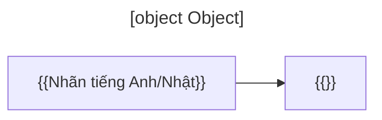

# Diagram explanation block

Dán ngay sau mỗi hình kỹ thuật trong bài (addendum R1.4, mục 5). Hình phải có tiêu đề, caption, alt text trong `data/visual-manifest.json`, và chú giải mức hoàn thiện nếu trộn nhiều mức.

*Hình: {{caption tiếng Việt}}. Mức hoàn thiện: {{As Implemented / As Tested / Proposed Design / Production Verified}}.*

**① 図の説明 — Giải thích sơ đồ:** {{Tiếng Việt: mỗi khối là gì, mũi tên nghĩa là gì, đọc theo thứ tự nào.}}

**② 日本語で説明してみよう（15–30秒）：**  
「{{2–4 câu tiếng Nhật, dễ nói, chính xác kỹ thuật}}」

*Dịch:* {{}}

**③ 面接対話：**  
**面接官：** {{この図の流れを説明してください。}}  
**応募者：** {{}}  
**面接官：** {{Câu hỏi đào sâu vào một thành phần}}  
**応募者：** {{}}

*Dịch:* {{}}

**④ 図を見ずに説明：** {{Yêu cầu người học giải thích lại không nhìn hình — đặt trong ⑩ 会話練習 nếu bài có nhiều hình.}}

**⑤ 応用質問：** {{Một câu đổi điều kiện để kiểm tra khả năng áp dụng.}}
