# BRSE Interview Master — 日本語で突破するBrSE面接

*Bản mở rộng chuyên sâu V2 — 22/10/2026*

**Phạm vi:** 14 chương, 49 bài học với 49 phần ⑪ 深掘り・実務演習 bổ sung.
**Trình độ định hướng:** N3–N2 giao tiếp phỏng vấn; phần thuật ngữ kỹ thuật có thể cao hơn mức JLPT.
**Giới hạn:** Chưa có đánh giá độc lập của người Nhật bản ngữ, người học thử và phần cứng IoT thật. Các chỗ 【】 phải được điền bằng thông tin thật. Ví dụ kỹ thuật phải phân biệt nội dung trong source và kịch bản thực hành.

## Mục lục

- [Chương 01: 自己紹介・自己PR](#chapter-01) — 3 bài
- [Chương 02: 志望動機・キャリアプラン](#chapter-02) — 3 bài
- [Chương 03: 職務経歴・プロジェクト説明](#chapter-03) — 3 bài
- [Chương 04: プログラミング・Web技術](#chapter-04) — 3 bài
- [Chương 05: フレームワーク・データベース](#chapter-05) — 3 bài
- [Chương 06: システム設計・クラウド](#chapter-06) — 3 bài
- [Chương 07: 開発工程・品質管理](#chapter-07) — 3 bài
- [Chương 08: 要件定義・仕様確認](#chapter-08) — 3 bài
- [Chương 09: 顧客対応・問題解決](#chapter-09) — 3 bài
- [Chương 10: 報連相・ビジネス日本語](#chapter-10) — 3 bài
- [Chương 11: 類似表現・自然な日本語](#chapter-11) — 3 bài
- [Chương 12: Smart Farm IoT — 技術デモ](#chapter-12) — 10 bài
- [Chương 13: 模擬面接・深掘り質問](#chapter-13) — 3 bài
- [Chương 14: 面接直前対策](#chapter-14) — 3 bài

## Cách học bản chuyên sâu

1. Tự trả lời câu hỏi phỏng vấn trong 20–40 giây trước khi xem mẫu.
2. Đọc cơ chế, cách hoạt động, rủi ro và trade-off; đối chiếu ví dụ dự án với nguồn.
3. Thực hiện nhiệm vụ trong mục ⑪, tạo sản phẩm đầu ra có thể kiểm tra.
4. Giải thích lại bằng tiếng Nhật: kết luận → cơ chế → ví dụ → giới hạn, sau đó ghi âm và kiểm lỗi.
5. Không nhận demo, mô phỏng hoặc một commit là bằng chứng vận hành production hay đóng góp cá nhân.


---

<a id="chapter-01"></a>
## Chương 01 — 自己紹介・自己PR

### 第01.01課 — 自己紹介 — Tự giới thiệu 30/60 giây

> **BRSE Interview Master — Draft / Pending Japanese Review.** Trình độ N3–N2, mục tiêu trả lời chính 15–30 giây. Các câu về cá nhân là **mẫu**; chỉ dùng sau khi điền dữ kiện thật. Không có chứng nhận người Nhật đã duyệt.

#### ① 学習目標 — Mục tiêu

Sau bài học, người học nhận biết ý định câu hỏi, trả lời đúng trọng tâm bằng 2–4 câu tiếng Nhật, phân biệt dữ kiện và giả định, phản hồi một câu hỏi đào sâu và sửa câu chưa tự nhiên.

#### ② 面接質問・質問の意図

**面接官：** 自己紹介をお願いします。

**Người phỏng vấn đang kiểm tra:** Ứng viên có giới thiệu bản thân rõ ràng, chọn trải nghiệm liên quan và thể hiện mối liên hệ với vị trí ứng tuyển hay không.

#### ③ 知識・思考プロセス — Kiến thức và cách suy nghĩ

Tự giới thiệu phải dựa CV: trình độ học vấn, trải nghiệm, mục tiêu thật. Không dùng placeholder để phát biểu trong phỏng vấn.

Cách trả lời: **kết luận → lý do / hành động → bằng chứng / giới hạn**. Với kinh nghiệm cá nhân, chỉ sử dụng sự thật trong CV/commit/test. Với tình huống giả định, dùng các cách nói 〜の場合は / 〜と考えています, tránh giả vờ từng làm.

#### ④ 図解 — Sơ đồ tư duy


**日本語で説明（mẫu nói sơ đồ）：** まず質問の目的を確認します。次に、結論を短く伝えます。必要なら理由や具体例を加え、確認できていない点は分けて説明します。

**Dịch:** Xác định mục đích câu hỏi; nêu kết luận ngắn; bổ sung lý do/ví dụ nếu cần và tách riêng thông tin chưa được xác minh. Sơ đồ là công cụ học, không phải architecture thực tế trừ khi nội dung nói rõ.

#### ⑤ 面接対話 — Hội thoại hỏi đáp

**面接官：** 自己紹介をお願いします。

**Dịch câu hỏi:** Bạn hãy tự giới thiệu về bản thân.

**応募者（Standard・要記入）：** 私は【実際の専攻・学歴】を学び、【実際に取り組んだ分野】に関心があります。特に【証拠のある学習・プロジェクト経験】に取り組みました。今後は【実際の志望職種】として成長したいと考えています。

**ベトナム語訳:** Tôi đã học [ngành học/học vấn thực tế] và quan tâm đến [lĩnh vực đã thực sự tìm hiểu]. Đặc biệt, tôi đã thực hiện [hoạt động học tập/dự án có bằng chứng]. Trong tương lai, tôi muốn phát triển với vai trò [vị trí thực sự mong muốn].

> **Chưa phải bản nói hoàn chỉnh:** Chỉ đọc thành tiếng sau khi thay tất cả các phần 【】 bằng thông tin đúng CV.

**面接官（深掘り）：** どのプロジェクトについて話せますか。

**Dịch câu hỏi đào sâu:** Bạn có thể nói về dự án nào?

**応募者：** Smart Farmなど、内容を説明できるプロジェクトを一つ選び、担当範囲は事実に基づいて答えます。

**ベトナム語訳:** Tôi sẽ chọn một dự án mình có thể giải thích rõ, chẳng hạn Smart Farm, rồi trình bày phạm vi công việc dựa trên sự thật.

**Professional version:** Giữ cùng ý nhưng điều chỉnh lịch sự và độ chính xác. Không tự động dùng 敬語 phức tạp; không sửa sự thật để tạo ấn tượng.

#### ⑥ 類似表現比較 — Cách nói dễ nhầm

- **確認しました** = đã kiểm tra; **検証しました** = đã kiểm chứng bằng phép thử/phương pháp.
- **担当しました** = đã phụ trách; **参加しました** = đã tham gia, không tự đồng nghĩa.
- **〜ができます** = có thể thực hiện theo điều kiện; **本番で運用しています** = đang vận hành production và cần minh chứng.
- **〜を確認した上で回答します** = sẽ trả lời sau khi xác nhận, phù hợp khi chưa đủ dữ liệu.

#### ⑦ 語彙・文法 — Từ vựng

| 日本語 | 読み方 | Nghĩa |
|---|---|---|
| 自己紹介 | じこしょうかい | Tự giới thiệu |
| 強み | つよみ | Điểm mạnh |
| 弱み | よわみ | Điểm yếu |
| 改善 | かいぜん | Cải thiện |
| 認識を合わせる | にんしきをあわせる | Thống nhất nhận thức |
| 相談する | そうだんする | Trao đổi/xin hỗ trợ |

Mẫu hữu ích: **まず〜を確認します。次に〜を整理します。その上で〜を説明します。** / **現時点では〜を確認できていません。**

#### ⑧ 会話練習 — Luyện phản xạ và ứng dụng

1. Không nhìn mẫu: trả lời câu chính trong 20–30 giây, theo cấu trúc kết luận → căn cứ → giới hạn thực tế.
2. **面接官：** 自己紹介で、技術経験をどのように簡潔に伝えますか。
   
   **Dịch:** Bạn giới thiệu ngắn gọn kinh nghiệm kỹ thuật thế nào?
   
   **応募者（回答例）：** 専門分野と実際に取り組んだことを一つ選び、具体的に説明します。
   
   **Dịch:** Tôi chọn một chuyên môn và một công việc thực sự đã làm để giải thích cụ thể.
3. Chuyển ngữ cảnh: áp dụng câu trên vào kinh nghiệm **có thật** của bản thân, không nhận thành quả không có bằng chứng.
4. Ghi âm một lần, tự đánh giá: nội dung đúng, mạch lạc, tự nhiên, đúng thời gian (mỗi tiêu chí 0–5 điểm).
5. **AI Interviewer:** この質問を一つずつ出し、私の回答を待ってください。具体例を一つ質問した後、自然な日本語の改善案を示してください。

#### ⑨ 解答ポイント — Điểm tự kiểm tra

- Nói kết luận trước và không kéo dài câu chính.
- Biết phân biệt vấn đề có thể giải thích ngay với thông tin cần xác minh.
- Với Smart Farm: backend và PostgreSQL chủ yếu local, luồng ESP32/Wokwi–AWS–backend có bằng chứng chạy thử theo mô tả; chưa xác nhận production hoặc bơm/van thật.
- Không thêm thành tích cá nhân, thời gian, số liệu không có căn cứ.

#### ⑩ 評価・改善 — Rubric /20

Tự chấm 0–4 cho mỗi tiêu chí: **đúng trọng tâm**, **độ chính xác / tính trung thực**, **tiếng Nhật tự nhiên**, **cấu trúc logic**, **đối đáp câu hỏi đào sâu**. Điểm 16–20: tốt; 12–15: cần chỉnh; dưới 12: luyện lại. Không phải chuẩn chính thức. Với văn bản, không đánh giá phát âm.

**Cách sửa:** ghi câu trả lời → xác định ba lỗi lớn nhất → rút gọn thành 2–4 câu Nhật → thực hành lại không nhìn mẫu.


#### 出典とステータス

Bài được biên soạn từ khung BRSE Interview Master và thông tin dự án do người dùng cung cấp. Các tình huống chung là ví dụ sư phạm; chưa qua native Japanese reviewer hoặc kiểm định Mermaid render. Trước khi duyệt, bổ sung bản dịch Việt sát nghĩa theo từng câu, đối chiếu CV và luyện nói có bấm giờ.

#### ⑪ 深掘り・実務演習 — Chuyên sâu và ứng dụng thực tế

##### Bản chất và cơ chế

Người phỏng vấn không cần nghe toàn bộ tiểu sử; họ cần biết trong 60 giây bạn có phù hợp vị trí nào, đã làm gì, và có thể kiểm chứng thế nào. Hãy phân biệt **nền tảng** (học ngành gì), **năng lực** (làm được hành động gì) và **bằng chứng** (repo, issue, demo, tài liệu). Nói 'tôi biết AWS' yếu hơn 'trong môi trường thử nghiệm tôi cấu hình đường truyền MQTT và xác nhận có telemetry' nếu có log thực tế.

##### Case study — Cách dùng trong dự án

Tình huống BrSE: giới thiệu trước PM Nhật về dự án POS/ERP hoặc Smart Farm. Chỉ chọn **một** dự án sát JD; nêu vấn đề, phần mình thực hiện, cách phối hợp và kết quả đã xác minh. Nếu dự án nhóm, giới thiệu theo 'nhóm thực hiện X; cá nhân tôi phụ trách Y'. Nếu mô phỏng Wokwi, nói đúng 'シミュレーション環境' thay vì '本番運用'.

##### Rủi ro, giới hạn và trade-off

Lỗi thường gặp: dành 45 giây kể tên công nghệ rồi không nói giá trị; tự nhận đã triển khai production; gắn '責任者' khi chỉ tham gia. Người phỏng vấn có thể hỏi ngay 'どのコードを担当しましたか' hoặc 'どう検証しましたか'; câu chuyện thiếu chứng cứ sẽ lộ rõ.

##### 回答例 — Giải thích bằng tiếng Nhật

> 自己紹介では、専攻、実際に担当した作業、応募職種とのつながりを順番に説明します。実務経験と学習プロジェクトは区別してお伝えします。

**Dịch sát nghĩa:** Khi tự giới thiệu, tôi lần lượt trình bày chuyên ngành, phần việc đã thực hiện và sự liên quan tới vị trí ứng tuyển. Tôi phân biệt kinh nghiệm thực tế với dự án học tập.

##### Bài thực hành có sản phẩm đầu ra

**Nhiệm vụ:** Soạn bản 30 giây và 60 giây; quay lại một lần; lập bảng từng khẳng định kèm liên kết minh chứng; thử câu đào sâu về trách nhiệm cá nhân.

**Điều kiện đạt:** Bản 60 giây dưới 170 chữ Nhật, không quá 3 năng lực, ít nhất một bằng chứng có thể trỏ tới, không có câu chưa xác minh.

*Lưu ý minh chứng: Ví dụ giáo dục phải phân biệt với chức năng đã kiểm thử thật; không nhận thành tích cá nhân, vận hành production hay mức an toàn khi chưa có bằng chứng.*

*Nguồn: [01-01-self-introduction.md](https://github.com/NiDa30/Interview/blob/main/book/chapters/chapter-01/01-01-self-introduction.md)*

### 第01.02課 — 強み・弱み — Điểm mạnh và điểm yếu

> **BRSE Interview Master — Draft / Pending Japanese Review.** Trình độ N3–N2, mục tiêu trả lời chính 15–30 giây. Các câu về cá nhân là **mẫu**; chỉ dùng sau khi điền dữ kiện thật. Không có chứng nhận người Nhật đã duyệt.

#### ① 学習目標 — Mục tiêu

Sau bài học, người học nhận biết ý định câu hỏi, trả lời đúng trọng tâm bằng 2–4 câu tiếng Nhật, phân biệt dữ kiện và giả định, phản hồi một câu hỏi đào sâu và sửa câu chưa tự nhiên.

#### ② 面接質問・質問の意図

**面接官：** あなたの強みは何ですか。

**Người phỏng vấn đang kiểm tra:** 強みは抽象的な性格だけでなく、仕事で再現できる行動として説明します。

#### ③ 知識・思考プロセス — Kiến thức và cách suy nghĩ

Điểm mạnh/vấn đề chỉ là ví dụ thực hành; không khẳng định người học đã thể hiện trong một dự án cụ thể.

Cách trả lời: **kết luận → lý do / hành động → bằng chứng / giới hạn**. Với kinh nghiệm cá nhân, chỉ sử dụng sự thật trong CV/commit/test. Với tình huống giả định, dùng các cách nói 〜の場合は / 〜と考えています, tránh giả vờ từng làm.

#### ④ 図解 — Sơ đồ tư duy


**日本語で説明（mẫu nói sơ đồ）：** まず質問の目的を確認します。次に、結論を短く伝えます。必要なら理由や具体例を加え、確認できていない点は分けて説明します。

**Dịch:** Xác định mục đích câu hỏi; nêu kết luận ngắn; bổ sung lý do/ví dụ nếu cần và tách riêng thông tin chưa được xác minh. Sơ đồ là công cụ học, không phải architecture thực tế trừ khi nội dung nói rõ.

#### ⑤ 面接対話 — Hội thoại hỏi đáp

**面接官：** あなたの強みは何ですか。

**Dịch câu hỏi:** Điểm mạnh và điểm yếu của bạn là gì?

**応募者（Standard）：** 私の強みは、分からないことを整理して確認する姿勢です。曖昧な点は質問し、認識を合わせるようにしています。

**ベトナム語訳:** Điểm mạnh của tôi là thái độ hệ thống hóa và xác nhận những điều chưa hiểu. Khi có chỗ mơ hồ, tôi đặt câu hỏi và cố gắng thống nhất cách hiểu giữa các bên.

**面接官（深掘り）：** 弱みは何ですか。

**Dịch câu hỏi đào sâu:** Bạn đang cải thiện điểm yếu như thế nào?

**応募者：** 【実際の弱み】を挙げ、今行っている改善方法を説明します。

**ベトナム語訳（ý nghĩa）：** Tôi sẽ nêu điểm yếu thực tế của mình và giải thích cách tôi đang cải thiện nó.

**Professional version:** Giữ cùng ý nhưng điều chỉnh lịch sự và độ chính xác. Không tự động dùng 敬語 phức tạp; không sửa sự thật để tạo ấn tượng.

#### ⑥ 類似表現比較 — Cách nói dễ nhầm

- **確認しました** = đã kiểm tra; **検証しました** = đã kiểm chứng bằng phép thử/phương pháp.
- **担当しました** = đã phụ trách; **参加しました** = đã tham gia, không tự đồng nghĩa.
- **〜ができます** = có thể thực hiện theo điều kiện; **本番で運用しています** = đang vận hành production và cần minh chứng.
- **〜を確認した上で回答します** = sẽ trả lời sau khi xác nhận, phù hợp khi chưa đủ dữ liệu.

#### ⑦ 語彙・文法 — Từ vựng

| 日本語 | 読み方 | Nghĩa |
|---|---|---|
| 自己紹介 | じこしょうかい | Tự giới thiệu |
| 強み | つよみ | Điểm mạnh |
| 弱み | よわみ | Điểm yếu |
| 改善 | かいぜん | Cải thiện |
| 認識を合わせる | にんしきをあわせる | Thống nhất nhận thức |
| 相談する | そうだんする | Trao đổi/xin hỗ trợ |

Mẫu hữu ích: **まず〜を確認します。次に〜を整理します。その上で〜を説明します。** / **現時点では〜を確認できていません。**

#### ⑧ 会話練習 — Luyện phản xạ và ứng dụng

1. Không nhìn mẫu: trả lời câu chính trong 20–30 giây, theo cấu trúc kết luận → căn cứ → giới hạn thực tế.
2. **面接官：** 弱みを伝える時、どんな点に気を付けますか。
   
   **Dịch:** Khi trình bày điểm yếu, cần lưu ý gì?
   
   **応募者（回答例）：** 弱みだけでなく、改善のために実践していることも説明します。
   
   **Dịch:** Không chỉ nói điểm yếu mà còn trình bày việc tôi đang thực hiện để cải thiện.
3. Chuyển ngữ cảnh: áp dụng câu trên vào kinh nghiệm **có thật** của bản thân, không nhận thành quả không có bằng chứng.
4. Ghi âm một lần, tự đánh giá: nội dung đúng, mạch lạc, tự nhiên, đúng thời gian (mỗi tiêu chí 0–5 điểm).
5. **AI Interviewer:** この質問を一つずつ出し、私の回答を待ってください。具体例を一つ質問した後、自然な日本語の改善案を示してください。

#### ⑨ 解答ポイント — Điểm tự kiểm tra

- Nói kết luận trước và không kéo dài câu chính.
- Biết phân biệt vấn đề có thể giải thích ngay với thông tin cần xác minh.
- Với Smart Farm: backend và PostgreSQL chủ yếu local, luồng ESP32/Wokwi–AWS–backend có bằng chứng chạy thử theo mô tả; chưa xác nhận production hoặc bơm/van thật.
- Không thêm thành tích cá nhân, thời gian, số liệu không có căn cứ.

#### ⑩ 評価・改善 — Rubric /20

Tự chấm 0–4 cho mỗi tiêu chí: **đúng trọng tâm**, **độ chính xác / tính trung thực**, **tiếng Nhật tự nhiên**, **cấu trúc logic**, **đối đáp câu hỏi đào sâu**. Điểm 16–20: tốt; 12–15: cần chỉnh; dưới 12: luyện lại. Không phải chuẩn chính thức. Với văn bản, không đánh giá phát âm.

**Cách sửa:** ghi câu trả lời → xác định ba lỗi lớn nhất → rút gọn thành 2–4 câu Nhật → thực hành lại không nhìn mẫu.


#### 出典とステータス

Bài được biên soạn từ khung BRSE Interview Master và thông tin dự án do người dùng cung cấp. Các tình huống chung là ví dụ sư phạm; chưa qua native Japanese reviewer hoặc kiểm định Mermaid render. Trước khi duyệt, bổ sung bản dịch Việt sát nghĩa theo từng câu, đối chiếu CV và luyện nói có bấm giờ.

#### ⑪ 深掘り・実務演習 — Chuyên sâu và ứng dụng thực tế

##### Bản chất và cơ chế

Điểm mạnh trong phỏng vấn kỹ sư phải được mô tả bằng **hành vi tái lặp** chứ không phải tính từ 'chăm chỉ'. Mô hình bằng chứng: bối cảnh → hành động lặp lại → kết quả quan sát → giới hạn. Với điểm yếu, đưa ra cơ chế tự cải thiện (checklist, phản hồi, đo tiến độ), không biến điểm mạnh giả thành điểm yếu sáo rỗng.

##### Case study — Cách dùng trong dự án

Tình huống: khi tài liệu API không thống nhất với giao diện, một năng lực có thể chứng minh là ghi lại sai lệch, đề xuất acceptance criteria, hỏi người phụ trách và cập nhật Jira. Trong câu trả lời, kể rõ vai trò thật và sản phẩm đầu ra (issue, testcase) chứ không nói mình 'luôn giải quyết mọi xung đột'.

##### Rủi ro, giới hạn và trade-off

Rủi ro: chọn điểm yếu gây mất niềm tin vào công việc cốt lõi mà không có biện pháp kiểm soát; nói '日本語は完璧ではありません' rồi dừng. Cách diễn đạt tốt hơn là mô tả cách xác nhận lại yêu cầu, ghi biên bản và tập thuyết trình.

##### 回答例 — Giải thích bằng tiếng Nhật

> 私の強みは、曖昧な点をそのままにせず、関係者に確認して整理することです。一方、説明が長くなることがあるため、結論から話す練習をしています。

**Dịch sát nghĩa:** Điểm mạnh của tôi là không bỏ qua chỗ mơ hồ mà xác nhận và hệ thống hóa với các bên. Mặt khác, đôi khi tôi giải thích dài, nên đang luyện nói kết luận trước.

##### Bài thực hành có sản phẩm đầu ra

**Nhiệm vụ:** Viết hai ví dụ theo STAR, một minh họa điểm mạnh và một ghi nhận điểm yếu trong lần học/làm gần nhất.

**Điều kiện đạt:** Người nghe có thể hỏi cụ thể 'いつ・何を・どう改善しましたか'; có câu trả lời thực tế không quá 45 giây.

*Lưu ý minh chứng: Ví dụ giáo dục phải phân biệt với chức năng đã kiểm thử thật; không nhận thành tích cá nhân, vận hành production hay mức an toàn khi chưa có bằng chứng.*

*Nguồn: [01-02-strengths-weaknesses.md](https://github.com/NiDa30/Interview/blob/main/book/chapters/chapter-01/01-02-strengths-weaknesses.md)*

### 第01.03課 — 学習姿勢・チームワーク — Học hỏi và làm việc nhóm

> **BRSE Interview Master — Draft / Pending Japanese Review.** Trình độ N3–N2, mục tiêu trả lời chính 15–30 giây. Các câu về cá nhân là **mẫu**; chỉ dùng sau khi điền dữ kiện thật. Không có chứng nhận người Nhật đã duyệt.

#### ① 学習目標 — Mục tiêu

Sau bài học, người học nhận biết ý định câu hỏi, trả lời đúng trọng tâm bằng 2–4 câu tiếng Nhật, phân biệt dữ kiện và giả định, phản hồi một câu hỏi đào sâu và sửa câu chưa tự nhiên.

#### ② 面接質問・質問の意図

**面接官：** 知らない技術が必要になったらどうしますか。

**Người phỏng vấn đang kiểm tra:** 技術課題には、必要性と期限を確認し、小さな実験で検証する姿勢が重要です。

#### ③ 知識・思考プロセス — Kiến thức và cách suy nghĩ

Đây là cách ứng xử gợi ý, không nhận là hành động đã xảy ra.

Cách trả lời: **kết luận → lý do / hành động → bằng chứng / giới hạn**. Với kinh nghiệm cá nhân, chỉ sử dụng sự thật trong CV/commit/test. Với tình huống giả định, dùng các cách nói 〜の場合は / 〜と考えています, tránh giả vờ từng làm.

#### ④ 図解 — Sơ đồ tư duy


**日本語で説明（mẫu nói sơ đồ）：** まず質問の目的を確認します。次に、結論を短く伝えます。必要なら理由や具体例を加え、確認できていない点は分けて説明します。

**Dịch:** Xác định mục đích câu hỏi; nêu kết luận ngắn; bổ sung lý do/ví dụ nếu cần và tách riêng thông tin chưa được xác minh. Sơ đồ là công cụ học, không phải architecture thực tế trừ khi nội dung nói rõ.

#### ⑤ 面接対話 — Hội thoại hỏi đáp

**面接官：** 知らない技術が必要になったらどうしますか。

**Dịch câu hỏi:** Nếu cần sử dụng công nghệ mà bạn chưa biết, bạn sẽ làm gì?

**応募者（Standard）：** まず必要な機能と期限を確認します。その後、公式資料を調べて小さく試し、分からない点はチームに相談します。

**ベトナム語訳:** Trước hết tôi xác nhận chức năng cần thiết và thời hạn. Sau đó tôi đọc tài liệu chính thức, thử ở phạm vi nhỏ và trao đổi với nhóm về những điểm chưa hiểu.

**面接官（深掘り）：** 納期が短い場合はどうしますか。

**Dịch câu hỏi đào sâu:** Nếu thời hạn rất ngắn thì sao?

**応募者：** 優先順位を整理し、実現できる範囲とリスクを早めに共有します。

**ベトナム語訳（ý nghĩa）：** Tôi sắp xếp thứ tự ưu tiên và chia sẻ sớm phạm vi có thể thực hiện cùng các rủi ro.

**Professional version:** Giữ cùng ý nhưng điều chỉnh lịch sự và độ chính xác. Không tự động dùng 敬語 phức tạp; không sửa sự thật để tạo ấn tượng.

#### ⑥ 類似表現比較 — Cách nói dễ nhầm

- **確認しました** = đã kiểm tra; **検証しました** = đã kiểm chứng bằng phép thử/phương pháp.
- **担当しました** = đã phụ trách; **参加しました** = đã tham gia, không tự đồng nghĩa.
- **〜ができます** = có thể thực hiện theo điều kiện; **本番で運用しています** = đang vận hành production và cần minh chứng.
- **〜を確認した上で回答します** = sẽ trả lời sau khi xác nhận, phù hợp khi chưa đủ dữ liệu.

#### ⑦ 語彙・文法 — Từ vựng

| 日本語 | 読み方 | Nghĩa |
|---|---|---|
| 自己紹介 | じこしょうかい | Tự giới thiệu |
| 強み | つよみ | Điểm mạnh |
| 弱み | よわみ | Điểm yếu |
| 改善 | かいぜん | Cải thiện |
| 認識を合わせる | にんしきをあわせる | Thống nhất nhận thức |
| 相談する | そうだんする | Trao đổi/xin hỗ trợ |

Mẫu hữu ích: **まず〜を確認します。次に〜を整理します。その上で〜を説明します。** / **現時点では〜を確認できていません。**

#### ⑧ 会話練習 — Luyện phản xạ và ứng dụng

1. Không nhìn mẫu: trả lời câu chính trong 20–30 giây, theo cấu trúc kết luận → căn cứ → giới hạn thực tế.
2. **面接官：** 知らない技術を学ぶ時、最初に何をしますか。
   
   **Dịch:** Khi học công nghệ mới, bạn làm gì đầu tiên?
   
   **応募者（回答例）：** 目標と必要な基礎を確認し、小さな課題で試します。
   
   **Dịch:** Tôi xác định mục tiêu và kiến thức nền rồi thử qua bài tập nhỏ.
3. Chuyển ngữ cảnh: áp dụng câu trên vào kinh nghiệm **có thật** của bản thân, không nhận thành quả không có bằng chứng.
4. Ghi âm một lần, tự đánh giá: nội dung đúng, mạch lạc, tự nhiên, đúng thời gian (mỗi tiêu chí 0–5 điểm).
5. **AI Interviewer:** この質問を一つずつ出し、私の回答を待ってください。具体例を一つ質問した後、自然な日本語の改善案を示してください。

#### ⑨ 解答ポイント — Điểm tự kiểm tra

- Nói kết luận trước và không kéo dài câu chính.
- Biết phân biệt vấn đề có thể giải thích ngay với thông tin cần xác minh.
- Với Smart Farm: backend và PostgreSQL chủ yếu local, luồng ESP32/Wokwi–AWS–backend có bằng chứng chạy thử theo mô tả; chưa xác nhận production hoặc bơm/van thật.
- Không thêm thành tích cá nhân, thời gian, số liệu không có căn cứ.

#### ⑩ 評価・改善 — Rubric /20

Tự chấm 0–4 cho mỗi tiêu chí: **đúng trọng tâm**, **độ chính xác / tính trung thực**, **tiếng Nhật tự nhiên**, **cấu trúc logic**, **đối đáp câu hỏi đào sâu**. Điểm 16–20: tốt; 12–15: cần chỉnh; dưới 12: luyện lại. Không phải chuẩn chính thức. Với văn bản, không đánh giá phát âm.

**Cách sửa:** ghi câu trả lời → xác định ba lỗi lớn nhất → rút gọn thành 2–4 câu Nhật → thực hành lại không nhìn mẫu.


#### 出典とステータス

Bài được biên soạn từ khung BRSE Interview Master và thông tin dự án do người dùng cung cấp. Các tình huống chung là ví dụ sư phạm; chưa qua native Japanese reviewer hoặc kiểm định Mermaid render. Trước khi duyệt, bổ sung bản dịch Việt sát nghĩa theo từng câu, đối chiếu CV và luyện nói có bấm giờ.

#### ⑪ 深掘り・実務演習 — Chuyên sâu và ứng dụng thực tế

##### Bản chất và cơ chế

Học công nghệ cần đi từ **mục tiêu khả năng** chứ không phải xem tutorial liên tục. Quy trình: xác định hành vi đầu ra → đọc tài liệu chuẩn → dựng ví dụ nhỏ → thiết kế phép thử có thể làm sai → ghi lại quyết định và giới hạn. Khi cần giải thích công nghệ mới trong phỏng vấn, phân biệt điều đã tự chạy với điều chỉ đọc.

##### Case study — Cách dùng trong dự án

Ví dụ học MQTT: trước hết hiểu publisher/subscriber, topic, QoS, TLS và cơ chế ACK ứng dụng; tiếp đó dùng một thiết bị mô phỏng publish telemetry; sau cùng cố tình ngắt kết nối và quan sát dữ liệu trễ. Việc nhận bản tin không chứng minh tính bền vững của toàn hệ thống hoặc an toàn khi điều khiển.

##### Rủi ro, giới hạn và trade-off

Sai lầm phổ biến là chuyển từ 'đã đọc về retry' sang 'hệ thống có retry an toàn'. Một tính năng chỉ được nhận là hoàn thành khi có code, test và hành vi đã quan sát; với thiết bị thật cần chứng cứ riêng.

##### 回答例 — Giải thích bằng tiếng Nhật

> 新しい技術を学ぶ時は、まず到達目標を決めます。小さな検証環境で動作を確認し、失敗した条件も記録します。

**Dịch sát nghĩa:** Khi học công nghệ mới, tôi xác định mục tiêu trước, kiểm thử trong môi trường nhỏ và ghi lại cả điều kiện thất bại.

##### Bài thực hành có sản phẩm đầu ra

**Nhiệm vụ:** Chọn một kỹ năng chưa chắc (ví dụ MQTT QoS); lập giả thuyết, môi trường thử, ba test case, bằng chứng mong đợi và kết luận đúng phạm vi.

**Điều kiện đạt:** Có một README ngắn, log kết quả, ba tình huống PASS/FAIL/NOT RUN và một điều chưa hiểu để hỏi mentor.

*Lưu ý minh chứng: Ví dụ giáo dục phải phân biệt với chức năng đã kiểm thử thật; không nhận thành tích cá nhân, vận hành production hay mức an toàn khi chưa có bằng chứng.*

*Nguồn: [01-03-learning-attitude.md](https://github.com/NiDa30/Interview/blob/main/book/chapters/chapter-01/01-03-learning-attitude.md)*


---

<a id="chapter-02"></a>
## Chương 02 — 志望動機・キャリアプラン

### 第02.01課 — 志望動機・BrSEを選ぶ理由

> **BRSE Interview Master · 日本語 N3–N2** · Draft / Pending reviewer.  
> Câu chính mục tiêu 15–30 giây, câu đào sâu 10–25 giây; thời lượng cần tự bấm giờ. Đây là bài học luyện phỏng vấn, không phải xác nhận kinh nghiệm cá nhân hay bản dịch được người Nhật duyệt.

#### ① 学習目標 — Mục tiêu

Hiểu câu hỏi, xác định điều nhà tuyển dụng thực sự muốn biết, đưa ra câu trả lời ngắn có căn cứ, trả lời một câu hỏi đào sâu và tự sửa theo rubric. Chủ đề: **志望動機・BrSEを選ぶ理由**.

#### ② 面接質問・質問の意図

**面接官：** なぜBrSEを志望していますか。

**Dịch câu hỏi:** Vì sao bạn muốn làm BrSE?

**Ý định:** Kiểm tra khả năng diễn đạt rõ ràng, tính thực tế của lý do/kinh nghiệm và cách xử lý tình huống bằng tiếng Nhật. Khi cần bằng chứng CV, phải lấy từ người học chứ không suy đoán.

#### ③ 思考プロセス・技術知識

Motivation → Match with role → Contribution; sửa theo động lực thực, tránh khẳng định đã từng làm BrSE.

**Khung sử dụng:** Kết luận hoặc tình trạng thực tế → lý do/tiêu chí → hành động hoặc bằng chứng → giới hạn. Nếu là tình huống giả định, dùng 「〜の場合は」; không biến giả định thành một thành tích đã xảy ra.

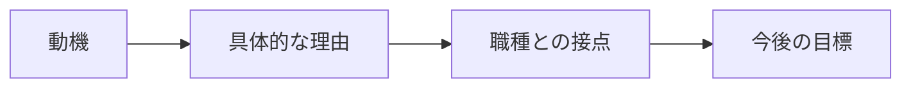

**日本語で図を説明：** まず質問の意図を確認し、結論を短く伝えます。その後、理由や具体例を加え、未確認の点は分けて説明します。

**Dịch:** Xác nhận ý định câu hỏi và nêu kết luận ngắn; sau đó bổ sung lý do/ví dụ, tách riêng điều chưa được xác minh.

#### ④ 面接対話 — Hội thoại chính + đào sâu

**面接官：** なぜBrSEを志望していますか。

**Dịch câu hỏi:** Vì sao bạn muốn ứng tuyển vị trí BrSE?

**応募者（Standard）：** 技術とコミュニケーションの両方を使い、お客様と開発チームの認識を合わせる仕事に関心があるからです。要件を正しく理解し、誤解を減らせるエンジニアを目指しています。

**Dịch tiếng Việt:** Tôi quan tâm công việc kết hợp kỹ thuật và giao tiếp để thống nhất nhận thức giữa khách hàng và đội phát triển. Tôi muốn trở thành kỹ sư hiểu đúng yêu cầu và giảm hiểu nhầm.

**面接官（深掘り）：** BrSEにはどんなスキルが必要ですか。

**Dịch câu hỏi đào sâu:** Theo bạn, BrSE cần những kỹ năng gì?

**応募者：** 技術理解だけでなく、要件を整理し、相手に分かりやすく伝える力が必要だと考えています。

**Dịch tiếng Việt:** Theo tôi, ngoài hiểu kỹ thuật cần kỹ năng hệ thống hóa yêu cầu và diễn đạt dễ hiểu.

**言い換えの注意:** Trong phỏng vấn ứng viên thường dùng です・ます rõ ràng. Không thêm 「恐れ入りますが」 một cách máy móc vào câu nói về động lực, công nghệ hoặc ngữ nghĩa thuật ngữ.

#### ⑤ 類似表現比較 — Sắc thái diễn đạt

| Cách nói | Khi dùng | Giới hạn |
|---|---|---|
| 〜と考えています | Quan điểm/định hướng | Không thay cho bằng chứng đã kiểm thử |
| 〜を確認しました | Đã xác nhận | Chỉ khi thực sự kiểm tra |
| 〜を検証しました | Đã kiểm chứng bằng phương pháp | Cần có phép thử/evidence |
| 現時点では未確認です | Hiện chưa xác minh | Phù hợp khi thông tin chưa chắc |
| 〜について確認させていただけますか | Xin xác nhận lịch sự | Dùng khi trao đổi với người cần tôn trọng |

#### ⑥ 語彙・文法 — Từ vựng trong bài

| 日本語 | 読み方 | Nghĩa |
|---|---|---|
| 志望動機 | しぼうどうき | Động lực ứng tuyển |
| 認識 | にんしき | Nhận thức |
| 要件 | ようけん | Yêu cầu |
| 誤解 | ごかい | Hiểu nhầm |

**Mẫu có thể tái sử dụng:** 「まず〜を確認します。」「〜のために〜しています。」「〜と考えています。」「〜については、まだ確認できていません。」

#### ⑦ 会話練習 — Active recall / Roleplay

1. **Shadowing:** đọc hội thoại và ngắt nhịp tự nhiên theo câu (không khẳng định phát âm chuẩn nếu chưa có audio).
2. **20 giây:** tự trả lời câu chính, không nhìn câu mẫu.
3. **15 giây:** trả lời câu đào sâu và bổ sung một ví dụ hoặc giới hạn.
4. **Transfer:** đổi sang một doanh nghiệp/dự án khác mà vẫn giữ cấu trúc lập luận; không sao chép thông tin chưa đúng.
5. **Prompt luyện với AI:** 「あなたは日本企業のBrSE面接官です。『志望動機・BrSEを選ぶ理由』について一問ずつ質問してください。回答を待ち、その内容に合わせて深掘り質問を一つだけしてください。最後に短い改善点を伝えてください。未確認の経験を事実として扱わないでください。」

**課題別・追加ロールプレイ — Tình huống bổ sung:**

**面接官：** BrSEを目指す理由を、具体的な仕事と結び付けて説明してください。

**Dịch câu hỏi:** Gắn động lực làm BrSE với công việc cụ thể.

**応募者（例）：** 技術を理解した上で、お客様と開発チームの認識を合わせる仕事に関心があります。

**Bài luyện:** Trả lời lại bằng lời của mình trong 20–30 giây; phân biệt điều đã làm, dự định và giả định. Không tự nhận kinh nghiệm chưa kiểm chứng.

#### ⑧ 解答のポイント — Điểm cần nhớ

- Trả lời thẳng câu hỏi thay vì kể quá nhiều thông tin.
- Dùng một lý do chính và tối đa một ví dụ ngắn khi luyện 15–30 giây.
- Với phát biểu cá nhân hoặc CV, chỉ nói điều thực sự đúng; các dấu 【】 là chỗ cần điền, không phải câu hoàn chỉnh.
- Với Smart Farm nếu được nhắc tới, backend/database chủ yếu local; chưa xác nhận production hoặc vận hành bơm/van thật.

#### ⑨ 評価・改善 — Rubric /20

Mỗi tiêu chí 0–4: **đúng trọng tâm**, **chính xác và trung thực**, **tiếng Nhật tự nhiên**, **giải thích mạch lạc**, **trả lời follow-up**. Mốc tự học 16–20 tốt, 12–15 cần sửa, dưới 12 cần luyện lại. Không phải điểm JLPT hoặc tiêu chí tuyển dụng chính thức. Không chấm phát âm bằng văn bản.

#### ⑩ 出典・検証状況

- Nội dung ví dụ được biên soạn để luyện nói, chưa có native Japanese reviewer xác nhận.
- Những nội dung nghề nghiệp/cá nhân phải kiểm tra với CV, JD, hoặc câu trả lời người học.
- Chưa đo thời lượng đọc nói thực tế hoặc kiểm thử render Mermaid.
- Bài này không xác nhận bất cứ production deployment, điểm thi tiếng Nhật hay thành tích không được cung cấp.

#### ⑪ 深掘り・実務演習 — Chuyên sâu và ứng dụng thực tế

##### Bản chất và cơ chế

BrSE không đơn thuần là phiên dịch IT; họ giúp giảm sai lệch giữa **mục tiêu nghiệp vụ**, **đặc tả**, **thiết kế**, **kiểm thử** và **bàn giao**. Năng lực cần kết hợp nghe–hỏi–tóm tắt bằng tiếng Nhật, hiểu kỹ thuật đủ sâu để đánh giá tác động, và ghi lại quyết định bằng tài liệu hai bên cùng xác nhận.

##### Case study — Cách dùng trong dự án

Tình huống: khách nói '画面をもっと速く' (làm màn hình nhanh hơn). Một BrSE không hứa tối ưu ngay; hỏi trang nào, thao tác nào, thời gian hiện tại/đích, thiết bị/mạng, rồi phối hợp đo với dev. Động lực ứng tuyển tốt nên gắn với mong muốn thực hiện quy trình giảm hiểu sai kiểu này, không chỉ 'yêu văn hóa Nhật'.

##### Rủi ro, giới hạn và trade-off

Cần phân biệt 役割 (vai trò), 責任範囲 (phạm vi trách nhiệm) và 権限 (quyền quyết định): BrSE có thể đưa phương án nhưng không tự thay đổi ngân sách/scope nếu chưa được phê duyệt.

##### 回答例 — Giải thích bằng tiếng Nhật

> BrSEを志望する理由は、技術的な理解をもとに、お客様の目的を具体的な要件へ落とし込み、開発チームと認識を合わせたいからです。

**Dịch sát nghĩa:** Tôi muốn trở thành BrSE để dựa trên hiểu biết kỹ thuật, chuyển mục tiêu khách hàng thành yêu cầu cụ thể và thống nhất với đội phát triển.

##### Bài thực hành có sản phẩm đầu ra

**Nhiệm vụ:** Viết lại động lực theo 3 câu: trải nghiệm thực, hành động muốn làm, năng lực sẽ bù đắp; chuẩn bị follow-up 'なぜ通訳ではなくBrSEですか'.

**Điều kiện đạt:** Có ví dụ nghiệp vụ–đặc tả–test và một giới hạn trách nhiệm rõ ràng, không chỉ lý do cá nhân chung chung.

*Lưu ý minh chứng: Ví dụ giáo dục phải phân biệt với chức năng đã kiểm thử thật; không nhận thành tích cá nhân, vận hành production hay mức an toàn khi chưa có bằng chứng.*

*Nguồn: [02-01-brse-motivation.md](https://github.com/NiDa30/Interview/blob/main/book/chapters/chapter-02/02-01-brse-motivation.md)*

### 第02.02課 — 日本で働く理由・異文化理解

> **BRSE Interview Master · 日本語 N3–N2** · Draft / Pending reviewer.  
> Câu chính mục tiêu 15–30 giây, câu đào sâu 10–25 giây; thời lượng cần tự bấm giờ. Đây là bài học luyện phỏng vấn, không phải xác nhận kinh nghiệm cá nhân hay bản dịch được người Nhật duyệt.

#### ① 学習目標 — Mục tiêu

Hiểu câu hỏi, xác định điều nhà tuyển dụng thực sự muốn biết, đưa ra câu trả lời ngắn có căn cứ, trả lời một câu hỏi đào sâu và tự sửa theo rubric. Chủ đề: **日本で働く理由・異文化理解**.

#### ② 面接質問・質問の意図

**面接官：** なぜ日本で働きたいですか。

**Dịch câu hỏi:** Vì sao bạn muốn làm việc tại Nhật?

**Ý định:** Kiểm tra khả năng diễn đạt rõ ràng, tính thực tế của lý do/kinh nghiệm và cách xử lý tình huống bằng tiếng Nhật. Khi cần bằng chứng CV, phải lấy từ người học chứ không suy đoán.

#### ③ 思考プロセス・技術知識

Personal reason → Concrete behavior → Respect cultural differences; không khái quát mọi công ty Nhật giống nhau.

**Khung sử dụng:** Kết luận hoặc tình trạng thực tế → lý do/tiêu chí → hành động hoặc bằng chứng → giới hạn. Nếu là tình huống giả định, dùng 「〜の場合は」; không biến giả định thành một thành tích đã xảy ra.


**日本語で図を説明：** まず質問の意図を確認し、結論を短く伝えます。その後、理由や具体例を加え、未確認の点は分けて説明します。

**Dịch:** Xác nhận ý định câu hỏi và nêu kết luận ngắn; sau đó bổ sung lý do/ví dụ, tách riêng điều chưa được xác minh.

#### ④ 面接対話 — Hội thoại chính + đào sâu

**面接官：** なぜ日本で働きたいですか。

**Dịch câu hỏi:** Vì sao bạn muốn làm việc tại Nhật Bản?

**応募者（Standard）：** 日本の開発現場で仕事の進め方を学び、日本語で技術や要件を正確に共有できるようになりたいからです。分からない時は確認する姿勢を大切にしたいです。

**Dịch tiếng Việt:** Tôi muốn học cách làm việc ở môi trường phát triển tại Nhật và có thể trao đổi kỹ thuật, yêu cầu chính xác bằng tiếng Nhật. Tôi chú trọng xác nhận khi chưa hiểu.

**面接官（深掘り）：** 文化や働き方が違ったらどうしますか。

**Dịch câu hỏi đào sâu:** Nếu văn hóa hoặc cách làm việc khác nhau, bạn sẽ xử lý thế nào?

**応募者：** まず理由とルールを確認し、決めつけずに相手と相談します。

**Dịch tiếng Việt:** Trước hết tìm hiểu lý do và quy tắc, trao đổi thay vì phán đoán.

**言い換えの注意:** Trong phỏng vấn ứng viên thường dùng です・ます rõ ràng. Không thêm 「恐れ入りますが」 một cách máy móc vào câu nói về động lực, công nghệ hoặc ngữ nghĩa thuật ngữ.

#### ⑤ 類似表現比較 — Sắc thái diễn đạt

| Cách nói | Khi dùng | Giới hạn |
|---|---|---|
| 〜と考えています | Quan điểm/định hướng | Không thay cho bằng chứng đã kiểm thử |
| 〜を確認しました | Đã xác nhận | Chỉ khi thực sự kiểm tra |
| 〜を検証しました | Đã kiểm chứng bằng phương pháp | Cần có phép thử/evidence |
| 現時点では未確認です | Hiện chưa xác minh | Phù hợp khi thông tin chưa chắc |
| 〜について確認させていただけますか | Xin xác nhận lịch sự | Dùng khi trao đổi với người cần tôn trọng |

#### ⑥ 語彙・文法 — Từ vựng trong bài

| 日本語 | 読み方 | Nghĩa |
|---|---|---|
| 働き方 | はたらきかた | Cách làm việc |
| 文化 | ぶんか | Văn hóa |
| 共有 | きょうゆう | Chia sẻ thông tin |
| 確認 | かくにん | Xác nhận |

**Mẫu có thể tái sử dụng:** 「まず〜を確認します。」「〜のために〜しています。」「〜と考えています。」「〜については、まだ確認できていません。」

#### ⑦ 会話練習 — Active recall / Roleplay

1. **Shadowing:** đọc hội thoại và ngắt nhịp tự nhiên theo câu (không khẳng định phát âm chuẩn nếu chưa có audio).
2. **20 giây:** tự trả lời câu chính, không nhìn câu mẫu.
3. **15 giây:** trả lời câu đào sâu và bổ sung một ví dụ hoặc giới hạn.
4. **Transfer:** đổi sang một doanh nghiệp/dự án khác mà vẫn giữ cấu trúc lập luận; không sao chép thông tin chưa đúng.
5. **Prompt luyện với AI:** 「あなたは日本企業のBrSE面接官です。『日本で働く理由・異文化理解』について一問ずつ質問してください。回答を待ち、その内容に合わせて深掘り質問を一つだけしてください。最後に短い改善点を伝えてください。未確認の経験を事実として扱わないでください。」

**課題別・追加ロールプレイ — Tình huống bổ sung:**

**面接官：** 働き方の違いに戸惑った場合、どうしますか。

**Dịch câu hỏi:** Nếu bối rối vì khác biệt cách làm việc thì sao?

**応募者（例）：** まず背景やルールを確認し、思い込みで判断せず相談します。

**Bài luyện:** Trả lời lại bằng lời của mình trong 20–30 giây; phân biệt điều đã làm, dự định và giả định. Không tự nhận kinh nghiệm chưa kiểm chứng.

#### ⑧ 解答のポイント — Điểm cần nhớ

- Trả lời thẳng câu hỏi thay vì kể quá nhiều thông tin.
- Dùng một lý do chính và tối đa một ví dụ ngắn khi luyện 15–30 giây.
- Với phát biểu cá nhân hoặc CV, chỉ nói điều thực sự đúng; các dấu 【】 là chỗ cần điền, không phải câu hoàn chỉnh.
- Với Smart Farm nếu được nhắc tới, backend/database chủ yếu local; chưa xác nhận production hoặc vận hành bơm/van thật.

#### ⑨ 評価・改善 — Rubric /20

Mỗi tiêu chí 0–4: **đúng trọng tâm**, **chính xác và trung thực**, **tiếng Nhật tự nhiên**, **giải thích mạch lạc**, **trả lời follow-up**. Mốc tự học 16–20 tốt, 12–15 cần sửa, dưới 12 cần luyện lại. Không phải điểm JLPT hoặc tiêu chí tuyển dụng chính thức. Không chấm phát âm bằng văn bản.

#### ⑩ 出典・検証状況

- Nội dung ví dụ được biên soạn để luyện nói, chưa có native Japanese reviewer xác nhận.
- Những nội dung nghề nghiệp/cá nhân phải kiểm tra với CV, JD, hoặc câu trả lời người học.
- Chưa đo thời lượng đọc nói thực tế hoặc kiểm thử render Mermaid.
- Bài này không xác nhận bất cứ production deployment, điểm thi tiếng Nhật hay thành tích không được cung cấp.

#### ⑪ 深掘り・実務演習 — Chuyên sâu và ứng dụng thực tế

##### Bản chất và cơ chế

Khi tham gia dự án xuyên biên giới, rủi ro lớn không nằm ở 'người Nhật luôn như thế' mà ở kỳ vọng chưa thống nhất: ai phê duyệt, báo theo kênh nào, lúc nào cần escalation, định nghĩa hoàn thành. Dùng báo–liên lạc–trao đổi (報連相) như **cơ chế minh bạch**, không phải nghi thức máy móc.

##### Case study — Cách dùng trong dự án

Ví dụ ticket phát hiện lệch requirement: trước daily meeting, xác nhận issue ID, bằng chứng, ảnh hưởng và phương án; gửi ngắn cho PM bằng dạng 事実→影響→相談事項. Nếu họp qua tiếng Nhật chưa nghe rõ, xin xác nhận bằng biên bản thay vì im lặng rồi tự suy diễn.

##### Rủi ro, giới hạn và trade-off

Không nên tuyên bố 'tôi hiểu hết văn hóa Nhật' hay phán xét công ty khi chưa làm việc tại đó. Cần nói '入社後、御社の進め方を学びたいです' và hỏi chính sách dự án cụ thể.

##### 回答例 — Giải thích bằng tiếng Nhật

> 働き方が違うと感じた場合は、まず背景と期待される成果を確認します。必要に応じて、認識を文章で共有します。

**Dịch sát nghĩa:** Nếu thấy khác biệt cách làm việc, tôi xác nhận bối cảnh và kết quả kỳ vọng, rồi chia sẻ cách hiểu bằng văn bản khi cần.

##### Bài thực hành có sản phẩm đầu ra

**Nhiệm vụ:** Soạn email Nhật báo issue có deadline và câu hỏi cần quyết; đóng vai PM Nhật hỏi cách bạn xác nhận khi không hiểu.

**Điều kiện đạt:** Email có tiêu đề, 事実, 影響, 次の対応, 確認したいこと; không dùng ngôn ngữ đổ lỗi.

*Lưu ý minh chứng: Ví dụ giáo dục phải phân biệt với chức năng đã kiểm thử thật; không nhận thành tích cá nhân, vận hành production hay mức an toàn khi chưa có bằng chứng.*

*Nguồn: [02-02-working-in-japan.md](https://github.com/NiDa30/Interview/blob/main/book/chapters/chapter-02/02-02-working-in-japan.md)*

### 第02.03課 — キャリアプラン・成長目標

> **BRSE Interview Master · 日本語 N3–N2** · Draft / Pending reviewer.  
> Câu chính mục tiêu 15–30 giây, câu đào sâu 10–25 giây; thời lượng cần tự bấm giờ. Đây là bài học luyện phỏng vấn, không phải xác nhận kinh nghiệm cá nhân hay bản dịch được người Nhật duyệt.

#### ① 学習目標 — Mục tiêu

Hiểu câu hỏi, xác định điều nhà tuyển dụng thực sự muốn biết, đưa ra câu trả lời ngắn có căn cứ, trả lời một câu hỏi đào sâu và tự sửa theo rubric. Chủ đề: **キャリアプラン・成長目標**.

#### ② 面接質問・質問の意図

**面接官：** 三年後はどのようなエンジニアになりたいですか。

**Dịch câu hỏi:** Ba năm nữa, bạn muốn trở thành kỹ sư như thế nào?

**Ý định:** Kiểm tra khả năng diễn đạt rõ ràng, tính thực tế của lý do/kinh nghiệm và cách xử lý tình huống bằng tiếng Nhật. Khi cần bằng chứng CV, phải lấy từ người học chứ không suy đoán.

#### ③ 思考プロセス・技術知識

Short-term skill → evidence → medium-term role. Đây là kế hoạch mẫu không phải cam kết đã được user xác nhận.

**Khung sử dụng:** Kết luận hoặc tình trạng thực tế → lý do/tiêu chí → hành động hoặc bằng chứng → giới hạn. Nếu là tình huống giả định, dùng 「〜の場合は」; không biến giả định thành một thành tích đã xảy ra.


**日本語で図を説明：** まず質問の意図を確認し、結論を短く伝えます。その後、理由や具体例を加え、未確認の点は分けて説明します。

**Dịch:** Xác nhận ý định câu hỏi và nêu kết luận ngắn; sau đó bổ sung lý do/ví dụ, tách riêng điều chưa được xác minh.

#### ④ 面接対話 — Hội thoại chính + đào sâu

**面接官：** 三年後はどのようなエンジニアになりたいですか。

**Dịch câu hỏi:** Ba năm nữa, bạn muốn trở thành kỹ sư như thế nào?

**応募者（Standard）：** Webとクラウドの知識を深め、要件から実装まで説明できるエンジニアになりたいです。その上で、日本語で顧客と開発チームの調整ができるBrSEを目指しています。

**Dịch tiếng Việt:** Trong ba năm, tôi muốn hiểu sâu Web và Cloud, giải thích được từ yêu cầu đến triển khai; tiếp đó hướng đến BrSE có thể điều phối bằng tiếng Nhật.

**面接官（深掘り）：** そのために何を優先しますか。

**Dịch câu hỏi đào sâu:** Để đạt mục tiêu đó, bạn sẽ ưu tiên điều gì?

**応募者：** まず技術の基礎と日本語で説明する力を強化したいです。学習の成果は実際の課題で確認します。

**Dịch tiếng Việt:** Tôi muốn ưu tiên nền tảng kỹ thuật và khả năng diễn đạt tiếng Nhật; kiểm chứng tiến bộ qua bài tập thực tế.

**言い換えの注意:** Trong phỏng vấn ứng viên thường dùng です・ます rõ ràng. Không thêm 「恐れ入りますが」 một cách máy móc vào câu nói về động lực, công nghệ hoặc ngữ nghĩa thuật ngữ.

#### ⑤ 類似表現比較 — Sắc thái diễn đạt

| Cách nói | Khi dùng | Giới hạn |
|---|---|---|
| 〜と考えています | Quan điểm/định hướng | Không thay cho bằng chứng đã kiểm thử |
| 〜を確認しました | Đã xác nhận | Chỉ khi thực sự kiểm tra |
| 〜を検証しました | Đã kiểm chứng bằng phương pháp | Cần có phép thử/evidence |
| 現時点では未確認です | Hiện chưa xác minh | Phù hợp khi thông tin chưa chắc |
| 〜について確認させていただけますか | Xin xác nhận lịch sự | Dùng khi trao đổi với người cần tôn trọng |

#### ⑥ 語彙・文法 — Từ vựng trong bài

| 日本語 | 読み方 | Nghĩa |
|---|---|---|
| 目標 | もくひょう | Mục tiêu |
| 成長 | せいちょう | Phát triển |
| 優先 | ゆうせん | Ưu tiên |
| 調整 | ちょうせい | Điều phối |

**Mẫu có thể tái sử dụng:** 「まず〜を確認します。」「〜のために〜しています。」「〜と考えています。」「〜については、まだ確認できていません。」

#### ⑦ 会話練習 — Active recall / Roleplay

1. **Shadowing:** đọc hội thoại và ngắt nhịp tự nhiên theo câu (không khẳng định phát âm chuẩn nếu chưa có audio).
2. **20 giây:** tự trả lời câu chính, không nhìn câu mẫu.
3. **15 giây:** trả lời câu đào sâu và bổ sung một ví dụ hoặc giới hạn.
4. **Transfer:** đổi sang một doanh nghiệp/dự án khác mà vẫn giữ cấu trúc lập luận; không sao chép thông tin chưa đúng.
5. **Prompt luyện với AI:** 「あなたは日本企業のBrSE面接官です。『キャリアプラン・成長目標』について一問ずつ質問してください。回答を待ち、その内容に合わせて深掘り質問を一つだけしてください。最後に短い改善点を伝えてください。未確認の経験を事実として扱わないでください。」

**課題別・追加ロールプレイ — Tình huống bổ sung:**

**面接官：** 一年以内に強化したいスキルは何ですか。

**Dịch câu hỏi:** Kỹ năng nào muốn tăng trong một năm?

**応募者（例）：** 技術的な説明力と日本語での確認力を優先して伸ばしたいです。

**Bài luyện:** Trả lời lại bằng lời của mình trong 20–30 giây; phân biệt điều đã làm, dự định và giả định. Không tự nhận kinh nghiệm chưa kiểm chứng.

#### ⑧ 解答のポイント — Điểm cần nhớ

- Trả lời thẳng câu hỏi thay vì kể quá nhiều thông tin.
- Dùng một lý do chính và tối đa một ví dụ ngắn khi luyện 15–30 giây.
- Với phát biểu cá nhân hoặc CV, chỉ nói điều thực sự đúng; các dấu 【】 là chỗ cần điền, không phải câu hoàn chỉnh.
- Với Smart Farm nếu được nhắc tới, backend/database chủ yếu local; chưa xác nhận production hoặc vận hành bơm/van thật.

#### ⑨ 評価・改善 — Rubric /20

Mỗi tiêu chí 0–4: **đúng trọng tâm**, **chính xác và trung thực**, **tiếng Nhật tự nhiên**, **giải thích mạch lạc**, **trả lời follow-up**. Mốc tự học 16–20 tốt, 12–15 cần sửa, dưới 12 cần luyện lại. Không phải điểm JLPT hoặc tiêu chí tuyển dụng chính thức. Không chấm phát âm bằng văn bản.

#### ⑩ 出典・検証状況

- Nội dung ví dụ được biên soạn để luyện nói, chưa có native Japanese reviewer xác nhận.
- Những nội dung nghề nghiệp/cá nhân phải kiểm tra với CV, JD, hoặc câu trả lời người học.
- Chưa đo thời lượng đọc nói thực tế hoặc kiểm thử render Mermaid.
- Bài này không xác nhận bất cứ production deployment, điểm thi tiếng Nhật hay thành tích không được cung cấp.

#### ⑪ 深掘り・実務演習 — Chuyên sâu và ứng dụng thực tế

##### Bản chất và cơ chế

Lộ trình BrSE/Web/Cloud nên tách ba tầng: **ngôn ngữ làm việc** (hearing, paraphrase, writing), **kiến thức hệ thống** (API, DB, cloud, security), **năng lực điều phối** (requirements, priority, trade-offs). 'Ba năm trở thành BrSE giỏi' không đo được; 'viết được API spec và giải thích thay đổi bằng tiếng Nhật' có thể kiểm tra.

##### Case study — Cách dùng trong dự án

Ứng dụng: giai đoạn đầu củng cố kỹ thuật và giao tiếp dự án nhỏ; giai đoạn tiếp theo chủ động dẫn requirement hearing có người review; giai đoạn sau mới chịu trách nhiệm điều phối phụ thuộc/risks. Trình bày theo năng lực chứ không tự gán thời gian hoặc chức vụ đảm bảo.

##### Rủi ro, giới hạn và trade-off

Trade-off: phát triển chiều sâu Cloud đồng thời mở rộng IoT và tiếng Nhật dễ bị phân tán; chọn một chuyên môn lõi, dùng dự án Smart Farm làm bài tập xuyên suốt. Không lấy chứng chỉ thay bằng năng lực xử lý sự cố.

##### 回答例 — Giải thích bằng tiếng Nhật

> 三年後は、技術的な根拠を示しながら、お客様と開発チームの調整ができるエンジニアになりたいです。そのため、まずAPI・DB・日本語での要件確認を強化します。

**Dịch sát nghĩa:** Trong ba năm, tôi muốn điều phối giữa khách và đội dev trên cơ sở kỹ thuật; vì vậy trước hết tôi tăng năng lực API, database và xác nhận yêu cầu bằng tiếng Nhật.

##### Bài thực hành có sản phẩm đầu ra

**Nhiệm vụ:** Đặt 3 mốc năng lực có sản phẩm đầu ra: đặc tả API, nhật ký incident, video mock interview; viết câu hỏi kiểm tra sau mỗi mốc.

**Điều kiện đạt:** Mỗi mốc có tài liệu hay bài thực hành đối chiếu được và một người/chương trình đánh giá, không phải lời hứa chức danh.

*Lưu ý minh chứng: Ví dụ giáo dục phải phân biệt với chức năng đã kiểm thử thật; không nhận thành tích cá nhân, vận hành production hay mức an toàn khi chưa có bằng chứng.*

*Nguồn: [02-03-career-roadmap.md](https://github.com/NiDa30/Interview/blob/main/book/chapters/chapter-02/02-03-career-roadmap.md)*


---

<a id="chapter-03"></a>
## Chương 03 — 職務経歴・プロジェクト説明

### 第03.01課 — 職務経歴書の説明 — Giải thích CV

> **BRSE Interview Master — Draft / Pending Japanese Review.** Trình độ N3–N2, mục tiêu trả lời chính 15–30 giây. Các câu về cá nhân là **mẫu**; chỉ dùng sau khi điền dữ kiện thật. Không có chứng nhận người Nhật đã duyệt.

#### ① 学習目標 — Mục tiêu

Sau bài học, người học nhận biết ý định câu hỏi, trả lời đúng trọng tâm bằng 2–4 câu tiếng Nhật, phân biệt dữ kiện và giả định, phản hồi một câu hỏi đào sâu và sửa câu chưa tự nhiên.

#### ② 面接質問・質問の意図

**面接官：** 職務経歴について説明してください。

**Người phỏng vấn đang kiểm tra:** CV phải phân biệt thời điểm, vai trò, công nghệ trực tiếp dùng và kết quả được xác minh.

#### ③ 知識・思考プロセス — Kiến thức và cách suy nghĩ

Không gán Java, AWS hoặc Spring Boot là kinh nghiệm làm việc chính thức nếu chỉ học hay xây dựng dự án.

Cách trả lời: **kết luận → lý do / hành động → bằng chứng / giới hạn**. Với kinh nghiệm cá nhân, chỉ sử dụng sự thật trong CV/commit/test. Với tình huống giả định, dùng các cách nói 〜の場合は / 〜と考えています, tránh giả vờ từng làm.

#### ④ 図解 — Sơ đồ tư duy

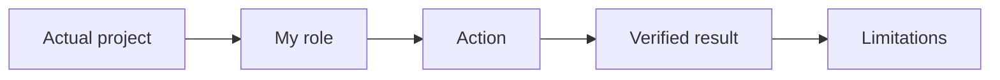

**日本語で説明（mẫu nói sơ đồ）：** まず質問の目的を確認します。次に、結論を短く伝えます。必要なら理由や具体例を加え、確認できていない点は分けて説明します。

**Dịch:** Xác định mục đích câu hỏi; nêu kết luận ngắn; bổ sung lý do/ví dụ nếu cần và tách riêng thông tin chưa được xác minh. Sơ đồ là công cụ học, không phải architecture thực tế trừ khi nội dung nói rõ.

#### ⑤ 面接対話 — Hội thoại hỏi đáp

**面接官：** 職務経歴について説明してください。

**Dịch câu hỏi:** Hãy trình bày quá trình công tác của bạn.

**応募者（Standard）：** 【実際の学歴・職歴】について、時系列でご説明します。主に【実際に担当した業務】に取り組みました。

**ベトナム語訳:** Tôi xin trình bày [học vấn/quá trình làm việc thực tế] theo thứ tự thời gian. Tôi chủ yếu thực hiện [công việc thực sự phụ trách].

**面接官（深掘り）：** その技術は業務で使いましたか。

**Dịch câu hỏi đào sâu:** Bạn đã sử dụng công nghệ đó trong công việc thực tế chưa?

**応募者：** 実務経験と学習経験を分けて、事実に基づいて答えます。

**ベトナム語訳（ý nghĩa）：** Tôi sẽ phân biệt kinh nghiệm làm việc thực tế với kinh nghiệm học tập và trả lời dựa trên sự thật.

**Professional version:** Giữ cùng ý nhưng điều chỉnh lịch sự và độ chính xác. Không tự động dùng 敬語 phức tạp; không sửa sự thật để tạo ấn tượng.

#### ⑥ 類似表現比較 — Cách nói dễ nhầm

- **確認しました** = đã kiểm tra; **検証しました** = đã kiểm chứng bằng phép thử/phương pháp.
- **担当しました** = đã phụ trách; **参加しました** = đã tham gia, không tự đồng nghĩa.
- **〜ができます** = có thể thực hiện theo điều kiện; **本番で運用しています** = đang vận hành production và cần minh chứng.
- **〜を確認した上で回答します** = sẽ trả lời sau khi xác nhận, phù hợp khi chưa đủ dữ liệu.

#### ⑦ 語彙・文法 — Từ vựng

| 日本語 | 読み方 | Nghĩa |
|---|---|---|
| 職務経歴 | しょくむけいれき | Quá trình công tác |
| 担当範囲 | たんとうはんい | Phạm vi phụ trách |
| 実装する | じっそうする | Hiện thực hóa |
| 検証する | けんしょうする | Kiểm chứng |
| 成果 | せいか | Thành quả |
| 根拠 | こんきょ | Bằng chứng/căn cứ |

Mẫu hữu ích: **まず〜を確認します。次に〜を整理します。その上で〜を説明します。** / **現時点では〜を確認できていません。**

#### ⑧ 会話練習 — Luyện phản xạ và ứng dụng

1. Không nhìn mẫu: trả lời câu chính trong 20–30 giây, theo cấu trúc kết luận → căn cứ → giới hạn thực tế.
2. **面接官：** 経歴に空白期間がある場合、どう説明しますか。
   
   **Dịch:** Nếu có khoảng trống trong CV, bạn giải thích thế nào?
   
   **応募者（回答例）：** その期間に実際に行っていたことを、事実に沿って簡潔に説明します。
   
   **Dịch:** Tôi trình bày ngắn gọn điều thực sự đã làm trong giai đoạn đó.
3. Chuyển ngữ cảnh: áp dụng câu trên vào kinh nghiệm **có thật** của bản thân, không nhận thành quả không có bằng chứng.
4. Ghi âm một lần, tự đánh giá: nội dung đúng, mạch lạc, tự nhiên, đúng thời gian (mỗi tiêu chí 0–5 điểm).
5. **AI Interviewer:** この質問を一つずつ出し、私の回答を待ってください。具体例を一つ質問した後、自然な日本語の改善案を示してください。

#### ⑨ 解答ポイント — Điểm tự kiểm tra

- Nói kết luận trước và không kéo dài câu chính.
- Biết phân biệt vấn đề có thể giải thích ngay với thông tin cần xác minh.
- Với Smart Farm: backend và PostgreSQL chủ yếu local, luồng ESP32/Wokwi–AWS–backend có bằng chứng chạy thử theo mô tả; chưa xác nhận production hoặc bơm/van thật.
- Không thêm thành tích cá nhân, thời gian, số liệu không có căn cứ.

#### ⑩ 評価・改善 — Rubric /20

Tự chấm 0–4 cho mỗi tiêu chí: **đúng trọng tâm**, **độ chính xác / tính trung thực**, **tiếng Nhật tự nhiên**, **cấu trúc logic**, **đối đáp câu hỏi đào sâu**. Điểm 16–20: tốt; 12–15: cần chỉnh; dưới 12: luyện lại. Không phải chuẩn chính thức. Với văn bản, không đánh giá phát âm.

**Cách sửa:** ghi câu trả lời → xác định ba lỗi lớn nhất → rút gọn thành 2–4 câu Nhật → thực hành lại không nhìn mẫu.


#### 出典とステータス

Bài được biên soạn từ khung BRSE Interview Master và thông tin dự án do người dùng cung cấp. Các tình huống chung là ví dụ sư phạm; chưa qua native Japanese reviewer hoặc kiểm định Mermaid render. Trước khi duyệt, bổ sung bản dịch Việt sát nghĩa theo từng câu, đối chiếu CV và luyện nói có bấm giờ.

#### ⑪ 深掘り・実務演習 — Chuyên sâu và ứng dụng thực tế

##### Bản chất và cơ chế

経歴書 phải phân biệt **thời gian học**, **dự án học tập**, **thực tập**, **việc làm có hợp đồng**, **tham gia nhóm**. Với mỗi dòng, ghi bối cảnh → vị trí/nhóm → trách nhiệm thực → công nghệ thực dùng → sản phẩm/bằng chứng. Nếu chưa có xác nhận vai trò chính thức, tránh gọi sản phẩm học tập là dự án thương mại.

##### Case study — Cách dùng trong dự án

Ví dụ ghi Smart Farm: có thể mô tả xây dựng/thử nghiệm phần IoT theo nội dung đã kiểm chứng trong repository; không ghi 'triển khai cho hàng trăm nông trại' khi không có log nghiệm thu. Nói rõ backend local và thử Wokwi. Với một dự án POS, phải phân biệt phần phân tích nghiệp vụ, frontend và QA mình thực hiện.

##### Rủi ro, giới hạn và trade-off

Trong phỏng vấn, câu 'Spring Bootを使いました' có thể bị hỏi code đâu, bảng nào, vì sao chọn JdbcTemplate, test nào. Tập trả lời ở độ sâu tương xứng với trách nhiệm đã khai.

##### 回答例 — Giải thích bằng tiếng Nhật

> 学習プロジェクトと実務経験を分け、担当した作業と確認できる成果を時系列で説明します。

**Dịch sát nghĩa:** Tôi phân biệt dự án học tập và kinh nghiệm làm việc, trình bày theo thời gian những việc bản thân phụ trách và kết quả có thể xác minh.

##### Bài thực hành có sản phẩm đầu ra

**Nhiệm vụ:** Lập bảng 5 dòng CV, cột thời gian–hình thức–vai trò–công nghệ–bằng chứng–mức chắc chắn; dịch sang Nhật.

**Điều kiện đạt:** Không còn mục chưa rõ giữa thực tập/chính thức; mỗi công nghệ trong CV gắn ít nhất một tác vụ hoặc bài tập cụ thể.

*Lưu ý minh chứng: Ví dụ giáo dục phải phân biệt với chức năng đã kiểm thử thật; không nhận thành tích cá nhân, vận hành production hay mức an toàn khi chưa có bằng chứng.*

*Nguồn: [03-01-cv-timeline.md](https://github.com/NiDa30/Interview/blob/main/book/chapters/chapter-03/03-01-cv-timeline.md)*

### 第03.02課 — プロジェクト説明 — Giải thích dự án

> **BRSE Interview Master — Draft / Pending Japanese Review.** Trình độ N3–N2, mục tiêu trả lời chính 15–30 giây. Các câu về cá nhân là **mẫu**; chỉ dùng sau khi điền dữ kiện thật. Không có chứng nhận người Nhật đã duyệt.

#### ① 学習目標 — Mục tiêu

Sau bài học, người học nhận biết ý định câu hỏi, trả lời đúng trọng tâm bằng 2–4 câu tiếng Nhật, phân biệt dữ kiện và giả định, phản hồi một câu hỏi đào sâu và sửa câu chưa tự nhiên.

#### ② 面接質問・質問の意図

**面接官：** Smart Farmのプロジェクトについて説明してください。

**Người phỏng vấn đang kiểm tra:** Mục tiêu → luồng hệ thống → vai trò cá nhân → kết quả đã xác minh → giới hạn.

#### ③ 知識・思考プロセス — Kiến thức và cách suy nghĩ

Chỉ xác nhận luồng ESP32/Wokwi–AWS–backend đã được chạy thử theo mô tả. Các chức năng nâng cao cần nghiệm thu thêm.

Cách trả lời: **kết luận → lý do / hành động → bằng chứng / giới hạn**. Với kinh nghiệm cá nhân, chỉ sử dụng sự thật trong CV/commit/test. Với tình huống giả định, dùng các cách nói 〜の場合は / 〜と考えています, tránh giả vờ từng làm.

#### ④ 図解 — Sơ đồ tư duy


**日本語で説明（mẫu nói sơ đồ）：** まず質問の目的を確認します。次に、結論を短く伝えます。必要なら理由や具体例を加え、確認できていない点は分けて説明します。

**Dịch:** Xác định mục đích câu hỏi; nêu kết luận ngắn; bổ sung lý do/ví dụ nếu cần và tách riêng thông tin chưa được xác minh. Sơ đồ là công cụ học, không phải architecture thực tế trừ khi nội dung nói rõ.

#### ⑤ 面接対話 — Hội thoại hỏi đáp

**面接官：** Smart Farmのプロジェクトについて説明してください。

**Dịch câu hỏi:** Hãy giới thiệu về dự án Smart Farm.

**応募者（Standard）：** Smart Farmは、農園の環境監視とデバイス管理を支援するシステムです。ESP32、AWS IoT Core、Spring Boot、PostgreSQL、Reactを使用しています。現在は主にローカル環境とシミュレーションで検証しています。

**ベトナム語訳:** Smart Farm là hệ thống hỗ trợ giám sát môi trường vườn và quản lý thiết bị. Hệ thống sử dụng ESP32, AWS IoT Core, Spring Boot, PostgreSQL và React. Hiện dự án chủ yếu được kiểm thử trong môi trường local và mô phỏng.

**面接官（深掘り）：** 実際の農場で稼働していますか。

**Dịch câu hỏi đào sâu:** Dự án có đang vận hành tại nông trại thật không?

**応募者：** 本番環境での運用や農業用ポンプ・バルブの動作は、まだ確認できていません。

**ベトナム語訳（ý nghĩa）：** Chúng tôi chưa xác nhận hệ thống vận hành production hoặc bơm/van nông nghiệp thật hoạt động.

**Professional version:** Giữ cùng ý nhưng điều chỉnh lịch sự và độ chính xác. Không tự động dùng 敬語 phức tạp; không sửa sự thật để tạo ấn tượng.

#### ⑥ 類似表現比較 — Cách nói dễ nhầm

- **確認しました** = đã kiểm tra; **検証しました** = đã kiểm chứng bằng phép thử/phương pháp.
- **担当しました** = đã phụ trách; **参加しました** = đã tham gia, không tự đồng nghĩa.
- **〜ができます** = có thể thực hiện theo điều kiện; **本番で運用しています** = đang vận hành production và cần minh chứng.
- **〜を確認した上で回答します** = sẽ trả lời sau khi xác nhận, phù hợp khi chưa đủ dữ liệu.

#### ⑦ 語彙・文法 — Từ vựng

| 日本語 | 読み方 | Nghĩa |
|---|---|---|
| 職務経歴 | しょくむけいれき | Quá trình công tác |
| 担当範囲 | たんとうはんい | Phạm vi phụ trách |
| 実装する | じっそうする | Hiện thực hóa |
| 検証する | けんしょうする | Kiểm chứng |
| 成果 | せいか | Thành quả |
| 根拠 | こんきょ | Bằng chứng/căn cứ |

Mẫu hữu ích: **まず〜を確認します。次に〜を整理します。その上で〜を説明します。** / **現時点では〜を確認できていません。**

#### ⑧ 会話練習 — Luyện phản xạ và ứng dụng

1. Không nhìn mẫu: trả lời câu chính trong 20–30 giây, theo cấu trúc kết luận → căn cứ → giới hạn thực tế.
2. **面接官：** プロジェクトの成果を説明する時、どこに注意しますか。
   
   **Dịch:** Khi trình bày thành quả dự án, cần lưu ý gì?
   
   **応募者（回答例）：** 自分の担当範囲とチーム全体の成果を分けて説明します。
   
   **Dịch:** Tôi phân biệt phần bản thân phụ trách với thành quả cả đội.
3. Chuyển ngữ cảnh: áp dụng câu trên vào kinh nghiệm **có thật** của bản thân, không nhận thành quả không có bằng chứng.
4. Ghi âm một lần, tự đánh giá: nội dung đúng, mạch lạc, tự nhiên, đúng thời gian (mỗi tiêu chí 0–5 điểm).
5. **AI Interviewer:** この質問を一つずつ出し、私の回答を待ってください。具体例を一つ質問した後、自然な日本語の改善案を示してください。

#### ⑨ 解答ポイント — Điểm tự kiểm tra

- Nói kết luận trước và không kéo dài câu chính.
- Biết phân biệt vấn đề có thể giải thích ngay với thông tin cần xác minh.
- Với Smart Farm: backend và PostgreSQL chủ yếu local, luồng ESP32/Wokwi–AWS–backend có bằng chứng chạy thử theo mô tả; chưa xác nhận production hoặc bơm/van thật.
- Không thêm thành tích cá nhân, thời gian, số liệu không có căn cứ.

#### ⑩ 評価・改善 — Rubric /20

Tự chấm 0–4 cho mỗi tiêu chí: **đúng trọng tâm**, **độ chính xác / tính trung thực**, **tiếng Nhật tự nhiên**, **cấu trúc logic**, **đối đáp câu hỏi đào sâu**. Điểm 16–20: tốt; 12–15: cần chỉnh; dưới 12: luyện lại. Không phải chuẩn chính thức. Với văn bản, không đánh giá phát âm.

**Cách sửa:** ghi câu trả lời → xác định ba lỗi lớn nhất → rút gọn thành 2–4 câu Nhật → thực hành lại không nhìn mẫu.


#### 出典とステータス

Bài được biên soạn từ khung BRSE Interview Master và thông tin dự án do người dùng cung cấp. Các tình huống chung là ví dụ sư phạm; chưa qua native Japanese reviewer hoặc kiểm định Mermaid render. Trước khi duyệt, bổ sung bản dịch Việt sát nghĩa theo từng câu, đối chiếu CV và luyện nói có bấm giờ.

#### ⑪ 深掘り・実務演習 — Chuyên sâu và ứng dụng thực tế

##### Bản chất và cơ chế

Một câu chuyện dự án đủ sâu có bốn lớp: **người sử dụng và vấn đề**, **luồng dữ liệu**, **quyết định thiết kế**, **điều kiện đánh giá thành công**. STAR hữu ích cho hành động cá nhân, nhưng phần kỹ thuật cần diễn giải topology, giao tiếp, lỗi và giới hạn. Tránh liệt kê stack mà không có luồng.

##### Case study — Cách dùng trong dự án

Ví dụ Smart Farm: cảm biến ESP32 gửi MQTT/TLS tới AWS IoT Core; backend xử lý và lưu PostgreSQL; React lấy dữ liệu qua REST/polling. Phải nói khác nhau giữa 'lệnh publish', 'thiết bị ACK', 'reported state' và 'bơm vật lý chạy'; ở đây không có bằng chứng production/bơm thật.

##### Rủi ro, giới hạn và trade-off

Đào sâu: tại sao API polling thay MQTT trực tiếp trên browser? Vì phân tách quyền/logic backend, nhưng vẫn có độ trễ giữa các lần fetch. Không gọi UI '实时' nếu đó là polling. Đặt câu hỏi lỗi có thông điệp trùng, thiết bị offline và dữ liệu cũ.

##### 回答例 — Giải thích bằng tiếng Nhật

> まず利用者の課題を説明し、次にデータの流れと技術選定の理由を述べます。最後に、検証済みの範囲と未確認の点を明確にします。

**Dịch sát nghĩa:** Trước hết tôi trình bày vấn đề người dùng, sau đó luồng dữ liệu và lý do chọn công nghệ, cuối cùng làm rõ phần đã kiểm chứng và chưa biết.

##### Bài thực hành có sản phẩm đầu ra

**Nhiệm vụ:** Vẽ sơ đồ luồng 6 bước, chọn một điểm lỗi và giải thích phát hiện–giảm ảnh hưởng–minh chứng test.

**Điều kiện đạt:** Người nghe có thể tóm tắt từ nguồn dữ liệu tới UI; có ít nhất một failure mode và không phóng đại kết quả.

*Lưu ý minh chứng: Ví dụ giáo dục phải phân biệt với chức năng đã kiểm thử thật; không nhận thành tích cá nhân, vận hành production hay mức an toàn khi chưa có bằng chứng.*

*Nguồn: [03-02-project-story.md](https://github.com/NiDa30/Interview/blob/main/book/chapters/chapter-03/03-02-project-story.md)*

### 第03.03課 — 担当範囲・課題・成果 — Vai trò, khó khăn, kết quả

> **BRSE Interview Master — Draft / Pending Japanese Review.** Trình độ N3–N2, mục tiêu trả lời chính 15–30 giây. Các câu về cá nhân là **mẫu**; chỉ dùng sau khi điền dữ kiện thật. Không có chứng nhận người Nhật đã duyệt.

#### ① 学習目標 — Mục tiêu

Sau bài học, người học nhận biết ý định câu hỏi, trả lời đúng trọng tâm bằng 2–4 câu tiếng Nhật, phân biệt dữ kiện và giả định, phản hồi một câu hỏi đào sâu và sửa câu chưa tự nhiên.

#### ② 面接質問・質問の意図

**面接官：** あなたは何を担当しましたか。

**Người phỏng vấn đang kiểm tra:** STAR: Situation → Task → Action → Result; mọi phần Action và Result phải có minh chứng.

#### ③ 知識・思考プロセス — Kiến thức và cách suy nghĩ

Khi chưa có bằng chứng vai trò cá nhân, giữ placeholder thay vì tự nhận toàn bộ backend, AWS, frontend.

Cách trả lời: **kết luận → lý do / hành động → bằng chứng / giới hạn**. Với kinh nghiệm cá nhân, chỉ sử dụng sự thật trong CV/commit/test. Với tình huống giả định, dùng các cách nói 〜の場合は / 〜と考えています, tránh giả vờ từng làm.

#### ④ 図解 — Sơ đồ tư duy


**日本語で説明（mẫu nói sơ đồ）：** まず質問の目的を確認します。次に、結論を短く伝えます。必要なら理由や具体例を加え、確認できていない点は分けて説明します。

**Dịch:** Xác định mục đích câu hỏi; nêu kết luận ngắn; bổ sung lý do/ví dụ nếu cần và tách riêng thông tin chưa được xác minh. Sơ đồ là công cụ học, không phải architecture thực tế trừ khi nội dung nói rõ.

#### ⑤ 面接対話 — Hội thoại hỏi đáp

**面接官：** あなたは何を担当しましたか。

**Dịch câu hỏi:** Bạn đã phụ trách những công việc gì?

**応募者（Standard）：** 私が担当した部分は【実際の機能】です。具体的には【自分で行った作業】を行い、【証拠のある結果】を確認しました。

**ベトナム語訳:** Phần tôi phụ trách là [chức năng đã thực hiện thực tế]. Cụ thể, tôi đã làm [công việc trực tiếp của mình] và xác minh được [kết quả có bằng chứng].

**面接官（深掘り）：** その成果をどう確認できますか。

**Dịch câu hỏi đào sâu:** Bạn có thể xác minh kết quả đó bằng cách nào?

**応募者：** 【対応するIssue・PR・テスト結果】を使って説明します。

**ベトナム語訳（ý nghĩa）：** Tôi sẽ giải thích dựa trên [issue, pull request hoặc kết quả kiểm thử tương ứng].

**Professional version:** Giữ cùng ý nhưng điều chỉnh lịch sự và độ chính xác. Không tự động dùng 敬語 phức tạp; không sửa sự thật để tạo ấn tượng.

#### ⑥ 類似表現比較 — Cách nói dễ nhầm

- **確認しました** = đã kiểm tra; **検証しました** = đã kiểm chứng bằng phép thử/phương pháp.
- **担当しました** = đã phụ trách; **参加しました** = đã tham gia, không tự đồng nghĩa.
- **〜ができます** = có thể thực hiện theo điều kiện; **本番で運用しています** = đang vận hành production và cần minh chứng.
- **〜を確認した上で回答します** = sẽ trả lời sau khi xác nhận, phù hợp khi chưa đủ dữ liệu.

#### ⑦ 語彙・文法 — Từ vựng

| 日本語 | 読み方 | Nghĩa |
|---|---|---|
| 職務経歴 | しょくむけいれき | Quá trình công tác |
| 担当範囲 | たんとうはんい | Phạm vi phụ trách |
| 実装する | じっそうする | Hiện thực hóa |
| 検証する | けんしょうする | Kiểm chứng |
| 成果 | せいか | Thành quả |
| 根拠 | こんきょ | Bằng chứng/căn cứ |

Mẫu hữu ích: **まず〜を確認します。次に〜を整理します。その上で〜を説明します。** / **現時点では〜を確認できていません。**

#### ⑧ 会話練習 — Luyện phản xạ và ứng dụng

1. Không nhìn mẫu: trả lời câu chính trong 20–30 giây, theo cấu trúc kết luận → căn cứ → giới hạn thực tế.
2. **面接官：** 実装していない機能について聞かれたら、どう答えますか。
   
   **Dịch:** Nếu được hỏi tính năng bạn không trực tiếp xây dựng thì sao?
   
   **応募者（回答例）：** 担当していないことを明確にし、理解している範囲だけ説明します。
   
   **Dịch:** Tôi nêu rõ mình không phụ trách và chỉ giải thích phần thực sự hiểu.
3. Chuyển ngữ cảnh: áp dụng câu trên vào kinh nghiệm **có thật** của bản thân, không nhận thành quả không có bằng chứng.
4. Ghi âm một lần, tự đánh giá: nội dung đúng, mạch lạc, tự nhiên, đúng thời gian (mỗi tiêu chí 0–5 điểm).
5. **AI Interviewer:** この質問を一つずつ出し、私の回答を待ってください。具体例を一つ質問した後、自然な日本語の改善案を示してください。

#### ⑨ 解答ポイント — Điểm tự kiểm tra

- Nói kết luận trước và không kéo dài câu chính.
- Biết phân biệt vấn đề có thể giải thích ngay với thông tin cần xác minh.
- Với Smart Farm: backend và PostgreSQL chủ yếu local, luồng ESP32/Wokwi–AWS–backend có bằng chứng chạy thử theo mô tả; chưa xác nhận production hoặc bơm/van thật.
- Không thêm thành tích cá nhân, thời gian, số liệu không có căn cứ.

#### ⑩ 評価・改善 — Rubric /20

Tự chấm 0–4 cho mỗi tiêu chí: **đúng trọng tâm**, **độ chính xác / tính trung thực**, **tiếng Nhật tự nhiên**, **cấu trúc logic**, **đối đáp câu hỏi đào sâu**. Điểm 16–20: tốt; 12–15: cần chỉnh; dưới 12: luyện lại. Không phải chuẩn chính thức. Với văn bản, không đánh giá phát âm.

**Cách sửa:** ghi câu trả lời → xác định ba lỗi lớn nhất → rút gọn thành 2–4 câu Nhật → thực hành lại không nhìn mẫu.


#### 出典とステータス

Bài được biên soạn từ khung BRSE Interview Master và thông tin dự án do người dùng cung cấp. Các tình huống chung là ví dụ sư phạm; chưa qua native Japanese reviewer hoặc kiểm định Mermaid render. Trước khi duyệt, bổ sung bản dịch Việt sát nghĩa theo từng câu, đối chiếu CV và luyện nói có bấm giờ.

#### ⑪ 深掘り・実務演習 — Chuyên sâu và ứng dụng thực tế

##### Bản chất và cơ chế

Đánh giá đóng góp nên dựa trên bằng chứng **traceability**: yêu cầu → issue → commit/PR → test → demo/review. RACI cho biết ai thực hiện, ai chịu trách nhiệm phê duyệt, ai được hỏi và ai được thông báo; không tự nhận vai trò A chỉ vì đã tham dự cuộc họp.

##### Case study — Cách dùng trong dự án

Trong nhóm ba người xây POS/ERP, nếu bạn làm BA/Frontend/QA, có thể mô tả một use case và dấu vết thiết kế/test tương ứng. Tránh nói đã viết backend hay kiến trúc thanh toán nếu không làm. Nếu đóng góp Smart Farm dựa vào repo, đưa PR/file/module và test minh chứng; commit không tự chứng minh tác giả quyết định kiến trúc.

##### Rủi ro, giới hạn và trade-off

Câu khó: 'Nếu đồng nghiệp viết chức năng đó, bạn có hiểu không?' Hãy giải thích kiến trúc mình hiểu, nói rõ không trực tiếp code, rồi dẫn đến phần có thể chứng minh; sự trung thực có giá trị hơn câu trả lời bao trùm.

##### 回答例 — Giải thích bằng tiếng Nhật

> 私が担当したのは【実際の作業】です。チーム全体で実装した機能と、私自身が確認した範囲を分けて説明します。

**Dịch sát nghĩa:** Tôi phụ trách [công việc thật]. Tôi tách chức năng cả đội thực hiện khỏi phạm vi chính mình đã kiểm tra.

##### Bài thực hành có sản phẩm đầu ra

**Nhiệm vụ:** Tạo bảng RACI cho một chức năng, đính kèm issue, ảnh/demo, test case và ba câu đào sâu về quyết định của bạn.

**Điều kiện đạt:** Phân biệt 参加・担当・主導; không có chỗ nào tự nhận lead/production khi chưa có căn cứ.

*Lưu ý minh chứng: Ví dụ giáo dục phải phân biệt với chức năng đã kiểm thử thật; không nhận thành tích cá nhân, vận hành production hay mức an toàn khi chưa có bằng chứng.*

*Nguồn: [03-03-individual-contribution.md](https://github.com/NiDa30/Interview/blob/main/book/chapters/chapter-03/03-03-individual-contribution.md)*


---

<a id="chapter-04"></a>
## Chương 04 — プログラミング・Web技術

### 第04.01課 — オブジェクト指向・カプセル化

> **BRSE Interview Master · Draft / Pending review**  
> Trình độ N3–N2; mục tiêu hội thoại chính 15–30 giây. Nội dung giải thích kỹ thuật là học liệu; không khẳng định người học từng làm các thao tác nếu chưa có bằng chứng. Các endpoint/sơ đồ minh họa không phải đặc tả dự án khi không được xác nhận.

#### ① 学習目標 — Mục tiêu

Hiểu và giải thích được **オブジェクト指向・カプセル化**, trả lời một câu hỏi kỹ thuật chính, xử lý ít nhất một follow-up, sử dụng từ vựng IT tiếng Nhật, và chuyển kiến thức sang tình huống mới.

#### ② 面接質問・質問の意図

**面接官：** オブジェクト指向とは何ですか。

**Nhà tuyển dụng đánh giá:** Năng lực hiểu khái niệm, giải thích mục đích sử dụng và phân biệt kiến thức thực tế với giả định.

#### ③ 技術知識・思考プロセス

**Cách tư duy:** Định nghĩa / tình huống → công dụng → rủi ro hoặc giới hạn → ví dụ. Khi hỏi về quyết định kỹ thuật của dự án, phải phân biệt *lợi ích chung* với *lý do lựa chọn thực tế được xác nhận*.

Đóng gói hạn chế truy cập trạng thái và công khai thao tác phù hợp.

#### ④ 図解 — Hình minh họa

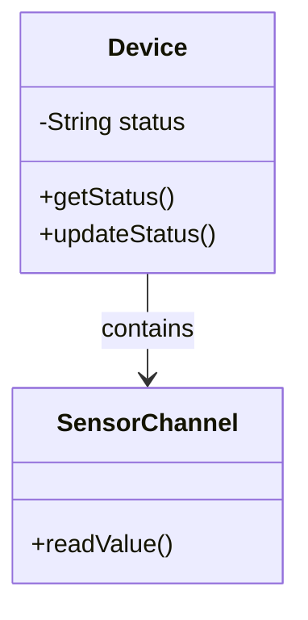

**Chú giải:** Sơ đồ có tính giáo dục. Không suy ra hạ tầng hoặc endpoint tương ứng đang tồn tại trong mã nguồn Smart Farm.

**日本語で説明してみよう：** まず全体の流れを確認します。次に、それぞれの役割を説明します。最後に、データの受け渡しや確認が必要な点をまとめます。

**Dịch:** Nắm luồng tổng thể, giải thích trách nhiệm các tầng, nêu điểm trao đổi dữ liệu và vấn đề cần xác minh.

#### ⑤ 面接対話 — Hội thoại Nhật–Việt

**面接官：** オブジェクト指向とは何ですか。

**Dịch câu hỏi:** Lập trình hướng đối tượng là gì?

**応募者（Standard）：** オブジェクト指向は、データと処理をオブジェクトとしてまとめて設計する考え方です。責任を分けることで、変更しやすくなる場合があります。

**ベトナム語訳：** OOP tổ chức dữ liệu và hành vi theo đối tượng; việc phân chia trách nhiệm có thể hỗ trợ thay đổi.

**面接官（深掘り）：** カプセル化とは何ですか。

**Câu hỏi đào sâu (Việt):** Đóng gói là gì?

**応募者：** 内部の状態へのアクセスを制限し、必要な操作を公開することです。

**ベトナム語訳：** Đóng gói là hạn chế truy cập vào trạng thái bên trong và công khai những thao tác cần thiết.

**質問の型:** 何ですか → なぜ必要ですか → 具体的にはどうしますか. Khi có câu hỏi tiếp theo, ưu tiên giải thích một ý mới, không lặp toàn bộ định nghĩa.

#### ⑥ 類似表現比較 — Cách diễn đạt phù hợp

- **使っています:** công nghệ đang dùng, không tự bao hàm lý do lựa chọn.
- **採用しました:** đã áp dụng; cần xác minh vai trò quyết định trước khi dùng ở ngôi cá nhân.
- **確認します / 検証します:** kiểm tra thông tin / kiểm chứng qua phương pháp.
- **実現できます / 可能性があります:** có thể thực hiện / có khả năng; không hứa tuyệt đối khi chưa đánh giá rủi ro.

#### ⑦ 語彙・文法 — Từ vựng chuyên ngành

| 日本語 | 読み方 | Nghĩa |
|---|---|---|
| オブジェクト指向 | オブジェクトしこう | Lập trình hướng đối tượng |
| カプセル化 | カプセルか | Đóng gói |
| 継承 | けいしょう | Kế thừa |
| 抽象化 | ちゅうしょうか | Trừu tượng hóa |
| 責任 | せきにん | Trách nhiệm |
| 状態 | じょうたい | Trạng thái |

**Mẫu câu phỏng vấn:** オブジェクト指向では、データと処理をまとめて扱います。

**Dịch sát nghĩa:** Trong OOP, dữ liệu và xử lý được gom để quản lý cùng nhau.

#### ⑧ 実践練習 — Active recall và chuyển ngữ cảnh

**Bước 1 — 20 giây:** Trả lời câu hỏi phỏng vấn chính của bài mà không nhìn mẫu. Ghi âm và tự kiểm tra có nêu được định nghĩa, công dụng, giới hạn hay chưa.

**Bước 2 — Câu hỏi ứng dụng của nhà tuyển dụng:**

**面接官：** Deviceの状態を外部から自由に変更できる設計には、どんな問題がありますか。

**Dịch câu hỏi:** Nếu bên ngoài sửa trạng thái Device tùy ý, có vấn đề gì?

**応募者（回答例）：** 状態の整合性が崩れる可能性があります。そのため、更新方法を限定します。

**Dịch từng câu:** Trạng thái có thể mất nhất quán. Vì vậy nên giới hạn cách cập nhật.

**Bước 3 — Bài tập thực hành:** Giải thích đóng gói bằng ví dụ class Device và setter kiểm tra điều kiện; không khẳng định class đó đang tồn tại trong dự án.

**Bước 4 — Trả lời cho khách hàng:** Hãy nói lại cùng ý bằng tiếng Nhật dễ hiểu, tránh thuật ngữ chưa giải thích. Không tự đưa ra cam kết về trạng thái production.

**Bước 5 — Chấm:** 0–4 điểm từng tiêu chí: đúng kiến thức, giải thích rõ, tiếng Nhật tự nhiên, nói đúng trọng tâm, xử lý follow-up. Tổng /20; nếu chưa có ghi âm, chỉ tự chấm nội dung, không khẳng định phát âm.

**AI Interviewer:** 面接官として上の質問を一問ずつ出してください。私の回答を待ち、事実と推測を区別させる質問を一つ追加してください。最後に自然な日本語への修正案を示してください。

#### ⑨ 評価・改善 — Rubric /20

Tự chấm năm tiêu chí 0–4: đúng trọng tâm, chính xác kỹ thuật, tiếng Nhật tự nhiên, diễn giải mạch lạc, phản xạ follow-up. Thang 16–20 tốt, 12–15 cần chỉnh, dưới 12 học lại là thước đo **nội bộ**. Không tự chấm phát âm khi không có audio.

**Quy trình sửa:** Rút ngắn câu, chỉ ra giới hạn cần xác minh, thử giải thích lại cho khách hàng không chuyên và làm mới ví dụ.

#### ⑩ 出典・検証状況

- Kiến thức cơ bản về lập trình / kiến trúc / QA / yêu cầu là **nội dung giáo dục tổng quát**, không trích xuất trực tiếp từ source code.
- Với Smart Farm, brief cung cấp: ESP32/Wokwi, AWS IoT Core, MQTT/TLS/X.509, backend Java 21/Spring Boot/Spring JDBC/modular monolith, PostgreSQL, React/REST/polling, kiểm thử JUnit/Spring Boot Test/Playwright; backend và DB chủ yếu local, luồng ESP32/Wokwi–AWS–backend có bằng chứng chạy thử theo mô tả.
- **Chưa xác nhận:** cấu hình production, khả năng vận hành bơm/van nông nghiệp thật, benchmark, endpoints và triển khai các công nghệ minh họa không có trong brief.
- Cần đối chiếu mã nguồn, kiểm thử render Mermaid, rà soát tiếng Nhật và thử trả lời có bấm giờ trước khi đánh dấu Reviewed.

#### ⑪ 深掘り・実務演習 — Chuyên sâu và ứng dụng thực tế

##### Bản chất và cơ chế

Đóng gói (カプセル化) không đơn thuần là `private` + getter/setter. Điều quan trọng là bảo vệ **bất biến**: ví dụ trạng thái bơm không được chuyển sang ON khi bị lockout, thời gian bật phải ở giới hạn hợp lệ. Một đối tượng tốt cho phép thao tác có nghĩa nghiệp vụ và từ chối trạng thái không hợp lệ thay vì để mọi lớp sửa trường tùy ý.

##### Case study — Cách dùng trong dự án

Ví dụ thiết kế `PumpState` có `requestOn(duration)`; tự kiểm tra lockout, expiry và policy trước khi tạo lệnh. `PumpService` thật trong repo có trạng thái `UNKNOWN`, `safetyLockout` và các điều kiện kiểm tra, nhưng đoạn mã thiết kế sau đây chỉ **minh họa**, không phải trích source. Kế thừa dễ gây ghép chặt; composition phù hợp khi muốn thay `CommandTransport` cho MQTT hoặc mock test.

##### Rủi ro, giới hạn và trade-off

Cân nhắc giữa trừu tượng quá sớm và code trùng: nếu mới có một loại bơm và một transport, chỉ tạo interface khi có ranh giới test/khả năng thay thế rõ. Khi phỏng vấn, kết nối nguyên lý OOP với cách giảm lỗi, không chỉ đọc thuộc 'đóng gói, kế thừa, đa hình'.

##### 回答例 — Giải thích bằng tiếng Nhật

> カプセル化の目的は、内部の値を隠すだけでなく、不正な状態への変更を防ぐことです。例えば、安全ロック中はON操作を受け付けない設計にします。

**Dịch sát nghĩa:** Đóng gói không chỉ giấu giá trị bên trong mà ngăn chuyển trạng thái không hợp lệ; ví dụ không nhận ON khi bị khóa an toàn.

##### Bài thực hành có sản phẩm đầu ra

**Nhiệm vụ:** Viết hai thiết kế: public setter đối lập method có invariant; lập ba unit tests cho lockout, duration ngoài giới hạn và command hợp lệ.

**Điều kiện đạt:** Test phủ một tình huống hợp lệ, hai tình huống từ chối và giải thích được vì sao cần abstraction/không cần inheritance.

*Lưu ý minh chứng: Ví dụ giáo dục phải phân biệt với chức năng đã kiểm thử thật; không nhận thành tích cá nhân, vận hành production hay mức an toàn khi chưa có bằng chứng.*

*Nguồn: [04-01-oop.md](https://github.com/NiDa30/Interview/blob/main/book/chapters/chapter-04/04-01-oop.md)*

### 第04.02課 — HTTP・REST API

> **BRSE Interview Master · Draft / Pending review**  
> Trình độ N3–N2; mục tiêu hội thoại chính 15–30 giây. Nội dung giải thích kỹ thuật là học liệu; không khẳng định người học từng làm các thao tác nếu chưa có bằng chứng. Các endpoint/sơ đồ minh họa không phải đặc tả dự án khi không được xác nhận.

#### ① 学習目標 — Mục tiêu

Hiểu và giải thích được **HTTP・REST API**, trả lời một câu hỏi kỹ thuật chính, xử lý ít nhất một follow-up, sử dụng từ vựng IT tiếng Nhật, và chuyển kiến thức sang tình huống mới.

#### ② 面接質問・質問の意図

**面接官：** REST APIとは何ですか。

**Nhà tuyển dụng đánh giá:** Năng lực hiểu khái niệm, giải thích mục đích sử dụng và phân biệt kiến thức thực tế với giả định.

#### ③ 技術知識・思考プロセス

**Cách tư duy:** Định nghĩa / tình huống → công dụng → rủi ro hoặc giới hạn → ví dụ. Khi hỏi về quyết định kỹ thuật của dự án, phải phân biệt *lợi ích chung* với *lý do lựa chọn thực tế được xác nhận*.

GET lấy tài nguyên; POST thường gửi nội dung để tạo/xử lý.

#### ④ 図解 — Hình minh họa

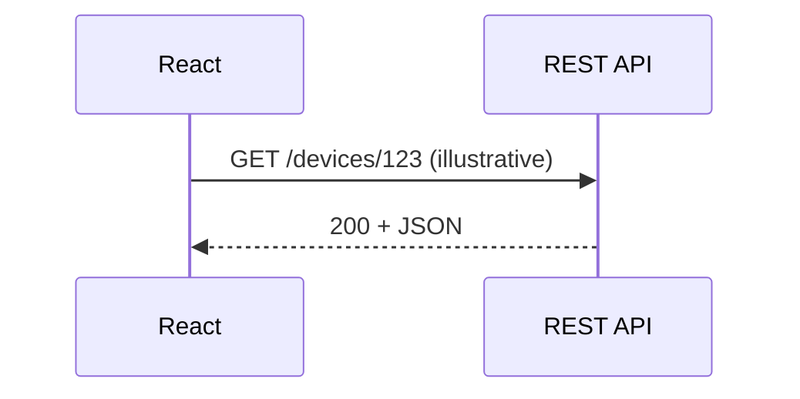

**Chú giải:** Sơ đồ có tính giáo dục. Không suy ra hạ tầng hoặc endpoint tương ứng đang tồn tại trong mã nguồn Smart Farm.

**日本語で説明してみよう：** まず全体の流れを確認します。次に、それぞれの役割を説明します。最後に、データの受け渡しや確認が必要な点をまとめます。

**Dịch:** Nắm luồng tổng thể, giải thích trách nhiệm các tầng, nêu điểm trao đổi dữ liệu và vấn đề cần xác minh.

#### ⑤ 面接対話 — Hội thoại Nhật–Việt

**面接官：** REST APIとは何ですか。

**Dịch câu hỏi:** REST API là gì?

**応募者（Standard）：** RESTの考え方に沿ってリソースを扱うAPIです。一般的にHTTPのメソッドやステータスコードを利用します。

**ベトナム語訳：** REST API là API tuân theo các nguyên tắc REST, thường sử dụng phương thức và mã trạng thái HTTP.

**面接官（深掘り）：** GETとPOSTの違いは何ですか。

**Câu hỏi đào sâu (Việt):** GET và POST khác nhau như thế nào?

**応募者：** GETは主に取得に使い、POSTはデータを送って処理や作成を依頼する時に使います。

**ベトナム語訳：** GET chủ yếu dùng để lấy dữ liệu; POST gửi dữ liệu để yêu cầu xử lý hoặc tạo tài nguyên.

**質問の型:** 何ですか → なぜ必要ですか → 具体的にはどうしますか. Khi có câu hỏi tiếp theo, ưu tiên giải thích một ý mới, không lặp toàn bộ định nghĩa.

#### ⑥ 類似表現比較 — Cách diễn đạt phù hợp

- **使っています:** công nghệ đang dùng, không tự bao hàm lý do lựa chọn.
- **採用しました:** đã áp dụng; cần xác minh vai trò quyết định trước khi dùng ở ngôi cá nhân.
- **確認します / 検証します:** kiểm tra thông tin / kiểm chứng qua phương pháp.
- **実現できます / 可能性があります:** có thể thực hiện / có khả năng; không hứa tuyệt đối khi chưa đánh giá rủi ro.

#### ⑦ 語彙・文法 — Từ vựng chuyên ngành

| 日本語 | 読み方 | Nghĩa |
|---|---|---|
| 資源 | しげん | Tài nguyên (resource) |
| 取得 | しゅとく | Lấy dữ liệu |
| 送信 | そうしん | Gửi |
| 要求 | ようきゅう | Yêu cầu/request |
| 応答 | おうとう | Phản hồi/response |
| 状態コード | じょうたいコード | Mã trạng thái |

**Mẫu câu phỏng vấn:** GETは主にデータを取得する時に使います。

**Dịch sát nghĩa:** GET chủ yếu dùng khi lấy dữ liệu.

#### ⑧ 実践練習 — Active recall và chuyển ngữ cảnh

**Bước 1 — 20 giây:** Trả lời câu hỏi phỏng vấn chính của bài mà không nhìn mẫu. Ghi âm và tự kiểm tra có nêu được định nghĩa, công dụng, giới hạn hay chưa.

**Bước 2 — Câu hỏi ứng dụng của nhà tuyển dụng:**

**面接官：** デバイス情報を取得するAPIには、GETとPOSTのどちらが一般的ですか。

**Dịch câu hỏi:** API đọc thông tin thiết bị thông thường dùng GET hay POST?

**応募者（回答例）：** 通常はGETを使います。ただし、APIの仕様を確認して判断します。

**Dịch từng câu:** Thông thường dùng GET, nhưng cần xem đặc tả API trước khi kết luận.

**Bước 3 — Bài tập thực hành:** Tự mô tả một request GET và response 200, rồi đặt thêm trường hợp 404; endpoint là ví dụ, không phải endpoint đã xác minh.

**Bước 4 — Trả lời cho khách hàng:** Hãy nói lại cùng ý bằng tiếng Nhật dễ hiểu, tránh thuật ngữ chưa giải thích. Không tự đưa ra cam kết về trạng thái production.

**Bước 5 — Chấm:** 0–4 điểm từng tiêu chí: đúng kiến thức, giải thích rõ, tiếng Nhật tự nhiên, nói đúng trọng tâm, xử lý follow-up. Tổng /20; nếu chưa có ghi âm, chỉ tự chấm nội dung, không khẳng định phát âm.

**AI Interviewer:** 面接官として上の質問を一問ずつ出してください。私の回答を待ち、事実と推測を区別させる質問を一つ追加してください。最後に自然な日本語への修正案を示してください。

#### ⑨ 評価・改善 — Rubric /20

Tự chấm năm tiêu chí 0–4: đúng trọng tâm, chính xác kỹ thuật, tiếng Nhật tự nhiên, diễn giải mạch lạc, phản xạ follow-up. Thang 16–20 tốt, 12–15 cần chỉnh, dưới 12 học lại là thước đo **nội bộ**. Không tự chấm phát âm khi không có audio.

**Quy trình sửa:** Rút ngắn câu, chỉ ra giới hạn cần xác minh, thử giải thích lại cho khách hàng không chuyên và làm mới ví dụ.

#### ⑩ 出典・検証状況

- Kiến thức cơ bản về lập trình / kiến trúc / QA / yêu cầu là **nội dung giáo dục tổng quát**, không trích xuất trực tiếp từ source code.
- Với Smart Farm, brief cung cấp: ESP32/Wokwi, AWS IoT Core, MQTT/TLS/X.509, backend Java 21/Spring Boot/Spring JDBC/modular monolith, PostgreSQL, React/REST/polling, kiểm thử JUnit/Spring Boot Test/Playwright; backend và DB chủ yếu local, luồng ESP32/Wokwi–AWS–backend có bằng chứng chạy thử theo mô tả.
- **Chưa xác nhận:** cấu hình production, khả năng vận hành bơm/van nông nghiệp thật, benchmark, endpoints và triển khai các công nghệ minh họa không có trong brief.
- Cần đối chiếu mã nguồn, kiểm thử render Mermaid, rà soát tiếng Nhật và thử trả lời có bấm giờ trước khi đánh dấu Reviewed.

#### ⑪ 深掘り・実務演習 — Chuyên sâu và ứng dụng thực tế

##### Bản chất và cơ chế

**Resource** là đối tượng nghiệp vụ mà API biểu diễn qua URL; **method** mô tả ý định, không phải tên hàm. `GET` là an toàn theo ngữ nghĩa (không cố tạo side effect nghiệp vụ); `PUT` thường mang ngữ nghĩa thay thế/idempotent, `POST` có thể tạo hoặc xử lý; `DELETE` mang ngữ nghĩa xóa và idempotent theo ý định. Cần phân biệt idempotent ở tầng HTTP với bảo đảm không gây hai lần tác động vật lý.

##### Case study — Cách dùng trong dự án

Ví dụ đọc sensor có thể dùng `GET /api/v1/devices/ENV01/telemetry/latest`, frontend đã có hàm fetch tương ứng trong repo Smart Farm. Trả 200 khi có payload hợp lệ, 404 khi không có reading, nhưng phải kiểm tra chi tiết contract của server trước khi mặc định mọi API đều vậy. Với lệnh bơm, POST là hành động có tác động; cần commandId/idempotency, authorization, trạng thái bất đồng bộ và timeout handling.

##### Rủi ro, giới hạn và trade-off

Lỗi nghiệp vụ hay gặp: xem HTTP 200 là bơm đã chạy; cache sai GET khiến UI hiển thị cũ; trả 500 cho mọi lỗi validation; quên auth/role; retry POST không có command ID làm kích hoạt trùng. API spec nên ghi rõ JSON schema, status, error contract và điều kiện hoàn tất.

##### 回答例 — Giải thích bằng tiếng Nhật

> REST APIでは、URLでリソースを表し、HTTPメソッドで操作の意味を伝えます。通信が成功しても、非同期処理の完了とは限りません。

**Dịch sát nghĩa:** REST API thể hiện tài nguyên qua URL và ý nghĩa thao tác qua method; giao tiếp thành công chưa chắc xử lý bất đồng bộ đã hoàn tất.

##### Bài thực hành có sản phẩm đầu ra

**Nhiệm vụ:** Viết OpenAPI ngắn cho GET latest và POST command (mang tính bài tập, không khẳng định endpoint POST thực); mô tả 200/202/400/401/409/500 cùng ba test.

**Điều kiện đạt:** Có ví dụ request/response, idempotency policy và bảng tách HTTP response với kết quả thiết bị.

##### Lab triển khai — Thử hợp đồng HTTP (minh họa)

Dùng môi trường backend **do bạn tự khởi chạy**; URL dựa trên route `telemetryApi.ts` của Smart Farm, không phải chứng cứ server đang online.

```bash
curl -i http://127.0.0.1:8080/api/v1/devices/ENV01/telemetry/latest
```

| Quan sát | Suy ra được | Chưa suy ra được |
|---|---|---|
| 200 kèm reading | API trả payload | Sensor vật lý đang đúng |
| 404 | Không có reading theo hợp đồng này | Toàn hệ thống offline |
| 5xx | Yêu cầu thất bại ở server/upstream | Nguyên nhân gốc, bơm có chạy |

**Bài nâng cao:** Viết một contract test cố tình trả 200 với timestamp cũ; UI phải xử lý thành dữ liệu stale, không hiển thị như dữ liệu mới.

*Lưu ý minh chứng: Ví dụ giáo dục phải phân biệt với chức năng đã kiểm thử thật; không nhận thành tích cá nhân, vận hành production hay mức an toàn khi chưa có bằng chứng.*

*Nguồn: [04-02-http-rest.md](https://github.com/NiDa30/Interview/blob/main/book/chapters/chapter-04/04-02-http-rest.md)*

### 第04.03課 — HTTPステータス・エラー処理

> **BRSE Interview Master · Draft / Pending review**  
> Trình độ N3–N2; mục tiêu hội thoại chính 15–30 giây. Nội dung giải thích kỹ thuật là học liệu; không khẳng định người học từng làm các thao tác nếu chưa có bằng chứng. Các endpoint/sơ đồ minh họa không phải đặc tả dự án khi không được xác nhận.

#### ① 学習目標 — Mục tiêu

Hiểu và giải thích được **HTTPステータス・エラー処理**, trả lời một câu hỏi kỹ thuật chính, xử lý ít nhất một follow-up, sử dụng từ vựng IT tiếng Nhật, và chuyển kiến thức sang tình huống mới.

#### ② 面接質問・質問の意図

**面接官：** APIでエラーが起きたらどうしますか。

**Nhà tuyển dụng đánh giá:** Năng lực hiểu khái niệm, giải thích mục đích sử dụng và phân biệt kiến thức thực tế với giả định.

#### ③ 技術知識・思考プロセス

**Cách tư duy:** Định nghĩa / tình huống → công dụng → rủi ro hoặc giới hạn → ví dụ. Khi hỏi về quyết định kỹ thuật của dự án, phải phân biệt *lợi ích chung* với *lý do lựa chọn thực tế được xác nhận*.

400 thường chỉ request không hợp lệ, 500 chỉ lỗi nội bộ server.

#### ④ 図解 — Hình minh họa

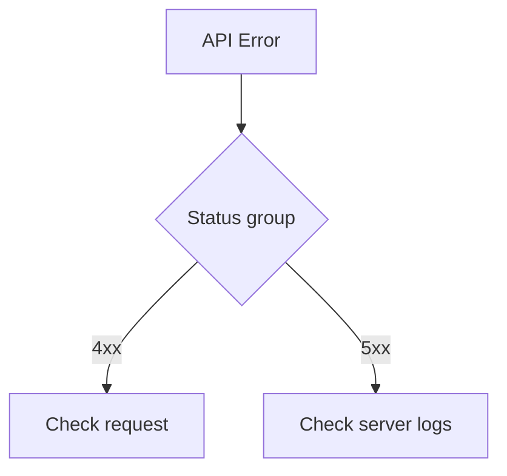

**Chú giải:** Sơ đồ có tính giáo dục. Không suy ra hạ tầng hoặc endpoint tương ứng đang tồn tại trong mã nguồn Smart Farm.

**日本語で説明してみよう：** まず全体の流れを確認します。次に、それぞれの役割を説明します。最後に、データの受け渡しや確認が必要な点をまとめます。

**Dịch:** Nắm luồng tổng thể, giải thích trách nhiệm các tầng, nêu điểm trao đổi dữ liệu và vấn đề cần xác minh.

#### ⑤ 面接対話 — Hội thoại Nhật–Việt

**面接官：** APIでエラーが起きたらどうしますか。

**Dịch câu hỏi:** Bạn làm gì khi API xảy ra lỗi?

**応募者（Standard）：** まずHTTPステータスコードとレスポンス内容を確認します。その後、リクエストとサーバー側のログを調べ、原因を切り分けます。

**ベトナム語訳：** Kiểm tra status code/response, sau đó request và log server để phân loại nguyên nhân.

**面接官（深掘り）：** 400と500の違いは何ですか。

**Câu hỏi đào sâu (Việt):** Mã 400 và 500 khác nhau thế nào?

**応募者：** 400はクライアント側のリクエストに問題がある場合、500はサーバー内部でエラーが起きた場合に使われます。

**ベトナム語訳：** 400 dùng khi yêu cầu từ phía client có vấn đề; 500 dùng khi có lỗi nội bộ máy chủ.

**質問の型:** 何ですか → なぜ必要ですか → 具体的にはどうしますか. Khi có câu hỏi tiếp theo, ưu tiên giải thích một ý mới, không lặp toàn bộ định nghĩa.

#### ⑥ 類似表現比較 — Cách diễn đạt phù hợp

- **使っています:** công nghệ đang dùng, không tự bao hàm lý do lựa chọn.
- **採用しました:** đã áp dụng; cần xác minh vai trò quyết định trước khi dùng ở ngôi cá nhân.
- **確認します / 検証します:** kiểm tra thông tin / kiểm chứng qua phương pháp.
- **実現できます / 可能性があります:** có thể thực hiện / có khả năng; không hứa tuyệt đối khi chưa đánh giá rủi ro.

#### ⑦ 語彙・文法 — Từ vựng chuyên ngành

| 日本語 | 読み方 | Nghĩa |
|---|---|---|
| 不正な要求 | ふせいなようきゅう | Yêu cầu không hợp lệ |
| 内部エラー | ないぶエラー | Lỗi nội bộ |
| 原因 | げんいん | Nguyên nhân |
| 切り分け | きりわけ | Khoanh vùng nguyên nhân |
| ログ | ログ | Nhật ký hệ thống |
| 再現 | さいげん | Tái hiện lỗi |

**Mẫu câu phỏng vấn:** まずエラーを再現し、ログを確認して原因を切り分けます。

**Dịch sát nghĩa:** Đầu tiên tôi tái hiện lỗi, kiểm tra log và khoanh vùng nguyên nhân.

#### ⑧ 実践練習 — Active recall và chuyển ngữ cảnh

**Bước 1 — 20 giây:** Trả lời câu hỏi phỏng vấn chính của bài mà không nhìn mẫu. Ghi âm và tự kiểm tra có nêu được định nghĩa, công dụng, giới hạn hay chưa.

**Bước 2 — Câu hỏi ứng dụng của nhà tuyển dụng:**

**面接官：** APIが500を返した場合、お客様には何を報告しますか。

**Dịch câu hỏi:** API trả mã 500, bạn sẽ báo khách hàng điều gì?

**応募者（回答例）：** 障害の発生と影響範囲を伝えます。原因が未確定なら、調査中であることを明確にします。

**Dịch từng câu:** Tôi thông báo sự cố và phạm vi ảnh hưởng; nếu chưa biết nguyên nhân, nói rõ vẫn đang điều tra.

**Bước 3 — Bài tập thực hành:** Phân biệt lỗi client 400 với lỗi server 500; luyện báo cáo sự cố mà không tiết lộ log nhạy cảm.

**Bước 4 — Trả lời cho khách hàng:** Hãy nói lại cùng ý bằng tiếng Nhật dễ hiểu, tránh thuật ngữ chưa giải thích. Không tự đưa ra cam kết về trạng thái production.

**Bước 5 — Chấm:** 0–4 điểm từng tiêu chí: đúng kiến thức, giải thích rõ, tiếng Nhật tự nhiên, nói đúng trọng tâm, xử lý follow-up. Tổng /20; nếu chưa có ghi âm, chỉ tự chấm nội dung, không khẳng định phát âm.

**AI Interviewer:** 面接官として上の質問を一問ずつ出してください。私の回答を待ち、事実と推測を区別させる質問を一つ追加してください。最後に自然な日本語への修正案を示してください。

#### ⑨ 評価・改善 — Rubric /20

Tự chấm năm tiêu chí 0–4: đúng trọng tâm, chính xác kỹ thuật, tiếng Nhật tự nhiên, diễn giải mạch lạc, phản xạ follow-up. Thang 16–20 tốt, 12–15 cần chỉnh, dưới 12 học lại là thước đo **nội bộ**. Không tự chấm phát âm khi không có audio.

**Quy trình sửa:** Rút ngắn câu, chỉ ra giới hạn cần xác minh, thử giải thích lại cho khách hàng không chuyên và làm mới ví dụ.

#### ⑩ 出典・検証状況

- Kiến thức cơ bản về lập trình / kiến trúc / QA / yêu cầu là **nội dung giáo dục tổng quát**, không trích xuất trực tiếp từ source code.
- Với Smart Farm, brief cung cấp: ESP32/Wokwi, AWS IoT Core, MQTT/TLS/X.509, backend Java 21/Spring Boot/Spring JDBC/modular monolith, PostgreSQL, React/REST/polling, kiểm thử JUnit/Spring Boot Test/Playwright; backend và DB chủ yếu local, luồng ESP32/Wokwi–AWS–backend có bằng chứng chạy thử theo mô tả.
- **Chưa xác nhận:** cấu hình production, khả năng vận hành bơm/van nông nghiệp thật, benchmark, endpoints và triển khai các công nghệ minh họa không có trong brief.
- Cần đối chiếu mã nguồn, kiểm thử render Mermaid, rà soát tiếng Nhật và thử trả lời có bấm giờ trước khi đánh dấu Reviewed.

#### ⑪ 深掘り・実務演習 — Chuyên sâu và ứng dụng thực tế

##### Bản chất và cơ chế

Mã HTTP là **tín hiệu phân loại ban đầu**, không phải nguyên nhân gốc. 400 là request không hợp lệ; 401 cần xác thực; 403 không đủ quyền; 404 tài nguyên không thấy; 409 xung đột trạng thái; 429 giới hạn; 500 lỗi server; 502/503/504 có thể liên quan gateway/upstream. Cần xem body contract, correlation ID và log theo đúng timestamp.

##### Case study — Cách dùng trong dự án

Trong Smart Farm, khách nhấn điều khiển và nhận lỗi: kiểm tra browser network → API response → command DB state → MQTT publish result → ACK/reported state nếu có. Nếu chỉ đến bước publish, không báo 'đã bật bơm'. Khi thiếu quyền đọc log, báo sự thật và xin người phụ trách kiểm tra, không chụp màn hình chứa chứng chỉ hay token.

##### Rủi ro, giới hạn và trade-off

Khác nhau giữa **incident report** và **root-cause report**: incident có thể nêu ảnh hưởng/phương án hạn chế khi nguyên nhân chưa xác nhận; RCA chỉ được viết sau khi có dấu vết. Không suy luận 500 do 'database lỗi' nếu log chưa chứng minh. Với retry, tránh gửi lại lệnh ON khi outcome chưa rõ.

##### 回答例 — Giải thích bằng tiếng Nhật

> まず発生条件とHTTPの応答を確認し、ログと照合して原因を切り分けます。原因が未確定の場合は、その点も明確に報告します。

**Dịch sát nghĩa:** Trước hết tôi xác nhận điều kiện xảy ra và phản hồi HTTP, đối chiếu log để khoanh vùng. Khi chưa xác định nguyên nhân, tôi cũng báo rõ điều đó.

##### Bài thực hành có sản phẩm đầu ra

**Nhiệm vụ:** Viết một incident ticket cho lỗi giả định 502: bước tái hiện, expected/actual, ảnh hưởng, evidence, giả thuyết, việc cần quyết.

**Điều kiện đạt:** Người đọc phân biệt fact, hypothesis, action; ticket không chứa dữ liệu nhạy cảm hay kết luận nguyên nhân không có chứng cứ.

*Lưu ý minh chứng: Ví dụ giáo dục phải phân biệt với chức năng đã kiểm thử thật; không nhận thành tích cá nhân, vận hành production hay mức an toàn khi chưa có bằng chứng.*

*Nguồn: [04-03-api-errors.md](https://github.com/NiDa30/Interview/blob/main/book/chapters/chapter-04/04-03-api-errors.md)*


---

<a id="chapter-05"></a>
## Chương 05 — フレームワーク・データベース

### 第05.01課 — Spring Boot・Spring JDBC

> **BRSE Interview Master · Draft / Pending review**  
> Trình độ N3–N2; mục tiêu hội thoại chính 15–30 giây. Nội dung giải thích kỹ thuật là học liệu; không khẳng định người học từng làm các thao tác nếu chưa có bằng chứng. Các endpoint/sơ đồ minh họa không phải đặc tả dự án khi không được xác nhận.

#### ① 学習目標 — Mục tiêu

Hiểu và giải thích được **Spring Boot・Spring JDBC**, trả lời một câu hỏi kỹ thuật chính, xử lý ít nhất một follow-up, sử dụng từ vựng IT tiếng Nhật, và chuyển kiến thức sang tình huống mới.

#### ② 面接質問・質問の意図

**面接官：** Spring Bootを使うメリットは何ですか。

**Nhà tuyển dụng đánh giá:** Năng lực hiểu khái niệm, giải thích mục đích sử dụng và phân biệt kiến thức thực tế với giả định.

#### ③ 技術知識・思考プロセス

**Cách tư duy:** Định nghĩa / tình huống → công dụng → rủi ro hoặc giới hạn → ví dụ. Khi hỏi về quyết định kỹ thuật của dự án, phải phân biệt *lợi ích chung* với *lý do lựa chọn thực tế được xác nhận*.

Spring JDBC giúp truy cập DB bằng SQL trong ứng dụng Java.

#### ④ 図解 — Hình minh họa

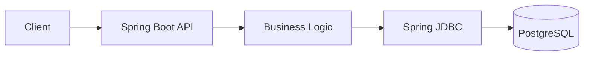

**Chú giải:** Sơ đồ có tính giáo dục. Không suy ra hạ tầng hoặc endpoint tương ứng đang tồn tại trong mã nguồn Smart Farm.

**日本語で説明してみよう：** まず全体の流れを確認します。次に、それぞれの役割を説明します。最後に、データの受け渡しや確認が必要な点をまとめます。

**Dịch:** Nắm luồng tổng thể, giải thích trách nhiệm các tầng, nêu điểm trao đổi dữ liệu và vấn đề cần xác minh.

#### ⑤ 面接対話 — Hội thoại Nhật–Việt

**面接官：** Spring Bootを使うメリットは何ですか。

**Dịch câu hỏi:** Sử dụng Spring Boot có lợi ích gì?

**応募者（Standard）：** JavaでREST APIや業務ロジックを開発するための機能が整っています。このシステムでは、センサーデータの処理やコマンドの管理に使っています。

**ベトナム語訳：** Spring Boot cung cấp nền tảng phát triển API và logic Java; trong Smart Farm phục vụ telemetry/command.

**面接官（深掘り）：** Spring JDBCの役割は何ですか。

**Câu hỏi đào sâu (Việt):** Spring JDBC đóng vai trò gì?

**応募者：** SQLを使ってJavaからデータベースへアクセスするために利用しています。

**ベトナム語訳：** Spring JDBC dùng để truy cập cơ sở dữ liệu từ Java thông qua SQL.

**質問の型:** 何ですか → なぜ必要ですか → 具体的にはどうしますか. Khi có câu hỏi tiếp theo, ưu tiên giải thích một ý mới, không lặp toàn bộ định nghĩa.

#### ⑥ 類似表現比較 — Cách diễn đạt phù hợp

- **使っています:** công nghệ đang dùng, không tự bao hàm lý do lựa chọn.
- **採用しました:** đã áp dụng; cần xác minh vai trò quyết định trước khi dùng ở ngôi cá nhân.
- **確認します / 検証します:** kiểm tra thông tin / kiểm chứng qua phương pháp.
- **実現できます / 可能性があります:** có thể thực hiện / có khả năng; không hứa tuyệt đối khi chưa đánh giá rủi ro.

#### ⑦ 語彙・文法 — Từ vựng chuyên ngành

| 日本語 | 読み方 | Nghĩa |
|---|---|---|
| 自動設定 | じどうせってい | Tự động cấu hình |
| 依存関係 | いぞんかんけい | Quan hệ phụ thuộc |
| 接続 | せつぞく | Kết nối |
| 業務ロジック | ぎょうむロジック | Logic nghiệp vụ |
| データベース | データベース | Cơ sở dữ liệu |
| 問い合わせ | といあわせ | Truy vấn / yêu cầu hỗ trợ (tùy ngữ cảnh) |

**Mẫu câu phỏng vấn:** Spring JDBCを使ってSQLでデータベースにアクセスします。

**Dịch sát nghĩa:** Tôi dùng Spring JDBC để truy cập cơ sở dữ liệu bằng SQL.

#### ⑧ 実践練習 — Active recall và chuyển ngữ cảnh

**Bước 1 — 20 giây:** Trả lời câu hỏi phỏng vấn chính của bài mà không nhìn mẫu. Ghi âm và tự kiểm tra có nêu được định nghĩa, công dụng, giới hạn hay chưa.

**Bước 2 — Câu hỏi ứng dụng của nhà tuyển dụng:**

**面接官：** SQLの実行に失敗したら、何を確認しますか。

**Dịch câu hỏi:** Nếu chạy SQL thất bại, bạn kiểm tra gì?

**応募者（回答例）：** まずエラーメッセージと接続状況を確認します。その後、SQLとパラメータを調べます。

**Dịch từng câu:** Tôi kiểm tra thông báo lỗi và kết nối, sau đó kiểm tra SQL và tham số.

**Bước 3 — Bài tập thực hành:** Vẽ bằng lời luồng Controller → Service → JDBC → PostgreSQL; phân biệt kiến trúc tham khảo với package thực tế.

**Bước 4 — Trả lời cho khách hàng:** Hãy nói lại cùng ý bằng tiếng Nhật dễ hiểu, tránh thuật ngữ chưa giải thích. Không tự đưa ra cam kết về trạng thái production.

**Bước 5 — Chấm:** 0–4 điểm từng tiêu chí: đúng kiến thức, giải thích rõ, tiếng Nhật tự nhiên, nói đúng trọng tâm, xử lý follow-up. Tổng /20; nếu chưa có ghi âm, chỉ tự chấm nội dung, không khẳng định phát âm.

**AI Interviewer:** 面接官として上の質問を一問ずつ出してください。私の回答を待ち、事実と推測を区別させる質問を一つ追加してください。最後に自然な日本語への修正案を示してください。

#### ⑨ 評価・改善 — Rubric /20

Tự chấm năm tiêu chí 0–4: đúng trọng tâm, chính xác kỹ thuật, tiếng Nhật tự nhiên, diễn giải mạch lạc, phản xạ follow-up. Thang 16–20 tốt, 12–15 cần chỉnh, dưới 12 học lại là thước đo **nội bộ**. Không tự chấm phát âm khi không có audio.

**Quy trình sửa:** Rút ngắn câu, chỉ ra giới hạn cần xác minh, thử giải thích lại cho khách hàng không chuyên và làm mới ví dụ.

#### ⑩ 出典・検証状況

- Kiến thức cơ bản về lập trình / kiến trúc / QA / yêu cầu là **nội dung giáo dục tổng quát**, không trích xuất trực tiếp từ source code.
- Với Smart Farm, brief cung cấp: ESP32/Wokwi, AWS IoT Core, MQTT/TLS/X.509, backend Java 21/Spring Boot/Spring JDBC/modular monolith, PostgreSQL, React/REST/polling, kiểm thử JUnit/Spring Boot Test/Playwright; backend và DB chủ yếu local, luồng ESP32/Wokwi–AWS–backend có bằng chứng chạy thử theo mô tả.
- **Chưa xác nhận:** cấu hình production, khả năng vận hành bơm/van nông nghiệp thật, benchmark, endpoints và triển khai các công nghệ minh họa không có trong brief.
- Cần đối chiếu mã nguồn, kiểm thử render Mermaid, rà soát tiếng Nhật và thử trả lời có bấm giờ trước khi đánh dấu Reviewed.

#### ⑪ 深掘り・実務演習 — Chuyên sâu và ứng dụng thực tế

##### Bản chất và cơ chế

Ứng dụng backend phải tách **hợp đồng HTTP**, **quy tắc nghiệp vụ**, **truy cập dữ liệu** và **xử lý lỗi**. Controller xác nhận input và tạo HTTP response; service bảo vệ bất biến; repository/JdbcTemplate thực hiện SQL; migration quản lý schema. Spring Boot giúp lắp dependency và cấu hình, nhưng không tự bảo đảm SQL an toàn hay business rule chính xác.

##### Case study — Cách dùng trong dự án

Trong mã Smart Farm, backend dùng Spring Boot 3.5, Java 21, Spring JDBC, PostgreSQL và Flyway (`backend/pom.xml`). Có `TelemetryValidator` kiểm tra chặt schema/giá trị ở biên MQTT, còn `TelemetryIngestion` dùng MQTT AWS. Khi giải thích luồng sensor, hãy phân biệt validator → router/ingestion → repository → dữ liệu REST cho UI. Tên lớp minh họa ngoài danh sách này cần đối chiếu source trước khi khẳng định tồn tại.

##### Rủi ro, giới hạn và trade-off

Rủi ro: nối chuỗi SQL từ đầu vào; transaction quá rộng làm giữ lock; trả exception/stack trace trực tiếp cho frontend; Flyway migration phá ngược dữ liệu khi deploy; backend local bị gọi là production. Dùng parameterized SQL, kiểm thử rollback/constraint, biến môi trường cho secret và mô tả rõ môi trường chạy.

##### 回答例 — Giải thích bằng tiếng Nhật

> Spring Bootでは、APIの受付、業務処理、データベースアクセスを役割ごとに分けます。SQLはパラメータを使い、入力値の検証も行います。

**Dịch sát nghĩa:** Trong Spring Boot, tôi chia trách nhiệm tiếp nhận API, xử lý nghiệp vụ và truy cập database; SQL sử dụng tham số và đầu vào được kiểm tra.

##### Bài thực hành có sản phẩm đầu ra

**Nhiệm vụ:** Thiết kế contract POST nhận telemetry giả lập, viết ba input tests cho JSON hợp lệ, thiếu trường, số ngoài dải; phác luồng từ controller đến repository và migration.

**Điều kiện đạt:** Chỉ rõ lớp nào xác nhận dữ liệu, xử lý lỗi nào ra 400/500 và không có string-concatenated SQL.

##### Lab triển khai — Parameterized SQL và phân lớp

Đoạn dưới đây là **mã Java minh họa**, không phải đoạn trích của repository.

```java
// Giả sử tồn tại bảng device_config(id, display_name).
String sql = "SELECT display_name FROM device_config WHERE id = ?";
String name = jdbcTemplate.queryForObject(sql, String.class, deviceId);
```

So sánh với nối chuỗi trực tiếp `"... WHERE id = '" + deviceId + "'"`: câu thứ hai làm tăng nguy cơ SQL injection khi đầu vào không đáng tin. Bài test cần có input hợp lệ, input không tồn tại và input chứa ký tự đặc biệt. Thảo luận cách map trường hợp 'không tìm thấy' sang HTTP 404 nếu contract xác nhận như vậy.

*Lưu ý minh chứng: Ví dụ giáo dục phải phân biệt với chức năng đã kiểm thử thật; không nhận thành tích cá nhân, vận hành production hay mức an toàn khi chưa có bằng chứng.*

*Nguồn: [05-01-spring-boot-jdbc.md](https://github.com/NiDa30/Interview/blob/main/book/chapters/chapter-05/05-01-spring-boot-jdbc.md)*

### 第05.02課 — React・TypeScript・API連携

> **BRSE Interview Master · Draft / Pending review**  
> Trình độ N3–N2; mục tiêu hội thoại chính 15–30 giây. Nội dung giải thích kỹ thuật là học liệu; không khẳng định người học từng làm các thao tác nếu chưa có bằng chứng. Các endpoint/sơ đồ minh họa không phải đặc tả dự án khi không được xác nhận.

#### ① 学習目標 — Mục tiêu

Hiểu và giải thích được **React・TypeScript・API連携**, trả lời một câu hỏi kỹ thuật chính, xử lý ít nhất một follow-up, sử dụng từ vựng IT tiếng Nhật, và chuyển kiến thức sang tình huống mới.

#### ② 面接質問・質問の意図

**面接官：** Reactの役割は何ですか。

**Nhà tuyển dụng đánh giá:** Năng lực hiểu khái niệm, giải thích mục đích sử dụng và phân biệt kiến thức thực tế với giả định.

#### ③ 技術知識・思考プロセス

**Cách tư duy:** Định nghĩa / tình huống → công dụng → rủi ro hoặc giới hạn → ví dụ. Khi hỏi về quyết định kỹ thuật của dự án, phải phân biệt *lợi ích chung* với *lý do lựa chọn thực tế được xác nhận*.

Polling có khoảng cập nhật, không phải realtime tức thì.

#### ④ 図解 — Hình minh họa

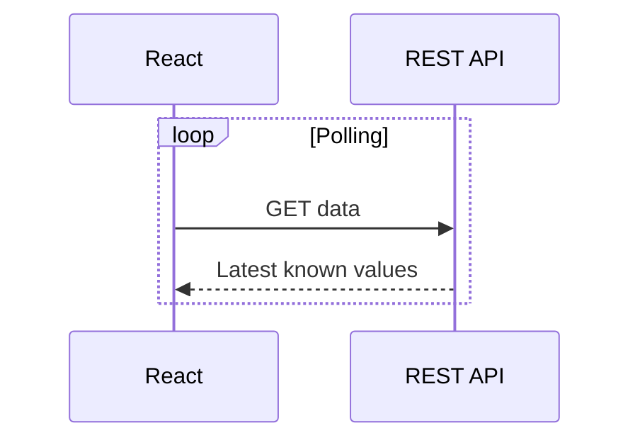

**Chú giải:** Sơ đồ có tính giáo dục. Không suy ra hạ tầng hoặc endpoint tương ứng đang tồn tại trong mã nguồn Smart Farm.

**日本語で説明してみよう：** まず全体の流れを確認します。次に、それぞれの役割を説明します。最後に、データの受け渡しや確認が必要な点をまとめます。

**Dịch:** Nắm luồng tổng thể, giải thích trách nhiệm các tầng, nêu điểm trao đổi dữ liệu và vấn đề cần xác minh.

#### ⑤ 面接対話 — Hội thoại Nhật–Việt

**面接官：** Reactの役割は何ですか。

**Dịch câu hỏi:** React đóng vai trò gì?

**応募者（Standard）：** 管理画面を作るためにReactを使っています。REST APIからデータを取得し、センサーの状態やデバイス情報を表示します。

**ベトナム語訳：** React làm giao diện quản lý, gọi REST API và hiển thị trạng thái.

**面接官（深掘り）：** 画面の更新はリアルタイムですか。

**Câu hỏi đào sâu (Việt):** Màn hình có được cập nhật theo thời gian thực không?

**応募者：** 現在説明している構成はポーリング方式なので、更新には間隔があります。

**ベトナム語訳：** Kiến trúc đang mô tả sử dụng polling nên có khoảng thời gian giữa các lần cập nhật.

**質問の型:** 何ですか → なぜ必要ですか → 具体的にはどうしますか. Khi có câu hỏi tiếp theo, ưu tiên giải thích một ý mới, không lặp toàn bộ định nghĩa.

#### ⑥ 類似表現比較 — Cách diễn đạt phù hợp

- **使っています:** công nghệ đang dùng, không tự bao hàm lý do lựa chọn.
- **採用しました:** đã áp dụng; cần xác minh vai trò quyết định trước khi dùng ở ngôi cá nhân.
- **確認します / 検証します:** kiểm tra thông tin / kiểm chứng qua phương pháp.
- **実現できます / 可能性があります:** có thể thực hiện / có khả năng; không hứa tuyệt đối khi chưa đánh giá rủi ro.

#### ⑦ 語彙・文法 — Từ vựng chuyên ngành

| 日本語 | 読み方 | Nghĩa |
|---|---|---|
| 画面 | がめん | Màn hình |
| 状態管理 | じょうたいかんり | Quản lý state |
| 再描画 | さいびょうが | Render lại |
| 取得 | しゅとく | Lấy dữ liệu |
| 更新間隔 | こうしんかんかく | Chu kỳ cập nhật |
| 定期取得 | ていきしゅとく | Lấy dữ liệu định kỳ |

**Mẫu câu phỏng vấn:** 画面はAPIからデータを定期的に取得して更新します。

**Dịch sát nghĩa:** Giao diện lấy dữ liệu định kỳ từ API để cập nhật.

#### ⑧ 実践練習 — Active recall và chuyển ngữ cảnh

**Bước 1 — 20 giây:** Trả lời câu hỏi phỏng vấn chính của bài mà không nhìn mẫu. Ghi âm và tự kiểm tra có nêu được định nghĩa, công dụng, giới hạn hay chưa.

**Bước 2 — Câu hỏi ứng dụng của nhà tuyển dụng:**

**面接官：** ポーリングの間隔が長いと、画面にどんな影響がありますか。

**Dịch câu hỏi:** Nếu khoảng polling dài, giao diện bị ảnh hưởng thế nào?

**応募者（回答例）：** 表示する情報が最新の状態より遅れる場合があります。更新間隔と負荷のバランスを検討します。

**Dịch từng câu:** Thông tin hiển thị có thể chậm hơn trạng thái mới nhất; cần cân bằng chu kỳ cập nhật và tải.

**Bước 3 — Bài tập thực hành:** Đóng vai người dùng thấy dữ liệu chậm, giải thích polling mà không gọi là real-time tuyệt đối.

**Bước 4 — Trả lời cho khách hàng:** Hãy nói lại cùng ý bằng tiếng Nhật dễ hiểu, tránh thuật ngữ chưa giải thích. Không tự đưa ra cam kết về trạng thái production.

**Bước 5 — Chấm:** 0–4 điểm từng tiêu chí: đúng kiến thức, giải thích rõ, tiếng Nhật tự nhiên, nói đúng trọng tâm, xử lý follow-up. Tổng /20; nếu chưa có ghi âm, chỉ tự chấm nội dung, không khẳng định phát âm.

**AI Interviewer:** 面接官として上の質問を一問ずつ出してください。私の回答を待ち、事実と推測を区別させる質問を一つ追加してください。最後に自然な日本語への修正案を示してください。

#### ⑨ 評価・改善 — Rubric /20

Tự chấm năm tiêu chí 0–4: đúng trọng tâm, chính xác kỹ thuật, tiếng Nhật tự nhiên, diễn giải mạch lạc, phản xạ follow-up. Thang 16–20 tốt, 12–15 cần chỉnh, dưới 12 học lại là thước đo **nội bộ**. Không tự chấm phát âm khi không có audio.

**Quy trình sửa:** Rút ngắn câu, chỉ ra giới hạn cần xác minh, thử giải thích lại cho khách hàng không chuyên và làm mới ví dụ.

#### ⑩ 出典・検証状況

- Kiến thức cơ bản về lập trình / kiến trúc / QA / yêu cầu là **nội dung giáo dục tổng quát**, không trích xuất trực tiếp từ source code.
- Với Smart Farm, brief cung cấp: ESP32/Wokwi, AWS IoT Core, MQTT/TLS/X.509, backend Java 21/Spring Boot/Spring JDBC/modular monolith, PostgreSQL, React/REST/polling, kiểm thử JUnit/Spring Boot Test/Playwright; backend và DB chủ yếu local, luồng ESP32/Wokwi–AWS–backend có bằng chứng chạy thử theo mô tả.
- **Chưa xác nhận:** cấu hình production, khả năng vận hành bơm/van nông nghiệp thật, benchmark, endpoints và triển khai các công nghệ minh họa không có trong brief.
- Cần đối chiếu mã nguồn, kiểm thử render Mermaid, rà soát tiếng Nhật và thử trả lời có bấm giờ trước khi đánh dấu Reviewed.

#### ⑪ 深掘り・実務演習 — Chuyên sâu và ứng dụng thực tế

##### Bản chất và cơ chế

State UI cần phân biệt **loading**, **ready**, **empty**, **stale** và **error**; dữ liệu hiển thị không chỉ là giá trị cảm biến mà còn có timestamp và độ tin cậy. React `useEffect` thường dựng polling nhưng phải cleanup timer, abort request cũ, tránh cập nhật sau unmount và tránh race khi chọn thiết bị mới.

##### Case study — Cách dùng trong dự án

Repo Smart Farm có `src/modules/iot/realtime/telemetryApi.ts` dùng `fetch` REST và kiểm tra `timestamp`, `receivedAt`; một hàm `telemetryState` phân biệt `live` với `stale` dựa trên độ tuổi bản tin. `PumpControl.tsx` đọc REST trạng thái/commands và định kỳ hỏi lại. Đây là kiểm tra *source*, chưa phải chứng cứ latency production.

##### Rủi ro, giới hạn và trade-off

Trade-off: polling 2 giây có thể đỡ trễ hơn polling 30 giây nhưng tăng tải; không nên bịa khoảng polling chung của tất cả trang. Khi thiết bị offline, cache cũ không được tô như trạng thái hiện tại. WebSocket/SSE chỉ nên đưa vào như phương án cân nhắc nếu có yêu cầu độ trễ và hạ tầng tương ứng.

##### 回答例 — Giải thích bằng tiếng Nhật

> 画面はREST APIを定期的に呼び出して更新しています。そのため、取得したデータの時刻を確認し、古い場合は「更新されていない」と表示します。

**Dịch sát nghĩa:** Giao diện cập nhật bằng việc gọi REST API định kỳ, vì vậy cần kiểm tra timestamp và thông báo nếu dữ liệu đã cũ.

##### Bài thực hành có sản phẩm đầu ra

**Nhiệm vụ:** Thiết kế bảng UI state từ 5 tình huống: đang tải, 404/no reading, mạng lỗi, dữ liệu cũ, dữ liệu mới; mô tả cleanup logic và AbortController.

**Điều kiện đạt:** Không bao giờ gọi dữ liệu cache cũ là realtime; phân biệt network error và sensor offline; có test cho race/unmount.

*Lưu ý minh chứng: Ví dụ giáo dục phải phân biệt với chức năng đã kiểm thử thật; không nhận thành tích cá nhân, vận hành production hay mức an toàn khi chưa có bằng chứng.*

*Nguồn: [05-02-react-state.md](https://github.com/NiDa30/Interview/blob/main/book/chapters/chapter-05/05-02-react-state.md)*

### 第05.03課 — PostgreSQL・トランザクション・Flyway

> **BRSE Interview Master · Draft / Pending review**  
> Trình độ N3–N2; mục tiêu hội thoại chính 15–30 giây. Nội dung giải thích kỹ thuật là học liệu; không khẳng định người học từng làm các thao tác nếu chưa có bằng chứng. Các endpoint/sơ đồ minh họa không phải đặc tả dự án khi không được xác nhận.

#### ① 学習目標 — Mục tiêu

Hiểu và giải thích được **PostgreSQL・トランザクション・Flyway**, trả lời một câu hỏi kỹ thuật chính, xử lý ít nhất một follow-up, sử dụng từ vựng IT tiếng Nhật, và chuyển kiến thức sang tình huống mới.

#### ② 面接質問・質問の意図

**面接官：** トランザクションはなぜ必要ですか。

**Nhà tuyển dụng đánh giá:** Năng lực hiểu khái niệm, giải thích mục đích sử dụng và phân biệt kiến thức thực tế với giả định.

#### ③ 技術知識・思考プロセス

**Cách tư duy:** Định nghĩa / tình huống → công dụng → rủi ro hoặc giới hạn → ví dụ. Khi hỏi về quyết định kỹ thuật của dự án, phải phân biệt *lợi ích chung* với *lý do lựa chọn thực tế được xác nhận*.

Flyway quản lý phiên bản schema.

#### ④ 図解 — Hình minh họa

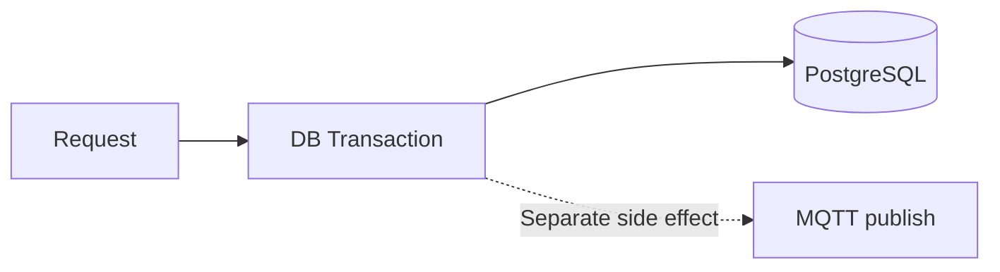

**Chú giải:** Sơ đồ có tính giáo dục. Không suy ra hạ tầng hoặc endpoint tương ứng đang tồn tại trong mã nguồn Smart Farm.

**日本語で説明してみよう：** まず全体の流れを確認します。次に、それぞれの役割を説明します。最後に、データの受け渡しや確認が必要な点をまとめます。

**Dịch:** Nắm luồng tổng thể, giải thích trách nhiệm các tầng, nêu điểm trao đổi dữ liệu và vấn đề cần xác minh.

#### ⑤ 面接対話 — Hội thoại Nhật–Việt

**面接官：** トランザクションはなぜ必要ですか。

**Dịch câu hỏi:** Vì sao cần transaction?

**応募者（Standard）：** 複数のデータ操作を一つのまとまりとして扱い、失敗した時に整合性を守るためです。ただし、外部MQTT送信まで同じDBトランザクションで保証できるわけではありません。

**ベトナム語訳：** Transaction bảo vệ nhất quán DB, không tự bảo đảm atomic với MQTT bên ngoài.

**面接官（深掘り）：** Flywayは何に使いますか。

**Câu hỏi đào sâu (Việt):** Flyway dùng để làm gì?

**応募者：** データベースのスキーマ変更をバージョンで管理するためです。

**ベトナム語訳：** Flyway được dùng để quản lý các thay đổi cấu trúc cơ sở dữ liệu theo phiên bản.

**質問の型:** 何ですか → なぜ必要ですか → 具体的にはどうしますか. Khi có câu hỏi tiếp theo, ưu tiên giải thích một ý mới, không lặp toàn bộ định nghĩa.

#### ⑥ 類似表現比較 — Cách diễn đạt phù hợp

- **使っています:** công nghệ đang dùng, không tự bao hàm lý do lựa chọn.
- **採用しました:** đã áp dụng; cần xác minh vai trò quyết định trước khi dùng ở ngôi cá nhân.
- **確認します / 検証します:** kiểm tra thông tin / kiểm chứng qua phương pháp.
- **実現できます / 可能性があります:** có thể thực hiện / có khả năng; không hứa tuyệt đối khi chưa đánh giá rủi ro.

#### ⑦ 語彙・文法 — Từ vựng chuyên ngành

| 日本語 | 読み方 | Nghĩa |
|---|---|---|
| 取引 | とりひき | Giao dịch (ngữ cảnh nghiệp vụ) |
| トランザクション | トランザクション | Giao dịch DB |
| 整合性 | せいごうせい | Tính nhất quán |
| 取り消し | とりけし | Hủy/rollback (theo ngữ cảnh) |
| 確定 | かくてい | Chốt/commit |
| 移行 | いこう | Di chuyển dữ liệu hoặc migration |

**Mẫu câu phỏng vấn:** 処理に失敗した場合は、トランザクションをロールバックします。

**Dịch sát nghĩa:** Khi xử lý lỗi, tôi rollback transaction.

#### ⑧ 実践練習 — Active recall và chuyển ngữ cảnh

**Bước 1 — 20 giây:** Trả lời câu hỏi phỏng vấn chính của bài mà không nhìn mẫu. Ghi âm và tự kiểm tra có nêu được định nghĩa, công dụng, giới hạn hay chưa.

**Bước 2 — Câu hỏi ứng dụng của nhà tuyển dụng:**

**面接官：** データベースの更新が成功しても、MQTT送信が失敗することはありますか。

**Dịch câu hỏi:** Cập nhật DB thành công nhưng gửi MQTT thất bại có thể xảy ra không?

**応募者（回答例）：** はい。データベースと外部通信は別の処理です。送信結果と再試行の方針を確認する必要があります。

**Dịch từng câu:** Có. DB và giao tiếp ngoài là các xử lý khác nhau; cần xác nhận kết quả gửi và chính sách thử lại.

**Bước 3 — Bài tập thực hành:** Nêu ví dụ giao dịch DB commit xong nhưng MQTT thất bại; không khẳng định hệ thống có transactional outbox.

**Bước 4 — Trả lời cho khách hàng:** Hãy nói lại cùng ý bằng tiếng Nhật dễ hiểu, tránh thuật ngữ chưa giải thích. Không tự đưa ra cam kết về trạng thái production.

**Bước 5 — Chấm:** 0–4 điểm từng tiêu chí: đúng kiến thức, giải thích rõ, tiếng Nhật tự nhiên, nói đúng trọng tâm, xử lý follow-up. Tổng /20; nếu chưa có ghi âm, chỉ tự chấm nội dung, không khẳng định phát âm.

**AI Interviewer:** 面接官として上の質問を一問ずつ出してください。私の回答を待ち、事実と推測を区別させる質問を一つ追加してください。最後に自然な日本語への修正案を示してください。

#### ⑨ 評価・改善 — Rubric /20

Tự chấm năm tiêu chí 0–4: đúng trọng tâm, chính xác kỹ thuật, tiếng Nhật tự nhiên, diễn giải mạch lạc, phản xạ follow-up. Thang 16–20 tốt, 12–15 cần chỉnh, dưới 12 học lại là thước đo **nội bộ**. Không tự chấm phát âm khi không có audio.

**Quy trình sửa:** Rút ngắn câu, chỉ ra giới hạn cần xác minh, thử giải thích lại cho khách hàng không chuyên và làm mới ví dụ.

#### ⑩ 出典・検証状況

- Kiến thức cơ bản về lập trình / kiến trúc / QA / yêu cầu là **nội dung giáo dục tổng quát**, không trích xuất trực tiếp từ source code.
- Với Smart Farm, brief cung cấp: ESP32/Wokwi, AWS IoT Core, MQTT/TLS/X.509, backend Java 21/Spring Boot/Spring JDBC/modular monolith, PostgreSQL, React/REST/polling, kiểm thử JUnit/Spring Boot Test/Playwright; backend và DB chủ yếu local, luồng ESP32/Wokwi–AWS–backend có bằng chứng chạy thử theo mô tả.
- **Chưa xác nhận:** cấu hình production, khả năng vận hành bơm/van nông nghiệp thật, benchmark, endpoints và triển khai các công nghệ minh họa không có trong brief.
- Cần đối chiếu mã nguồn, kiểm thử render Mermaid, rà soát tiếng Nhật và thử trả lời có bấm giờ trước khi đánh dấu Reviewed.

#### ⑪ 深掘り・実務演習 — Chuyên sâu và ứng dụng thực tế

##### Bản chất và cơ chế

ACID bảo vệ **giao dịch trong phạm vi database**: atomicity, consistency, isolation, durability với điều kiện cấu hình DB. Isolation level quyết định cách concurrent transactions nhìn thấy dữ liệu; unique constraint có thể ngăn telemetry duplicate nếu khóa gồm device/boot/sequence; app logic vẫn phải xử lý lỗi constraint đúng.

##### Case study — Cách dùng trong dự án

Tình huống command: ghi command row trong PostgreSQL rồi publish MQTT; nếu commit thành công nhưng publish thất bại, DB đã có intent còn thiết bị chưa chắc nhận. Một DB transaction **không làm MQTT trở thành atomic**. Kiến trúc outbox/worker, retry có idempotency và reconciliation là các phương án thiết kế tham khảo; không khẳng định Smart Farm đã triển khai chúng khi chưa thấy code/test cụ thể.

##### Rủi ro, giới hạn và trade-off

Trong hệ thống thật, điều khiển actuator ON là thao tác nhạy cảm: retry mù có thể gây tác động trùng, nhất là khi phản hồi chậm. `PumpService` ở source có loại lỗi khi publish chưa được xác nhận, cảnh báo không tự gửi lại ON. Cần phân biệt lỗi commit, lỗi gửi, ACK trễ, reportedState cũ, và tác động điện thực.

##### 回答例 — Giải thích bằng tiếng Nhật

> DBのトランザクションでデータの整合性を守れますが、外部のMQTT送信まで一括して保証できるわけではありません。失敗した場合の状態管理が必要です。

**Dịch sát nghĩa:** Transaction DB giúp bảo vệ nhất quán dữ liệu, nhưng không bảo đảm gộp luôn việc gửi MQTT bên ngoài; cần quản lý trạng thái khi lỗi.

##### Bài thực hành có sản phẩm đầu ra

**Nhiệm vụ:** Vẽ hai timeline: commit DB thành công/publish lỗi và publish thành công/ACK lỗi; đề xuất trạng thái DB và hành vi UI cho từng nhánh.

**Điều kiện đạt:** Không dùng chữ 'atomic' cho DB+MQTT nếu không có cơ chế; có xử lý retry an toàn và một test concurrent update.

##### Lab triển khai — Hai hệ thống, một giao dịch không đủ

SQL dưới đây là **thiết kế giả định để phân tích**, không phải schema hiện hành của Smart Farm.

```sql
BEGIN;
INSERT INTO command_requests(command_id, state)
VALUES ('7aeedc7a-0e2d-41e2-b074-0a0e5f195020', 'PENDING');
INSERT INTO command_outbox(command_id, delivery_state)
VALUES ('7aeedc7a-0e2d-41e2-b074-0a0e5f195020', 'NOT_SENT');
COMMIT;
-- Worker riêng publish MQTT. Việc publish không nằm trong transaction SQL.
```

Viết bảng ba trường hợp: worker chưa gửi, broker nhận nhưng client timeout, device ACK nhưng DB update lỗi. Với mỗi trường hợp nêu chính sách correlation/idempotency và điểm cần kiểm tra trước khi quyết định gửi ON lại.

*Lưu ý minh chứng: Ví dụ giáo dục phải phân biệt với chức năng đã kiểm thử thật; không nhận thành tích cá nhân, vận hành production hay mức an toàn khi chưa có bằng chứng.*

*Nguồn: [05-03-postgresql-transaction.md](https://github.com/NiDa30/Interview/blob/main/book/chapters/chapter-05/05-03-postgresql-transaction.md)*


---

<a id="chapter-06"></a>
## Chương 06 — システム設計・クラウド

### 第06.01課 — モジュラーモノリス・設計判断

> **BRSE Interview Master · Draft / Pending review**  
> Trình độ N3–N2; mục tiêu hội thoại chính 15–30 giây. Nội dung giải thích kỹ thuật là học liệu; không khẳng định người học từng làm các thao tác nếu chưa có bằng chứng. Các endpoint/sơ đồ minh họa không phải đặc tả dự án khi không được xác nhận.

#### ① 学習目標 — Mục tiêu

Hiểu và giải thích được **モジュラーモノリス・設計判断**, trả lời một câu hỏi kỹ thuật chính, xử lý ít nhất một follow-up, sử dụng từ vựng IT tiếng Nhật, và chuyển kiến thức sang tình huống mới.

#### ② 面接質問・質問の意図

**面接官：** モジュラーモノリスとは何ですか。

**Nhà tuyển dụng đánh giá:** Năng lực hiểu khái niệm, giải thích mục đích sử dụng và phân biệt kiến thức thực tế với giả định.

#### ③ 技術知識・思考プロセス

**Cách tư duy:** Định nghĩa / tình huống → công dụng → rủi ro hoặc giới hạn → ví dụ. Khi hỏi về quyết định kỹ thuật của dự án, phải phân biệt *lợi ích chung* với *lý do lựa chọn thực tế được xác nhận*.

Microservices có thể deploy độc lập nhưng tăng phức tạp quản lý.

#### ④ 図解 — Hình minh họa

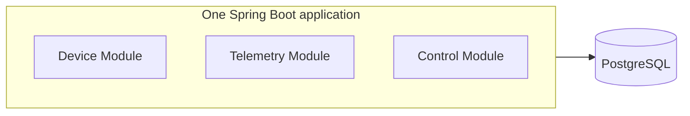

**Chú giải:** Sơ đồ có tính giáo dục. Không suy ra hạ tầng hoặc endpoint tương ứng đang tồn tại trong mã nguồn Smart Farm.

**日本語で説明してみよう：** まず全体の流れを確認します。次に、それぞれの役割を説明します。最後に、データの受け渡しや確認が必要な点をまとめます。

**Dịch:** Nắm luồng tổng thể, giải thích trách nhiệm các tầng, nêu điểm trao đổi dữ liệu và vấn đề cần xác minh.

#### ⑤ 面接対話 — Hội thoại Nhật–Việt

**面接官：** モジュラーモノリスとは何ですか。

**Dịch câu hỏi:** Modular monolith là gì?

**応募者（Standard）：** 一つのアプリケーションの中で、機能をモジュールごとに分ける構成です。Smart Farmでは、デバイス、テレメトリー、制御などを分けています。

**ベトナム語訳：** Modular monolith là một ứng dụng chia module chức năng.

**面接官（深掘り）：** マイクロサービスとの違いは何ですか。

**Câu hỏi đào sâu (Việt):** Modular monolith khác microservices ra sao?

**応募者：** マイクロサービスは独立したサービスとして展開できますが、運用が複雑になる場合があります。

**ベトナム語訳：** Microservices có thể triển khai thành các dịch vụ độc lập, nhưng việc vận hành có thể phức tạp hơn.

**質問の型:** 何ですか → なぜ必要ですか → 具体的にはどうしますか. Khi có câu hỏi tiếp theo, ưu tiên giải thích một ý mới, không lặp toàn bộ định nghĩa.

#### ⑥ 類似表現比較 — Cách diễn đạt phù hợp

- **使っています:** công nghệ đang dùng, không tự bao hàm lý do lựa chọn.
- **採用しました:** đã áp dụng; cần xác minh vai trò quyết định trước khi dùng ở ngôi cá nhân.
- **確認します / 検証します:** kiểm tra thông tin / kiểm chứng qua phương pháp.
- **実現できます / 可能性があります:** có thể thực hiện / có khả năng; không hứa tuyệt đối khi chưa đánh giá rủi ro.

#### ⑦ 語彙・文法 — Từ vựng chuyên ngành

| 日本語 | 読み方 | Nghĩa |
|---|---|---|
| 構成 | こうせい | Kiến trúc/cấu trúc |
| 分割 | ぶんかつ | Phân tách |
| 境界 | きょうかい | Ranh giới |
| 依存 | いぞん | Phụ thuộc |
| 単一 | たんいつ | Duy nhất |
| 保守性 | ほしゅせい | Khả năng bảo trì |

**Mẫu câu phỏng vấn:** 機能ごとにモジュールを分け、依存関係を整理します。

**Dịch sát nghĩa:** Tôi tách module theo chức năng và sắp xếp các quan hệ phụ thuộc.

#### ⑧ 実践練習 — Active recall và chuyển ngữ cảnh

**Bước 1 — 20 giây:** Tự trả lời câu phỏng vấn chính không nhìn mẫu. Nêu kết luận, lý do, giới hạn và ghi âm để tự đối chiếu.

**Bước 2 — Câu hỏi ứng dụng:**

**面接官：** 機能を一つのアプリにまとめると、どんな注意点がありますか。

**Dịch câu hỏi:** Nếu gom các chức năng vào một ứng dụng, cần lưu ý gì?

**応募者（回答例）：** モジュール間の依存が複雑にならないように、責任と境界を明確にします。

**Dịch câu trả lời:** Để tránh phụ thuộc giữa module trở nên phức tạp, tôi làm rõ trách nhiệm và ranh giới.

**Bước 3 — Tình huống chuyên biệt:** Lập bảng so sánh modular monolith với microservices theo triển khai, vận hành và ranh giới module; không bịa lý do quyết định ban đầu.

**Bước 4 — BrSE transfer:** Hãy nói lại câu trả lời cho khách hàng bằng tiếng Nhật dễ hiểu, tách điều đã kiểm tra khỏi đề xuất/giả định; không tự cam kết production, an toàn hoặc deadline.

**Bước 5 — Tự đánh giá:** 0–4 cho mỗi tiêu chí: đúng kiến thức, rõ ràng, tiếng Nhật tự nhiên, đúng trọng tâm và phản hồi câu đào sâu. Tổng /20. Không chấm phát âm qua văn bản nếu chưa có ghi âm.

**AI Interviewer:** あなたは日本企業のBrSE面接官です。上記の内容について一問ずつ質問し、私の回答を待ってください。その回答に基づいて深掘りを一つ行い、最後に自然な言い方と事実関係の注意点を教えてください。

#### ⑨ 評価・改善 — Rubric /20

Tự chấm năm tiêu chí 0–4: đúng trọng tâm, chính xác kỹ thuật, tiếng Nhật tự nhiên, diễn giải mạch lạc, phản xạ follow-up. Thang 16–20 tốt, 12–15 cần chỉnh, dưới 12 học lại là thước đo **nội bộ**. Không tự chấm phát âm khi không có audio.

**Quy trình sửa:** Rút ngắn câu, chỉ ra giới hạn cần xác minh, thử giải thích lại cho khách hàng không chuyên và làm mới ví dụ.

#### ⑩ 出典・検証状況

- Kiến thức cơ bản về lập trình / kiến trúc / QA / yêu cầu là **nội dung giáo dục tổng quát**, không trích xuất trực tiếp từ source code.
- Với Smart Farm, brief cung cấp: ESP32/Wokwi, AWS IoT Core, MQTT/TLS/X.509, backend Java 21/Spring Boot/Spring JDBC/modular monolith, PostgreSQL, React/REST/polling, kiểm thử JUnit/Spring Boot Test/Playwright; backend và DB chủ yếu local, luồng ESP32/Wokwi–AWS–backend có bằng chứng chạy thử theo mô tả.
- **Chưa xác nhận:** cấu hình production, khả năng vận hành bơm/van nông nghiệp thật, benchmark, endpoints và triển khai các công nghệ minh họa không có trong brief.
- Cần đối chiếu mã nguồn, kiểm thử render Mermaid, rà soát tiếng Nhật và thử trả lời có bấm giờ trước khi đánh dấu Reviewed.

#### ⑪ 深掘り・実務演習 — Chuyên sâu và ứng dụng thực tế

##### Bản chất và cơ chế

Modular monolith có **một đơn vị deploy** nhưng nhiều module với trách nhiệm độc lập về nghiệp vụ: telemetry, devices, control, alerts, automation. Mấu chốt không nằm ở số package mà ở interface, dependency direction và quyền sở hữu dữ liệu. Module không nên trực tiếp sửa bảng/cấu trúc private của module khác tùy tiện.

##### Case study — Cách dùng trong dự án

Với Smart Farm, có thể phân tích các package backend `iot/telemetry`, `iot/control`, `iot/automation`, `iot/monitoring` trong source. Ví dụ `CommandTransport` là interface giúp tách dịch vụ điều khiển khỏi cách publish MQTT; test có thể dùng stub/mock. Điều này chứng minh một ranh giới code, không tự chứng minh cả hệ thống được kiểm toán thành modular monolith hoàn hảo.

##### Rủi ro, giới hạn và trade-off

So với microservices: modular monolith đơn giản về deploy và transaction nội bộ nhưng có nguy cơ coupling và thay đổi gây ảnh hưởng chung; microservices chia deploy, scaling nhưng tăng chi phí observability, network failure và distributed consistency. Quyết định phụ thuộc team size, tốc độ thay đổi, SLA và khả năng vận hành, không phải xu hướng.

##### 回答例 — Giải thích bằng tiếng Nhật

> モジュラーモノリスでは、一つのアプリケーションの中で機能ごとの責任を分けます。重要なのはパッケージ数ではなく、依存関係と境界を守ることです。

**Dịch sát nghĩa:** Trong modular monolith, chức năng được chia trách nhiệm trong một ứng dụng; điều quan trọng là giữ ranh giới và quan hệ phụ thuộc, không phải số lượng package.

##### Bài thực hành có sản phẩm đầu ra

**Nhiệm vụ:** Vẽ dependency matrix bốn module; tìm hai coupling nguy hiểm và đề xuất một interface/DTO; đưa ra điều kiện khi nào đáng tách service.

**Điều kiện đạt:** Mỗi dependency có lý do, chiều dữ liệu, rủi ro thay đổi, test contract; không kết luận microservices luôn tốt hơn.

*Lưu ý minh chứng: Ví dụ giáo dục phải phân biệt với chức năng đã kiểm thử thật; không nhận thành tích cá nhân, vận hành production hay mức an toàn khi chưa có bằng chứng.*

*Nguồn: [06-01-modular-monolith.md](https://github.com/NiDa30/Interview/blob/main/book/chapters/chapter-06/06-01-modular-monolith.md)*

### 第06.02課 — AWS IoT Core・TLS・X.509

> **BRSE Interview Master · Draft / Pending review**  
> Trình độ N3–N2; mục tiêu hội thoại chính 15–30 giây. Nội dung giải thích kỹ thuật là học liệu; không khẳng định người học từng làm các thao tác nếu chưa có bằng chứng. Các endpoint/sơ đồ minh họa không phải đặc tả dự án khi không được xác nhận.

#### ① 学習目標 — Mục tiêu

Hiểu và giải thích được **AWS IoT Core・TLS・X.509**, trả lời một câu hỏi kỹ thuật chính, xử lý ít nhất một follow-up, sử dụng từ vựng IT tiếng Nhật, và chuyển kiến thức sang tình huống mới.

#### ② 面接質問・質問の意図

**面接官：** AWS IoT Coreをどのように使用していますか。

**Nhà tuyển dụng đánh giá:** Năng lực hiểu khái niệm, giải thích mục đích sử dụng và phân biệt kiến thức thực tế với giả định.

#### ③ 技術知識・思考プロセス

**Cách tư duy:** Định nghĩa / tình huống → công dụng → rủi ro hoặc giới hạn → ví dụ. Khi hỏi về quyết định kỹ thuật của dự án, phải phân biệt *lợi ích chung* với *lý do lựa chọn thực tế được xác nhận*.

TLS chưa đủ chứng minh bảo mật toàn hệ thống.

#### ④ 図解 — Hình minh họa

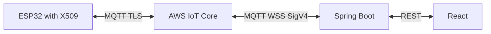

**Chú giải:** Sơ đồ có tính giáo dục. Không suy ra hạ tầng hoặc endpoint tương ứng đang tồn tại trong mã nguồn Smart Farm.

**日本語で説明してみよう：** まず全体の流れを確認します。次に、それぞれの役割を説明します。最後に、データの受け渡しや確認が必要な点をまとめます。

**Dịch:** Nắm luồng tổng thể, giải thích trách nhiệm các tầng, nêu điểm trao đổi dữ liệu và vấn đề cần xác minh.

#### ⑤ 面接対話 — Hội thoại Nhật–Việt

**面接官：** AWS IoT Coreをどのように使用していますか。

**Dịch câu hỏi:** Bạn sử dụng AWS IoT Core như thế nào?

**応募者（Standard）：** ESP32とバックエンドの間でMQTTメッセージをやり取りするために使っています。デバイスの接続にはTLSと証明書を使っています。

**ベトナム語訳：** AWS IoT Core trao đổi MQTT giữa thiết bị/backend, thiết bị kết nối TLS/chứng chỉ.

**面接官（深掘り）：** これでシステム全体は安全ですか。

**Câu hỏi đào sâu (Việt):** Như vậy toàn hệ thống đã an toàn chưa?

**応募者：** いいえ。アクセス権限やAPI認証、デバイスごとの設定も確認する必要があります。

**ベトナム語訳：** Chưa. Còn cần kiểm tra phân quyền, xác thực API và cấu hình cho từng thiết bị.

**質問の型:** 何ですか → なぜ必要ですか → 具体的にはどうしますか. Khi có câu hỏi tiếp theo, ưu tiên giải thích một ý mới, không lặp toàn bộ định nghĩa.

#### ⑥ 類似表現比較 — Cách diễn đạt phù hợp

- **使っています:** công nghệ đang dùng, không tự bao hàm lý do lựa chọn.
- **採用しました:** đã áp dụng; cần xác minh vai trò quyết định trước khi dùng ở ngôi cá nhân.
- **確認します / 検証します:** kiểm tra thông tin / kiểm chứng qua phương pháp.
- **実現できます / 可能性があります:** có thể thực hiện / có khả năng; không hứa tuyệt đối khi chưa đánh giá rủi ro.

#### ⑦ 語彙・文法 — Từ vựng chuyên ngành

| 日本語 | 読み方 | Nghĩa |
|---|---|---|
| 証明書 | しょうめいしょ | Chứng chỉ |
| 暗号化 | あんごうか | Mã hóa |
| 認証 | にんしょう | Xác thực |
| 認可 | にんか | Phân quyền |
| 権限 | けんげん | Quyền truy cập |
| 通信経路 | つうしんけいろ | Đường truyền |

**Mẫu câu phỏng vấn:** TLSで通信を保護しますが、権限の設定も確認する必要があります。

**Dịch sát nghĩa:** TLS bảo vệ đường truyền nhưng vẫn cần kiểm tra cấu hình phân quyền.

#### ⑧ 実践練習 — Active recall và chuyển ngữ cảnh

**Bước 1 — 20 giây:** Tự trả lời câu phỏng vấn chính không nhìn mẫu. Nêu kết luận, lý do, giới hạn và ghi âm để tự đối chiếu.

**Bước 2 — Câu hỏi ứng dụng:**

**面接官：** TLSを使えば、デバイスの通信はすべて安全と言えますか。

**Dịch câu hỏi:** Dùng TLS có đủ để nói giao tiếp thiết bị hoàn toàn an toàn không?

**応募者（回答例）：** いいえ。通信の暗号化に加えて、証明書の管理や接続先の権限を確認する必要があります。

**Dịch câu trả lời:** Không. Ngoài mã hóa đường truyền, cần kiểm tra quản lý chứng chỉ và quyền truy cập.

**Bước 3 — Tình huống chuyên biệt:** Giải thích với khách hàng sự khác nhau giữa mã hóa, xác thực và phân quyền; chỉ mô tả mức độ đã kiểm tra thực tế.

**Bước 4 — BrSE transfer:** Hãy nói lại câu trả lời cho khách hàng bằng tiếng Nhật dễ hiểu, tách điều đã kiểm tra khỏi đề xuất/giả định; không tự cam kết production, an toàn hoặc deadline.

**Bước 5 — Tự đánh giá:** 0–4 cho mỗi tiêu chí: đúng kiến thức, rõ ràng, tiếng Nhật tự nhiên, đúng trọng tâm và phản hồi câu đào sâu. Tổng /20. Không chấm phát âm qua văn bản nếu chưa có ghi âm.

**AI Interviewer:** あなたは日本企業のBrSE面接官です。上記の内容について一問ずつ質問し、私の回答を待ってください。その回答に基づいて深掘りを一つ行い、最後に自然な言い方と事実関係の注意点を教えてください。

#### ⑨ 評価・改善 — Rubric /20

Tự chấm năm tiêu chí 0–4: đúng trọng tâm, chính xác kỹ thuật, tiếng Nhật tự nhiên, diễn giải mạch lạc, phản xạ follow-up. Thang 16–20 tốt, 12–15 cần chỉnh, dưới 12 học lại là thước đo **nội bộ**. Không tự chấm phát âm khi không có audio.

**Quy trình sửa:** Rút ngắn câu, chỉ ra giới hạn cần xác minh, thử giải thích lại cho khách hàng không chuyên và làm mới ví dụ.

#### ⑩ 出典・検証状況

- Kiến thức cơ bản về lập trình / kiến trúc / QA / yêu cầu là **nội dung giáo dục tổng quát**, không trích xuất trực tiếp từ source code.
- Với Smart Farm, brief cung cấp: ESP32/Wokwi, AWS IoT Core, MQTT/TLS/X.509, backend Java 21/Spring Boot/Spring JDBC/modular monolith, PostgreSQL, React/REST/polling, kiểm thử JUnit/Spring Boot Test/Playwright; backend và DB chủ yếu local, luồng ESP32/Wokwi–AWS–backend có bằng chứng chạy thử theo mô tả.
- **Chưa xác nhận:** cấu hình production, khả năng vận hành bơm/van nông nghiệp thật, benchmark, endpoints và triển khai các công nghệ minh họa không có trong brief.
- Cần đối chiếu mã nguồn, kiểm thử render Mermaid, rà soát tiếng Nhật và thử trả lời có bấm giờ trước khi đánh dấu Reviewed.

#### ⑪ 深掘り・実務演習 — Chuyên sâu và ứng dụng thực tế

##### Bản chất và cơ chế

Bảo mật IoT phải phân lớp **kênh TLS**, **xác thực danh tính X.509**, **ủy quyền theo topic/action**, **an toàn bí mật trên thiết bị**, và **giám sát sự cố**. TLS mã hóa đường truyền và xác minh endpoint, nhưng không đồng nghĩa người dùng frontend được phân quyền đúng, command không bị phát lặp hay thiết bị vật lý an toàn.

##### Case study — Cách dùng trong dự án

Code backend dùng `AwsIotMqttConnectionBuilder` khi cấu hình `smartfarm.mqtt.enabled=true`; firmware README mô tả AWS endpoint/certificate đặt trong tệp private không commit. Khi thiết kế policy, chỉ cho phép publish/subscribe trên topic của Thing/Device được chỉ định và cần tách telemetry với control. Cần kiểm tra chính sách IAM/IoT thực tế thay vì suy ra least privilege từ tài liệu.

##### Rủi ro, giới hạn và trade-off

Threat model: đánh cắp key private trong firmware image, MQTT topic wildcard rộng, chứng chỉ hết hạn, lệch thời gian thiết bị, mất mạng khi actuator đang ON. Quy trình phải có rotate/revoke certificate, cập nhật firmware an toàn, bảo vệ relay bằng interlock điện độc lập. Source chỉ chứng minh code/config, không chứng minh security penetration test.

##### 回答例 — Giải thích bằng tiếng Nhật

> TLSは通信経路を保護しますが、証明書の管理とMQTTトピックごとの権限制御も必要です。設定を確認せずに「安全です」と断言しません。

**Dịch sát nghĩa:** TLS bảo vệ đường truyền, nhưng còn cần quản lý chứng chỉ và quyền theo topic MQTT; không khẳng định an toàn nếu chưa xác nhận cấu hình.

##### Bài thực hành có sản phẩm đầu ra

**Nhiệm vụ:** Viết policy review checklist: clientId, topic publish/subscribe/receive, expiry/rotation, không commit secrets, hành vi khi mất kết nối; mô tả ba attack scenarios.

**Điều kiện đạt:** Gắn mỗi kiểm soát với một mối đe dọa, test/command cần chạy và trạng thái Verified/Not run; không chia sẻ private key.

*Lưu ý minh chứng: Ví dụ giáo dục phải phân biệt với chức năng đã kiểm thử thật; không nhận thành tích cá nhân, vận hành production hay mức an toàn khi chưa có bằng chứng.*

*Nguồn: [06-02-aws-iot-security.md](https://github.com/NiDa30/Interview/blob/main/book/chapters/chapter-06/06-02-aws-iot-security.md)*

### 第06.03課 — 性能・拡張性・監視

> **BRSE Interview Master · Draft / Pending review**  
> Trình độ N3–N2; mục tiêu hội thoại chính 15–30 giây. Nội dung giải thích kỹ thuật là học liệu; không khẳng định người học từng làm các thao tác nếu chưa có bằng chứng. Các endpoint/sơ đồ minh họa không phải đặc tả dự án khi không được xác nhận.

#### ① 学習目標 — Mục tiêu

Hiểu và giải thích được **性能・拡張性・監視**, trả lời một câu hỏi kỹ thuật chính, xử lý ít nhất một follow-up, sử dụng từ vựng IT tiếng Nhật, và chuyển kiến thức sang tình huống mới.

#### ② 面接質問・質問の意図

**面接官：** お客様に「もっと速くして」と言われたらどうしますか。

**Nhà tuyển dụng đánh giá:** Năng lực hiểu khái niệm, giải thích mục đích sử dụng và phân biệt kiến thức thực tế với giả định.

#### ③ 技術知識・思考プロセス

**Cách tư duy:** Định nghĩa / tình huống → công dụng → rủi ro hoặc giới hạn → ví dụ. Khi hỏi về quyết định kỹ thuật của dự án, phải phân biệt *lợi ích chung* với *lý do lựa chọn thực tế được xác nhận*.

Chưa thể kết luận; cần đo từng tầng.

#### ④ 図解 — Hình minh họa

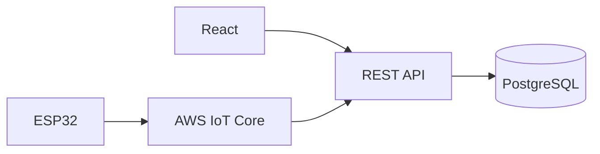

**Chú giải:** Sơ đồ có tính giáo dục. Không suy ra hạ tầng hoặc endpoint tương ứng đang tồn tại trong mã nguồn Smart Farm.

**日本語で説明してみよう：** まず全体の流れを確認します。次に、それぞれの役割を説明します。最後に、データの受け渡しや確認が必要な点をまとめます。

**Dịch:** Nắm luồng tổng thể, giải thích trách nhiệm các tầng, nêu điểm trao đổi dữ liệu và vấn đề cần xác minh.

#### ⑤ 面接対話 — Hội thoại Nhật–Việt

**面接官：** お客様に「もっと速くして」と言われたらどうしますか。

**Dịch câu hỏi:** Nếu khách hàng yêu cầu “làm cho nhanh hơn”, bạn sẽ làm gì?

**応募者（Standard）：** まず、どの操作が遅いのか確認します。現状の応答時間を測り、目標値を合意した上で原因を調べます。

**ベトナム語訳：** Xác định tác vụ chậm, đo baseline, thống nhất mục tiêu.

**面接官（深掘り）：** ポーリングが原因かどうか分かりますか。

**Câu hỏi đào sâu (Việt):** Có thể kết luận polling là nguyên nhân gây chậm không?

**応募者：** すぐには判断できません。APIの応答や通信、データベースの処理を分けて調べます。

**ベトナム語訳：** Chưa thể kết luận ngay. Cần kiểm tra riêng thời gian phản hồi API, truyền thông và xử lý database.

**質問の型:** 何ですか → なぜ必要ですか → 具体的にはどうしますか. Khi có câu hỏi tiếp theo, ưu tiên giải thích một ý mới, không lặp toàn bộ định nghĩa.

#### ⑥ 類似表現比較 — Cách diễn đạt phù hợp

- **使っています:** công nghệ đang dùng, không tự bao hàm lý do lựa chọn.
- **採用しました:** đã áp dụng; cần xác minh vai trò quyết định trước khi dùng ở ngôi cá nhân.
- **確認します / 検証します:** kiểm tra thông tin / kiểm chứng qua phương pháp.
- **実現できます / 可能性があります:** có thể thực hiện / có khả năng; không hứa tuyệt đối khi chưa đánh giá rủi ro.

#### ⑦ 語彙・文法 — Từ vựng chuyên ngành

| 日本語 | 読み方 | Nghĩa |
|---|---|---|
| 応答時間 | おうとうじかん | Thời gian phản hồi |
| 処理時間 | しょりじかん | Thời gian xử lý |
| 計測 | けいそく | Đo lường |
| 改善 | かいぜん | Cải thiện |
| 負荷 | ふか | Tải |
| ボトルネック | ボトルネック | Điểm nghẽn |

**Mẫu câu phỏng vấn:** 改善の前に応答時間を計測し、原因を特定します。

**Dịch sát nghĩa:** Trước khi tối ưu, tôi đo thời gian phản hồi và xác định nguyên nhân.

#### ⑧ 実践練習 — Active recall và chuyển ngữ cảnh

**Bước 1 — 20 giây:** Tự trả lời câu phỏng vấn chính không nhìn mẫu. Nêu kết luận, lý do, giới hạn và ghi âm để tự đối chiếu.

**Bước 2 — Câu hỏi ứng dụng:**

**面接官：** 画面の表示が遅い場合、最初に何をしますか。

**Dịch câu hỏi:** Khi giao diện hiển thị chậm, bạn làm gì trước?

**応募者（回答例）：** まず遅い操作を特定し、画面、API、データベースのどこに時間がかかるかを測ります。

**Dịch câu trả lời:** Trước tiên tôi xác định thao tác chậm và đo thời gian ở giao diện, API và database.

**Bước 3 — Tình huống chuyên biệt:** Hỏi lại '速くして' bằng các câu nhằm chốt thao tác, thời điểm, môi trường và mục tiêu đo được; không tự tạo benchmark.

**Bước 4 — BrSE transfer:** Hãy nói lại câu trả lời cho khách hàng bằng tiếng Nhật dễ hiểu, tách điều đã kiểm tra khỏi đề xuất/giả định; không tự cam kết production, an toàn hoặc deadline.

**Bước 5 — Tự đánh giá:** 0–4 cho mỗi tiêu chí: đúng kiến thức, rõ ràng, tiếng Nhật tự nhiên, đúng trọng tâm và phản hồi câu đào sâu. Tổng /20. Không chấm phát âm qua văn bản nếu chưa có ghi âm.

**AI Interviewer:** あなたは日本企業のBrSE面接官です。上記の内容について一問ずつ質問し、私の回答を待ってください。その回答に基づいて深掘りを一つ行い、最後に自然な言い方と事実関係の注意点を教えてください。

#### ⑨ 評価・改善 — Rubric /20

Tự chấm năm tiêu chí 0–4: đúng trọng tâm, chính xác kỹ thuật, tiếng Nhật tự nhiên, diễn giải mạch lạc, phản xạ follow-up. Thang 16–20 tốt, 12–15 cần chỉnh, dưới 12 học lại là thước đo **nội bộ**. Không tự chấm phát âm khi không có audio.

**Quy trình sửa:** Rút ngắn câu, chỉ ra giới hạn cần xác minh, thử giải thích lại cho khách hàng không chuyên và làm mới ví dụ.

#### ⑩ 出典・検証状況

- Kiến thức cơ bản về lập trình / kiến trúc / QA / yêu cầu là **nội dung giáo dục tổng quát**, không trích xuất trực tiếp từ source code.
- Với Smart Farm, brief cung cấp: ESP32/Wokwi, AWS IoT Core, MQTT/TLS/X.509, backend Java 21/Spring Boot/Spring JDBC/modular monolith, PostgreSQL, React/REST/polling, kiểm thử JUnit/Spring Boot Test/Playwright; backend và DB chủ yếu local, luồng ESP32/Wokwi–AWS–backend có bằng chứng chạy thử theo mô tả.
- **Chưa xác nhận:** cấu hình production, khả năng vận hành bơm/van nông nghiệp thật, benchmark, endpoints và triển khai các công nghệ minh họa không có trong brief.
- Cần đối chiếu mã nguồn, kiểm thử render Mermaid, rà soát tiếng Nhật và thử trả lời có bấm giờ trước khi đánh dấu Reviewed.

#### ⑪ 深掘り・実務演習 — Chuyên sâu và ứng dụng thực tế

##### Bản chất và cơ chế

Performance gồm ít nhất **latency p50/p95/p99**, throughput, error rate, CPU/memory, DB query timing và freshness dữ liệu. Một con số average thấp không bác bỏ trải nghiệm chậm ở tail latency. Quan sát phải gắn với workload, thời điểm, environment, cold/warm cache và request size; không so sánh benchmark khác điều kiện.

##### Case study — Cách dùng trong dự án

Khách nói 'dashboard chậm': đo browser waterfall, fetch REST, backend processing, JDBC query và thời gian phản hồi; kiểm tra API chậm hay UI re-render nhiều. Với cảm biến, dữ liệu đến trễ còn có delay ESP32/MQTT/network/polling: tổng latency không chỉ là thời gian một request HTTP.

##### Rủi ro, giới hạn và trade-off

Trước khi đề xuất cache hoặc index, kiểm tra thống kê query và cardinality; caching có thể làm sai trạng thái điều khiển nhạy cảm. Nếu đặt mục tiêu 'p95 < 2s' chỉ là ví dụ yêu cầu cần được khách duyệt, **không phải benchmark đã đo**. Cần thêm graceful degraded UI nếu sensor stale.

##### 回答例 — Giải thích bằng tiếng Nhật

> 性能を改善する前に、操作と測定条件を決め、画面・API・DBの時間を分けて測ります。目標値は関係者と合意します。

**Dịch sát nghĩa:** Trước khi cải thiện hiệu năng, tôi xác định thao tác/điều kiện đo, tách thời gian UI, API, DB và thống nhất mục tiêu với các bên.

##### Bài thực hành có sản phẩm đầu ra

**Nhiệm vụ:** Lập kế hoạch đo 20 lần trên một use case, đo p50/p95, ghi điều kiện và đề xuất giả thuyết tối ưu; không tự tạo dữ liệu benchmark.

**Điều kiện đạt:** Có baseline, chỉ số, nơi nghi bottleneck, giả thuyết, phép đo lại, sai số/giới hạn rõ ràng.

*Lưu ý minh chứng: Ví dụ giáo dục phải phân biệt với chức năng đã kiểm thử thật; không nhận thành tích cá nhân, vận hành production hay mức an toàn khi chưa có bằng chứng.*

*Nguồn: [06-03-performance-scale.md](https://github.com/NiDa30/Interview/blob/main/book/chapters/chapter-06/06-03-performance-scale.md)*


---

<a id="chapter-07"></a>
## Chương 07 — 開発工程・品質管理

### 第07.01課 — アジャイル・Scrum・進捗管理

> **BRSE Interview Master · Draft / Pending review**  
> Trình độ N3–N2; mục tiêu hội thoại chính 15–30 giây. Nội dung giải thích kỹ thuật là học liệu; không khẳng định người học từng làm các thao tác nếu chưa có bằng chứng. Các endpoint/sơ đồ minh họa không phải đặc tả dự án khi không được xác nhận.

#### ① 学習目標 — Mục tiêu

Hiểu và giải thích được **アジャイル・Scrum・進捗管理**, trả lời một câu hỏi kỹ thuật chính, xử lý ít nhất một follow-up, sử dụng từ vựng IT tiếng Nhật, và chuyển kiến thức sang tình huống mới.

#### ② 面接質問・質問の意図

**面接官：** アジャイル開発とは何ですか。

**Nhà tuyển dụng đánh giá:** Năng lực hiểu khái niệm, giải thích mục đích sử dụng và phân biệt kiến thức thực tế với giả định.

#### ③ 技術知識・思考プロセス

**Cách tư duy:** Định nghĩa / tình huống → công dụng → rủi ro hoặc giới hạn → ví dụ. Khi hỏi về quyết định kỹ thuật của dự án, phải phân biệt *lợi ích chung* với *lý do lựa chọn thực tế được xác nhận*.

Làm rõ mục đích và tác động, trao đổi ưu tiên.

#### ④ 図解 — Hình minh họa

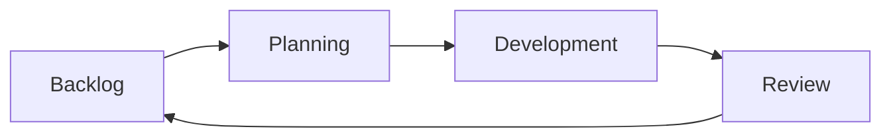

**Chú giải:** Sơ đồ có tính giáo dục. Không suy ra hạ tầng hoặc endpoint tương ứng đang tồn tại trong mã nguồn Smart Farm.

**日本語で説明してみよう：** まず全体の流れを確認します。次に、それぞれの役割を説明します。最後に、データの受け渡しや確認が必要な点をまとめます。

**Dịch:** Nắm luồng tổng thể, giải thích trách nhiệm các tầng, nêu điểm trao đổi dữ liệu và vấn đề cần xác minh.

#### ⑤ 面接対話 — Hội thoại Nhật–Việt

**面接官：** アジャイル開発とは何ですか。

**Dịch câu hỏi:** Phát triển Agile là gì?

**応募者（Standard）：** 短いサイクルで開発と確認を繰り返し、フィードバックを取り入れる進め方です。Scrumは、そのためのフレームワークの一つです。

**ベトナム語訳：** Agile lặp ngắn và phản hồi; Scrum là một framework.

**面接官（深掘り）：** 要件が変わったらどうしますか。

**Câu hỏi đào sâu (Việt):** Nếu yêu cầu thay đổi thì xử lý thế nào?

**応募者：** 目的と影響を確認し、優先順位や計画をチームと相談します。

**ベトナム語訳：** Tôi xác nhận mục đích và ảnh hưởng của thay đổi, sau đó trao đổi với nhóm để điều chỉnh mức ưu tiên và kế hoạch.

**質問の型:** 何ですか → なぜ必要ですか → 具体的にはどうしますか. Khi có câu hỏi tiếp theo, ưu tiên giải thích một ý mới, không lặp toàn bộ định nghĩa.

#### ⑥ 類似表現比較 — Cách diễn đạt phù hợp

- **使っています:** công nghệ đang dùng, không tự bao hàm lý do lựa chọn.
- **採用しました:** đã áp dụng; cần xác minh vai trò quyết định trước khi dùng ở ngôi cá nhân.
- **確認します / 検証します:** kiểm tra thông tin / kiểm chứng qua phương pháp.
- **実現できます / 可能性があります:** có thể thực hiện / có khả năng; không hứa tuyệt đối khi chưa đánh giá rủi ro.

#### ⑦ 語彙・文法 — Từ vựng chuyên ngành

| 日本語 | 読み方 | Nghĩa |
|---|---|---|
| 反復 | はんぷく | Lặp lại |
| 優先順位 | ゆうせんじゅんい | Thứ tự ưu tiên |
| 振り返り | ふりかえり | Nhìn lại/retrospective |
| 作業項目 | さぎょうこうもく | Hạng mục công việc |
| 進捗 | しんちょく | Tiến độ |
| 改善点 | かいぜんてん | Điểm cải thiện |

**Mẫu câu phỏng vấn:** 短い期間で開発と確認を繰り返します。

**Dịch sát nghĩa:** Chúng tôi lặp lại việc phát triển và kiểm tra theo chu kỳ ngắn.

#### ⑧ 実践練習 — Active recall và chuyển ngữ cảnh

**Bước 1 — 20 giây:** Tự trả lời câu phỏng vấn chính không nhìn mẫu. Nêu kết luận, lý do, giới hạn và ghi âm để tự đối chiếu.

**Bước 2 — Câu hỏi ứng dụng:**

**面接官：** スプリントの途中で新しい要求が来たら、どうしますか。

**Dịch câu hỏi:** Nếu yêu cầu mới đến giữa sprint, bạn làm gì?

**応募者（回答例）：** 目的と緊急度を確認し、チームと影響を相談します。優先順位の変更は関係者と合意します。

**Dịch câu trả lời:** Tôi xác nhận mục đích và độ khẩn cấp, trao đổi tác động với đội, rồi thống nhất với các bên về thay đổi ưu tiên.

**Bước 3 — Tình huống chuyên biệt:** Tạo tình huống một yêu cầu tưới mới đến giữa sprint; chọn cách báo cáo thay vì tự ý thêm phạm vi.

**Bước 4 — BrSE transfer:** Hãy nói lại câu trả lời cho khách hàng bằng tiếng Nhật dễ hiểu, tách điều đã kiểm tra khỏi đề xuất/giả định; không tự cam kết production, an toàn hoặc deadline.

**Bước 5 — Tự đánh giá:** 0–4 cho mỗi tiêu chí: đúng kiến thức, rõ ràng, tiếng Nhật tự nhiên, đúng trọng tâm và phản hồi câu đào sâu. Tổng /20. Không chấm phát âm qua văn bản nếu chưa có ghi âm.

**AI Interviewer:** あなたは日本企業のBrSE面接官です。上記の内容について一問ずつ質問し、私の回答を待ってください。その回答に基づいて深掘りを一つ行い、最後に自然な言い方と事実関係の注意点を教えてください。

#### ⑨ 評価・改善 — Rubric /20

Tự chấm năm tiêu chí 0–4: đúng trọng tâm, chính xác kỹ thuật, tiếng Nhật tự nhiên, diễn giải mạch lạc, phản xạ follow-up. Thang 16–20 tốt, 12–15 cần chỉnh, dưới 12 học lại là thước đo **nội bộ**. Không tự chấm phát âm khi không có audio.

**Quy trình sửa:** Rút ngắn câu, chỉ ra giới hạn cần xác minh, thử giải thích lại cho khách hàng không chuyên và làm mới ví dụ.

#### ⑩ 出典・検証状況

- Kiến thức cơ bản về lập trình / kiến trúc / QA / yêu cầu là **nội dung giáo dục tổng quát**, không trích xuất trực tiếp từ source code.
- Với Smart Farm, brief cung cấp: ESP32/Wokwi, AWS IoT Core, MQTT/TLS/X.509, backend Java 21/Spring Boot/Spring JDBC/modular monolith, PostgreSQL, React/REST/polling, kiểm thử JUnit/Spring Boot Test/Playwright; backend và DB chủ yếu local, luồng ESP32/Wokwi–AWS–backend có bằng chứng chạy thử theo mô tả.
- **Chưa xác nhận:** cấu hình production, khả năng vận hành bơm/van nông nghiệp thật, benchmark, endpoints và triển khai các công nghệ minh họa không có trong brief.
- Cần đối chiếu mã nguồn, kiểm thử render Mermaid, rà soát tiếng Nhật và thử trả lời có bấm giờ trước khi đánh dấu Reviewed.

#### ⑪ 深掘り・実務演習 — Chuyên sâu và ứng dụng thực tế

##### Bản chất và cơ chế

Agile nhấn vào **phản hồi sớm** và thích ứng dựa trên bằng chứng; Scrum có Product Goal, Sprint Goal, Product Backlog, Sprint Backlog, Increment và các event riêng. Không nên gọi daily scrum là 'để báo cáo cho sếp'; mục tiêu là Developers kiểm tra tiến độ hướng Sprint Goal và điều chỉnh kế hoạch.

##### Case study — Cách dùng trong dự án

Tình huống giữa sprint khách đề nghị thêm tính năng tưới: phân biệt request mới với bug ảnh hưởng Sprint Goal; làm rõ value, effort, risk và scope. Product Owner phụ trách sắp xếp Product Backlog; việc điều chỉnh Sprint Backlog phải trao đổi với Developers, không nên để BrSE tự hứa hoàn thành trong sprint.

##### Rủi ro, giới hạn và trade-off

Trade-off: team nhỏ có thể cần quản lý công việc nhẹ hơn; không biến ritual thành mục tiêu. Nếu backlog issue chưa có acceptance criteria, velocity cao không nói lên chất lượng. Demo increment chỉ nên coi là Done khi đáp ứng Definition of Done đã thống nhất.

##### 回答例 — Giải thích bằng tiếng Nhật

> スプリント中に新しい要望が出た場合は、まず目的と影響を整理し、プロダクトオーナーと開発チームで優先順位を確認します。

**Dịch sát nghĩa:** Khi có yêu cầu mới trong sprint, trước hết tổng hợp mục tiêu/ảnh hưởng rồi xác nhận thứ tự ưu tiên cùng Product Owner và đội phát triển.

##### Bài thực hành có sản phẩm đầu ra

**Nhiệm vụ:** Viết user story và acceptance criteria cho cảnh báo độ ẩm thấp; chia thành task, bug, risk và quyết định ưu tiên giữa sprint.

**Điều kiện đạt:** Mỗi story có actor/value, ba điều kiện nghiệm thu, DoD và người có quyền quyết định rõ ràng.

*Lưu ý minh chứng: Ví dụ giáo dục phải phân biệt với chức năng đã kiểm thử thật; không nhận thành tích cá nhân, vận hành production hay mức an toàn khi chưa có bằng chứng.*

*Nguồn: [07-01-agile-scrum.md](https://github.com/NiDa30/Interview/blob/main/book/chapters/chapter-07/07-01-agile-scrum.md)*

### 第07.02課 — Git・Jira・CI/CD

> **BRSE Interview Master · Draft / Pending review**  
> Trình độ N3–N2; mục tiêu hội thoại chính 15–30 giây. Nội dung giải thích kỹ thuật là học liệu; không khẳng định người học từng làm các thao tác nếu chưa có bằng chứng. Các endpoint/sơ đồ minh họa không phải đặc tả dự án khi không được xác nhận.

#### ① 学習目標 — Mục tiêu

Hiểu và giải thích được **Git・Jira・CI/CD**, trả lời một câu hỏi kỹ thuật chính, xử lý ít nhất một follow-up, sử dụng từ vựng IT tiếng Nhật, và chuyển kiến thức sang tình huống mới.

#### ② 面接質問・質問の意図

**面接官：** GitとJiraはどう使い分けますか。

**Nhà tuyển dụng đánh giá:** Năng lực hiểu khái niệm, giải thích mục đích sử dụng và phân biệt kiến thức thực tế với giả định.

#### ③ 技術知識・思考プロセス

**Cách tư duy:** Định nghĩa / tình huống → công dụng → rủi ro hoặc giới hạn → ví dụ. Khi hỏi về quyết định kỹ thuật của dự án, phải phân biệt *lợi ích chung* với *lý do lựa chọn thực tế được xác nhận*.

CI kiểm tra tích hợp; CD liên quan tự động hóa phân phối/triển khai.

#### ④ 図解 — Hình minh họa

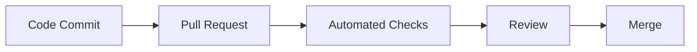

**Chú giải:** Sơ đồ có tính giáo dục. Không suy ra hạ tầng hoặc endpoint tương ứng đang tồn tại trong mã nguồn Smart Farm.

**日本語で説明してみよう：** まず全体の流れを確認します。次に、それぞれの役割を説明します。最後に、データの受け渡しや確認が必要な点をまとめます。

**Dịch:** Nắm luồng tổng thể, giải thích trách nhiệm các tầng, nêu điểm trao đổi dữ liệu và vấn đề cần xác minh.

#### ⑤ 面接対話 — Hội thoại Nhật–Việt

**面接官：** GitとJiraはどう使い分けますか。

**Dịch câu hỏi:** Bạn phân chia cách sử dụng Git và Jira như thế nào?

**応募者（Standard）：** Gitはコードの変更履歴を管理するために使います。Jiraはタスクや課題の進捗管理に使います。

**ベトナム語訳：** Git quản lý code; Jira quản lý issue và tiến độ.

**面接官（深掘り）：** CIとCDは何ですか。

**Câu hỏi đào sâu (Việt):** CI và CD là gì?

**応募者：** CIは変更を継続的に統合して検証する考え方です。CDはリリース準備やデプロイの自動化に関係します。

**ベトナム語訳：** CI là thực hành tích hợp và kiểm tra thay đổi liên tục. CD liên quan đến tự động hóa quá trình phân phối hoặc triển khai phần mềm.

**質問の型:** 何ですか → なぜ必要ですか → 具体的にはどうしますか. Khi có câu hỏi tiếp theo, ưu tiên giải thích một ý mới, không lặp toàn bộ định nghĩa.

#### ⑥ 類似表現比較 — Cách diễn đạt phù hợp

- **使っています:** công nghệ đang dùng, không tự bao hàm lý do lựa chọn.
- **採用しました:** đã áp dụng; cần xác minh vai trò quyết định trước khi dùng ở ngôi cá nhân.
- **確認します / 検証します:** kiểm tra thông tin / kiểm chứng qua phương pháp.
- **実現できます / 可能性があります:** có thể thực hiện / có khả năng; không hứa tuyệt đối khi chưa đánh giá rủi ro.

#### ⑦ 語彙・文法 — Từ vựng chuyên ngành

| 日本語 | 読み方 | Nghĩa |
|---|---|---|
| 変更履歴 | へんこうりれき | Lịch sử thay đổi |
| 課題管理 | かだいかんり | Quản lý issue |
| 自動テスト | じどうテスト | Kiểm thử tự động |
| 統合 | とうごう | Tích hợp |
| レビュー | レビュー | Review |
| ブランチ | ブランチ | Nhánh code |

**Mẫu câu phỏng vấn:** Gitで変更履歴を管理し、Jiraで課題と進捗を管理します。

**Dịch sát nghĩa:** Tôi dùng Git quản lý lịch sử thay đổi và Jira quản lý issue, tiến độ.

#### ⑧ 実践練習 — Active recall và chuyển ngữ cảnh

**Bước 1 — 20 giây:** Tự trả lời câu phỏng vấn chính không nhìn mẫu. Nêu kết luận, lý do, giới hạn và ghi âm để tự đối chiếu.

**Bước 2 — Câu hỏi ứng dụng:**

**面接官：** CIのチェックが失敗した時、どのように対応しますか。

**Dịch câu hỏi:** Khi kiểm tra CI thất bại, bạn xử lý thế nào?

**応募者（回答例）：** 失敗したテストとログを確認し、変更内容との関係を調べます。原因が不明なら状況を共有します。

**Dịch câu trả lời:** Tôi kiểm tra bài test và log lỗi, xem liên quan thay đổi mã thế nào; chưa rõ nguyên nhân thì chia sẻ tình hình.

**Bước 3 — Tình huống chuyên biệt:** Viết một Jira bug giả định: hiện tượng, điều kiện tái hiện, kết quả mong đợi, mức ảnh hưởng. Không nói repo hiện có pipeline đã pass.

**Bước 4 — BrSE transfer:** Hãy nói lại câu trả lời cho khách hàng bằng tiếng Nhật dễ hiểu, tách điều đã kiểm tra khỏi đề xuất/giả định; không tự cam kết production, an toàn hoặc deadline.

**Bước 5 — Tự đánh giá:** 0–4 cho mỗi tiêu chí: đúng kiến thức, rõ ràng, tiếng Nhật tự nhiên, đúng trọng tâm và phản hồi câu đào sâu. Tổng /20. Không chấm phát âm qua văn bản nếu chưa có ghi âm.

**AI Interviewer:** あなたは日本企業のBrSE面接官です。上記の内容について一問ずつ質問し、私の回答を待ってください。その回答に基づいて深掘りを一つ行い、最後に自然な言い方と事実関係の注意点を教えてください。

#### ⑨ 評価・改善 — Rubric /20

Tự chấm năm tiêu chí 0–4: đúng trọng tâm, chính xác kỹ thuật, tiếng Nhật tự nhiên, diễn giải mạch lạc, phản xạ follow-up. Thang 16–20 tốt, 12–15 cần chỉnh, dưới 12 học lại là thước đo **nội bộ**. Không tự chấm phát âm khi không có audio.

**Quy trình sửa:** Rút ngắn câu, chỉ ra giới hạn cần xác minh, thử giải thích lại cho khách hàng không chuyên và làm mới ví dụ.

#### ⑩ 出典・検証状況

- Kiến thức cơ bản về lập trình / kiến trúc / QA / yêu cầu là **nội dung giáo dục tổng quát**, không trích xuất trực tiếp từ source code.
- Với Smart Farm, brief cung cấp: ESP32/Wokwi, AWS IoT Core, MQTT/TLS/X.509, backend Java 21/Spring Boot/Spring JDBC/modular monolith, PostgreSQL, React/REST/polling, kiểm thử JUnit/Spring Boot Test/Playwright; backend và DB chủ yếu local, luồng ESP32/Wokwi–AWS–backend có bằng chứng chạy thử theo mô tả.
- **Chưa xác nhận:** cấu hình production, khả năng vận hành bơm/van nông nghiệp thật, benchmark, endpoints và triển khai các công nghệ minh họa không có trong brief.
- Cần đối chiếu mã nguồn, kiểm thử render Mermaid, rà soát tiếng Nhật và thử trả lời có bấm giờ trước khi đánh dấu Reviewed.

#### ⑪ 深掘り・実務演習 — Chuyên sâu và ứng dụng thực tế

##### Bản chất và cơ chế

Git ghi lại thay đổi code theo commit/branch/PR; Jira ghi **vì sao thay đổi**, ai sở hữu, tiêu chí nghiệm thu và trạng thái; CI thực thi checks khi có commit/PR; CD liên quan đóng gói/phân phối/deploy (không nhất thiết deploy production tự động). Chỉ có pipeline xanh không đủ kết luận hành vi ngoài phạm vi test.

##### Case study — Cách dùng trong dự án

Ví dụ một bug dashboard hiển thị state sai: Jira issue chứa steps/expected/actual, PR liên kết issue, reviewer kiểm tra code, CI chạy unit/integration/UI, sau merge có bản phát hành/triển khai rõ môi trường. Với Book QA repo Interview, workflow có Python static checks và Mermaid rendering; đó là **pipeline kiểm định giáo trình**, không phải chứng minh tính đúng của runtime Smart Farm.

##### Rủi ro, giới hạn và trade-off

Rủi ro: commit secret, tự merge không review, test chỉ happy path, bỏ qua license, CI xanh tại commit cũ trong khi HEAD đã đổi. Kiểm tra SHA gắn với report; nếu artifacts/runner chưa xong không ghi 'verified'. Không dùng rebase force nếu team chưa thống nhất quy trình.

##### 回答例 — Giải thích bằng tiếng Nhật

> Gitは変更履歴を管理し、Jiraは課題の目的や受け入れ条件を記録します。CIは変更ごとに自動テストを実行しますが、検証範囲の確認も必要です。

**Dịch sát nghĩa:** Git quản lý lịch sử thay đổi, Jira ghi mục tiêu/điều kiện nghiệm thu; CI tự động chạy test mỗi thay đổi nhưng vẫn cần kiểm tra phạm vi.

##### Bài thực hành có sản phẩm đầu ra

**Nhiệm vụ:** Tạo issue Jira mẫu với DoD, nhánh Git giả định, PR template, ma trận CI gồm lint/unit/API/E2E và tình huống rollback.

**Điều kiện đạt:** Từ issue → commit → test → release truy xuất được, có phân biệt PASS trên SHA nào và các check chưa chạy.

*Lưu ý minh chứng: Ví dụ giáo dục phải phân biệt với chức năng đã kiểm thử thật; không nhận thành tích cá nhân, vận hành production hay mức an toàn khi chưa có bằng chứng.*

*Nguồn: [07-02-git-jira-ci.md](https://github.com/NiDa30/Interview/blob/main/book/chapters/chapter-07/07-02-git-jira-ci.md)*

### 第07.03課 — 単体・結合・E2Eテスト

> **BRSE Interview Master · Draft / Pending review**  
> Trình độ N3–N2; mục tiêu hội thoại chính 15–30 giây. Nội dung giải thích kỹ thuật là học liệu; không khẳng định người học từng làm các thao tác nếu chưa có bằng chứng. Các endpoint/sơ đồ minh họa không phải đặc tả dự án khi không được xác nhận.

#### ① 学習目標 — Mục tiêu

Hiểu và giải thích được **単体・結合・E2Eテスト**, trả lời một câu hỏi kỹ thuật chính, xử lý ít nhất một follow-up, sử dụng từ vựng IT tiếng Nhật, và chuyển kiến thức sang tình huống mới.

#### ② 面接質問・質問の意図

**面接官：** 単体テストと結合テストの違いは何ですか。

**Nhà tuyển dụng đánh giá:** Năng lực hiểu khái niệm, giải thích mục đích sử dụng và phân biệt kiến thức thực tế với giả định.

#### ③ 技術知識・思考プロセス

**Cách tư duy:** Định nghĩa / tình huống → công dụng → rủi ro hoặc giới hạn → ví dụ. Khi hỏi về quyết định kỹ thuật của dự án, phải phân biệt *lợi ích chung* với *lý do lựa chọn thực tế được xác nhận*.

Playwright test thao tác/hiển thị UI.

#### ④ 図解 — Hình minh họa

```mermaid
flowchart TD
Req[Requirement] --> Unit[Unit Tests]
Req --> Int[Integration Tests]
Req --> UI[UI or E2E Tests]
```

**Chú giải:** Sơ đồ có tính giáo dục. Không suy ra hạ tầng hoặc endpoint tương ứng đang tồn tại trong mã nguồn Smart Farm.

**日本語で説明してみよう：** まず全体の流れを確認します。次に、それぞれの役割を説明します。最後に、データの受け渡しや確認が必要な点をまとめます。

**Dịch:** Nắm luồng tổng thể, giải thích trách nhiệm các tầng, nêu điểm trao đổi dữ liệu và vấn đề cần xác minh.

#### ⑤ 面接対話 — Hội thoại Nhật–Việt

**面接官：** 単体テストと結合テストの違いは何ですか。

**Dịch câu hỏi:** Unit test và integration test khác nhau thế nào?

**応募者（Standard）：** 単体テストでは小さな処理を確認します。結合テストでは複数の機能や部品の連携を検証します。

**ベトナム語訳：** Unit kiểm tra chức năng nhỏ; integration kiểm tra phối hợp.

**面接官（深掘り）：** Playwrightは何に使いますか。

**Câu hỏi đào sâu (Việt):** Playwright dùng để làm gì?

**応募者：** Web画面の操作や表示を含むテストに使用できます。

**ベトナム語訳：** Playwright có thể dùng để kiểm thử thao tác và hiển thị trên giao diện web.

**質問の型:** 何ですか → なぜ必要ですか → 具体的にはどうしますか. Khi có câu hỏi tiếp theo, ưu tiên giải thích một ý mới, không lặp toàn bộ định nghĩa.

#### ⑥ 類似表現比較 — Cách diễn đạt phù hợp

- **使っています:** công nghệ đang dùng, không tự bao hàm lý do lựa chọn.
- **採用しました:** đã áp dụng; cần xác minh vai trò quyết định trước khi dùng ở ngôi cá nhân.
- **確認します / 検証します:** kiểm tra thông tin / kiểm chứng qua phương pháp.
- **実現できます / 可能性があります:** có thể thực hiện / có khả năng; không hứa tuyệt đối khi chưa đánh giá rủi ro.

#### ⑦ 語彙・文法 — Từ vựng chuyên ngành

| 日本語 | 読み方 | Nghĩa |
|---|---|---|
| 単体テスト | たんたいテスト | Unit test |
| 結合テスト | けつごうテスト | Integration test |
| 試験項目 | しけんこうもく | Test case |
| 期待結果 | きたいけっか | Kết quả mong đợi |
| 検証 | けんしょう | Kiểm chứng |
| 品質 | ひんしつ | Chất lượng |

**Mẫu câu phỏng vấn:** 結合テストでは複数の機能の連携を確認します。

**Dịch sát nghĩa:** Trong integration test, tôi kiểm tra sự phối hợp giữa nhiều chức năng.

#### ⑧ 実践練習 — Active recall và chuyển ngữ cảnh

**Bước 1 — 20 giây:** Tự trả lời câu phỏng vấn chính không nhìn mẫu. Nêu kết luận, lý do, giới hạn và ghi âm để tự đối chiếu.

**Bước 2 — Câu hỏi ứng dụng:**

**面接官：** 単体テストが成功すれば、画面も正しく動きますか。

**Dịch câu hỏi:** Unit test thành công có bảo đảm giao diện chạy đúng không?

**応募者（回答例）：** いいえ。機能間の連携や画面操作については、結合テストやE2Eテストでも確認する必要があります。

**Dịch câu trả lời:** Không. Sự phối hợp giữa chức năng và thao tác giao diện còn cần kiểm tra bằng integration/E2E test.

**Bước 3 — Tình huống chuyên biệt:** Phân loại ba test case minh họa: logic xác nhận dữ liệu, API và thao tác đặt lệnh từ màn hình; không suy ra coverage.

**Bước 4 — BrSE transfer:** Hãy nói lại câu trả lời cho khách hàng bằng tiếng Nhật dễ hiểu, tách điều đã kiểm tra khỏi đề xuất/giả định; không tự cam kết production, an toàn hoặc deadline.

**Bước 5 — Tự đánh giá:** 0–4 cho mỗi tiêu chí: đúng kiến thức, rõ ràng, tiếng Nhật tự nhiên, đúng trọng tâm và phản hồi câu đào sâu. Tổng /20. Không chấm phát âm qua văn bản nếu chưa có ghi âm.

**AI Interviewer:** あなたは日本企業のBrSE面接官です。上記の内容について一問ずつ質問し、私の回答を待ってください。その回答に基づいて深掘りを一つ行い、最後に自然な言い方と事実関係の注意点を教えてください。

#### ⑨ 評価・改善 — Rubric /20

Tự chấm năm tiêu chí 0–4: đúng trọng tâm, chính xác kỹ thuật, tiếng Nhật tự nhiên, diễn giải mạch lạc, phản xạ follow-up. Thang 16–20 tốt, 12–15 cần chỉnh, dưới 12 học lại là thước đo **nội bộ**. Không tự chấm phát âm khi không có audio.

**Quy trình sửa:** Rút ngắn câu, chỉ ra giới hạn cần xác minh, thử giải thích lại cho khách hàng không chuyên và làm mới ví dụ.

#### ⑩ 出典・検証状況

- Kiến thức cơ bản về lập trình / kiến trúc / QA / yêu cầu là **nội dung giáo dục tổng quát**, không trích xuất trực tiếp từ source code.
- Với Smart Farm, brief cung cấp: ESP32/Wokwi, AWS IoT Core, MQTT/TLS/X.509, backend Java 21/Spring Boot/Spring JDBC/modular monolith, PostgreSQL, React/REST/polling, kiểm thử JUnit/Spring Boot Test/Playwright; backend và DB chủ yếu local, luồng ESP32/Wokwi–AWS–backend có bằng chứng chạy thử theo mô tả.
- **Chưa xác nhận:** cấu hình production, khả năng vận hành bơm/van nông nghiệp thật, benchmark, endpoints và triển khai các công nghệ minh họa không có trong brief.
- Cần đối chiếu mã nguồn, kiểm thử render Mermaid, rà soát tiếng Nhật và thử trả lời có bấm giờ trước khi đánh dấu Reviewed.

#### ⑪ 深掘り・実務演習 — Chuyên sâu và ứng dụng thực tế

##### Bản chất và cơ chế

Unit test kiểm tra đơn vị logic với dependency cô lập; integration test kiểm tra ranh giới thực (DB, REST, MQTT stub hoặc test instance); E2E kiểm tra luồng người dùng từ UI tới phản hồi. 'Test pyramid' là gợi ý cân bằng tốc độ/độ tin cậy, không thay thế phân tích rủi ro. Độ bao phủ dòng code cao không chứng minh yêu cầu đúng.

##### Case study — Cách dùng trong dự án

Với hệ thống tưới, cần kiểm thử xác nhận ngưỡng, xử lý duplicate telemetry, stale timestamp, trạng thái publish không chắc chắn, ACK timeout và false-success UI. Contract test xác minh field/status của API; test DB dùng migration thật; test an toàn phần cứng không thể giả thay bằng Playwright. Repo Smart Farm có JUnit test và Playwright config nhưng sự hiện diện của file **không chứng minh** test đã chạy thành công trong lượt này.

##### Rủi ro, giới hạn và trade-off

Test oracle phải định nghĩa expected outcome theo từng stage: HTTP request được nhận ≠ command được publish ≠ ACK thiết bị ≠ bơm chạy. Kịch bản negative thường quan trọng hơn happy path đối với actuator. Nếu không thể thử trên thiết bị thật, đánh dấu NOT RUN rõ ràng.

##### 回答例 — Giải thích bằng tiếng Nhật

> 単体テスト、結合テスト、E2Eテストは確認する範囲が異なります。特に制御機能では、送信成功だけで実機動作を確認したことにはなりません。

**Dịch sát nghĩa:** Unit, integration và E2E kiểm tra các phạm vi khác nhau; đặc biệt với điều khiển thiết bị, gửi thành công không chứng minh vận hành phần cứng.

##### Bài thực hành có sản phẩm đầu ra

**Nhiệm vụ:** Thiết kế ma trận 12 test cases nhóm input/schema, DB, MQTT, UI, Wokwi, hardware; ghi precondition/steps/expected/evidence.

**Điều kiện đạt:** Mỗi case có oracle, môi trường, mức tự động hóa và trạng thái PASS/FAIL/NOT RUN; không tự gán hardware PASS.

*Lưu ý minh chứng: Ví dụ giáo dục phải phân biệt với chức năng đã kiểm thử thật; không nhận thành tích cá nhân, vận hành production hay mức an toàn khi chưa có bằng chứng.*

*Nguồn: [07-03-test-quality.md](https://github.com/NiDa30/Interview/blob/main/book/chapters/chapter-07/07-03-test-quality.md)*


---

<a id="chapter-08"></a>
## Chương 08 — 要件定義・仕様確認

### 第08.01課 — 要件ヒアリング・要件定義

> **BRSE Interview Master · Draft / Pending review**  
> Trình độ N3–N2; mục tiêu hội thoại chính 15–30 giây. Nội dung giải thích kỹ thuật là học liệu; không khẳng định người học từng làm các thao tác nếu chưa có bằng chứng. Các endpoint/sơ đồ minh họa không phải đặc tả dự án khi không được xác nhận.

#### ① 学習目標 — Mục tiêu

Hiểu và giải thích được **要件ヒアリング・要件定義**, trả lời một câu hỏi kỹ thuật chính, xử lý ít nhất một follow-up, sử dụng từ vựng IT tiếng Nhật, và chuyển kiến thức sang tình huống mới.

#### ② 面接質問・質問の意図

**面接官：** 要件定義では何を確認しますか。

**Nhà tuyển dụng đánh giá:** Năng lực hiểu khái niệm, giải thích mục đích sử dụng và phân biệt kiến thức thực tế với giả định.

#### ③ 技術知識・思考プロセス

**Cách tư duy:** Định nghĩa / tình huống → công dụng → rủi ro hoặc giới hạn → ví dụ. Khi hỏi về quyết định kỹ thuật của dự án, phải phân biệt *lợi ích chung* với *lý do lựa chọn thực tế được xác nhận*.

Mong muốn khác yêu cầu được xác định.

#### ④ 図解 — Hình minh họa

```mermaid
flowchart LR
Wish[Customer Wish] --> Q[Clarify]
Q --> C[Constraints]
C --> R[Requirements]
R --> AC[Acceptance Criteria]
```

**Chú giải:** Sơ đồ có tính giáo dục. Không suy ra hạ tầng hoặc endpoint tương ứng đang tồn tại trong mã nguồn Smart Farm.

**日本語で説明してみよう：** まず全体の流れを確認します。次に、それぞれの役割を説明します。最後に、データの受け渡しや確認が必要な点をまとめます。

**Dịch:** Nắm luồng tổng thể, giải thích trách nhiệm các tầng, nêu điểm trao đổi dữ liệu và vấn đề cần xác minh.

#### ⑤ 面接対話 — Hội thoại Nhật–Việt

**面接官：** 要件定義では何を確認しますか。

**Dịch câu hỏi:** Trong xác định yêu cầu, bạn xác nhận những gì?

**応募者（Standard）：** お客様の目的、必要な機能、制約を確認します。曖昧な点は質問して、認識を合わせます。

**ベトナム語訳：** Làm rõ mục tiêu, chức năng, giới hạn và điểm mơ hồ.

**面接官（深掘り）：** 要望と要件の違いは何ですか。

**Câu hỏi đào sâu (Việt):** Mong muốn và yêu cầu có giống nhau không?

**応募者：** 要望はお客様の希望で、要件は実現すべき条件として整理したものです。

**ベトナム語訳：** Mong muốn là điều khách hàng hy vọng có được; yêu cầu là những điều kiện đã được làm rõ và xác định cần thực hiện.

**質問の型:** 何ですか → なぜ必要ですか → 具体的にはどうしますか. Khi có câu hỏi tiếp theo, ưu tiên giải thích một ý mới, không lặp toàn bộ định nghĩa.

#### ⑥ 類似表現比較 — Cách diễn đạt phù hợp

- **使っています:** công nghệ đang dùng, không tự bao hàm lý do lựa chọn.
- **採用しました:** đã áp dụng; cần xác minh vai trò quyết định trước khi dùng ở ngôi cá nhân.
- **確認します / 検証します:** kiểm tra thông tin / kiểm chứng qua phương pháp.
- **実現できます / 可能性があります:** có thể thực hiện / có khả năng; không hứa tuyệt đối khi chưa đánh giá rủi ro.

#### ⑦ 語彙・文法 — Từ vựng chuyên ngành

| 日本語 | 読み方 | Nghĩa |
|---|---|---|
| 要件定義 | ようけんていぎ | Xác định yêu cầu |
| ヒアリング | ヒアリング | Phỏng vấn khai thác yêu cầu |
| 目的 | もくてき | Mục đích |
| 制約 | せいやく | Ràng buộc |
| 認識合わせ | にんしきあわせ | Thống nhất nhận thức |
| 受け入れ条件 | うけいれじょうけん | Điều kiện nghiệm thu |

**Mẫu câu phỏng vấn:** まずお客様の目的と制約を確認します。

**Dịch sát nghĩa:** Trước hết tôi xác nhận mục tiêu và các ràng buộc của khách hàng.

#### ⑧ 実践練習 — Active recall và chuyển ngữ cảnh

**Bước 1 — 20 giây:** Tự trả lời câu phỏng vấn chính không nhìn mẫu. Nêu kết luận, lý do, giới hạn và ghi âm để tự đối chiếu.

**Bước 2 — Câu hỏi ứng dụng:**

**面接官：** お客様が「自動で水をやりたい」と言ったら、何を聞きますか。

**Dịch câu hỏi:** Nếu khách nói 'muốn tưới tự động', bạn hỏi gì?

**応募者（回答例）：** 対象エリア、開始条件、停止条件、異常時の動作を確認します。受け入れ条件も相談します。

**Dịch câu trả lời:** Tôi hỏi khu vực áp dụng, điều kiện bắt đầu/dừng, hành vi khi bất thường, rồi trao đổi tiêu chí nghiệm thu.

**Bước 3 — Tình huống chuyên biệt:** Đóng vai BrSE hỏi 5 câu làm rõ: cây/khu vực, ngưỡng, lịch tưới, sự cố sensor và quyền thao tác; đây là yêu cầu giả định.

**Bước 4 — BrSE transfer:** Hãy nói lại câu trả lời cho khách hàng bằng tiếng Nhật dễ hiểu, tách điều đã kiểm tra khỏi đề xuất/giả định; không tự cam kết production, an toàn hoặc deadline.

**Bước 5 — Tự đánh giá:** 0–4 cho mỗi tiêu chí: đúng kiến thức, rõ ràng, tiếng Nhật tự nhiên, đúng trọng tâm và phản hồi câu đào sâu. Tổng /20. Không chấm phát âm qua văn bản nếu chưa có ghi âm.

**AI Interviewer:** あなたは日本企業のBrSE面接官です。上記の内容について一問ずつ質問し、私の回答を待ってください。その回答に基づいて深掘りを一つ行い、最後に自然な言い方と事実関係の注意点を教えてください。

#### ⑨ 評価・改善 — Rubric /20

Tự chấm năm tiêu chí 0–4: đúng trọng tâm, chính xác kỹ thuật, tiếng Nhật tự nhiên, diễn giải mạch lạc, phản xạ follow-up. Thang 16–20 tốt, 12–15 cần chỉnh, dưới 12 học lại là thước đo **nội bộ**. Không tự chấm phát âm khi không có audio.

**Quy trình sửa:** Rút ngắn câu, chỉ ra giới hạn cần xác minh, thử giải thích lại cho khách hàng không chuyên và làm mới ví dụ.

#### ⑩ 出典・検証状況

- Kiến thức cơ bản về lập trình / kiến trúc / QA / yêu cầu là **nội dung giáo dục tổng quát**, không trích xuất trực tiếp từ source code.
- Với Smart Farm, brief cung cấp: ESP32/Wokwi, AWS IoT Core, MQTT/TLS/X.509, backend Java 21/Spring Boot/Spring JDBC/modular monolith, PostgreSQL, React/REST/polling, kiểm thử JUnit/Spring Boot Test/Playwright; backend và DB chủ yếu local, luồng ESP32/Wokwi–AWS–backend có bằng chứng chạy thử theo mô tả.
- **Chưa xác nhận:** cấu hình production, khả năng vận hành bơm/van nông nghiệp thật, benchmark, endpoints và triển khai các công nghệ minh họa không có trong brief.
- Cần đối chiếu mã nguồn, kiểm thử render Mermaid, rà soát tiếng Nhật và thử trả lời có bấm giờ trước khi đánh dấu Reviewed.

#### ⑪ 深掘り・実務演習 — Chuyên sâu và ứng dụng thực tế

##### Bản chất và cơ chế

Khách hàng nói 'muốn tưới tự động' mới là **mong muốn**, chưa phải yêu cầu có thể triển khai. BrSE cần khám phá actor, phạm vi, trigger, override, ngoại lệ, dữ liệu đầu vào, quyền thao tác và mục tiêu kinh doanh. Kỹ thuật 5W1H và ví dụ/ phản ví dụ giúp phát hiện giả định ẩn; các ràng buộc an toàn phải được nêu độc lập với tiện ích giao diện.

##### Case study — Cách dùng trong dự án

Tình huống: ngưỡng soil moisture thấp có tự bật relay hay cần lịch tưới, giới hạn thời lượng, mực nước hồ, dự báo mưa, thao tác manual override? Nếu cảm biến mất kết nối lúc đang ON, an toàn mong muốn là gì, đo bằng thiết bị nào, ai phê duyệt? Không thể tự quyết các điều kiện safety thay khách và kỹ sư phần cứng.

##### Rủi ro, giới hạn và trade-off

Deliverable tốt gồm glossary, actor matrix, workflow bình thường và ngoại lệ, acceptance criteria, quyết định còn mở và tác động. Khi có yêu cầu 'tuyệt đối không tưới lúc mưa', phải đề nghị phương án fail-safe và giải thích xác suất sensor lỗi, thay vì hứa tuyệt đối.

##### 回答例 — Giải thích bằng tiếng Nhật

> 「自動で水をやりたい」というご要望について、開始条件、停止条件、例外時の動作、手動操作の可否を確認させてください。

**Dịch sát nghĩa:** Với yêu cầu tưới tự động, tôi xin xác nhận điều kiện bắt đầu/dừng, hành vi khi có ngoại lệ và có cho phép thao tác thủ công không.

##### Bài thực hành có sản phẩm đầu ra

**Nhiệm vụ:** Viết ít nhất 12 câu hỏi hearing, chia functional/non-functional/safety; tạo 3 acceptance criteria gồm một trường hợp sensor offline.

**Điều kiện đạt:** Yêu cầu đo được, có người quyết, phân biệt assumption/open item và chấp nhận trường hợp nguy hiểm chưa thể nghiệm thu.

*Lưu ý minh chứng: Ví dụ giáo dục phải phân biệt với chức năng đã kiểm thử thật; không nhận thành tích cá nhân, vận hành production hay mức an toàn khi chưa có bằng chứng.*

*Nguồn: [08-01-requirement-hearing.md](https://github.com/NiDa30/Interview/blob/main/book/chapters/chapter-08/08-01-requirement-hearing.md)*

### 第08.02課 — 曖昧な仕様・性能要求

> **BRSE Interview Master · Draft / Pending review**  
> Trình độ N3–N2; mục tiêu hội thoại chính 15–30 giây. Nội dung giải thích kỹ thuật là học liệu; không khẳng định người học từng làm các thao tác nếu chưa có bằng chứng. Các endpoint/sơ đồ minh họa không phải đặc tả dự án khi không được xác nhận.

#### ① 学習目標 — Mục tiêu

Hiểu và giải thích được **曖昧な仕様・性能要求**, trả lời một câu hỏi kỹ thuật chính, xử lý ít nhất một follow-up, sử dụng từ vựng IT tiếng Nhật, và chuyển kiến thức sang tình huống mới.

#### ② 面接質問・質問の意図

**面接官：** お客様が「画面を速くしてほしい」と言ったら。

**Nhà tuyển dụng đánh giá:** Năng lực hiểu khái niệm, giải thích mục đích sử dụng và phân biệt kiến thức thực tế với giả định.

#### ③ 技術知識・思考プロセス

**Cách tư duy:** Định nghĩa / tình huống → công dụng → rủi ro hoặc giới hạn → ví dụ. Khi hỏi về quyết định kỹ thuật của dự án, phải phân biệt *lợi ích chung* với *lý do lựa chọn thực tế được xác nhận*.

Thống nhất baseline và KPI.

#### ④ 図解 — Hình minh họa

```mermaid
flowchart LR
V[Vague Request] --> S[Specify Screen]
S --> O[Specify Operation]
O --> B[Measure Baseline]
B --> T[Agree Target]
```

**Chú giải:** Sơ đồ có tính giáo dục. Không suy ra hạ tầng hoặc endpoint tương ứng đang tồn tại trong mã nguồn Smart Farm.

**日本語で説明してみよう：** まず全体の流れを確認します。次に、それぞれの役割を説明します。最後に、データの受け渡しや確認が必要な点をまとめます。

**Dịch:** Nắm luồng tổng thể, giải thích trách nhiệm các tầng, nêu điểm trao đổi dữ liệu và vấn đề cần xác minh.

#### ⑤ 面接対話 — Hội thoại Nhật–Việt

**面接官：** お客様が「画面を速くしてほしい」と言ったら。

**Dịch câu hỏi:** Nếu khách hàng nói muốn giao diện chạy nhanh hơn thì sao?

**応募者（Standard）：** まず、どの画面で何が遅いか確認します。その後、現在の応答時間と目標を測定・整理し、優先順位を相談します。

**ベトナム語訳：** Xác định màn hình/tác vụ, đo hiện trạng, thống nhất mục tiêu.

**面接官（深掘り）：** 数字がない場合はどうしますか。

**Câu hỏi đào sâu (Việt):** Nếu không có số liệu mục tiêu thì làm sao?

**応募者：** 測定方法を決めて現状を把握し、目標値をお客様と合意します。

**ベトナム語訳：** Tôi sẽ thống nhất cách đo, nắm thời gian phản hồi hiện tại rồi cùng khách hàng thống nhất giá trị mục tiêu.

**質問の型:** 何ですか → なぜ必要ですか → 具体的にはどうしますか. Khi có câu hỏi tiếp theo, ưu tiên giải thích một ý mới, không lặp toàn bộ định nghĩa.

#### ⑥ 類似表現比較 — Cách diễn đạt phù hợp

- **使っています:** công nghệ đang dùng, không tự bao hàm lý do lựa chọn.
- **採用しました:** đã áp dụng; cần xác minh vai trò quyết định trước khi dùng ở ngôi cá nhân.
- **確認します / 検証します:** kiểm tra thông tin / kiểm chứng qua phương pháp.
- **実現できます / 可能性があります:** có thể thực hiện / có khả năng; không hứa tuyệt đối khi chưa đánh giá rủi ro.

#### ⑦ 語彙・文法 — Từ vựng chuyên ngành

| 日本語 | 読み方 | Nghĩa |
|---|---|---|
| 曖昧 | あいまい | Mơ hồ |
| 具体化 | ぐたいか | Cụ thể hóa |
| 測定 | そくてい | Đo lường |
| 基準値 | きじゅんち | Giá trị chuẩn |
| 応答時間 | おうとうじかん | Thời gian phản hồi |
| 合意 | ごうい | Thống nhất |

**Mẫu câu phỏng vấn:** 曖昧な要求は測定できる条件に具体化します。

**Dịch sát nghĩa:** Tôi cụ thể hóa yêu cầu mơ hồ thành điều kiện có thể đo được.

#### ⑧ 実践練習 — Active recall và chuyển ngữ cảnh

**Bước 1 — 20 giây:** Tự trả lời câu phỏng vấn chính không nhìn mẫu. Nêu kết luận, lý do, giới hạn và ghi âm để tự đối chiếu.

**Bước 2 — Câu hỏi ứng dụng:**

**面接官：** 「もっと速く」という要求を、どうやって確認できる条件にしますか。

**Dịch câu hỏi:** Làm sao đổi yêu cầu 'nhanh hơn' thành điều kiện có thể xác minh?

**応募者（回答例）：** 対象の画面と操作を特定し、現在の応答時間を測った上で、目標を合意します。

**Dịch câu trả lời:** Tôi xác định màn hình và thao tác, đo thời gian phản hồi hiện tại rồi thống nhất mục tiêu.

**Bước 3 — Tình huống chuyên biệt:** Soạn câu hỏi khách: trang nào, thao tác nào, mạng/thiết bị nào, thời điểm đo và thời gian mục tiêu; không tự gán số ms.

**Bước 4 — BrSE transfer:** Hãy nói lại câu trả lời cho khách hàng bằng tiếng Nhật dễ hiểu, tách điều đã kiểm tra khỏi đề xuất/giả định; không tự cam kết production, an toàn hoặc deadline.

**Bước 5 — Tự đánh giá:** 0–4 cho mỗi tiêu chí: đúng kiến thức, rõ ràng, tiếng Nhật tự nhiên, đúng trọng tâm và phản hồi câu đào sâu. Tổng /20. Không chấm phát âm qua văn bản nếu chưa có ghi âm.

**AI Interviewer:** あなたは日本企業のBrSE面接官です。上記の内容について一問ずつ質問し、私の回答を待ってください。その回答に基づいて深掘りを一つ行い、最後に自然な言い方と事実関係の注意点を教えてください。

#### ⑨ 評価・改善 — Rubric /20

Tự chấm năm tiêu chí 0–4: đúng trọng tâm, chính xác kỹ thuật, tiếng Nhật tự nhiên, diễn giải mạch lạc, phản xạ follow-up. Thang 16–20 tốt, 12–15 cần chỉnh, dưới 12 học lại là thước đo **nội bộ**. Không tự chấm phát âm khi không có audio.

**Quy trình sửa:** Rút ngắn câu, chỉ ra giới hạn cần xác minh, thử giải thích lại cho khách hàng không chuyên và làm mới ví dụ.

#### ⑩ 出典・検証状況

- Kiến thức cơ bản về lập trình / kiến trúc / QA / yêu cầu là **nội dung giáo dục tổng quát**, không trích xuất trực tiếp từ source code.
- Với Smart Farm, brief cung cấp: ESP32/Wokwi, AWS IoT Core, MQTT/TLS/X.509, backend Java 21/Spring Boot/Spring JDBC/modular monolith, PostgreSQL, React/REST/polling, kiểm thử JUnit/Spring Boot Test/Playwright; backend và DB chủ yếu local, luồng ESP32/Wokwi–AWS–backend có bằng chứng chạy thử theo mô tả.
- **Chưa xác nhận:** cấu hình production, khả năng vận hành bơm/van nông nghiệp thật, benchmark, endpoints và triển khai các công nghệ minh họa không có trong brief.
- Cần đối chiếu mã nguồn, kiểm thử render Mermaid, rà soát tiếng Nhật và thử trả lời có bấm giờ trước khi đánh dấu Reviewed.

#### ⑪ 深掘り・実務演習 — Chuyên sâu và ứng dụng thực tế

##### Bản chất và cơ chế

Cụm 'nhanh', 'an toàn', 'realtime', 'dễ dùng' thiếu **đối tượng, điều kiện và tiêu chí quan sát**. Để đo được, phải chọn use case, môi trường, baseline, metric, ngưỡng/mục tiêu, cách đo, tần suất, người phê duyệt và failure behavior. Không tự gán p95/99 hoặc tỷ lệ lỗi cho khách.

##### Case study — Cách dùng trong dự án

Ví dụ 'dashboard realtime' có thể là độ tuổi cảm biến tối đa khi online, chu kỳ polling REST, độ trễ render và cách hiển thị stale. Đặt câu hỏi: ở mạng nào, sensor gửi mỗi bao lâu, khi offline bao lâu thì báo, hiển thị time sent hay received? Không thể suy ra cập nhật ngay tức thì vì hiện tại frontend dùng polling.

##### Rủi ro, giới hạn và trade-off

Trade-off: tăng polling làm tăng tải API; giảm cached lifetime có thể tạo request bùng nổ; số đo không tách sensor/network/API/UI làm team tối ưu sai chỗ. Chỉ ký acceptance criteria khi có baseline và điều kiện thử thống nhất.

##### 回答例 — Giải thích bằng tiếng Nhật

> 「速くしてほしい」というご要望について、対象の操作、現在の応答時間、測定条件、目標値を確認したいです。

**Dịch sát nghĩa:** Với yêu cầu làm nhanh hơn, tôi muốn xác nhận thao tác mục tiêu, thời gian phản hồi hiện tại, điều kiện đo và giá trị đích.

##### Bài thực hành có sản phẩm đầu ra

**Nhiệm vụ:** Chuyển bốn yêu cầu mơ hồ thành Given/When/Then đo được; mỗi yêu cầu thêm negative case và yêu cầu nguồn dữ liệu đo.

**Điều kiện đạt:** Mỗi tiêu chí có actor, môi trường, metric, expected, log/evidence và chưa tự suy ra con số thực đo.

*Lưu ý minh chứng: Ví dụ giáo dục phải phân biệt với chức năng đã kiểm thử thật; không nhận thành tích cá nhân, vận hành production hay mức an toàn khi chưa có bằng chứng.*

*Nguồn: [08-02-ambiguous-spec.md](https://github.com/NiDa30/Interview/blob/main/book/chapters/chapter-08/08-02-ambiguous-spec.md)*

### 第08.03課 — 受け入れ条件・仕様変更

> **BRSE Interview Master · Draft / Pending review**  
> Trình độ N3–N2; mục tiêu hội thoại chính 15–30 giây. Nội dung giải thích kỹ thuật là học liệu; không khẳng định người học từng làm các thao tác nếu chưa có bằng chứng. Các endpoint/sơ đồ minh họa không phải đặc tả dự án khi không được xác nhận.

#### ① 学習目標 — Mục tiêu

Hiểu và giải thích được **受け入れ条件・仕様変更**, trả lời một câu hỏi kỹ thuật chính, xử lý ít nhất một follow-up, sử dụng từ vựng IT tiếng Nhật, và chuyển kiến thức sang tình huống mới.

#### ② 面接質問・質問の意図

**面接官：** 受け入れ条件はなぜ大切ですか。

**Nhà tuyển dụng đánh giá:** Năng lực hiểu khái niệm, giải thích mục đích sử dụng và phân biệt kiến thức thực tế với giả định.

#### ③ 技術知識・思考プロセス

**Cách tư duy:** Định nghĩa / tình huống → công dụng → rủi ro hoặc giới hạn → ví dụ. Khi hỏi về quyết định kỹ thuật của dự án, phải phân biệt *lợi ích chung* với *lý do lựa chọn thực tế được xác nhận*.

Làm rõ mục tiêu, effort, deadline, thống nhất bên liên quan.

#### ④ 図解 — Hình minh họa

```mermaid
flowchart LR
R[Change Request] --> Scope[Clarify Scope]
Scope --> Impact[Impact and Risk]
Impact --> Options[Options]
Options --> Approval[Agreement]
Approval --> AC[Acceptance Criteria]
```

**Chú giải:** Sơ đồ có tính giáo dục. Không suy ra hạ tầng hoặc endpoint tương ứng đang tồn tại trong mã nguồn Smart Farm.

**日本語で説明してみよう：** まず全体の流れを確認します。次に、それぞれの役割を説明します。最後に、データの受け渡しや確認が必要な点をまとめます。

**Dịch:** Nắm luồng tổng thể, giải thích trách nhiệm các tầng, nêu điểm trao đổi dữ liệu và vấn đề cần xác minh.

#### ⑤ 面接対話 — Hội thoại Nhật–Việt

**面接官：** 受け入れ条件はなぜ大切ですか。

**Dịch câu hỏi:** Vì sao điều kiện nghiệm thu lại quan trọng?

**応募者（Standard）：** 実装が完了したかを判断する基準を共有するためです。正常時だけでなく、エラー時の期待動作も確認します。

**ベトナム語訳：** Tiêu chí nghiệm thu xác định done, bao gồm trường hợp lỗi.

**面接官（深掘り）：** 仕様変更を頼まれたらどうしますか。

**Câu hỏi đào sâu (Việt):** Nếu được yêu cầu thay đổi đặc tả thì làm thế nào?

**応募者：** 変更の目的、工数、納期への影響を確認し、関係者と合意します。

**ベトナム語訳：** Tôi xác nhận mục tiêu thay đổi, công sức cần thiết và ảnh hưởng tới hạn giao hàng, rồi thống nhất với các bên liên quan.

**質問の型:** 何ですか → なぜ必要ですか → 具体的にはどうしますか. Khi có câu hỏi tiếp theo, ưu tiên giải thích một ý mới, không lặp toàn bộ định nghĩa.

#### ⑥ 類似表現比較 — Cách diễn đạt phù hợp

- **使っています:** công nghệ đang dùng, không tự bao hàm lý do lựa chọn.
- **採用しました:** đã áp dụng; cần xác minh vai trò quyết định trước khi dùng ở ngôi cá nhân.
- **確認します / 検証します:** kiểm tra thông tin / kiểm chứng qua phương pháp.
- **実現できます / 可能性があります:** có thể thực hiện / có khả năng; không hứa tuyệt đối khi chưa đánh giá rủi ro.

#### ⑦ 語彙・文法 — Từ vựng chuyên ngành

| 日本語 | 読み方 | Nghĩa |
|---|---|---|
| 受け入れ条件 | うけいれじょうけん | Điều kiện nghiệm thu |
| 仕様変更 | しようへんこう | Thay đổi đặc tả |
| 影響調査 | えいきょうちょうさ | Phân tích ảnh hưởng |
| 納期 | のうき | Thời hạn giao |
| 関係者 | かんけいしゃ | Bên liên quan |
| 合意 | ごうい | Thống nhất |

**Mẫu câu phỏng vấn:** 仕様変更の前に影響範囲と納期を確認します。

**Dịch sát nghĩa:** Trước khi thay đổi đặc tả, tôi xác nhận phạm vi ảnh hưởng và thời hạn giao.

#### ⑧ 実践練習 — Active recall và chuyển ngữ cảnh

**Bước 1 — 20 giây:** Tự trả lời câu phỏng vấn chính không nhìn mẫu. Nêu kết luận, lý do, giới hạn và ghi âm để tự đối chiếu.

**Bước 2 — Câu hỏi ứng dụng:**

**面接官：** 仕様変更で納期に影響が出る場合、どう伝えますか。

**Dịch câu hỏi:** Nếu thay đổi đặc tả ảnh hưởng thời hạn giao, bạn thông báo ra sao?

**応募者（回答例）：** 変更内容と影響範囲を整理し、対応案と日程の選択肢を説明して、合意を取ります。

**Dịch câu trả lời:** Tôi tổng hợp nội dung thay đổi và phạm vi ảnh hưởng, trình bày phương án/lịch trình để lấy đồng thuận.

**Bước 3 — Tình huống chuyên biệt:** Viết hai acceptance criteria giả định cho MQTT command: gửi đã ghi nhận và ACK được nhận; không nhầm ACK với vận hành bơm thật.

**Bước 4 — BrSE transfer:** Hãy nói lại câu trả lời cho khách hàng bằng tiếng Nhật dễ hiểu, tách điều đã kiểm tra khỏi đề xuất/giả định; không tự cam kết production, an toàn hoặc deadline.

**Bước 5 — Tự đánh giá:** 0–4 cho mỗi tiêu chí: đúng kiến thức, rõ ràng, tiếng Nhật tự nhiên, đúng trọng tâm và phản hồi câu đào sâu. Tổng /20. Không chấm phát âm qua văn bản nếu chưa có ghi âm.

**AI Interviewer:** あなたは日本企業のBrSE面接官です。上記の内容について一問ずつ質問し、私の回答を待ってください。その回答に基づいて深掘りを一つ行い、最後に自然な言い方と事実関係の注意点を教えてください。

#### ⑨ 評価・改善 — Rubric /20

Tự chấm năm tiêu chí 0–4: đúng trọng tâm, chính xác kỹ thuật, tiếng Nhật tự nhiên, diễn giải mạch lạc, phản xạ follow-up. Thang 16–20 tốt, 12–15 cần chỉnh, dưới 12 học lại là thước đo **nội bộ**. Không tự chấm phát âm khi không có audio.

**Quy trình sửa:** Rút ngắn câu, chỉ ra giới hạn cần xác minh, thử giải thích lại cho khách hàng không chuyên và làm mới ví dụ.

#### ⑩ 出典・検証状況

- Kiến thức cơ bản về lập trình / kiến trúc / QA / yêu cầu là **nội dung giáo dục tổng quát**, không trích xuất trực tiếp từ source code.
- Với Smart Farm, brief cung cấp: ESP32/Wokwi, AWS IoT Core, MQTT/TLS/X.509, backend Java 21/Spring Boot/Spring JDBC/modular monolith, PostgreSQL, React/REST/polling, kiểm thử JUnit/Spring Boot Test/Playwright; backend và DB chủ yếu local, luồng ESP32/Wokwi–AWS–backend có bằng chứng chạy thử theo mô tả.
- **Chưa xác nhận:** cấu hình production, khả năng vận hành bơm/van nông nghiệp thật, benchmark, endpoints và triển khai các công nghệ minh họa không có trong brief.
- Cần đối chiếu mã nguồn, kiểm thử render Mermaid, rà soát tiếng Nhật và thử trả lời có bấm giờ trước khi đánh dấu Reviewed.

#### ⑪ 深掘り・実務演習 — Chuyên sâu và ứng dụng thực tế

##### Bản chất và cơ chế

Acceptance criteria mô tả **hành vi quan sát** để hai phía thống nhất 'xong' nghĩa là gì. Change request cần phân tích tác động lên scope, effort, deadline, architecture, regression tests và safety; quyết định thay đổi phải có người có thẩm quyền chấp thuận và version của baseline.

##### Case study — Cách dùng trong dự án

Ví dụ khách muốn hiển thị 'Lệnh thành công' ngay khi POST trả 200: BrSE phải làm rõ đó chỉ là request được backend tiếp nhận, không phải bơm ON. Đề xuất UI theo state `REQUESTED → PUBLISHED → ACKED/FAILED/UNKNOWN`, nhưng phải đối chiếu trạng thái thật trong backend, không chép thẳng ví dụ thành product contract.

##### Rủi ro, giới hạn và trade-off

Thực hành BDD: Given pump đang khóa, When gửi ON, Then backend từ chối và không publish; Given publish result chưa chắc chắn, Then UI hiển thị trạng thái cần xác minh, không gửi lại ON tự động. Nếu còn tranh cãi, ghi decision log thay vì điều chỉnh trực tiếp theo ý một người.

##### 回答例 — Giải thích bằng tiếng Nhật

> 仕様変更を受けた場合は、影響範囲、工数、リスク、受け入れ条件を整理した上で、関係者の合意を取ります。

**Dịch sát nghĩa:** Khi nhận yêu cầu thay đổi, tôi tổng hợp phạm vi ảnh hưởng, effort, rủi ro và điều kiện nghiệm thu rồi lấy đồng thuận các bên.

##### Bài thực hành có sản phẩm đầu ra

**Nhiệm vụ:** Viết change request cho trường hợp ACK timeout: before/after, decision owner, 4 BDD criteria, test plan, thông báo khách.

**Điều kiện đạt:** Có baseline/version, người duyệt, rollback/impact, tiêu chí phân biệt gửi lệnh và tác động vật lý.

##### Lab triển khai — Acceptance criteria dưới dạng BDD

Dưới đây là **đặc tả ví dụ**, chưa được khách hàng và safety owner phê duyệt.

```gherkin
Feature: Pump command feedback
  Scenario: Reject ON while safety lockout is active
    Given pump PUMP01 has safetyLockout = true
    When an authorized user requests ON
    Then the API must reject the command
    And no ON MQTT command must be published

  Scenario: Uncertain publish must not be marked complete
    Given publish result is unknown
    When the UI refreshes command status
    Then it must not show "pump is running"
    And it must not automatically retry ON
```

**Traceability:** Với từng `Then`, ghi module chịu trách nhiệm và test oracle (API body, DB command state, MQTT mock, trạng thái UI). Đừng dùng BDD giả định như bằng chứng feature đã đạt.

*Lưu ý minh chứng: Ví dụ giáo dục phải phân biệt với chức năng đã kiểm thử thật; không nhận thành tích cá nhân, vận hành production hay mức an toàn khi chưa có bằng chứng.*

*Nguồn: [08-03-acceptance-change.md](https://github.com/NiDa30/Interview/blob/main/book/chapters/chapter-08/08-03-acceptance-change.md)*


---

<a id="chapter-09"></a>
## Chương 09 — 顧客対応・問題解決

### 第09.01課 — 実現可能性の確認 — Đánh giá tính khả thi

> **BRSE Interview Master — Draft / Pending Japanese Review.** Trình độ N3–N2, mục tiêu trả lời chính 15–30 giây. Các câu về cá nhân là **mẫu**; chỉ dùng sau khi điền dữ kiện thật. Không có chứng nhận người Nhật đã duyệt.

#### ① 学習目標 — Mục tiêu

Sau bài học, người học nhận biết ý định câu hỏi, trả lời đúng trọng tâm bằng 2–4 câu tiếng Nhật, phân biệt dữ kiện và giả định, phản hồi một câu hỏi đào sâu và sửa câu chưa tự nhiên.

#### ② 面接質問・質問の意図

**面接官：** お客様から「この機能は技術的に可能ですか」と聞かれたらどうしますか。

**Người phỏng vấn đang kiểm tra:** Không hứa chức năng làm được trước khi rõ yêu cầu, khối lượng và rủi ro.

#### ③ 知識・思考プロセス — Kiến thức và cách suy nghĩ

Khung làm việc: 目的 → 要件 → 技術確認 → 工数/リスク → 報告.

Cách trả lời: **kết luận → lý do / hành động → bằng chứng / giới hạn**. Với kinh nghiệm cá nhân, chỉ sử dụng sự thật trong CV/commit/test. Với tình huống giả định, dùng các cách nói 〜の場合は / 〜と考えています, tránh giả vờ từng làm.

#### ④ 図解 — Sơ đồ tư duy

```mermaid
flowchart LR
 A["Customer request / issue"] --> B["Clarify facts"] --> C["Dev assessment"] --> D["Options and risks"] --> E["Client report"]
```

**日本語で説明（mẫu nói sơ đồ）：** まず質問の目的を確認します。次に、結論を短く伝えます。必要なら理由や具体例を加え、確認できていない点は分けて説明します。

**Dịch:** Xác định mục đích câu hỏi; nêu kết luận ngắn; bổ sung lý do/ví dụ nếu cần và tách riêng thông tin chưa được xác minh. Sơ đồ là công cụ học, không phải architecture thực tế trừ khi nội dung nói rõ.

#### ⑤ 面接対話 — Hội thoại hỏi đáp

**面接官：** お客様から「この機能は技術的に可能ですか」と聞かれたらどうしますか。

**Dịch câu hỏi:** Nếu khách hàng hỏi tính năng này có khả thi về kỹ thuật không, bạn sẽ làm gì?

**応募者（Standard）：** まず、お客様の目的と具体的な要件を確認します。その後、開発チームと実現可能性や工数、リスクを調べます。結果を説明し、難しい場合は代替案を提案します。

**ベトナム語訳:** Trước hết tôi xác nhận mục tiêu và yêu cầu cụ thể của khách hàng. Sau đó cùng đội phát triển đánh giá tính khả thi, khối lượng công việc và rủi ro. Tôi giải thích kết quả và đề xuất phương án thay thế nếu khó thực hiện.

**面接官（深掘り）：** すぐ回答するよう求められたら。

**Dịch câu hỏi đào sâu:** Nếu được yêu cầu trả lời ngay thì sao?

**応募者：** 確認できた点と未確認の点を分け、調査に必要な情報を伝えます。

**ベトナム語訳（ý nghĩa）：** Tôi sẽ phân biệt những điểm đã xác nhận với những điểm chưa xác nhận, rồi thông báo thông tin cần thiết để tiến hành khảo sát.

**Professional version:** Giữ cùng ý nhưng điều chỉnh lịch sự và độ chính xác. Không tự động dùng 敬語 phức tạp; không sửa sự thật để tạo ấn tượng.

#### ⑥ 類似表現比較 — Cách nói dễ nhầm

- **確認しました** = đã kiểm tra; **検証しました** = đã kiểm chứng bằng phép thử/phương pháp.
- **担当しました** = đã phụ trách; **参加しました** = đã tham gia, không tự đồng nghĩa.
- **〜ができます** = có thể thực hiện theo điều kiện; **本番で運用しています** = đang vận hành production và cần minh chứng.
- **〜を確認した上で回答します** = sẽ trả lời sau khi xác nhận, phù hợp khi chưa đủ dữ liệu.

#### ⑦ 語彙・文法 — Từ vựng

| 日本語 | 読み方 | Nghĩa |
|---|---|---|
| 実現可能性 | じつげんかのうせい | Tính khả thi |
| 工数 | こうすう | Khối lượng công sức |
| 影響範囲 | えいきょうはんい | Phạm vi ảnh hưởng |
| 代替案 | だいたいあん | Phương án thay |
| 重大度 | じゅうだいど | Mức độ nghiêm trọng |
| 納期 | のうき | Hạn giao hàng |

Mẫu hữu ích: **まず〜を確認します。次に〜を整理します。その上で〜を説明します。** / **現時点では〜を確認できていません。**

#### ⑧ 会話練習 — Luyện phản xạ và ứng dụng

1. Không nhìn mẫu: trả lời câu chính trong 20–30 giây, theo cấu trúc kết luận → căn cứ → giới hạn thực tế.
2. **面接官：** 実現できるかまだ分からない場合、どう答えますか。
   
   **Dịch:** Nếu chưa biết có khả thi hay không, bạn trả lời sao?
   
   **応募者（回答例）：** 現時点では断言せず、条件と影響を調べて回答します。
   
   **Dịch:** Tôi chưa khẳng định, mà kiểm tra điều kiện và ảnh hưởng trước khi trả lời.
3. Chuyển ngữ cảnh: áp dụng câu trên vào kinh nghiệm **có thật** của bản thân, không nhận thành quả không có bằng chứng.
4. Ghi âm một lần, tự đánh giá: nội dung đúng, mạch lạc, tự nhiên, đúng thời gian (mỗi tiêu chí 0–5 điểm).
5. **AI Interviewer:** この質問を一つずつ出し、私の回答を待ってください。具体例を一つ質問した後、自然な日本語の改善案を示してください。

#### ⑨ 解答ポイント — Điểm tự kiểm tra

- Nói kết luận trước và không kéo dài câu chính.
- Biết phân biệt vấn đề có thể giải thích ngay với thông tin cần xác minh.
- Với Smart Farm: backend và PostgreSQL chủ yếu local, luồng ESP32/Wokwi–AWS–backend có bằng chứng chạy thử theo mô tả; chưa xác nhận production hoặc bơm/van thật.
- Không thêm thành tích cá nhân, thời gian, số liệu không có căn cứ.

#### ⑩ 評価・改善 — Rubric /20

Tự chấm 0–4 cho mỗi tiêu chí: **đúng trọng tâm**, **độ chính xác / tính trung thực**, **tiếng Nhật tự nhiên**, **cấu trúc logic**, **đối đáp câu hỏi đào sâu**. Điểm 16–20: tốt; 12–15: cần chỉnh; dưới 12: luyện lại. Không phải chuẩn chính thức. Với văn bản, không đánh giá phát âm.

**Cách sửa:** ghi câu trả lời → xác định ba lỗi lớn nhất → rút gọn thành 2–4 câu Nhật → thực hành lại không nhìn mẫu.


#### 出典とステータス

Bài được biên soạn từ khung BRSE Interview Master và thông tin dự án do người dùng cung cấp. Các tình huống chung là ví dụ sư phạm; chưa qua native Japanese reviewer hoặc kiểm định Mermaid render. Trước khi duyệt, bổ sung bản dịch Việt sát nghĩa theo từng câu, đối chiếu CV và luyện nói có bấm giờ.

#### ⑪ 深掘り・実務演習 — Chuyên sâu và ứng dụng thực tế

##### Bản chất và cơ chế

Khi hỏi '機能を実現できますか', câu trả lời có trách nhiệm cần phân loại **kỹ thuật khả thi**, **khả thi trong tiến độ/nguồn lực**, **rủi ro vận hành** và **điều kiện tiên quyết**. Proof of Concept kiểm tra giả thuyết hẹp, không chứng minh production readiness. Cần xác định quyết định nào đang được yêu cầu: 'có thể nghiên cứu' hay 'cam kết giao hàng'.

##### Case study — Cách dùng trong dự án

Tình huống khách muốn tưới tự động theo dự báo mưa: cần nguồn dữ liệu mưa, độ trễ, điều kiện khi API thất bại, mực nước/relay interlock, acceptance criteria, tính chi phí request, người phê duyệt risk. Một demo fetch dự báo thành công không đủ đảm bảo bơm không chạy vào ngày mưa; khi rủi ro safety chưa xử lý phải nêu giới hạn thẳng.

##### Rủi ro, giới hạn và trade-off

Cần viết feasibility matrix: option A dùng lịch cố định, B dựa cảm biến đất, C dựa cả mưa; từng option ghi complexity, dependency, failure mode, test và điều chưa biết. Không tự kết luận 'có thể hoàn thành 2 ngày' nếu không có estimate từ dev/team.

##### 回答例 — Giải thích bằng tiếng Nhật

> 現時点では実現可能か断定できません。要件、外部サービスへの依存、工数、安全上の条件を確認した上で、代替案とともにご報告します。

**Dịch sát nghĩa:** Hiện tôi chưa thể khẳng định tính khả thi. Tôi sẽ xác nhận yêu cầu, phụ thuộc dịch vụ ngoài, công sức và điều kiện an toàn rồi báo cáo cùng phương án thay thế.

##### Bài thực hành có sản phẩm đầu ra

**Nhiệm vụ:** Tạo bảng lựa chọn ba giải pháp tưới: ưu/nhược, dependency, kiểm thử, tiêu chí loại trừ, assumption và người duyệt.

**Điều kiện đạt:** Câu trả lời thể hiện điều kiện và mức độ chắc chắn, không đánh đồng PoC với vận hành thật.

*Lưu ý minh chứng: Ví dụ giáo dục phải phân biệt với chức năng đã kiểm thử thật; không nhận thành tích cá nhân, vận hành production hay mức an toàn khi chưa có bằng chứng.*

*Nguồn: [09-01-feasibility.md](https://github.com/NiDa30/Interview/blob/main/book/chapters/chapter-09/09-01-feasibility.md)*

### 第09.02課 — 仕様変更・認識相違 — Thay đổi và bất đồng

> **BRSE Interview Master — Draft / Pending Japanese Review.** Trình độ N3–N2, mục tiêu trả lời chính 15–30 giây. Các câu về cá nhân là **mẫu**; chỉ dùng sau khi điền dữ kiện thật. Không có chứng nhận người Nhật đã duyệt.

#### ① 学習目標 — Mục tiêu

Sau bài học, người học nhận biết ý định câu hỏi, trả lời đúng trọng tâm bằng 2–4 câu tiếng Nhật, phân biệt dữ kiện và giả định, phản hồi một câu hỏi đào sâu và sửa câu chưa tự nhiên.

#### ② 面接質問・質問の意図

**面接官：** お客様と開発チームの意見が違う場合、どうしますか。

**Người phỏng vấn đang kiểm tra:** BrSE làm rõ cả mục tiêu khách hàng và giới hạn kỹ thuật, không chỉ dịch từ ngữ.

#### ③ 知識・思考プロセス — Kiến thức và cách suy nghĩ

Không tự quyết cam kết release khi thiếu quyền/đánh giá.

Cách trả lời: **kết luận → lý do / hành động → bằng chứng / giới hạn**. Với kinh nghiệm cá nhân, chỉ sử dụng sự thật trong CV/commit/test. Với tình huống giả định, dùng các cách nói 〜の場合は / 〜と考えています, tránh giả vờ từng làm.

#### ④ 図解 — Sơ đồ tư duy

```mermaid
flowchart LR
 A["Customer request / issue"] --> B["Clarify facts"] --> C["Dev assessment"] --> D["Options and risks"] --> E["Client report"]
```

**日本語で説明（mẫu nói sơ đồ）：** まず質問の目的を確認します。次に、結論を短く伝えます。必要なら理由や具体例を加え、確認できていない点は分けて説明します。

**Dịch:** Xác định mục đích câu hỏi; nêu kết luận ngắn; bổ sung lý do/ví dụ nếu cần và tách riêng thông tin chưa được xác minh. Sơ đồ là công cụ học, không phải architecture thực tế trừ khi nội dung nói rõ.

#### ⑤ 面接対話 — Hội thoại hỏi đáp

**面接官：** お客様と開発チームの意見が違う場合、どうしますか。

**Dịch câu hỏi:** Nếu khách hàng và nhóm phát triển bất đồng quan điểm, bạn sẽ làm gì?

**応募者（Standard）：** まず、双方の目的と制約を確認します。次に、影響範囲と選択肢を整理し、合意できる対応を相談します。

**ベトナム語訳:** Trước hết tôi xác nhận mục tiêu và các ràng buộc của cả hai phía. Sau đó tôi tổng hợp phạm vi ảnh hưởng, các lựa chọn và trao đổi để tìm cách xử lý có thể thống nhất.

**面接官（深掘り）：** お客様が予定どおりのリリースを希望する場合は。

**Dịch câu hỏi đào sâu:** Nếu khách hàng vẫn muốn phát hành đúng lịch thì sao?

**応募者：** 優先度と対応可能な範囲を調べ、延期や段階的な対応も含めて相談します。

**ベトナム語訳（ý nghĩa）：** Tôi sẽ xem mức độ ưu tiên và phạm vi có thể đáp ứng, rồi trao đổi cả phương án hoãn hoặc thực hiện theo từng giai đoạn.

**Professional version:** Giữ cùng ý nhưng điều chỉnh lịch sự và độ chính xác. Không tự động dùng 敬語 phức tạp; không sửa sự thật để tạo ấn tượng.

#### ⑥ 類似表現比較 — Cách nói dễ nhầm

- **確認しました** = đã kiểm tra; **検証しました** = đã kiểm chứng bằng phép thử/phương pháp.
- **担当しました** = đã phụ trách; **参加しました** = đã tham gia, không tự đồng nghĩa.
- **〜ができます** = có thể thực hiện theo điều kiện; **本番で運用しています** = đang vận hành production và cần minh chứng.
- **〜を確認した上で回答します** = sẽ trả lời sau khi xác nhận, phù hợp khi chưa đủ dữ liệu.

#### ⑦ 語彙・文法 — Từ vựng

| 日本語 | 読み方 | Nghĩa |
|---|---|---|
| 実現可能性 | じつげんかのうせい | Tính khả thi |
| 工数 | こうすう | Khối lượng công sức |
| 影響範囲 | えいきょうはんい | Phạm vi ảnh hưởng |
| 代替案 | だいたいあん | Phương án thay |
| 重大度 | じゅうだいど | Mức độ nghiêm trọng |
| 納期 | のうき | Hạn giao hàng |

Mẫu hữu ích: **まず〜を確認します。次に〜を整理します。その上で〜を説明します。** / **現時点では〜を確認できていません。**

#### ⑧ 会話練習 — Luyện phản xạ và ứng dụng

1. Không nhìn mẫu: trả lời câu chính trong 20–30 giây, theo cấu trúc kết luận → căn cứ → giới hạn thực tế.
2. **面接官：** 追加要求で納期が厳しくなったら、どう対応しますか。
   
   **Dịch:** Nếu yêu cầu thêm khiến deadline căng thẳng, xử lý sao?
   
   **応募者（回答例）：** 優先度と工数を整理し、範囲や日程の案を関係者と相談します。
   
   **Dịch:** Tôi tổng hợp ưu tiên và công sức, trao đổi phương án phạm vi hoặc lịch trình.
3. Chuyển ngữ cảnh: áp dụng câu trên vào kinh nghiệm **có thật** của bản thân, không nhận thành quả không có bằng chứng.
4. Ghi âm một lần, tự đánh giá: nội dung đúng, mạch lạc, tự nhiên, đúng thời gian (mỗi tiêu chí 0–5 điểm).
5. **AI Interviewer:** この質問を一つずつ出し、私の回答を待ってください。具体例を一つ質問した後、自然な日本語の改善案を示してください。

#### ⑨ 解答ポイント — Điểm tự kiểm tra

- Nói kết luận trước và không kéo dài câu chính.
- Biết phân biệt vấn đề có thể giải thích ngay với thông tin cần xác minh.
- Với Smart Farm: backend và PostgreSQL chủ yếu local, luồng ESP32/Wokwi–AWS–backend có bằng chứng chạy thử theo mô tả; chưa xác nhận production hoặc bơm/van thật.
- Không thêm thành tích cá nhân, thời gian, số liệu không có căn cứ.

#### ⑩ 評価・改善 — Rubric /20

Tự chấm 0–4 cho mỗi tiêu chí: **đúng trọng tâm**, **độ chính xác / tính trung thực**, **tiếng Nhật tự nhiên**, **cấu trúc logic**, **đối đáp câu hỏi đào sâu**. Điểm 16–20: tốt; 12–15: cần chỉnh; dưới 12: luyện lại. Không phải chuẩn chính thức. Với văn bản, không đánh giá phát âm.

**Cách sửa:** ghi câu trả lời → xác định ba lỗi lớn nhất → rút gọn thành 2–4 câu Nhật → thực hành lại không nhìn mẫu.


#### 出典とステータス

Bài được biên soạn từ khung BRSE Interview Master và thông tin dự án do người dùng cung cấp. Các tình huống chung là ví dụ sư phạm; chưa qua native Japanese reviewer hoặc kiểm định Mermaid render. Trước khi duyệt, bổ sung bản dịch Việt sát nghĩa theo từng câu, đối chiếu CV và luyện nói có bấm giờ.

#### ⑪ 深掘り・実務演習 — Chuyên sâu và ứng dụng thực tế

##### Bản chất và cơ chế

Tranh chấp giữa khách và đội dev hiếm khi có một bên đơn giản 'đúng'; thường là tối ưu các mục tiêu khác nhau: giá trị nghiệp vụ, deadline, nguồn lực, chất lượng và rủi ro. BrSE cần biến lời phàn nàn thành lựa chọn có hệ quả, xác nhận decision owner và giữ traceability. **Không cam kết thêm scope mà không ước lượng/đồng thuận**.

##### Case study — Cách dùng trong dự án

Ví dụ giữa sprint xuất hiện yêu cầu 'thêm AI dự báo tưới trước demo'. Đội có thể đề xuất (A) demo với dữ liệu mô phỏng có disclaimer, (B) nghiên cứu PoC ngoài scope release, (C) lùi ngày để xây pipeline và test thật. Ghi rõ điều nào vận hành được, đâu là mô phỏng. Không lấy bản mock data để cam kết độ chính xác AI.

##### Rủi ro, giới hạn và trade-off

Khi trao đổi bằng tiếng Nhật, dùng câu trung tính '影響が見込まれます' chứ không quy lỗi; trình bày fact → impact → options → request decision. Biên bản ghi ai đồng ý thay đổi acceptance criteria và tiêu chí nào bị hoãn.

##### 回答例 — Giải thích bằng tiếng Nhật

> 追加のご要望について、目的を確認した上で、作業量と品質への影響を整理します。対応範囲と納期の選択肢をご相談させてください。

**Dịch sát nghĩa:** Tôi xác nhận mục tiêu yêu cầu mới, tổng hợp ảnh hưởng tới công sức/chất lượng và trao đổi các lựa chọn về phạm vi, thời hạn.

##### Bài thực hành có sản phẩm đầu ra

**Nhiệm vụ:** Tạo 1 change request kèm ba option và email đề nghị khách chọn; đóng vai khách không đồng ý tăng deadline.

**Điều kiện đạt:** Có cost–scope–risk trade-off, decision owner, tài liệu chốt lại sau họp, không đổ lỗi cho dev hoặc khách.

*Lưu ý minh chứng: Ví dụ giáo dục phải phân biệt với chức năng đã kiểm thử thật; không nhận thành tích cá nhân, vận hành production hay mức an toàn khi chưa có bằng chứng.*

*Nguồn: [09-02-scope-conflict.md](https://github.com/NiDa30/Interview/blob/main/book/chapters/chapter-09/09-02-scope-conflict.md)*

### 第09.03課 — 重大バグ・納期 — Sự cố nghiêm trọng sát deadline

> **BRSE Interview Master — Draft / Pending Japanese Review.** Trình độ N3–N2, mục tiêu trả lời chính 15–30 giây. Các câu về cá nhân là **mẫu**; chỉ dùng sau khi điền dữ kiện thật. Không có chứng nhận người Nhật đã duyệt.

#### ① 学習目標 — Mục tiêu

Sau bài học, người học nhận biết ý định câu hỏi, trả lời đúng trọng tâm bằng 2–4 câu tiếng Nhật, phân biệt dữ kiện và giả định, phản hồi một câu hỏi đào sâu và sửa câu chưa tự nhiên.

#### ② 面接質問・質問の意図

**面接官：** 納期直前に重大なバグが見つかったらどうしますか。

**Người phỏng vấn đang kiểm tra:** Phải đánh giá severity, impact, điều kiện tái hiện và lựa chọn release minh bạch.

#### ③ 知識・思考プロセス — Kiến thức và cách suy nghĩ

Không tự nhận dự án Smart Farm đã có incident production. Đây là tình huống phỏng vấn giả định.

Cách trả lời: **kết luận → lý do / hành động → bằng chứng / giới hạn**. Với kinh nghiệm cá nhân, chỉ sử dụng sự thật trong CV/commit/test. Với tình huống giả định, dùng các cách nói 〜の場合は / 〜と考えています, tránh giả vờ từng làm.

#### ④ 図解 — Sơ đồ tư duy

```mermaid
flowchart LR
 A["Customer request / issue"] --> B["Clarify facts"] --> C["Dev assessment"] --> D["Options and risks"] --> E["Client report"]
```

**日本語で説明（mẫu nói sơ đồ）：** まず質問の目的を確認します。次に、結論を短く伝えます。必要なら理由や具体例を加え、確認できていない点は分けて説明します。

**Dịch:** Xác định mục đích câu hỏi; nêu kết luận ngắn; bổ sung lý do/ví dụ nếu cần và tách riêng thông tin chưa được xác minh. Sơ đồ là công cụ học, không phải architecture thực tế trừ khi nội dung nói rõ.

#### ⑤ 面接対話 — Hội thoại hỏi đáp

**面接官：** 納期直前に重大なバグが見つかったらどうしますか。

**Dịch câu hỏi:** Nếu tìm thấy lỗi nghiêm trọng ngay trước hạn giao, bạn sẽ làm gì?

**応募者（Standard）：** まず重大度と影響範囲を確認します。開発チームと修正方法とリスクを検討し、お客様に現状と選択肢を早めに説明します。

**ベトナム語訳:** Trước hết tôi xác nhận mức độ nghiêm trọng và phạm vi ảnh hưởng. Tôi cùng đội phát triển xem xét cách sửa và các rủi ro, sau đó sớm giải thích tình hình hiện tại và các lựa chọn cho khách hàng.

**面接官（深掘り）：** 原因がまだ分からない場合は。

**Dịch câu hỏi đào sâu:** Nếu vẫn chưa biết nguyên nhân thì sao?

**応募者：** 原因は調査中だと伝え、確認できた影響と次の調査内容を報告します。

**ベトナム語訳（ý nghĩa）：** Tôi sẽ nói rõ nguyên nhân đang được điều tra và báo cáo những ảnh hưởng đã xác nhận cùng nội dung sẽ kiểm tra tiếp.

**Professional version:** Giữ cùng ý nhưng điều chỉnh lịch sự và độ chính xác. Không tự động dùng 敬語 phức tạp; không sửa sự thật để tạo ấn tượng.

#### ⑥ 類似表現比較 — Cách nói dễ nhầm

- **確認しました** = đã kiểm tra; **検証しました** = đã kiểm chứng bằng phép thử/phương pháp.
- **担当しました** = đã phụ trách; **参加しました** = đã tham gia, không tự đồng nghĩa.
- **〜ができます** = có thể thực hiện theo điều kiện; **本番で運用しています** = đang vận hành production và cần minh chứng.
- **〜を確認した上で回答します** = sẽ trả lời sau khi xác nhận, phù hợp khi chưa đủ dữ liệu.

#### ⑦ 語彙・文法 — Từ vựng

| 日本語 | 読み方 | Nghĩa |
|---|---|---|
| 実現可能性 | じつげんかのうせい | Tính khả thi |
| 工数 | こうすう | Khối lượng công sức |
| 影響範囲 | えいきょうはんい | Phạm vi ảnh hưởng |
| 代替案 | だいたいあん | Phương án thay |
| 重大度 | じゅうだいど | Mức độ nghiêm trọng |
| 納期 | のうき | Hạn giao hàng |

Mẫu hữu ích: **まず〜を確認します。次に〜を整理します。その上で〜を説明します。** / **現時点では〜を確認できていません。**

#### ⑧ 会話練習 — Luyện phản xạ và ứng dụng

1. Không nhìn mẫu: trả lời câu chính trong 20–30 giây, theo cấu trúc kết luận → căn cứ → giới hạn thực tế.
2. **面接官：** 重大な不具合を発見したら、何を優先しますか。
   
   **Dịch:** Phát hiện lỗi nghiêm trọng, bạn ưu tiên gì?
   
   **応募者（回答例）：** 影響範囲を確認し、関係者へ速やかに報告します。
   
   **Dịch:** Tôi xác nhận phạm vi ảnh hưởng và báo cáo nhanh cho bên liên quan.
3. Chuyển ngữ cảnh: áp dụng câu trên vào kinh nghiệm **có thật** của bản thân, không nhận thành quả không có bằng chứng.
4. Ghi âm một lần, tự đánh giá: nội dung đúng, mạch lạc, tự nhiên, đúng thời gian (mỗi tiêu chí 0–5 điểm).
5. **AI Interviewer:** この質問を一つずつ出し、私の回答を待ってください。具体例を一つ質問した後、自然な日本語の改善案を示してください。

#### ⑨ 解答ポイント — Điểm tự kiểm tra

- Nói kết luận trước và không kéo dài câu chính.
- Biết phân biệt vấn đề có thể giải thích ngay với thông tin cần xác minh.
- Với Smart Farm: backend và PostgreSQL chủ yếu local, luồng ESP32/Wokwi–AWS–backend có bằng chứng chạy thử theo mô tả; chưa xác nhận production hoặc bơm/van thật.
- Không thêm thành tích cá nhân, thời gian, số liệu không có căn cứ.

#### ⑩ 評価・改善 — Rubric /20

Tự chấm 0–4 cho mỗi tiêu chí: **đúng trọng tâm**, **độ chính xác / tính trung thực**, **tiếng Nhật tự nhiên**, **cấu trúc logic**, **đối đáp câu hỏi đào sâu**. Điểm 16–20: tốt; 12–15: cần chỉnh; dưới 12: luyện lại. Không phải chuẩn chính thức. Với văn bản, không đánh giá phát âm.

**Cách sửa:** ghi câu trả lời → xác định ba lỗi lớn nhất → rút gọn thành 2–4 câu Nhật → thực hành lại không nhìn mẫu.


#### 出典とステータス

Bài được biên soạn từ khung BRSE Interview Master và thông tin dự án do người dùng cung cấp. Các tình huống chung là ví dụ sư phạm; chưa qua native Japanese reviewer hoặc kiểm định Mermaid render. Trước khi duyệt, bổ sung bản dịch Việt sát nghĩa theo từng câu, đối chiếu CV và luyện nói có bấm giờ.

#### ⑪ 深掘り・実務演習 — Chuyên sâu và ứng dụng thực tế

##### Bản chất và cơ chế

Incident quan trọng cần ưu tiên theo **mức nghiêm trọng của hậu quả** và **khả năng tái hiện**, không chỉ cảm nhận 'bug lớn'. Dữ liệu người dùng, điều khiển thiết bị, an toàn điện–nước và mất tiền có rủi ro cao. Trước hết phải ngăn tác động thêm, thu thập dấu vết, xác nhận phạm vi ảnh hưởng rồi phối hợp quyết định rollback/disable feature; RCA chi tiết làm sau.

##### Case study — Cách dùng trong dự án

Tình huống kiểm thử: command bơm ON bị gửi lại khi publish uncertain. Nếu có nguy cơ trùng lệnh thì stop release, vô hiệu tính năng trên môi trường phù hợp, xác nhận trạng thái thật và không tự retry ON. Từ `PumpService` code có cảnh báo 'do not automatically retry ON' khi publish chưa xác nhận; nhưng vẫn cần test hành vi thực tế và review safety độc lập.

##### Rủi ro, giới hạn và trade-off

Đừng báo khách 'đã sửa xong' chỉ vì unit test xanh; cần regression, môi trường đúng, xác minh nguy cơ data migration, kế hoạch rollback và giám sát sau release. Đặt một thời điểm cập nhật tiếp theo **được thỏa thuận**, không hứa tùy tiện.

##### 回答例 — Giải thích bằng tiếng Nhật

> 重大な不具合を確認した場合は、まず影響拡大を防ぎ、事実と未確認事項を分けて報告します。リリース可否は関係者と判断します。

**Dịch sát nghĩa:** Khi xác nhận lỗi nghiêm trọng, trước hết tôi ngăn lan rộng, tách thông tin đã biết/chưa biết, và cùng các bên quyết định có phát hành không.

##### Bài thực hành có sản phẩm đầu ra

**Nhiệm vụ:** Viết tình huống SEV mức cao: timeline, impact, workaround/rollback, owner, log cần giữ, test xác nhận fix và bài học.

**Điều kiện đạt:** Có clear gate stop/go, không tự báo đã an toàn khi chưa có real-device test.

*Lưu ý minh chứng: Ví dụ giáo dục phải phân biệt với chức năng đã kiểm thử thật; không nhận thành tích cá nhân, vận hành production hay mức an toàn khi chưa có bằng chứng.*

*Nguồn: [09-03-critical-bug.md](https://github.com/NiDa30/Interview/blob/main/book/chapters/chapter-09/09-03-critical-bug.md)*


---

<a id="chapter-10"></a>
## Chương 10 — 報連相・ビジネス日本語

### 第10.01課 — 報告・進捗と問題の伝え方

> **BRSE Interview Master · 日本語 N3–N2** · Draft / Pending reviewer.  
> Câu chính mục tiêu 15–30 giây, câu đào sâu 10–25 giây; thời lượng cần tự bấm giờ. Đây là bài học luyện phỏng vấn, không phải xác nhận kinh nghiệm cá nhân hay bản dịch được người Nhật duyệt.

#### ① 学習目標 — Mục tiêu

Hiểu câu hỏi, xác định điều nhà tuyển dụng thực sự muốn biết, đưa ra câu trả lời ngắn có căn cứ, trả lời một câu hỏi đào sâu và tự sửa theo rubric. Chủ đề: **報告・進捗と問題の伝え方**.

#### ② 面接質問・質問の意図

**面接官：** 進捗が遅れている場合、上司にどう報告しますか。

**Dịch câu hỏi:** Nếu tiến độ bị chậm, bạn sẽ báo cáo cấp trên như thế nào?

**Ý định:** Kiểm tra khả năng diễn đạt rõ ràng, tính thực tế của lý do/kinh nghiệm và cách xử lý tình huống bằng tiếng Nhật. Khi cần bằng chứng CV, phải lấy từ người học chứ không suy đoán.

#### ③ 思考プロセス・技術知識

Fact → impact → next action → help needed; không tự tạo giờ deadline.

**Khung sử dụng:** Kết luận hoặc tình trạng thực tế → lý do/tiêu chí → hành động hoặc bằng chứng → giới hạn. Nếu là tình huống giả định, dùng 「〜の場合は」; không biến giả định thành một thành tích đã xảy ra.

```mermaid
flowchart LR
 A[事実] --> B[影響] --> C[対応案] --> D[確認依頼]
```

**日本語で図を説明：** まず質問の意図を確認し、結論を短く伝えます。その後、理由や具体例を加え、未確認の点は分けて説明します。

**Dịch:** Xác nhận ý định câu hỏi và nêu kết luận ngắn; sau đó bổ sung lý do/ví dụ, tách riêng điều chưa được xác minh.

#### ④ 面接対話 — Hội thoại chính + đào sâu

**面接官：** 進捗が遅れている場合、上司にどう報告しますか。

**Dịch câu hỏi:** Khi tiến độ chậm, bạn sẽ báo cáo với cấp trên như thế nào?

**応募者（Standard）：** 現在の進捗と遅れの理由、影響範囲を整理して報告します。その上で、対応案と確認が必要な点を伝えます。

**Dịch tiếng Việt:** Tôi tổng hợp tiến độ hiện tại, lý do chậm, phạm vi ảnh hưởng để báo cáo; đồng thời nêu phương án xử lý và điều cần xác nhận.

**面接官（深掘り）：** まだ原因が分からない場合はどうしますか。

**Dịch câu hỏi đào sâu:** Nếu vẫn chưa biết nguyên nhân thì sao?

**応募者：** 分かっている事実と調査中の点を分けて報告します。

**Dịch tiếng Việt:** Tôi tách thông tin đã xác minh và phần đang điều tra.

**敬語・場面:** 報連相 với cấp trên: báo sự thật, rủi ro, việc cần quyết; với khách hàng: dùng kính ngữ khi cần xin xác nhận, không lạm dụng 「恐れ入りますが」 trong mọi câu.

#### ⑤ 類似表現比較 — Sắc thái diễn đạt

| Cách nói | Khi dùng | Giới hạn |
|---|---|---|
| 〜と考えています | Quan điểm/định hướng | Không thay cho bằng chứng đã kiểm thử |
| 〜を確認しました | Đã xác nhận | Chỉ khi thực sự kiểm tra |
| 〜を検証しました | Đã kiểm chứng bằng phương pháp | Cần có phép thử/evidence |
| 現時点では未確認です | Hiện chưa xác minh | Phù hợp khi thông tin chưa chắc |
| 〜について確認させていただけますか | Xin xác nhận lịch sự | Dùng khi trao đổi với người cần tôn trọng |

#### ⑥ 語彙・文法 — Từ vựng trong bài

| 日本語 | 読み方 | Nghĩa |
|---|---|---|
| 報告 | ほうこく | Báo cáo |
| 進捗 | しんちょく | Tiến độ |
| 遅延 | ちえん | Chậm trễ |
| 影響範囲 | えいきょうはんい | Phạm vi ảnh hưởng |

**Mẫu có thể tái sử dụng:** 「まず〜を確認します。」「〜のために〜しています。」「〜と考えています。」「〜については、まだ確認できていません。」

#### ⑦ 会話練習 — Active recall / Roleplay

1. **Shadowing:** đọc hội thoại và ngắt nhịp tự nhiên theo câu (không khẳng định phát âm chuẩn nếu chưa có audio).
2. **20 giây:** tự trả lời câu chính, không nhìn câu mẫu.
3. **15 giây:** trả lời câu đào sâu và bổ sung một ví dụ hoặc giới hạn.
4. **Transfer:** đổi sang một doanh nghiệp/dự án khác mà vẫn giữ cấu trúc lập luận; không sao chép thông tin chưa đúng.
5. **Prompt luyện với AI:** 「あなたは日本企業のBrSE面接官です。『報告・進捗と問題の伝え方』について一問ずつ質問してください。回答を待ち、その内容に合わせて深掘り質問を一つだけしてください。最後に短い改善点を伝えてください。未確認の経験を事実として扱わないでください。」

**課題別・追加ロールプレイ — Tình huống bổ sung:**

**面接官：** 遅延の原因が不明な場合、どう報告しますか。

**Dịch câu hỏi:** Báo tiến độ trễ khi chưa rõ nguyên nhân thế nào?

**応募者（例）：** 確認済みの事実と調査中の項目を分け、次の報告予定も伝えます。

**Bài luyện:** Trả lời lại bằng lời của mình trong 20–30 giây; phân biệt điều đã làm, dự định và giả định. Không tự nhận kinh nghiệm chưa kiểm chứng.

#### ⑧ 解答のポイント — Điểm cần nhớ

- Trả lời thẳng câu hỏi thay vì kể quá nhiều thông tin.
- Dùng một lý do chính và tối đa một ví dụ ngắn khi luyện 15–30 giây.
- Với phát biểu cá nhân hoặc CV, chỉ nói điều thực sự đúng; các dấu 【】 là chỗ cần điền, không phải câu hoàn chỉnh.
- Với Smart Farm nếu được nhắc tới, backend/database chủ yếu local; chưa xác nhận production hoặc vận hành bơm/van thật.

#### ⑨ 評価・改善 — Rubric /20

Mỗi tiêu chí 0–4: **đúng trọng tâm**, **chính xác và trung thực**, **tiếng Nhật tự nhiên**, **giải thích mạch lạc**, **trả lời follow-up**. Mốc tự học 16–20 tốt, 12–15 cần sửa, dưới 12 cần luyện lại. Không phải điểm JLPT hoặc tiêu chí tuyển dụng chính thức. Không chấm phát âm bằng văn bản.

#### ⑩ 出典・検証状況

- Nội dung ví dụ được biên soạn để luyện nói, chưa có native Japanese reviewer xác nhận.
- Những nội dung nghề nghiệp/cá nhân phải kiểm tra với CV, JD, hoặc câu trả lời người học.
- Chưa đo thời lượng đọc nói thực tế hoặc kiểm thử render Mermaid.
- Bài này không xác nhận bất cứ production deployment, điểm thi tiếng Nhật hay thành tích không được cung cấp.

#### ⑪ 深掘り・実務演習 — Chuyên sâu và ứng dụng thực tế

##### Bản chất và cơ chế

Báo cáo tốt khác nhật ký công việc. Người quản lý cần **tình trạng**, **sai lệch**, **ảnh hưởng**, **biện pháp**, **quyết định đang cần**. Dùng kết luận trước (結論から): 進捗→問題→影響→対応→相談. Khi chưa rõ nguyên nhân, mô tả phạm vi đã kiểm tra và kế hoạch điều tra thay vì tự suy luận.

##### Case study — Cách dùng trong dự án

Ví dụ: UI sensor stale. Báo 'từ X đến Y dữ liệu ENV01 không cập nhật' chỉ khi có timestamp log; 'nguyên nhân MQTT lỗi' phải để giả thuyết nếu chưa thấy connection status. Đừng công bố sensor offline chỉ vì frontend request lỗi — backend/API có thể lỗi độc lập.

##### Rủi ro, giới hạn và trade-off

Chọn kênh theo độ khẩn: lỗi có nguy cơ kích hoạt actuator cần escalation ngay qua kênh sự cố, còn vấn đề ưu tiên thường có thể đưa Jira và daily. Sự lịch sự không thay cho nội dung quyết định.

##### 回答例 — Giải thích bằng tiếng Nhật

> 現時点で確認できているのは、画面のデータ更新が止まっていることです。通信とAPIを切り分けて調査し、結果が分かり次第ご報告します。

**Dịch sát nghĩa:** Hiện chúng tôi xác nhận dữ liệu trên màn hình ngừng cập nhật. Tôi sẽ kiểm tra phân tách giao tiếp và API rồi báo cáo khi có kết quả.

##### Bài thực hành có sản phẩm đầu ra

**Nhiệm vụ:** Tạo status update tiếng Nhật 5 dòng cho incident giả định, gồm fact, unknown, impact, action, request decision.

**Điều kiện đạt:** Không trộn lỗi API với lỗi sensor; có thời gian/môi trường và owner, không hứa deadline vô căn cứ.

*Lưu ý minh chứng: Ví dụ giáo dục phải phân biệt với chức năng đã kiểm thử thật; không nhận thành tích cá nhân, vận hành production hay mức an toàn khi chưa có bằng chứng.*

*Nguồn: [10-01-houkoku.md](https://github.com/NiDa30/Interview/blob/main/book/chapters/chapter-10/10-01-houkoku.md)*

### 第10.02課 — 連絡・相談・エスカレーション

> **BRSE Interview Master · 日本語 N3–N2** · Draft / Pending reviewer.  
> Câu chính mục tiêu 15–30 giây, câu đào sâu 10–25 giây; thời lượng cần tự bấm giờ. Đây là bài học luyện phỏng vấn, không phải xác nhận kinh nghiệm cá nhân hay bản dịch được người Nhật duyệt.

#### ① 学習目標 — Mục tiêu

Hiểu câu hỏi, xác định điều nhà tuyển dụng thực sự muốn biết, đưa ra câu trả lời ngắn có căn cứ, trả lời một câu hỏi đào sâu và tự sửa theo rubric. Chủ đề: **連絡・相談・エスカレーション**.

#### ② 面接質問・質問の意図

**面接官：** 自分だけで判断できない問題が起きたらどうしますか。

**Dịch câu hỏi:** Nếu gặp vấn đề không thể tự quyết định, bạn sẽ làm gì?

**Ý định:** Kiểm tra khả năng diễn đạt rõ ràng, tính thực tế của lý do/kinh nghiệm và cách xử lý tình huống bằng tiếng Nhật. Khi cần bằng chứng CV, phải lấy từ người học chứ không suy đoán.

#### ③ 思考プロセス・技術知識

Who → What → urgency → request; tình huống tổng quát không phải kinh nghiệm cá nhân.

**Khung sử dụng:** Kết luận hoặc tình trạng thực tế → lý do/tiêu chí → hành động hoặc bằng chứng → giới hạn. Nếu là tình huống giả định, dùng 「〜の場合は」; không biến giả định thành một thành tích đã xảy ra.

```mermaid
flowchart LR
 A[事実] --> B[影響] --> C[対応案] --> D[確認依頼]
```

**日本語で図を説明：** まず質問の意図を確認し、結論を短く伝えます。その後、理由や具体例を加え、未確認の点は分けて説明します。

**Dịch:** Xác nhận ý định câu hỏi và nêu kết luận ngắn; sau đó bổ sung lý do/ví dụ, tách riêng điều chưa được xác minh.

#### ④ 面接対話 — Hội thoại chính + đào sâu

**面接官：** 自分だけで判断できない問題が起きたらどうしますか。

**Dịch câu hỏi:** Nếu gặp vấn đề không thể tự quyết định, bạn sẽ làm gì?

**応募者（Standard）：** まず現象と調査結果を整理します。影響が大きい場合や判断が難しい場合は、早めに上司や関係者に相談します。

**Dịch tiếng Việt:** Tôi hệ thống hóa hiện tượng và kết quả điều tra; khi ảnh hưởng lớn hoặc khó tự quyết thì trao đổi sớm với cấp trên và bên liên quan.

**面接官（深掘り）：** 相談する前に何を用意しますか。

**Dịch câu hỏi đào sâu:** Bạn sẽ chuẩn bị gì trước khi xin ý kiến?

**応募者：** 事実、試したこと、選択肢、判断してほしい点をまとめます。

**Dịch tiếng Việt:** Chuẩn bị dữ kiện, điều đã thử, các lựa chọn và quyết định cần xin ý kiến.

**敬語・場面:** 報連相 với cấp trên: báo sự thật, rủi ro, việc cần quyết; với khách hàng: dùng kính ngữ khi cần xin xác nhận, không lạm dụng 「恐れ入りますが」 trong mọi câu.

#### ⑤ 類似表現比較 — Sắc thái diễn đạt

| Cách nói | Khi dùng | Giới hạn |
|---|---|---|
| 〜と考えています | Quan điểm/định hướng | Không thay cho bằng chứng đã kiểm thử |
| 〜を確認しました | Đã xác nhận | Chỉ khi thực sự kiểm tra |
| 〜を検証しました | Đã kiểm chứng bằng phương pháp | Cần có phép thử/evidence |
| 現時点では未確認です | Hiện chưa xác minh | Phù hợp khi thông tin chưa chắc |
| 〜について確認させていただけますか | Xin xác nhận lịch sự | Dùng khi trao đổi với người cần tôn trọng |

#### ⑥ 語彙・文法 — Từ vựng trong bài

| 日本語 | 読み方 | Nghĩa |
|---|---|---|
| 連絡 | れんらく | Liên lạc |
| 相談 | そうだん | Trao đổi xin ý kiến |
| 関係者 | かんけいしゃ | Bên liên quan |
| 判断 | はんだん | Quyết định |

**Mẫu có thể tái sử dụng:** 「まず〜を確認します。」「〜のために〜しています。」「〜と考えています。」「〜については、まだ確認できていません。」

#### ⑦ 会話練習 — Active recall / Roleplay

1. **Shadowing:** đọc hội thoại và ngắt nhịp tự nhiên theo câu (không khẳng định phát âm chuẩn nếu chưa có audio).
2. **20 giây:** tự trả lời câu chính, không nhìn câu mẫu.
3. **15 giây:** trả lời câu đào sâu và bổ sung một ví dụ hoặc giới hạn.
4. **Transfer:** đổi sang một doanh nghiệp/dự án khác mà vẫn giữ cấu trúc lập luận; không sao chép thông tin chưa đúng.
5. **Prompt luyện với AI:** 「あなたは日本企業のBrSE面接官です。『連絡・相談・エスカレーション』について一問ずつ質問してください。回答を待ち、その内容に合わせて深掘り質問を一つだけしてください。最後に短い改善点を伝えてください。未確認の経験を事実として扱わないでください。」

**課題別・追加ロールプレイ — Tình huống bổ sung:**

**面接官：** 上司に相談する前に何を整理しますか。

**Dịch câu hỏi:** Chuẩn bị gì trước khi xin ý kiến cấp trên?

**応募者（例）：** 影響範囲、試した対応、選択肢、判断してほしい点を整理します。

**Bài luyện:** Trả lời lại bằng lời của mình trong 20–30 giây; phân biệt điều đã làm, dự định và giả định. Không tự nhận kinh nghiệm chưa kiểm chứng.

#### ⑧ 解答のポイント — Điểm cần nhớ

- Trả lời thẳng câu hỏi thay vì kể quá nhiều thông tin.
- Dùng một lý do chính và tối đa một ví dụ ngắn khi luyện 15–30 giây.
- Với phát biểu cá nhân hoặc CV, chỉ nói điều thực sự đúng; các dấu 【】 là chỗ cần điền, không phải câu hoàn chỉnh.
- Với Smart Farm nếu được nhắc tới, backend/database chủ yếu local; chưa xác nhận production hoặc vận hành bơm/van thật.

#### ⑨ 評価・改善 — Rubric /20

Mỗi tiêu chí 0–4: **đúng trọng tâm**, **chính xác và trung thực**, **tiếng Nhật tự nhiên**, **giải thích mạch lạc**, **trả lời follow-up**. Mốc tự học 16–20 tốt, 12–15 cần sửa, dưới 12 cần luyện lại. Không phải điểm JLPT hoặc tiêu chí tuyển dụng chính thức. Không chấm phát âm bằng văn bản.

#### ⑩ 出典・検証状況

- Nội dung ví dụ được biên soạn để luyện nói, chưa có native Japanese reviewer xác nhận.
- Những nội dung nghề nghiệp/cá nhân phải kiểm tra với CV, JD, hoặc câu trả lời người học.
- Chưa đo thời lượng đọc nói thực tế hoặc kiểm thử render Mermaid.
- Bài này không xác nhận bất cứ production deployment, điểm thi tiếng Nhật hay thành tích không được cung cấp.

#### ⑪ 深掘り・実務演習 — Chuyên sâu và ứng dụng thực tế

##### Bản chất và cơ chế

**連絡** là chia sẻ thông tin cần các bên biết; **相談** là xin góc nhìn/ra quyết định khi vấn đề vượt quyền hoặc cần ý kiến. Phân biệt việc 'FYI' với đề nghị approve rõ ràng. Trước khi hỏi người quản lý, chuẩn bị thông tin cần thiết để họ có thể quyết định: mục tiêu, phạm vi, phương án, rủi ro và deadline.

##### Case study — Cách dùng trong dự án

Ví dụ backend dev và QA bất đồng xem mã 202 có nghĩa 'bơm đã bật'. BrSE đưa bằng chứng API contract và MQTT command states, yêu cầu xác nhận wording UI, người phê duyệt và test oracle. Không chỉ chuyển tiếp hai lời phàn nàn; đó là trách nhiệm kết nối kỹ thuật và nghiệp vụ.

##### Rủi ro, giới hạn và trade-off

Sai lầm: 相談 quá muộn sau khi trễ tiến độ, hoặc hỏi 'どうしたらいいですか' không cung cấp facts/options. Việc phát hiện rủi ro không buộc BrSE tự giải quyết hết: escalation đúng lúc là hành vi chuyên nghiệp.

##### 回答例 — Giải thích bằng tiếng Nhật

> 判断が必要な点について相談したいです。現状と影響を整理し、対応案を二つ用意しました。どちらを優先すべきか、ご意見をいただけますか。

**Dịch sát nghĩa:** Tôi muốn xin ý kiến về điểm cần quyết định. Tôi đã tổng hợp tình hình và ảnh hưởng, chuẩn bị hai phương án; có thể xin ý kiến phương án cần ưu tiên không ạ?

##### Bài thực hành có sản phẩm đầu ra

**Nhiệm vụ:** Viết 1 message FYI và 1 message xin quyết định cho cùng vấn đề; gạch chân nơi cần approval.

**Điều kiện đạt:** Người nhận hiểu cần làm gì trước khi đọc hết message; không gửi thông báo có tính chất xin phép mà thiếu câu hỏi.

*Lưu ý minh chứng: Ví dụ giáo dục phải phân biệt với chức năng đã kiểm thử thật; không nhận thành tích cá nhân, vận hành production hay mức an toàn khi chưa có bằng chứng.*

*Nguồn: [10-02-renraku-soudan.md](https://github.com/NiDa30/Interview/blob/main/book/chapters/chapter-10/10-02-renraku-soudan.md)*

### 第10.03課 — 敬語・仕様確認の依頼

> **BRSE Interview Master · 日本語 N3–N2** · Draft / Pending reviewer.  
> Câu chính mục tiêu 15–30 giây, câu đào sâu 10–25 giây; thời lượng cần tự bấm giờ. Đây là bài học luyện phỏng vấn, không phải xác nhận kinh nghiệm cá nhân hay bản dịch được người Nhật duyệt.

#### ① 学習目標 — Mục tiêu

Hiểu câu hỏi, xác định điều nhà tuyển dụng thực sự muốn biết, đưa ra câu trả lời ngắn có căn cứ, trả lời một câu hỏi đào sâu và tự sửa theo rubric. Chủ đề: **敬語・仕様確認の依頼**.

#### ② 面接質問・質問の意図

**面接官：** お客様に仕様を確認する時、どう伝えますか。

**Dịch câu hỏi:** Khi muốn xác nhận đặc tả với khách hàng, bạn sẽ nói như thế nào?

**Ý định:** Kiểm tra khả năng diễn đạt rõ ràng, tính thực tế của lý do/kinh nghiệm và cách xử lý tình huống bằng tiếng Nhật. Khi cần bằng chứng CV, phải lấy từ người học chứ không suy đoán.

#### ③ 思考プロセス・技術知識

Clear request → paraphrase → confirmation; kính ngữ lịch sự, tránh xếp nhiều dạng quá phức tạp.

**Khung sử dụng:** Kết luận hoặc tình trạng thực tế → lý do/tiêu chí → hành động hoặc bằng chứng → giới hạn. Nếu là tình huống giả định, dùng 「〜の場合は」; không biến giả định thành một thành tích đã xảy ra.

```mermaid
flowchart LR
 A[事実] --> B[影響] --> C[対応案] --> D[確認依頼]
```

**日本語で図を説明：** まず質問の意図を確認し、結論を短く伝えます。その後、理由や具体例を加え、未確認の点は分けて説明します。

**Dịch:** Xác nhận ý định câu hỏi và nêu kết luận ngắn; sau đó bổ sung lý do/ví dụ, tách riêng điều chưa được xác minh.

#### ④ 面接対話 — Hội thoại chính + đào sâu

**面接官：** お客様に仕様を確認する時、どう伝えますか。

**Dịch câu hỏi:** Khi xác nhận đặc tả với khách hàng, bạn sẽ nói thế nào?

**応募者（Standard）：** 恐れ入りますが、仕様について一点確認させてください。想定されている動作は、こちらの認識で合っていますでしょうか。

**Dịch tiếng Việt:** Xin phép cho tôi xác nhận một điểm trong đặc tả. Về cách vận hành dự kiến, xin cho tôi xác nhận cách hiểu của chúng tôi có gì sai khác không ạ?

**面接官（深掘り）：** 相手の説明が分からなかったら。

**Dịch câu hỏi đào sâu:** Nếu bạn chưa hiểu lời giải thích của đối phương thì sao?

**応募者：** 恐れ入ります。認識を合わせたいので、もう一度ご説明いただけますか。

**Dịch tiếng Việt:** Xin lỗi đã làm phiền. Để thống nhất cách hiểu, anh/chị có thể giải thích lại một lần nữa được không ạ?

**敬語・場面:** 報連相 với cấp trên: báo sự thật, rủi ro, việc cần quyết; với khách hàng: dùng kính ngữ khi cần xin xác nhận, không lạm dụng 「恐れ入りますが」 trong mọi câu.

**R2 — Keigo thực hành:** Với khách hàng, dùng 「恐れ入りますが、〜確認させてください」 hoặc 「〜教えていただけますか」 khi cần nhờ; tránh chồng nhiều cấu trúc khiêm nhường/khả năng trong cùng một câu. Ví dụ 「〜いただけますでしょうか」 không phải lúc nào cũng sai, nhưng thường dài hơn mức cần thiết.

#### ⑤ 類似表現比較 — Sắc thái diễn đạt

| Cách nói | Khi dùng | Giới hạn |
|---|---|---|
| 〜と考えています | Quan điểm/định hướng | Không thay cho bằng chứng đã kiểm thử |
| 〜を確認しました | Đã xác nhận | Chỉ khi thực sự kiểm tra |
| 〜を検証しました | Đã kiểm chứng bằng phương pháp | Cần có phép thử/evidence |
| 現時点では未確認です | Hiện chưa xác minh | Phù hợp khi thông tin chưa chắc |
| 〜について確認させていただけますか | Xin xác nhận lịch sự | Dùng khi trao đổi với người cần tôn trọng |

#### ⑥ 語彙・文法 — Từ vựng trong bài

| 日本語 | 読み方 | Nghĩa |
|---|---|---|
| 恐れ入ります | おそれいります | Xin lỗi làm phiền |
| 仕様 | しよう | Đặc tả |
| 認識 | にんしき | Nhận thức |
| 確認させていただく | かくにんさせていただく | Xin phép xác nhận |

**Mẫu có thể tái sử dụng:** 「まず〜を確認します。」「〜のために〜しています。」「〜と考えています。」「〜については、まだ確認できていません。」

#### ⑦ 会話練習 — Active recall / Roleplay

1. **Shadowing:** đọc hội thoại và ngắt nhịp tự nhiên theo câu (không khẳng định phát âm chuẩn nếu chưa có audio).
2. **20 giây:** tự trả lời câu chính, không nhìn câu mẫu.
3. **15 giây:** trả lời câu đào sâu và bổ sung một ví dụ hoặc giới hạn.
4. **Transfer:** đổi sang một doanh nghiệp/dự án khác mà vẫn giữ cấu trúc lập luận; không sao chép thông tin chưa đúng.
5. **Prompt luyện với AI:** 「あなたは日本企業のBrSE面接官です。『敬語・仕様確認の依頼』について一問ずつ質問してください。回答を待ち、その内容に合わせて深掘り質問を一つだけしてください。最後に短い改善点を伝えてください。未確認の経験を事実として扱わないでください。」

**課題別・追加ロールプレイ — Tình huống bổ sung:**

**面接官：** お客様に認識の相違を丁寧に確認してください。

**Dịch câu hỏi:** Hãy xác nhận khác biệt nhận thức với khách một cách lịch sự.

**応募者（例）：** 恐れ入りますが、こちらの認識で相違ないか、一点確認させてください。

**Bài luyện:** Trả lời lại bằng lời của mình trong 20–30 giây; phân biệt điều đã làm, dự định và giả định. Không tự nhận kinh nghiệm chưa kiểm chứng.

#### ⑧ 解答のポイント — Điểm cần nhớ

- Trả lời thẳng câu hỏi thay vì kể quá nhiều thông tin.
- Dùng một lý do chính và tối đa một ví dụ ngắn khi luyện 15–30 giây.
- Với phát biểu cá nhân hoặc CV, chỉ nói điều thực sự đúng; các dấu 【】 là chỗ cần điền, không phải câu hoàn chỉnh.
- Với Smart Farm nếu được nhắc tới, backend/database chủ yếu local; chưa xác nhận production hoặc vận hành bơm/van thật.

#### ⑨ 評価・改善 — Rubric /20

Mỗi tiêu chí 0–4: **đúng trọng tâm**, **chính xác và trung thực**, **tiếng Nhật tự nhiên**, **giải thích mạch lạc**, **trả lời follow-up**. Mốc tự học 16–20 tốt, 12–15 cần sửa, dưới 12 cần luyện lại. Không phải điểm JLPT hoặc tiêu chí tuyển dụng chính thức. Không chấm phát âm bằng văn bản.

#### ⑩ 出典・検証状況

- Nội dung ví dụ được biên soạn để luyện nói, chưa có native Japanese reviewer xác nhận.
- Những nội dung nghề nghiệp/cá nhân phải kiểm tra với CV, JD, hoặc câu trả lời người học.
- Chưa đo thời lượng đọc nói thực tế hoặc kiểm thử render Mermaid.
- Bài này không xác nhận bất cứ production deployment, điểm thi tiếng Nhật hay thành tích không được cung cấp.

#### ⑪ 深掘り・実務演習 — Chuyên sâu và ứng dụng thực tế

##### Bản chất và cơ chế

Keigo cần lựa chọn theo **ai là người thực hiện hành động** và **đang nói với ai**: 尊敬語 nâng hành động của đối phương; 謙譲語 hạ hành động của mình; 丁寧語 dùng です/ます. Không áp một tiền tố lịch sự lên mọi câu. Trong phỏng vấn ứng viên, です/ます rõ, đúng nội dung thường tốt hơn câu chồng いただく/させていただく khó hiểu.

##### Case study — Cách dùng trong dự án

Thực hành xác nhận yêu cầu khách: 'この仕様について一点確認させてください' là lịch sự vừa đủ; khi nhờ khách giải thích lại: 'もう一度ご説明いただけますか'. Nếu phải thông báo tin xấu: nêu fact và hướng xử lý, không để câu xin lỗi lấn át thông tin. Chú ý 了解しました có thể bị xem kém phù hợp trong một số quan hệ; 承知しました là lựa chọn nghiệp vụ an toàn hơn.

##### Rủi ro, giới hạn và trade-off

Giới hạn: sắc thái kính ngữ phụ thuộc quan hệ, công ty và tình huống; từ điển/AI không thay native review. 'させていただく' không sai tự thân nhưng cần hợp nghĩa 'được phép làm' và tránh dùng không cần thiết. Người chưa quen nên ưu tiên cấu trúc ngắn chính xác.

##### 回答例 — Giải thích bằng tiếng Nhật

> 恐れ入りますが、認識を合わせるため、一点確認させてください。こちらの理解で相違ないでしょうか。

**Dịch sát nghĩa:** Xin lỗi đã làm phiền, để thống nhất cách hiểu tôi xin xác nhận một điểm: cách hiểu này có gì khác không ạ?

##### Bài thực hành có sản phẩm đầu ra

**Nhiệm vụ:** Chuyển 6 câu đời thường sang khách hàng/đồng nghiệp/cấp trên; giải thích tại sao dùng 丁寧語/謙譲語 hoặc không.

**Điều kiện đạt:** Không có '二重敬語' không chủ ý; câu hỏi rõ nghĩa, người được kính là đúng chủ thể.

*Lưu ý minh chứng: Ví dụ giáo dục phải phân biệt với chức năng đã kiểm thử thật; không nhận thành tích cá nhân, vận hành production hay mức an toàn khi chưa có bằng chứng.*

*Nguồn: [10-03-keigo-confirmation.md](https://github.com/NiDa30/Interview/blob/main/book/chapters/chapter-10/10-03-keigo-confirmation.md)*


---

<a id="chapter-11"></a>
## Chương 11 — 類似表現・自然な日本語

### 第11.01課 — 確認・検証・調査の違い

> **BRSE Interview Master · 日本語 N3–N2** · Draft / Pending reviewer.  
> Câu chính mục tiêu 15–30 giây, câu đào sâu 10–25 giây; thời lượng cần tự bấm giờ. Đây là bài học luyện phỏng vấn, không phải xác nhận kinh nghiệm cá nhân hay bản dịch được người Nhật duyệt.

#### ① 学習目標 — Mục tiêu

Hiểu câu hỏi, xác định điều nhà tuyển dụng thực sự muốn biết, đưa ra câu trả lời ngắn có căn cứ, trả lời một câu hỏi đào sâu và tự sửa theo rubric. Chủ đề: **確認・検証・調査の違い**.

#### ② 面接質問・質問の意図

**面接官：** 「確認」と「検証」の違いを説明してください。

**Dịch câu hỏi:** Hãy giải thích sự khác nhau giữa 確認 và 検証.

**Ý định:** Kiểm tra khả năng diễn đạt rõ ràng, tính thực tế của lý do/kinh nghiệm và cách xử lý tình huống bằng tiếng Nhật. Khi cần bằng chứng CV, phải lấy từ người học chứ không suy đoán.

#### ③ 思考プロセス・技術知識

確認=check; 検証=validate/test; 調査=investigate. Từ không có ranh giới tuyệt đối trong mọi ngữ cảnh.

**Khung sử dụng:** Kết luận hoặc tình trạng thực tế → lý do/tiêu chí → hành động hoặc bằng chứng → giới hạn. Nếu là tình huống giả định, dùng 「〜の場合は」; không biến giả định thành một thành tích đã xảy ra.

```mermaid
flowchart LR
 A[文脈] --> B[ニュアンス] --> C[表現選択] --> D[例文]
```

**日本語で図を説明：** まず質問の意図を確認し、結論を短く伝えます。その後、理由や具体例を加え、未確認の点は分けて説明します。

**Dịch:** Xác nhận ý định câu hỏi và nêu kết luận ngắn; sau đó bổ sung lý do/ví dụ, tách riêng điều chưa được xác minh.

#### ④ 面接対話 — Hội thoại chính + đào sâu

**面接官：** 「確認」と「検証」の違いを説明してください。

**Dịch câu hỏi:** Hãy giải thích sự khác nhau giữa 確認 (xác nhận) và 検証 (kiểm chứng).

**応募者（Standard）：** 確認は情報や状態を確かめることです。検証は、仮説や動作が正しいかを試して調べる時によく使います。

**Dịch tiếng Việt:** 確認 là xác nhận thông tin/trạng thái; 検証 thường là kiểm chứng giả thuyết hoặc hành vi bằng phép thử.

**面接官（深掘り）：** 「調査」はどんな場合に使いますか。

**Dịch câu hỏi đào sâu:** 調査 được dùng trong trường hợp nào?

**応募者：** 原因や実態が分からない時に、情報を集めて調べる場合です。

**Dịch tiếng Việt:** 調査 dùng khi thu thập, tìm hiểu thông tin để xác định nguyên nhân hay thực trạng.

**言い換えの注意:** Trong phỏng vấn ứng viên thường dùng です・ます rõ ràng. Không thêm 「恐れ入りますが」 một cách máy móc vào câu nói về động lực, công nghệ hoặc ngữ nghĩa thuật ngữ.

#### ⑤ 類似表現比較 — Sắc thái diễn đạt

| Cách nói | Khi dùng | Giới hạn |
|---|---|---|
| 〜と考えています | Quan điểm/định hướng | Không thay cho bằng chứng đã kiểm thử |
| 〜を確認しました | Đã xác nhận | Chỉ khi thực sự kiểm tra |
| 〜を検証しました | Đã kiểm chứng bằng phương pháp | Cần có phép thử/evidence |
| 現時点では未確認です | Hiện chưa xác minh | Phù hợp khi thông tin chưa chắc |
| 〜について確認させていただけますか | Xin xác nhận lịch sự | Dùng khi trao đổi với người cần tôn trọng |

#### ⑥ 語彙・文法 — Từ vựng trong bài

| 日本語 | 読み方 | Nghĩa |
|---|---|---|
| 確認 | かくにん | Xác nhận |
| 検証 | けんしょう | Kiểm chứng |
| 調査 | ちょうさ | Điều tra |
| 仮説 | かせつ | Giả thuyết |

**Mẫu có thể tái sử dụng:** 「まず〜を確認します。」「〜のために〜しています。」「〜と考えています。」「〜については、まだ確認できていません。」

#### ⑦ 会話練習 — Active recall / Roleplay

1. **Shadowing:** đọc hội thoại và ngắt nhịp tự nhiên theo câu (không khẳng định phát âm chuẩn nếu chưa có audio).
2. **20 giây:** tự trả lời câu chính, không nhìn câu mẫu.
3. **15 giây:** trả lời câu đào sâu và bổ sung một ví dụ hoặc giới hạn.
4. **Transfer:** đổi sang một doanh nghiệp/dự án khác mà vẫn giữ cấu trúc lập luận; không sao chép thông tin chưa đúng.
5. **Prompt luyện với AI:** 「あなたは日本企業のBrSE面接官です。『確認・検証・調査の違い』について一問ずつ質問してください。回答を待ち、その内容に合わせて深掘り質問を一つだけしてください。最後に短い改善点を伝えてください。未確認の経験を事実として扱わないでください。」

**課題別・追加ロールプレイ — Tình huống bổ sung:**

**面接官：** 障害の原因を調べる時は「確認」「検証」「調査」のどれが自然ですか。

**Dịch câu hỏi:** Tra nguyên nhân lỗi nên dùng từ nào?

**応募者（例）：** 原因が不明な段階では「調査」が自然です。仮説を試す場面では「検証」を使います。

**Bài luyện:** Trả lời lại bằng lời của mình trong 20–30 giây; phân biệt điều đã làm, dự định và giả định. Không tự nhận kinh nghiệm chưa kiểm chứng.

#### ⑧ 解答のポイント — Điểm cần nhớ

- Trả lời thẳng câu hỏi thay vì kể quá nhiều thông tin.
- Dùng một lý do chính và tối đa một ví dụ ngắn khi luyện 15–30 giây.
- Với phát biểu cá nhân hoặc CV, chỉ nói điều thực sự đúng; các dấu 【】 là chỗ cần điền, không phải câu hoàn chỉnh.
- Với Smart Farm nếu được nhắc tới, backend/database chủ yếu local; chưa xác nhận production hoặc vận hành bơm/van thật.

#### ⑨ 評価・改善 — Rubric /20

Mỗi tiêu chí 0–4: **đúng trọng tâm**, **chính xác và trung thực**, **tiếng Nhật tự nhiên**, **giải thích mạch lạc**, **trả lời follow-up**. Mốc tự học 16–20 tốt, 12–15 cần sửa, dưới 12 cần luyện lại. Không phải điểm JLPT hoặc tiêu chí tuyển dụng chính thức. Không chấm phát âm bằng văn bản.

#### ⑩ 出典・検証状況

- Nội dung ví dụ được biên soạn để luyện nói, chưa có native Japanese reviewer xác nhận.
- Những nội dung nghề nghiệp/cá nhân phải kiểm tra với CV, JD, hoặc câu trả lời người học.
- Chưa đo thời lượng đọc nói thực tế hoặc kiểm thử render Mermaid.
- Bài này không xác nhận bất cứ production deployment, điểm thi tiếng Nhật hay thành tích không được cung cấp.

#### ⑪ 深掘り・実務演習 — Chuyên sâu và ứng dụng thực tế

##### Bản chất và cơ chế

確認 thường là **kiểm tra trạng thái/thông tin có khớp điều kiện**; 検証 là **thử một giả thuyết/hành vi theo phép kiểm chứng**; 調査 là **thu thập dữ liệu để làm rõ sự thật/nguyên nhân**. Trong thực tế ba hoạt động có thể nối tiếp nhau, không phải ba nhãn gắn cứng tách biệt.

##### Case study — Cách dùng trong dự án

Ví dụ khách thấy sensor không cập nhật: 確認 screen timestamp/API response; 調査 connection logs và các thay đổi gần đây; 検証 bằng cách tạo telemetry hợp lệ trong môi trường test rồi quan sát refresh. Khi chưa thực sự chạy thử, câu '検証しました' thiếu căn cứ. Dùng '確認中です' hay '調査中です' phù hợp hơn.

##### Rủi ro, giới hạn và trade-off

Phân biệt 'đã xem log' với 'đã chứng minh nguyên nhân'. Trong biên bản kỹ thuật có mục 観測事実 / 仮説 / 検証方法 / 結果 / 次の対応. Người phỏng vấn sẽ đánh giá khả năng nói rõ điều đã làm hơn tên từ khó.

##### 回答例 — Giải thích bằng tiếng Nhật

> まず画面の状態を確認し、その後、原因を調査します。仮説が立てられたら、テスト環境で動作を検証します。

**Dịch sát nghĩa:** Đầu tiên tôi xác nhận trạng thái màn hình, sau đó điều tra nguyên nhân; khi có giả thuyết, tôi kiểm chứng hành vi trong môi trường test.

##### Bài thực hành có sản phẩm đầu ra

**Nhiệm vụ:** Viết 6 câu tiếng Nhật có chủ ngữ và evidence: 2 確認, 2 調査, 2 検証; phân loại theo hành động thật.

**Điều kiện đạt:** Mỗi câu có đối tượng kiểm tra và bằng chứng; không sử dụng 検証 khi mới dự kiến kiểm thử.

*Lưu ý minh chứng: Ví dụ giáo dục phải phân biệt với chức năng đã kiểm thử thật; không nhận thành tích cá nhân, vận hành production hay mức an toàn khi chưa có bằng chứng.*

*Nguồn: [11-01-kakunin-kensho.md](https://github.com/NiDa30/Interview/blob/main/book/chapters/chapter-11/11-01-kakunin-kensho.md)*

### 第11.02課 — 対応・処理・対策・修正

> **BRSE Interview Master · 日本語 N3–N2** · Draft / Pending reviewer.  
> Câu chính mục tiêu 15–30 giây, câu đào sâu 10–25 giây; thời lượng cần tự bấm giờ. Đây là bài học luyện phỏng vấn, không phải xác nhận kinh nghiệm cá nhân hay bản dịch được người Nhật duyệt.

#### ① 学習目標 — Mục tiêu

Hiểu câu hỏi, xác định điều nhà tuyển dụng thực sự muốn biết, đưa ra câu trả lời ngắn có căn cứ, trả lời một câu hỏi đào sâu và tự sửa theo rubric. Chủ đề: **対応・処理・対策・修正**.

#### ② 面接質問・質問の意図

**面接官：** 「対応」と「処理」はどう違いますか。

**Dịch câu hỏi:** 対応 và 処理 khác nhau như thế nào?

**Ý định:** Kiểm tra khả năng diễn đạt rõ ràng, tính thực tế của lý do/kinh nghiệm và cách xử lý tình huống bằng tiếng Nhật. Khi cần bằng chứng CV, phải lấy từ người học chứ không suy đoán.

#### ③ 思考プロセス・技術知識

問い合わせに対応する; データを処理する; 再発防止策を考える; バグを修正する.

**Khung sử dụng:** Kết luận hoặc tình trạng thực tế → lý do/tiêu chí → hành động hoặc bằng chứng → giới hạn. Nếu là tình huống giả định, dùng 「〜の場合は」; không biến giả định thành một thành tích đã xảy ra.

```mermaid
flowchart LR
 A[文脈] --> B[ニュアンス] --> C[表現選択] --> D[例文]
```

**日本語で図を説明：** まず質問の意図を確認し、結論を短く伝えます。その後、理由や具体例を加え、未確認の点は分けて説明します。

**Dịch:** Xác nhận ý định câu hỏi và nêu kết luận ngắn; sau đó bổ sung lý do/ví dụ, tách riêng điều chưa được xác minh.

#### ④ 面接対話 — Hội thoại chính + đào sâu

**面接官：** 「対応」と「処理」はどう違いますか。

**Dịch câu hỏi:** 対応 (ứng phó/xử lý tình huống) và 処理 (xử lý công việc/dữ liệu) khác nhau thế nào?

**応募者（Standard）：** 対応は問題や相手の状況に応じて行動することです。処理は決まった手順などに従って作業やデータを扱うことです。

**Dịch tiếng Việt:** 対応 là ứng xử/xử lý theo tình huống hoặc đối tượng; 処理 là xử lý công việc/dữ liệu theo một quy trình.

**面接官（深掘り）：** 「対策」と「修正」はどう違いますか。

**Dịch câu hỏi đào sâu:** 対策 và 修正 khác nhau như thế nào?

**応募者：** 対策は問題を防いだり改善したりする方法です。修正はコードや資料などの間違いを直すことです。

**Dịch tiếng Việt:** 対策 là biện pháp ngăn ngừa/cải thiện, 修正 là sửa lỗi trong code/tài liệu.

**ニュアンス:** Đối chiếu ngữ cảnh và ví dụ cụ thể trước khi chọn từ. Khi trả lời người phỏng vấn, dùng です・ます; không có lý do tự động mở đầu bằng 「恐れ入りますが」.

#### ⑤ 類似表現比較 — Sắc thái diễn đạt

| Cách nói | Khi dùng | Giới hạn |
|---|---|---|
| 〜と考えています | Quan điểm/định hướng | Không thay cho bằng chứng đã kiểm thử |
| 〜を確認しました | Đã xác nhận | Chỉ khi thực sự kiểm tra |
| 〜を検証しました | Đã kiểm chứng bằng phương pháp | Cần có phép thử/evidence |
| 現時点では未確認です | Hiện chưa xác minh | Phù hợp khi thông tin chưa chắc |
| 〜について確認させていただけますか | Xin xác nhận lịch sự | Dùng khi trao đổi với người cần tôn trọng |

#### ⑥ 語彙・文法 — Từ vựng trong bài

| 日本語 | 読み方 | Nghĩa |
|---|---|---|
| 対応 | たいおう | Ứng phó |
| 処理 | しょり | Xử lý |
| 対策 | たいさく | Biện pháp |
| 修正 | しゅうせい | Sửa chữa |

**Mẫu có thể tái sử dụng:** 「まず〜を確認します。」「〜のために〜しています。」「〜と考えています。」「〜については、まだ確認できていません。」

#### ⑦ 会話練習 — Active recall / Roleplay

1. **Shadowing:** đọc hội thoại và ngắt nhịp tự nhiên theo câu (không khẳng định phát âm chuẩn nếu chưa có audio).
2. **20 giây:** tự trả lời câu chính, không nhìn câu mẫu.
3. **15 giây:** trả lời câu đào sâu và bổ sung một ví dụ hoặc giới hạn.
4. **Transfer:** đổi sang một doanh nghiệp/dự án khác mà vẫn giữ cấu trúc lập luận; không sao chép thông tin chưa đúng.
5. **Prompt luyện với AI:** 「あなたは日本企業のBrSE面接官です。『対応・処理・対策・修正』について一問ずつ質問してください。回答を待ち、その内容に合わせて深掘り質問を一つだけしてください。最後に短い改善点を伝えてください。未確認の経験を事実として扱わないでください。」

**課題別・追加ロールプレイ — Tình huống bổ sung:**

**面接官：** 恒久的な対策と一時的な対応の違いは何ですか。

**Dịch câu hỏi:** Phân biệt biện pháp lâu dài với xử lý tạm thời.

**応募者（例）：** 一時的な対応は影響を抑えるため、恒久的な対策は原因を取り除くために行います。

**Bài luyện:** Trả lời bằng lời mình trong 20–30 giây; không tự nhận kinh nghiệm chưa xác minh. Nếu có 【】, điền sự thật trước khi sử dụng.

#### ⑧ 解答のポイント — Điểm cần nhớ

- Trả lời thẳng câu hỏi thay vì kể quá nhiều thông tin.
- Dùng một lý do chính và tối đa một ví dụ ngắn khi luyện 15–30 giây.
- Với phát biểu cá nhân hoặc CV, chỉ nói điều thực sự đúng; các dấu 【】 là chỗ cần điền, không phải câu hoàn chỉnh.
- Với Smart Farm nếu được nhắc tới, backend/database chủ yếu local; chưa xác nhận production hoặc vận hành bơm/van thật.

#### ⑨ 評価・改善 — Rubric /20

Mỗi tiêu chí 0–4: **đúng trọng tâm**, **chính xác và trung thực**, **tiếng Nhật tự nhiên**, **giải thích mạch lạc**, **trả lời follow-up**. Mốc tự học 16–20 tốt, 12–15 cần sửa, dưới 12 cần luyện lại. Không phải điểm JLPT hoặc tiêu chí tuyển dụng chính thức. Không chấm phát âm bằng văn bản.

#### ⑩ 出典・検証状況

- Nội dung ví dụ được biên soạn để luyện nói, chưa có native Japanese reviewer xác nhận.
- Những nội dung nghề nghiệp/cá nhân phải kiểm tra với CV, JD, hoặc câu trả lời người học.
- Chưa đo thời lượng đọc nói thực tế hoặc kiểm thử render Mermaid.
- Bài này không xác nhận bất cứ production deployment, điểm thi tiếng Nhật hay thành tích không được cung cấp.

#### ⑪ 深掘り・実務演習 — Chuyên sâu và ứng dụng thực tế

##### Bản chất và cơ chế

対応 bao trùm **cách ứng phó** với người/sự cố/tình huống; 処理 thường nói **xử lý theo quy trình** công việc/dữ liệu; 修正 là **sửa lỗi cụ thể** trong code/tài liệu; 対策 là **biện pháp phòng ngừa/giảm rủi ro**. Khi report, dùng đúng từ cho từng lớp để không đánh đồng workaround với root fix.

##### Case study — Cách dùng trong dự án

Ví dụ lệnh MQTT timeout: 対応 là trao đổi với khách, tắt feature nguy hiểm, phân công owner; 処理 là xử lý queue/timeout theo state machine; 修正 là đổi logic duplicate handling; 対策 là regression test và cơ chế chống tái diễn. Nếu mới khôi phục tạm, không gọi đó là 恒久対策.

##### Rủi ro, giới hạn và trade-off

Trong postmortem, hãy phân biệt 暫定対応 (ứng phó tạm thời) và 恒久対策 (biện pháp lâu dài). Một PR merge không chắc đã deploy; QA xanh chưa chắc tương đương physical safety acceptance.

##### 回答例 — Giải thích bằng tiếng Nhật

> 一時的な対応と恒久的な対策を分けて報告します。コードの修正が終わっても、再発防止の検証は別に必要です。

**Dịch sát nghĩa:** Tôi báo cáo riêng xử lý tạm thời và biện pháp lâu dài; ngay cả khi sửa code xong, kiểm chứng phòng tái diễn vẫn là bước riêng.

##### Bài thực hành có sản phẩm đầu ra

**Nhiệm vụ:** Soạn postmortem ngắn gồm 現象, 暫定対応, 原因, 修正, 恒久対策, 検証結果; ghi rõ phần chưa chạy.

**Điều kiện đạt:** Người học không gọi một biện pháp tạm thời là đã giải quyết gốc rễ; biết nêu trạng thái phát hành.

*Lưu ý minh chứng: Ví dụ giáo dục phải phân biệt với chức năng đã kiểm thử thật; không nhận thành tích cá nhân, vận hành production hay mức an toàn khi chưa có bằng chứng.*

*Nguồn: [11-02-taiou-shori.md](https://github.com/NiDa30/Interview/blob/main/book/chapters/chapter-11/11-02-taiou-shori.md)*

### 第11.03課 — できます・可能です・未確認の伝え方

> **BRSE Interview Master · 日本語 N3–N2** · Draft / Pending reviewer.  
> Câu chính mục tiêu 15–30 giây, câu đào sâu 10–25 giây; thời lượng cần tự bấm giờ. Đây là bài học luyện phỏng vấn, không phải xác nhận kinh nghiệm cá nhân hay bản dịch được người Nhật duyệt.

#### ① 学習目標 — Mục tiêu

Hiểu câu hỏi, xác định điều nhà tuyển dụng thực sự muốn biết, đưa ra câu trả lời ngắn có căn cứ, trả lời một câu hỏi đào sâu và tự sửa theo rubric. Chủ đề: **できます・可能です・未確認の伝え方**.

#### ② 面接質問・質問の意図

**面接官：** 「できます」と「可能です」はどう違いますか。

**Dịch câu hỏi:** できます và 可能です khác nhau như thế nào?

**Ý định:** Kiểm tra khả năng diễn đạt rõ ràng, tính thực tế của lý do/kinh nghiệm và cách xử lý tình huống bằng tiếng Nhật. Khi cần bằng chứng CV, phải lấy từ người học chứ không suy đoán.

#### ③ 思考プロセス・技術知識

〜できる (ability); 〜可能です (possibility); 〜見込みです (expectation) ≠ 確認済み (verified).

**Khung sử dụng:** Kết luận hoặc tình trạng thực tế → lý do/tiêu chí → hành động hoặc bằng chứng → giới hạn. Nếu là tình huống giả định, dùng 「〜の場合は」; không biến giả định thành một thành tích đã xảy ra.

```mermaid
flowchart LR
 A[文脈] --> B[ニュアンス] --> C[表現選択] --> D[例文]
```

**日本語で図を説明：** まず質問の意図を確認し、結論を短く伝えます。その後、理由や具体例を加え、未確認の点は分けて説明します。

**Dịch:** Xác nhận ý định câu hỏi và nêu kết luận ngắn; sau đó bổ sung lý do/ví dụ, tách riêng điều chưa được xác minh.

#### ④ 面接対話 — Hội thoại chính + đào sâu

**面接官：** 「できます」と「可能です」はどう違いますか。

**Dịch câu hỏi:** できます và 可能です khác nhau như thế nào?

**応募者（Standard）：** どちらも実現できることを表しますが、「可能です」はやや硬い表現です。まだ調査していない場合は、可能だと断言しないことが重要です。

**Dịch tiếng Việt:** Cả hai diễn đạt có thể thực hiện; 可能です có sắc thái trang trọng hơn. Nếu chưa khảo sát thì không nên khẳng định.

**面接官（深掘り）：** まだ確認していない時はどう言いますか。

**Dịch câu hỏi đào sâu:** Khi chưa xác minh, bạn sẽ nói thế nào?

**応募者：** 現時点では確認できていません。条件と影響を調査した上で回答します。

**Dịch tiếng Việt:** Hiện chưa thể xác nhận. Tôi sẽ trả lời sau khi khảo sát điều kiện và ảnh hưởng.

**ニュアンス:** Đối chiếu ngữ cảnh và ví dụ cụ thể trước khi chọn từ. Khi trả lời người phỏng vấn, dùng です・ます; không có lý do tự động mở đầu bằng 「恐れ入りますが」.

**R2 — Sắc thái:** 「できます」 phù hợp nói khả năng của bản thân hoặc việc thực hiện; 「可能です」 hay dùng để trình bày tính khả thi/phương án một cách trang trọng. Cả hai cần nêu điều kiện nếu chưa xác minh, ví dụ 「現時点では未確認です」.

#### ⑤ 類似表現比較 — Sắc thái diễn đạt

| Cách nói | Khi dùng | Giới hạn |
|---|---|---|
| 〜と考えています | Quan điểm/định hướng | Không thay cho bằng chứng đã kiểm thử |
| 〜を確認しました | Đã xác nhận | Chỉ khi thực sự kiểm tra |
| 〜を検証しました | Đã kiểm chứng bằng phương pháp | Cần có phép thử/evidence |
| 現時点では未確認です | Hiện chưa xác minh | Phù hợp khi thông tin chưa chắc |
| 〜について確認させていただけますか | Xin xác nhận lịch sự | Dùng khi trao đổi với người cần tôn trọng |

#### ⑥ 語彙・文法 — Từ vựng trong bài

| 日本語 | 読み方 | Nghĩa |
|---|---|---|
| 可能 | かのう | Khả thi |
| 断言 | だんげん | Khẳng định chắc |
| 見込み | みこみ | Dự kiến |
| 未確認 | みかくにん | Chưa xác nhận |

**Mẫu có thể tái sử dụng:** 「まず〜を確認します。」「〜のために〜しています。」「〜と考えています。」「〜については、まだ確認できていません。」

#### ⑦ 会話練習 — Active recall / Roleplay

1. **Shadowing:** đọc hội thoại và ngắt nhịp tự nhiên theo câu (không khẳng định phát âm chuẩn nếu chưa có audio).
2. **20 giây:** tự trả lời câu chính, không nhìn câu mẫu.
3. **15 giây:** trả lời câu đào sâu và bổ sung một ví dụ hoặc giới hạn.
4. **Transfer:** đổi sang một doanh nghiệp/dự án khác mà vẫn giữ cấu trúc lập luận; không sao chép thông tin chưa đúng.
5. **Prompt luyện với AI:** 「あなたは日本企業のBrSE面接官です。『できます・可能です・未確認の伝え方』について一問ずつ質問してください。回答を待ち、その内容に合わせて深掘り質問を一つだけしてください。最後に短い改善点を伝えてください。未確認の経験を事実として扱わないでください。」

**課題別・追加ロールプレイ — Tình huống bổ sung:**

**面接官：** 実装可能か未確認の場合、お客様にどう説明しますか。

**Dịch câu hỏi:** Nếu chưa rõ có thể triển khai, nói sao với khách?

**応募者（例）：** 現時点では実現可能か確認できていません。条件と影響を調査して回答します。

**Bài luyện:** Trả lời bằng lời mình trong 20–30 giây; không tự nhận kinh nghiệm chưa xác minh. Nếu có 【】, điền sự thật trước khi sử dụng.

#### ⑧ 解答のポイント — Điểm cần nhớ

- Trả lời thẳng câu hỏi thay vì kể quá nhiều thông tin.
- Dùng một lý do chính và tối đa một ví dụ ngắn khi luyện 15–30 giây.
- Với phát biểu cá nhân hoặc CV, chỉ nói điều thực sự đúng; các dấu 【】 là chỗ cần điền, không phải câu hoàn chỉnh.
- Với Smart Farm nếu được nhắc tới, backend/database chủ yếu local; chưa xác nhận production hoặc vận hành bơm/van thật.

#### ⑨ 評価・改善 — Rubric /20

Mỗi tiêu chí 0–4: **đúng trọng tâm**, **chính xác và trung thực**, **tiếng Nhật tự nhiên**, **giải thích mạch lạc**, **trả lời follow-up**. Mốc tự học 16–20 tốt, 12–15 cần sửa, dưới 12 cần luyện lại. Không phải điểm JLPT hoặc tiêu chí tuyển dụng chính thức. Không chấm phát âm bằng văn bản.

#### ⑩ 出典・検証状況

- Nội dung ví dụ được biên soạn để luyện nói, chưa có native Japanese reviewer xác nhận.
- Những nội dung nghề nghiệp/cá nhân phải kiểm tra với CV, JD, hoặc câu trả lời người học.
- Chưa đo thời lượng đọc nói thực tế hoặc kiểm thử render Mermaid.
- Bài này không xác nhận bất cứ production deployment, điểm thi tiếng Nhật hay thành tích không được cung cấp.

#### ⑪ 深掘り・実務演習 — Chuyên sâu và ứng dụng thực tế

##### Bản chất và cơ chế

できます thường trực tiếp nói **có khả năng thực hiện**; 可能です mang sắc thái trang trọng/khả thi theo điều kiện; 実現可能です nhấn đánh giá tính khả thi mục tiêu. Về nghiệp vụ, cái nguy hiểm không phải chọn sai từ đồng nghĩa mà là cam kết khi chưa có dữ kiện về scope, chi phí, an toàn, luật và production.

##### Case study — Cách dùng trong dự án

Ví dụ khách hỏi '雨の日に絶対にポンプが動かないようにできますか': trả lời '可能です' ngay là chưa có căn cứ. Nên nói cần kiểm tra nguồn mưa, fail-safe khi API lỗi, cảm biến/relay, điều kiện nghiệm thu với kỹ sư an toàn; chỉ kết luận theo phạm vi đã test. Với tính năng nhỏ đã chạy local, có thể dùng '開発環境では動作を確認しました' nhưng không chuyển thành '本番でも可能です'.

##### Rủi ro, giới hạn và trade-off

Ngôn ngữ thể hiện mức chắc chắn: 未確認です → 調査が必要です → 条件付きで実現可能と考えます → 検証環境で確認できました → 本番で確認できました (chỉ khi đúng). Có thể đề xuất alternative với trade-off thay vì hứa quá mức.

##### 回答例 — Giải thích bằng tiếng Nhật

> 現時点では未確認のため、実現可能か断言できません。条件とリスクを調べた上で、ご回答します。

**Dịch sát nghĩa:** Hiện còn chưa xác minh nên tôi chưa thể khẳng định tính khả thi; tôi sẽ khảo sát điều kiện/rủi ro rồi trả lời.

##### Bài thực hành có sản phẩm đầu ra

**Nhiệm vụ:** Viết 5 câu tương ứng 5 mức bằng chứng cho tính năng tưới mưa; đối chiếu từng câu với evidence cần có.

**Điều kiện đạt:** Mức khẳng định tăng đúng theo chứng cứ; không dùng production wording khi chỉ có Wokwi.

*Lưu ý minh chứng: Ví dụ giáo dục phải phân biệt với chức năng đã kiểm thử thật; không nhận thành tích cá nhân, vận hành production hay mức an toàn khi chưa có bằng chứng.*

*Nguồn: [11-03-dekiru-kanou.md](https://github.com/NiDa30/Interview/blob/main/book/chapters/chapter-11/11-03-dekiru-kanou.md)*


---

<a id="chapter-12"></a>
## Chương 12 — Smart Farm IoT — 技術デモ

### 第12.01課 — プロジェクト概要 | Giới thiệu dự án Smart Farm IoT

> **BRSE Interview Master · 第12章 技術デモ・プレゼンテーション**  
> **Đối tượng:** Ứng viên BrSE, tiếng Nhật N3–N2  
> **Trạng thái:** Draft — chờ rà soát tiếng Nhật và đối chiếu minh chứng kỹ thuật  
> **Nguồn:** Mô tả Smart Farm IoT Management System do người dùng cung cấp. Không phải kết quả audit mã nguồn hay xác nhận từ reviewer Nhật.  
> **Bài liên quan:** [12.02 — システム構成](https://github.com/NiDa30/Interview/blob/main/book/chapters/chapter-12/12-02-system-architecture.md)

#### ① 学習目標 — Mục tiêu

Kết thúc bài học, người học có thể:

- Trả lời **どのようなプロジェクトですか** trong khoảng 30 giây.
- Giới thiệu dự án trong khoảng 60 giây theo **mục đích → tính năng → công nghệ → tình trạng hiện tại**.
- Nêu rõ sự khác biệt giữa **đã phát triển**, **đã chạy thử** và **đã xác minh vận hành thực tế**.
- Phân biệt chức năng chung của hệ thống với **công việc cá nhân** chưa được cung cấp.
- Trả lời ngắn và nhất quán khi người phỏng vấn hỏi sâu.

#### ② プロジェクトの基本情報 — Thông tin dự án

| Mục | Nội dung theo mô tả dự án |
|---|---|
| Tên | Smart Farm IoT Management System |
| Mục đích | Giám sát môi trường vườn, quản lý thiết bị theo khu vực và hỗ trợ điều khiển/quy trình tưới |
| Thiết bị | ESP32, C/C++, Arduino Framework, PlatformIO |
| Mô phỏng | Wokwi, cảm biến và actuator mô phỏng |
| Kết nối | AWS IoT Core, MQTT, TLS, X.509 |
| Backend | Java 21, Spring Boot, Spring JDBC; modular monolith |
| Frontend | React, TypeScript, Vite, Tailwind CSS |
| CSDL | PostgreSQL 16, Flyway |
| Kiểm thử | JUnit, Spring Boot Test, PostgreSQL integration tests, Playwright |
| Trạng thái hiện tại | Backend và PostgreSQL chủ yếu ở local; luồng ESP32/Wokwi–AWS–backend có bằng chứng chạy thử theo mô tả; các chức năng nâng cao vẫn cần nghiệm thu |
| Chưa xác nhận | Production deployment, hiệu năng định lượng và vận hành bơm/van nông nghiệp thực tế |
| Đóng góp cá nhân | **Chưa cung cấp đủ** để xác định chính xác từng hạng mục tự thực hiện |

> **Nguyên tắc diễn đạt:** 「開発しました」 (đã phát triển) không đồng nghĩa 「本番環境で運用しています」 (đang vận hành production). Không tự thêm số lượng người dùng, hiệu quả tiết kiệm nước, uptime, sản lượng hay trách nhiệm cá nhân.

#### ③ 全体像 — Hình dung dự án trong một sơ đồ

```mermaid
flowchart LR
    Sensor["Cảm biến môi trường"] --> ESP["ESP32 / Wokwi"]
    ESP -->|"MQTT/TLS — telemetry"| AWS["AWS IoT Core"]
    AWS -->|"MQTT qua WSS/SigV4"| BE["Spring Boot Backend"]
    BE --> DB[("PostgreSQL")]
    UI["React Management Web"] <-->|"REST API / polling"| BE
    BE -->|"MQTT command"| AWS
    AWS -->|"Điều khiển"| ESP
    ESP --> ACT["LED mô phỏng bơm/van"]
```

**Giải thích ngắn:** ESP32 lấy dữ liệu cảm biến rồi gửi qua AWS IoT Core; Spring Boot xử lý và lưu PostgreSQL. React cho phép xem thông tin và gửi yêu cầu điều khiển qua API. Đây là **kiến trúc được mô tả**, không phải kết quả nghiệm thu mọi luồng.

**Mẹo nhìn sơ đồ:** Thiết bị → Cloud → Backend → Database/Web; điều khiển đi chiều ngược lại qua Backend → AWS → thiết bị.

#### ④ 面接対話 — Giới thiệu dự án bằng tiếng Nhật

##### A. Bản 30 giây — Standard (N3–N2)

**面接官：** どのようなプロジェクトですか。

**Dịch câu hỏi:** Đây là dự án như thế nào?

**応募者：**

Smart Farm IoT Management Systemという農園管理システムを開発しています。ESP32で環境データを取得し、AWS IoT Coreを通じてバックエンドに送信します。Web画面では、データの確認やデバイスの制御要求ができます。現在は主にローカル環境とシミュレーションで検証しています。

**Dịch:** Tôi đang phát triển hệ thống quản lý vườn Smart Farm IoT Management System. ESP32 lấy dữ liệu môi trường và gửi tới backend qua AWS IoT Core. Trên giao diện web có thể xem dữ liệu và gửi yêu cầu điều khiển thiết bị. Hiện hệ thống chủ yếu được kiểm thử trong môi trường local và mô phỏng.

**Khung ghi nhớ:** 何を作る → データ取得 → Webで何ができる → 現在の状況.

##### B. Bản 60 giây — Professional

**面接官：** プロジェクトの概要と使用技術について教えてください。

**Dịch câu hỏi:** Hãy giới thiệu tổng quan dự án và các công nghệ sử dụng.

**応募者：**

Smart Farm IoT Management Systemは、農園の環境監視と灌漑管理を支援するシステムです。ESP32で温度や湿度などのセンサーデータを取得し、MQTTを使ってAWS IoT Coreへ送信します。バックエンドはJavaとSpring Bootで構築し、データの検証や履歴保存、アラート判定、制御コマンドの管理を行います。データベースにはPostgreSQL、管理画面にはReactを使用しています。現在、ESP32やWokwiからAWSを経由してバックエンドへデータを送る流れは試験していますが、本番運用や実際の農業用ポンプ・バルブの動作は、まだ確認できていません。

**Dịch:** Smart Farm là hệ thống hỗ trợ giám sát môi trường và quản lý tưới. ESP32 lấy dữ liệu như nhiệt độ, độ ẩm và truyền bằng MQTT lên AWS IoT Core. Backend Java/Spring Boot xác thực dữ liệu, lưu lịch sử, đánh giá cảnh báo và quản lý lệnh. Hệ thống dùng PostgreSQL và React. Luồng từ ESP32/Wokwi qua AWS đến backend đã được chạy thử, nhưng chưa xác nhận vận hành production hay điều khiển bơm/van nông nghiệp thật.

**Lưu ý:** Thời gian nói phụ thuộc tốc độ; hãy bấm giờ thực tế và rút gọn khi cần. Bản Professional chỉ tăng tính rõ ràng và mức chuyên nghiệp, **không nâng trạng thái dự án**.

##### C. Đối đáp đào sâu (mỗi câu trả lời mục tiêu 15–30 giây)

**Q1 — 目的**

**面接官：** このシステムの主な目的は何ですか。  

**Dịch câu hỏi:** Mục tiêu chính của hệ thống này là gì?
**応募者：** 農園の環境を見える化し、デバイスや灌漑の管理をしやすくすることです。センサーデータの履歴やアラートも確認できるようにしています。

*Dịch:* Mục đích là trực quan hóa môi trường vườn và giúp quản lý thiết bị/tưới thuận tiện hơn; có lịch sử cảm biến và cảnh báo.

**Q2 — 主な機能**

**面接官：** 代表的な機能を三つ教えてください。

**Dịch câu hỏi:** Hãy nêu ba tính năng tiêu biểu.  
**応募者：** センサーデータの監視、エリアごとのデバイス管理、灌漑の制御です。また、履歴やアラートの確認もできます。

*Dịch:* Ba nhóm chức năng tiêu biểu là giám sát cảm biến, quản lý thiết bị theo khu vực và điều khiển tưới; ngoài ra còn có lịch sử và cảnh báo.

**Q3 — 技術**

**面接官：** 主にどのような技術を使っていますか。  

**Dịch câu hỏi:** Bạn chủ yếu sử dụng những công nghệ nào?
**応募者：** デバイスはESP32、通信はMQTTとAWS IoT Coreを使っています。バックエンドはSpring Boot、データベースはPostgreSQL、Web画面はReactです。

*Dịch:* Thiết bị là ESP32, giao tiếp bằng MQTT/AWS IoT Core; backend Spring Boot, database PostgreSQL, frontend React.

**Q4 — 現在の開発状況**

**面接官：** このシステムは本番環境で動いていますか。  

**Dịch câu hỏi:** Hệ thống này có đang chạy trong môi trường production không?
**応募者：** いいえ、現在は主にローカル環境で開発・検証しています。ESP32やWokwiからAWSを通じてバックエンドにデータを送るテストは行っていますが、本番運用はまだ確認できていません。

*Dịch:* Chưa. Dự án chủ yếu phát triển và thử nghiệm local. Đã thử luồng ESP32/Wokwi → AWS → backend, nhưng chưa xác nhận production.

**Q5 — 担当範囲 (tránh bịa kinh nghiệm)**

**面接官：** あなたはどの部分を担当しましたか。

**Dịch câu hỏi:** Bạn phụ trách phần nào?

**応募者 — Mẫu điền theo sự thật:** 私は主に【実際に担当した機能】を担当しました。具体的には、【自分が実施した作業】を行いました。現在は【確認済みの成果や課題】です。

*Dịch:* Tôi chủ yếu phụ trách [hạng mục thực tế]. Cụ thể tôi đã [công việc bản thân đã làm]. Hiện [kết quả hoặc vấn đề đã xác nhận].

> **Không học thuộc placeholder như câu trả lời hoàn chỉnh.** Cần điền từ lịch sử công việc, commit, issue hoặc nhật ký dự án. Không nói 「全部一人で開発しました」 nếu chưa xác minh.

**Q6 — Kết quả điều khiển**

**面接官：** コマンドの送信に成功したら、ポンプも動いたと言えますか。  

**Dịch câu hỏi:** Nếu gửi lệnh thành công, có thể khẳng định máy bơm đã hoạt động không?
**応募者：** いいえ。送信の成功とデバイスの動作は別です。ACKやデバイスから報告された状態を確認します。実際のポンプの動作は、まだ検証できていません。

*Dịch:* Không. Gửi lệnh và thiết bị hoạt động là hai điều khác nhau. Cần xem ACK/trạng thái thiết bị báo cáo; vận hành bơm thật chưa được xác minh.

**Q7 — 将来の課題**

**面接官：** 今後、どのような点を改善したいですか。  

**Dịch câu hỏi:** Bạn muốn cải thiện những điểm nào trong tương lai?
**応募者：** まず、まだ十分に検証できていない機能をテストしたいです。その後、実機での動作や運用上の課題を確認し、安全性と信頼性を高めたいと考えています。

*Dịch:* Trước tiên muốn kiểm thử thêm tính năng chưa được xác minh đầy đủ; sau đó kiểm tra thiết bị thật và vấn đề vận hành để nâng tính an toàn, độ tin cậy. **Đây là định hướng đề xuất, không phải cam kết hoặc công việc đã hoàn thành.**

---

#### ⑤ 質問の意図と思考プロセス — Nhà tuyển dụng kiểm tra điều gì?

| Câu hỏi | Ý định nhà tuyển dụng | Khung trả lời |
|---|---|---|
| どのようなプロジェクトですか | Hiểu bản chất dự án, có diễn đạt gọn không | Purpose → Architecture → Function → Status |
| なぜこの技術を使いましたか | Hiểu vai trò, lý do và trade-off không | Choice → Reason → Limitation |
| 何を担当しましたか | Phân biệt đóng góp cá nhân và công việc của nhóm | Role → Action → Verified Result |
| 本番運用していますか | Mức độ trung thực và kiểm thử | Current Status → Evidence → Limitation |
| 問題が起きたらどうしますか | Tư duy xử lý như BrSE | Clarify → Investigate → Report/Options |

**Điểm 80/20:** Bắt đầu bằng ý chính, giải thích tối đa hai ý bổ sung. Dừng lại để nhà tuyển dụng hỏi sâu.

#### ⑥ 語彙・文法 — Từ vựng và mẫu diễn đạt

| 日本語 | 読み方 | Nghĩa Việt | Ví dụ ngắn |
|---|---|---|---|
| 農園管理 | のうえんかんり | Quản lý vườn | 農園管理システム |
| 環境監視 | かんきょうかんし | Giám sát môi trường | 環境監視を行います |
| 灌漑 | かんがい | Tưới tiêu | 灌漑を管理します |
| 測定 | そくてい | Đo đạc | 温度を測定します |
| センサーデータ | センサーデータ | Dữ liệu cảm biến | データを送信します |
| 開発 | かいはつ | Phát triển | システムを開発しています |
| 検証 | けんしょう | Kiểm chứng | 動作を検証します |
| 模擬 | もぎ | Mô phỏng | 模擬環境で試します |
| 実機 | じっき | Thiết bị thật | 実機で確認します |
| 本番環境 | ほんばんかんきょう | Môi trường production | 本番環境ではありません |
| 通信 | つうしん | Truyền thông | MQTTで通信します |
| 制御 | せいぎょ | Điều khiển | デバイスを制御します |
| 履歴 | りれき | Lịch sử | 履歴を保存します |
| 警告 | けいこく | Cảnh báo | 警告を表示します |
| 担当 | たんとう | Phụ trách | API連携を担当しました |
| 課題 | かだい | Vấn đề cần giải quyết | 今後の課題です |

##### Cấu trúc dùng được ngay

- **〜というシステムです**: Đây là hệ thống tên là…
- **〜を使って〜します**: Sử dụng … để …
- **〜を通じて / 〜を経由して**: Thông qua …
- **〜ことができます**: Có thể làm …
- **〜を目的としています**: Có mục đích …
- **まだ〜ていません**: Chưa …
- **〜だけでは〜とは言えません**: Chỉ … thì chưa thể kết luận …

##### 類似表現比較 — Phân biệt cách nói

| Câu | Ý nghĩa | Khi nên dùng |
|---|---|---|
| 開発しています | Đang phát triển | Nói về trạng thái xây dựng |
| 開発しました | Đã phát triển | Có phần việc thực sự hoàn thành |
| 動作を確認しました | Đã kiểm tra hoạt động | Khi có bằng chứng test cho trường hợp cụ thể |
| 動作を検証しています | Đang kiểm chứng hoạt động | Khi còn kiểm thử |
| 本番運用しています | Đang vận hành production | Chỉ nói khi có chứng cứ triển khai/vận hành thật |

**Lưu ý:** 「できるようにしています」 có thể diễn đạt một chức năng được xây dựng, nhưng đừng dùng để khẳng định chức năng đã nghiệm thu hoặc chạy ổn định trên thiết bị thực tế.

#### ⑦ シャドーイング・反射練習 — Luyện nói ngắn

**Drill 1 — 10 giây:** Chỉ trả lời: このシステムは何をするものですか。

**Drill 2 — 30 giây:** Không nhìn câu mẫu, dùng bốn ý: mục tiêu / ESP32 / AWS & Backend / trạng thái kiểm thử.

**Drill 3 — 60 giây:** Thêm công nghệ Java/Spring Boot, PostgreSQL, React và một giới hạn thực tế.

**Drill 4 — Tình huống BrSE:**

面接官：「農場で実際に使っていますか。」

Yêu cầu trả lời trung thực trong hai câu tiếng Nhật; không né tránh câu hỏi, không nói đã vận hành ngoài thực địa.

**Drill 5 — Vai trò cá nhân:**

Điền ba thông tin trước khi nói: tên chức năng chính mình phụ trách, hành động cụ thể, minh chứng kết quả. Nếu chưa xác định, hãy trả lời rằng cần xác nhận phạm vi thực hiện thay vì nhận toàn bộ công lao.

##### Prompt cho AI Interviewer

> あなたは日本企業のBrSE面接官です。Smart Farm IoT Management Systemについて一問ずつ質問し、毎回回答を待ってください。質問はプロジェクト概要、使用技術、本人の担当範囲、開発状況、実機検証の順に進めてください。回答が曖昧なら、関連する深掘り質問を一つだけしてください。未確認の実績を事実として扱わないでください。最後に短い改善案を示してください。

#### ⑧ 評価・改善 — Rubric /20

Mỗi tiêu chí 0–4 điểm:

| Tiêu chí | Đạt 4 điểm khi |
|---|---|
| Đúng trọng tâm | Trả lời trực tiếp câu hỏi, không lan man |
| Chính xác kỹ thuật | Nêu đúng mục tiêu, công nghệ và luồng tổng quát |
| Tiếng Nhật | Câu đúng, tự nhiên, dễ hiểu |
| Rõ ràng | Có trình tự và chuyển ý dễ theo dõi |
| Đối đáp trung thực | Phân biệt điều đã làm, đã thử và chưa nghiệm thu |

**Gợi ý đánh giá nội bộ:** 16–20: tốt; 12–15: cần chỉnh; dưới 12: luyện lại. Đây không phải thang điểm tuyển dụng chính thức.

**Cách tự sửa:** (1) Ghi hoặc nói câu trả lời, (2) đánh dấu ba lỗi lớn nhất, (3) nói lại ngắn hơn, (4) trả lời thêm câu hỏi đào sâu. Nếu chỉ có transcript, không tự chấm phát âm.

#### ⑨ 確認済み情報・未確認事項 — Ranh giới bằng chứng

**Thông tin theo mô tả người xây dựng:** hệ thống đã phát triển các chức năng quản lý thiết bị/khu vực, giám sát môi trường, cảnh báo, tưới và theo dõi phiên tưới; backend/PostgreSQL chủ yếu local; đã có bằng chứng chạy thử luồng ESP32/Wokwi–AWS–backend.

**Chưa thể kết luận:** toàn bộ tính năng đã nghiệm thu; sản phẩm đã chạy production; bơm/van nông nghiệp thật đã vận hành; có số liệu performance hoặc tác động kinh doanh.

**Chưa đủ dữ liệu để viết câu trả lời cá nhân hóa:** thời gian dự án, quy mô nhóm, chức năng người học trực tiếp đảm nhiệm, tỷ lệ đóng góp, tên API/topic thực tế và kết quả test từng tính năng. Khi có CV/commit/issue, cập nhật Bài 12.01 theo đúng bằng chứng.

#### ⑩ 解答・最終チェック — Tự kiểm tra cuối bài

- [ ] Tôi giải thích được dự án trong 30 giây mà không đọc bài.
- [ ] Tôi nói được bốn công nghệ chính và đúng vai trò.
- [ ] Tôi trả lời đúng “có chạy production chưa?”.
- [ ] Tôi không lẫn gửi lệnh thành công với thiết bị thật đã chạy.
- [ ] Tôi không nhận phần việc cá nhân chưa có chứng cứ.
- [ ] Tôi có thể trả lời ít nhất ba câu hỏi đào sâu.

**Câu ghi nhớ cuối bài:**  
**目的 → 主な機能 → 使用技術 → 実装・検証状況 → 自分の担当範囲（事実のみ）**

**Bài kế tiếp:** [12.02 — システム構成](https://github.com/NiDa30/Interview/blob/main/book/chapters/chapter-12/12-02-system-architecture.md), sau đó **12.05 — デバイス制御・ACK**.

#### ⑪ 深掘り・実務演習 — Chuyên sâu và ứng dụng thực tế

##### Bản chất và cơ chế

Muốn trình bày dự án sâu cần phân biệt ba lớp: **giá trị nghiệp vụ** (người quản lý cần biết đất khô, trạng thái thiết bị), **luồng kỹ thuật** (ESP32 → AWS IoT/MQTT → backend → PostgreSQL → React/REST), và **năng lực đã thực sự xác minh**. Việc có dashboard không chứng minh hệ thống hoạt động được trong điều kiện nông trại thực. Hãy kể use case đầu-cuối rồi nói rõ môi trường lab/Wokwi hoặc máy local.

##### Case study — Cách dùng trong dự án

Snapshot repo `NiDa30/smart-farm-management-system` commit `7f16662` có mã backend Spring Boot/JDBC, MQTT ingestion, REST frontend và firmware Wokwi, với README firmware ghi chưa kiểm tra bơm vật lý/dòng nước. Từ nguồn đó có thể nói 'đã xây dựng mã/hệ thống demo', nhưng không nói 'đã triển khai production với hiệu quả tưới tối ưu'. Khái niệm 'đang chạy' cần nêu cụ thể nơi chạy, thời điểm và log.

##### Rủi ro, giới hạn và trade-off

Rủi ro khi trình bày: trộn tính năng planned, mock data, unit test, Wokwi simulation và phần cứng thật; bỏ qua người dùng; không biết chỉ ra giới hạn. Người phỏng vấn có thể hỏi business KPI như tiết kiệm bao nhiêu nước: nếu không có đo lường thì phải nói chưa có số liệu và đề xuất cách đo dựa vào lưu lượng kế/baseline, không suy diễn từ việc relay chuyển trạng thái.

##### 回答例 — Giải thích bằng tiếng Nhật

> このプロジェクトは、センサー情報の監視と灌漑設備の管理を目的としています。現時点で確認できたのは主に開発・シミュレーション環境での動作であり、実際の農場での効果はまだ測定していません。

**Dịch sát nghĩa:** Đây là dự án phục vụ giám sát cảm biến và quản lý tưới. Hiện chủ yếu xác minh môi trường phát triển/mô phỏng, chưa đo hiệu quả thực tại nông trại.

##### Bài thực hành có sản phẩm đầu ra

**Nhiệm vụ:** Tạo project one-pager: actor, pain, 3 use cases, sơ đồ, evidence link, cột simulated/implemented/verified/not run.

**Điều kiện đạt:** Người đọc xác định được dữ liệu vào, giá trị ra, tiêu chí đo chưa có và ranh giới kiểm chứng.

**Nguồn đối chiếu dự án:** [NiDa30/smart-farm-management-system, commit 7f16662](https://github.com/NiDa30/smart-farm-management-system/tree/7f16662f78ad5d8fc83983bf7047c5d6a2ae4d56). Source review không thay cho kiểm thử runtime, thiết bị vật lý hay đánh giá native Japanese.

*Nguồn: [12-01-project-overview.md](https://github.com/NiDa30/Interview/blob/main/book/chapters/chapter-12/12-01-project-overview.md)*

### 第12.02課 — システム構成 | Kiến trúc hệ thống Smart Farm IoT

> **BRSE Interview Master — 第12章 技術デモ・プレゼンテーション**  
> Trình độ luyện nói: N3–N2 · Case study: Smart Farm IoT Management System  
> **Trạng thái học liệu:** Draft — cần kiểm định tiếng Nhật và đối chiếu bằng chứng triển khai trước khi xuất bản.  
> **Căn cứ:** Mô tả dự án do người xây dựng cung cấp. Không phải biên bản kiểm toán mã nguồn hay kết quả nghiệm thu.

#### ① 学習目標 — Mục tiêu học tập

Sau bài này, người học có thể:

1. Giới thiệu kiến trúc tổng thể bằng tiếng Nhật trong khoảng 30 giây.
2. Giải thích vai trò của ESP32, AWS IoT Core, Spring Boot, PostgreSQL và React.
3. Phân biệt luồng **telemetry**, luồng **REST/polling** và luồng **command/ACK**.
4. Phân biệt **MQTT publish được gửi**, **thiết bị trả ACK** và **trạng thái thiết bị được báo cáo**.
5. Trả lời câu hỏi đào sâu bằng câu ngắn, chính xác và trung thực về mức độ hoàn thiện.

#### ② システム概要 — Kiến trúc tổng thể

**Tóm tắt:** Smart Farm IoT Management System quản lý môi trường vườn và thiết bị tưới thông qua ESP32, AWS IoT Core và ứng dụng web. Backend được tổ chức theo **modular monolith** trong một ứng dụng Spring Boot. Giao tiếp với thiết bị qua MQTT bất đồng bộ; giao diện React truy cập backend qua REST API và polling.

```mermaid
flowchart LR
    S["Cảm biến môi trường"] --> E["ESP32 / Wokwi"]
    E -->|"Telemetry / ACK / trạng thái (MQTT/TLS)"| I["AWS IoT Core"]
    I -->|"MQTT qua WSS / SigV4"| B["Spring Boot Backend<br/>Java 21 — Modular Monolith"]
    B --> D[("PostgreSQL 16")]
    U["React Web<br/>TypeScript"] <-->|"REST API / polling"| B
    B -->|"Publish lệnh MQTT"| I
    I -->|"MQTT/TLS — lệnh điều khiển"| E
    E --> A["LED mô phỏng bơm / van"]
```

**Cách đọc sơ đồ:**

- **Chiều đo đạc:** cảm biến → ESP32/Wokwi → AWS IoT Core → Spring Boot → PostgreSQL.
- **Chiều hiển thị:** React gọi REST API; backend lấy dữ liệu liên quan để hiển thị, giao diện polling cập nhật.
- **Chiều điều khiển:** React yêu cầu điều khiển → backend quản lý lệnh → publish qua AWS IoT Core → ESP32 → actuator mô phỏng; bản tin ACK/trạng thái được đưa ngược về backend.

> **Phạm vi thực tế:** Backend và PostgreSQL chủ yếu chạy local và có kết nối AWS IoT Core. Luồng ESP32/Wokwi–AWS–backend đã có bằng chứng chạy thử theo mô tả dự án. Các chức năng nâng cao cần nghiệm thu thêm; chưa xác nhận triển khai production hay điều khiển bơm/van nông nghiệp thật. Sơ đồ biểu diễn kiến trúc được mô tả, **không phải bằng chứng nghiệm thu từng mũi tên**.

##### 日本語で30秒説明 — Giải thích sơ đồ trong khoảng 30 giây

**応募者：**

このシステムは、IoT機器とAWS、Webアプリを連携させた農園管理システムです。ESP32がセンサーデータをAWS IoT Coreに送信し、Spring Bootのバックエンドがデータを処理してPostgreSQLに保存します。Reactの画面から環境データを確認したり、デバイスへの制御要求を送ったりできます。現在は主にローカル環境とシミュレーションで検証しています。

**Dịch:** Đây là hệ thống quản lý vườn kết nối thiết bị IoT, AWS và ứng dụng web. ESP32 gửi dữ liệu cảm biến lên AWS IoT Core; backend Spring Boot xử lý và lưu vào PostgreSQL. Từ màn hình React có thể kiểm tra dữ liệu môi trường và gửi yêu cầu điều khiển thiết bị. Hiện dự án chủ yếu được kiểm thử ở môi trường local và mô phỏng.

**Mẹo nhớ:** 目的 → データ送信 → データ処理・保存 → Web操作 → 現在の検証範囲.

---

#### ③ 主要コンポーネント — Vai trò từng thành phần và hội thoại phỏng vấn

##### A. ESP32 / Wokwi — センサーとデバイス

**Kiến thức cốt lõi:** ESP32 chạy firmware C/C++ (Arduino Framework/PlatformIO), thu nhận dữ liệu cảm biến và xử lý lệnh. Wokwi dùng để mô phỏng cảm biến, điều kiện môi trường và actuator; LED đại diện thao tác bơm/van trong mô phỏng.

**面接官：** ESP32は、このシステムでどのような役割を持っていますか。

**Dịch câu hỏi:** ESP32 đóng vai trò gì trong hệ thống này?
**応募者：** ESP32はセンサーデータを取得し、MQTTで送信する役割を持っています。また、受信した制御コマンドを処理し、ACKや状態を返します。

*Dịch:* ESP32 thu nhận và gửi dữ liệu cảm biến qua MQTT. Nó cũng xử lý lệnh điều khiển nhận được và gửi ACK hoặc trạng thái.

**深掘り — 面接官：** Wokwiを使う理由は何ですか。  
**応募者：** 実機がなくても、センサーや制御処理の一部をシミュレーションして、通信の流れを確認できるからです。

*Dịch:* Vì có thể mô phỏng một phần cảm biến và điều khiển, kiểm tra luồng giao tiếp mà chưa cần thiết bị thật.

##### B. AWS IoT Core / MQTT — デバイスとの通信

**Kiến thức cốt lõi:** Thiết bị kết nối qua MQTT/TLS và chứng chỉ X.509. Backend sử dụng kết nối MQTT qua WSS/SigV4 theo kiến trúc được mô tả. AWS IoT Core làm trung gian publish/subscribe giữa thiết bị và backend; không tự động có nghĩa một lệnh đã được thực thi.

**面接官：** なぜMQTTを使用していますか。  

**Dịch câu hỏi:** Vì sao sử dụng MQTT?
**応募者：** MQTTは軽量な通信プロトコルで、IoT機器に適しています。Publish/Subscribe方式により、センサーデータや制御コマンドを非同期でやり取りできます。

*Dịch:* MQTT là giao thức nhẹ phù hợp cho IoT; publish/subscribe cho phép trao đổi dữ liệu và lệnh bất đồng bộ.

**深掘り — 面接官：** MQTTとREST APIはどう使い分けていますか。  
**応募者：** デバイスとの通信にはMQTTを使い、Web画面とバックエンドの通信にはREST APIを使っています。

*Dịch:* MQTT dùng cho trao đổi với thiết bị; REST API dùng giữa giao diện web và backend.

##### C. Spring Boot — バックエンド

**Kiến thức cốt lõi:** Backend Java 21/Spring Boot sử dụng Spring JDBC, tổ chức dạng modular monolith. Các nhóm nghiệp vụ: thiết bị, telemetry, cảnh báo, tự động hóa, điều khiển và báo cáo. Backend cung cấp REST API, xử lý bản tin MQTT, kiểm tra dữ liệu, lưu lịch sử và quản lý quy trình tưới.

**面接官：** バックエンドでは何を処理しますか。  

**Dịch câu hỏi:** Backend xử lý những gì?
**応募者：** Spring BootでREST APIを提供し、センサーデータの検証や保存、アラートの判定、制御コマンドの管理などを行います。

*Dịch:* Spring Boot cung cấp REST API, xác thực và lưu dữ liệu cảm biến, đánh giá cảnh báo và quản lý lệnh điều khiển.

**深掘り — 面接官：** モジュラーモノリスとは何ですか。  
**応募者：** 一つのアプリケーションの中で、機能ごとにモジュールを分ける構成です。このシステムでは、デバイス管理やテレメトリーなどを分けています。

*Dịch:* Modular monolith là ứng dụng thống nhất nhưng phân chia module theo chức năng như quản lý thiết bị, telemetry.

##### D. PostgreSQL / Flyway — データ保存

**Kiến thức cốt lõi:** PostgreSQL 16 lưu dữ liệu cảm biến, cấu hình, lệnh, ACK, sự kiện và lịch sử phiên tưới. Flyway quản lý thay đổi schema. Không suy đoán bảng, index hay chỉ số hiệu năng cụ thể nếu chưa xem source code.

**面接官：** データベースには何を保存していますか。  

**Dịch câu hỏi:** Cơ sở dữ liệu lưu những gì?
**応募者：** PostgreSQLにはセンサーの測定履歴や設定情報、制御コマンド、ACK、灌漑セッションの履歴などを保存しています。

*Dịch:* PostgreSQL lưu lịch sử đo cảm biến, cấu hình, lệnh, ACK và phiên tưới.

**深掘り — 面接官：** なぜ履歴データが必要ですか。  
**応募者：** 環境の変化を確認したり、アラートや制御結果を後から調査したりするためです。

*Dịch:* Để kiểm tra biến động môi trường và tra cứu cảnh báo, kết quả điều khiển về sau.

##### E. React / REST / Polling — 管理画面

**Kiến thức cốt lõi:** Frontend React, TypeScript, Vite và Tailwind CSS hiển thị dashboard, khu vực, cảm biến, cảnh báo và thao tác điều khiển. Web sử dụng REST API/polling, không mặc định có WebSocket trực tiếp với thiết bị.

**面接官：** Web画面は、どのようにデータを取得しますか。  

**Dịch câu hỏi:** Giao diện web lấy dữ liệu bằng cách nào?
**応募者：** Reactの画面からREST APIを呼び出します。また、ポーリングによって新しいセンサーデータやコマンドの状態を確認します。

*Dịch:* React gọi REST API và dùng polling để kiểm tra dữ liệu cảm biến, trạng thái lệnh mới.

**深掘り — 面接官：** 画面はデバイスと直接通信しますか。  
**応募者：** いいえ。画面はバックエンドのAPIと通信し、デバイスへのコマンドはバックエンドからAWS IoT Coreを経由して送ります。

*Dịch:* Không. Giao diện gọi API của backend; lệnh tới thiết bị được gửi qua backend và AWS IoT Core.

---

#### ④ データの流れ — Luồng xử lý cần hiểu sâu

##### 4.1 Telemetry: Cảm biến → Database → Web

```mermaid
sequenceDiagram
    participant E as ESP32 / Wokwi
    participant I as AWS IoT Core
    participant B as Spring Boot
    participant D as PostgreSQL
    participant U as React Web
    E->>I: Publish telemetry (device ID, boot ID, sequence, time)
    I->>B: MQTT message
    B->>B: Validate / handle duplicates / evaluate alerts
    B->>D: Persist history and events
    U->>B: GET telemetry (polling)
    B->>D: Read relevant data
    D-->>B: Results
    B-->>U: REST response
```

Dữ liệu có device ID, boot ID, sequence và thời gian đo giúp backend nhận diện nguồn và xử lý dữ liệu lặp theo logic của ứng dụng. **Không khẳng định bảo đảm exactly-once hoặc dữ liệu không thể mất** khi chưa kiểm chứng thiết kế, QoS và triển khai thực tế.

**面接官：** センサーデータは、どのように画面に表示されますか。  

**Dịch câu hỏi:** Dữ liệu cảm biến được hiển thị lên giao diện như thế nào?
**応募者：** ESP32からMQTTで送信したデータを、バックエンドで検証して保存します。その後、Reactの画面がREST APIを呼び出して、データを表示します。

*Dịch:* ESP32 gửi dữ liệu qua MQTT; backend kiểm tra và lưu. React gọi REST API để hiển thị dữ liệu.

**深掘り — 面接官：** 同じデータが複数回届いたらどうしますか。  
**応募者：** バックエンドではデバイスIDや起動ID、連番などを使って、重複データを判定する設計です。判定条件の詳細は実装を確認して説明します。

*Dịch:* Backend dùng các thông tin như device ID, boot ID, sequence để nhận diện dữ liệu trùng; điều kiện cụ thể cần đối chiếu mã nguồn.

##### 4.2 Control: Lệnh gửi đi không đồng nghĩa thiết bị đã thực hiện

```mermaid
sequenceDiagram
    participant U as React Web
    participant B as Spring Boot
    participant D as PostgreSQL
    participant I as AWS IoT Core
    participant E as ESP32
    U->>B: Control request (REST)
    B->>D: Save command ID and intent
    B->>I: Publish MQTT command
    Note over B,E: Publish result is NOT device execution result
    I->>E: Deliver command
    E->>I: ACK / reported device state
    I->>B: Forward ACK / state
    B->>D: Match command and record updates
    U->>B: Poll command status
    B-->>U: Latest known status
```

**Ba tầng cần phân biệt:**

| Tầng | Có thể kết luận gì? | Không thể kết luận gì? |
|---|---|---|
| Publish result | Bước gửi/publish trả về kết quả | Không chứng minh thiết bị đã nhận hay thực hiện |
| Device ACK | Thiết bị đã phản hồi theo ý nghĩa ACK được định nghĩa | Chưa chắc trạng thái vật lý đúng |
| Reported device state | Thiết bị báo cáo trạng thái | Chưa đồng nghĩa bơm/van thực tế đã được xác minh độc lập |

**面接官：** MQTTで送信できたら、制御は成功したと言えますか。  

**Dịch câu hỏi:** Nếu gửi được bằng MQTT thì có thể coi việc điều khiển đã thành công không?
**応募者：** いいえ、送信できただけでは成功とは言えません。デバイスからのACKと報告された状態を確認する必要があります。実機が正しく動いたかどうかは、別の確認が必要です。

*Dịch:* Không. Chỉ gửi được lệnh chưa đủ. Cần kiểm tra ACK và trạng thái thiết bị báo cáo; vận hành thực tế phải xác minh riêng.

**深掘り — 面接官：** ACKが返らない場合は、どう説明しますか。  
**応募者：** ACKを確認できていないため、実行結果は未確認だと説明します。通信状況とコマンドの記録を調べます。再送する場合は、重複実行のリスクも確認します。

*Dịch:* Giải thích rằng kết quả thực hiện chưa được xác nhận; kiểm tra kết nối và lịch sử lệnh, đồng thời xem xét nguy cơ thực hiện lặp trước khi gửi lại. **Đây là cách xử lý đề xuất trong phỏng vấn, không khẳng định tính năng tự động retry đã triển khai.**

---

#### ⑤ 技術判断 — Câu hỏi kiến trúc nâng cao, trả lời ngắn

##### Q1 — Vì sao Modular Monolith?

**面接官：** なぜマイクロサービスではなく、モジュラーモノリスにしたのですか。  

**Dịch câu hỏi:** Vì sao chọn modular monolith thay vì microservices?
**応募者（Standard）：** 一つのアプリケーションとして管理しながら、機能ごとにコードを分けられるからです。現在の開発段階では、構成を複雑にしすぎないことも重要だと考えています。

*Dịch:* Vì có thể quản lý dưới một ứng dụng đồng thời phân chia code theo tính năng; giai đoạn hiện tại nên tránh phức tạp hóa không cần thiết.

**Lưu ý:** Đây là **lập luận kiến trúc hợp lý để luyện phỏng vấn**, chưa phải lý do lựa chọn đã được tác giả dự án xác nhận.

##### Q2 — Có phải dữ liệu real-time tuyệt đối?

**面接官：** Web画面のデータは完全なリアルタイムですか。  

**Dịch câu hỏi:** Dữ liệu trên web có cập nhật thời gian thực hoàn toàn không?
**応募者：** いいえ。現在の画面はREST APIとポーリングを使用しているため、更新には間隔があります。ほぼリアルタイムの監視を目指していますが、遅延の数値はまだ提示できません。

*Dịch:* Không. Web dùng REST và polling nên có khoảng cập nhật; hướng đến giám sát gần thời gian thực nhưng chưa có số đo độ trễ để công bố.

##### Q3 — Bảo mật thiết bị thế nào?

**面接官：** デバイスとの通信は、どのように保護していますか。  

**Dịch câu hỏi:** Bạn bảo vệ kết nối với thiết bị như thế nào?
**応募者：** ESP32とAWS IoT Coreの接続にはTLSとX.509証明書を使用しています。通信相手の認証と、通信内容の保護が目的です。

*Dịch:* Kết nối ESP32–AWS IoT Core sử dụng TLS và chứng chỉ X.509 nhằm xác thực và bảo vệ dữ liệu truyền.

---

#### ⑥ 語彙・文法 — Từ vựng và biểu đạt phỏng vấn

| 日本語 | 読み方 | Nghĩa tiếng Việt |
|---|---|---|
| システム構成 | システムこうせい | Cấu trúc/kiến trúc hệ thống |
| 農園管理 | のうえんかんり | Quản lý vườn/nông trại |
| センサー | センサー | Cảm biến |
| 測定値 | そくていち | Giá trị đo |
| 取得する | しゅとくする | Thu nhận/lấy dữ liệu |
| 送信する | そうしんする | Gửi/truyền |
| 受信する | じゅしんする | Nhận |
| 保存する | ほぞんする | Lưu |
| 連携する | れんけいする | Kết nối, tích hợp phối hợp |
| 非同期 | ひどうき | Bất đồng bộ |
| 検証する | けんしょうする | Kiểm chứng/kiểm tra |
| 重複データ | ちょうふくデータ／じゅうふくデータ | Dữ liệu trùng |
| 制御コマンド | せいぎょコマンド | Lệnh điều khiển |
| 応答 | おうとう | Phản hồi |
| 状態 | じょうたい | Trạng thái |
| 未確認 | みかくにん | Chưa xác nhận |
| 実機 | じっき | Thiết bị thật |
| 模擬環境 | もぎかんきょう | Môi trường mô phỏng |
| 実現可能性 | じつげんかのうせい | Tính khả thi |
| 影響範囲 | えいきょうはんい | Phạm vi ảnh hưởng |

##### Cụm câu ứng dụng

- **〜を使ってデータを送信します。** — Gửi dữ liệu bằng…
- **〜を経由して〜に送ります。** — Gửi đến… thông qua…
- **〜に保存します。** — Lưu vào…
- **〜だけでは、〜とは言えません。** — Chỉ… thì chưa thể nói là…
- **〜については、まだ確認できていません。** — Về…, hiện vẫn chưa xác minh được.

##### 類似表現比較 — Cách nói dễ nhầm

| Biểu đạt | Sắc thái / Cách dùng |
|---|---|
| 確認します | Xác nhận, kiểm tra; phù hợp phỏng vấn thông thường |
| 確認いたします | Khiêm nhường, trang trọng hơn khi nói về hành động của mình với người cần tôn trọng |
| 検証します | Kiểm chứng bằng bước kiểm tra/bằng chứng, thường dùng cho chức năng hoặc giả thuyết |
| 送信しました | Đã gửi; không tự suy ra bên nhận đã thực thi |
| 実行が完了しました | Đã hoàn thành thực thi; chỉ dùng khi có bằng chứng phù hợp |

---

#### ⑦ 会話練習 — Luyện phản xạ

**Bài A — 30秒説明:** Không nhìn bài, giải thích sơ đồ theo thứ tự **ESP32 → AWS IoT Core → Spring Boot → PostgreSQL → React**. Nói thêm một câu về MQTT và REST.

**Bài B — Hỏi sâu:** Trả lời bằng tiếng Nhật, mỗi câu 15–30 giây:

1. なぜデバイス通信にMQTTを使いますか。
2. Reactの画面とESP32は直接通信しますか。
3. ACKが届かなかった場合、制御は成功したと言えますか。
4. なぜPostgreSQLに履歴を保存するのですか。
5. 本番環境での運用実績はありますか。

**Bài C — Thay đổi bối cảnh (BrSE):** Khách hàng Nhật hỏi: 「画面に『送信成功』と表示されていますが、なぜポンプが動かないのですか。」 Hãy trả lời 2–4 câu, giải thích khác biệt giữa gửi lệnh, ACK và trạng thái thực tế. Không hứa rằng bơm đã chạy.

**Bài D — Tự vẽ:** Vẽ lại hai sơ đồ trên chỉ từ trí nhớ; giải thích vì sao React không giao tiếp MQTT trực tiếp với ESP32 trong kiến trúc này.

##### AI Mock Interview Prompt

> あなたは日本企業のBrSE技術面接官です。Smart Farm IoT Management Systemのアーキテクチャについて、日本語で一問ずつ質問してください。回答を待ち、その内容に沿って一つだけ深掘り質問をしてください。5問後に技術的な正確さ、日本語、簡潔さ、説明の論理性を評価してください。未確認の実績を事実として扱わないでください。

---

#### ⑧ 解答のポイント — Gợi ý tự kiểm tra

- **MQTT:** giao tiếp publish/subscribe bất đồng bộ giữa thiết bị và hệ thống.
- **React:** gọi REST API/polling với backend; không mô tả kết nối MQTT trực tiếp nếu nguồn không nói có.
- **ACK:** là phản hồi được định nghĩa ở cấp thiết bị; chưa tự chứng minh vận hành vật lý.
- **PostgreSQL:** phục vụ lưu lịch sử và truy tra dữ liệu, lệnh, sự kiện.
- **Production:** chưa xác nhận triển khai production hoặc vận hành bơm/van nông nghiệp thật.
- **Câu BrSE:** nêu đúng trạng thái chưa xác nhận, đề xuất kiểm tra publish, ACK, trạng thái báo cáo và tín hiệu vật lý nếu có; không khẳng định nguyên nhân khi thiếu dữ liệu.

#### ⑨ 評価・改善 — Rubric 20 điểm

Mỗi tiêu chí chấm từ **0 đến 4**:

| Tiêu chí | Mức 4/4 |
|---|---|
| Technical Accuracy | Không nhầm telemetry, REST, MQTT, ACK và trạng thái thiết bị |
| Answer Relevance | Trả lời đúng câu hỏi ngay đầu, không lan man |
| Japanese Naturalness | Câu tự nhiên, đúng ngữ pháp, phù hợp N3–N2 |
| Explanation Clarity | Trình bày được luồng theo thứ tự, dễ hiểu |
| Follow-up Handling | Trả lời câu hỏi đào sâu, biết nói rõ điều chưa xác minh |

**Mốc luyện tập nội bộ:** 16–20: tốt; 12–15: cần chỉnh; dưới 12: học lại phần còn yếu. Đây không phải thang điểm chính thức của JLPT hay doanh nghiệp Nhật.

**Quy trình sửa:** ghi âm hoặc tự gõ câu trả lời → tự so với câu mẫu → xác định tối đa ba lỗi quan trọng → trả lời lại không nhìn mẫu. Nếu chỉ có văn bản, không tự đánh giá phát âm.

#### ⑩ 実装状況・出典 — Mức độ xác minh và nguồn

| Hạng mục | Trạng thái được phép trình bày |
|---|---|
| Firmware ESP32/Wokwi, backend và các nhóm tính năng đã mô tả | Đã phát triển theo mô tả của người dùng; mức nghiệm thu từng tính năng có thể khác nhau |
| ESP32/Wokwi → AWS IoT Core → Backend | Có bằng chứng chạy thử theo thông tin người dùng cung cấp; chưa kiểm chứng độc lập trong bài này |
| Backend / PostgreSQL | Chủ yếu chạy local |
| Dashboard, điều khiển, cảnh báo, tự động hóa nâng cao | Có nội dung đã phát triển; một số chức năng cần nghiệm thu thêm |
| Production deployment | Chưa xác nhận |
| Bơm/van nông nghiệp vật lý | Chưa xác nhận vận hành |
| Số liệu latency, throughput, availability | Chưa được cung cấp; không tự suy đoán |
| Vai trò và đóng góp cá nhân | Chưa được mô tả đủ; không tự nhận toàn bộ dự án là đóng góp cá nhân |

**Nguồn:** Project brief “Smart Farm IoT Management System” do người dùng cung cấp trong cuộc trao đổi biên soạn Chương 12.

**Cần kiểm tra trước khi publish:** README và mã nguồn thực tế, tên API/topic MQTT, bằng chứng test và ảnh demo, trạng thái từng chức năng, vai trò cá nhân trong dự án; đồng thời nhờ reviewer tiếng Nhật/IoT kiểm tra bài học nếu có điều kiện.

---

**Ghi nhớ cuối bài:**  
**送信成功 ≠ ACK受信 ≠ 実機動作の確認**  
Gửi thành công ≠ Nhận ACK ≠ Xác minh thiết bị vật lý đã vận hành.

#### ⑪ 深掘り・実務演習 — Chuyên sâu và ứng dụng thực tế

##### Bản chất và cơ chế

Sơ đồ hệ thống không chỉ gồm hộp tên công nghệ: phải giải thích **đường dữ liệu**, **đường lệnh**, **nguồn chân lý trạng thái** và **ranh giới tin cậy**. Luồng telemetry và control có hướng khác nhau; không dùng trạng thái request HTTP đại diện cho kết quả actuator. Tại MQTT layer, QoS quyết định cơ chế giao nhận message của broker, không đồng nghĩa xử lý nghiệp vụ đúng một lần.

##### Case study — Cách dùng trong dự án

Code backend có `TelemetryIngestion` subscribe topic `smartfarm/FARM001/+/telemetry`; frontend `PumpControl.tsx` truy cập REST `/api/v1/actuators/PUMP01`, định kỳ lấy status và commands; `application.yml` mặc định MQTT/control off. Bởi vậy giải thích trung thực phải nêu hệ thống cần bật đúng cấu hình và credential; có code không chứng minh đã kết nối thành công ngay lúc demo.

##### Rủi ro, giới hạn và trade-off

Thiết kế fault tree: trường hợp data không lên UI có thể ở ESP32 ADC, Wi-Fi, TLS, topic subscription, worker queue, validator, DB, REST hoặc polling. Với từng node cần có dấu vết riêng để khoanh vùng. Trong diagrams, ghi trạng thái nhận dữ liệu là event, không nói 'độ ẩm mới nhất' nếu timestamp stale.

##### 回答例 — Giải thích bằng tiếng Nhật

> データの経路はESP32からMQTT、バックエンド、データベース、REST API、画面です。一方、制御は別の経路を通るため、それぞれの結果を分けて確認します。

**Dịch sát nghĩa:** Dữ liệu đi từ ESP32 qua MQTT, backend, DB, REST API lên UI; điều khiển theo đường khác nên phải kiểm tra kết quả riêng.

##### Bài thực hành có sản phẩm đầu ra

**Nhiệm vụ:** Vẽ hai sequence riêng telemetry và control, đánh dấu trust boundary, credential, queue, timeout, từng trạng thái UI.

**Điều kiện đạt:** Từng mũi tên chỉ rõ payload, owner, timeout/failure, điều kiện xác nhận, không nhảy thẳng từ publish đến bơm ON.

**Nguồn đối chiếu dự án:** [NiDa30/smart-farm-management-system, commit 7f16662](https://github.com/NiDa30/smart-farm-management-system/tree/7f16662f78ad5d8fc83983bf7047c5d6a2ae4d56). Source review không thay cho kiểm thử runtime, thiết bị vật lý hay đánh giá native Japanese.

*Nguồn: [12-02-system-architecture.md](https://github.com/NiDa30/Interview/blob/main/book/chapters/chapter-12/12-02-system-architecture.md)*

### 第12.03課 — 使用技術と選定理由 | Công nghệ sử dụng và lý do lựa chọn

> **BRSE Interview Master · 第12章 技術デモ・プレゼンテーション**  
> Đối tượng: N3–N2 · Câu trả lời chính: 15–30 giây · **Status: Draft / Pending technical & Japanese review**  
> Case study: Smart Farm IoT Management System. Dựa trên mô tả do tác giả cung cấp, **không thay thế đối chiếu mã nguồn, tài liệu thiết kế hoặc phỏng vấn tác giả kiến trúc**.  
> Bài trước: [12.02 — システム構成](https://github.com/NiDa30/Interview/blob/main/book/chapters/chapter-12/12-02-system-architecture.md). Bài liên quan: [12.05 — デバイス制御・ACK](https://github.com/NiDa30/Interview/blob/main/book/chapters/chapter-12/12-05-device-control-ack.md).

#### ① 学習目標 — Mục tiêu

Sau bài học, người học có thể:
- Nói đúng vai trò của ESP32, AWS IoT Core, MQTT, Spring Boot, PostgreSQL và React.
- Giải thích **MQTT và REST API không phải hai lựa chọn thay thế hoàn toàn**: chúng được dùng ở những đoạn kết nối khác nhau trong kiến trúc này.
- Đưa ra **lập luận có điều kiện** khi được hỏi “vì sao chọn công nghệ?”, không bịa lý do lịch sử của nhóm.
- Trả lời và bảo vệ quan điểm ngắn bằng tiếng Nhật, có câu hỏi đào sâu, trade-off và giới hạn xác minh.

#### ② 使用技術一覧 — Công nghệ trong hệ thống

| Layer | Công nghệ theo mô tả dự án | Vai trò có cơ sở |
|---|---|---|
| Firmware | ESP32, C/C++, Arduino Framework, PlatformIO | Đọc cảm biến, gửi bản tin, xử lý lệnh |
| Mô phỏng | Wokwi | Mô phỏng cảm biến, điều kiện môi trường và LED đại diện actuator |
| Device messaging | AWS IoT Core, MQTT, TLS, X.509 | Kết nối xác thực, trao đổi telemetry / command / ACK |
| Backend device connection | MQTT qua WSS / SigV4 | Backend kết nối AWS IoT Core theo mô tả kiến trúc |
| Backend | Java 21, Spring Boot, Spring JDBC, AWS IoT Device SDK | REST API, xử lý nghiệp vụ IoT, lưu và quản lý lệnh |
| Architecture | Modular monolith | Một ứng dụng backend, tách module nghiệp vụ |
| Web | React, TypeScript, Vite, Tailwind CSS | Dashboard, quản lý khu vực, cảm biến, điều khiển |
| Web communication | REST API / polling | Web gọi backend; lấy dữ liệu và cập nhật trạng thái theo chu kỳ |
| Persistence | PostgreSQL 16, Flyway | Lưu dữ liệu lịch sử, cấu hình, lệnh, ACK, event; quản lý migration |
| Development / testing | Git, Maven, Docker Compose, Python, JUnit, Spring Boot Test, PostgreSQL integration tests, Playwright | Công cụ phát triển, kiểm thử và tự động hóa thao tác |

**Phân biệt:** Công nghệ **được dùng** là dữ kiện từ project brief; **lý do lựa chọn ban đầu** chưa được cung cấp đầy đủ. Phần trade-off bên dưới là **giải thích kỹ thuật để luyện phỏng vấn**, không được phát biểu là quyết định lịch sử của nhóm nếu chưa đối chiếu.

#### ③ 図解 — Công nghệ hoạt động cùng nhau thế nào?

```mermaid
flowchart LR
  Sensor["Sensors"] --> ESP["ESP32 / Wokwi"]
  ESP <-->|"MQTT + TLS / X.509"| AWS["AWS IoT Core"]
  AWS <-->|"MQTT over WSS / SigV4"| BE["Java 21 / Spring Boot<br/>Modular monolith"]
  BE <-->|"SQL / Spring JDBC"| DB[("PostgreSQL 16")]
  UI["React / TypeScript Web"] <-->|"REST API / polling"| BE
  ESP --> LED["Simulated pump / valve LED"]
```

*Đây là sơ đồ kiến trúc mô tả, không xác nhận khả năng production hoặc vận hành bơm/van thật.*

##### 日本語で30秒説明 — Giải thích sơ đồ

**応募者：** デバイス側ではESP32を使い、AWS IoT CoreとMQTTで通信します。バックエンドはJavaとSpring Bootで開発し、データをPostgreSQLに保存します。Web画面はReactで作り、REST APIを通じてバックエンドと通信します。現在は主にローカル環境とシミュレーションで検証しています。

**Dịch:** Phía thiết bị sử dụng ESP32, giao tiếp MQTT với AWS IoT Core. Backend dùng Java/Spring Boot và lưu PostgreSQL. Web dùng React, trao đổi REST API với backend. Hiện dự án chủ yếu kiểm thử trong môi trường local và mô phỏng.

**Định hướng tư duy:** **Layer → Technology → Responsibility → Limitation**.

#### ④ 面接対話 — Hội thoại phỏng vấn theo từng kiến thức

##### Q1 — なぜMQTTですか。 (Vì sao MQTT?)

**質問の意図:** Hiểu đặc trưng giao tiếp thiết bị và asynchronous messaging.

**面接官：** なぜIoT機器との通信にMQTTを使っていますか。

**Dịch câu hỏi:** Vì sao dùng MQTT để giao tiếp với thiết bị IoT?
**応募者（Standard）：** MQTTは軽量で、IoT機器との通信に適しています。Publish/Subscribe方式を使うことで、データや制御コマンドを非同期にやり取りできます。

**Dịch:** MQTT nhẹ và phù hợp giao tiếp IoT. Pub/Sub cho phép trao đổi dữ liệu và lệnh bất đồng bộ.

**深掘り — 面接官：** MQTTなら、コマンド送信後に必ず実行されますか。  
**応募者：** いいえ。送信と実行は別です。デバイスからのACKや状態を確認する必要があります。

**Dịch:** Không. Gửi và thực thi khác nhau; cần kiểm tra ACK và trạng thái thiết bị.

**Trade-off:** MQTT phù hợp messaging thiết bị; không có nghĩa mặc định đảm bảo exactly-once ở cấp nghiệp vụ, hoặc thiết bị thật đã vận hành.

##### Q2 — MQTTとHTTP/RESTの違い (MQTT so với REST)

**質問の意図:** Có hiểu mỗi protocol được dùng ở đâu, không so sánh hời hợt.

**面接官：** このシステムでは、MQTTとREST APIをどう使い分けていますか。  

**Dịch câu hỏi:** Trong hệ thống này, MQTT và REST API được phân chia sử dụng thế nào?
**応募者（Standard）：** デバイスとの通信にはMQTTを使っています。一方、Reactの画面はREST APIでバックエンドと通信します。用途に合わせて使い分けています。

**Dịch:** MQTT dùng để trao đổi với thiết bị. React dùng REST API để giao tiếp với backend; mỗi cách phục vụ một mục đích.

**深掘り — 面接官：** REST APIだけではだめですか。  
**応募者：** HTTPでも実現できる場合はあります。ただ、この構成ではMQTTのPublish/Subscribe方式をデバイス通信に利用しています。

**Dịch:** Có trường hợp HTTP cũng làm được. Nhưng kiến trúc này sử dụng pub/sub MQTT cho thiết bị.

**Lưu ý:** REST là phong cách kiến trúc API, thường sử dụng HTTP; MQTT là giao thức messaging. Đừng khẳng định mọi HTTP đều đồng bộ hay MQTT tự động tốt hơn trong mọi tình huống.

```mermaid
flowchart TD
  A["Cần giao tiếp với ai?"] --> B{"Loại kết nối"}
  B -->|"Web ↔ Backend"| C["REST API / polling (hiện có)"]
  B -->|"Backend ↔ Device"| D["MQTT qua AWS IoT Core (hiện có)"]
  C --> E["Phục vụ giao diện và nghiệp vụ Web"]
  D --> F["Telemetry / Command / ACK"]
```

##### Q3 — AWS IoT Coreの役割 (Vai trò AWS IoT Core)

**面接官：** AWS IoT Coreは何のために使っていますか。  

**Dịch câu hỏi:** AWS IoT Core được dùng để làm gì?
**応募者：** ESP32とバックエンドの間で、MQTTメッセージをやり取りするために使っています。TLSや証明書を使ったデバイスの接続にも対応しています。

**Dịch:** AWS IoT Core giúp trao đổi MQTT giữa ESP32 và backend, hỗ trợ kết nối thiết bị sử dụng TLS và chứng chỉ.

**深掘り — 面接官：** バックエンドもAWS上で動いていますか。  
**応募者：** いいえ。現在、バックエンドとPostgreSQLは主にローカル環境で動かし、AWS IoT Coreに接続しています。

**Dịch:** Không. Backend và PostgreSQL chủ yếu chạy local, kết nối tới AWS IoT Core.

**Không được nói:** Hệ thống đã deploy hoàn chỉnh trên AWS nếu không có minh chứng.

##### Q4 — Spring Bootを使う理由 (Vì sao Spring Boot?)

**面接官：** バックエンドにSpring Bootを使うメリットは何ですか。  

**Dịch câu hỏi:** Dùng Spring Boot ở backend có lợi ích gì?
**応募者（Standard）：** Spring BootはJavaでREST APIや業務処理を実装しやすいフレームワークです。このシステムでは、APIやセンサーデータの処理、制御コマンドの管理に使っています。

**Dịch:** Spring Boot hỗ trợ xây dựng REST API và xử lý nghiệp vụ Java. Trong hệ thống này, nó phục vụ API, xử lý dữ liệu và quản lý lệnh.

**深掘り — 面接官：** なぜマイクロサービスにしていないのですか。  
**応募者：** 現在は一つのアプリケーション内で機能ごとにモジュールを分けています。構成を複雑にしすぎず、機能を整理できる点がメリットです。

**Dịch:** Hiện hệ thống chia module trong một ứng dụng; thuận lợi là tổ chức nghiệp vụ mà chưa tăng độ phức tạp triển khai.

**Tính trung thực:** Đây là lợi ích có cơ sở của kiến trúc, **không xác nhận động cơ ra quyết định của team**.

##### Q5 — PostgreSQLの役割 (Tại sao PostgreSQL?)

**面接官：** PostgreSQLには、どのような情報を保存していますか。  

**Dịch câu hỏi:** PostgreSQL lưu trữ thông tin nào?
**応募者：** センサーデータの履歴、設定情報、コマンド、ACK、灌漑セッションなどを保存しています。あとから状態や処理結果を調査できるようにしています。

**Dịch:** CSDL lưu lịch sử cảm biến, cấu hình, lệnh, ACK, phiên tưới; hỗ trợ kiểm tra trạng thái và kết quả sau này.

**深掘り — 面接官：** MongoDBではなくPostgreSQLを使う理由は何ですか。  
**応募者（Professional）：** PostgreSQLはリレーショナルデータやトランザクションを扱うのに適しています。ただし、MongoDBとの比較を含めた正式な選定理由は、設計資料を確認して説明します。

**Dịch:** PostgreSQL phù hợp dữ liệu quan hệ và transaction. Tuy nhiên, lý do quyết định chính thức so với MongoDB cần đối chiếu tài liệu thiết kế.

**Không được tự khẳng định:** PostgreSQL luôn nhanh hơn MongoDB, hoặc dự án đã benchmarking.

##### Q6 — ReactとSpring Bootの連携 (Frontend/Backend)

**面接官：** Reactはバックエンドとどのように連携していますか。  

**Dịch câu hỏi:** React kết nối với backend theo cách nào?
**応募者：** ReactからREST APIを呼び出して、センサーデータやデバイス情報を取得します。状態の更新にはポーリングを使っています。

**Dịch:** React gọi REST API lấy dữ liệu cảm biến, thông tin thiết bị; polling được dùng để cập nhật trạng thái.

**深掘り — 面接官：** WebSocketによるリアルタイム更新ですか。  
**応募者：** 現在説明しているWeb画面はREST APIとポーリング方式です。WebSocketによる画面更新は確認できていません。

**Dịch:** Theo mô tả hiện có, giao diện dùng REST và polling; chưa xác nhận cơ chế WebSocket cho cập nhật web.

##### Q7 — Security: TLS / X.509

**面接官：** TLSとX.509証明書は何のために使っていますか。  

**Dịch câu hỏi:** TLS và chứng chỉ X.509 được dùng để làm gì?
**応募者：** デバイスとAWS IoT Coreの通信を保護するためです。TLSで通信を暗号化し、証明書を使って接続相手を認証します。

**Dịch:** Để bảo vệ giao tiếp thiết bị–AWS, TLS mã hóa đường truyền và chứng chỉ phục vụ xác thực.

**深掘り — 面接官：** これでシステム全体のセキュリティは十分ですか。  
**応募者：** いいえ。通信の保護だけでは不十分です。アクセス権限やAPIの認証なども別に確認する必要があります。

**Dịch:** Không, bảo vệ kết nối chưa đủ; còn phải xem phân quyền và xác thực API. **Đây là nguyên tắc an toàn, không khẳng định các cơ chế khác đã triển khai**.

##### Q8 — Spring JDBC / Flyway

**面接官：** Spring JDBCとFlywayは、どのような役割ですか。  

**Dịch câu hỏi:** Spring JDBC và Flyway có vai trò gì?
**応募者：** Spring JDBCはJavaからデータベースを操作するために使っています。Flywayはデータベースの構造変更を管理するために使っています。

**Dịch:** Spring JDBC truy cập database từ Java; Flyway quản lý các lần thay đổi schema.

**深掘り — 面接官：** データベースの構造を変更するとき、何に注意しますか。  
**応募者：** 既存データへの影響や、アプリとの互換性を確認します。必要なテストも行います。

**Dịch:** Kiểm tra ảnh hưởng tới dữ liệu cũ, tương thích ứng dụng và kiểm thử cần thiết. Đây là **cách làm khuyến nghị**, không tự nhận đã thực hiện migration production.

##### Q9 — Testing stack

**面接官：** どのようなテスト技術を使っていますか。  

**Dịch câu hỏi:** Bạn dùng những công nghệ kiểm thử nào?
**応募者：** バックエンドのテストにはJUnitやSpring Boot Testを使っています。PostgreSQLを使った結合テストや、Playwrightによる画面テストもあります。

**Dịch:** Dùng JUnit/Spring Boot Test cho backend, integration test với PostgreSQL và kiểm thử giao diện bằng Playwright.

**深掘り — 面接官：** すべての機能のテストが終わっていますか。  
**応募者：** いいえ。高度な機能の一部は、まだ追加の検証が必要です。テスト範囲と結果を確認してから報告します。

**Dịch:** Chưa. Một số chức năng nâng cao cần kiểm tra thêm, và chỉ báo cáo sau khi xác nhận phạm vi/kết quả.

#### ⑤ 技術比較 — Bảng so sánh kiến thức cần nắm

| So sánh | Trọng tâm | Tránh nói |
|---|---|---|
| MQTT vs REST | MQTT pub/sub thiết bị; REST API cho web/backend trong hệ thống này | MQTT luôn tốt hơn REST |
| Spring Boot vs framework khác | Java backend/REST, hệ sinh thái Spring | Spring Boot tự động đảm bảo hiệu năng |
| PostgreSQL vs MongoDB | Data model, quan hệ, transactions và truy vấn; lựa chọn phụ thuộc yêu cầu | SQL luôn nhanh hơn NoSQL |
| Modular monolith vs microservices | Một deployment backend với module tách biệt; đổi lại giới hạn độc lập triển khai | Microservices luôn hiện đại hơn |
| Polling vs Push | Polling lấy dữ liệu theo khoảng, có đánh đổi về độ trễ/lưu lượng; push khác về cơ chế | Polling là cập nhật tức thì |
| MQTT publish vs Device ACK | Gửi lệnh khác phản hồi thiết bị | Publish thành công = bơm đã chạy |

#### ⑥ 語彙・表現 — Từ vựng và cách nói

| 日本語 | 読み方 | Nghĩa |
|---|---|---|
| 使用技術 | しようぎじゅつ | Công nghệ sử dụng |
| 採用する | さいようする | Lựa chọn, áp dụng |
| 選定理由 | せんていりゆう | Lý do lựa chọn |
| 用途 | ようと | Mục đích sử dụng |
| 通信方式 | つうしんほうしき | Phương thức giao tiếp |
| 軽量 | けいりょう | Nhẹ |
| 非同期 | ひどうき | Bất đồng bộ |
| 送信する | そうしんする | Gửi |
| 取得する | しゅとくする | Lấy/thu nhận |
| 保存する | ほぞんする | Lưu |
| 検証する | けんしょうする | Xác minh/kiểm chứng |
| 構成 | こうせい | Cấu trúc/kiến trúc |
| 拡張性 | かくちょうせい | Khả năng mở rộng |
| 保守性 | ほしゅせい | Tính bảo trì |
| 暗号化 | あんごうか | Mã hóa |
| 認証 | にんしょう | Xác thực |
| 権限 | けんげん | Quyền truy cập |
| 結合テスト | けつごうテスト | Kiểm thử tích hợp |
| 本番運用 | ほんばんうんよう | Vận hành production |
| 未確認 | みかくにん | Chưa xác minh |

##### 類似表現比較 — So sánh cách diễn đạt

- **使っています**: trung tính “đang sử dụng”; phù hợp nói về công nghệ hiện có.
- **採用しました**: “đã chọn/áp dụng”; dùng khi xác nhận được quyết định lựa chọn.
- **〜に適しています**: “phù hợp với…”; không tuyệt đối hóa thành tốt nhất.
- **〜と考えています**: “tôi cho rằng…”; thể hiện đánh giá cá nhân, khác với bằng chứng đã kiểm thử.
- **〜については確認が必要です**: “cần xác nhận về…”; diễn đạt trung thực khi chưa có thông tin.

#### ⑦ 会話練習 — Luyện phản xạ

**Drill A — 20 giây:** 「MQTTとREST APIはどう使い分けていますか。」 Trả lời hai câu.

**Drill B — 30 giây:** Giải thích sơ đồ bằng tiếng Nhật theo 5 thành phần ESP32 → AWS → Spring Boot → PostgreSQL ↔ React.

**Drill C — 15 giây:** 「バックエンドはAWS上で動いていますか。」 Trả lời đúng tình trạng local.

**Drill D — 25 giây:** 「なぜMongoDBではなくPostgreSQLですか。」 Nêu ưu điểm phù hợp **và giới hạn chưa biết lý do quyết định ban đầu**.

**Drill E — BrSE roleplay:** Khách hàng hỏi: 「この仕組みは通信が切れても必ず安全に動きますか。」 Không được khẳng định hệ thống đã đảm bảo fail-safe. Trả lời điều có thể xác nhận, câu hỏi cần làm rõ, và cách trao đổi đội dev.

**Drill F — Interview transfer:** Người phỏng vấn đổi bối cảnh sang thiết bị ở xa kết nối không ổn định. Giải thích các tiêu chí nên đánh giá (kết nối, độ trễ, phản hồi, trạng thái), **không bịa thiết kế offline/retry đã có**.

##### AI Mock Interview Prompt

> あなたは日本企業のBrSE技術面接官です。Smart Farmの技術選定について、一問ずつ質問してください。回答を待ってから、理由・トレードオフ・未確認事項に関する深掘り質問を一つだけしてください。5問後に技術的な正確さ、日本語の自然さ、説明の分かりやすさ、正直さを評価してください。回答は15〜30秒を目標にしてください。

#### ⑧ 解答のポイント — Đáp án định hướng

1. **MQTT:** giao tiếp pub/sub giữa thiết bị và backend qua AWS IoT.
2. **REST:** giao diện React ↔ backend; polling để cập nhật trạng thái.
3. **AWS:** IoT Core được sử dụng; **backend và PostgreSQL chủ yếu vẫn local**.
4. **Spring Boot:** backend Java, REST và nghiệp vụ; modular monolith.
5. **PostgreSQL:** lưu dữ liệu quan hệ, lịch sử, lệnh/ACK; không suy ra tốt hơn tất cả NoSQL.
6. **Security:** TLS/X.509 ở thiết bị–AWS; không đồng nghĩa toàn hệ thống bảo mật hoàn chỉnh.
7. **Testing:** có công nghệ kiểm thử được liệt kê; một số chức năng vẫn cần nghiệm thu thêm.

#### ⑨ 評価・改善 — Rubric /20

| Tiêu chí (0–4) | Đạt 4 điểm |
|---|---|
| Answer Relevance | Trả lời trực tiếp câu hỏi, không kể lan man tên công nghệ |
| Technical Accuracy | Nêu đúng vai trò và giới hạn công nghệ |
| Japanese Naturalness | Tiếng Nhật ngắn, đúng, tự nhiên |
| Explanation Clarity | Có thể giải thích theo layer/sơ đồ |
| Follow-up Handling | Biết phân tích trade-off, trả lời trung thực khi chưa xác minh |

Mốc luyện tập **nội bộ**: 16–20 tốt, 12–15 cần sửa, dưới 12 cần luyện lại. Không phải thang điểm tuyển dụng chính thức. Nếu không có audio, không chấm phát âm.

**Feedback:** chỉ ra tối đa ba lỗi chính; đề xuất câu sửa ngắn hơn; yêu cầu trả lời lại không nhìn mẫu.

#### ⑩ 出典・検証状況 — Nguồn và trạng thái xác minh

| Nội dung | Trạng thái |
|---|---|
| Danh sách ESP32, MQTT, AWS IoT Core, Java/Spring Boot, React, PostgreSQL, Flyway, bộ công cụ kiểm thử | Thông tin dự án do người dùng cung cấp |
| Kết nối ESP32/Wokwi–AWS–backend | Có bằng chứng chạy thử theo mô tả, chưa kiểm toán độc lập |
| Backend và PostgreSQL chạy production trên AWS | **Không xác nhận**; phần lớn đang local |
| Lý do chính thức ban đầu chọn MQTT/Spring Boot/PostgreSQL | **Chưa cung cấp**; các lập luận “vì sao” là giải thích kỹ thuật có điều kiện |
| Hiệu năng, số user đồng thời, SLA, benchmark | **Chưa được cung cấp** |
| Toàn bộ chức năng nâng cao đã nghiệm thu | **Chưa xác nhận** |
| Bơm và van nông nghiệp thật | **Chưa xác nhận vận hành** |
| Cấu hình bảo mật chi tiết, policies, topic permissions | Cần đối chiếu repository và cấu hình |
| Tiếng Nhật được native reviewer xác nhận | **Chưa xác nhận** |

**Quality gate trước khi publish:** rà soát câu chữ, thời lượng nói thực tế, Mermaid render, đối chiếu code/architecture decision record (nếu có), chính xác trạng thái test và giới hạn sản phẩm.

---

**Ghi nhớ cuối bài:** **「何を使っていますか」khác với「なぜそれを選びましたか」**. Hãy phân biệt *công nghệ đang dùng* với *lý do lựa chọn thực tế đã xác minh*.

#### ⑪ 深掘り・実務演習 — Chuyên sâu và ứng dụng thực tế

##### Bản chất và cơ chế

Chọn công nghệ theo **ràng buộc giao tiếp/độ trễ/độ tin cậy**, **kỹ năng đội**, **khả năng vận hành** và **rủi ro bảo mật**. MQTT phù hợp pub/sub và kết nối thiết bị; REST tiện cho browser và business API; PostgreSQL phù hợp lưu trạng thái có transaction; Java/Spring Boot tạo backend strongly typed; React tổ chức trạng thái giao diện. Nhưng mỗi lựa chọn cũng tạo complexity cần quản lý.

##### Case study — Cách dùng trong dự án

Tại repo Smart Farm: `backend/pom.xml` khai Spring Boot, JDBC/Flyway, PostgreSQL và AWS IoT SDK; `package.json` dùng React và có dependency `mqtt` nhưng **không được suy ra mọi UI đều kết nối MQTT**; `PumpControl.tsx` đọc REST/polling. AWS IoT Core có dịch vụ quản lý Thing/certificates và topic, nhưng phí/lifecycle và IAM policy phải xác minh cho môi trường thực.

##### Rủi ro, giới hạn và trade-off

Chọn PostgreSQL không tự tạo time-series optimal schema; chọn AWS không tự chứng minh scale vô hạn; dùng X.509/TLS không thay authorization. Khi giải thích lý do chọn, phải so sánh ít nhất một phương án thay thế (HTTP polling trực tiếp từ ESP32, WebSocket/SSE, broker khác) dựa vào yêu cầu, không dựa vào từ khóa thời thượng.

##### 回答例 — Giải thích bằng tiếng Nhật

> MQTTはデバイス間の非同期通信に、REST APIは管理画面とバックエンド間のやり取りに使っています。役割と運用条件を分けて技術を選びます。

**Dịch sát nghĩa:** MQTT dùng cho giao tiếp bất đồng bộ với thiết bị, REST API cho giao diện với backend; chọn theo vai trò và điều kiện vận hành.

##### Bài thực hành có sản phẩm đầu ra

**Nhiệm vụ:** Lập technology decision record: context, options, decision, consequences, unknowns cho MQTT vs HTTP và REST polling vs WebSocket.

**Điều kiện đạt:** Nêu được ít nhất hai trade-offs về latency, cost, reliability và security, không nói 'dùng vì phổ biến'.

**Nguồn đối chiếu dự án:** [NiDa30/smart-farm-management-system, commit 7f16662](https://github.com/NiDa30/smart-farm-management-system/tree/7f16662f78ad5d8fc83983bf7047c5d6a2ae4d56). Source review không thay cho kiểm thử runtime, thiết bị vật lý hay đánh giá native Japanese.

*Nguồn: [12-03-technology-selection.md](https://github.com/NiDa30/Interview/blob/main/book/chapters/chapter-12/12-03-technology-selection.md)*

### 第12.04課 — センサーデータ処理 | Xử lý dữ liệu cảm biến (Telemetry)

> **BRSE Interview Master · 第12章 技術デモ・プレゼンテーション**  
> **Trình độ:** JLPT N3–N2 · **Thời lượng trả lời chính:** mục tiêu 15–30 giây  
> **Học liệu:** Draft / Pending Japanese & Technical Review  
> **Căn cứ:** Mô tả *Smart Farm IoT Management System* do tác giả cung cấp; không phải biên bản kiểm toán mã nguồn hoặc chứng cứ nghiệm thu độc lập.  
> **Bài liên quan:** [12.02 システム構成](https://github.com/NiDa30/Interview/blob/main/book/chapters/chapter-12/12-02-system-architecture.md) · [12.03 使用技術](https://github.com/NiDa30/Interview/blob/main/book/chapters/chapter-12/12-03-technology-selection.md) · [12.05 デバイス制御・ACK](https://github.com/NiDa30/Interview/blob/main/book/chapters/chapter-12/12-05-device-control-ack.md)

#### ① 学習目標 — Mục tiêu

Sau bài học, bạn có thể:
1. Trình bày luồng **cảm biến → ESP32/Wokwi → MQTT → AWS IoT Core → Spring Boot → PostgreSQL → React**.
2. Giải thích mục đích của **device ID, boot ID, sequence và thời gian đo**.
3. Phân biệt **data validation**, **duplicate handling**, **lưu lịch sử**, **đánh giá cảnh báo** và **hiển thị gần thời gian thực**.
4. Trả lời câu hỏi đào sâu về dữ liệu lặp, dữ liệu đến chậm, mất kết nối và tình trạng kiểm thử — không bịa triển khai.
5. Giải thích sơ đồ bằng tiếng Nhật trong khoảng 30 giây.

#### ② 技術知識 — Kiến thức cốt lõi

**Telemetry (テレメトリーデータ)** là dữ liệu thiết bị gửi về hệ thống nhằm phục vụ giám sát và phân tích trạng thái môi trường. Trong Smart Farm, nguồn là ESP32 hoặc Wokwi mô phỏng cảm biến nhiệt độ, độ ẩm không khí, độ ẩm đất và các thông tin môi trường/nguồn nước được mô tả. Không giả định tất cả loại cảm biến hoặc giá trị đều đã được xác minh ngoài thực địa.

Theo tài liệu mô tả, mỗi bản tin có:

| Trường | Tác dụng chính | Không được tự kết luận |
|---|---|---|
| **device ID** | Xác định thiết bị gửi | Không tự chứng minh danh tính thiết bị đã được xác thực end-to-end |
| **boot ID** | Phân biệt các lần khởi động | Không đảm bảo duy nhất toàn cục nếu chưa biết thuật toán |
| **sequence** | Hỗ trợ nhận biết thứ tự và kiểm tra bản tin lặp trong phạm vi phù hợp | Không mặc định tăng liên tục mãi hoặc không bao giờ mất |
| **measurement timestamp** | Thời điểm thiết bị ghi nhận phép đo | Không mặc định đồng hồ ESP32 luôn chính xác hoặc đồng bộ |

**Backend theo mô tả:** tiếp nhận bản tin MQTT từ AWS IoT Core, kiểm tra dữ liệu, xử lý dữ liệu trùng, lưu lịch sử và đánh giá điều kiện cảnh báo. React gọi REST API/polling để xem dữ liệu gần thời gian thực và lịch sử. Không giả định web đăng ký MQTT trực tiếp.

> **Giới hạn xác minh:** Chưa được cung cấp payload JSON chính xác, MQTT topic thực tế, thuật toán chống trùng, điều kiện cảnh báo cụ thể, database schema, tần suất gửi hay số đo latency. Ví dụ kỹ thuật bên dưới chỉ minh họa khái niệm, **không phải payload đã được xác nhận của dự án**.

#### ③ 図解 — Sơ đồ luồng Telemetry

```mermaid
sequenceDiagram
    autonumber
    participant S as Sensor
    participant E as ESP32 / Wokwi
    participant I as AWS IoT Core
    participant B as Spring Boot
    participant D as PostgreSQL
    participant U as React Web
    S->>E: Đọc thông số môi trường
    E->>I: Publish telemetry (MQTT/TLS)
    I->>B: Chuyển bản tin MQTT
    B->>B: Kiểm tra tính hợp lệ
    B->>B: Nhận diện/xử lý dữ liệu trùng
    B->>D: Lưu lịch sử, sự kiện liên quan
    B->>B: Đánh giá điều kiện cảnh báo
    U->>B: REST GET (polling)
    B->>D: Truy vấn dữ liệu
    D-->>B: Kết quả
    B-->>U: Response
```

*Sơ đồ là thứ tự logic dựa trên mô tả hệ thống. Thứ tự chính xác giữa lưu dữ liệu và đánh giá cảnh báo, transaction boundaries và hành vi từng nhánh lỗi cần kiểm tra code.*

##### 日本語で30秒説明

**面接官：** センサーデータの処理の流れを説明してください。

**Dịch câu hỏi:** Hãy giải thích luồng xử lý dữ liệu cảm biến.

**応募者：** ESP32がセンサーデータを取得し、MQTTでAWS IoT Coreに送信します。バックエンドはデータの内容と重複を確認し、PostgreSQLに履歴を保存します。Reactの画面ではREST APIを使ってデータを取得し、環境の状態を確認できます。

**Dịch:** ESP32 lấy dữ liệu cảm biến rồi gửi bằng MQTT tới AWS IoT Core. Backend kiểm tra nội dung và dữ liệu trùng, lưu lịch sử PostgreSQL. Giao diện React dùng REST API để lấy dữ liệu và xem trạng thái môi trường.

**Khung nói:** 取得 → 送信 → 確認 → 保存 → 表示.

---

#### ④ 面接対話 — Hội thoại ngắn theo kiến thức

##### Q1 — テレメトリーとは何ですか。 (Telemetry là gì?)

**質問の意図:** Có hiểu dữ liệu IoT được gửi về để làm gì không?

**面接官：** テレメトリーデータとは何ですか。  

**Dịch câu hỏi:** Dữ liệu telemetry là gì?
**応募者：** デバイスから送られる測定データや状態情報のことです。このシステムでは、温度や湿度、土壌の水分などを監視するために使っています。

*Dịch:* Telemetry là dữ liệu đo hoặc trạng thái được thiết bị gửi về; ở đây dùng để giám sát nhiệt độ, độ ẩm không khí và độ ẩm đất.

**深掘り — 面接官：** そのデータを保存する理由は何ですか。  
**応募者：** 現在の状態だけでなく、過去の変化や異常が起きた時の状況を確認するためです。

*Dịch:* Để xem biến động lịch sử và tình trạng khi có bất thường, không chỉ dữ liệu hiện tại.

##### Q2 — データはどこを通りますか。 (Dữ liệu đi qua đâu?)

**面接官：** ESP32からデータベースまで、どうやってデータを送りますか。  

**Dịch câu hỏi:** Dữ liệu đi từ ESP32 đến cơ sở dữ liệu như thế nào?
**応募者：** ESP32がMQTTでAWS IoT Coreにデータを送信します。バックエンドがそのデータを受信して処理し、PostgreSQLに保存します。

*Dịch:* ESP32 gửi MQTT tới AWS IoT Core, backend nhận và xử lý rồi lưu PostgreSQL.

**深掘り — 面接官：** ReactはAWS IoT Coreに直接接続していますか。  
**応募者：** いいえ。現在の構成では、ReactはバックエンドのREST APIからデータを取得します。

*Dịch:* Không; trong kiến trúc hiện tại React lấy dữ liệu qua REST API của backend.

##### Q3 — device ID・boot ID・sequence

**面接官：** なぜデバイスIDや起動ID、連番を入れていますか。  

**Dịch câu hỏi:** Vì sao dùng device ID, boot ID và số thứ tự?
**応募者：** どのデバイスから送られたデータか分かるようにするためです。起動IDと連番は、再起動後のデータを区別したり、重複を確認したりする時にも役立ちます。

*Dịch:* Device ID xác định thiết bị; boot ID và sequence hỗ trợ phân biệt dữ liệu sau khởi động lại và kiểm tra dữ liệu trùng.

**深掘り — 面接官：** 連番だけで必ず重複を判定できますか。  
**応募者：** いいえ。再起動や連番のリセットも考える必要があります。実際の判定条件は、実装を確認して説明します。

*Dịch:* Không; phải xét khởi động lại hoặc reset sequence, cần đối chiếu điều kiện code thực tế.

##### Q4 — 重複データ (Dữ liệu trùng)

**面接官：** 同じセンサーデータが二回届いた場合、どうしますか。  

**Dịch câu hỏi:** Nếu cùng bản tin cảm biến đến hai lần thì sao?
**応募者：** バックエンドで、デバイスIDや起動ID、連番などを使って重複を確認します。重複と判断したデータは、設計した処理ルールに従って扱います。

*Dịch:* Backend dựa trên các thông tin như device ID, boot ID và sequence để kiểm tra trùng; dữ liệu được xác định là trùng xử lý theo quy tắc thiết kế.

**深掘り — 面接官：** その判定は完全ですか。  
**応募者：** 判定方法の詳細と例外ケースは、コードやテスト結果を確認する必要があります。現時点では完全だとは断言できません。

*Dịch:* Cần kiểm tra thuật toán, các trường hợp ngoại lệ và test; hiện không khẳng định hoàn hảo.

##### Q5 — バリデーション (Kiểm tra dữ liệu)

**面接官：** 受信したセンサーデータは、そのまま保存しますか。  

**Dịch câu hỏi:** Dữ liệu cảm biến có được lưu ngay không qua kiểm tra?
**応募者：** いいえ。まずデータの内容を確認し、適切に処理してから保存します。具体的なチェック条件は、実装を確認して説明します。

*Dịch:* Không, backend kiểm tra nội dung trước khi xử lý/lưu. Điều kiện kiểm tra cụ thể cần xem mã nguồn.

**深掘り — 面接官：** 例えば、何を確認する必要がありますか。  
**応募者：** 一般的には、必須項目や値の形式、異常な値などを確認します。ただし、このシステムでの具体的なルールは別途確認が必要です。

*Dịch:* Về nguyên tắc có thể kiểm tra trường bắt buộc, định dạng và giá trị bất thường; chưa khẳng định những rule đó đã được triển khai.

##### Q6 — アラート判定 (Cảnh báo)

**面接官：** アラートはどこで判定していますか。  

**Dịch câu hỏi:** Cảnh báo được xác định ở đâu?
**応募者：** バックエンドでセンサーデータを処理し、設定された条件に基づいてアラートを判定します。結果は履歴やイベントの管理にも利用します。

*Dịch:* Backend đánh giá cảnh báo theo điều kiện cấu hình, dùng kết quả cho quản lý lịch sử và sự kiện.

**深掘り — 面接官：** 土壌が乾いていたら、必ず自動で水を出しますか。  
**応募者：** いいえ。水分だけでなく、許可された時間帯や水の状態、雨などの条件も考慮する設計です。すべての動作が実機で検証されたわけではありません。

*Dịch:* Không; thiết kế còn xét lịch cho phép, tình trạng nước, mưa. Chưa xác nhận mọi hoạt động được kiểm thử với thiết bị thật.

##### Q7 — ほぼリアルタイム (Gần thời gian thực)

**面接官：** ダッシュボードのデータはリアルタイムで更新されますか。  

**Dịch câu hỏi:** Dữ liệu dashboard có cập nhật theo thời gian thực không?
**応募者：** Web画面はREST APIとポーリングを使っています。そのため、更新には一定の間隔があります。具体的な遅延時間は、測定結果を確認する必要があります。

*Dịch:* Web dùng REST và polling, nên cập nhật có khoảng thời gian; số liệu độ trễ cần đo/đối chiếu.

**深掘り — 面接官：** 更新が遅いと言われたら、どうしますか。  
**応募者：** まず、どの画面でどのくらい遅いか確認します。その後、デバイスの送信からAPIの応答までを分けて調べます。

*Dịch:* Làm rõ trang nào chậm và mức độ, rồi kiểm tra từng chặng từ thiết bị đến API.

##### Q8 — 通信障害 (Mất kết nối)

**面接官：** デバイスがオフラインになった場合、どうしますか。  

**Dịch câu hỏi:** Nếu thiết bị mất kết nối thì sao?
**応募者：** まず、最後に受信した時刻と通信状況を確認します。オフライン中のデータをどう扱うかは、仕様と実装を確認して判断します。

*Dịch:* Kiểm tra thời điểm nhận cuối và tình trạng kết nối; việc xử lý dữ liệu khi offline cần dựa trên spec/triển khai.

**深掘り — 面接官：** データは自動的に再送されますか。  
**応募者：** 自動再送の仕組みについては、まだ確認できていません。動作を断言せず、ファームウェアとバックエンドの仕様を調べます。

*Dịch:* Chưa xác minh cơ chế gửi lại tự động; sẽ kiểm tra firmware và backend thay vì khẳng định.

---

#### ⑤ 技術深掘り — Phân tích kỹ thuật để trả lời câu hỏi khó

##### Duplicate detection và tính chính xác

Một chiến lược **ứng viên** là xét tổ hợp (device ID, boot ID, sequence) để nhận dạng bản tin; tuy nhiên hiệu lực phụ thuộc cách sinh boot ID, quy tắc sequence, thay đổi firmware và transaction/database constraints. **Không khẳng định dự án sử dụng chính xác composite key hoặc unique index này khi chưa xem code.**

##### Đến chậm và ngoài thứ tự

Timestamp đo và thời gian backend nhận có ý nghĩa khác nhau. Khi bản tin đến chậm hoặc ngoài thứ tự, cần tránh mặc định bản tin đến sau là số đo mới hơn. Cơ chế xử lý thực tế của dự án đối với các trường hợp này **chưa có bằng chứng chi tiết**.

##### Validity không đồng nghĩa authenticity

Dữ liệu có đầy đủ trường và đúng định dạng chưa chứng minh người gửi hợp lệ. ESP32 giao tiếp AWS IoT Core qua TLS/chứng chỉ X.509 theo mô tả, nhưng chính sách topic, phân quyền và bảo vệ dữ liệu xuyên suốt backend cần kiểm tra cấu hình thực tế.

##### Event, alert và water usage

Hệ thống được mô tả có lưu cảnh báo, sự kiện và ước tính lượng nước theo độ phủ dữ liệu. Không suy ra thuật toán tính lượng nước, ngưỡng cảnh báo hoặc độ chính xác cảm biến cụ thể nếu chưa có tài liệu/kiểm thử.

##### Cách trình bày giới hạn một cách chuyên nghiệp

**応募者：** その処理の基本的な流れは説明できますが、細かい判定条件についてはコードとテスト結果を確認した上でお答えします。

*Dịch:* Tôi có thể giải thích luồng tổng thể, còn điều kiện xử lý chi tiết sẽ xác nhận code và kết quả test trước khi trả lời.

---

#### ⑥ 語彙・文法 — Từ vựng IT

| 日本語 | 読み方 | Nghĩa |
|---|---|---|
| センサーデータ | センサーデータ | Dữ liệu cảm biến |
| テレメトリー | テレメトリー | Telemetry |
| 測定値 | そくていち | Giá trị đo |
| 温度 | おんど | Nhiệt độ |
| 湿度 | しつど | Độ ẩm |
| 土壌水分 | どじょうすいぶん | Độ ẩm đất |
| 取得する | しゅとくする | Thu nhận |
| 送信する | そうしんする | Gửi |
| 受信する | じゅしんする | Nhận |
| 起動ID | きどうアイディー | Mã phiên khởi động |
| 連番 | れんばん | Số thứ tự liên tiếp |
| 測定時刻 | そくていじこく | Thời gian đo |
| 重複 | ちょうふく／じゅうふく | Trùng lặp |
| 判定する | はんていする | Đánh giá/xác định |
| 検証する | けんしょうする | Kiểm chứng |
| 保存する | ほぞんする | Lưu |
| 履歴 | りれき | Lịch sử |
| 異常値 | いじょうち | Giá trị bất thường |
| 警告 | けいこく | Cảnh báo |
| 更新間隔 | こうしんかんかく | Khoảng cập nhật |
| 通信障害 | つうしんしょうがい | Sự cố kết nối |
| 未確認 | みかくにん | Chưa xác minh |

##### 類似表現比較 — Các cách nói cần phân biệt

| Biểu đạt | Ý nghĩa và ngữ cảnh |
|---|---|
| 取得する / 受信する | 取得する nhấn mạnh lấy/thu thập dữ liệu; 受信する nhấn mạnh nhận qua kết nối |
| 確認する / 検証する | 確認する: xác nhận/kiểm tra; 検証する: kiểm chứng một giả thuyết hoặc tính đúng bằng quy trình |
| 測定時刻 / 受信時刻 | Thời điểm cảm biến đo / thời điểm hệ thống nhận |
| ほぼリアルタイム / リアルタイム | Gần thời gian thực / thời gian thực; không khẳng định realtime nếu chỉ có polling |
| 〜に基づいて | Dựa trên… (例: 設定された条件に基づいて判定します) |
| 〜だけでは〜とは言えません | Chỉ với… chưa thể kết luận… |

---

#### ⑦ 会話練習 — Tự trả lời không nhìn mẫu

1. **15 giây:** 「テレメトリーとは何ですか。」
2. **30 giây:** 「ESP32のデータはどうやってWeb画面に表示されますか。」
3. **20 giây:** 「なぜ起動IDと連番が必要ですか。」
4. **30 giây:** 「重複したメッセージが届いたら、どう対応しますか。」
5. **20 giây:** 「このダッシュボードは完全なリアルタイムですか。」
6. **BrSE transfer:** Khách hàng nói「昨日の測定データが一部ありません。原因は何ですか。」 Hỏi làm rõ phạm vi/thời gian/thiết bị, kiểm tra evidence, không bịa nguyên nhân.

##### Prompt AI Mock Interview

> あなたは日本企業のBrSE技術面接官です。Smart Farmのセンサーデータ処理について一問ずつ質問してください。毎回回答を待ち、その内容に応じて関連する深掘り質問を一つだけしてください。テレメトリー、デバイスID、起動ID、連番、重複、バリデーション、保存、アラート、ポーリングを評価してください。回答は15〜30秒を目標とし、5問後にフィードバックをしてください。未確認の仕様や実績を事実として扱わないでください。

#### ⑧ 解答・チェックポイント

- Sensor/ESP32 → AWS IoT Core/MQTT → Spring Boot → PostgreSQL; React qua REST/polling.
- Device ID + boot ID + sequence hỗ trợ xác định bản tin, nhưng **không tự đảm bảo chống trùng hoàn hảo**.
- Measurement timestamp khác thời điểm nhận dữ liệu ở server.
- Validate, duplicate handling và alert được mô tả là có trong backend; **chi tiết code và test chưa được đối chiếu**.
- Polling không phải dữ liệu thời gian thực tức thì.
- Nếu offline, không được tự nhận dữ liệu sẽ được buffer/retry nếu chưa có bằng chứng.
- Dữ liệu từ mô phỏng không đồng nghĩa vận hành cảm biến ngoài vườn thật.

#### ⑨ 評価・改善 — Rubric /20

| Tiêu chí (0–4) | Mức tốt nhất (4 điểm) |
|---|---|
| Answer Relevance | Trả lời thẳng trọng tâm trong 15–30 giây |
| Technical Accuracy | Đúng luồng, không bịa algorithm/QoS/retry |
| Japanese Naturalness | Câu Nhật gọn, tự nhiên, đúng mức N3–N2 |
| Explanation Clarity | Mô tả data flow theo thứ tự dễ hiểu |
| Follow-up Handling | Trả lời được trùng lặp, độ trễ, lỗi kết nối với giới hạn rõ |

**Mốc luyện tập nội bộ:** 16–20 tốt; 12–15 cần sửa; dưới 12 nên ôn lại. Không phải rubric JLPT chính thức. Không chấm phát âm nếu không có bản ghi âm.

#### ⑩ 出典・検証状況 — Nguồn và điều cần kiểm tra

| Hạng mục | Trạng thái bằng chứng |
|---|---|
| Gửi telemetry có device ID, boot ID, sequence, measurement time | Thông tin do người xây dựng cung cấp |
| Backend validate, xử lý trùng, lưu lịch sử, đánh giá cảnh báo | Thông tin do người xây dựng cung cấp |
| ESP32/Wokwi–AWS IoT Core–backend | Có bằng chứng chạy thử theo mô tả, chưa kiểm tra độc lập tại đây |
| MQTT topic/payload chuẩn, khóa chống trùng, indexes, QoS, threshold | **Chưa xác minh chi tiết** |
| Xử lý out-of-order / offline buffer / retry | **Chưa được xác nhận** |
| Khoảng polling và độ trễ định lượng | **Chưa được cung cấp** |
| Production và bơm/van nông nghiệp thật | **Chưa được xác nhận** |

**Trước khi publish:** đối chiếu firmware, MQTT payload/topic, service xử lý telemetry, DDL/schema, logic alert, test case và ảnh/recording demo; chạy render Mermaid và nhờ reviewer kỹ thuật/tiếng Nhật rà soát.

---

**Câu ghi nhớ:** **受信できた ≠ 正しいデータ ≠ 重複していない ≠ 最新の測定値**  
*Nhận được dữ liệu ≠ dữ liệu hợp lệ ≠ dữ liệu không trùng ≠ phép đo mới nhất.*

#### ⑪ 深掘り・実務演習 — Chuyên sâu và ứng dụng thực tế

##### Bản chất và cơ chế

Pipeline telemetry tin cậy phải xác nhận **schema**, **nguồn**, **thứ tự**, **duplicate**, **độ tươi**, **đơn vị đo**, **giá trị ngoài dải** và **ghi DB**. Ví dụ bootId+sequence có thể hỗ trợ phân biệt restart và duplicate nhưng chỉ an toàn nếu định nghĩa khóa rõ. Timestamp thiết bị có thể lệch; backend nên tách device timestamp và receivedAt để UI đánh giá freshness.

##### Case study — Cách dùng trong dự án

`TelemetryValidator.java` trong repo kiểm tra chính xác field, `schemaVersion=1`, device ID, UUID bootId, `sequence` không âm, timestamp không quá xa tương lai, temperature/humidity/soilMoisture trong dải, và chặn payload quá kích thước. `telemetryApi.ts` của UI kiểm tra giá trị JSON và freshness; có thể ghi traceability từ chính hai file này. Tuy nhiên validation chỉ chứng minh format hợp lệ, không chứng minh sensor được hiệu chuẩn đúng.

##### Rủi ro, giới hạn và trade-off

Failure modes: Wi-Fi rớt, QoS1 delivery lặp, MQTT topic sai, worker queue đầy, DB downtime, timestamp lệch. Chính sách retry và dedupe phải được kiểm chứng theo trạng thái lưu thực tế. Không lấy dữ liệu mock đặt vào báo cáo là đo thực. Nếu có sensor ADC, cần calibration/độ phân giải/đơn vị sai số trước khi nói độ ẩm chính xác.

##### 回答例 — Giải thích bằng tiếng Nhật

> センサーデータは受信しただけで正しいとは限りません。形式、範囲、時刻、重複を確認し、保存結果まで検証します。

**Dịch sát nghĩa:** Dữ liệu cảm biến nhận được chưa chắc đúng; cần kiểm tra định dạng, phạm vi, timestamp, duplicate và kết quả lưu.

##### Bài thực hành có sản phẩm đầu ra

**Nhiệm vụ:** Vẽ luồng ingest kèm 8 test: missing field, unexpected field, timestamp future, duplicate, reboot, stale, DB error, queue pressure; ghi test oracle.

**Điều kiện đạt:** Biết phân biệt verified schema và accuracy của cảm biến; mỗi case có expected reject/accept/degraded.

##### Lab triển khai — JSON telemetry v1 và test biên

Dữ liệu sau là **payload minh họa hợp lệ về hình thức**, không phải giá trị đo thật.

```json
{
  "schemaVersion": 1,
  "deviceId": "ENV01",
  "bootId": "6fc21774-9f52-4a07-a0a9-5c080cee61b9",
  "sequence": 42,
  "timestamp": "2026-10-01T08:00:00Z",
  "temperature": 28.5,
  "humidity": 61.2,
  "soilMoisture": 36.0,
  "uptimeMs": 240000
}
```

Dựa vào `TelemetryValidator.java`, tự tạo ba bản tin sai: `humidity=120`, thiếu `bootId`, `sequence=-1`. Dự đoán validation từ chối; sau đó viết JUnit test thật để xác minh. Dùng `receivedAt` và `timestamp` để mô tả stale data; không nhầm validation với hiệu chuẩn thiết bị.

**Nguồn đối chiếu dự án:** [NiDa30/smart-farm-management-system, commit 7f16662](https://github.com/NiDa30/smart-farm-management-system/tree/7f16662f78ad5d8fc83983bf7047c5d6a2ae4d56). Source review không thay cho kiểm thử runtime, thiết bị vật lý hay đánh giá native Japanese.

*Nguồn: [12-04-telemetry-processing.md](https://github.com/NiDa30/Interview/blob/main/book/chapters/chapter-12/12-04-telemetry-processing.md)*

### 第12.05課 — デバイス制御・ACK | Điều khiển thiết bị và xác nhận phản hồi

> **BRSE Interview Master · 第12章 技術デモ・プレゼンテーション**  
> Trình độ: N3–N2 · Câu trả lời chính: mục tiêu 15–30 giây · Học liệu: **Draft / Pending review**  
> Căn cứ: mô tả **Smart Farm IoT Management System** do người xây dựng cung cấp. Không phải kết quả kiểm toán mã nguồn hoặc nghiệm thu thiết bị thực.  
> Bài liên quan: [12.01 プロジェクト概要](https://github.com/NiDa30/Interview/blob/main/book/chapters/chapter-12/12-01-project-overview.md) · [12.02 システム構成](https://github.com/NiDa30/Interview/blob/main/book/chapters/chapter-12/12-02-system-architecture.md)

#### ① 学習目標 — Mục tiêu

Sau khi học, người học có thể:

1. Giải thích luồng yêu cầu điều khiển: **React → REST API → Spring Boot → PostgreSQL (lưu ý định và mã lệnh) → AWS IoT Core → ESP32**.
2. Phân biệt **publish result**, **ACK**, **reported device state** và **verified physical state**.
3. Giải thích vì sao thiết kế lưu command ID/ý định trước khi gửi.
4. Trả lời tình huống **không có ACK, timeout, mất kết nối, báo trạng thái không nhất quán** mà không khẳng định những tính năng chưa được xác minh.
5. Giải thích bằng tiếng Nhật trong khoảng 30 giây; xử lý câu hỏi đào sâu theo vai trò BrSE.

#### ② まず理解する — Kiến thức nền

##### Bốn trạng thái không được đánh đồng

| Thuật ngữ | Điều nó cho biết | Điều **chưa** chứng minh |
|---|---|---|
| **Command intent / command ID** | Backend đã ghi nhận yêu cầu điều khiển và định danh lệnh | Lệnh đã tới thiết bị |
| **Publish result** | Kết quả thao tác gửi/publish theo cơ chế đang dùng | Thiết bị đã nhận và thực hiện lệnh |
| **Device ACK** | Thiết bị gửi phản hồi theo **ngữ nghĩa ACK do firmware quy định** | Thiết bị vật lý đã vận hành đúng; ACK có thể chỉ là đã nhận lệnh |
| **Reported device state** | Trạng thái thiết bị được báo cáo trong thông điệp | Trạng thái vật lý đã được xác minh độc lập |

**Ví dụ:** Giao diện hiện `送信済み` (đã gửi) không đủ căn cứ đổi thành `ポンプが動作しました` (bơm đã hoạt động). Cần có bằng chứng trạng thái tương ứng. Dự án chưa xác nhận vận hành bơm/van nông nghiệp thật.

##### Hệ thống thực tế đã được mô tả

- Frontend: **React / TypeScript**, gọi **REST API**, kiểm tra trạng thái bằng **polling**.
- Backend: **Java 21 / Spring Boot**, lưu **command ID và command intent trước khi gửi**, quản lý sự kiện, đối chiếu publish/ACK/state; dùng PostgreSQL.
- Kết nối thiết bị: **AWS IoT Core**, **MQTT**, thiết bị ESP32 dùng **TLS/X.509**; backend kết nối theo mô tả **MQTT over WSS / SigV4**.
- Firmware: **ESP32** nhận lệnh, xử lý theo firmware và gửi **ACK/trạng thái**; **LED** được dùng mô phỏng bơm/van.
- Tưới: có điều khiển có thời hạn, quy tắc theo độ ẩm đất/lịch, theo dõi phiên tưới và điều kiện nước/mưa/lưu lượng theo phạm vi mô tả. **Mức nghiệm thu của từng chức năng nâng cao chưa được xác nhận.**

#### ③ 図解 — Sơ đồ điều khiển Command → ACK

```mermaid
sequenceDiagram
    autonumber
    participant U as React Web
    participant B as Spring Boot
    participant D as PostgreSQL
    participant I as AWS IoT Core
    participant E as ESP32 / Wokwi
    U->>B: REST control request
    B->>D: Save command ID and intent
    B->>I: Publish MQTT command
    I-->>B: Publish result (transport step)
    Note over B,E: Publish != ACK != confirmed physical operation
    I->>E: Deliver MQTT command
    E-->>I: ACK and/or reported state
    I-->>B: MQTT ACK / state
    B->>B: Match with command ID / state
    B->>D: Record received result and events
    U->>B: Poll command status
    B-->>U: Latest known result
```

**Chú thích:** Đây là **luồng logic tổng hợp từ mô tả dự án**, không xác nhận rằng mọi đường truyền hay mọi nhánh lỗi đều đã được nghiệm thu. Một số MQTT publish API có thể chỉ trả kết quả gọi API hoặc nhận vào broker; ý nghĩa cụ thể cần kiểm tra SDK và code của dự án. ACK là phản hồi cấp ứng dụng, không được tự nhầm với MQTT transport acknowledgment.

##### 状態の判断 — Cách đánh giá trạng thái

```mermaid
flowchart TD
    A["Yêu cầu điều khiển"] --> B["Ghi command ID và ý định"]
    B --> C["Gửi lệnh MQTT"]
    C --> D{"Publish có kết quả gì?"}
    D -->|Lỗi / chưa xác nhận| E["Ghi nhận vấn đề gửi; điều tra"]
    D -->|Gửi được| F["Chờ ACK hoặc dữ liệu trạng thái"]
    F --> G{"Đã có phản hồi phù hợp?"}
    G -->|Chưa có| H["Kết quả thực hiện chưa xác nhận"]
    G -->|Có| I["Đối chiếu ACK và trạng thái báo cáo"]
    I --> J{"Có minh chứng trạng thái yêu cầu?"}
    J -->|Chưa rõ| H
    J -->|Có trạng thái báo cáo| K["Ghi nhận trạng thái thiết bị báo cáo"]
    K --> L["Xác minh vật lý riêng nếu cần"]
```

> Các nhánh **điều tra lỗi/chưa xác nhận, xác minh vật lý** là hướng xử lý/đánh giá nên thực hiện, **không mặc định chức năng tự động retry, timeout, watchdog hoặc kiểm tra vật lý đã được triển khai**.

##### 日本語で30秒説明 — Tóm tắt luồng bằng tiếng Nhật

**応募者：**

Web画面から制御要求を送ると、バックエンドはコマンドIDと要求内容を保存してから、MQTTでESP32に送信します。その後、デバイスから届くACKや状態情報を確認し、結果を記録します。送信できただけでは、実際にポンプが動いたとは判断しません。

**Dịch:** Web gửi yêu cầu điều khiển; backend lưu command ID và nội dung yêu cầu trước khi gửi đến ESP32 qua MQTT. Sau đó kiểm tra ACK/trạng thái phản hồi và lưu kết quả. Chỉ gửi thành công không đủ để kết luận bơm thật đã chạy.

**Cách nhớ:** 要求 → 保存 → 送信 → 応答 → 状態確認.

---

#### ④ 面接対話 — Hỏi đáp chuẩn phỏng vấn

##### Q1. Điều khiển hoạt động như thế nào?

**面接官：** デバイスの制御は、どのような流れで行いますか。

**Dịch câu hỏi:** Việc điều khiển thiết bị diễn ra theo luồng nào?

**応募者（Standard）：** まず、Web画面からバックエンドに制御要求を送ります。バックエンドはコマンドを保存し、MQTTでESP32に送信します。その後、デバイスからのACKや状態を確認します。

**Dịch:** Web gửi yêu cầu tới backend; backend lưu rồi chuyển lệnh qua MQTT đến ESP32, sau đó kiểm tra ACK và trạng thái.

**深掘り — 面接官：** なぜ送信する前にコマンドを保存しますか。  
**応募者：** どの要求を送ったか記録し、後からACKや結果と照合するためです。問題が起きた場合の調査にも役立ちます。

*Dịch:* Để có lịch sử yêu cầu và đối chiếu ACK/kết quả; giúp điều tra khi có lỗi.

##### Q2. Gửi MQTT thành công có đồng nghĩa điều khiển thành công?

**面接官：** MQTTの送信が成功すれば、制御も成功したと言えますか。

**Dịch câu hỏi:** Gửi MQTT thành công có đồng nghĩa điều khiển thành công không?

**応募者（Standard）：** いいえ、送信成功と制御成功は別です。ACKとデバイスから報告された状態を確認する必要があります。実機の動作確認は、さらに別の検証が必要です。

**Dịch:** Không. Gửi và thực thi là khác nhau. Cần ACK, trạng thái báo cáo và nếu cần xác nhận hoạt động vật lý riêng.

**深掘り — 面接官：** ACKがあれば、ポンプの動作まで保証できますか。  
**応募者：** いいえ。ACKの意味は実装によって異なります。実際のポンプの動作を判断するには、対応する状態やセンサーなどの根拠が必要です。

*Dịch:* Không; ý nghĩa ACK tùy firmware. Phải có trạng thái hoặc bằng chứng cảm biến phù hợp để xác minh bơm thật.

##### Q3. ACK bị thiếu thì sao?

**面接官：** ACKが返ってこなかった場合、どう対応しますか。

**Dịch câu hỏi:** Nếu không nhận ACK, bạn xử lý thế nào?

**応募者（Standard）：** まず、制御結果を未確認として扱います。通信状況とコマンドID、デバイスの状態を確認します。再送が必要な場合は、重複実行のリスクを考えて開発チームと判断します。

**Dịch:** Ghi nhận kết quả chưa xác minh, xem kết nối, command ID, trạng thái thiết bị; nếu muốn gửi lại phải xét rủi ro thực hiện trùng với đội dev.

**深掘り — 面接官：** すぐに同じコマンドを再送してもいいですか。  
**応募者：** いいえ、すでに実行されている可能性があります。まず実行状況を調べ、再送時の安全性を確認します。

*Dịch:* Không nên gửi lại ngay: lệnh có thể đã thực thi, nên cần kiểm tra và đánh giá an toàn trước.

> **Ranh giới nguồn:** Đây là **quy trình ứng xử đề xuất trong phỏng vấn**, không khẳng định dự án đã có retry tự động, deduplication cho mọi command hoặc chính sách timeout cụ thể.

##### Q4. Trạng thái trên màn hình lệch thiết bị thì sao?

**面接官：** 画面に「送信成功」と表示されていますが、ポンプが動いていません。どう説明しますか。

**Dịch câu hỏi:** Màn hình báo gửi thành công nhưng bơm không chạy, bạn giải thích thế nào?

**応募者（Professional）：** 「送信成功」はコマンドの送信結果であり、ポンプの動作完了を示すものではありません。ACKやデバイスの状態、通信ログを確認し、現時点で分かっている状況をお客様に説明します。

**Dịch:** “Gửi thành công” là kết quả gửi lệnh, không phải bơm đã chạy; cần kiểm tra ACK, trạng thái, log và báo đúng thông tin đã xác minh cho khách hàng.

**深掘り — 面接官：** お客様には、いつ「成功」と伝えますか。  
**応募者：** 成功の判定条件を仕様で明確にし、その条件を確認できた段階で伝えます。確認できない場合は「未確認」と説明します。

*Dịch:* Chỉ thông báo thành công khi điều kiện xác nhận được xác định trong spec và đã có bằng chứng; nếu không thì báo “chưa xác nhận”.

##### Q5. Vì sao dùng giao tiếp bất đồng bộ?

**面接官：** なぜデバイスの制御にMQTTを使っていますか。

**Dịch câu hỏi:** Vì sao dùng MQTT để điều khiển thiết bị?

**応募者（Standard）：** MQTTはIoT機器との通信に適した軽量なプロトコルです。Publish/Subscribe方式を使い、バックエンドとデバイスの間でコマンドや状態を非同期にやり取りできます。

**Dịch:** MQTT nhẹ, phù hợp IoT; sử dụng pub/sub để trao đổi lệnh và trạng thái bất đồng bộ.

**深掘り — 面接官：** Web画面からESP32へ直接送りますか。  
**応募者：** いいえ。Web画面はREST APIでバックエンドと通信し、バックエンドがAWS IoT Coreを経由してデバイスに送ります。

*Dịch:* Không; web gửi yêu cầu qua REST đến backend, backend qua AWS IoT Core chuyển lệnh đến thiết bị.

##### Q6. Khi nào có thể nói sản phẩm đã chạy thật?

**面接官：** この制御機能は、実際の農業用ポンプでも動作確認しましたか。

**Dịch câu hỏi:** Đã kiểm tra chức năng này với bơm nông nghiệp thật chưa?

**応募者（Standard）：** いいえ、実際の農業用ポンプやバルブでの動作は、まだ確認できていません。現在の説明は、ESP32やWokwiを使った開発・検証環境に基づいています。

**Dịch:** Chưa xác minh với bơm/van nông nghiệp thật. Những gì đang trình bày dựa trên môi trường phát triển và mô phỏng ESP32/Wokwi.

**深掘り — 面接官：** 今後、何を確認する必要がありますか。  
**応募者：** 実機での動作、安全条件、通信が切れた場合の状態を確認する必要があると考えています。

*Dịch:* Đề xuất kiểm tra vận hành thật, điều kiện an toàn và trạng thái khi mất kết nối — **kế hoạch đề xuất**, không phải những bước đã hoàn thành.

---

#### ⑤ 技術深掘り — Hiểu sâu để không học vẹt

##### Command ID và correlation

Lưu một mã lệnh giúp định danh yêu cầu điều khiển, theo dõi trạng thái và đối chiếu phản hồi. Tuy nhiên, **chỉ có command ID chưa chứng minh hệ thống idempotent hoặc chống thực thi trùng**. Cần kiểm tra định nghĩa payload, điều kiện xử lý lệnh trùng, persistence và cơ chế tương quan ACK trong mã nguồn.

##### Phân biệt ACK của MQTT và ACK cấp thiết bị

Một số cơ chế MQTT có phản hồi ở tầng truyền tải tùy QoS. **ACK cấp ứng dụng** là thông điệp do firmware gửi để báo một sự kiện mà hệ thống đã định nghĩa. Hai loại này không được đánh đồng. Ngữ nghĩa ACK có thể là `received`, `accepted`, `executed` hoặc trạng thái khác; mô tả đầu vào **không xác định đủ chi tiết enum và điều kiện thành công của firmware**.

##### Timeout, retry, state reconciliation

Đây là các vấn đề người phỏng vấn có thể hỏi sâu, nhưng **chưa có bằng chứng nguồn về chính sách timeout/retry cụ thể**. Phân biệt:

- **Đã mô tả:** lưu command intent, đối chiếu kết quả gửi/ACK/trạng thái, theo dõi phiên tưới.
- **Cần xác minh:** timeout bao lâu, gửi lại theo chính sách nào, có cơ chế idempotency hay dead-letter handling hay không.
- **Khuyến nghị kỹ thuật:** định nghĩa trạng thái chưa biết rõ và xác minh trước khi gửi lại lệnh điều khiển có thể ảnh hưởng thiết bị.

##### Điều kiện tưới và an toàn

Luồng tưới được mô tả có xét độ ẩm đất, lịch cho phép, phản hồi van và điều kiện nước/mưa/lưu lượng. Vì nhiều chức năng nâng cao vẫn cần nghiệm thu, **không tuyên bố đây là hệ thống an toàn chức năng cho thiết bị nông nghiệp thật**. Khi phỏng vấn, nói rõ điều kiện dự kiến, bằng chứng đã thử và những mục chưa xác nhận.

---

#### ⑥ 語彙・文法 — Từ vựng trong hội thoại

| 日本語 | 読み方 | Nghĩa Việt |
|---|---|---|
| 制御要求 | せいぎょようきゅう | Yêu cầu điều khiển |
| 制御コマンド | せいぎょコマンド | Lệnh điều khiển |
| 送信結果 | そうしんけっか | Kết quả gửi |
| 受信 | じゅしん | Nhận |
| 応答 | おうとう | Phản hồi |
| 確認応答 | かくにんおうとう | Phản hồi xác nhận (tùy định nghĩa ACK) |
| 状態情報 | じょうたいじょうほう | Thông tin trạng thái |
| 実行結果 | じっこうけっか | Kết quả thực thi |
| 照合する | しょうごうする | Đối chiếu |
| 重複実行 | ちょうふくじっこう／じゅうふくじっこう | Thực thi trùng |
| 通信状況 | つうしんじょうきょう | Tình trạng truyền thông |
| 未確認 | みかくにん | Chưa được xác nhận |
| 再送する | さいそうする | Gửi lại |
| 検証する | けんしょうする | Kiểm chứng |
| 実機 | じっき | Thiết bị thật |
| 非同期 | ひどうき | Bất đồng bộ |
| 影響範囲 | えいきょうはんい | Phạm vi ảnh hưởng |
| 仕様 | しよう | Đặc tả |

##### Biểu đạt quan trọng

- **〜だけでは成功とは言えません。** — Chỉ … thì không thể kết luận thành công.
- **〜を確認する必要があります。** — Cần xác nhận …
- **〜として扱います。** — Xử lý/coi như trạng thái …
- **〜と〜は別です。** — … và … là khác nhau.
- **〜た段階で報告します。** — Báo cáo khi đã tới bước …
- **〜可能性があります。** — Có khả năng …
- **まだ確認できていません。** — Vẫn chưa xác minh được.

##### 類似表現比較

| Cụm từ | Khác biệt |
|---|---|
| 送信しました | Đã thực hiện thao tác gửi; không suy ra bên nhận đã làm |
| 受信しました | Đã nhận thông tin; không đồng nghĩa thực thi |
| 実行しました | Đã thực thi; cần bằng chứng của bước thực thi |
| 動作を確認しました | Đã kiểm tra hoạt động; chỉ dùng khi có bước xác minh thực tế phù hợp |
| 確認します | Cách nói thông thường “sẽ kiểm tra” |
| 確認いたします | Cách nói khiêm nhường, lịch sự hơn khi phù hợp ngữ cảnh |

---

#### ⑦ 会話練習 — Luyện phản xạ có bấm giờ

**Drill A — 15 giây:** 「送信成功と制御成功は同じですか。」 Trả lời tối đa hai câu, không nhìn mẫu.

**Drill B — 30 giây:** Giải thích sơ đồ Command/ACK theo các từ khóa: **要求 → 保存 → 送信 → ACK → 状態**.

**Drill C — 20 giây:** Khách hàng nói 「ACKが来ませんが、もう一度送ってもいいですか。」 Hãy trả lời theo tư duy **trạng thái chưa xác nhận → điều tra → rủi ro trùng lệnh**.

**Drill D — 30 giây:** 「システムは本番環境で稼働していますか。」 Trả lời trung thực về local, Wokwi và chưa xác nhận bơm thật.

**Drill E — Transfer:** Một van có thể đã mở nhưng ACK bị mất. Người học cần đề xuất cách kiểm tra trước khi tự động gửi lại, không suy đoán chắc chắn van đóng hoặc mở.

##### Mock interview — Prompt dùng với ChatGPT

> あなたは日本企業のBrSE技術面接官です。Smart Farmのデバイス制御について一問ずつ質問してください。毎回、応募者の回答を待ち、その回答に沿った深掘り質問を一つだけしてください。特に、MQTT送信結果、デバイスACK、状態確認、タイムアウト時の説明、実機未検証の区別を評価してください。回答は15〜30秒を目標とし、最後に簡潔さ・技術的正確さ・日本語・説明の論理性を評価してください。

#### ⑧ 解答ポイント — Tự đối chiếu

1. **Gửi thành công ≠ thực thi thành công.**
2. **ACK của thiết bị** phụ thuộc định nghĩa firmware, không tự chứng minh cơ cấu vật lý hoạt động.
3. Thiếu ACK nên ghi **chưa xác nhận**, không vội nói thất bại cũng không vội nói thành công.
4. Gửi lại lệnh thiếu kiểm tra có nguy cơ **thực thi trùng**.
5. React dùng REST API với backend; backend dùng MQTT qua AWS IoT Core tới thiết bị.
6. Chưa xác nhận hệ thống **production** hoặc **bơm/van nông nghiệp thật**.

#### ⑨ 評価・改善 — Rubric /20

| Tiêu chí (0–4) | Mức 4 điểm |
|---|---|
| Answer Relevance | Trả lời câu hỏi ngay và đúng trọng tâm |
| Technical Accuracy | Tách rõ publish, ACK, trạng thái và xác minh vật lý |
| Japanese Naturalness | Câu rõ ràng, đúng mức độ lịch sự, không gượng ép |
| Explanation Clarity | Có thứ tự và người nghe theo được luồng xử lý |
| Follow-up Handling | Trả lời tình huống lỗi, biết nói “chưa xác minh” và phân biệt đề xuất với tính năng đã làm |

**Mốc nội bộ:** 16–20: tốt; 12–15: cần sửa; dưới 12: học lại điểm yếu. Không phải tiêu chí tuyển dụng chính thức. Chỉ chấm phát âm khi có dữ liệu giọng nói thực tế.

**Quy trình sửa:** nghe/đọc lại → ghi tối đa ba lỗi chính → nói lại ngắn hơn → thử câu hỏi đào sâu khác.

#### ⑩ 出典・検証状況 — Nguồn và giới hạn

| Nội dung | Tình trạng |
|---|---|
| Lưu command ID/intent trước khi publish, tách publish/ACK/state | Được nêu trong mô tả người dùng |
| MQTT AWS IoT Core ↔ ESP32, Wokwi/LED mô phỏng | Được nêu trong mô tả người dùng |
| Luồng ESP32/Wokwi → AWS → backend | Có bằng chứng chạy thử theo mô tả, **chưa được kiểm chứng độc lập trong bài học** |
| Timeout cụ thể, retry, idempotency cho command | **Chưa được cung cấp đủ bằng chứng**; nội dung liên quan chỉ là phân tích/kịch bản thực hành |
| Bơm/van nông nghiệp thật | Chưa xác nhận nghiệm thu hoặc vận hành |
| Production, SLA, độ trễ, tỉ lệ điều khiển thành công | Chưa cung cấp số liệu |
| Vai trò, mức đóng góp cá nhân | Chưa có chứng cứ trong brief; không tự nhận đã triển khai toàn bộ |

**Trước khi publish:** đối chiếu định dạng command và ACK với firmware, topic MQTT, logic lưu DB, trạng thái khi timeout, mã lệnh trùng, màn hình thực tế và bằng chứng kiểm thử; reviewer tiếng Nhật xác nhận cách diễn đạt.

---

**Ghi nhớ cuối bài:** **送信成功 ≠ ACK受信 ≠ 実機動作の確認**  
*Gửi thành công ≠ Nhận phản hồi xác nhận ≠ Xác minh thiết bị vật lý đã hoạt động.*

**Các bài liên quan:** [12.01 — プロジェクト概要](https://github.com/NiDa30/Interview/blob/main/book/chapters/chapter-12/12-01-project-overview.md) · [12.02 — システム構成](https://github.com/NiDa30/Interview/blob/main/book/chapters/chapter-12/12-02-system-architecture.md).

#### ⑪ 深掘り・実務演習 — Chuyên sâu và ứng dụng thực tế

##### Bản chất và cơ chế

Đối với lệnh bơm, cần giữ bốn mức **API nhận yêu cầu**, **MQTT publish broker-confirmed**, **ACK từ thiết bị**, **reported state/thực tế vật lý**. Hệ thống có thể dừng ở mỗi mức; trạng thái `UNKNOWN` là kết quả hợp lệ khi thiếu bằng chứng, không phải bug UI. Command ID correlation, expiry, duplicate suppression, safe retry quyết định tránh thao tác ON hai lần.

##### Case study — Cách dùng trong dự án

Trong source `PumpService.java`, `UncertainPublish` trả thông điệp cảnh báo không tự động retry ON. `TelemetryIngestion.java` gọi MQTT publish QoS AT_LEAST_ONCE rồi đợi future; điều này xác nhận publish ở tầng SDK, không chứng minh firmware xử lý hoặc relay tác động. `PumpControl.tsx` lấy status và command history qua API. Phải kiểm tra logs, DB và firmware để biết ACK/reportedState có đến không.

##### Rủi ro, giới hạn và trade-off

Khi publish timeout, hai khả năng tồn tại: broker chưa nhận hoặc đã nhận nhưng client mất phản hồi. Gửi lại ON ngay có thể gây hoạt động trùng; lựa chọn thường là tra command ID, chờ state, dùng expiry/dedupe và chính sách do safety owner duyệt. Không lấy status `ON` do firmware báo đồng nghĩa bơm có nước chảy nếu chưa có feedback sensor/flow meter.

##### 回答例 — Giải thích bằng tiếng Nhật

> 送信に成功しただけでは、ポンプが動いたとは判断できません。コマンドID、ACK、報告状態を確認し、実機動作は別に検証します。

**Dịch sát nghĩa:** Chỉ gửi thành công không thể kết luận bơm hoạt động; cần kiểm tra command ID, ACK, reported state và xác minh phần cứng riêng.

##### Bài thực hành có sản phẩm đầu ra

**Nhiệm vụ:** Xây state transition table cho RECEIVED/PUBLISHED/ACKED/FAILED/UNKNOWN/EXPIRED; viết 6 negative tests đặc biệt uncertain publish/duplicate ON.

**Điều kiện đạt:** Chỉ rõ ai quyết định retry và điều kiện an toàn; không có transition tự động UNKNOWN→SUCCESS khi không có evidence.

##### Lab triển khai — State machine kiểm chứng được

| Giai đoạn | Bằng chứng tối thiểu | Không được suy ra |
|---|---|---|
| REQUESTED | Bản ghi yêu cầu hợp lệ | Broker đã nhận |
| PUBLISHED | Future/SDK publish báo thành công | Firmware thực thi |
| ACKED | ACK khớp commandId, không expired | Máy bơm có nước chảy |
| REPORTED_ON | Thiết bị gửi trạng thái ON còn fresh | Relay/bơm vật lý chắc đã hoạt động |
| UNKNOWN | Thiếu kết quả hoặc quá timeout | Có thể gửi lại ON ngay |
| FAILED/EXPIRED | Lỗi hoặc quá hạn đã được ghi nhận | Tự động an toàn để thử ON tiếp |

Viết unit test cho `UNKNOWN` và `ACK` đến trễ, xác nhận không có đường chuyển trực tiếp từ `PUBLISHED` sang `physical_success`. Đây là mô hình học tập; enum/state thực tế phải đối chiếu code.

**Nguồn đối chiếu dự án:** [NiDa30/smart-farm-management-system, commit 7f16662](https://github.com/NiDa30/smart-farm-management-system/tree/7f16662f78ad5d8fc83983bf7047c5d6a2ae4d56). Source review không thay cho kiểm thử runtime, thiết bị vật lý hay đánh giá native Japanese.

*Nguồn: [12-05-device-control-ack.md](https://github.com/NiDa30/Interview/blob/main/book/chapters/chapter-12/12-05-device-control-ack.md)*

### 第12.06課 — 自動灌漑・安全管理 | Tưới tự động và quản lý an toàn

> **BRSE Interview Master · 第12章 技術デモ・プレゼンテーション**  
> Trình độ N3–N2 · Trả lời chính 15–30 giây · **Draft — Pending Japanese/technical review**.  
> **Nguồn:** Mô tả Smart Farm IoT Management System do người dùng cung cấp. Không thay thế audit mã nguồn, demo thực tế hoặc nghiệm thu. Backend/PostgreSQL chủ yếu local; luồng ESP32/Wokwi–AWS–backend có bằng chứng thử nghiệm theo mô tả; chức năng nâng cao cần nghiệm thu thêm; chưa xác nhận production hay bơm/van nông nghiệp thật.  
> Xem [Kiến trúc 12.02](https://github.com/NiDa30/Interview/blob/main/book/chapters/chapter-12/12-02-system-architecture.md), [Telemetry 12.04](https://github.com/NiDa30/Interview/blob/main/book/chapters/chapter-12/12-04-telemetry-processing.md), [Command/ACK 12.05](https://github.com/NiDa30/Interview/blob/main/book/chapters/chapter-12/12-05-device-control-ack.md).

#### ① 学習目標 — Mục tiêu

Trình bày quy tắc tưới theo độ ẩm đất và lịch cho phép; nêu vai trò nước, mưa, lưu lượng, phản hồi van; phân biệt **điều kiện thiết kế**, **đã phát triển** và **đã kiểm thử**; giao tiếp an toàn với khách hàng khi thiếu bằng chứng. Không mặc định hệ thống có interlock fail-safe công nghiệp.

#### ② 技術知識 — Phân tích chuyên môn

Theo mô tả, hệ thống có **điều khiển bật/tắt có thời hạn**, quy tắc tưới dựa trên **độ ẩm đất và lịch cho phép**, quy trình xác nhận từng bước có kiểm tra **phản hồi van, nước/mưa/lưu lượng**; theo dõi **phiên tưới, sự kiện, lượng nước ước tính và độ phủ dữ liệu**. Những chức năng nâng cao vẫn cần nghiệm thu.

**Khác biệt quan trọng:** quy tắc tưới xác định *khi nào nên đề nghị tưới*; lệnh MQTT là *yêu cầu điều khiển*; ACK và trạng thái báo cáo *không tự chứng minh* bơm/van ngoài thực địa đã hoạt động.

##### Sơ đồ luồng quyết định (minh họa logic, không phải code/đặc tả chính thức)

```mermaid
flowchart TD
  A["Đánh giá nhu cầu tưới"] --> B{"Độ ẩm đất dưới ngưỡng?"}
  B -->|Không| X["Không đề xuất tưới"]
  B -->|Có| C{"Trong lịch cho phép?"}
  C -->|Không| X
  C -->|Có| D["Xét điều kiện nước / mưa / lưu lượng"]
  D --> E{"Các điều kiện đã đủ rõ?"}
  E -->|Chưa rõ| F["Không kết luận an toàn; cần kiểm tra"]
  E -->|Đã thỏa theo quy tắc| G["Tạo yêu cầu điều khiển"]
  G --> H["Theo dõi publish / ACK / trạng thái van"]
  H --> I["Ghi phiên tưới, sự kiện và lượng nước ước tính"]
```

**Giải thích:** Hình trên thể hiện tiêu chí cần diễn giải trong phỏng vấn. Thứ tự, kiểu ngưỡng, điều kiện khóa an toàn, xử lý thiếu sensor và kết quả phản hồi cụ thể cần xác minh code và các test case.

##### 日本語で30秒説明

**応募者：** このシステムでは、土壌の水分と許可された時間帯を使って、灌漑の条件を判断します。また、水の状態や雨、バルブからの応答も考慮する設計です。制御コマンドを送っただけで成功と判断せず、ACKや状態を確認します。実機での安全性は、まだ十分に検証できていません。

**Dịch:** Hệ thống đánh giá điều kiện tưới dựa trên độ ẩm đất và thời gian cho phép; thiết kế còn xét nước, mưa và phản hồi van. Không coi gửi lệnh là đã thành công; cần đối chiếu ACK/trạng thái. An toàn thiết bị thật chưa được xác minh đầy đủ.

#### ③ 思考プロセス — Cách trả lời BrSE

**Yêu cầu → Điều kiện → Hành động → Xác minh → Giới hạn.** Khi khách hàng yêu cầu “tưới tự động hoàn toàn”, cần hỏi rõ ngưỡng, thời gian, ưu tiên, tình huống nước cạn, mất mạng, thiếu ACK và tiêu chuẩn nghiệm thu. Không đưa ra cam kết an toàn trước khi thẩm định.

#### ④ 面接対話 — Phỏng vấn và câu hỏi đào sâu

##### A. いつ水をやりますか — Điều kiện tưới

**面接官：** 自動灌漑はどのような条件で動きますか。

**Dịch câu hỏi:** Hệ thống tưới tự động hoạt động theo những điều kiện nào?  
**応募者：** 土壌の水分と灌漑を許可する時間帯を基準にします。また、水や雨などの条件も確認する設計です。具体的な判定ルールは実装とテストを確認して説明します。  
**Dịch:** Dựa trên độ ẩm đất và thời gian cho phép; còn xét nước/mưa. Rule chi tiết phải xác nhận code/test.

**深掘り：** 土壌が乾燥していたら、必ず水を出しますか。  

**Dịch câu hỏi:** Khi đất khô có luôn bật tưới không?
**応募者：** いいえ。時間帯や水の状態など、ほかの条件も考える必要があります。  
**Dịch:** Không; còn phải xét lịch và tình trạng nước.

##### B. 安全性 — An toàn

**面接官：** この灌漑システムは安全に動作しますか。  

**Dịch câu hỏi:** Hệ thống tưới này có vận hành an toàn không?
**応募者：** システムには複数の条件を確認する設計があります。ただし、実際の農業用ポンプとバルブでは、まだ十分に検証できていません。安全性を保証するには、実機試験が必要です。  
**Dịch:** Có thiết kế kiểm tra nhiều điều kiện, nhưng chưa thử đủ với bơm/van nông nghiệp thật; cần thử thực tế trước khi cam kết an toàn.

**深掘り：** 通信が切れたら、自動的に停止しますか。  

**Dịch câu hỏi:** Khi mất kết nối, hệ thống có tự động dừng không?
**応募者：** その動作は、まだ確認できていません。フェイルセーフの要件と実装を調べる必要があります。  
**Dịch:** Hành vi đó chưa xác nhận; cần xem yêu cầu và triển khai fail-safe.

##### C. バルブの応答 — Phản hồi van

**面接官：** バルブの制御結果はどう確認しますか。  

**Dịch câu hỏi:** Bạn xác nhận kết quả điều khiển van bằng cách nào?
**応募者：** コマンドの送信結果とACK、デバイスから報告された状態を分けて確認します。実際にバルブが開いたかどうかは、さらに検証が必要です。  
**Dịch:** Phân biệt kết quả gửi, ACK, trạng thái báo cáo; van thực sự mở vẫn cần kiểm chứng.

**深掘り：** ACKが返らないとき、すぐ再送しますか。  

**Dịch câu hỏi:** Nếu không có ACK, bạn gửi lại ngay không?
**応募者：** いいえ。すでに実行された可能性があるため、状態を確認してから判断します。  
**Dịch:** Không; có thể đã thực thi, cần xem trạng thái trước.

##### D. 水量の推定 — Lượng nước

**面接官：** 使用した水の量は正確に分かりますか。  

**Dịch câu hỏi:** Có biết chính xác lượng nước đã sử dụng không?
**応募者：** 水量を推定し、データの取得状況も記録する機能があります。ただし、実際の精度や計算方法については、測定結果を確認する必要があります。  
**Dịch:** Có ước tính lượng nước và theo dõi độ phủ dữ liệu, nhưng độ chính xác/công thức cần đối chiếu.

**深掘り：** データが欠けている場合はどうしますか。  

**Dịch câu hỏi:** Nếu dữ liệu bị thiếu, bạn xử lý thế nào?
**応募者：** 推定値には不確かさがあることを伝え、データの欠損状況を確認します。  
**Dịch:** Phải nói rõ độ bất định và tình trạng thiếu dữ liệu.

##### E. 仕様変更 — Giao tiếp khách hàng

**面接官：** お客様が「雨の日は絶対に水を出さないでほしい」と言ったら、どうしますか。  

**Dịch câu hỏi:** Nếu khách yêu cầu tuyệt đối không tưới vào ngày mưa, bạn sẽ làm gì?
**応募者：** まず、雨の判断条件とセンサーの異常時の動作を確認します。その後、開発チームと仕様やテスト方法を検討し、お客様と合意します。  
**Dịch:** Làm rõ định nghĩa “có mưa”, cách xử lý lỗi cảm biến, trao đổi dev về spec/test rồi thống nhất khách hàng.

**深掘り：** 雨のデータが取得できない場合はどうしますか。  

**Dịch câu hỏi:** Nếu không lấy được dữ liệu mưa thì sao?
**応募者：** 勝手に動作を決めず、安全側の仕様をお客様と確認します。  
**Dịch:** Không tự quyết; cần thống nhất quy tắc an toàn khi thiếu dữ liệu.

#### ⑤ 技術深掘り — Kiến thức ngoài câu trả lời ngắn

- **Threshold:** Chưa có ngưỡng độ ẩm cụ thể; không tạo số %.
- **Scheduling:** Mô tả có “lịch cho phép”, không suy ra engine lập lịch cụ thể.
- **Safety:** Cần xem sensor lỗi, network failure, ACK bị mất, bơm không có nước, van kẹt, quá thời gian, nguồn điện. Đây là **test scenarios đề xuất**, không phải kết quả đã qua kiểm thử.
- **Water usage:** Độ phủ dữ liệu ảnh hưởng độ tin cậy ước tính; không tự nói nước tiết kiệm bao nhiêu phần trăm.
- **Session:** Phân biệt phiên tưới đã ghi nhận với phiên thực sự hoàn thành ở phần cứng vật lý.

#### ⑥ 語彙・文法

| 日本語 | 読み方 | Nghĩa |
|---|---|---|
| 自動灌漑 | じどうかんがい | Tưới tự động |
| 土壌水分 | どじょうすいぶん | Độ ẩm đất |
| 閾値 | しきいち | Ngưỡng |
| 時間帯 | じかんたい | Khung giờ |
| 水位 | すいい | Mực nước |
| 流量 | りゅうりょう | Lưu lượng |
| 降雨 | こうう | Mưa |
| バルブ | バルブ | Van |
| 安全性 | あんぜんせい | Tính an toàn |
| 確認応答 | かくにんおうとう | ACK |
| 推定値 | すいていち | Giá trị ước tính |
| 欠損 | けっそん | Thiếu dữ liệu |
| 実機試験 | じっきしけん | Kiểm thử thiết bị thật |

**類似表現:** 確認する (kiểm tra/xác nhận) / 検証する (kiểm chứng bằng thử nghiệm); 動作した (đã hoạt động) / 動作を報告した (thiết bị *báo* đã hoạt động). Mẫu dùng: **〜だけでは〜とは言えません**; **〜を確認した上で判断します**.

#### ⑦ 会話練習

1. Giải thích sơ đồ trong 30 giây với các từ: 水分 → 時間帯 → 条件 → コマンド → ACK.
2. Khách hàng nói: 「センサーが壊れても安全ですか。」 Trả lời hai câu, không bịa cơ chế fail-safe.
3. Giải thích vì sao ACK không chứng minh van vật lý mở.
4. Nói một câu phân biệt chức năng đã phát triển và nghiệm thu thiết bị thật.
5. **Mock interviewer prompt:** 「灌漑の仕様について一問ずつ質問し、私の回答を待って深掘りしてください。未確認事項を事実として扱わないでください。」

#### ⑧ 解答ポイント

Cần nói rõ: (1) điều kiện tưới nhiều yếu tố; (2) gửi lệnh, ACK, trạng thái báo cáo là các cấp khác nhau; (3) chưa được quyền cam kết fail-safe/production; (4) hỏi rõ tiêu chí nghiệm thu và dữ liệu thiếu.

#### ⑨ 評価・改善 — Rubric /20

Chấm mỗi tiêu chí từ 0–4: **đúng trọng tâm**, **chính xác kỹ thuật**, **tiếng Nhật tự nhiên**, **giải thích mạch lạc**, **xử lý câu hỏi đào sâu và trung thực**. 16–20: tốt; 12–15: cần chỉnh; dưới 12: học lại. Mốc nội bộ, không phải tiêu chuẩn tuyển dụng chính thức. Không chấm phát âm nếu chỉ có văn bản.

**Cách luyện:** Trả lời không nhìn mẫu → tự chấm → chọn tối đa ba lỗi quan trọng → sửa và trả lời lại. Giữ câu chính 2–4 câu, nếu tình huống phức tạp hãy tách phần phân tích kỹ thuật ra khỏi câu trả lời.

#### ⑩ 出典・確認事項 — Nguồn và phần cần kiểm chứng

- **Đã mô tả:** kiến trúc ESP32/Wokwi ↔ AWS IoT Core ↔ Spring Boot ↔ PostgreSQL; Web React/REST/polling; lưu command, ACK, sự kiện, phiên tưới.
- **Có thông tin về chạy thử:** luồng ESP32/Wokwi–AWS–backend, nhưng bài này chưa tự kiểm định evidence.
- **Chưa chứng minh:** toàn bộ các nhánh lỗi/chức năng nâng cao đã nghiệm thu; production; bơm/van thực tế; performance/SLA định lượng; mọi vai trò cá nhân.
- Khi có mã nguồn, đối chiếu claim tới issue/commit/test/demo và chỉnh bài; nhờ reviewer tiếng Nhật kiểm tra sự tự nhiên.

#### ⑪ 深掘り・実務演習 — Chuyên sâu và ứng dụng thực tế

##### Bản chất và cơ chế

Rule tưới cần phân biệt **input measurement**, **decision policy**, **command generation**, **actuator output**, **feedback** và **physical interlock**. Rule software không đủ tạo safety guarantee khi relay chập, sensor kẹt, nguồn điện lỗi hoặc nước cạn. Fail-safe phải xét hành vi khi mất dữ liệu, mất mạng, reset, chạy lâu, stale timestamp, lệnh trùng và override thủ công.

##### Case study — Cách dùng trong dự án

Repo có `RuleScheduler.java` gọi `WateringRule.tick` trong chế độ MQTT bật và khi exception gọi `manualHold()`; firmware README mô tả Wokwi GPIO26 relay/LED, reservoir switch mô phỏng và lockout. README **khẳng định chưa thử bơm vật lý/dòng nước**, và bảo vệ điện độc lập vẫn là yêu cầu. Những chi tiết này là source review, không phải kết quả real-hardware test do lượt này chạy.

##### Rủi ro, giới hạn và trade-off

Đặc biệt không hứa 'đất khô chắc chắn tự tưới' vì còn ràng buộc: độ tin cậy ADC, lịch tưới, cooldown, nước trong bể, lockout, thời gian ON tối đa và quyền thao tác. Nhu cầu 'không tưới khi mưa' cần xử lý source unavailable; không được đặt mặc định tùy ý mà thiếu safety review.

##### 回答例 — Giải thích bằng tiếng Nhật

> 安全性を説明する時は、センサーの値だけでなく、停止条件、通信断、手動操作、電気的な保護を分けて確認する必要があります。

**Dịch sát nghĩa:** Khi giải thích an toàn, phải xem riêng sensor, điều kiện dừng, mất kết nối, điều khiển tay và bảo vệ điện.

##### Bài thực hành có sản phẩm đầu ra

**Nhiệm vụ:** Viết hazard analysis 10 tình huống, mỗi tình huống có cause, effect, detection, control, test environment, residual risk.

**Điều kiện đạt:** Không nhận Wokwi test là electrical safety certification; tất cả hazard phần cứng đánh NOT RUN nếu chưa đo thực.

##### Lab triển khai — Hazard analysis mẫu

| Sự cố giả định | Tác hại có thể xảy ra | Cần có bằng chứng kiểm thử |
|---|---|---|
| Soil ADC bị kẹt ở giá trị khô | Tưới quá mức | Input fault injection và giới hạn thời lượng |
| Mất Wi-Fi khi relay ON | Không nhận lệnh OFF | Test độc lập cutoff và electrical fail-safe |
| Bể hết nước | Chạy khô bơm | Float switch, đo điện thực, cơ chế lockout |
| Firmware reboot | Relay về trạng thái bất ngờ | Boot-off, relay polarity và test bơm thật |

**Chú ý:** Source README mới chứng minh mô phỏng Wokwi cho một số điều kiện, **không** chứng minh safety certification hay test đầy đủ trên mạch điện thật. Tất cả hazard chưa chạy phải ghi NOT RUN.

**Nguồn đối chiếu dự án:** [NiDa30/smart-farm-management-system, commit 7f16662](https://github.com/NiDa30/smart-farm-management-system/tree/7f16662f78ad5d8fc83983bf7047c5d6a2ae4d56). Source review không thay cho kiểm thử runtime, thiết bị vật lý hay đánh giá native Japanese.

*Nguồn: [12-06-automated-irrigation-safety.md](https://github.com/NiDa30/Interview/blob/main/book/chapters/chapter-12/12-06-automated-irrigation-safety.md)*

### 第12.07課 — エラー処理・品質管理 | Xử lý lỗi và quản lý chất lượng

> **BRSE Interview Master · 第12章 技術デモ・プレゼンテーション**  
> Trình độ N3–N2 · Trả lời chính 15–30 giây · **Draft — Pending Japanese/technical review**.  
> **Nguồn:** Mô tả Smart Farm IoT Management System do người dùng cung cấp. Không thay thế audit mã nguồn, demo thực tế hoặc nghiệm thu. Backend/PostgreSQL chủ yếu local; luồng ESP32/Wokwi–AWS–backend có bằng chứng thử nghiệm theo mô tả; chức năng nâng cao cần nghiệm thu thêm; chưa xác nhận production hay bơm/van nông nghiệp thật.  
> Xem [Kiến trúc 12.02](https://github.com/NiDa30/Interview/blob/main/book/chapters/chapter-12/12-02-system-architecture.md), [Telemetry 12.04](https://github.com/NiDa30/Interview/blob/main/book/chapters/chapter-12/12-04-telemetry-processing.md), [Command/ACK 12.05](https://github.com/NiDa30/Interview/blob/main/book/chapters/chapter-12/12-05-device-control-ack.md).

#### ① 学習目標

Biết mô tả lỗi truyền thông, trùng telemetry, thiếu ACK, lỗi lưu dữ liệu; phân biệt unit/integration/E2E; trao đổi incident với khách hàng Nhật theo hướng **xác minh → đánh giá ảnh hưởng → phương án → báo cáo**, không bịa SLO, số bug đã sửa hoặc production incident.

#### ② 技術知識

**Đã được mô tả:** hệ thống có backend kiểm tra telemetry và xử lý trùng; lưu command intent, publish result, ACK, trạng thái và sự kiện; bộ công cụ kiểm thử gồm **JUnit, Spring Boot Test, PostgreSQL integration tests, Playwright**. Một số tính năng nâng cao vẫn cần nghiệm thu. **Chưa xác minh** chính sách retry, dead-letter, recovery time, idempotency toàn hệ thống, alert delivery và ngưỡng fail-safe cụ thể.

##### Incident triage (quy trình học tập đề xuất)

```mermaid
flowchart TD
 A["Người dùng báo sự cố"] --> B["Xác nhận triệu chứng và thời điểm"]
 B --> C{"Luồng nào bị ảnh hưởng?"}
 C -->|Telemetry| D["Kiểm tra device, message, validation, DB"]
 C -->|Control| E["Kiểm tra command, publish, ACK, state"]
 C -->|UI| F["Kiểm tra API, polling, hiển thị"]
 D --> G["Tập hợp evidence"]
 E --> G
 F --> G
 G --> H["Đánh giá mức ảnh hưởng / hướng xử lý"]
 H --> I["Báo cáo sự thật đã xác minh và bước tiếp"]
```

*Đây là phương pháp phân tích lỗi nên thực hiện khi phỏng vấn, không phải hệ thống tự động triage đã triển khai.*

##### 日本語で30秒説明

**応募者：** 問題が発生したら、まず現象と影響範囲を確認します。次に、デバイス、MQTT、バックエンド、データベース、画面のどこに問題があるかを切り分けます。確認できた事実と未確認の点を整理し、対応方針を報告します。

**Dịch:** Khi có vấn đề, xác nhận triệu chứng và phạm vi ảnh hưởng; chia nhỏ theo thiết bị, MQTT, backend, DB và UI; phân biệt sự thật và điều chưa rõ rồi báo phương án.

#### ③ 面接対話 — Hỏi–đáp có đào sâu

##### A. MQTT bị gián đoạn

**面接官：** デバイスからデータが届かなくなった場合、どうしますか。

**Dịch câu hỏi:** Nếu không còn nhận được dữ liệu từ thiết bị, bạn làm gì?  
**応募者：** 最後に受信した時刻を確認し、デバイスの接続状況とMQTT通信を調べます。原因を決めつけず、確認した結果を整理します。  
**Dịch:** Xem lần nhận cuối, tình trạng kết nối, MQTT; không đoán nguyên nhân.

**深掘り：** オフライン中のデータは必ず保存されますか。  

**Dịch câu hỏi:** Dữ liệu lúc offline có chắc chắn được lưu không?
**応募者：** 自動保存や再送の仕様は、まだ確認できていません。ファームウェアとテスト結果を調べます。  
**Dịch:** Chưa xác nhận lưu/gửi lại khi offline; cần xem firmware/test.

##### B. Trùng telemetry

**面接官：** 同じメッセージを二回受け取ったらどうしますか。  

**Dịch câu hỏi:** Nếu nhận cùng một bản tin hai lần, bạn xử lý thế nào?
**応募者：** デバイスIDや起動ID、連番などを使って、重複を判定する設計です。例外ケースや判定ルールは実装を確認します。  
**Dịch:** Có thiết kế xét device ID, boot ID và sequence; cần xem rule, trường hợp ngoại lệ.

**深掘り：** MQTTのQoSだけで業務上の重複を防げますか。  

**Dịch câu hỏi:** Chỉ MQTT QoS có ngăn được trùng lặp ở nghiệp vụ không?
**応募者：** いいえ。通信の保証と、業務データの重複処理は分けて考える必要があります。  
**Dịch:** Không; QoS giao thức khác với chống trùng dữ liệu nghiệp vụ.

##### C. Thiếu ACK

**面接官：** コマンドのACKが届かなかったらどう対応しますか。  

**Dịch câu hỏi:** Nếu không nhận ACK của lệnh điều khiển, bạn làm gì?
**応募者：** 実行結果を未確認として扱い、コマンドIDと通信状況、状態情報を調べます。再送前には二重実行の危険も確認します。  
**Dịch:** Đánh dấu kết quả chưa xác nhận; kiểm tra ID, kết nối, trạng thái; lưu ý thực hiện trùng.

**深掘り：** 送信成功なら画面に「完了」と表示していいですか。  

**Dịch câu hỏi:** Gửi thành công có thể hiển thị 'Hoàn tất' trên màn hình không?
**応募者：** いいえ。送信成功と実行完了は違います。画面の表示は確認できた状態に合わせるべきです。  
**Dịch:** Không; UI phải phản ánh trạng thái thực sự đã xác minh.

##### D. Database lỗi

**面接官：** データベースへの保存が失敗したらどうしますか。  

**Dịch câu hỏi:** Nếu lưu vào database thất bại thì sao?
**応募者：** まずエラー内容と影響範囲を確認します。その後、ログやデータの整合性を調べて、修正方法を検討します。  
**Dịch:** Kiểm tra lỗi, phạm vi ảnh hưởng, log, tính nhất quán trước khi chọn sửa.

**深掘り：** メッセージは自動的に再処理されますか。  

**Dịch câu hỏi:** Bản tin có tự động được xử lý lại không?
**応募者：** その仕組みはまだ確認できていません。再処理と重複防止の設計を確認します。  
**Dịch:** Chưa rõ cơ chế reprocess; phải kiểm tra thiết kế và chống trùng.

##### E. Các loại kiểm thử

**面接官：** どのようなテストを使用していますか。  

**Dịch câu hỏi:** Bạn sử dụng những loại kiểm thử nào?
**応募者：** JUnitとSpring Boot Testを使っています。また、PostgreSQLを使った結合テストや、Playwrightを使った画面テストもあります。  
**Dịch:** Dùng JUnit/Spring Boot Test; integration tests với PostgreSQL và UI tests Playwright.

**深掘り：** これで実機の安全性も保証できますか。  

**Dịch câu hỏi:** Như vậy có bảo đảm an toàn cho thiết bị thật không?
**応募者：** いいえ。ソフトウェアのテストだけでは、実機の安全性は保証できません。実際のポンプやバルブでの検証が必要です。  
**Dịch:** Không; test phần mềm chưa chứng minh an toàn phần cứng thật.

##### F. Deadline gần kề

**面接官：** リリース直前に重大なバグが見つかったらどうしますか。  

**Dịch câu hỏi:** Phát hiện lỗi nghiêm trọng ngay trước phát hành, bạn làm gì?
**応募者：** まず重大度と影響範囲を確認します。開発チームと対応策を検討し、リスクと選択肢をお客様に説明して判断を仰ぎます。  
**Dịch:** Xác định mức độ/phạm vi, trao đổi dev, trình bày rủi ro và phương án để thống nhất quyết định.

**深掘り：** 原因が分からない場合、どう報告しますか。  

**Dịch câu hỏi:** Khi chưa rõ nguyên nhân, bạn báo cáo thế nào?
**応募者：** 原因は調査中だと正直に伝え、分かっている影響と次の確認事項を報告します。  
**Dịch:** Báo nguyên nhân đang điều tra, thông tin đã rõ và các bước kiểm tra tiếp.

#### ④ 技術深掘り — Test matrix đề xuất

| Tình huống | Cần thử gì | Trạng thái |
|---|---|---|
| MQTT disconnect | Kết nối mất, UI không hiểu nhầm dữ liệu cũ là mới | Scenario đề xuất, chưa xác nhận test |
| Duplicate telemetry | Cùng dữ liệu gửi nhiều lần | Có chức năng xử lý trùng theo mô tả; test case chưa đối chiếu |
| Lost ACK | Command có thể đã thực thi nhưng không nhận ACK | Scenario đề xuất |
| DB failure | Lỗi lưu, trạng thái command có nhất quán không | Scenario đề xuất |
| Polling delay | UI có thể hiện timestamp/trạng thái đúng | Scenario đề xuất |
| Sensor invalid | Giá trị thiếu/trái định dạng | Backend có validation theo mô tả; quy tắc cụ thể chưa kiểm |
| Physical pump/valve | Hành vi vật lý và fail-safe | Chưa nghiệm thu thực tế |

**Phân biệt test:** Unit kiểm tra logic cục bộ; Integration kiểm tra các phần làm việc cùng nhau; E2E kiểm tra luồng xuyên tầng. Tên tool trong project **không chứng minh** độ phủ hay kết quả passing.

#### ⑤ 語彙・文法

| 日本語 | 読み方 | Nghĩa |
|---|---|---|
| 障害 | しょうがい | Sự cố |
| 原因 | げんいん | Nguyên nhân |
| 影響範囲 | えいきょうはんい | Phạm vi ảnh hưởng |
| 切り分け | きりわけ | Khoanh vùng nguyên nhân |
| 重複 | ちょうふく／じゅうふく | Trùng lặp |
| 整合性 | せいごうせい | Tính nhất quán |
| 再処理 | さいしょり | Xử lý lại |
| 再送 | さいそう | Gửi lại |
| 未確認 | みかくにん | Chưa xác nhận |
| 重大なバグ | じゅうだいなバグ | Lỗi nghiêm trọng |
| 結合テスト | けつごうテスト | Kiểm thử tích hợp |
| 対策 | たいさく | Biện pháp |

**類似表現:** 障害 (incident/failure) ≠ バグ (lỗi phần mềm); 推定 (ước đoán có cơ sở) ≠ 確認済み (đã xác minh). **〜について調査中です** = hiện đang điều tra; **現時点では〜を確認できていません** = hiện tại chưa thể xác nhận.

#### ⑥ 会話練習

1. 「データが来ない」— hỏi rõ thiết bị, mốc thời gian, phạm vi.
2. 「ACKがない」— diễn đạt “unknown” chứ không tự kết luận thất bại.
3. 「すぐ本番リリースできますか」— trả lời giới hạn chưa có production evidence.
4. Học viên tự thiết kế ba test case cho duplicate, DB unavailable và mất kết nối, ghi rõ **đề xuất**.
5. AI interviewer: 「障害対応とテストについて一問ずつ質問し、回答を待ってから一つだけ深掘りしてください。事実と仮説を区別してください。」

#### ⑦ 解答ポイント

Đúng: phân tầng kiểm tra, không đoán nguyên nhân, không đồng nhất MQTT ACK và app ACK, không tự tuyên bố retry/fail-safe, có báo cáo minh bạch và đo phạm vi ảnh hưởng.

#### ⑧ 学習チェック — Luyện giải thích lỗi bằng tiếng Nhật

**Tình huống:** Lệnh MQTT đã được publish nhưng không có ACK. Người phỏng vấn yêu cầu phân biệt điều đã biết và điều chưa biết.

**練習質問：** ACKが届かない場合、どこまで確認できたと言えますか。

**回答例：** コマンドの送信結果は確認できますが、デバイスが処理したかどうかはまだ分かりません。ログやデバイスの報告状態を確認します。

**Dịch:** Có thể kiểm tra kết quả gửi lệnh, nhưng chưa biết thiết bị đã xử lý hay chưa. Cần kiểm tra log và trạng thái do thiết bị báo về.

**Tự kiểm:** Không kết luận bơm/van đã hoạt động chỉ dựa vào publish; nêu kết quả thử nghiệm thực tế riêng với tình huống giả định.

#### ⑨ 評価・改善 — Rubric /20

Chấm mỗi tiêu chí từ 0–4: **đúng trọng tâm**, **chính xác kỹ thuật**, **tiếng Nhật tự nhiên**, **giải thích mạch lạc**, **xử lý câu hỏi đào sâu và trung thực**. 16–20: tốt; 12–15: cần chỉnh; dưới 12: học lại. Mốc nội bộ, không phải tiêu chuẩn tuyển dụng chính thức. Không chấm phát âm nếu chỉ có văn bản.

**Cách luyện:** Trả lời không nhìn mẫu → tự chấm → chọn tối đa ba lỗi quan trọng → sửa và trả lời lại. Giữ câu chính 2–4 câu, nếu tình huống phức tạp hãy tách phần phân tích kỹ thuật ra khỏi câu trả lời.

#### ⑩ 出典・確認事項 — Nguồn và phần cần kiểm chứng

- **Đã mô tả:** kiến trúc ESP32/Wokwi ↔ AWS IoT Core ↔ Spring Boot ↔ PostgreSQL; Web React/REST/polling; lưu command, ACK, sự kiện, phiên tưới.
- **Có thông tin về chạy thử:** luồng ESP32/Wokwi–AWS–backend, nhưng bài này chưa tự kiểm định evidence.
- **Chưa chứng minh:** toàn bộ các nhánh lỗi/chức năng nâng cao đã nghiệm thu; production; bơm/van thực tế; performance/SLA định lượng; mọi vai trò cá nhân.
- Khi có mã nguồn, đối chiếu claim tới issue/commit/test/demo và chỉnh bài; nhờ reviewer tiếng Nhật kiểm tra sự tự nhiên.

#### ⑪ 深掘り・実務演習 — Chuyên sâu và ứng dụng thực tế

##### Bản chất và cơ chế

Một lỗi 'không thấy dữ liệu' có thể thuộc thiết bị, mạng, TLS, MQTT broker, worker queue, validator, database, REST API hoặc UI polling. Kỹ thuật observability cần log sự kiện có timestamp/correlation, metric về queue/delivery/DB, health của MQTT, và trạng thái freshness ở frontend. Log raw secrets/payload nhạy cảm không được ghi vô tội vạ.

##### Case study — Cách dùng trong dự án

Source `TelemetryIngestion` tạo worker queue bounded; `MqttHealth` và `MqttConnectivityProbe` có trong backend; `TelemetryValidator` từ chối malformed payload. Tuy nhiên chỉ có các lớp không chứng minh monitoring production đang hoạt động. Một test đáng giá: gửi payload sai format, kiểm tra API latest không bị coi là fresh, log không rò credential, worker tiếp tục phục vụ payload đúng.

##### Rủi ro, giới hạn và trade-off

Cần tránh workaround tạo rủi ro lớn hơn lỗi gốc: reboot thiết bị đang ON, retry command ON chưa rõ trạng thái, đổi IAM policy quá rộng, disable TLS, xóa dữ liệu trước khi sao lưu. Issue report nên tách symptom, reproduction, hypothesis, impact, next decision. Không có log realtime thì ghi NOT VERIFIED.

##### 回答例 — Giải thích bằng tiếng Nhật

> 障害が起きた場合は、デバイスから画面までの経路を分けて確認します。推測を事実として報告せず、ログと時刻を記録します。

**Dịch sát nghĩa:** Khi có sự cố, tôi kiểm tra từng đoạn từ thiết bị đến giao diện; không báo giả thuyết như sự thật và ghi log/timestamp.

##### Bài thực hành có sản phẩm đầu ra

**Nhiệm vụ:** Thiết kế runbook 8 bước cho incident telemetry stale, gồm metric/log, người phụ trách, cutoff nguy hiểm, status cập nhật khách.

**Điều kiện đạt:** Runbook có quyết định escalation và không chứa động tác retry ON mặc định.

**Nguồn đối chiếu dự án:** [NiDa30/smart-farm-management-system, commit 7f16662](https://github.com/NiDa30/smart-farm-management-system/tree/7f16662f78ad5d8fc83983bf7047c5d6a2ae4d56). Source review không thay cho kiểm thử runtime, thiết bị vật lý hay đánh giá native Japanese.

*Nguồn: [12-07-error-handling-quality.md](https://github.com/NiDa30/Interview/blob/main/book/chapters/chapter-12/12-07-error-handling-quality.md)*

### 第12.08課 — 担当業務・技術的な課題 | Vai trò cá nhân và khó khăn kỹ thuật

> **BRSE Interview Master · 第12章 技術デモ・プレゼンテーション**  
> Trình độ N3–N2 · Trả lời chính 15–30 giây · **Draft — Pending Japanese/technical review**.  
> **Nguồn:** Mô tả Smart Farm IoT Management System do người dùng cung cấp. Không thay thế audit mã nguồn, demo thực tế hoặc nghiệm thu. Backend/PostgreSQL chủ yếu local; luồng ESP32/Wokwi–AWS–backend có bằng chứng thử nghiệm theo mô tả; chức năng nâng cao cần nghiệm thu thêm; chưa xác nhận production hay bơm/van nông nghiệp thật.  
> Xem [Kiến trúc 12.02](https://github.com/NiDa30/Interview/blob/main/book/chapters/chapter-12/12-02-system-architecture.md), [Telemetry 12.04](https://github.com/NiDa30/Interview/blob/main/book/chapters/chapter-12/12-04-telemetry-processing.md), [Command/ACK 12.05](https://github.com/NiDa30/Interview/blob/main/book/chapters/chapter-12/12-05-device-control-ack.md).

#### ① 学習目標

Trả lời **何を担当しましたか**, **一番大変だったことは**, **どう解決しましたか**, **結果は** theo PREP/STAR, bảo vệ được đóng góp cá nhân, không tự nhận toàn bộ dự án. Dạy cách nói chưa biết/đang xác minh tự nhiên trong phỏng vấn Nhật.

#### ② 事実と仮定 — Nguồn sự thật

Tài liệu đầu vào mô tả kiến trúc và tính năng của **hệ thống**, **chưa cho biết** chính xác người học đã tự code những module nào, quy mô nhóm, thời gian thực hiện, số bug, kết quả có thể đo và số commit. Vì thế:

- Những câu như “Tôi tự build toàn bộ AWS/React/backend” **không được viết như trải nghiệm đã xác nhận**.
- Ví dụ cá nhân hóa dùng **【placeholder】**; phải thay bằng bằng chứng thật.
- Câu trả lời mẫu thuộc tuyến **general/conditional**, không tự suy ra đó là CV của người học.

##### Evidence map — Bảng điền trước khi phỏng vấn

| Câu hỏi | Thông tin cần điền | Bằng chứng nên dùng |
|---|---|---|
| Tôi phụ trách gì? | 【Tên module/chức năng】 | Commit, issue, PR |
| Tôi đã làm gì? | 【Một hành động kiểm chứng được】 | File code, test hoặc tài liệu |
| Khó khăn nào? | 【Một tình huống thực tế】 | Issue, debug log |
| Tôi xử lý thế nào? | 【Các bước đã thực hiện】 | Fix commit / test result |
| Kết quả nào? | 【Kết quả thực tế, không bịa số liệu】 | Test/report/demo |
| Giới hạn còn lại? | 【Chưa nghiệm thu gì】 | QA checklist |

```mermaid
flowchart LR
    A["担当範囲 — Vai trò"] --> B["課題 — Vấn đề"]
    B --> C["行動 — Hành động của tôi"]
    C --> D["確認できた結果 — Kết quả có bằng chứng"]
    D --> E["残る課題 — Giới hạn"]
```

##### 日本語で30秒説明 — Mẫu có chỗ trống, chỉ dùng sau khi xác minh

**応募者：** このプロジェクトでは、主に【実際に担当した機能】を担当しました。特に【実際の課題】が難しかったため、【自分が行った対応】を行いました。その結果、【確認できた結果】を確認できました。現在も【残っている課題】は、追加の検証が必要です。

**Dịch:** Tôi phụ trách [chức năng thật]. Gặp [khó khăn thật], tôi [hành động thật], đã có [kết quả xác minh]; [hạn chế] vẫn cần kiểm tra. **Không đọc các placeholder trong phỏng vấn.**

#### ③ 面接対話 — Hỏi đáp theo mục đích

##### A. 担当範囲 — Trách nhiệm

**面接官：** このプロジェクトでは何を担当しましたか。

**Dịch câu hỏi:** Bạn đã phụ trách những công việc gì trong dự án này?  
**応募者（điền bằng chứng）：** 私は【担当モジュール】を担当しました。具体的には【自分が実施した作業】を行いました。  
**Dịch:** Tôi phụ trách [module], cụ thể đã [công việc]. Cần điền theo sự thật.

**深掘り：** その部分は一人で実装したのですか。  

**Dịch câu hỏi:** Bạn tự mình triển khai phần đó hay không?
**応募者（mẫu có điều kiện）：** 【自分とチームの分担】です。私の担当部分は【事実】です。  
**Dịch:** [Phân công thật]; trách nhiệm trực tiếp của tôi là [sự thật].

##### B. 技術的に難しかった点 — Khó khăn

**面接官：** 開発で一番難しかったことは何ですか。  

**Dịch câu hỏi:** Điều khó nhất khi phát triển là gì?
**応募者（cấu trúc, không xác nhận trải nghiệm）：** 【実際の課題】が難しかったです。まず【確認したこと】を調べて、【対応内容】を進めました。  
**Dịch:** Khó nhất là [vấn đề thật]; tôi kiểm tra [bước] và thực hiện [hành động].

**深掘り：** どのように原因を特定しましたか。  

**Dịch câu hỏi:** Bạn xác định nguyên nhân thế nào?
**応募者：** 【調査したログ・テスト・コード】を確認しました。そこから【根拠を示せる原因】を判断しました。  
**Dịch:** Xem [evidence], rút ra [nguyên nhân có căn cứ].

##### C. MQTT không ổn định — Tình huống mẫu, không phải kinh nghiệm đã xảy ra

**面接官：** 仮にMQTTの通信が不安定になったら、どう調査しますか。  

**Dịch câu hỏi:** Giả sử giao tiếp MQTT không ổn định, bạn điều tra thế nào?
**応募者：** まず、デバイスの接続状況と送信ログを確認します。次に、AWS IoT Coreとバックエンドの受信状況を分けて調べます。  
**Dịch:** *Giả sử* MQTT bất ổn: kiểm tra thiết bị/log gửi; chia tầng AWS và backend.

**深掘り：** 原因が分からない場合はどうしますか。  

**Dịch câu hỏi:** Nếu không rõ nguyên nhân thì sao?
**応募者：** 再現条件と未確認の点を整理し、チームに相談します。  
**Dịch:** Tổng hợp điều kiện tái hiện và phần chưa rõ, trao đổi đội.

##### D. チームとの連携 — Phối hợp

**面接官：** チームの意見が違うときは、どうしますか。  

**Dịch câu hỏi:** Khi nhóm bất đồng ý kiến thì bạn làm gì?
**応募者：** まず、お互いの理由と制約を確認します。その上で、目的とリスクを整理し、合意できる方法を検討します。  
**Dịch:** Xác nhận lập luận/ràng buộc, tổng hợp mục tiêu/rủi ro và phương án thống nhất.

**深掘り：** すぐに決められない場合はどうしますか。  

**Dịch câu hỏi:** Nếu không thể quyết ngay thì sao?
**応募者：** 必要な確認事項と期限を整理し、関係者に相談します。  
**Dịch:** Ghi vấn đề và thời hạn cần xác minh, bàn với bên liên quan.

##### E. 実績 — Kết quả và số liệu

**面接官：** どんな成果がありましたか。  

**Dịch câu hỏi:** Dự án đã đạt những kết quả gì?
**応募者（mẫu trung thực về hệ thống, không nhận công lao cá nhân）：** プロジェクト全体として、ESP32やWokwiからAWSを通じてバックエンドにデータを送る流れを試験しています。私個人の成果については【確認できる担当成果】を説明します。  
**Dịch:** Ở cấp dự án, đã có chạy thử luồng dữ liệu; kết quả cá nhân cần chứng minh riêng.

**深掘り：** 本番環境でも使われていますか。  

**Dịch câu hỏi:** Hệ thống đã được dùng ở production chưa?
**応募者：** いいえ。本番運用や実際の農業用ポンプ・バルブの動作は、まだ確認できていません。  
**Dịch:** Chưa xác nhận production và vận hành phần cứng nông nghiệp thật.

##### F. Không biết trả lời

**面接官：** MQTTのQoS設定はいくつですか。  

**Dịch câu hỏi:** MQTT QoS được đặt ở mức nào?
**応募者：** その設定値は今すぐ正確にお答えできません。設定ファイルを確認した上で、正しい情報をお伝えします。  
**Dịch:** Tôi chưa thể trả lời chính xác giá trị QoS ngay; sẽ kiểm tra cấu hình và phản hồi đúng.

**深掘り：** 確認するなら、どこを見ますか。  

**Dịch câu hỏi:** Nếu cần xác nhận, bạn sẽ xem ở đâu?
**応募者：** ファームウェアとバックエンドのMQTT設定を確認します。  
**Dịch:** Kiểm tra cấu hình MQTT ở firmware/backend.

#### ④ 思考プロセス — STAR và PREP

- **STAR:** Situation → Task → Action → Result. Chỉ dùng khi có trải nghiệm thật.
- **PREP:** Point → Reason → Example → Point. Dùng giải thích ý kiến kỹ thuật tổng quát.
- **Không nhầm:** câu “nếu gặp lỗi tôi sẽ…” là giả định; không được biến thành “tôi đã khắc phục…” khi chưa xảy ra.

#### ⑤ 語彙・文法

| 日本語 | 読み方 | Nghĩa |
|---|---|---|
| 担当する | たんとうする | Phụ trách |
| 役割 | やくわり | Vai trò |
| 実装する | じっそうする | Hiện thực hóa/code |
| 課題 | かだい | Vấn đề |
| 原因 | げんいん | Nguyên nhân |
| 調査する | ちょうさする | Điều tra |
| 再現する | さいげんする | Tái hiện |
| 対応する | たいおうする | Xử lý |
| 成果 | せいか | Thành quả |
| 根拠 | こんきょ | Căn cứ |
| 分担 | ぶんたん | Phân công |
| 相談する | そうだんする | Trao đổi |
| 未確認 | みかくにん | Chưa xác nhận |

**類似表現:** 担当しました (tôi phụ trách) ≠ 参加しました (tôi tham gia); 実装しました (đã code) ≠ 検証しました (đã thử/kiểm chứng); 成果 (kết quả) ≠ 予定 (dự kiến). 

**Mẫu:** 〜を担当しました。/ 〜が課題でした。/ 〜を確認した上で判断しました。/ 現時点では正確にお答えできません。

#### ⑥ 会話練習

1. Điền evidence map bằng thông tin thật trước khi luyện.
2. Tự giới thiệu vai trò cá nhân trong 20 giây, không kể tên công nghệ không làm.
3. Trả lời 「一番難しかったことは？」 theo STAR 30–45 giây.
4. Phân biệt ba câu: *đã tham gia*, *đã phát triển*, *đã kiểm thử*.
5. AI interviewer: 「職務経歴とSmart Farmの担当範囲を一問ずつ質問し、回答を待って深掘りしてください。裏付けのない実績は確認してください。」

#### ⑦ 解答ポイント

Câu có chỗ trống chỉ là **template**; cần xác minh người học thực sự làm gì. Trả lời không biết một cách trung thực tốt hơn suy đoán config; phân biệt kết quả dự án và đóng góp cá nhân.

#### ⑧ 学習チェック — Luyện trả lời về vai trò cá nhân

**Tình huống:** Người phỏng vấn hỏi bạn trực tiếp viết phần nào và có bằng chứng gì.

**練習質問：** ご自身が担当した範囲を、確認できる事実だけで説明してください。

**回答例：** 私が実際に担当したのは【担当範囲】です。具体的には【作業】を行い、【確認できる記録】で結果を確かめました。

**Dịch:** Phần tôi trực tiếp phụ trách là [phạm vi]. Cụ thể, tôi đã [công việc] và xác nhận kết quả qua [bằng chứng có thể kiểm tra].

**Tự kiểm:** Thay chỗ 【】 bằng bằng chứng của chính người học, không nhận công việc của cả nhóm là thành tích cá nhân.

#### ⑨ 評価・改善 — Rubric /20

Chấm mỗi tiêu chí từ 0–4: **đúng trọng tâm**, **chính xác kỹ thuật**, **tiếng Nhật tự nhiên**, **giải thích mạch lạc**, **xử lý câu hỏi đào sâu và trung thực**. 16–20: tốt; 12–15: cần chỉnh; dưới 12: học lại. Mốc nội bộ, không phải tiêu chuẩn tuyển dụng chính thức. Không chấm phát âm nếu chỉ có văn bản.

**Cách luyện:** Trả lời không nhìn mẫu → tự chấm → chọn tối đa ba lỗi quan trọng → sửa và trả lời lại. Giữ câu chính 2–4 câu, nếu tình huống phức tạp hãy tách phần phân tích kỹ thuật ra khỏi câu trả lời.

#### ⑩ 出典・確認事項 — Nguồn và phần cần kiểm chứng

- **Đã mô tả:** kiến trúc ESP32/Wokwi ↔ AWS IoT Core ↔ Spring Boot ↔ PostgreSQL; Web React/REST/polling; lưu command, ACK, sự kiện, phiên tưới.
- **Có thông tin về chạy thử:** luồng ESP32/Wokwi–AWS–backend, nhưng bài này chưa tự kiểm định evidence.
- **Chưa chứng minh:** toàn bộ các nhánh lỗi/chức năng nâng cao đã nghiệm thu; production; bơm/van thực tế; performance/SLA định lượng; mọi vai trò cá nhân.
- Khi có mã nguồn, đối chiếu claim tới issue/commit/test/demo và chỉnh bài; nhờ reviewer tiếng Nhật kiểm tra sự tự nhiên.

#### ⑪ 深掘り・実務演習 — Chuyên sâu và ứng dụng thực tế

##### Bản chất và cơ chế

Trong phỏng vấn dự án dài, người nghe sẽ hỏi **mình thực hiện chính xác phần nào**, **quyết định khó nhất**, **test chứng minh** và **giới hạn**. Không nên dùng câu 'chúng tôi làm X' khi hỏi đóng góp cá nhân. Hãy liên kết mỗi claim với issue, PR, file, test log và reviewer. Repo có file không chứng minh bạn là người thiết kế hay vận hành.

##### Case study — Cách dùng trong dự án

Ví dụ muốn trình bày `TelemetryValidator`, hãy chỉ ra vấn đề payload sai schema gây DB lỗi, giải thích kiểm tra version/field/range/timestamp, và test tương ứng; chỉ nói 'tôi xây' khi có bằng chứng tác giả. Với `PumpService`, người phỏng vấn sẽ hỏi logic uncertain publish và lockout; không chỉ đọc tên class. Nếu đóng góp là BA/QA, trình bày use case, acceptance criteria, test và quyết định nghiệp vụ thay vì giả làm dev backend.

##### Rủi ro, giới hạn và trade-off

Trường hợp chưa tự làm một module: câu trả lời tốt là nêu ranh giới mình chưa phụ trách, phần hiểu biết ở mức system view và kênh sẽ xác nhận với owner. Phân biệt 学習した, 検証した, 実装した, 運用した tương ứng bốn mức bằng chứng rất khác nhau.

##### 回答例 — Giải thích bằng tiếng Nhật

> 私が担当した部分は、確認できる成果物に基づいて説明します。チームで作成した機能と、自分で実装・検証した範囲は分けます。

**Dịch sát nghĩa:** Tôi trình bày phần mình phụ trách dựa trên sản phẩm có thể xác minh; tách chức năng nhóm khỏi phần tự lập trình/kiểm thử.

##### Bài thực hành có sản phẩm đầu ra

**Nhiệm vụ:** Chọn ba claim trong CV và lập traceability matrix issue→commit/file→test→demo; chuẩn bị câu sâu '何を改善しましたか'.

**Điều kiện đạt:** Không có claim cá nhân không thể chỉ evidence; mức hiểu kiến trúc không bị mô tả như ownership.

**Nguồn đối chiếu dự án:** [NiDa30/smart-farm-management-system, commit 7f16662](https://github.com/NiDa30/smart-farm-management-system/tree/7f16662f78ad5d8fc83983bf7047c5d6a2ae4d56). Source review không thay cho kiểm thử runtime, thiết bị vật lý hay đánh giá native Japanese.

*Nguồn: [12-08-responsibilities-challenges.md](https://github.com/NiDa30/Interview/blob/main/book/chapters/chapter-12/12-08-responsibilities-challenges.md)*

### 第12.09課 — 技術デモ・プレゼンテーション | Demo kỹ thuật Smart Farm

> **BRSE Interview Master · 第12章 技術デモ・プレゼンテーション**  
> Trình độ N3–N2 · Trả lời chính 15–30 giây · **Draft — Pending Japanese/technical review**.  
> **Nguồn:** Mô tả Smart Farm IoT Management System do người dùng cung cấp. Không thay thế audit mã nguồn, demo thực tế hoặc nghiệm thu. Backend/PostgreSQL chủ yếu local; luồng ESP32/Wokwi–AWS–backend có bằng chứng thử nghiệm theo mô tả; chức năng nâng cao cần nghiệm thu thêm; chưa xác nhận production hay bơm/van nông nghiệp thật.  
> Xem [Kiến trúc 12.02](https://github.com/NiDa30/Interview/blob/main/book/chapters/chapter-12/12-02-system-architecture.md), [Telemetry 12.04](https://github.com/NiDa30/Interview/blob/main/book/chapters/chapter-12/12-04-telemetry-processing.md), [Command/ACK 12.05](https://github.com/NiDa30/Interview/blob/main/book/chapters/chapter-12/12-05-device-control-ack.md).

#### ① 学習目標

Biết giới thiệu demo **3 phút** và **5–7 phút** bằng tiếng Nhật, giải thích luồng **UI → API → Business Logic → PostgreSQL → AWS IoT → ESP32**, chuẩn bị kế hoạch nếu kết nối AWS/Wokwi không hoạt động. Không dùng demo mô phỏng để tuyên bố hệ thống production.

#### ② デモ構成 — Kịch bản, minh chứng và giới hạn

**Dự án có trong brief:** Dashboard giám sát cảm biến, quản lý khu vực/thiết bị, điều khiển thiết bị, cảnh báo, lịch sử, tưới và xuất CSV. Tuy nhiên không có bằng chứng trong cuộc hội thoại về **trạng thái từng màn hình đang chạy lúc demo**. Vì vậy kịch bản dưới đây là **kế hoạch có điều kiện**, không phải mô tả buổi demo đã diễn ra.

```mermaid
flowchart LR
 UI["React UI"] -->|"REST"| BE["Spring Boot Business Modules"]
 BE <-->|"SQL"| DB[("PostgreSQL")]
 BE <-->|"MQTT WSS/SigV4"| AWS["AWS IoT Core"]
 AWS <-->|"MQTT TLS/X.509"| E["ESP32 / Wokwi"]
 E --> LED["Simulated actuator LED"]
```

**Bộ bằng chứng cần chuẩn bị:** ảnh dashboard, log telemetry, bản ghi dữ liệu database đã ẩn bí mật, MQTT publish/ACK, command status và test results. Không đưa chứng chỉ, mật khẩu, topic nhạy cảm hoặc token vào slide/demo công khai.

##### Demo outline theo thời lượng

| Phần | 3 phút | 5–7 phút |
|---|---|---|
| Mục tiêu | 20s | 30s |
| Kiến trúc | 35s | 60s |
| Giám sát sensor | 45s | 90s |
| Luồng điều khiển / ACK | 55s | 90–120s |
| Trạng thái kiểm thử và giới hạn | 25s | 45–60s |
| Q&A | ngoài thời lượng hoặc theo interviewer | phần còn lại |

*Đây là phân bổ mục tiêu luyện tập, không phải thời gian trình diễn đã đo.*

##### 3分デモ — Kịch bản lời nói (dùng theo các mốc trình diễn)

**導入:** 本日はSmart Farm IoT Management Systemをご紹介します。農園の環境データを確認し、デバイスや灌漑を管理するためのシステムです。

**構成:** センサーのデータはESP32からAWS IoT Coreに送られ、Spring Bootのバックエンドで処理します。履歴はPostgreSQLに保存し、Reactの画面から確認します。

**監視（mở màn hình đã kiểm chứng):** こちらは管理画面です。【表示が確認できた場合のみ：温度や湿度などの値を確認できます。】データの更新はREST APIとポーリングで行っています。

**制御（chỉ khi demo thực sự chạy):** こちらから制御要求を送ると、バックエンドがコマンドを記録し、MQTTでデバイスに送信します。ただし、送信成功とデバイスの動作成功は別です。ACKと報告された状態を確認します。

**締め:** 現在は主にローカル環境とシミュレーションで検証しています。実際の農業用ポンプ・バルブの動作と本番運用は、まだ確認できていません。

**Bản dịch tiếng Việt theo từng đoạn:**

- **導入 — Mở đầu:** Hôm nay tôi xin giới thiệu Smart Farm IoT Management System. Đây là hệ thống giúp kiểm tra dữ liệu môi trường vườn và quản lý thiết bị cũng như việc tưới.
- **構成 — Kiến trúc:** Dữ liệu cảm biến được ESP32 gửi tới AWS IoT Core và xử lý tại backend Spring Boot. Lịch sử được lưu trong PostgreSQL và có thể xem từ giao diện React.
- **監視 — Giám sát:** Đây là màn hình quản lý. **Chỉ khi có dữ liệu hiển thị thực tế:** tại đây có thể kiểm tra các giá trị như nhiệt độ và độ ẩm. Dữ liệu cập nhật bằng REST API và polling.
- **制御 — Điều khiển:** Khi gửi yêu cầu điều khiển tại đây, backend ghi nhận command rồi gửi đến thiết bị bằng MQTT. Tuy nhiên, gửi thành công khác với thiết bị hoạt động thành công. Chúng tôi kiểm tra ACK và trạng thái được báo cáo.
- **締め — Kết luận:** Hiện dự án được kiểm chứng chủ yếu trong môi trường local và mô phỏng. Việc vận hành bơm/van nông nghiệp thật và môi trường production vẫn chưa được xác nhận.

**Ghi chú thời lượng:** Kịch bản này gồm cả thao tác/chuyển cảnh; không được gọi là bài nói liên tục 3 phút nếu chưa bấm giờ.

##### 5–7分デモ — Bản mở rộng

Giữ lời dẫn của bản 3 phút và thêm các đoạn chỉ khi có màn hình/bằng chứng:

**エリア管理：** デバイスやセンサーをエリアごとに管理する機能があります。画面で設定内容を確認しながら説明します。

**履歴：** センサーデータの履歴を保存しています。時刻や測定値を確認し、必要に応じてCSVの出力機能も説明します。

**制御結果：** この処理ではコマンドIDで要求と応答を対応付けます。ACKや状態が確認できない場合は、成功と断定しません。

**設計の工夫：** バックエンドはモジュラーモノリスとして、デバイス管理、テレメトリー、制御などの機能を分けています。

**課題：** 今後は未検証の機能を確認し、実機での動作や安全性も検証する必要があります。

*Bất kỳ phần nào chưa sẵn sàng trên môi trường thực tế phải chuyển thành “thiết kế và kế hoạch”, không nói như thao tác demo đã chứng minh.*

#### ③ 面接対話 — Hội thoại và câu hỏi đào sâu

##### A. Demo thứ tự nào?

**面接官：** デモでは、どの順番で説明しますか。

**Dịch câu hỏi:** Trong buổi demo, bạn sẽ giải thích theo thứ tự nào?  
**応募者：** まず目的と構成を簡単に説明します。次に、画面で監視機能を紹介し、最後に制御の流れと現在の検証状況を説明します。  
**Dịch:** Nêu mục tiêu/kiến trúc → giám sát trên UI → điều khiển và trạng thái kiểm thử.

**深掘り：** 時間が短い場合はどうしますか。  

**Dịch câu hỏi:** Nếu thời gian ngắn thì bạn làm gì?
**応募者：** 一番重要な監視と制御の流れを優先します。細かい説明は質問に合わせて追加します。  
**Dịch:** Ưu tiên giám sát và điều khiển, chi tiết nói khi bị hỏi sâu.

##### B. Button → API → DB → MQTT

**面接官：** ボタンを押した後、何が起こりますか。  

**Dịch câu hỏi:** Sau khi nhấn nút, điều gì xảy ra?
**応募者：** Reactからバックエンドに制御要求が送られます。バックエンドはコマンドを保存し、AWS IoT Coreを経由してESP32に送信します。その後、ACKや状態を確認します。  
**Dịch:** React gửi yêu cầu, backend lưu command rồi gửi AWS đến ESP32, đối chiếu ACK/state.

**深掘り：** すぐに「成功」と表示していいですか。  

**Dịch câu hỏi:** Có thể hiển thị 'Thành công' ngay không?
**応募者：** いいえ。送信結果と実行結果を区別して表示する必要があります。  
**Dịch:** Không; phân biệt trạng thái gửi và thực thi.

##### C. Demo bị lỗi

**面接官：** デモ中にAWSへ接続できなくなったらどうしますか。  

**Dịch câu hỏi:** Nếu mất kết nối AWS giữa demo, bạn làm gì?
**応募者：** まず接続状況を確認します。復旧できない場合は、事前に用意した構成図や検証記録を使って、処理の流れを説明します。  
**Dịch:** Kiểm tra kết nối; nếu không khôi phục, dùng sơ đồ và bằng chứng đã chuẩn bị để giải thích, không giả live success.

**深掘り：** 録画を使う場合、どう説明しますか。  

**Dịch câu hỏi:** Nếu dùng video quay trước, bạn giải thích ra sao?
**応募者：** これは事前に記録したテスト結果だと明確に伝えます。  
**Dịch:** Nêu rõ đó là bản ghi test trước, không phải demo live.

##### D. Người phỏng vấn hỏi production

**面接官：** この画面は本番の農場で使われていますか。  

**Dịch câu hỏi:** Giao diện này đã được sử dụng tại nông trại thật chưa?
**応募者：** いいえ、現在は主にローカル環境とシミュレーションで確認しています。実際の農場への導入は、まだ確認できていません。  
**Dịch:** Chưa; chủ yếu local và mô phỏng, chưa xác nhận triển khai ngoài nông trại.

**深掘り：** センサーデータは実測値ですか。  

**Dịch câu hỏi:** Dữ liệu cảm biến này có phải giá trị đo thực tế không?
**応募者：** Wokwiで取得した値はシミュレーションのデータです。実機の測定値とは区別して説明します。  
**Dịch:** Dữ liệu Wokwi là mô phỏng, phải phân biệt với cảm biến thật.

##### E. Vai trò cá nhân khi demo

**面接官：** この画面はあなたが作りましたか。  

**Dịch câu hỏi:** Bạn có tự phát triển giao diện này không?
**応募者（chỉ điền dựa theo CV/commit）：** 【実際に担当した機能】は私が担当しました。【それ以外の担当範囲】については、チームの分担に沿って説明します。  
**Dịch:** Nêu đúng tính năng mình làm; phần khác theo phân công nhóm. **Không dùng placeholder khi phỏng vấn.**

**深掘り：** どの部分を実装しましたか。  

**Dịch câu hỏi:** Bạn đã triển khai phần nào?
**応募者：** 【ファイル・機能・テストなどで確認できる担当内容】です。  
**Dịch:** Chỉ ra phần việc có bằng chứng.

#### ④ プレゼン表現 — Từ vựng và cách dẫn

| 日本語 | 読み方 | Nghĩa |
|---|---|---|
| ご紹介します | ごしょうかいします | Xin giới thiệu |
| 画面 | がめん | Màn hình |
| 操作 | そうさ | Thao tác |
| 処理の流れ | しょりのながれ | Luồng xử lý |
| 構成図 | こうせいず | Sơ đồ kiến trúc |
| 実行結果 | じっこうけっか | Kết quả thực thi |
| 動作確認 | どうさかくにん | Kiểm tra hoạt động |
| 検証記録 | けんしょうきろく | Bản ghi kiểm thử |
| 事前 | じぜん | Từ trước |
| 現時点 | げんじてん | Hiện tại |
| 本番運用 | ほんばんうんよう | Vận hành production |
| 制限 | せいげん | Giới hạn |

**類似表現:** こちらをご覧ください (xin xem phần này) / こちらでご確認いただけます (có thể kiểm tra tại đây); 実行しました (đã thực thi) / 実行できる設計です (thiết kế cho phép, chưa chứng minh đã chạy). Nói 「現在の検証範囲では…」 khi muốn hạn định phạm vi bằng chứng.

#### ⑤ 会話練習 — Demo rehearsal

1. Thực hành bản 3 phút có đồng hồ, bao gồm thao tác thật.
2. Giải thích luồng “button → API → database → MQTT → ACK” không nhìn sơ đồ trong 30 giây.
3. Thực hành hai phương án: demo live thành công và demo bị lỗi kết nối.
4. Trả lời câu “Bạn làm phần nào?” chỉ bằng bằng chứng thực.
5. AI interviewer: 「デモの途中で一つずつ質問し、回答を待って深掘りしてください。実機未検証と模擬結果を区別してください。」

#### ⑥ 準備チェックリスト — Checklist

- [ ] Màn hình thực tế sẵn sàng hoặc ảnh/video **ghi rõ là recording**.
- [ ] Internet/AWS không được coi là bảo đảm; có sơ đồ backup.
- [ ] Demo không lộ secrets/tokens/certificates.
- [ ] Lệnh gửi/ACK/trạng thái được dán nhãn phân biệt.
- [ ] Không nói mô phỏng là bơm thật.
- [ ] Có một câu kết về giới hạn và bước kiểm thử tiếp.
- [ ] Nếu nhắc kết quả cá nhân, có commit/issue/test làm bằng chứng.

#### ⑦ 解答ポイント

Demo tốt nói đúng hệ thống làm gì, ai gửi dữ liệu, backend ghi gì, kết quả nào đã được xác nhận, và cái gì chưa được kiểm chứng. Không đổi video cũ thành live demo trong lời kể.

#### ⑧ 学習チェック — Luyện trình diễn có kiểm chứng

**Tình huống:** Màn hình hiển thị gửi lệnh thành công nhưng chưa chứng minh thiết bị vật lý hoạt động.

**練習質問：** この画面の「送信成功」は、何を意味しますか。

**回答例：** コマンドを送信できたことを示します。デバイス側の受信や実際の動作は、別の方法で確認する必要があります。

**Dịch:** Điều đó cho thấy đã gửi được lệnh. Việc thiết bị nhận lệnh và vận hành thực tế cần được xác minh bằng cách khác.

**Tự kiểm:** Trong demo, nói rõ dữ liệu thật/giả lập, lần chạy nào đã quan sát, điều gì chưa được kiểm chứng.

#### ⑨ 評価・改善 — Rubric /20

Chấm mỗi tiêu chí từ 0–4: **đúng trọng tâm**, **chính xác kỹ thuật**, **tiếng Nhật tự nhiên**, **giải thích mạch lạc**, **xử lý câu hỏi đào sâu và trung thực**. 16–20: tốt; 12–15: cần chỉnh; dưới 12: học lại. Mốc nội bộ, không phải tiêu chuẩn tuyển dụng chính thức. Không chấm phát âm nếu chỉ có văn bản.

**Cách luyện:** Trả lời không nhìn mẫu → tự chấm → chọn tối đa ba lỗi quan trọng → sửa và trả lời lại. Giữ câu chính 2–4 câu, nếu tình huống phức tạp hãy tách phần phân tích kỹ thuật ra khỏi câu trả lời.

#### ⑩ 出典・確認事項 — Nguồn và phần cần kiểm chứng

- **Đã mô tả:** kiến trúc ESP32/Wokwi ↔ AWS IoT Core ↔ Spring Boot ↔ PostgreSQL; Web React/REST/polling; lưu command, ACK, sự kiện, phiên tưới.
- **Có thông tin về chạy thử:** luồng ESP32/Wokwi–AWS–backend, nhưng bài này chưa tự kiểm định evidence.
- **Chưa chứng minh:** toàn bộ các nhánh lỗi/chức năng nâng cao đã nghiệm thu; production; bơm/van thực tế; performance/SLA định lượng; mọi vai trò cá nhân.
- Khi có mã nguồn, đối chiếu claim tới issue/commit/test/demo và chỉnh bài; nhờ reviewer tiếng Nhật kiểm tra sự tự nhiên.

#### ⑪ 深掘り・実務演習 — Chuyên sâu và ứng dụng thực tế

##### Bản chất và cơ chế

Demo tốt không phải bấm nút liên tục mà là chứng minh **đầu vào, hành vi kỳ vọng, kết quả quan sát và giới hạn**. Trước demo chốt môi trường (local/Wokwi/AWS), phiên bản, nguồn dữ liệu thật/mô phỏng, credential, preconditions và fallback khi mạng lỗi. Nếu video ghi trước, cần gắn nhãn bản ghi, không trình bày như live session.

##### Case study — Cách dùng trong dự án

Ví dụ trình diễn sensor: mô phỏng giá trị đất khô, quan sát MQTT message, DB record, REST response và trạng thái UI. Với điều khiển bơm: hiển thị commandId, publish result, ACK, reportedState; nếu chỉ Wokwi LED sáng, nói 'LED simulation' chứ không nói 'đã tưới thành công'. README firmware cũng ghi chưa có bơm vật lý hoặc phép đo dòng chảy.

##### Rủi ro, giới hạn và trade-off

Khi AWS mất kết nối giữa demo, không được dùng dữ liệu cũ như kết quả vừa tạo; có thể chuyển sang kịch bản recorded có chú thích, báo rõ điều kiện lỗi và phần chưa chứng minh. Chuẩn bị từ vựng Nhật để nói không biết một cách tự nhiên, không tự nhận dữ liệu benchmark/safety.

##### 回答例 — Giải thích bằng tiếng Nhật

> デモでは、入力、処理、結果の順にご説明します。今回はシミュレーション環境での確認であり、実機のポンプ動作までは検証していません。

**Dịch sát nghĩa:** Trong demo, tôi giải thích đầu vào, xử lý, kết quả; lần này xác minh trong môi trường mô phỏng, chưa kiểm chứng hoạt động bơm thật.

##### Bài thực hành có sản phẩm đầu ra

**Nhiệm vụ:** Viết demo script 5 phút: 30s problem, 1m architecture, 2m telemetry, 1m control states, 30s limitations/future; chuẩn bị checklist mạng lỗi.

**Điều kiện đạt:** Kết quả quan sát có log/ảnh tương ứng, lời nói không vượt mức chứng minh của demo.

**Nguồn đối chiếu dự án:** [NiDa30/smart-farm-management-system, commit 7f16662](https://github.com/NiDa30/smart-farm-management-system/tree/7f16662f78ad5d8fc83983bf7047c5d6a2ae4d56). Source review không thay cho kiểm thử runtime, thiết bị vật lý hay đánh giá native Japanese.

*Nguồn: [12-09-technical-demo.md](https://github.com/NiDa30/Interview/blob/main/book/chapters/chapter-12/12-09-technical-demo.md)*

### 第12.10課 — 模擬面接・深掘り質問 | Phỏng vấn giả lập dự án Smart Farm

> **BRSE Interview Master · 第12章 技術デモ・プレゼンテーション**  
> Trình độ N3–N2 · Trả lời chính 15–30 giây · **Draft — Pending Japanese/technical review**.  
> **Nguồn:** Mô tả Smart Farm IoT Management System do người dùng cung cấp. Không thay thế audit mã nguồn, demo thực tế hoặc nghiệm thu. Backend/PostgreSQL chủ yếu local; luồng ESP32/Wokwi–AWS–backend có bằng chứng thử nghiệm theo mô tả; chức năng nâng cao cần nghiệm thu thêm; chưa xác nhận production hay bơm/van nông nghiệp thật.  
> Xem [Kiến trúc 12.02](https://github.com/NiDa30/Interview/blob/main/book/chapters/chapter-12/12-02-system-architecture.md), [Telemetry 12.04](https://github.com/NiDa30/Interview/blob/main/book/chapters/chapter-12/12-04-telemetry-processing.md), [Command/ACK 12.05](https://github.com/NiDa30/Interview/blob/main/book/chapters/chapter-12/12-05-device-control-ack.md).

#### ① 学習目標

Ứng viên có thể hoàn thành một buổi phỏng vấn Smart Farm bằng tiếng Nhật, từ tổng quan đến kiến trúc, lý do dùng công nghệ, dữ liệu, điều khiển, sự cố, bảo mật, demo và giới hạn. AI interviewer hỏi **một câu mỗi lượt**, đợi câu trả lời, đào sâu dựa trên nội dung thực tế, sau đó đánh giá.

#### ② 面接の流れ — Cấu trúc buổi phỏng vấn

```mermaid
flowchart TD
 A["自己紹介 30–60s"] --> B["プロジェクト概要"]
 B --> C["システム構成"]
 C --> D["技術選定とデータ処理"]
 D --> E["コマンド / ACK / 状態"]
 E --> F["障害 / 顧客対応"]
 F --> G["担当範囲と検証状況"]
 G --> H["振り返り・フィードバック"]
```

**Mode:** một lượt hỏi → học viên trả lời → một câu đào sâu liên quan → ghi nhận điểm → tiếp tục. Không làm sẵn bài trả lời trước người học. Các hội thoại sau là **mẫu để tự học**, không thay thế phiên tương tác.

#### ③ 模擬面接 — Bộ câu hỏi mẫu kèm đáp án ngắn

##### Round 1 — Overview

**面接官：** Smart Farm IoT Management Systemについて、簡単に説明してください。

**Dịch câu hỏi:** Hãy giới thiệu ngắn gọn về Smart Farm IoT Management System.  
**応募者：** 農園の環境を監視し、デバイスや灌漑を管理するためのシステムです。ESP32とAWS IoT Core、Spring Boot、PostgreSQL、Reactを使っています。現在は主に開発環境で検証しています。  
**Dịch:** Hệ thống giám sát môi trường, quản lý thiết bị/tưới; dùng ESP32, AWS, Spring Boot, PostgreSQL, React; chủ yếu thử trong môi trường phát triển.

**深掘り：** どの機能が特に重要ですか。  

**Dịch câu hỏi:** Chức năng nào đặc biệt quan trọng?
**応募者：** センサーデータの監視と、制御結果を正しく確認できることが重要だと考えています。  
**Dịch:** Theo tôi, giám sát và xác minh kết quả điều khiển đúng rất quan trọng.

##### Round 2 — Architecture

**面接官：** センサーデータは、どのように画面に届きますか。  

**Dịch câu hỏi:** Dữ liệu cảm biến đi đến giao diện bằng cách nào?
**応募者：** ESP32からAWS IoT CoreへMQTTで送信し、バックエンドで処理してPostgreSQLに保存します。画面はREST APIからデータを取得します。  
**Dịch:** ESP32 → AWS MQTT → backend → DB; UI qua REST.

**深掘り：** ReactはMQTTを直接使いますか。  

**Dịch câu hỏi:** React có dùng MQTT trực tiếp không?
**応募者：** いいえ。現在の画面はREST APIとポーリングでバックエンドに接続しています。  
**Dịch:** Không; web dùng REST/polling với backend.

##### Round 3 — Technology

**面接官：** なぜMQTTを使うのですか。  

**Dịch câu hỏi:** Vì sao dùng MQTT?
**応募者：** 軽量でIoT機器との通信に適しており、Publish/Subscribe方式で非同期にメッセージをやり取りできるためです。  
**Dịch:** MQTT nhẹ và phù hợp IoT, pub/sub bất đồng bộ.

**深掘り：** REST APIはどこで使っていますか。  

**Dịch câu hỏi:** REST API được dùng ở đâu?
**応募者：** Web画面とバックエンドの間です。  
**Dịch:** Giữa UI và backend.

##### Round 4 — Telemetry consistency

**面接官：** 同じデータが複数回届いたら、どうしますか。  

**Dịch câu hỏi:** Nếu cùng dữ liệu đến nhiều lần thì sao?
**応募者：** バックエンドで重複を確認する処理があります。デバイスIDや起動ID、連番などが判断の手がかりになります。具体的な条件はコードを確認します。  
**Dịch:** Backend có xử lý kiểm tra trùng; ID thiết bị, boot ID, sequence hỗ trợ nhận diện; điều kiện chính xác cần xem code.

**深掘り：** 連番だけで十分ですか。  

**Dịch câu hỏi:** Chỉ số thứ tự có đủ để nhận biết trùng lặp không?
**応募者：** いいえ。再起動の影響も考える必要があります。  
**Dịch:** Không; còn phải tính reboot.

##### Round 5 — ACK and state

**面接官：** MQTTでコマンドの送信が成功したら、ポンプは動きましたか。  

**Dịch câu hỏi:** Nếu gửi MQTT thành công, bơm đã chạy chưa?
**応募者：** いいえ、送信成功だけでは判断できません。ACKとデバイスの状態を確認する必要があります。実際のポンプはまだ検証できていません。  
**Dịch:** Không thể kết luận chỉ từ publish; phải xem ACK/state; bơm thật chưa xác minh.

**深掘り：** ACKが届かなかったらどうしますか。  

**Dịch câu hỏi:** Nếu không nhận được ACK thì sao?
**応募者：** 結果を未確認として扱い、通信状況とコマンド履歴を調べます。  
**Dịch:** Đánh dấu chưa xác nhận và kiểm tra kết nối/log.

##### Round 6 — Safety and irrigation

**面接官：** 土壌が乾いていたら、必ず灌漑しますか。  

**Dịch câu hỏi:** Đất khô có nghĩa chắc chắn sẽ tưới không?
**応募者：** いいえ。土壌の水分だけでなく、許可された時間帯や水の状態、雨なども考慮する設計です。  
**Dịch:** Không; thiết kế xét thêm lịch, nguồn nước, mưa.

**深掘り：** 実機でも安全だと保証できますか。  

**Dịch câu hỏi:** Bạn có thể bảo đảm an toàn trên thiết bị thật không?
**応募者：** いいえ、実機での十分な検証はまだできていません。  
**Dịch:** Chưa; chưa đủ xác minh an toàn với thiết bị thật.

##### Round 7 — Bug triage

**面接官：** 画面のデータが更新されない場合、どうしますか。  

**Dịch câu hỏi:** Nếu dữ liệu giao diện không cập nhật thì sao?
**応募者：** まず再現条件を確認します。次に、デバイスの送信、MQTT、バックエンド、APIの順に切り分けて調べます。  
**Dịch:** Xác định điều kiện tái hiện rồi kiểm tra từ thiết bị đến API.

**深掘り：** 原因が不明ならどう報告しますか。  

**Dịch câu hỏi:** Nếu chưa rõ nguyên nhân, bạn báo cáo thế nào?
**応募者：** 現時点で分かっていることと未確認の点を分けて報告します。  
**Dịch:** Báo phần đã rõ và phần chưa rõ riêng.

##### Round 8 — Security

**面接官：** IoT通信のセキュリティはどうしていますか。  

**Dịch câu hỏi:** Bạn bảo mật giao tiếp IoT bằng cách nào?
**応募者：** ESP32とAWS IoT Coreの間では、TLSとX.509証明書を使っています。ただし、システム全体の安全性は別途確認が必要です。  
**Dịch:** ESP32–AWS dùng TLS/X.509; chưa chứng minh đủ an toàn toàn hệ thống.

**深掘り：** 権限は最小になっていますか。  

**Dịch câu hỏi:** Đã áp dụng nguyên tắc quyền tối thiểu chưa?
**応募者：** ポリシーの詳細をまだ確認できていないため、断言できません。設定を確認します。  
**Dịch:** Chưa thể chắc quyền đã tối thiểu nếu chưa đối chiếu policy.

##### Round 9 — Personal contribution

**面接官：** このプロジェクトで何を担当しましたか。  

**Dịch câu hỏi:** Bạn phụ trách phần nào của dự án?
**応募者（chỉ điền sau khi xác minh）：** 主に【自分が担当した機能】を担当しました。具体的には【実際の作業】を行いました。  
**Dịch:** Tôi phụ trách [thật], đã thực hiện [thật]. Không có dữ liệu về đóng góp cá nhân trong nguồn hiện tại.

**深掘り：** それはどのように確認できますか。  

**Dịch câu hỏi:** Bạn xác minh điều đó bằng cách nào?
**応募者：** 【対応するPR・Issue・テスト結果】で確認できます。  
**Dịch:** Bằng [PR/issue/test] có thật.

##### Round 10 — Limitations & future work

**面接官：** 今後の課題は何ですか。  

**Dịch câu hỏi:** Những thách thức còn lại là gì?
**応募者：** 高度な機能の追加検証と、実際のポンプやバルブを使った動作確認が必要です。本番運用についても、まだ確認できていません。  
**Dịch:** Cần nghiệm thu tính năng nâng cao, test thiết bị thật; chưa xác nhận production.

**深掘り：** 何を優先しますか。  

**Dịch câu hỏi:** Bạn ưu tiên việc gì?
**応募者：** 安全性に関係する条件と、制御結果を正しく確認できるかどうかを優先したいです。  
**Dịch:** Tôi sẽ ưu tiên điều kiện an toàn và xác minh kết quả điều khiển. Đây là lựa chọn ưu tiên đề xuất.

#### ④ 追加の難問 — Câu hỏi tình huống chưa có đáp án thuộc lòng

- お客様が「明日から実際の農場で使いたい」と言ったら、どう答えますか。
- 送信に成功したのにACKがない場合、どう判断しますか。
- PostgreSQLに同じ測定値が二回ある場合、どこを調べますか。
- 本番環境ではないことを、失礼にならずにどう説明しますか。
- 開発チームが「安全性は保証できない」と言ったら、どうしますか。

Người học trả lời theo: **事実 → 不明点 → 調査・提案 → 報告**. Không cho đáp án sẵn trước lần thử đầu.

#### ⑤ 面接官AIプロンプト — Dùng nguyên văn

> あなたは日本企業のBrSE面接官です。Smart Farm IoT Management Systemについて面接してください。最初に「自己紹介とプロジェクトの概要を教えてください」と一問だけ質問し、必ず私の回答を待ってください。次は回答内容に沿った深掘り質問を一つだけしてください。概要、構成、MQTT/REST、テレメトリー、ACK、灌漑安全性、テスト、担当範囲、本番運用の順に必要に応じて質問してください。未確認の実績や機能を事実として扱わず、分からないことを正直に説明できるかも評価してください。10問の後に20点のルーブリック、特に重要な改善点3つ、改善した日本語回答の例を示してください。文章だけなら発音を採点しないでください。

#### ⑥ 重要語彙・表現

| 日本語 | 読み方 | Nghĩa |
|---|---|---|
| 面接官 | めんせつかん | Người phỏng vấn |
| 応募者 | おうぼしゃ | Ứng viên |
| 概要 | がいよう | Tổng quan |
| 構成 | こうせい | Cấu trúc |
| 深掘り質問 | ふかぼりしつもん | Câu hỏi đào sâu |
| 担当範囲 | たんとうはんい | Phạm vi phụ trách |
| 実現可能性 | じつげんかのうせい | Tính khả thi |
| 根拠 | こんきょ | Căn cứ |
| 未確認 | みかくにん | Chưa xác minh |
| 本番環境 | ほんばんかんきょう | Môi trường production |
| 再現条件 | さいげんじょうけん | Điều kiện tái hiện |
| 確認した上で | かくにんしたうえで | Sau khi kiểm tra |

**類似表現:** 分かりません (không biết) / 現時点では確認できていません (chưa xác minh đến hiện tại); 開発しています (đang phát triển) / 本番運用しています (đang vận hành production); 送信成功 (gửi thành công) / 動作確認 (xác nhận hoạt động).

#### ⑦ 会話練習 — Tự luyện

1. **Round 1**: đọc hiểu 10 câu hỏi rồi trả lời mà không nhìn mẫu.
2. **Round 2**: AI hỏi ngẫu nhiên 5 câu, mỗi câu 15–30 giây.
3. **Round 3**: mô tả kiến trúc trước một “khách hàng không chuyên kỹ thuật”.
4. **Round 4**: giải thích lỗi publish/ACK/state với interviewer kỹ thuật.
5. **Round 5**: nêu đúng đóng góp cá nhân với bằng chứng, không bịa số liệu.

#### ⑧ 解答ポイント — Điều kiện đạt

Người học phân biệt được MQTT/REST, telemetry/control, publish/ACK/state, phát triển/kiểm thử/production, dự án cá nhân vs đóng góp cá nhân. Không tự tạo những công nghệ AWS phụ trợ, ngưỡng cảm biến, benchmark hay thông tin CV chưa cung cấp.

#### ⑨ 評価・改善 — Rubric /20

Chấm mỗi tiêu chí từ 0–4: **đúng trọng tâm**, **chính xác kỹ thuật**, **tiếng Nhật tự nhiên**, **giải thích mạch lạc**, **xử lý câu hỏi đào sâu và trung thực**. 16–20: tốt; 12–15: cần chỉnh; dưới 12: học lại. Mốc nội bộ, không phải tiêu chuẩn tuyển dụng chính thức. Không chấm phát âm nếu chỉ có văn bản.

**Cách luyện:** Trả lời không nhìn mẫu → tự chấm → chọn tối đa ba lỗi quan trọng → sửa và trả lời lại. Giữ câu chính 2–4 câu, nếu tình huống phức tạp hãy tách phần phân tích kỹ thuật ra khỏi câu trả lời.

#### ⑩ 出典・確認事項 — Nguồn và phần cần kiểm chứng

- **Đã mô tả:** kiến trúc ESP32/Wokwi ↔ AWS IoT Core ↔ Spring Boot ↔ PostgreSQL; Web React/REST/polling; lưu command, ACK, sự kiện, phiên tưới.
- **Có thông tin về chạy thử:** luồng ESP32/Wokwi–AWS–backend, nhưng bài này chưa tự kiểm định evidence.
- **Chưa chứng minh:** toàn bộ các nhánh lỗi/chức năng nâng cao đã nghiệm thu; production; bơm/van thực tế; performance/SLA định lượng; mọi vai trò cá nhân.
- Khi có mã nguồn, đối chiếu claim tới issue/commit/test/demo và chỉnh bài; nhờ reviewer tiếng Nhật kiểm tra sự tự nhiên.

#### ⑪ 深掘り・実務演習 — Chuyên sâu và ứng dụng thực tế

##### Bản chất và cơ chế

Phỏng vấn nâng cao yêu cầu **đi từ lựa chọn thiết kế đến tình huống phản chứng**. Nếu nói dùng MQTT vì nhẹ, người phỏng vấn sẽ hỏi QoS, duplicates, ACK tầng ứng dụng, offlining; nếu nói DB transaction, hỏi DB commit thành công nhưng publish lỗi; nếu nói realtime, hỏi độ trễ frontend polling và định nghĩa freshness. Mục tiêu là lập luận có điều kiện, không thuộc lòng script.

##### Case study — Cách dùng trong dự án

Hãy dùng mô hình 4 bước cho mỗi câu: (1) kết luận ngắn, (2) cơ chế kỹ thuật, (3) tình huống dự án có dẫn chứng, (4) giới hạn và câu hỏi cần xác minh. Ví dụ '送信成功≠ポンプON': kết luận, giải thích SDK publish vs device ACK, chỉ code/README, nêu chưa test bơm vật lý. Khi thiếu chứng cứ, nói 'まだ確認できていません' thay vì giả vờ đã làm.

##### Rủi ro, giới hạn và trade-off

Stress test phỏng vấn: interviewer đưa giả thuyết sai 'HTTP 200 nghĩa sensor mới và bơm an toàn'; ứng viên cần phản biện nhẹ nhàng bằng flow và source. Không nên viện dẫn 'AWS hỗ trợ' để khẳng định system secure. Nếu câu hỏi vượt phạm vi, mô tả cách kiểm tra và ai approve.

##### 回答例 — Giải thích bằng tiếng Nhật

> 技術面接では、結論だけでなく、設計理由、失敗した場合の対応、検証した範囲も説明します。未確認の内容は断定しません。

**Dịch sát nghĩa:** Trong phỏng vấn kỹ thuật, tôi giải thích không chỉ kết luận mà cả lý do thiết kế, ứng phó lỗi và phạm vi kiểm chứng; không khẳng định nội dung chưa xác minh.

##### Bài thực hành có sản phẩm đầu ra

**Nhiệm vụ:** Tổ chức mock interview 40 phút: 10 câu kỹ thuật + 4 tình huống ngược + 2 câu khách hàng; ghi lỗi luận điểm/Japanese/evidence, nói lại lần hai.

**Điều kiện đạt:** Rubric có nội dung 0–5, chứng cứ 0–5, tiếng Nhật 0–5, phản xạ 0–5; có bảng ghi câu chưa trả lời và tài liệu để tra.

**Nguồn đối chiếu dự án:** [NiDa30/smart-farm-management-system, commit 7f16662](https://github.com/NiDa30/smart-farm-management-system/tree/7f16662f78ad5d8fc83983bf7047c5d6a2ae4d56). Source review không thay cho kiểm thử runtime, thiết bị vật lý hay đánh giá native Japanese.

*Nguồn: [12-10-mock-interview.md](https://github.com/NiDa30/Interview/blob/main/book/chapters/chapter-12/12-10-mock-interview.md)*


---

<a id="chapter-13"></a>
## Chương 13 — 模擬面接・深掘り質問

### 第13.01課 — 模擬面接・一般質問

> **BRSE Interview Master · 日本語 N3–N2** · Draft / Pending reviewer.  
> Câu chính mục tiêu 15–30 giây, câu đào sâu 10–25 giây; thời lượng cần tự bấm giờ. Đây là bài học luyện phỏng vấn, không phải xác nhận kinh nghiệm cá nhân hay bản dịch được người Nhật duyệt.

#### ① 学習目標 — Mục tiêu

Hiểu câu hỏi, xác định điều nhà tuyển dụng thực sự muốn biết, đưa ra câu trả lời ngắn có căn cứ, trả lời một câu hỏi đào sâu và tự sửa theo rubric. Chủ đề: **模擬面接・一般質問**.

#### ② 面接質問・質問の意図

**面接官：** Smart Farmについて簡単に説明してください。

**Dịch câu hỏi:** Hãy giới thiệu ngắn gọn dự án Smart Farm.

**Ý định:** Kiểm tra khả năng diễn đạt rõ ràng, tính thực tế của lý do/kinh nghiệm và cách xử lý tình huống bằng tiếng Nhật. Khi cần bằng chứng CV, phải lấy từ người học chứ không suy đoán.

#### ③ 思考プロセス・技術知識

Mock: self-introduction → project → role → evidence; câu trả lời cá nhân cần điền thật.

**Khung sử dụng:** Kết luận hoặc tình trạng thực tế → lý do/tiêu chí → hành động hoặc bằng chứng → giới hạn. Nếu là tình huống giả định, dùng 「〜の場合は」; không biến giả định thành một thành tích đã xảy ra.

```mermaid
flowchart LR
 A[質問] --> B[回答] --> C[深掘り] --> D[改善]
```

**日本語で図を説明：** まず質問の意図を確認し、結論を短く伝えます。その後、理由や具体例を加え、未確認の点は分けて説明します。

**Dịch:** Xác nhận ý định câu hỏi và nêu kết luận ngắn; sau đó bổ sung lý do/ví dụ, tách riêng điều chưa được xác minh.

#### ④ 面接対話 — Hội thoại chính + đào sâu

**面接官：** Smart Farmについて簡単に説明してください。

**Dịch câu hỏi:** Hãy giới thiệu ngắn gọn dự án Smart Farm.

**応募者（Standard）：** 農園の環境監視と灌漑管理を支援するシステムです。ESP32からAWS IoT Coreにデータを送り、Spring Bootで処理してPostgreSQLに保存します。現在は主に開発・シミュレーション環境で検証しています。

**Dịch tiếng Việt:** Đây là hệ thống hỗ trợ giám sát môi trường và tưới. ESP32 gửi dữ liệu lên AWS IoT Core; Spring Boot xử lý, lưu PostgreSQL. Hiện chủ yếu thử ở môi trường phát triển/mô phỏng.

**面接官（深掘り）：** どの部分を担当しましたか。

**Dịch câu hỏi đào sâu:** Bạn phụ trách phần nào?

**応募者：** 担当範囲は【事実で確認できる機能】です。チーム全体の成果とは分けて説明します。

**Dịch tiếng Việt:** Phần tôi phụ trách là [hạng mục có bằng chứng], phân biệt với kết quả toàn dự án.

**面接時の表現:** Khi bị hỏi sâu, nêu dữ kiện, điều chưa rõ và cách kiểm tra. です・ます đủ lịch sự; không cần thêm kính ngữ không phù hợp trong mọi câu.

#### ⑤ 類似表現比較 — Sắc thái diễn đạt

| Cách nói | Khi dùng | Giới hạn |
|---|---|---|
| 〜と考えています | Quan điểm/định hướng | Không thay cho bằng chứng đã kiểm thử |
| 〜を確認しました | Đã xác nhận | Chỉ khi thực sự kiểm tra |
| 〜を検証しました | Đã kiểm chứng bằng phương pháp | Cần có phép thử/evidence |
| 現時点では未確認です | Hiện chưa xác minh | Phù hợp khi thông tin chưa chắc |
| 〜について確認させていただけますか | Xin xác nhận lịch sự | Dùng khi trao đổi với người cần tôn trọng |

#### ⑥ 語彙・文法 — Từ vựng trong bài

| 日本語 | 読み方 | Nghĩa |
|---|---|---|
| 面接官 | めんせつかん | Người phỏng vấn |
| 応募者 | おうぼしゃ | Ứng viên |
| 担当 | たんとう | Phụ trách |
| 概要 | がいよう | Tổng quan |

**Mẫu có thể tái sử dụng:** 「まず〜を確認します。」「〜のために〜しています。」「〜と考えています。」「〜については、まだ確認できていません。」

#### ⑦ 会話練習 — Active recall / Roleplay

1. **Shadowing:** đọc hội thoại và ngắt nhịp tự nhiên theo câu (không khẳng định phát âm chuẩn nếu chưa có audio).
2. **20 giây:** tự trả lời câu chính, không nhìn câu mẫu.
3. **15 giây:** trả lời câu đào sâu và bổ sung một ví dụ hoặc giới hạn.
4. **Transfer:** đổi sang một doanh nghiệp/dự án khác mà vẫn giữ cấu trúc lập luận; không sao chép thông tin chưa đúng.
5. **Prompt luyện với AI:** 「あなたは日本企業のBrSE面接官です。『模擬面接・一般質問』について一問ずつ質問してください。回答を待ち、その内容に合わせて深掘り質問を一つだけしてください。最後に短い改善点を伝えてください。未確認の経験を事実として扱わないでください。」

**課題別・追加ロールプレイ — Tình huống bổ sung:**

**面接官：** 担当した機能を具体的に一つ教えてください。

**Dịch câu hỏi:** Hãy nêu một tính năng bạn trực tiếp phụ trách.

**応募者（例）：** 実際に担当したのは【担当機能】です。具体的には【検証できる作業】を行いました。

**Bài luyện:** Trả lời bằng lời mình trong 20–30 giây; không tự nhận kinh nghiệm chưa xác minh. Nếu có 【】, điền sự thật trước khi sử dụng.

#### ⑧ 解答のポイント — Điểm cần nhớ

- Trả lời thẳng câu hỏi thay vì kể quá nhiều thông tin.
- Dùng một lý do chính và tối đa một ví dụ ngắn khi luyện 15–30 giây.
- Với phát biểu cá nhân hoặc CV, chỉ nói điều thực sự đúng; các dấu 【】 là chỗ cần điền, không phải câu hoàn chỉnh.
- Với Smart Farm nếu được nhắc tới, backend/database chủ yếu local; chưa xác nhận production hoặc vận hành bơm/van thật.

#### ⑨ 評価・改善 — Rubric /20

Mỗi tiêu chí 0–4: **đúng trọng tâm**, **chính xác và trung thực**, **tiếng Nhật tự nhiên**, **giải thích mạch lạc**, **trả lời follow-up**. Mốc tự học 16–20 tốt, 12–15 cần sửa, dưới 12 cần luyện lại. Không phải điểm JLPT hoặc tiêu chí tuyển dụng chính thức. Không chấm phát âm bằng văn bản.

#### ⑩ 出典・検証状況

- Nội dung ví dụ được biên soạn để luyện nói, chưa có native Japanese reviewer xác nhận.
- Những nội dung nghề nghiệp/cá nhân phải kiểm tra với CV, JD, hoặc câu trả lời người học.
- Chưa đo thời lượng đọc nói thực tế hoặc kiểm thử render Mermaid.
- Bài này không xác nhận bất cứ production deployment, điểm thi tiếng Nhật hay thành tích không được cung cấp.

#### ⑪ 深掘り・実務演習 — Chuyên sâu và ứng dụng thực tế

##### Bản chất và cơ chế

Phỏng vấn tổng hợp kiểm tra tính nhất quán giữa **CV**, **động lực**, **năng lực kỹ thuật**, **thành quả** và **kế hoạch học**. Người hỏi thường chuyển ngữ cảnh liên tục để xem bạn có đang trả lời từ kinh nghiệm thật hay học thuộc một bài mẫu. Quy trình tốt: chuẩn bị bản tự giới thiệu 60 giây, hai dự án có bằng chứng, một thất bại thật và cách cải thiện, một ví dụ trao đổi yêu cầu.

##### Case study — Cách dùng trong dự án

Tình huống: câu 'Hãy kể kết quả dự án Smart Farm' không thể trả lời bằng số lượng nước tiết kiệm khi chưa đo; trả lời đúng là mô tả tính năng code/test hiện có, môi trường phát triển, sự phân biệt Wokwi với physical pump và phần còn thiếu. Nếu hỏi vì sao muốn BrSE, liên hệ năng lực chuyển vấn đề kỹ thuật thành acceptance criteria cho khách, không chỉ thích tiếng Nhật.

##### Rủi ro, giới hạn và trade-off

Khi người phỏng vấn hỏi '経験がありますか', phải phân biệt 実務経験, 学習経験, 検証経験. Đừng dùng câu dài 90 giây che đi việc chưa có minh chứng; việc thừa nhận giới hạn rồi đề xuất cách học là khả năng chuyên nghiệp.

##### 回答例 — Giải thích bằng tiếng Nhật

> 自己紹介と志望動機は、職務経歴書の内容と一致させます。経験したことと今後取り組みたいことは、分けて説明します。

**Dịch sát nghĩa:** Tôi bảo đảm tự giới thiệu và động lực phù hợp CV; phân biệt điều đã trải qua với điều mong muốn làm sau này.

##### Bài thực hành có sản phẩm đầu ra

**Nhiệm vụ:** Tạo 12 câu hỏi phỏng vấn: 3 về CV, 3 kỹ thuật, 3 teamwork, 3 định hướng; ghi âm câu chính và phản hồi đào sâu.

**Điều kiện đạt:** Mỗi câu có evidence hoặc nêu mức giả định, thời gian dưới 60 giây, tự phát hiện ít nhất ba vấn đề để luyện lại.

*Lưu ý minh chứng: Ví dụ giáo dục phải phân biệt với chức năng đã kiểm thử thật; không nhận thành tích cá nhân, vận hành production hay mức an toàn khi chưa có bằng chứng.*

*Nguồn: [13-01-mock-general.md](https://github.com/NiDa30/Interview/blob/main/book/chapters/chapter-13/13-01-mock-general.md)*

### 第13.02課 — 技術面接・深掘り

> **BRSE Interview Master · 日本語 N3–N2** · Draft / Pending reviewer.  
> Câu chính mục tiêu 15–30 giây, câu đào sâu 10–25 giây; thời lượng cần tự bấm giờ. Đây là bài học luyện phỏng vấn, không phải xác nhận kinh nghiệm cá nhân hay bản dịch được người Nhật duyệt.

#### ① 学習目標 — Mục tiêu

Hiểu câu hỏi, xác định điều nhà tuyển dụng thực sự muốn biết, đưa ra câu trả lời ngắn có căn cứ, trả lời một câu hỏi đào sâu và tự sửa theo rubric. Chủ đề: **技術面接・深掘り**.

#### ② 面接質問・質問の意図

**面接官：** MQTTでコマンドの送信が成功したら、ポンプは動いていますか。

**Dịch câu hỏi:** Nếu gửi lệnh MQTT thành công, có thể kết luận bơm đang hoạt động không?

**Ý định:** Kiểm tra khả năng diễn đạt rõ ràng, tính thực tế của lý do/kinh nghiệm và cách xử lý tình huống bằng tiếng Nhật. Khi cần bằng chứng CV, phải lấy từ người học chứ không suy đoán.

#### ③ 思考プロセス・技術知識

Technical deep-dive: MQTT ≠ REST, publish ≠ ACK ≠ physical outcome, không giả thiết QoS/retry.

**Khung sử dụng:** Kết luận hoặc tình trạng thực tế → lý do/tiêu chí → hành động hoặc bằng chứng → giới hạn. Nếu là tình huống giả định, dùng 「〜の場合は」; không biến giả định thành một thành tích đã xảy ra.

```mermaid
flowchart LR
 A[質問] --> B[回答] --> C[深掘り] --> D[改善]
```

**日本語で図を説明：** まず質問の意図を確認し、結論を短く伝えます。その後、理由や具体例を加え、未確認の点は分けて説明します。

**Dịch:** Xác nhận ý định câu hỏi và nêu kết luận ngắn; sau đó bổ sung lý do/ví dụ, tách riêng điều chưa được xác minh.

#### ④ 面接対話 — Hội thoại chính + đào sâu

**面接官：** MQTTでコマンドの送信が成功したら、ポンプは動いていますか。

**Dịch câu hỏi:** Nếu gửi lệnh MQTT thành công, có thể kết luận máy bơm đang hoạt động không?

**応募者（Standard）：** いいえ。送信成功だけでは判断できません。デバイスからのACKと報告された状態を確認する必要があります。実際のポンプの動作は、まだ検証できていません。

**Dịch tiếng Việt:** Không. Không thể kết luận từ gửi thành công. Cần ACK và trạng thái do thiết bị báo cáo; hoạt động bơm thực chưa được xác minh.

**面接官（深掘り）：** ACKが来ない時はどうしますか。

**Dịch câu hỏi đào sâu:** Nếu không nhận ACK, bạn sẽ xử lý thế nào?

**応募者：** 結果を未確認として扱い、通信状況とコマンドの記録を確認します。

**Dịch tiếng Việt:** Tôi xem kết quả là chưa xác nhận và kiểm tra kết nối/lịch sử lệnh.

**面接時の表現:** Khi bị hỏi sâu, nêu dữ kiện, điều chưa rõ và cách kiểm tra. です・ます đủ lịch sự; không cần thêm kính ngữ không phù hợp trong mọi câu.

#### ⑤ 類似表現比較 — Sắc thái diễn đạt

| Cách nói | Khi dùng | Giới hạn |
|---|---|---|
| 〜と考えています | Quan điểm/định hướng | Không thay cho bằng chứng đã kiểm thử |
| 〜を確認しました | Đã xác nhận | Chỉ khi thực sự kiểm tra |
| 〜を検証しました | Đã kiểm chứng bằng phương pháp | Cần có phép thử/evidence |
| 現時点では未確認です | Hiện chưa xác minh | Phù hợp khi thông tin chưa chắc |
| 〜について確認させていただけますか | Xin xác nhận lịch sự | Dùng khi trao đổi với người cần tôn trọng |

#### ⑥ 語彙・文法 — Từ vựng trong bài

| 日本語 | 読み方 | Nghĩa |
|---|---|---|
| 送信 | そうしん | Gửi |
| 応答 | おうとう | Phản hồi |
| 状態 | じょうたい | Trạng thái |
| 実機 | じっき | Thiết bị thật |

**Mẫu có thể tái sử dụng:** 「まず〜を確認します。」「〜のために〜しています。」「〜と考えています。」「〜については、まだ確認できていません。」

#### ⑦ 会話練習 — Active recall / Roleplay

1. **Shadowing:** đọc hội thoại và ngắt nhịp tự nhiên theo câu (không khẳng định phát âm chuẩn nếu chưa có audio).
2. **20 giây:** tự trả lời câu chính, không nhìn câu mẫu.
3. **15 giây:** trả lời câu đào sâu và bổ sung một ví dụ hoặc giới hạn.
4. **Transfer:** đổi sang một doanh nghiệp/dự án khác mà vẫn giữ cấu trúc lập luận; không sao chép thông tin chưa đúng.
5. **Prompt luyện với AI:** 「あなたは日本企業のBrSE面接官です。『技術面接・深掘り』について一問ずつ質問してください。回答を待ち、その内容に合わせて深掘り質問を一つだけしてください。最後に短い改善点を伝えてください。未確認の経験を事実として扱わないでください。」

**課題別・追加ロールプレイ — Tình huống bổ sung:**

**面接官：** MQTTの送信成功とポンプの動作確認は同じですか。

**Dịch câu hỏi:** Gửi MQTT thành công và xác nhận bơm hoạt động có giống nhau không?

**応募者（例）：** いいえ。送信、ACK、報告された状態、実際の動作は分けて確認する必要があります。

**Bài luyện:** Trả lời bằng lời mình trong 20–30 giây; không tự nhận kinh nghiệm chưa xác minh. Nếu có 【】, điền sự thật trước khi sử dụng.

#### ⑧ 解答のポイント — Điểm cần nhớ

- Trả lời thẳng câu hỏi thay vì kể quá nhiều thông tin.
- Dùng một lý do chính và tối đa một ví dụ ngắn khi luyện 15–30 giây.
- Với phát biểu cá nhân hoặc CV, chỉ nói điều thực sự đúng; các dấu 【】 là chỗ cần điền, không phải câu hoàn chỉnh.
- Với Smart Farm nếu được nhắc tới, backend/database chủ yếu local; chưa xác nhận production hoặc vận hành bơm/van thật.

#### ⑨ 評価・改善 — Rubric /20

Mỗi tiêu chí 0–4: **đúng trọng tâm**, **chính xác và trung thực**, **tiếng Nhật tự nhiên**, **giải thích mạch lạc**, **trả lời follow-up**. Mốc tự học 16–20 tốt, 12–15 cần sửa, dưới 12 cần luyện lại. Không phải điểm JLPT hoặc tiêu chí tuyển dụng chính thức. Không chấm phát âm bằng văn bản.

#### ⑩ 出典・検証状況

- Nội dung ví dụ được biên soạn để luyện nói, chưa có native Japanese reviewer xác nhận.
- Những nội dung nghề nghiệp/cá nhân phải kiểm tra với CV, JD, hoặc câu trả lời người học.
- Chưa đo thời lượng đọc nói thực tế hoặc kiểm thử render Mermaid.
- Bài này không xác nhận bất cứ production deployment, điểm thi tiếng Nhật hay thành tích không được cung cấp.

#### ⑪ 深掘り・実務演習 — Chuyên sâu và ứng dụng thực tế

##### Bản chất và cơ chế

Kỹ sư được đánh giá qua khả năng **lập luận về failure modes**, không phải số công nghệ thuộc lòng. Với OOP hỏi invariant, REST hỏi idempotency, DB hỏi transaction boundary, MQTT hỏi QoS/ACK, Cloud hỏi TLS/IAM, frontend hỏi stale state. Người hỏi có thể cố tình đặt kết luận sai để kiểm tra bạn có phản biện trên cơ sở kỹ thuật không.

##### Case study — Cách dùng trong dự án

Tình huống phỏng vấn: 'POST điều khiển trả 200; pump chắc đã ON?' Hãy phân rã browser → backend → publish → device ACK → reportedState → physical actuation. Dùng ví dụ code `PumpService` trả uncertain publish và frontend polling REST; nếu không có ảnh/log real hardware, không nhận đã chứng minh chuyển động vật lý.

##### Rủi ro, giới hạn và trade-off

Trả lời một câu khó nên theo 4P: Point, Principle, Project evidence, Pending verification. Nếu không biết chi tiết QoS thực tế của endpoint, có thể nói config/code cần xem lại, không tự gán giá trị và không kết luận security chỉ từ TLS.

##### 回答例 — Giải thích bằng tiếng Nhật

> 技術的な判断では、正常系だけでなく、失敗時の状態と確認方法も説明します。コードにあることと実際に動作確認したことは区別します。

**Dịch sát nghĩa:** Khi đánh giá kỹ thuật, tôi giải thích cả trạng thái khi lỗi và cách kiểm tra; phân biệt điều có trong code với điều đã quan sát chạy thực.

##### Bài thực hành có sản phẩm đầu ra

**Nhiệm vụ:** Tạo sơ đồ hai luồng telemetry/control và trả lời 8 câu phản chứng: duplicate, network loss, 500, DB failure, stale UI, policy broad, retry ON, rollback.

**Điều kiện đạt:** Mỗi phản chứng có nguyên nhân giả định, quan sát cần thu thập, hành động an toàn và phương pháp xác minh.

*Lưu ý minh chứng: Ví dụ giáo dục phải phân biệt với chức năng đã kiểm thử thật; không nhận thành tích cá nhân, vận hành production hay mức an toàn khi chưa có bằng chứng.*

*Nguồn: [13-02-mock-tech.md](https://github.com/NiDa30/Interview/blob/main/book/chapters/chapter-13/13-02-mock-tech.md)*

### 第13.03課 — 顧客調整・ケース面接

> **BRSE Interview Master · 日本語 N3–N2** · Draft / Pending reviewer.  
> Câu chính mục tiêu 15–30 giây, câu đào sâu 10–25 giây; thời lượng cần tự bấm giờ. Đây là bài học luyện phỏng vấn, không phải xác nhận kinh nghiệm cá nhân hay bản dịch được người Nhật duyệt.

#### ① 学習目標 — Mục tiêu

Hiểu câu hỏi, xác định điều nhà tuyển dụng thực sự muốn biết, đưa ra câu trả lời ngắn có căn cứ, trả lời một câu hỏi đào sâu và tự sửa theo rubric. Chủ đề: **顧客調整・ケース面接**.

#### ② 面接質問・質問の意図

**面接官：** お客様から急な仕様変更を依頼されたらどうしますか。

**Dịch câu hỏi:** Nếu khách hàng đột ngột yêu cầu thay đổi đặc tả, bạn sẽ làm gì?

**Ý định:** Kiểm tra khả năng diễn đạt rõ ràng, tính thực tế của lý do/kinh nghiệm và cách xử lý tình huống bằng tiếng Nhật. Khi cần bằng chứng CV, phải lấy từ người học chứ không suy đoán.

#### ③ 思考プロセス・技術知識

Case roleplay: clarify → analyze → alternatives → agreement; không tự quyết deadline vượt quyền.

**Khung sử dụng:** Kết luận hoặc tình trạng thực tế → lý do/tiêu chí → hành động hoặc bằng chứng → giới hạn. Nếu là tình huống giả định, dùng 「〜の場合は」; không biến giả định thành một thành tích đã xảy ra.

```mermaid
flowchart LR
 A[質問] --> B[回答] --> C[深掘り] --> D[改善]
```

**日本語で図を説明：** まず質問の意図を確認し、結論を短く伝えます。その後、理由や具体例を加え、未確認の点は分けて説明します。

**Dịch:** Xác nhận ý định câu hỏi và nêu kết luận ngắn; sau đó bổ sung lý do/ví dụ, tách riêng điều chưa được xác minh.

#### ④ 面接対話 — Hội thoại chính + đào sâu

**面接官：** お客様から急な仕様変更を依頼されたらどうしますか。

**Dịch câu hỏi:** Nếu khách hàng đột ngột yêu cầu thay đổi đặc tả, bạn sẽ làm gì?

**応募者（Standard）：** まず、変更の目的と優先度を確認します。その後、開発チームと工数や影響範囲を調べ、対応案とリスクをお客様に説明します。

**Dịch tiếng Việt:** Tôi làm rõ mục tiêu và mức ưu tiên, trao đổi dev về effort và phạm vi ảnh hưởng, giải thích phương án và rủi ro cho khách.

**面接官（深掘り）：** 納期に間に合わない場合は。

**Dịch câu hỏi đào sâu:** Nếu không kịp hạn giao hàng thì sao?

**応募者：** 遅れの可能性を早めに共有し、対応範囲や日程の変更を相談します。

**Dịch tiếng Việt:** Tôi thông báo sớm nguy cơ chậm và trao đổi điều chỉnh phạm vi hoặc lịch trình.

**面接時の表現:** Khi bị hỏi sâu, nêu dữ kiện, điều chưa rõ và cách kiểm tra. です・ます đủ lịch sự; không cần thêm kính ngữ không phù hợp trong mọi câu.

#### ⑤ 類似表現比較 — Sắc thái diễn đạt

| Cách nói | Khi dùng | Giới hạn |
|---|---|---|
| 〜と考えています | Quan điểm/định hướng | Không thay cho bằng chứng đã kiểm thử |
| 〜を確認しました | Đã xác nhận | Chỉ khi thực sự kiểm tra |
| 〜を検証しました | Đã kiểm chứng bằng phương pháp | Cần có phép thử/evidence |
| 現時点では未確認です | Hiện chưa xác minh | Phù hợp khi thông tin chưa chắc |
| 〜について確認させていただけますか | Xin xác nhận lịch sự | Dùng khi trao đổi với người cần tôn trọng |

#### ⑥ 語彙・文法 — Từ vựng trong bài

| 日本語 | 読み方 | Nghĩa |
|---|---|---|
| 仕様変更 | しようへんこう | Thay đổi đặc tả |
| 優先度 | ゆうせんど | Mức ưu tiên |
| 工数 | こうすう | Công sức |
| 納期 | のうき | Hạn giao |

**Mẫu có thể tái sử dụng:** 「まず〜を確認します。」「〜のために〜しています。」「〜と考えています。」「〜については、まだ確認できていません。」

#### ⑦ 会話練習 — Active recall / Roleplay

1. **Shadowing:** đọc hội thoại và ngắt nhịp tự nhiên theo câu (không khẳng định phát âm chuẩn nếu chưa có audio).
2. **20 giây:** tự trả lời câu chính, không nhìn câu mẫu.
3. **15 giây:** trả lời câu đào sâu và bổ sung một ví dụ hoặc giới hạn.
4. **Transfer:** đổi sang một doanh nghiệp/dự án khác mà vẫn giữ cấu trúc lập luận; không sao chép thông tin chưa đúng.
5. **Prompt luyện với AI:** 「あなたは日本企業のBrSE面接官です。『顧客調整・ケース面接』について一問ずつ質問してください。回答を待ち、その内容に合わせて深掘り質問を一つだけしてください。最後に短い改善点を伝えてください。未確認の経験を事実として扱わないでください。」

**課題別・追加ロールプレイ — Tình huống bổ sung:**

**面接官：** 仕様変更が納期に影響する時、どう説明しますか。

**Dịch câu hỏi:** Khi đổi yêu cầu ảnh hưởng hạn giao thì nói thế nào?

**応募者（例）：** 変更目的と影響を整理し、対応範囲と日程の選択肢を相談します。

**Bài luyện:** Trả lời bằng lời mình trong 20–30 giây; không tự nhận kinh nghiệm chưa xác minh. Nếu có 【】, điền sự thật trước khi sử dụng.

#### ⑧ 解答のポイント — Điểm cần nhớ

- Trả lời thẳng câu hỏi thay vì kể quá nhiều thông tin.
- Dùng một lý do chính và tối đa một ví dụ ngắn khi luyện 15–30 giây.
- Với phát biểu cá nhân hoặc CV, chỉ nói điều thực sự đúng; các dấu 【】 là chỗ cần điền, không phải câu hoàn chỉnh.
- Với Smart Farm nếu được nhắc tới, backend/database chủ yếu local; chưa xác nhận production hoặc vận hành bơm/van thật.

#### ⑨ 評価・改善 — Rubric /20

Mỗi tiêu chí 0–4: **đúng trọng tâm**, **chính xác và trung thực**, **tiếng Nhật tự nhiên**, **giải thích mạch lạc**, **trả lời follow-up**. Mốc tự học 16–20 tốt, 12–15 cần sửa, dưới 12 cần luyện lại. Không phải điểm JLPT hoặc tiêu chí tuyển dụng chính thức. Không chấm phát âm bằng văn bản.

#### ⑩ 出典・検証状況

- Nội dung ví dụ được biên soạn để luyện nói, chưa có native Japanese reviewer xác nhận.
- Những nội dung nghề nghiệp/cá nhân phải kiểm tra với CV, JD, hoặc câu trả lời người học.
- Chưa đo thời lượng đọc nói thực tế hoặc kiểm thử render Mermaid.
- Bài này không xác nhận bất cứ production deployment, điểm thi tiếng Nhật hay thành tích không được cung cấp.

#### ⑪ 深掘り・実務演習 — Chuyên sâu và ứng dụng thực tế

##### Bản chất và cơ chế

BrSE nâng cao phải nghe yêu cầu chưa rõ, tóm tắt lại bằng Nhật, xác nhận actor/metric/safety, rồi đề xuất phương án có tác động về cost/time/risk. Đây là nhiệm vụ kết nối quyết định, không chỉ dịch nguyên văn. Phải biết lúc nào cần escalation tới Product Owner, PM, security owner và kỹ sư hardware.

##### Case study — Cách dùng trong dự án

Đóng vai khách yêu cầu 'ngày mai bật tưới thông minh theo mưa'. Bạn cần hỏi dữ liệu thời tiết nào, khi offline sẽ làm gì, điều kiện stop, phạm vi prototype/production và ai ký nghiệm thu. Đề xuất demo mock có nhãn rõ, PoC với những giả định, hoặc đổi lịch để thử thật; không hứa một phương án tuyệt đối an toàn.

##### Rủi ro, giới hạn và trade-off

Keigo nên hỗ trợ việc đạt thỏa thuận: '認識合わせのため…確認させてください' và '影響についてご相談したいです'. Kết thúc họp phải có minutes: decision, owner, deadline, unresolved issues. Nếu không chốt lại bằng văn bản, hiểu lầm ban đầu có thể tái diễn.

##### 回答例 — Giải thích bằng tiếng Nhật

> ご要望の目的を確認した上で、実装範囲、納期、安全上の条件をご相談したいです。合意した内容は議事録にまとめます。

**Dịch sát nghĩa:** Tôi muốn xác nhận mục tiêu rồi trao đổi phạm vi triển khai, thời hạn, điều kiện an toàn; ghi lại nội dung đã thống nhất vào biên bản.

##### Bài thực hành có sản phẩm đầu ra

**Nhiệm vụ:** Tổ chức roleplay 10 phút: khách → BrSE → dev; tạo bảng yêu cầu, hai phương án, ba tiêu chí nghiệm thu và minutes tiếng Nhật.

**Điều kiện đạt:** Phải có câu hỏi làm rõ, kết luận không hứa vượt evidence, người duyệt và nội dung follow-up.

*Lưu ý minh chứng: Ví dụ giáo dục phải phân biệt với chức năng đã kiểm thử thật; không nhận thành tích cá nhân, vận hành production hay mức an toàn khi chưa có bằng chứng.*

*Nguồn: [13-03-mock-brse-case.md](https://github.com/NiDa30/Interview/blob/main/book/chapters/chapter-13/13-03-mock-brse-case.md)*


---

<a id="chapter-14"></a>
## Chương 14 — 面接直前対策

### 第14.01課 — 直前確認・自己紹介

> **BRSE Interview Master · 日本語 N3–N2** · Draft / Pending reviewer.  
> Câu chính mục tiêu 15–30 giây, câu đào sâu 10–25 giây; thời lượng cần tự bấm giờ. Đây là bài học luyện phỏng vấn, không phải xác nhận kinh nghiệm cá nhân hay bản dịch được người Nhật duyệt.

#### ① 学習目標 — Mục tiêu

Hiểu câu hỏi, xác định điều nhà tuyển dụng thực sự muốn biết, đưa ra câu trả lời ngắn có căn cứ, trả lời một câu hỏi đào sâu và tự sửa theo rubric. Chủ đề: **直前確認・自己紹介**.

#### ② 面接質問・質問の意図

**面接官：** 一分で自己紹介してください。

**Dịch câu hỏi:** Hãy giới thiệu bản thân trong một phút.

**Ý định:** Kiểm tra khả năng diễn đạt rõ ràng, tính thực tế của lý do/kinh nghiệm và cách xử lý tình huống bằng tiếng Nhật. Khi cần bằng chứng CV, phải lấy từ người học chứ không suy đoán.

#### ③ 思考プロセス・技術知識

Final checklist: no unsupported CV, 30/60-second rehearsal, không nhận bằng/chứng chỉ chưa có.

**Khung sử dụng:** Kết luận hoặc tình trạng thực tế → lý do/tiêu chí → hành động hoặc bằng chứng → giới hạn. Nếu là tình huống giả định, dùng 「〜の場合は」; không biến giả định thành một thành tích đã xảy ra.

```mermaid
flowchart LR
 A[事実確認] --> B[短い回答] --> C[根拠] --> D[振り返り]
```

**日本語で図を説明：** まず質問の意図を確認し、結論を短く伝えます。その後、理由や具体例を加え、未確認の点は分けて説明します。

**Dịch:** Xác nhận ý định câu hỏi và nêu kết luận ngắn; sau đó bổ sung lý do/ví dụ, tách riêng điều chưa được xác minh.

#### ④ 面接対話 — Hội thoại chính + đào sâu

**面接官：** 一分で自己紹介してください。

**Dịch câu hỏi:** Hãy tự giới thiệu trong một phút.

**応募者（Standard）：** 私は【実際の専攻・経験】を学んできました。特に【根拠のあるプロジェクト経験】に取り組みました。今後は【本当の志望職種】として成長したいと考えています。

**Dịch tiếng Việt:** Tôi đã học [chuyên ngành và kinh nghiệm thực tế]. Đặc biệt, tôi đã thực hiện [trải nghiệm dự án có bằng chứng]. Trong tương lai, tôi muốn phát triển trong vai trò [vị trí thực sự mong muốn].

**面接官（深掘り）：** 説明が長くなったらどうしますか。

**Dịch câu hỏi đào sâu:** Nếu phần trình bày quá dài thì bạn sẽ làm gì?

**応募者：** 結論から話し、具体例を一つに絞ります。

**Dịch tiếng Việt:** Tôi nêu kết luận trước và chỉ chọn một ví dụ.

**面接時の表現:** Ưu tiên trả lời trực tiếp, です・ます rõ ràng. Chỉ sử dụng kính ngữ xin nhờ hoặc khiêm nhường theo đúng tình huống, không thêm công thức vào mọi câu.

#### ⑤ 類似表現比較 — Sắc thái diễn đạt

| Cách nói | Khi dùng | Giới hạn |
|---|---|---|
| 〜と考えています | Quan điểm/định hướng | Không thay cho bằng chứng đã kiểm thử |
| 〜を確認しました | Đã xác nhận | Chỉ khi thực sự kiểm tra |
| 〜を検証しました | Đã kiểm chứng bằng phương pháp | Cần có phép thử/evidence |
| 現時点では未確認です | Hiện chưa xác minh | Phù hợp khi thông tin chưa chắc |
| 〜について確認させていただけますか | Xin xác nhận lịch sự | Dùng khi trao đổi với người cần tôn trọng |

#### ⑥ 語彙・文法 — Từ vựng trong bài

| 日本語 | 読み方 | Nghĩa |
|---|---|---|
| 直前 | ちょくぜん | Ngay trước |
| 経歴 | けいれき | Lý lịch |
| 志望理由 | しぼうりゆう | Lý do ứng tuyển |
| 要点 | ようてん | Ý chính |

**Mẫu có thể tái sử dụng:** 「まず〜を確認します。」「〜のために〜しています。」「〜と考えています。」「〜については、まだ確認できていません。」

#### ⑦ 会話練習 — Active recall / Roleplay

1. **Shadowing:** đọc hội thoại và ngắt nhịp tự nhiên theo câu (không khẳng định phát âm chuẩn nếu chưa có audio).
2. **20 giây:** tự trả lời câu chính, không nhìn câu mẫu.
3. **15 giây:** trả lời câu đào sâu và bổ sung một ví dụ hoặc giới hạn.
4. **Transfer:** đổi sang một doanh nghiệp/dự án khác mà vẫn giữ cấu trúc lập luận; không sao chép thông tin chưa đúng.
5. **Prompt luyện với AI:** 「あなたは日本企業のBrSE面接官です。『直前確認・自己紹介』について一問ずつ質問してください。回答を待ち、その内容に合わせて深掘り質問を一つだけしてください。最後に短い改善点を伝えてください。未確認の経験を事実として扱わないでください。」

**課題別・追加ロールプレイ — Tình huống bổ sung:**

**面接官：** 一分以内に自己紹介し、最後に志望理由を一文で述べてください。

**Dịch câu hỏi:** Tự giới thiệu dưới một phút rồi nêu một câu lý do ứng tuyển.

**応募者（例）：** 私は【実際の専門】を学び、【確認できる活動】に取り組みました。今後は【志望職種】として成長したいです。

**Bài luyện:** Trả lời bằng lời mình trong 20–30 giây; không tự nhận kinh nghiệm chưa xác minh. Nếu có 【】, điền sự thật trước khi sử dụng.

#### ⑧ 解答のポイント — Điểm cần nhớ

- Trả lời thẳng câu hỏi thay vì kể quá nhiều thông tin.
- Dùng một lý do chính và tối đa một ví dụ ngắn khi luyện 15–30 giây.
- Với phát biểu cá nhân hoặc CV, chỉ nói điều thực sự đúng; các dấu 【】 là chỗ cần điền, không phải câu hoàn chỉnh.
- Với Smart Farm nếu được nhắc tới, backend/database chủ yếu local; chưa xác nhận production hoặc vận hành bơm/van thật.

#### ⑨ 評価・改善 — Rubric /20

Mỗi tiêu chí 0–4: **đúng trọng tâm**, **chính xác và trung thực**, **tiếng Nhật tự nhiên**, **giải thích mạch lạc**, **trả lời follow-up**. Mốc tự học 16–20 tốt, 12–15 cần sửa, dưới 12 cần luyện lại. Không phải điểm JLPT hoặc tiêu chí tuyển dụng chính thức. Không chấm phát âm bằng văn bản.

#### ⑩ 出典・検証状況

- Nội dung ví dụ được biên soạn để luyện nói, chưa có native Japanese reviewer xác nhận.
- Những nội dung nghề nghiệp/cá nhân phải kiểm tra với CV, JD, hoặc câu trả lời người học.
- Chưa đo thời lượng đọc nói thực tế hoặc kiểm thử render Mermaid.
- Bài này không xác nhận bất cứ production deployment, điểm thi tiếng Nhật hay thành tích không được cung cấp.

#### ⑪ 深掘り・実務演習 — Chuyên sâu và ứng dụng thực tế

##### Bản chất và cơ chế

Mục tiêu cuối không phải nói càng nhiều càng giỏi. Một phần giới thiệu tốt hoạt động theo **cấu trúc phân tầng**: 60 giây tổng quan, 2 phút khi hỏi đào sâu, 5 phút cho technical design và evidence. Câu đầu tiên trả lời đúng vị trí ứng tuyển; nội dung không vượt quá CV, nhật ký dự án hay mức ngoại ngữ thực.

##### Case study — Cách dùng trong dự án

Ví dụ một ứng viên nền tảng IT muốn Web Engineer/BrSE: bắt đầu từ nền tảng kỹ thuật, một case REST–DB hoặc IoT được kiểm chứng, cách phối hợp và định hướng rõ. Nếu dự án Smart Farm dùng Wokwi, cách nói 'ESP32を使ったシミュレーション環境で検証しました' an toàn hơn '農場で運用しています' khi chưa có bằng chứng.

##### Rủi ro, giới hạn và trade-off

Kiểm tra bằng câu follow-up: '具体的には何を担当しましたか', 'その結果はどう確認しましたか', '失敗した場合は?' Nếu không trả lời được, phải rút bớt claim trong câu mở đầu, không chỉ học thuộc cho trôi.

##### 回答例 — Giải thích bằng tiếng Nhật

> 私は【確認できる専攻・経験】を通して、【具体的な技術課題】に取り組みました。今後は、技術と日本語での要件調整を両立できるエンジニアを目指しています。

**Dịch sát nghĩa:** Tôi đã xử lý [vấn đề kỹ thuật cụ thể] thông qua [chuyên ngành/kinh nghiệm có thể kiểm chứng]. Trong tương lai, tôi muốn trở thành kỹ sư kết hợp kỹ thuật với điều phối yêu cầu bằng tiếng Nhật.

##### Bài thực hành có sản phẩm đầu ra

**Nhiệm vụ:** Tạo bản giới thiệu 30/60/120 giây cùng một bộ facts, ghi âm rồi so sánh phần nào bị phóng đại khi kéo dài.

**Điều kiện đạt:** Ba phiên bản nhất quán, nhắc tối đa hai dự án thật, có lý do phù hợp vị trí và một câu trả lời follow-up.

*Lưu ý minh chứng: Ví dụ giáo dục phải phân biệt với chức năng đã kiểm thử thật; không nhận thành tích cá nhân, vận hành production hay mức an toàn khi chưa có bằng chứng.*

*Nguồn: [14-01-final-selfintro.md](https://github.com/NiDa30/Interview/blob/main/book/chapters/chapter-14/14-01-final-selfintro.md)*

### 第14.02課 — 分からない質問・不確実性

> **BRSE Interview Master · 日本語 N3–N2** · Draft / Pending reviewer.  
> Câu chính mục tiêu 15–30 giây, câu đào sâu 10–25 giây; thời lượng cần tự bấm giờ. Đây là bài học luyện phỏng vấn, không phải xác nhận kinh nghiệm cá nhân hay bản dịch được người Nhật duyệt.

#### ① 学習目標 — Mục tiêu

Hiểu câu hỏi, xác định điều nhà tuyển dụng thực sự muốn biết, đưa ra câu trả lời ngắn có căn cứ, trả lời một câu hỏi đào sâu và tự sửa theo rubric. Chủ đề: **分からない質問・不確実性**.

#### ② 面接質問・質問の意図

**面接官：** 知らない技術について聞かれたら、どう答えますか。

**Dịch câu hỏi:** Bạn trả lời ra sao khi được hỏi về công nghệ chưa biết?

**Ý định:** Kiểm tra khả năng diễn đạt rõ ràng, tính thực tế của lý do/kinh nghiệm và cách xử lý tình huống bằng tiếng Nhật. Khi cần bằng chứng CV, phải lấy từ người học chứ không suy đoán.

#### ③ 思考プロセス・技術知識

Confidence calibration: know / partial / unknown; tuyệt đối không bịa configuration AWS, benchmark, experience.

**Khung sử dụng:** Kết luận hoặc tình trạng thực tế → lý do/tiêu chí → hành động hoặc bằng chứng → giới hạn. Nếu là tình huống giả định, dùng 「〜の場合は」; không biến giả định thành một thành tích đã xảy ra.

```mermaid
flowchart LR
 A[事実確認] --> B[短い回答] --> C[根拠] --> D[振り返り]
```

**日本語で図を説明：** まず質問の意図を確認し、結論を短く伝えます。その後、理由や具体例を加え、未確認の点は分けて説明します。

**Dịch:** Xác nhận ý định câu hỏi và nêu kết luận ngắn; sau đó bổ sung lý do/ví dụ, tách riêng điều chưa được xác minh.

#### ④ 面接対話 — Hội thoại chính + đào sâu

**面接官：** 知らない技術について聞かれたら、どう答えますか。

**Dịch câu hỏi:** Bạn sẽ trả lời thế nào khi được hỏi về công nghệ mình chưa biết?

**応募者（Standard）：** 経験がない場合は、その点を正直に伝えます。その上で、知っている関連知識を説明し、必要なら調べて回答します。

**Dịch tiếng Việt:** Nếu không có kinh nghiệm, tôi nói thật; sau đó trình bày kiến thức liên quan mình biết và tra cứu nếu cần.

**面接官（深掘り）：** 分かったふりをするとどうなりますか。

**Dịch câu hỏi đào sâu:** Điều gì có thể xảy ra nếu giả vờ như đã hiểu?

**応募者：** 誤った情報を伝える危険があるので、分からない点は確認することが重要です。

**Dịch tiếng Việt:** Giả hiểu có thể dẫn đến thông tin sai, nên cần xác minh điểm chưa rõ.

**面接時の表現:** Ưu tiên trả lời trực tiếp, です・ます rõ ràng. Chỉ sử dụng kính ngữ xin nhờ hoặc khiêm nhường theo đúng tình huống, không thêm công thức vào mọi câu.

#### ⑤ 類似表現比較 — Sắc thái diễn đạt

| Cách nói | Khi dùng | Giới hạn |
|---|---|---|
| 〜と考えています | Quan điểm/định hướng | Không thay cho bằng chứng đã kiểm thử |
| 〜を確認しました | Đã xác nhận | Chỉ khi thực sự kiểm tra |
| 〜を検証しました | Đã kiểm chứng bằng phương pháp | Cần có phép thử/evidence |
| 現時点では未確認です | Hiện chưa xác minh | Phù hợp khi thông tin chưa chắc |
| 〜について確認させていただけますか | Xin xác nhận lịch sự | Dùng khi trao đổi với người cần tôn trọng |

#### ⑥ 語彙・文法 — Từ vựng trong bài

| 日本語 | 読み方 | Nghĩa |
|---|---|---|
| 未経験 | みけいけん | Chưa kinh nghiệm |
| 正直 | しょうじき | Thành thật |
| 誤り | あやまり | Sai sót |
| 確認 | かくにん | Xác nhận |

**Mẫu có thể tái sử dụng:** 「まず〜を確認します。」「〜のために〜しています。」「〜と考えています。」「〜については、まだ確認できていません。」

#### ⑦ 会話練習 — Active recall / Roleplay

1. **Shadowing:** đọc hội thoại và ngắt nhịp tự nhiên theo câu (không khẳng định phát âm chuẩn nếu chưa có audio).
2. **20 giây:** tự trả lời câu chính, không nhìn câu mẫu.
3. **15 giây:** trả lời câu đào sâu và bổ sung một ví dụ hoặc giới hạn.
4. **Transfer:** đổi sang một doanh nghiệp/dự án khác mà vẫn giữ cấu trúc lập luận; không sao chép thông tin chưa đúng.
5. **Prompt luyện với AI:** 「あなたは日本企業のBrSE面接官です。『分からない質問・不確実性』について一問ずつ質問してください。回答を待ち、その内容に合わせて深掘り質問を一つだけしてください。最後に短い改善点を伝えてください。未確認の経験を事実として扱わないでください。」

**課題別・追加ロールプレイ — Tình huống bổ sung:**

**面接官：** 知らない内容を質問された場合、どう伝えますか。

**Dịch câu hỏi:** Khi bị hỏi điều chưa biết thì nói sao?

**応募者（例）：** その技術について実務経験はありません。関連する知識をお伝えした上で、必要な点を確認します。

**Bài luyện:** Trả lời bằng lời mình trong 20–30 giây; không tự nhận kinh nghiệm chưa xác minh. Nếu có 【】, điền sự thật trước khi sử dụng.

#### ⑧ 解答のポイント — Điểm cần nhớ

- Trả lời thẳng câu hỏi thay vì kể quá nhiều thông tin.
- Dùng một lý do chính và tối đa một ví dụ ngắn khi luyện 15–30 giây.
- Với phát biểu cá nhân hoặc CV, chỉ nói điều thực sự đúng; các dấu 【】 là chỗ cần điền, không phải câu hoàn chỉnh.
- Với Smart Farm nếu được nhắc tới, backend/database chủ yếu local; chưa xác nhận production hoặc vận hành bơm/van thật.

#### ⑨ 評価・改善 — Rubric /20

Mỗi tiêu chí 0–4: **đúng trọng tâm**, **chính xác và trung thực**, **tiếng Nhật tự nhiên**, **giải thích mạch lạc**, **trả lời follow-up**. Mốc tự học 16–20 tốt, 12–15 cần sửa, dưới 12 cần luyện lại. Không phải điểm JLPT hoặc tiêu chí tuyển dụng chính thức. Không chấm phát âm bằng văn bản.

#### ⑩ 出典・検証状況

- Nội dung ví dụ được biên soạn để luyện nói, chưa có native Japanese reviewer xác nhận.
- Những nội dung nghề nghiệp/cá nhân phải kiểm tra với CV, JD, hoặc câu trả lời người học.
- Chưa đo thời lượng đọc nói thực tế hoặc kiểm thử render Mermaid.
- Bài này không xác nhận bất cứ production deployment, điểm thi tiếng Nhật hay thành tích không được cung cấp.

#### ⑪ 深掘り・実務演習 — Chuyên sâu và ứng dụng thực tế

##### Bản chất và cơ chế

Không biết một công nghệ không đồng nghĩa thiếu năng lực. Vấn đề là biết **mình không biết phần nào**, nguồn sẽ tra và kiểm tra bằng cách nào. Phân loại: (a) biết nguyên lý nhưng chưa dùng production, (b) đã chạy thử local, (c) không biết khái niệm, (d) đã dùng nhưng chưa xác minh thông số. Không trộn câu trả lời giữa các mức.

##### Case study — Cách dùng trong dự án

Ví dụ được hỏi 'MQTT QoS cấu hình ở firmware là bao nhiêu?': nếu chưa mở code/config, không đoán. Nói rõ đã hiểu QoS 0/1/2 về mặt khái niệm và sẽ xác nhận phần cấu hình theo mã/log. Với tính năng 'tưới an toàn', nếu chưa test hardware thì cần chuyển câu sang lời nói thận trọng và đề xuất test điện, sensor feedback, fail-safe.

##### Rủi ro, giới hạn và trade-off

Tránh hai cực: từ chối khô khan '分かりません' rồi im lặng, hoặc đoán bừa để tạo ấn tượng. Câu trả lời hiệu quả: giới hạn → phần biết chắc → cách kiểm tra → kết luận tạm. Nếu yêu cầu safety/financial/security, phải ưu tiên xác minh trước quyết định.

##### 回答例 — Giải thích bằng tiếng Nhật

> 申し訳ありません。その設定値は現時点で確認できていません。仕組みについては説明できますが、実際の値はコードとログを確認してから回答します。

**Dịch sát nghĩa:** Xin lỗi, hiện tôi chưa xác minh giá trị cấu hình đó. Tôi có thể giải thích cơ chế nhưng sẽ kiểm tra code/log trước khi trả lời giá trị thực.

##### Bài thực hành có sản phẩm đầu ra

**Nhiệm vụ:** Viết 10 câu hỏi mà bạn chưa chắc; với mỗi câu, ghi điều biết, điều chưa biết, source cần đọc, test cần chạy và câu Nhật giới hạn.

**Điều kiện đạt:** Không câu nào có số đo/claim không có minh chứng, nhưng vẫn đề xuất được hành động tiếp theo hữu ích.

*Lưu ý minh chứng: Ví dụ giáo dục phải phân biệt với chức năng đã kiểm thử thật; không nhận thành tích cá nhân, vận hành production hay mức an toàn khi chưa có bằng chứng.*

*Nguồn: [14-02-unknown-answer.md](https://github.com/NiDa30/Interview/blob/main/book/chapters/chapter-14/14-02-unknown-answer.md)*

### 第14.03課 — 逆質問・総合評価

> **BRSE Interview Master · 日本語 N3–N2** · Draft / Pending reviewer.  
> Câu chính mục tiêu 15–30 giây, câu đào sâu 10–25 giây; thời lượng cần tự bấm giờ. Đây là bài học luyện phỏng vấn, không phải xác nhận kinh nghiệm cá nhân hay bản dịch được người Nhật duyệt.

#### ① 学習目標 — Mục tiêu

Hiểu câu hỏi, xác định điều nhà tuyển dụng thực sự muốn biết, đưa ra câu trả lời ngắn có căn cứ, trả lời một câu hỏi đào sâu và tự sửa theo rubric. Chủ đề: **逆質問・総合評価**.

#### ② 面接質問・質問の意図

**面接官：** 最後に何か質問はありますか。

**Dịch câu hỏi:** Cuối cùng, bạn có câu hỏi nào không?

**Ý định:** Kiểm tra khả năng diễn đạt rõ ràng, tính thực tế của lý do/kinh nghiệm và cách xử lý tình huống bằng tiếng Nhật. Khi cần bằng chứng CV, phải lấy từ người học chứ không suy đoán.

#### ③ 思考プロセス・技術知識

Hỏi role, mentoring, team communication; tránh hỏi điều đã nêu rõ trong JD; rubric phải dựa câu trả lời thật.

**Khung sử dụng:** Kết luận hoặc tình trạng thực tế → lý do/tiêu chí → hành động hoặc bằng chứng → giới hạn. Nếu là tình huống giả định, dùng 「〜の場合は」; không biến giả định thành một thành tích đã xảy ra.

```mermaid
flowchart LR
 A[事実確認] --> B[短い回答] --> C[根拠] --> D[振り返り]
```

**日本語で図を説明：** まず質問の意図を確認し、結論を短く伝えます。その後、理由や具体例を加え、未確認の点は分けて説明します。

**Dịch:** Xác nhận ý định câu hỏi và nêu kết luận ngắn; sau đó bổ sung lý do/ví dụ, tách riêng điều chưa được xác minh.

#### ④ 面接対話 — Hội thoại chính + đào sâu

**面接官：** 最後に何か質問はありますか。

**Dịch câu hỏi:** Cuối cùng, bạn có câu hỏi nào không?

**応募者（Standard）：** はい。入社後に担当する業務と、BrSEに期待される役割について教えていただけますでしょうか。

**Dịch tiếng Việt:** Vâng. Anh/chị có thể cho biết công việc sẽ phụ trách sau khi gia nhập và kỳ vọng dành cho vai trò BrSE không ạ?

**面接官（深掘り）：** ほかに聞きたいことはありますか。

**Dịch câu hỏi đào sâu:** Bạn còn muốn hỏi điều gì khác không?

**応募者：** 開発チームとお客様との連携方法についても伺いたいです。

**Dịch tiếng Việt:** Tôi cũng muốn hỏi cách phối hợp giữa đội phát triển và khách hàng.

**面接時の表現:** Ưu tiên trả lời trực tiếp, です・ます rõ ràng. Chỉ sử dụng kính ngữ xin nhờ hoặc khiêm nhường theo đúng tình huống, không thêm công thức vào mọi câu.

#### ⑤ 類似表現比較 — Sắc thái diễn đạt

| Cách nói | Khi dùng | Giới hạn |
|---|---|---|
| 〜と考えています | Quan điểm/định hướng | Không thay cho bằng chứng đã kiểm thử |
| 〜を確認しました | Đã xác nhận | Chỉ khi thực sự kiểm tra |
| 〜を検証しました | Đã kiểm chứng bằng phương pháp | Cần có phép thử/evidence |
| 現時点では未確認です | Hiện chưa xác minh | Phù hợp khi thông tin chưa chắc |
| 〜について確認させていただけますか | Xin xác nhận lịch sự | Dùng khi trao đổi với người cần tôn trọng |

#### ⑥ 語彙・文法 — Từ vựng trong bài

| 日本語 | 読み方 | Nghĩa |
|---|---|---|
| 逆質問 | ぎゃくしつもん | Câu hỏi ngược |
| 期待 | きたい | Kỳ vọng |
| 担当業務 | たんとうぎょうむ | Công việc phụ trách |
| 連携 | れんけい | Phối hợp |

**Mẫu có thể tái sử dụng:** 「まず〜を確認します。」「〜のために〜しています。」「〜と考えています。」「〜については、まだ確認できていません。」

#### ⑦ 会話練習 — Active recall / Roleplay

1. **Shadowing:** đọc hội thoại và ngắt nhịp tự nhiên theo câu (không khẳng định phát âm chuẩn nếu chưa có audio).
2. **20 giây:** tự trả lời câu chính, không nhìn câu mẫu.
3. **15 giây:** trả lời câu đào sâu và bổ sung một ví dụ hoặc giới hạn.
4. **Transfer:** đổi sang một doanh nghiệp/dự án khác mà vẫn giữ cấu trúc lập luận; không sao chép thông tin chưa đúng.
5. **Prompt luyện với AI:** 「あなたは日本企業のBrSE面接官です。『逆質問・総合評価』について一問ずつ質問してください。回答を待ち、その内容に合わせて深掘り質問を一つだけしてください。最後に短い改善点を伝えてください。未確認の経験を事実として扱わないでください。」

**課題別・追加ロールプレイ — Tình huống bổ sung:**

**面接官：** 入社後の働き方について、逆質問を一つしてください。

**Dịch câu hỏi:** Đặt một câu hỏi ngược về cách làm việc khi gia nhập.

**応募者（例）：** 入社後、開発チームとお客様との連携は、主にどのように進めていますか。

**Bài luyện:** Trả lời bằng lời mình trong 20–30 giây; không tự nhận kinh nghiệm chưa xác minh. Nếu có 【】, điền sự thật trước khi sử dụng.

#### ⑧ 解答のポイント — Điểm cần nhớ

- Trả lời thẳng câu hỏi thay vì kể quá nhiều thông tin.
- Dùng một lý do chính và tối đa một ví dụ ngắn khi luyện 15–30 giây.
- Với phát biểu cá nhân hoặc CV, chỉ nói điều thực sự đúng; các dấu 【】 là chỗ cần điền, không phải câu hoàn chỉnh.
- Với Smart Farm nếu được nhắc tới, backend/database chủ yếu local; chưa xác nhận production hoặc vận hành bơm/van thật.

#### ⑨ 評価・改善 — Rubric /20

Mỗi tiêu chí 0–4: **đúng trọng tâm**, **chính xác và trung thực**, **tiếng Nhật tự nhiên**, **giải thích mạch lạc**, **trả lời follow-up**. Mốc tự học 16–20 tốt, 12–15 cần sửa, dưới 12 cần luyện lại. Không phải điểm JLPT hoặc tiêu chí tuyển dụng chính thức. Không chấm phát âm bằng văn bản.

#### ⑩ 出典・検証状況

- Nội dung ví dụ được biên soạn để luyện nói, chưa có native Japanese reviewer xác nhận.
- Những nội dung nghề nghiệp/cá nhân phải kiểm tra với CV, JD, hoặc câu trả lời người học.
- Chưa đo thời lượng đọc nói thực tế hoặc kiểm thử render Mermaid.
- Bài này không xác nhận bất cứ production deployment, điểm thi tiếng Nhật hay thành tích không được cung cấp.

#### ⑪ 深掘り・実務演習 — Chuyên sâu và ứng dụng thực tế

##### Bản chất và cơ chế

逆質問 nên dùng để hiểu **phạm vi vai trò**, **cách phối hợp** và **tiêu chuẩn thành công**, không chỉ để gây thiện cảm. Hỏi để phát hiện khác biệt thực tế: BrSE viết spec hay chỉ hỗ trợ communication? Ai ký acceptance criteria? Dự án có on-call không? Có môi trường test hardware không? Khi hỏi về kế hoạch học, gắn với kỳ vọng 90 ngày đầu.

##### Case study — Cách dùng trong dự án

Ví dụ câu hỏi về teamwork: '御社では、お客様と開発チームの認識を合わせるため、どのような資料や会議を活用されていますか'. Với vị trí Cloud/IoT có thể hỏi môi trường test AWS, review security, ownership release và failure handling. Không mặc định công ty dùng Jira/Scrum hay luôn có BrSE rõ vai trò.

##### Rủi ro, giới hạn và trade-off

Rủi ro khi chỉ hỏi lương/benefits hoặc hỏi quá chung 'công ty có đào tạo không' dù JD đã có thông tin. Câu hỏi tốt tạo thành hội thoại hai chiều: hỏi một nội dung, nghe phản hồi, nêu điều mình quan tâm, xác nhận kỳ vọng; không chất vấn như audit khi mới phỏng vấn.

##### 回答例 — Giải thích bằng tiếng Nhật

> 入社後に期待される役割について伺いたいです。特に、要件確認と開発チームとの連携は、どのように進めていますか。

**Dịch sát nghĩa:** Tôi muốn hỏi về vai trò được kỳ vọng sau khi vào công ty, đặc biệt quy trình xác nhận yêu cầu và phối hợp với đội phát triển.

##### Bài thực hành có sản phẩm đầu ra

**Nhiệm vụ:** Chuẩn bị 6 câu reverse questions: scope, owner, QA, tech stack, mentoring, 90-day expectation; chọn ba theo JD và giả định trước câu trả lời.

**Điều kiện đạt:** Câu hỏi không trùng nội dung JD rõ ràng, mở ra trao đổi, có follow-up lịch sự và không tự cam kết quyền hạn.

*Lưu ý minh chứng: Ví dụ giáo dục phải phân biệt với chức năng đã kiểm thử thật; không nhận thành tích cá nhân, vận hành production hay mức an toàn khi chưa có bằng chứng.*

*Nguồn: [14-03-reverse-questions-evaluation.md](https://github.com/NiDa30/Interview/blob/main/book/chapters/chapter-14/14-03-reverse-questions-evaluation.md)*
