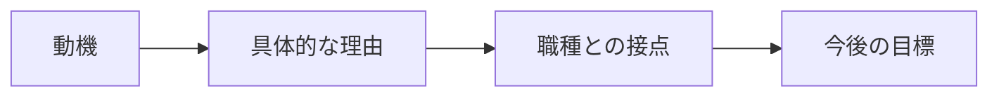
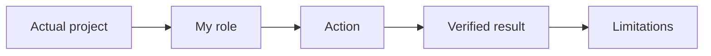
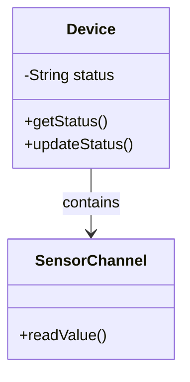
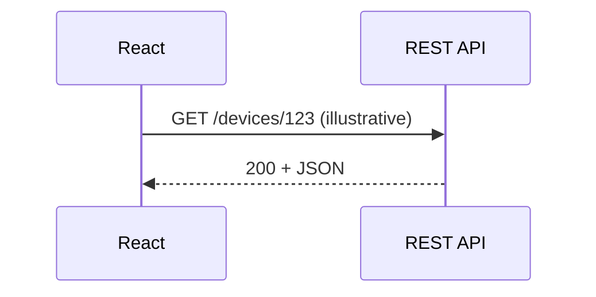
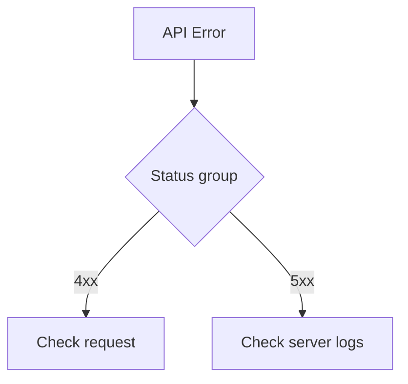
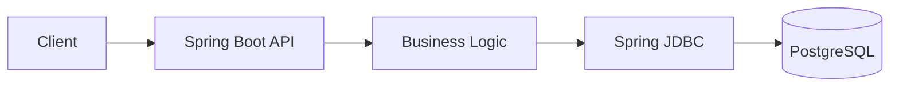
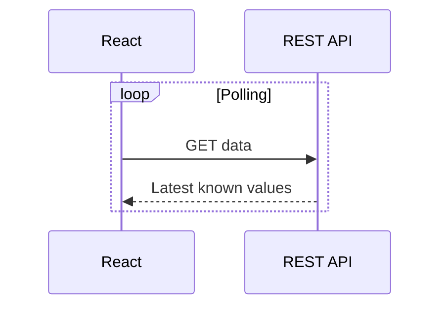
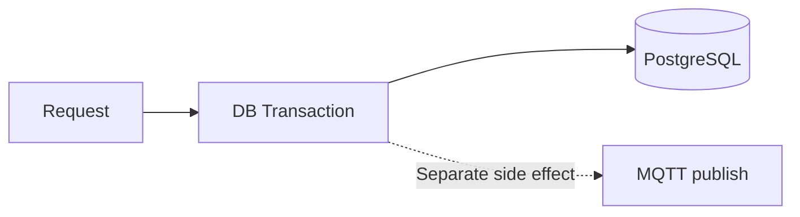
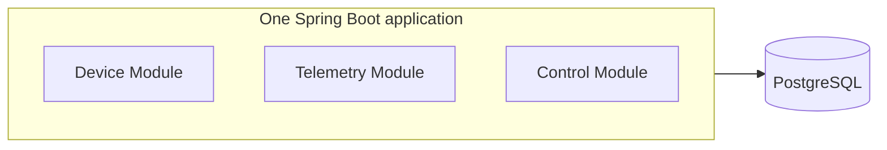

# BRSE Interview Master — 日本語で突破するBrSE面接

*Bản sách tổng hợp học tập — 22/10/2026*

**Ngôn ngữ:** Tiếng Nhật N3–N2 và giải thích tiếng Việt. **Phạm vi:** 14 chương, 49 bài. **Trạng thái:** Bản thảo; chưa có nghiệm thu độc lập của người bản ngữ hoặc người học thử. Những phần 【】 cần điền bằng sự thật đã xác minh.

## Mục lục

- Chương 01: 自己紹介・自己PR (3 bài)
- Chương 02: 志望動機・キャリアプラン (3 bài)
- Chương 03: 職務経歴・プロジェクト説明 (3 bài)
- Chương 04: プログラミング・Web技術 (3 bài)
- Chương 05: フレームワーク・データベース (3 bài)
- Chương 06: システム設計・クラウド (3 bài)
- Chương 07: 開発工程・品質管理 (3 bài)
- Chương 08: 要件定義・仕様確認 (3 bài)
- Chương 09: 顧客対応・問題解決 (3 bài)
- Chương 10: 報連相・ビジネス日本語 (3 bài)
- Chương 11: 類似表現・自然な日本語 (3 bài)
- Chương 12: Smart Farm IoT — 技術デモ (10 bài)
- Chương 13: 模擬面接・深掘り質問 (3 bài)
- Chương 14: 面接直前対策 (3 bài)

## Cách học

Tự trả lời câu hỏi trước khi xem mẫu; nói rõ kết luận, lý do, giới hạn, rồi luyện câu hỏi đào sâu và ghi âm. Nội dung Smart Farm cần phân biệt môi trường mô phỏng, gửi lệnh MQTT, ACK, trạng thái thiết bị và tác động thực tế.

---

## Chương 01 — 自己紹介・自己PR

### 第01.01課 — 自己紹介 — Tự giới thiệu 30/60 giây

> **BRSE Interview Master — Draft / Pending Japanese Review.** Trình độ N3–N2, mục tiêu trả lời chính 15–30 giây. Các câu về cá nhân là **mẫu**; chỉ dùng sau khi điền dữ kiện thật. Không có chứng nhận người Nhật đã duyệt.

#### ① 学習目標 — Mục tiêu

Sau bài học, người học nhận biết ý định câu hỏi, trả lời đúng trọng tâm bằng 2–4 câu tiếng Nhật, phân biệt dữ kiện và giả định, phản hồi một câu hỏi đào sâu và sửa câu chưa tự nhiên.

#### ② 面接質問・質問の意図

**面接官：** 自己紹介をお願いします。

**Người phỏng vấn đang kiểm tra:** Ứng viên có giới thiệu bản thân rõ ràng, chọn trải nghiệm liên quan và thể hiện mối liên hệ với vị trí ứng tuyển hay không.

#### ③ 知識・思考プロセス — Kiến thức và cách suy nghĩ

Tự giới thiệu phải dựa CV: trình độ học vấn, trải nghiệm, mục tiêu thật. Không dùng placeholder để phát biểu trong phỏng vấn.

Cách trả lời: **kết luận → lý do / hành động → bằng chứng / giới hạn**. Với kinh nghiệm cá nhân, chỉ sử dụng sự thật trong CV/commit/test. Với tình huống giả định, dùng các cách nói 〜の場合は / 〜と考えています, tránh giả vờ từng làm.

#### ④ 図解 — Sơ đồ tư duy

**日本語で説明（mẫu nói sơ đồ）：** まず質問の目的を確認します。次に、結論を短く伝えます。必要なら理由や具体例を加え、確認できていない点は分けて説明します。

**Dịch:** Xác định mục đích câu hỏi; nêu kết luận ngắn; bổ sung lý do/ví dụ nếu cần và tách riêng thông tin chưa được xác minh. Sơ đồ là công cụ học, không phải architecture thực tế trừ khi nội dung nói rõ.

#### ⑤ 面接対話 — Hội thoại hỏi đáp

**面接官：** 自己紹介をお願いします。

**Dịch câu hỏi:** Bạn hãy tự giới thiệu về bản thân.

**応募者（Standard・要記入）：** 私は【実際の専攻・学歴】を学び、【実際に取り組んだ分野】に関心があります。特に【証拠のある学習・プロジェクト経験】に取り組みました。今後は【実際の志望職種】として成長したいと考えています。

**ベトナム語訳:** Tôi đã học [ngành học/học vấn thực tế] và quan tâm đến [lĩnh vực đã thực sự tìm hiểu]. Đặc biệt, tôi đã thực hiện [hoạt động học tập/dự án có bằng chứng]. Trong tương lai, tôi muốn phát triển với vai trò [vị trí thực sự mong muốn].

> **Chưa phải bản nói hoàn chỉnh:** Chỉ đọc thành tiếng sau khi thay tất cả các phần 【】 bằng thông tin đúng CV.

**面接官（深掘り）：** どのプロジェクトについて話せますか。

**Dịch câu hỏi đào sâu:** Bạn có thể nói về dự án nào?

**応募者：** Smart Farmなど、内容を説明できるプロジェクトを一つ選び、担当範囲は事実に基づいて答えます。

**ベトナム語訳:** Tôi sẽ chọn một dự án mình có thể giải thích rõ, chẳng hạn Smart Farm, rồi trình bày phạm vi công việc dựa trên sự thật.

**Professional version:** Giữ cùng ý nhưng điều chỉnh lịch sự và độ chính xác. Không tự động dùng 敬語 phức tạp; không sửa sự thật để tạo ấn tượng.

#### ⑥ 類似表現比較 — Cách nói dễ nhầm

- **確認しました** = đã kiểm tra; **検証しました** = đã kiểm chứng bằng phép thử/phương pháp.
- **担当しました** = đã phụ trách; **参加しました** = đã tham gia, không tự đồng nghĩa.
- **〜ができます** = có thể thực hiện theo điều kiện; **本番で運用しています** = đang vận hành production và cần minh chứng.
- **〜を確認した上で回答します** = sẽ trả lời sau khi xác nhận, phù hợp khi chưa đủ dữ liệu.

#### ⑦ 語彙・文法 — Từ vựng

| 日本語 | 読み方 | Nghĩa |
|---|---|---|
| 自己紹介 | じこしょうかい | Tự giới thiệu |
| 強み | つよみ | Điểm mạnh |
| 弱み | よわみ | Điểm yếu |
| 改善 | かいぜん | Cải thiện |
| 認識を合わせる | にんしきをあわせる | Thống nhất nhận thức |
| 相談する | そうだんする | Trao đổi/xin hỗ trợ |

Mẫu hữu ích: **まず〜を確認します。次に〜を整理します。その上で〜を説明します。** / **現時点では〜を確認できていません。**

#### ⑧ 会話練習 — Luyện phản xạ và ứng dụng

1. Không nhìn mẫu: trả lời câu chính trong 20–30 giây, theo cấu trúc kết luận → căn cứ → giới hạn thực tế.
2. **面接官：** 自己紹介で、技術経験をどのように簡潔に伝えますか。
   
   **Dịch:** Bạn giới thiệu ngắn gọn kinh nghiệm kỹ thuật thế nào?
   
   **応募者（回答例）：** 専門分野と実際に取り組んだことを一つ選び、具体的に説明します。
   
   **Dịch:** Tôi chọn một chuyên môn và một công việc thực sự đã làm để giải thích cụ thể.
3. Chuyển ngữ cảnh: áp dụng câu trên vào kinh nghiệm **có thật** của bản thân, không nhận thành quả không có bằng chứng.
4. Ghi âm một lần, tự đánh giá: nội dung đúng, mạch lạc, tự nhiên, đúng thời gian (mỗi tiêu chí 0–5 điểm).
5. **AI Interviewer:** この質問を一つずつ出し、私の回答を待ってください。具体例を一つ質問した後、自然な日本語の改善案を示してください。

#### ⑨ 解答ポイント — Điểm tự kiểm tra

- Nói kết luận trước và không kéo dài câu chính.
- Biết phân biệt vấn đề có thể giải thích ngay với thông tin cần xác minh.
- Với Smart Farm: backend và PostgreSQL chủ yếu local, luồng ESP32/Wokwi–AWS–backend có bằng chứng chạy thử theo mô tả; chưa xác nhận production hoặc bơm/van thật.
- Không thêm thành tích cá nhân, thời gian, số liệu không có căn cứ.

#### ⑩ 評価・改善 — Rubric /20

Tự chấm 0–4 cho mỗi tiêu chí: **đúng trọng tâm**, **độ chính xác / tính trung thực**, **tiếng Nhật tự nhiên**, **cấu trúc logic**, **đối đáp câu hỏi đào sâu**. Điểm 16–20: tốt; 12–15: cần chỉnh; dưới 12: luyện lại. Không phải chuẩn chính thức. Với văn bản, không đánh giá phát âm.

**Cách sửa:** ghi câu trả lời → xác định ba lỗi lớn nhất → rút gọn thành 2–4 câu Nhật → thực hành lại không nhìn mẫu.

#### 出典とステータス

Bài được biên soạn từ khung BRSE Interview Master và thông tin dự án do người dùng cung cấp. Các tình huống chung là ví dụ sư phạm; chưa qua native Japanese reviewer hoặc kiểm định Mermaid render. Trước khi duyệt, bổ sung bản dịch Việt sát nghĩa theo từng câu, đối chiếu CV và luyện nói có bấm giờ.

*Nguồn: [01-01-self-introduction.md](https://github.com/NiDa30/Interview/blob/main/book/chapters/chapter-01/01-01-self-introduction.md)*

### 第01.02課 — 強み・弱み — Điểm mạnh và điểm yếu

> **BRSE Interview Master — Draft / Pending Japanese Review.** Trình độ N3–N2, mục tiêu trả lời chính 15–30 giây. Các câu về cá nhân là **mẫu**; chỉ dùng sau khi điền dữ kiện thật. Không có chứng nhận người Nhật đã duyệt.

#### ① 学習目標 — Mục tiêu

Sau bài học, người học nhận biết ý định câu hỏi, trả lời đúng trọng tâm bằng 2–4 câu tiếng Nhật, phân biệt dữ kiện và giả định, phản hồi một câu hỏi đào sâu và sửa câu chưa tự nhiên.

#### ② 面接質問・質問の意図

**面接官：** あなたの強みは何ですか。

**Người phỏng vấn đang kiểm tra:** 強みは抽象的な性格だけでなく、仕事で再現できる行動として説明します。

#### ③ 知識・思考プロセス — Kiến thức và cách suy nghĩ

Điểm mạnh/vấn đề chỉ là ví dụ thực hành; không khẳng định người học đã thể hiện trong một dự án cụ thể.

Cách trả lời: **kết luận → lý do / hành động → bằng chứng / giới hạn**. Với kinh nghiệm cá nhân, chỉ sử dụng sự thật trong CV/commit/test. Với tình huống giả định, dùng các cách nói 〜の場合は / 〜と考えています, tránh giả vờ từng làm.

#### ④ 図解 — Sơ đồ tư duy

**日本語で説明（mẫu nói sơ đồ）：** まず質問の目的を確認します。次に、結論を短く伝えます。必要なら理由や具体例を加え、確認できていない点は分けて説明します。

**Dịch:** Xác định mục đích câu hỏi; nêu kết luận ngắn; bổ sung lý do/ví dụ nếu cần và tách riêng thông tin chưa được xác minh. Sơ đồ là công cụ học, không phải architecture thực tế trừ khi nội dung nói rõ.

#### ⑤ 面接対話 — Hội thoại hỏi đáp

**面接官：** あなたの強みは何ですか。

**Dịch câu hỏi:** Điểm mạnh và điểm yếu của bạn là gì?

**応募者（Standard）：** 私の強みは、分からないことを整理して確認する姿勢です。曖昧な点は質問し、認識を合わせるようにしています。

**ベトナム語訳:** Điểm mạnh của tôi là thái độ hệ thống hóa và xác nhận những điều chưa hiểu. Khi có chỗ mơ hồ, tôi đặt câu hỏi và cố gắng thống nhất cách hiểu giữa các bên.

**面接官（深掘り）：** 弱みは何ですか。

**Dịch câu hỏi đào sâu:** Bạn đang cải thiện điểm yếu như thế nào?

**応募者：** 【実際の弱み】を挙げ、今行っている改善方法を説明します。

**ベトナム語訳（ý nghĩa）：** Tôi sẽ nêu điểm yếu thực tế của mình và giải thích cách tôi đang cải thiện nó.

**Professional version:** Giữ cùng ý nhưng điều chỉnh lịch sự và độ chính xác. Không tự động dùng 敬語 phức tạp; không sửa sự thật để tạo ấn tượng.

#### ⑥ 類似表現比較 — Cách nói dễ nhầm

- **確認しました** = đã kiểm tra; **検証しました** = đã kiểm chứng bằng phép thử/phương pháp.
- **担当しました** = đã phụ trách; **参加しました** = đã tham gia, không tự đồng nghĩa.
- **〜ができます** = có thể thực hiện theo điều kiện; **本番で運用しています** = đang vận hành production và cần minh chứng.
- **〜を確認した上で回答します** = sẽ trả lời sau khi xác nhận, phù hợp khi chưa đủ dữ liệu.

#### ⑦ 語彙・文法 — Từ vựng

| 日本語 | 読み方 | Nghĩa |
|---|---|---|
| 自己紹介 | じこしょうかい | Tự giới thiệu |
| 強み | つよみ | Điểm mạnh |
| 弱み | よわみ | Điểm yếu |
| 改善 | かいぜん | Cải thiện |
| 認識を合わせる | にんしきをあわせる | Thống nhất nhận thức |
| 相談する | そうだんする | Trao đổi/xin hỗ trợ |

Mẫu hữu ích: **まず〜を確認します。次に〜を整理します。その上で〜を説明します。** / **現時点では〜を確認できていません。**

#### ⑧ 会話練習 — Luyện phản xạ và ứng dụng

1. Không nhìn mẫu: trả lời câu chính trong 20–30 giây, theo cấu trúc kết luận → căn cứ → giới hạn thực tế.
2. **面接官：** 弱みを伝える時、どんな点に気を付けますか。
   
   **Dịch:** Khi trình bày điểm yếu, cần lưu ý gì?
   
   **応募者（回答例）：** 弱みだけでなく、改善のために実践していることも説明します。
   
   **Dịch:** Không chỉ nói điểm yếu mà còn trình bày việc tôi đang thực hiện để cải thiện.
3. Chuyển ngữ cảnh: áp dụng câu trên vào kinh nghiệm **có thật** của bản thân, không nhận thành quả không có bằng chứng.
4. Ghi âm một lần, tự đánh giá: nội dung đúng, mạch lạc, tự nhiên, đúng thời gian (mỗi tiêu chí 0–5 điểm).
5. **AI Interviewer:** この質問を一つずつ出し、私の回答を待ってください。具体例を一つ質問した後、自然な日本語の改善案を示してください。

#### ⑨ 解答ポイント — Điểm tự kiểm tra

- Nói kết luận trước và không kéo dài câu chính.
- Biết phân biệt vấn đề có thể giải thích ngay với thông tin cần xác minh.
- Với Smart Farm: backend và PostgreSQL chủ yếu local, luồng ESP32/Wokwi–AWS–backend có bằng chứng chạy thử theo mô tả; chưa xác nhận production hoặc bơm/van thật.
- Không thêm thành tích cá nhân, thời gian, số liệu không có căn cứ.

#### ⑩ 評価・改善 — Rubric /20

Tự chấm 0–4 cho mỗi tiêu chí: **đúng trọng tâm**, **độ chính xác / tính trung thực**, **tiếng Nhật tự nhiên**, **cấu trúc logic**, **đối đáp câu hỏi đào sâu**. Điểm 16–20: tốt; 12–15: cần chỉnh; dưới 12: luyện lại. Không phải chuẩn chính thức. Với văn bản, không đánh giá phát âm.

**Cách sửa:** ghi câu trả lời → xác định ba lỗi lớn nhất → rút gọn thành 2–4 câu Nhật → thực hành lại không nhìn mẫu.

#### 出典とステータス

Bài được biên soạn từ khung BRSE Interview Master và thông tin dự án do người dùng cung cấp. Các tình huống chung là ví dụ sư phạm; chưa qua native Japanese reviewer hoặc kiểm định Mermaid render. Trước khi duyệt, bổ sung bản dịch Việt sát nghĩa theo từng câu, đối chiếu CV và luyện nói có bấm giờ.

*Nguồn: [01-02-strengths-weaknesses.md](https://github.com/NiDa30/Interview/blob/main/book/chapters/chapter-01/01-02-strengths-weaknesses.md)*

### 第01.03課 — 学習姿勢・チームワーク — Học hỏi và làm việc nhóm

> **BRSE Interview Master — Draft / Pending Japanese Review.** Trình độ N3–N2, mục tiêu trả lời chính 15–30 giây. Các câu về cá nhân là **mẫu**; chỉ dùng sau khi điền dữ kiện thật. Không có chứng nhận người Nhật đã duyệt.

#### ① 学習目標 — Mục tiêu

Sau bài học, người học nhận biết ý định câu hỏi, trả lời đúng trọng tâm bằng 2–4 câu tiếng Nhật, phân biệt dữ kiện và giả định, phản hồi một câu hỏi đào sâu và sửa câu chưa tự nhiên.

#### ② 面接質問・質問の意図

**面接官：** 知らない技術が必要になったらどうしますか。

**Người phỏng vấn đang kiểm tra:** 技術課題には、必要性と期限を確認し、小さな実験で検証する姿勢が重要です。

#### ③ 知識・思考プロセス — Kiến thức và cách suy nghĩ

Đây là cách ứng xử gợi ý, không nhận là hành động đã xảy ra.

Cách trả lời: **kết luận → lý do / hành động → bằng chứng / giới hạn**. Với kinh nghiệm cá nhân, chỉ sử dụng sự thật trong CV/commit/test. Với tình huống giả định, dùng các cách nói 〜の場合は / 〜と考えています, tránh giả vờ từng làm.

#### ④ 図解 — Sơ đồ tư duy

**日本語で説明（mẫu nói sơ đồ）：** まず質問の目的を確認します。次に、結論を短く伝えます。必要なら理由や具体例を加え、確認できていない点は分けて説明します。

**Dịch:** Xác định mục đích câu hỏi; nêu kết luận ngắn; bổ sung lý do/ví dụ nếu cần và tách riêng thông tin chưa được xác minh. Sơ đồ là công cụ học, không phải architecture thực tế trừ khi nội dung nói rõ.

#### ⑤ 面接対話 — Hội thoại hỏi đáp

**面接官：** 知らない技術が必要になったらどうしますか。

**Dịch câu hỏi:** Nếu cần sử dụng công nghệ mà bạn chưa biết, bạn sẽ làm gì?

**応募者（Standard）：** まず必要な機能と期限を確認します。その後、公式資料を調べて小さく試し、分からない点はチームに相談します。

**ベトナム語訳:** Trước hết tôi xác nhận chức năng cần thiết và thời hạn. Sau đó tôi đọc tài liệu chính thức, thử ở phạm vi nhỏ và trao đổi với nhóm về những điểm chưa hiểu.

**面接官（深掘り）：** 納期が短い場合はどうしますか。

**Dịch câu hỏi đào sâu:** Nếu thời hạn rất ngắn thì sao?

**応募者：** 優先順位を整理し、実現できる範囲とリスクを早めに共有します。

**ベトナム語訳（ý nghĩa）：** Tôi sắp xếp thứ tự ưu tiên và chia sẻ sớm phạm vi có thể thực hiện cùng các rủi ro.

**Professional version:** Giữ cùng ý nhưng điều chỉnh lịch sự và độ chính xác. Không tự động dùng 敬語 phức tạp; không sửa sự thật để tạo ấn tượng.

#### ⑥ 類似表現比較 — Cách nói dễ nhầm

- **確認しました** = đã kiểm tra; **検証しました** = đã kiểm chứng bằng phép thử/phương pháp.
- **担当しました** = đã phụ trách; **参加しました** = đã tham gia, không tự đồng nghĩa.
- **〜ができます** = có thể thực hiện theo điều kiện; **本番で運用しています** = đang vận hành production và cần minh chứng.
- **〜を確認した上で回答します** = sẽ trả lời sau khi xác nhận, phù hợp khi chưa đủ dữ liệu.

#### ⑦ 語彙・文法 — Từ vựng

| 日本語 | 読み方 | Nghĩa |
|---|---|---|
| 自己紹介 | じこしょうかい | Tự giới thiệu |
| 強み | つよみ | Điểm mạnh |
| 弱み | よわみ | Điểm yếu |
| 改善 | かいぜん | Cải thiện |
| 認識を合わせる | にんしきをあわせる | Thống nhất nhận thức |
| 相談する | そうだんする | Trao đổi/xin hỗ trợ |

Mẫu hữu ích: **まず〜を確認します。次に〜を整理します。その上で〜を説明します。** / **現時点では〜を確認できていません。**

#### ⑧ 会話練習 — Luyện phản xạ và ứng dụng

1. Không nhìn mẫu: trả lời câu chính trong 20–30 giây, theo cấu trúc kết luận → căn cứ → giới hạn thực tế.
2. **面接官：** 知らない技術を学ぶ時、最初に何をしますか。
   
   **Dịch:** Khi học công nghệ mới, bạn làm gì đầu tiên?
   
   **応募者（回答例）：** 目標と必要な基礎を確認し、小さな課題で試します。
   
   **Dịch:** Tôi xác định mục tiêu và kiến thức nền rồi thử qua bài tập nhỏ.
3. Chuyển ngữ cảnh: áp dụng câu trên vào kinh nghiệm **có thật** của bản thân, không nhận thành quả không có bằng chứng.
4. Ghi âm một lần, tự đánh giá: nội dung đúng, mạch lạc, tự nhiên, đúng thời gian (mỗi tiêu chí 0–5 điểm).
5. **AI Interviewer:** この質問を一つずつ出し、私の回答を待ってください。具体例を一つ質問した後、自然な日本語の改善案を示してください。

#### ⑨ 解答ポイント — Điểm tự kiểm tra

- Nói kết luận trước và không kéo dài câu chính.
- Biết phân biệt vấn đề có thể giải thích ngay với thông tin cần xác minh.
- Với Smart Farm: backend và PostgreSQL chủ yếu local, luồng ESP32/Wokwi–AWS–backend có bằng chứng chạy thử theo mô tả; chưa xác nhận production hoặc bơm/van thật.
- Không thêm thành tích cá nhân, thời gian, số liệu không có căn cứ.

#### ⑩ 評価・改善 — Rubric /20

Tự chấm 0–4 cho mỗi tiêu chí: **đúng trọng tâm**, **độ chính xác / tính trung thực**, **tiếng Nhật tự nhiên**, **cấu trúc logic**, **đối đáp câu hỏi đào sâu**. Điểm 16–20: tốt; 12–15: cần chỉnh; dưới 12: luyện lại. Không phải chuẩn chính thức. Với văn bản, không đánh giá phát âm.

**Cách sửa:** ghi câu trả lời → xác định ba lỗi lớn nhất → rút gọn thành 2–4 câu Nhật → thực hành lại không nhìn mẫu.

#### 出典とステータス

Bài được biên soạn từ khung BRSE Interview Master và thông tin dự án do người dùng cung cấp. Các tình huống chung là ví dụ sư phạm; chưa qua native Japanese reviewer hoặc kiểm định Mermaid render. Trước khi duyệt, bổ sung bản dịch Việt sát nghĩa theo từng câu, đối chiếu CV và luyện nói có bấm giờ.

*Nguồn: [01-03-learning-attitude.md](https://github.com/NiDa30/Interview/blob/main/book/chapters/chapter-01/01-03-learning-attitude.md)*

---

## Chương 02 — 志望動機・キャリアプラン

### 第02.01課 — 志望動機・BrSEを選ぶ理由

> **BRSE Interview Master · 日本語 N3–N2** · Draft / Pending reviewer.  
> Câu chính mục tiêu 15–30 giây, câu đào sâu 10–25 giây; thời lượng cần tự bấm giờ. Đây là bài học luyện phỏng vấn, không phải xác nhận kinh nghiệm cá nhân hay bản dịch được người Nhật duyệt.

#### ① 学習目標 — Mục tiêu

Hiểu câu hỏi, xác định điều nhà tuyển dụng thực sự muốn biết, đưa ra câu trả lời ngắn có căn cứ, trả lời một câu hỏi đào sâu và tự sửa theo rubric. Chủ đề: **志望動機・BrSEを選ぶ理由**.

#### ② 面接質問・質問の意図

**面接官：** なぜBrSEを志望していますか。

**Dịch câu hỏi:** Vì sao bạn muốn làm BrSE?

**Ý định:** Kiểm tra khả năng diễn đạt rõ ràng, tính thực tế của lý do/kinh nghiệm và cách xử lý tình huống bằng tiếng Nhật. Khi cần bằng chứng CV, phải lấy từ người học chứ không suy đoán.

#### ③ 思考プロセス・技術知識

Motivation → Match with role → Contribution; sửa theo động lực thực, tránh khẳng định đã từng làm BrSE.

**Khung sử dụng:** Kết luận hoặc tình trạng thực tế → lý do/tiêu chí → hành động hoặc bằng chứng → giới hạn. Nếu là tình huống giả định, dùng 「〜の場合は」; không biến giả định thành một thành tích đã xảy ra.

**日本語で図を説明：** まず質問の意図を確認し、結論を短く伝えます。その後、理由や具体例を加え、未確認の点は分けて説明します。

**Dịch:** Xác nhận ý định câu hỏi và nêu kết luận ngắn; sau đó bổ sung lý do/ví dụ, tách riêng điều chưa được xác minh.

#### ④ 面接対話 — Hội thoại chính + đào sâu

**面接官：** なぜBrSEを志望していますか。

**Dịch câu hỏi:** Vì sao bạn muốn ứng tuyển vị trí BrSE?

**応募者（Standard）：** 技術とコミュニケーションの両方を使い、お客様と開発チームの認識を合わせる仕事に関心があるからです。要件を正しく理解し、誤解を減らせるエンジニアを目指しています。

**Dịch tiếng Việt:** Tôi quan tâm công việc kết hợp kỹ thuật và giao tiếp để thống nhất nhận thức giữa khách hàng và đội phát triển. Tôi muốn trở thành kỹ sư hiểu đúng yêu cầu và giảm hiểu nhầm.

**面接官（深掘り）：** BrSEにはどんなスキルが必要ですか。

**Dịch câu hỏi đào sâu:** Theo bạn, BrSE cần những kỹ năng gì?

**応募者：** 技術理解だけでなく、要件を整理し、相手に分かりやすく伝える力が必要だと考えています。

**Dịch tiếng Việt:** Theo tôi, ngoài hiểu kỹ thuật cần kỹ năng hệ thống hóa yêu cầu và diễn đạt dễ hiểu.

**言い換えの注意:** Trong phỏng vấn ứng viên thường dùng です・ます rõ ràng. Không thêm 「恐れ入りますが」 một cách máy móc vào câu nói về động lực, công nghệ hoặc ngữ nghĩa thuật ngữ.

#### ⑤ 類似表現比較 — Sắc thái diễn đạt

| Cách nói | Khi dùng | Giới hạn |
|---|---|---|
| 〜と考えています | Quan điểm/định hướng | Không thay cho bằng chứng đã kiểm thử |
| 〜を確認しました | Đã xác nhận | Chỉ khi thực sự kiểm tra |
| 〜を検証しました | Đã kiểm chứng bằng phương pháp | Cần có phép thử/evidence |
| 現時点では未確認です | Hiện chưa xác minh | Phù hợp khi thông tin chưa chắc |
| 〜について確認させていただけますか | Xin xác nhận lịch sự | Dùng khi trao đổi với người cần tôn trọng |

#### ⑥ 語彙・文法 — Từ vựng trong bài

| 日本語 | 読み方 | Nghĩa |
|---|---|---|
| 志望動機 | しぼうどうき | Động lực ứng tuyển |
| 認識 | にんしき | Nhận thức |
| 要件 | ようけん | Yêu cầu |
| 誤解 | ごかい | Hiểu nhầm |

**Mẫu có thể tái sử dụng:** 「まず〜を確認します。」「〜のために〜しています。」「〜と考えています。」「〜については、まだ確認できていません。」

#### ⑦ 会話練習 — Active recall / Roleplay

1. **Shadowing:** đọc hội thoại và ngắt nhịp tự nhiên theo câu (không khẳng định phát âm chuẩn nếu chưa có audio).
2. **20 giây:** tự trả lời câu chính, không nhìn câu mẫu.
3. **15 giây:** trả lời câu đào sâu và bổ sung một ví dụ hoặc giới hạn.
4. **Transfer:** đổi sang một doanh nghiệp/dự án khác mà vẫn giữ cấu trúc lập luận; không sao chép thông tin chưa đúng.
5. **Prompt luyện với AI:** 「あなたは日本企業のBrSE面接官です。『志望動機・BrSEを選ぶ理由』について一問ずつ質問してください。回答を待ち、その内容に合わせて深掘り質問を一つだけしてください。最後に短い改善点を伝えてください。未確認の経験を事実として扱わないでください。」

**課題別・追加ロールプレイ — Tình huống bổ sung:**

**面接官：** BrSEを目指す理由を、具体的な仕事と結び付けて説明してください。

**Dịch câu hỏi:** Gắn động lực làm BrSE với công việc cụ thể.

**応募者（例）：** 技術を理解した上で、お客様と開発チームの認識を合わせる仕事に関心があります。

**Bài luyện:** Trả lời lại bằng lời của mình trong 20–30 giây; phân biệt điều đã làm, dự định và giả định. Không tự nhận kinh nghiệm chưa kiểm chứng.

#### ⑧ 解答のポイント — Điểm cần nhớ

- Trả lời thẳng câu hỏi thay vì kể quá nhiều thông tin.
- Dùng một lý do chính và tối đa một ví dụ ngắn khi luyện 15–30 giây.
- Với phát biểu cá nhân hoặc CV, chỉ nói điều thực sự đúng; các dấu 【】 là chỗ cần điền, không phải câu hoàn chỉnh.
- Với Smart Farm nếu được nhắc tới, backend/database chủ yếu local; chưa xác nhận production hoặc vận hành bơm/van thật.

#### ⑨ 評価・改善 — Rubric /20

Mỗi tiêu chí 0–4: **đúng trọng tâm**, **chính xác và trung thực**, **tiếng Nhật tự nhiên**, **giải thích mạch lạc**, **trả lời follow-up**. Mốc tự học 16–20 tốt, 12–15 cần sửa, dưới 12 cần luyện lại. Không phải điểm JLPT hoặc tiêu chí tuyển dụng chính thức. Không chấm phát âm bằng văn bản.

#### ⑩ 出典・検証状況

- Nội dung ví dụ được biên soạn để luyện nói, chưa có native Japanese reviewer xác nhận.
- Những nội dung nghề nghiệp/cá nhân phải kiểm tra với CV, JD, hoặc câu trả lời người học.
- Chưa đo thời lượng đọc nói thực tế hoặc kiểm thử render Mermaid.
- Bài này không xác nhận bất cứ production deployment, điểm thi tiếng Nhật hay thành tích không được cung cấp.

*Nguồn: [02-01-brse-motivation.md](https://github.com/NiDa30/Interview/blob/main/book/chapters/chapter-02/02-01-brse-motivation.md)*

### 第02.02課 — 日本で働く理由・異文化理解

> **BRSE Interview Master · 日本語 N3–N2** · Draft / Pending reviewer.  
> Câu chính mục tiêu 15–30 giây, câu đào sâu 10–25 giây; thời lượng cần tự bấm giờ. Đây là bài học luyện phỏng vấn, không phải xác nhận kinh nghiệm cá nhân hay bản dịch được người Nhật duyệt.

#### ① 学習目標 — Mục tiêu

Hiểu câu hỏi, xác định điều nhà tuyển dụng thực sự muốn biết, đưa ra câu trả lời ngắn có căn cứ, trả lời một câu hỏi đào sâu và tự sửa theo rubric. Chủ đề: **日本で働く理由・異文化理解**.

#### ② 面接質問・質問の意図

**面接官：** なぜ日本で働きたいですか。

**Dịch câu hỏi:** Vì sao bạn muốn làm việc tại Nhật?

**Ý định:** Kiểm tra khả năng diễn đạt rõ ràng, tính thực tế của lý do/kinh nghiệm và cách xử lý tình huống bằng tiếng Nhật. Khi cần bằng chứng CV, phải lấy từ người học chứ không suy đoán.

#### ③ 思考プロセス・技術知識

Personal reason → Concrete behavior → Respect cultural differences; không khái quát mọi công ty Nhật giống nhau.

**Khung sử dụng:** Kết luận hoặc tình trạng thực tế → lý do/tiêu chí → hành động hoặc bằng chứng → giới hạn. Nếu là tình huống giả định, dùng 「〜の場合は」; không biến giả định thành một thành tích đã xảy ra.

**日本語で図を説明：** まず質問の意図を確認し、結論を短く伝えます。その後、理由や具体例を加え、未確認の点は分けて説明します。

**Dịch:** Xác nhận ý định câu hỏi và nêu kết luận ngắn; sau đó bổ sung lý do/ví dụ, tách riêng điều chưa được xác minh.

#### ④ 面接対話 — Hội thoại chính + đào sâu

**面接官：** なぜ日本で働きたいですか。

**Dịch câu hỏi:** Vì sao bạn muốn làm việc tại Nhật Bản?

**応募者（Standard）：** 日本の開発現場で仕事の進め方を学び、日本語で技術や要件を正確に共有できるようになりたいからです。分からない時は確認する姿勢を大切にしたいです。

**Dịch tiếng Việt:** Tôi muốn học cách làm việc ở môi trường phát triển tại Nhật và có thể trao đổi kỹ thuật, yêu cầu chính xác bằng tiếng Nhật. Tôi chú trọng xác nhận khi chưa hiểu.

**面接官（深掘り）：** 文化や働き方が違ったらどうしますか。

**Dịch câu hỏi đào sâu:** Nếu văn hóa hoặc cách làm việc khác nhau, bạn sẽ xử lý thế nào?

**応募者：** まず理由とルールを確認し、決めつけずに相手と相談します。

**Dịch tiếng Việt:** Trước hết tìm hiểu lý do và quy tắc, trao đổi thay vì phán đoán.

**言い換えの注意:** Trong phỏng vấn ứng viên thường dùng です・ます rõ ràng. Không thêm 「恐れ入りますが」 một cách máy móc vào câu nói về động lực, công nghệ hoặc ngữ nghĩa thuật ngữ.

#### ⑤ 類似表現比較 — Sắc thái diễn đạt

| Cách nói | Khi dùng | Giới hạn |
|---|---|---|
| 〜と考えています | Quan điểm/định hướng | Không thay cho bằng chứng đã kiểm thử |
| 〜を確認しました | Đã xác nhận | Chỉ khi thực sự kiểm tra |
| 〜を検証しました | Đã kiểm chứng bằng phương pháp | Cần có phép thử/evidence |
| 現時点では未確認です | Hiện chưa xác minh | Phù hợp khi thông tin chưa chắc |
| 〜について確認させていただけますか | Xin xác nhận lịch sự | Dùng khi trao đổi với người cần tôn trọng |

#### ⑥ 語彙・文法 — Từ vựng trong bài

| 日本語 | 読み方 | Nghĩa |
|---|---|---|
| 働き方 | はたらきかた | Cách làm việc |
| 文化 | ぶんか | Văn hóa |
| 共有 | きょうゆう | Chia sẻ thông tin |
| 確認 | かくにん | Xác nhận |

**Mẫu có thể tái sử dụng:** 「まず〜を確認します。」「〜のために〜しています。」「〜と考えています。」「〜については、まだ確認できていません。」

#### ⑦ 会話練習 — Active recall / Roleplay

1. **Shadowing:** đọc hội thoại và ngắt nhịp tự nhiên theo câu (không khẳng định phát âm chuẩn nếu chưa có audio).
2. **20 giây:** tự trả lời câu chính, không nhìn câu mẫu.
3. **15 giây:** trả lời câu đào sâu và bổ sung một ví dụ hoặc giới hạn.
4. **Transfer:** đổi sang một doanh nghiệp/dự án khác mà vẫn giữ cấu trúc lập luận; không sao chép thông tin chưa đúng.
5. **Prompt luyện với AI:** 「あなたは日本企業のBrSE面接官です。『日本で働く理由・異文化理解』について一問ずつ質問してください。回答を待ち、その内容に合わせて深掘り質問を一つだけしてください。最後に短い改善点を伝えてください。未確認の経験を事実として扱わないでください。」

**課題別・追加ロールプレイ — Tình huống bổ sung:**

**面接官：** 働き方の違いに戸惑った場合、どうしますか。

**Dịch câu hỏi:** Nếu bối rối vì khác biệt cách làm việc thì sao?

**応募者（例）：** まず背景やルールを確認し、思い込みで判断せず相談します。

**Bài luyện:** Trả lời lại bằng lời của mình trong 20–30 giây; phân biệt điều đã làm, dự định và giả định. Không tự nhận kinh nghiệm chưa kiểm chứng.

#### ⑧ 解答のポイント — Điểm cần nhớ

- Trả lời thẳng câu hỏi thay vì kể quá nhiều thông tin.
- Dùng một lý do chính và tối đa một ví dụ ngắn khi luyện 15–30 giây.
- Với phát biểu cá nhân hoặc CV, chỉ nói điều thực sự đúng; các dấu 【】 là chỗ cần điền, không phải câu hoàn chỉnh.
- Với Smart Farm nếu được nhắc tới, backend/database chủ yếu local; chưa xác nhận production hoặc vận hành bơm/van thật.

#### ⑨ 評価・改善 — Rubric /20

Mỗi tiêu chí 0–4: **đúng trọng tâm**, **chính xác và trung thực**, **tiếng Nhật tự nhiên**, **giải thích mạch lạc**, **trả lời follow-up**. Mốc tự học 16–20 tốt, 12–15 cần sửa, dưới 12 cần luyện lại. Không phải điểm JLPT hoặc tiêu chí tuyển dụng chính thức. Không chấm phát âm bằng văn bản.

#### ⑩ 出典・検証状況

- Nội dung ví dụ được biên soạn để luyện nói, chưa có native Japanese reviewer xác nhận.
- Những nội dung nghề nghiệp/cá nhân phải kiểm tra với CV, JD, hoặc câu trả lời người học.
- Chưa đo thời lượng đọc nói thực tế hoặc kiểm thử render Mermaid.
- Bài này không xác nhận bất cứ production deployment, điểm thi tiếng Nhật hay thành tích không được cung cấp.

*Nguồn: [02-02-working-in-japan.md](https://github.com/NiDa30/Interview/blob/main/book/chapters/chapter-02/02-02-working-in-japan.md)*

### 第02.03課 — キャリアプラン・成長目標

> **BRSE Interview Master · 日本語 N3–N2** · Draft / Pending reviewer.  
> Câu chính mục tiêu 15–30 giây, câu đào sâu 10–25 giây; thời lượng cần tự bấm giờ. Đây là bài học luyện phỏng vấn, không phải xác nhận kinh nghiệm cá nhân hay bản dịch được người Nhật duyệt.

#### ① 学習目標 — Mục tiêu

Hiểu câu hỏi, xác định điều nhà tuyển dụng thực sự muốn biết, đưa ra câu trả lời ngắn có căn cứ, trả lời một câu hỏi đào sâu và tự sửa theo rubric. Chủ đề: **キャリアプラン・成長目標**.

#### ② 面接質問・質問の意図

**面接官：** 三年後はどのようなエンジニアになりたいですか。

**Dịch câu hỏi:** Ba năm nữa, bạn muốn trở thành kỹ sư như thế nào?

**Ý định:** Kiểm tra khả năng diễn đạt rõ ràng, tính thực tế của lý do/kinh nghiệm và cách xử lý tình huống bằng tiếng Nhật. Khi cần bằng chứng CV, phải lấy từ người học chứ không suy đoán.

#### ③ 思考プロセス・技術知識

Short-term skill → evidence → medium-term role. Đây là kế hoạch mẫu không phải cam kết đã được user xác nhận.

**Khung sử dụng:** Kết luận hoặc tình trạng thực tế → lý do/tiêu chí → hành động hoặc bằng chứng → giới hạn. Nếu là tình huống giả định, dùng 「〜の場合は」; không biến giả định thành một thành tích đã xảy ra.

**日本語で図を説明：** まず質問の意図を確認し、結論を短く伝えます。その後、理由や具体例を加え、未確認の点は分けて説明します。

**Dịch:** Xác nhận ý định câu hỏi và nêu kết luận ngắn; sau đó bổ sung lý do/ví dụ, tách riêng điều chưa được xác minh.

#### ④ 面接対話 — Hội thoại chính + đào sâu

**面接官：** 三年後はどのようなエンジニアになりたいですか。

**Dịch câu hỏi:** Ba năm nữa, bạn muốn trở thành kỹ sư như thế nào?

**応募者（Standard）：** Webとクラウドの知識を深め、要件から実装まで説明できるエンジニアになりたいです。その上で、日本語で顧客と開発チームの調整ができるBrSEを目指しています。

**Dịch tiếng Việt:** Trong ba năm, tôi muốn hiểu sâu Web và Cloud, giải thích được từ yêu cầu đến triển khai; tiếp đó hướng đến BrSE có thể điều phối bằng tiếng Nhật.

**面接官（深掘り）：** そのために何を優先しますか。

**Dịch câu hỏi đào sâu:** Để đạt mục tiêu đó, bạn sẽ ưu tiên điều gì?

**応募者：** まず技術の基礎と日本語で説明する力を強化したいです。学習の成果は実際の課題で確認します。

**Dịch tiếng Việt:** Tôi muốn ưu tiên nền tảng kỹ thuật và khả năng diễn đạt tiếng Nhật; kiểm chứng tiến bộ qua bài tập thực tế.

**言い換えの注意:** Trong phỏng vấn ứng viên thường dùng です・ます rõ ràng. Không thêm 「恐れ入りますが」 một cách máy móc vào câu nói về động lực, công nghệ hoặc ngữ nghĩa thuật ngữ.

#### ⑤ 類似表現比較 — Sắc thái diễn đạt

| Cách nói | Khi dùng | Giới hạn |
|---|---|---|
| 〜と考えています | Quan điểm/định hướng | Không thay cho bằng chứng đã kiểm thử |
| 〜を確認しました | Đã xác nhận | Chỉ khi thực sự kiểm tra |
| 〜を検証しました | Đã kiểm chứng bằng phương pháp | Cần có phép thử/evidence |
| 現時点では未確認です | Hiện chưa xác minh | Phù hợp khi thông tin chưa chắc |
| 〜について確認させていただけますか | Xin xác nhận lịch sự | Dùng khi trao đổi với người cần tôn trọng |

#### ⑥ 語彙・文法 — Từ vựng trong bài

| 日本語 | 読み方 | Nghĩa |
|---|---|---|
| 目標 | もくひょう | Mục tiêu |
| 成長 | せいちょう | Phát triển |
| 優先 | ゆうせん | Ưu tiên |
| 調整 | ちょうせい | Điều phối |

**Mẫu có thể tái sử dụng:** 「まず〜を確認します。」「〜のために〜しています。」「〜と考えています。」「〜については、まだ確認できていません。」

#### ⑦ 会話練習 — Active recall / Roleplay

1. **Shadowing:** đọc hội thoại và ngắt nhịp tự nhiên theo câu (không khẳng định phát âm chuẩn nếu chưa có audio).
2. **20 giây:** tự trả lời câu chính, không nhìn câu mẫu.
3. **15 giây:** trả lời câu đào sâu và bổ sung một ví dụ hoặc giới hạn.
4. **Transfer:** đổi sang một doanh nghiệp/dự án khác mà vẫn giữ cấu trúc lập luận; không sao chép thông tin chưa đúng.
5. **Prompt luyện với AI:** 「あなたは日本企業のBrSE面接官です。『キャリアプラン・成長目標』について一問ずつ質問してください。回答を待ち、その内容に合わせて深掘り質問を一つだけしてください。最後に短い改善点を伝えてください。未確認の経験を事実として扱わないでください。」

**課題別・追加ロールプレイ — Tình huống bổ sung:**

**面接官：** 一年以内に強化したいスキルは何ですか。

**Dịch câu hỏi:** Kỹ năng nào muốn tăng trong một năm?

**応募者（例）：** 技術的な説明力と日本語での確認力を優先して伸ばしたいです。

**Bài luyện:** Trả lời lại bằng lời của mình trong 20–30 giây; phân biệt điều đã làm, dự định và giả định. Không tự nhận kinh nghiệm chưa kiểm chứng.

#### ⑧ 解答のポイント — Điểm cần nhớ

- Trả lời thẳng câu hỏi thay vì kể quá nhiều thông tin.
- Dùng một lý do chính và tối đa một ví dụ ngắn khi luyện 15–30 giây.
- Với phát biểu cá nhân hoặc CV, chỉ nói điều thực sự đúng; các dấu 【】 là chỗ cần điền, không phải câu hoàn chỉnh.
- Với Smart Farm nếu được nhắc tới, backend/database chủ yếu local; chưa xác nhận production hoặc vận hành bơm/van thật.

#### ⑨ 評価・改善 — Rubric /20

Mỗi tiêu chí 0–4: **đúng trọng tâm**, **chính xác và trung thực**, **tiếng Nhật tự nhiên**, **giải thích mạch lạc**, **trả lời follow-up**. Mốc tự học 16–20 tốt, 12–15 cần sửa, dưới 12 cần luyện lại. Không phải điểm JLPT hoặc tiêu chí tuyển dụng chính thức. Không chấm phát âm bằng văn bản.

#### ⑩ 出典・検証状況

- Nội dung ví dụ được biên soạn để luyện nói, chưa có native Japanese reviewer xác nhận.
- Những nội dung nghề nghiệp/cá nhân phải kiểm tra với CV, JD, hoặc câu trả lời người học.
- Chưa đo thời lượng đọc nói thực tế hoặc kiểm thử render Mermaid.
- Bài này không xác nhận bất cứ production deployment, điểm thi tiếng Nhật hay thành tích không được cung cấp.

*Nguồn: [02-03-career-roadmap.md](https://github.com/NiDa30/Interview/blob/main/book/chapters/chapter-02/02-03-career-roadmap.md)*

---

## Chương 03 — 職務経歴・プロジェクト説明

### 第03.01課 — 職務経歴書の説明 — Giải thích CV

> **BRSE Interview Master — Draft / Pending Japanese Review.** Trình độ N3–N2, mục tiêu trả lời chính 15–30 giây. Các câu về cá nhân là **mẫu**; chỉ dùng sau khi điền dữ kiện thật. Không có chứng nhận người Nhật đã duyệt.

#### ① 学習目標 — Mục tiêu

Sau bài học, người học nhận biết ý định câu hỏi, trả lời đúng trọng tâm bằng 2–4 câu tiếng Nhật, phân biệt dữ kiện và giả định, phản hồi một câu hỏi đào sâu và sửa câu chưa tự nhiên.

#### ② 面接質問・質問の意図

**面接官：** 職務経歴について説明してください。

**Người phỏng vấn đang kiểm tra:** CV phải phân biệt thời điểm, vai trò, công nghệ trực tiếp dùng và kết quả được xác minh.

#### ③ 知識・思考プロセス — Kiến thức và cách suy nghĩ

Không gán Java, AWS hoặc Spring Boot là kinh nghiệm làm việc chính thức nếu chỉ học hay xây dựng dự án.

Cách trả lời: **kết luận → lý do / hành động → bằng chứng / giới hạn**. Với kinh nghiệm cá nhân, chỉ sử dụng sự thật trong CV/commit/test. Với tình huống giả định, dùng các cách nói 〜の場合は / 〜と考えています, tránh giả vờ từng làm.

#### ④ 図解 — Sơ đồ tư duy

**日本語で説明（mẫu nói sơ đồ）：** まず質問の目的を確認します。次に、結論を短く伝えます。必要なら理由や具体例を加え、確認できていない点は分けて説明します。

**Dịch:** Xác định mục đích câu hỏi; nêu kết luận ngắn; bổ sung lý do/ví dụ nếu cần và tách riêng thông tin chưa được xác minh. Sơ đồ là công cụ học, không phải architecture thực tế trừ khi nội dung nói rõ.

#### ⑤ 面接対話 — Hội thoại hỏi đáp

**面接官：** 職務経歴について説明してください。

**Dịch câu hỏi:** Hãy trình bày quá trình công tác của bạn.

**応募者（Standard）：** 【実際の学歴・職歴】について、時系列でご説明します。主に【実際に担当した業務】に取り組みました。

**ベトナム語訳:** Tôi xin trình bày [học vấn/quá trình làm việc thực tế] theo thứ tự thời gian. Tôi chủ yếu thực hiện [công việc thực sự phụ trách].

**面接官（深掘り）：** その技術は業務で使いましたか。

**Dịch câu hỏi đào sâu:** Bạn đã sử dụng công nghệ đó trong công việc thực tế chưa?

**応募者：** 実務経験と学習経験を分けて、事実に基づいて答えます。

**ベトナム語訳（ý nghĩa）：** Tôi sẽ phân biệt kinh nghiệm làm việc thực tế với kinh nghiệm học tập và trả lời dựa trên sự thật.

**Professional version:** Giữ cùng ý nhưng điều chỉnh lịch sự và độ chính xác. Không tự động dùng 敬語 phức tạp; không sửa sự thật để tạo ấn tượng.

#### ⑥ 類似表現比較 — Cách nói dễ nhầm

- **確認しました** = đã kiểm tra; **検証しました** = đã kiểm chứng bằng phép thử/phương pháp.
- **担当しました** = đã phụ trách; **参加しました** = đã tham gia, không tự đồng nghĩa.
- **〜ができます** = có thể thực hiện theo điều kiện; **本番で運用しています** = đang vận hành production và cần minh chứng.
- **〜を確認した上で回答します** = sẽ trả lời sau khi xác nhận, phù hợp khi chưa đủ dữ liệu.

#### ⑦ 語彙・文法 — Từ vựng

| 日本語 | 読み方 | Nghĩa |
|---|---|---|
| 職務経歴 | しょくむけいれき | Quá trình công tác |
| 担当範囲 | たんとうはんい | Phạm vi phụ trách |
| 実装する | じっそうする | Hiện thực hóa |
| 検証する | けんしょうする | Kiểm chứng |
| 成果 | せいか | Thành quả |
| 根拠 | こんきょ | Bằng chứng/căn cứ |

Mẫu hữu ích: **まず〜を確認します。次に〜を整理します。その上で〜を説明します。** / **現時点では〜を確認できていません。**

#### ⑧ 会話練習 — Luyện phản xạ và ứng dụng

1. Không nhìn mẫu: trả lời câu chính trong 20–30 giây, theo cấu trúc kết luận → căn cứ → giới hạn thực tế.
2. **面接官：** 経歴に空白期間がある場合、どう説明しますか。
   
   **Dịch:** Nếu có khoảng trống trong CV, bạn giải thích thế nào?
   
   **応募者（回答例）：** その期間に実際に行っていたことを、事実に沿って簡潔に説明します。
   
   **Dịch:** Tôi trình bày ngắn gọn điều thực sự đã làm trong giai đoạn đó.
3. Chuyển ngữ cảnh: áp dụng câu trên vào kinh nghiệm **có thật** của bản thân, không nhận thành quả không có bằng chứng.
4. Ghi âm một lần, tự đánh giá: nội dung đúng, mạch lạc, tự nhiên, đúng thời gian (mỗi tiêu chí 0–5 điểm).
5. **AI Interviewer:** この質問を一つずつ出し、私の回答を待ってください。具体例を一つ質問した後、自然な日本語の改善案を示してください。

#### ⑨ 解答ポイント — Điểm tự kiểm tra

- Nói kết luận trước và không kéo dài câu chính.
- Biết phân biệt vấn đề có thể giải thích ngay với thông tin cần xác minh.
- Với Smart Farm: backend và PostgreSQL chủ yếu local, luồng ESP32/Wokwi–AWS–backend có bằng chứng chạy thử theo mô tả; chưa xác nhận production hoặc bơm/van thật.
- Không thêm thành tích cá nhân, thời gian, số liệu không có căn cứ.

#### ⑩ 評価・改善 — Rubric /20

Tự chấm 0–4 cho mỗi tiêu chí: **đúng trọng tâm**, **độ chính xác / tính trung thực**, **tiếng Nhật tự nhiên**, **cấu trúc logic**, **đối đáp câu hỏi đào sâu**. Điểm 16–20: tốt; 12–15: cần chỉnh; dưới 12: luyện lại. Không phải chuẩn chính thức. Với văn bản, không đánh giá phát âm.

**Cách sửa:** ghi câu trả lời → xác định ba lỗi lớn nhất → rút gọn thành 2–4 câu Nhật → thực hành lại không nhìn mẫu.

#### 出典とステータス

Bài được biên soạn từ khung BRSE Interview Master và thông tin dự án do người dùng cung cấp. Các tình huống chung là ví dụ sư phạm; chưa qua native Japanese reviewer hoặc kiểm định Mermaid render. Trước khi duyệt, bổ sung bản dịch Việt sát nghĩa theo từng câu, đối chiếu CV và luyện nói có bấm giờ.

*Nguồn: [03-01-cv-timeline.md](https://github.com/NiDa30/Interview/blob/main/book/chapters/chapter-03/03-01-cv-timeline.md)*

### 第03.02課 — プロジェクト説明 — Giải thích dự án

> **BRSE Interview Master — Draft / Pending Japanese Review.** Trình độ N3–N2, mục tiêu trả lời chính 15–30 giây. Các câu về cá nhân là **mẫu**; chỉ dùng sau khi điền dữ kiện thật. Không có chứng nhận người Nhật đã duyệt.

#### ① 学習目標 — Mục tiêu

Sau bài học, người học nhận biết ý định câu hỏi, trả lời đúng trọng tâm bằng 2–4 câu tiếng Nhật, phân biệt dữ kiện và giả định, phản hồi một câu hỏi đào sâu và sửa câu chưa tự nhiên.

#### ② 面接質問・質問の意図

**面接官：** Smart Farmのプロジェクトについて説明してください。

**Người phỏng vấn đang kiểm tra:** Mục tiêu → luồng hệ thống → vai trò cá nhân → kết quả đã xác minh → giới hạn.

#### ③ 知識・思考プロセス — Kiến thức và cách suy nghĩ

Chỉ xác nhận luồng ESP32/Wokwi–AWS–backend đã được chạy thử theo mô tả. Các chức năng nâng cao cần nghiệm thu thêm.

Cách trả lời: **kết luận → lý do / hành động → bằng chứng / giới hạn**. Với kinh nghiệm cá nhân, chỉ sử dụng sự thật trong CV/commit/test. Với tình huống giả định, dùng các cách nói 〜の場合は / 〜と考えています, tránh giả vờ từng làm.

#### ④ 図解 — Sơ đồ tư duy

**日本語で説明（mẫu nói sơ đồ）：** まず質問の目的を確認します。次に、結論を短く伝えます。必要なら理由や具体例を加え、確認できていない点は分けて説明します。

**Dịch:** Xác định mục đích câu hỏi; nêu kết luận ngắn; bổ sung lý do/ví dụ nếu cần và tách riêng thông tin chưa được xác minh. Sơ đồ là công cụ học, không phải architecture thực tế trừ khi nội dung nói rõ.

#### ⑤ 面接対話 — Hội thoại hỏi đáp

**面接官：** Smart Farmのプロジェクトについて説明してください。

**Dịch câu hỏi:** Hãy giới thiệu về dự án Smart Farm.

**応募者（Standard）：** Smart Farmは、農園の環境監視とデバイス管理を支援するシステムです。ESP32、AWS IoT Core、Spring Boot、PostgreSQL、Reactを使用しています。現在は主にローカル環境とシミュレーションで検証しています。

**ベトナム語訳:** Smart Farm là hệ thống hỗ trợ giám sát môi trường vườn và quản lý thiết bị. Hệ thống sử dụng ESP32, AWS IoT Core, Spring Boot, PostgreSQL và React. Hiện dự án chủ yếu được kiểm thử trong môi trường local và mô phỏng.

**面接官（深掘り）：** 実際の農場で稼働していますか。

**Dịch câu hỏi đào sâu:** Dự án có đang vận hành tại nông trại thật không?

**応募者：** 本番環境での運用や農業用ポンプ・バルブの動作は、まだ確認できていません。

**ベトナム語訳（ý nghĩa）：** Chúng tôi chưa xác nhận hệ thống vận hành production hoặc bơm/van nông nghiệp thật hoạt động.

**Professional version:** Giữ cùng ý nhưng điều chỉnh lịch sự và độ chính xác. Không tự động dùng 敬語 phức tạp; không sửa sự thật để tạo ấn tượng.

#### ⑥ 類似表現比較 — Cách nói dễ nhầm

- **確認しました** = đã kiểm tra; **検証しました** = đã kiểm chứng bằng phép thử/phương pháp.
- **担当しました** = đã phụ trách; **参加しました** = đã tham gia, không tự đồng nghĩa.
- **〜ができます** = có thể thực hiện theo điều kiện; **本番で運用しています** = đang vận hành production và cần minh chứng.
- **〜を確認した上で回答します** = sẽ trả lời sau khi xác nhận, phù hợp khi chưa đủ dữ liệu.

#### ⑦ 語彙・文法 — Từ vựng

| 日本語 | 読み方 | Nghĩa |
|---|---|---|
| 職務経歴 | しょくむけいれき | Quá trình công tác |
| 担当範囲 | たんとうはんい | Phạm vi phụ trách |
| 実装する | じっそうする | Hiện thực hóa |
| 検証する | けんしょうする | Kiểm chứng |
| 成果 | せいか | Thành quả |
| 根拠 | こんきょ | Bằng chứng/căn cứ |

Mẫu hữu ích: **まず〜を確認します。次に〜を整理します。その上で〜を説明します。** / **現時点では〜を確認できていません。**

#### ⑧ 会話練習 — Luyện phản xạ và ứng dụng

1. Không nhìn mẫu: trả lời câu chính trong 20–30 giây, theo cấu trúc kết luận → căn cứ → giới hạn thực tế.
2. **面接官：** プロジェクトの成果を説明する時、どこに注意しますか。
   
   **Dịch:** Khi trình bày thành quả dự án, cần lưu ý gì?
   
   **応募者（回答例）：** 自分の担当範囲とチーム全体の成果を分けて説明します。
   
   **Dịch:** Tôi phân biệt phần bản thân phụ trách với thành quả cả đội.
3. Chuyển ngữ cảnh: áp dụng câu trên vào kinh nghiệm **có thật** của bản thân, không nhận thành quả không có bằng chứng.
4. Ghi âm một lần, tự đánh giá: nội dung đúng, mạch lạc, tự nhiên, đúng thời gian (mỗi tiêu chí 0–5 điểm).
5. **AI Interviewer:** この質問を一つずつ出し、私の回答を待ってください。具体例を一つ質問した後、自然な日本語の改善案を示してください。

#### ⑨ 解答ポイント — Điểm tự kiểm tra

- Nói kết luận trước và không kéo dài câu chính.
- Biết phân biệt vấn đề có thể giải thích ngay với thông tin cần xác minh.
- Với Smart Farm: backend và PostgreSQL chủ yếu local, luồng ESP32/Wokwi–AWS–backend có bằng chứng chạy thử theo mô tả; chưa xác nhận production hoặc bơm/van thật.
- Không thêm thành tích cá nhân, thời gian, số liệu không có căn cứ.

#### ⑩ 評価・改善 — Rubric /20

Tự chấm 0–4 cho mỗi tiêu chí: **đúng trọng tâm**, **độ chính xác / tính trung thực**, **tiếng Nhật tự nhiên**, **cấu trúc logic**, **đối đáp câu hỏi đào sâu**. Điểm 16–20: tốt; 12–15: cần chỉnh; dưới 12: luyện lại. Không phải chuẩn chính thức. Với văn bản, không đánh giá phát âm.

**Cách sửa:** ghi câu trả lời → xác định ba lỗi lớn nhất → rút gọn thành 2–4 câu Nhật → thực hành lại không nhìn mẫu.

#### 出典とステータス

Bài được biên soạn từ khung BRSE Interview Master và thông tin dự án do người dùng cung cấp. Các tình huống chung là ví dụ sư phạm; chưa qua native Japanese reviewer hoặc kiểm định Mermaid render. Trước khi duyệt, bổ sung bản dịch Việt sát nghĩa theo từng câu, đối chiếu CV và luyện nói có bấm giờ.

*Nguồn: [03-02-project-story.md](https://github.com/NiDa30/Interview/blob/main/book/chapters/chapter-03/03-02-project-story.md)*

### 第03.03課 — 担当範囲・課題・成果 — Vai trò, khó khăn, kết quả

> **BRSE Interview Master — Draft / Pending Japanese Review.** Trình độ N3–N2, mục tiêu trả lời chính 15–30 giây. Các câu về cá nhân là **mẫu**; chỉ dùng sau khi điền dữ kiện thật. Không có chứng nhận người Nhật đã duyệt.

#### ① 学習目標 — Mục tiêu

Sau bài học, người học nhận biết ý định câu hỏi, trả lời đúng trọng tâm bằng 2–4 câu tiếng Nhật, phân biệt dữ kiện và giả định, phản hồi một câu hỏi đào sâu và sửa câu chưa tự nhiên.

#### ② 面接質問・質問の意図

**面接官：** あなたは何を担当しましたか。

**Người phỏng vấn đang kiểm tra:** STAR: Situation → Task → Action → Result; mọi phần Action và Result phải có minh chứng.

#### ③ 知識・思考プロセス — Kiến thức và cách suy nghĩ

Khi chưa có bằng chứng vai trò cá nhân, giữ placeholder thay vì tự nhận toàn bộ backend, AWS, frontend.

Cách trả lời: **kết luận → lý do / hành động → bằng chứng / giới hạn**. Với kinh nghiệm cá nhân, chỉ sử dụng sự thật trong CV/commit/test. Với tình huống giả định, dùng các cách nói 〜の場合は / 〜と考えています, tránh giả vờ từng làm.

#### ④ 図解 — Sơ đồ tư duy

**日本語で説明（mẫu nói sơ đồ）：** まず質問の目的を確認します。次に、結論を短く伝えます。必要なら理由や具体例を加え、確認できていない点は分けて説明します。

**Dịch:** Xác định mục đích câu hỏi; nêu kết luận ngắn; bổ sung lý do/ví dụ nếu cần và tách riêng thông tin chưa được xác minh. Sơ đồ là công cụ học, không phải architecture thực tế trừ khi nội dung nói rõ.

#### ⑤ 面接対話 — Hội thoại hỏi đáp

**面接官：** あなたは何を担当しましたか。

**Dịch câu hỏi:** Bạn đã phụ trách những công việc gì?

**応募者（Standard）：** 私が担当した部分は【実際の機能】です。具体的には【自分で行った作業】を行い、【証拠のある結果】を確認しました。

**ベトナム語訳:** Phần tôi phụ trách là [chức năng đã thực hiện thực tế]. Cụ thể, tôi đã làm [công việc trực tiếp của mình] và xác minh được [kết quả có bằng chứng].

**面接官（深掘り）：** その成果をどう確認できますか。

**Dịch câu hỏi đào sâu:** Bạn có thể xác minh kết quả đó bằng cách nào?

**応募者：** 【対応するIssue・PR・テスト結果】を使って説明します。

**ベトナム語訳（ý nghĩa）：** Tôi sẽ giải thích dựa trên [issue, pull request hoặc kết quả kiểm thử tương ứng].

**Professional version:** Giữ cùng ý nhưng điều chỉnh lịch sự và độ chính xác. Không tự động dùng 敬語 phức tạp; không sửa sự thật để tạo ấn tượng.

#### ⑥ 類似表現比較 — Cách nói dễ nhầm

- **確認しました** = đã kiểm tra; **検証しました** = đã kiểm chứng bằng phép thử/phương pháp.
- **担当しました** = đã phụ trách; **参加しました** = đã tham gia, không tự đồng nghĩa.
- **〜ができます** = có thể thực hiện theo điều kiện; **本番で運用しています** = đang vận hành production và cần minh chứng.
- **〜を確認した上で回答します** = sẽ trả lời sau khi xác nhận, phù hợp khi chưa đủ dữ liệu.

#### ⑦ 語彙・文法 — Từ vựng

| 日本語 | 読み方 | Nghĩa |
|---|---|---|
| 職務経歴 | しょくむけいれき | Quá trình công tác |
| 担当範囲 | たんとうはんい | Phạm vi phụ trách |
| 実装する | じっそうする | Hiện thực hóa |
| 検証する | けんしょうする | Kiểm chứng |
| 成果 | せいか | Thành quả |
| 根拠 | こんきょ | Bằng chứng/căn cứ |

Mẫu hữu ích: **まず〜を確認します。次に〜を整理します。その上で〜を説明します。** / **現時点では〜を確認できていません。**

#### ⑧ 会話練習 — Luyện phản xạ và ứng dụng

1. Không nhìn mẫu: trả lời câu chính trong 20–30 giây, theo cấu trúc kết luận → căn cứ → giới hạn thực tế.
2. **面接官：** 実装していない機能について聞かれたら、どう答えますか。
   
   **Dịch:** Nếu được hỏi tính năng bạn không trực tiếp xây dựng thì sao?
   
   **応募者（回答例）：** 担当していないことを明確にし、理解している範囲だけ説明します。
   
   **Dịch:** Tôi nêu rõ mình không phụ trách và chỉ giải thích phần thực sự hiểu.
3. Chuyển ngữ cảnh: áp dụng câu trên vào kinh nghiệm **có thật** của bản thân, không nhận thành quả không có bằng chứng.
4. Ghi âm một lần, tự đánh giá: nội dung đúng, mạch lạc, tự nhiên, đúng thời gian (mỗi tiêu chí 0–5 điểm).
5. **AI Interviewer:** この質問を一つずつ出し、私の回答を待ってください。具体例を一つ質問した後、自然な日本語の改善案を示してください。

#### ⑨ 解答ポイント — Điểm tự kiểm tra

- Nói kết luận trước và không kéo dài câu chính.
- Biết phân biệt vấn đề có thể giải thích ngay với thông tin cần xác minh.
- Với Smart Farm: backend và PostgreSQL chủ yếu local, luồng ESP32/Wokwi–AWS–backend có bằng chứng chạy thử theo mô tả; chưa xác nhận production hoặc bơm/van thật.
- Không thêm thành tích cá nhân, thời gian, số liệu không có căn cứ.

#### ⑩ 評価・改善 — Rubric /20

Tự chấm 0–4 cho mỗi tiêu chí: **đúng trọng tâm**, **độ chính xác / tính trung thực**, **tiếng Nhật tự nhiên**, **cấu trúc logic**, **đối đáp câu hỏi đào sâu**. Điểm 16–20: tốt; 12–15: cần chỉnh; dưới 12: luyện lại. Không phải chuẩn chính thức. Với văn bản, không đánh giá phát âm.

**Cách sửa:** ghi câu trả lời → xác định ba lỗi lớn nhất → rút gọn thành 2–4 câu Nhật → thực hành lại không nhìn mẫu.

#### 出典とステータス

Bài được biên soạn từ khung BRSE Interview Master và thông tin dự án do người dùng cung cấp. Các tình huống chung là ví dụ sư phạm; chưa qua native Japanese reviewer hoặc kiểm định Mermaid render. Trước khi duyệt, bổ sung bản dịch Việt sát nghĩa theo từng câu, đối chiếu CV và luyện nói có bấm giờ.

*Nguồn: [03-03-individual-contribution.md](https://github.com/NiDa30/Interview/blob/main/book/chapters/chapter-03/03-03-individual-contribution.md)*

---

## Chương 04 — プログラミング・Web技術

### 第04.01課 — オブジェクト指向・カプセル化

> **BRSE Interview Master · Draft / Pending review**  
> Trình độ N3–N2; mục tiêu hội thoại chính 15–30 giây. Nội dung giải thích kỹ thuật là học liệu; không khẳng định người học từng làm các thao tác nếu chưa có bằng chứng. Các endpoint/sơ đồ minh họa không phải đặc tả dự án khi không được xác nhận.

#### ① 学習目標 — Mục tiêu

Hiểu và giải thích được **オブジェクト指向・カプセル化**, trả lời một câu hỏi kỹ thuật chính, xử lý ít nhất một follow-up, sử dụng từ vựng IT tiếng Nhật, và chuyển kiến thức sang tình huống mới.

#### ② 面接質問・質問の意図

**面接官：** オブジェクト指向とは何ですか。

**Nhà tuyển dụng đánh giá:** Năng lực hiểu khái niệm, giải thích mục đích sử dụng và phân biệt kiến thức thực tế với giả định.

#### ③ 技術知識・思考プロセス

**Cách tư duy:** Định nghĩa / tình huống → công dụng → rủi ro hoặc giới hạn → ví dụ. Khi hỏi về quyết định kỹ thuật của dự án, phải phân biệt *lợi ích chung* với *lý do lựa chọn thực tế được xác nhận*.

Đóng gói hạn chế truy cập trạng thái và công khai thao tác phù hợp.

#### ④ 図解 — Hình minh họa

**Chú giải:** Sơ đồ có tính giáo dục. Không suy ra hạ tầng hoặc endpoint tương ứng đang tồn tại trong mã nguồn Smart Farm.

**日本語で説明してみよう：** まず全体の流れを確認します。次に、それぞれの役割を説明します。最後に、データの受け渡しや確認が必要な点をまとめます。

**Dịch:** Nắm luồng tổng thể, giải thích trách nhiệm các tầng, nêu điểm trao đổi dữ liệu và vấn đề cần xác minh.

#### ⑤ 面接対話 — Hội thoại Nhật–Việt

**面接官：** オブジェクト指向とは何ですか。

**Dịch câu hỏi:** Lập trình hướng đối tượng là gì?

**応募者（Standard）：** オブジェクト指向は、データと処理をオブジェクトとしてまとめて設計する考え方です。責任を分けることで、変更しやすくなる場合があります。

**ベトナム語訳：** OOP tổ chức dữ liệu và hành vi theo đối tượng; việc phân chia trách nhiệm có thể hỗ trợ thay đổi.

**面接官（深掘り）：** カプセル化とは何ですか。

**Câu hỏi đào sâu (Việt):** Đóng gói là gì?

**応募者：** 内部の状態へのアクセスを制限し、必要な操作を公開することです。

**ベトナム語訳：** Đóng gói là hạn chế truy cập vào trạng thái bên trong và công khai những thao tác cần thiết.

**質問の型:** 何ですか → なぜ必要ですか → 具体的にはどうしますか. Khi có câu hỏi tiếp theo, ưu tiên giải thích một ý mới, không lặp toàn bộ định nghĩa.

#### ⑥ 類似表現比較 — Cách diễn đạt phù hợp

- **使っています:** công nghệ đang dùng, không tự bao hàm lý do lựa chọn.
- **採用しました:** đã áp dụng; cần xác minh vai trò quyết định trước khi dùng ở ngôi cá nhân.
- **確認します / 検証します:** kiểm tra thông tin / kiểm chứng qua phương pháp.
- **実現できます / 可能性があります:** có thể thực hiện / có khả năng; không hứa tuyệt đối khi chưa đánh giá rủi ro.

#### ⑦ 語彙・文法 — Từ vựng chuyên ngành

| 日本語 | 読み方 | Nghĩa |
|---|---|---|
| オブジェクト指向 | オブジェクトしこう | Lập trình hướng đối tượng |
| カプセル化 | カプセルか | Đóng gói |
| 継承 | けいしょう | Kế thừa |
| 抽象化 | ちゅうしょうか | Trừu tượng hóa |
| 責任 | せきにん | Trách nhiệm |
| 状態 | じょうたい | Trạng thái |

**Mẫu câu phỏng vấn:** オブジェクト指向では、データと処理をまとめて扱います。

**Dịch sát nghĩa:** Trong OOP, dữ liệu và xử lý được gom để quản lý cùng nhau.

#### ⑧ 実践練習 — Active recall và chuyển ngữ cảnh

**Bước 1 — 20 giây:** Trả lời câu hỏi phỏng vấn chính của bài mà không nhìn mẫu. Ghi âm và tự kiểm tra có nêu được định nghĩa, công dụng, giới hạn hay chưa.

**Bước 2 — Câu hỏi ứng dụng của nhà tuyển dụng:**

**面接官：** Deviceの状態を外部から自由に変更できる設計には、どんな問題がありますか。

**Dịch câu hỏi:** Nếu bên ngoài sửa trạng thái Device tùy ý, có vấn đề gì?

**応募者（回答例）：** 状態の整合性が崩れる可能性があります。そのため、更新方法を限定します。

**Dịch từng câu:** Trạng thái có thể mất nhất quán. Vì vậy nên giới hạn cách cập nhật.

**Bước 3 — Bài tập thực hành:** Giải thích đóng gói bằng ví dụ class Device và setter kiểm tra điều kiện; không khẳng định class đó đang tồn tại trong dự án.

**Bước 4 — Trả lời cho khách hàng:** Hãy nói lại cùng ý bằng tiếng Nhật dễ hiểu, tránh thuật ngữ chưa giải thích. Không tự đưa ra cam kết về trạng thái production.

**Bước 5 — Chấm:** 0–4 điểm từng tiêu chí: đúng kiến thức, giải thích rõ, tiếng Nhật tự nhiên, nói đúng trọng tâm, xử lý follow-up. Tổng /20; nếu chưa có ghi âm, chỉ tự chấm nội dung, không khẳng định phát âm.

**AI Interviewer:** 面接官として上の質問を一問ずつ出してください。私の回答を待ち、事実と推測を区別させる質問を一つ追加してください。最後に自然な日本語への修正案を示してください。

#### ⑨ 評価・改善 — Rubric /20

Tự chấm năm tiêu chí 0–4: đúng trọng tâm, chính xác kỹ thuật, tiếng Nhật tự nhiên, diễn giải mạch lạc, phản xạ follow-up. Thang 16–20 tốt, 12–15 cần chỉnh, dưới 12 học lại là thước đo **nội bộ**. Không tự chấm phát âm khi không có audio.

**Quy trình sửa:** Rút ngắn câu, chỉ ra giới hạn cần xác minh, thử giải thích lại cho khách hàng không chuyên và làm mới ví dụ.

#### ⑩ 出典・検証状況

- Kiến thức cơ bản về lập trình / kiến trúc / QA / yêu cầu là **nội dung giáo dục tổng quát**, không trích xuất trực tiếp từ source code.
- Với Smart Farm, brief cung cấp: ESP32/Wokwi, AWS IoT Core, MQTT/TLS/X.509, backend Java 21/Spring Boot/Spring JDBC/modular monolith, PostgreSQL, React/REST/polling, kiểm thử JUnit/Spring Boot Test/Playwright; backend và DB chủ yếu local, luồng ESP32/Wokwi–AWS–backend có bằng chứng chạy thử theo mô tả.
- **Chưa xác nhận:** cấu hình production, khả năng vận hành bơm/van nông nghiệp thật, benchmark, endpoints và triển khai các công nghệ minh họa không có trong brief.
- Cần đối chiếu mã nguồn, kiểm thử render Mermaid, rà soát tiếng Nhật và thử trả lời có bấm giờ trước khi đánh dấu Reviewed.

*Nguồn: [04-01-oop.md](https://github.com/NiDa30/Interview/blob/main/book/chapters/chapter-04/04-01-oop.md)*

### 第04.02課 — HTTP・REST API

> **BRSE Interview Master · Draft / Pending review**  
> Trình độ N3–N2; mục tiêu hội thoại chính 15–30 giây. Nội dung giải thích kỹ thuật là học liệu; không khẳng định người học từng làm các thao tác nếu chưa có bằng chứng. Các endpoint/sơ đồ minh họa không phải đặc tả dự án khi không được xác nhận.

#### ① 学習目標 — Mục tiêu

Hiểu và giải thích được **HTTP・REST API**, trả lời một câu hỏi kỹ thuật chính, xử lý ít nhất một follow-up, sử dụng từ vựng IT tiếng Nhật, và chuyển kiến thức sang tình huống mới.

#### ② 面接質問・質問の意図

**面接官：** REST APIとは何ですか。

**Nhà tuyển dụng đánh giá:** Năng lực hiểu khái niệm, giải thích mục đích sử dụng và phân biệt kiến thức thực tế với giả định.

#### ③ 技術知識・思考プロセス

**Cách tư duy:** Định nghĩa / tình huống → công dụng → rủi ro hoặc giới hạn → ví dụ. Khi hỏi về quyết định kỹ thuật của dự án, phải phân biệt *lợi ích chung* với *lý do lựa chọn thực tế được xác nhận*.

GET lấy tài nguyên; POST thường gửi nội dung để tạo/xử lý.

#### ④ 図解 — Hình minh họa

**Chú giải:** Sơ đồ có tính giáo dục. Không suy ra hạ tầng hoặc endpoint tương ứng đang tồn tại trong mã nguồn Smart Farm.

**日本語で説明してみよう：** まず全体の流れを確認します。次に、それぞれの役割を説明します。最後に、データの受け渡しや確認が必要な点をまとめます。

**Dịch:** Nắm luồng tổng thể, giải thích trách nhiệm các tầng, nêu điểm trao đổi dữ liệu và vấn đề cần xác minh.

#### ⑤ 面接対話 — Hội thoại Nhật–Việt

**面接官：** REST APIとは何ですか。

**Dịch câu hỏi:** REST API là gì?

**応募者（Standard）：** RESTの考え方に沿ってリソースを扱うAPIです。一般的にHTTPのメソッドやステータスコードを利用します。

**ベトナム語訳：** REST API là API tuân theo các nguyên tắc REST, thường sử dụng phương thức và mã trạng thái HTTP.

**面接官（深掘り）：** GETとPOSTの違いは何ですか。

**Câu hỏi đào sâu (Việt):** GET và POST khác nhau như thế nào?

**応募者：** GETは主に取得に使い、POSTはデータを送って処理や作成を依頼する時に使います。

**ベトナム語訳：** GET chủ yếu dùng để lấy dữ liệu; POST gửi dữ liệu để yêu cầu xử lý hoặc tạo tài nguyên.

**質問の型:** 何ですか → なぜ必要ですか → 具体的にはどうしますか. Khi có câu hỏi tiếp theo, ưu tiên giải thích một ý mới, không lặp toàn bộ định nghĩa.

#### ⑥ 類似表現比較 — Cách diễn đạt phù hợp

- **使っています:** công nghệ đang dùng, không tự bao hàm lý do lựa chọn.
- **採用しました:** đã áp dụng; cần xác minh vai trò quyết định trước khi dùng ở ngôi cá nhân.
- **確認します / 検証します:** kiểm tra thông tin / kiểm chứng qua phương pháp.
- **実現できます / 可能性があります:** có thể thực hiện / có khả năng; không hứa tuyệt đối khi chưa đánh giá rủi ro.

#### ⑦ 語彙・文法 — Từ vựng chuyên ngành

| 日本語 | 読み方 | Nghĩa |
|---|---|---|
| 資源 | しげん | Tài nguyên (resource) |
| 取得 | しゅとく | Lấy dữ liệu |
| 送信 | そうしん | Gửi |
| 要求 | ようきゅう | Yêu cầu/request |
| 応答 | おうとう | Phản hồi/response |
| 状態コード | じょうたいコード | Mã trạng thái |

**Mẫu câu phỏng vấn:** GETは主にデータを取得する時に使います。

**Dịch sát nghĩa:** GET chủ yếu dùng khi lấy dữ liệu.

#### ⑧ 実践練習 — Active recall và chuyển ngữ cảnh

**Bước 1 — 20 giây:** Trả lời câu hỏi phỏng vấn chính của bài mà không nhìn mẫu. Ghi âm và tự kiểm tra có nêu được định nghĩa, công dụng, giới hạn hay chưa.

**Bước 2 — Câu hỏi ứng dụng của nhà tuyển dụng:**

**面接官：** デバイス情報を取得するAPIには、GETとPOSTのどちらが一般的ですか。

**Dịch câu hỏi:** API đọc thông tin thiết bị thông thường dùng GET hay POST?

**応募者（回答例）：** 通常はGETを使います。ただし、APIの仕様を確認して判断します。

**Dịch từng câu:** Thông thường dùng GET, nhưng cần xem đặc tả API trước khi kết luận.

**Bước 3 — Bài tập thực hành:** Tự mô tả một request GET và response 200, rồi đặt thêm trường hợp 404; endpoint là ví dụ, không phải endpoint đã xác minh.

**Bước 4 — Trả lời cho khách hàng:** Hãy nói lại cùng ý bằng tiếng Nhật dễ hiểu, tránh thuật ngữ chưa giải thích. Không tự đưa ra cam kết về trạng thái production.

**Bước 5 — Chấm:** 0–4 điểm từng tiêu chí: đúng kiến thức, giải thích rõ, tiếng Nhật tự nhiên, nói đúng trọng tâm, xử lý follow-up. Tổng /20; nếu chưa có ghi âm, chỉ tự chấm nội dung, không khẳng định phát âm.

**AI Interviewer:** 面接官として上の質問を一問ずつ出してください。私の回答を待ち、事実と推測を区別させる質問を一つ追加してください。最後に自然な日本語への修正案を示してください。

#### ⑨ 評価・改善 — Rubric /20

Tự chấm năm tiêu chí 0–4: đúng trọng tâm, chính xác kỹ thuật, tiếng Nhật tự nhiên, diễn giải mạch lạc, phản xạ follow-up. Thang 16–20 tốt, 12–15 cần chỉnh, dưới 12 học lại là thước đo **nội bộ**. Không tự chấm phát âm khi không có audio.

**Quy trình sửa:** Rút ngắn câu, chỉ ra giới hạn cần xác minh, thử giải thích lại cho khách hàng không chuyên và làm mới ví dụ.

#### ⑩ 出典・検証状況

- Kiến thức cơ bản về lập trình / kiến trúc / QA / yêu cầu là **nội dung giáo dục tổng quát**, không trích xuất trực tiếp từ source code.
- Với Smart Farm, brief cung cấp: ESP32/Wokwi, AWS IoT Core, MQTT/TLS/X.509, backend Java 21/Spring Boot/Spring JDBC/modular monolith, PostgreSQL, React/REST/polling, kiểm thử JUnit/Spring Boot Test/Playwright; backend và DB chủ yếu local, luồng ESP32/Wokwi–AWS–backend có bằng chứng chạy thử theo mô tả.
- **Chưa xác nhận:** cấu hình production, khả năng vận hành bơm/van nông nghiệp thật, benchmark, endpoints và triển khai các công nghệ minh họa không có trong brief.
- Cần đối chiếu mã nguồn, kiểm thử render Mermaid, rà soát tiếng Nhật và thử trả lời có bấm giờ trước khi đánh dấu Reviewed.

*Nguồn: [04-02-http-rest.md](https://github.com/NiDa30/Interview/blob/main/book/chapters/chapter-04/04-02-http-rest.md)*

### 第04.03課 — HTTPステータス・エラー処理

> **BRSE Interview Master · Draft / Pending review**  
> Trình độ N3–N2; mục tiêu hội thoại chính 15–30 giây. Nội dung giải thích kỹ thuật là học liệu; không khẳng định người học từng làm các thao tác nếu chưa có bằng chứng. Các endpoint/sơ đồ minh họa không phải đặc tả dự án khi không được xác nhận.

#### ① 学習目標 — Mục tiêu

Hiểu và giải thích được **HTTPステータス・エラー処理**, trả lời một câu hỏi kỹ thuật chính, xử lý ít nhất một follow-up, sử dụng từ vựng IT tiếng Nhật, và chuyển kiến thức sang tình huống mới.

#### ② 面接質問・質問の意図

**面接官：** APIでエラーが起きたらどうしますか。

**Nhà tuyển dụng đánh giá:** Năng lực hiểu khái niệm, giải thích mục đích sử dụng và phân biệt kiến thức thực tế với giả định.

#### ③ 技術知識・思考プロセス

**Cách tư duy:** Định nghĩa / tình huống → công dụng → rủi ro hoặc giới hạn → ví dụ. Khi hỏi về quyết định kỹ thuật của dự án, phải phân biệt *lợi ích chung* với *lý do lựa chọn thực tế được xác nhận*.

400 thường chỉ request không hợp lệ, 500 chỉ lỗi nội bộ server.

#### ④ 図解 — Hình minh họa

**Chú giải:** Sơ đồ có tính giáo dục. Không suy ra hạ tầng hoặc endpoint tương ứng đang tồn tại trong mã nguồn Smart Farm.

**日本語で説明してみよう：** まず全体の流れを確認します。次に、それぞれの役割を説明します。最後に、データの受け渡しや確認が必要な点をまとめます。

**Dịch:** Nắm luồng tổng thể, giải thích trách nhiệm các tầng, nêu điểm trao đổi dữ liệu và vấn đề cần xác minh.

#### ⑤ 面接対話 — Hội thoại Nhật–Việt

**面接官：** APIでエラーが起きたらどうしますか。

**Dịch câu hỏi:** Bạn làm gì khi API xảy ra lỗi?

**応募者（Standard）：** まずHTTPステータスコードとレスポンス内容を確認します。その後、リクエストとサーバー側のログを調べ、原因を切り分けます。

**ベトナム語訳：** Kiểm tra status code/response, sau đó request và log server để phân loại nguyên nhân.

**面接官（深掘り）：** 400と500の違いは何ですか。

**Câu hỏi đào sâu (Việt):** Mã 400 và 500 khác nhau thế nào?

**応募者：** 400はクライアント側のリクエストに問題がある場合、500はサーバー内部でエラーが起きた場合に使われます。

**ベトナム語訳：** 400 dùng khi yêu cầu từ phía client có vấn đề; 500 dùng khi có lỗi nội bộ máy chủ.

**質問の型:** 何ですか → なぜ必要ですか → 具体的にはどうしますか. Khi có câu hỏi tiếp theo, ưu tiên giải thích một ý mới, không lặp toàn bộ định nghĩa.

#### ⑥ 類似表現比較 — Cách diễn đạt phù hợp

- **使っています:** công nghệ đang dùng, không tự bao hàm lý do lựa chọn.
- **採用しました:** đã áp dụng; cần xác minh vai trò quyết định trước khi dùng ở ngôi cá nhân.
- **確認します / 検証します:** kiểm tra thông tin / kiểm chứng qua phương pháp.
- **実現できます / 可能性があります:** có thể thực hiện / có khả năng; không hứa tuyệt đối khi chưa đánh giá rủi ro.

#### ⑦ 語彙・文法 — Từ vựng chuyên ngành

| 日本語 | 読み方 | Nghĩa |
|---|---|---|
| 不正な要求 | ふせいなようきゅう | Yêu cầu không hợp lệ |
| 内部エラー | ないぶエラー | Lỗi nội bộ |
| 原因 | げんいん | Nguyên nhân |
| 切り分け | きりわけ | Khoanh vùng nguyên nhân |
| ログ | ログ | Nhật ký hệ thống |
| 再現 | さいげん | Tái hiện lỗi |

**Mẫu câu phỏng vấn:** まずエラーを再現し、ログを確認して原因を切り分けます。

**Dịch sát nghĩa:** Đầu tiên tôi tái hiện lỗi, kiểm tra log và khoanh vùng nguyên nhân.

#### ⑧ 実践練習 — Active recall và chuyển ngữ cảnh

**Bước 1 — 20 giây:** Trả lời câu hỏi phỏng vấn chính của bài mà không nhìn mẫu. Ghi âm và tự kiểm tra có nêu được định nghĩa, công dụng, giới hạn hay chưa.

**Bước 2 — Câu hỏi ứng dụng của nhà tuyển dụng:**

**面接官：** APIが500を返した場合、お客様には何を報告しますか。

**Dịch câu hỏi:** API trả mã 500, bạn sẽ báo khách hàng điều gì?

**応募者（回答例）：** 障害の発生と影響範囲を伝えます。原因が未確定なら、調査中であることを明確にします。

**Dịch từng câu:** Tôi thông báo sự cố và phạm vi ảnh hưởng; nếu chưa biết nguyên nhân, nói rõ vẫn đang điều tra.

**Bước 3 — Bài tập thực hành:** Phân biệt lỗi client 400 với lỗi server 500; luyện báo cáo sự cố mà không tiết lộ log nhạy cảm.

**Bước 4 — Trả lời cho khách hàng:** Hãy nói lại cùng ý bằng tiếng Nhật dễ hiểu, tránh thuật ngữ chưa giải thích. Không tự đưa ra cam kết về trạng thái production.

**Bước 5 — Chấm:** 0–4 điểm từng tiêu chí: đúng kiến thức, giải thích rõ, tiếng Nhật tự nhiên, nói đúng trọng tâm, xử lý follow-up. Tổng /20; nếu chưa có ghi âm, chỉ tự chấm nội dung, không khẳng định phát âm.

**AI Interviewer:** 面接官として上の質問を一問ずつ出してください。私の回答を待ち、事実と推測を区別させる質問を一つ追加してください。最後に自然な日本語への修正案を示してください。

#### ⑨ 評価・改善 — Rubric /20

Tự chấm năm tiêu chí 0–4: đúng trọng tâm, chính xác kỹ thuật, tiếng Nhật tự nhiên, diễn giải mạch lạc, phản xạ follow-up. Thang 16–20 tốt, 12–15 cần chỉnh, dưới 12 học lại là thước đo **nội bộ**. Không tự chấm phát âm khi không có audio.

**Quy trình sửa:** Rút ngắn câu, chỉ ra giới hạn cần xác minh, thử giải thích lại cho khách hàng không chuyên và làm mới ví dụ.

#### ⑩ 出典・検証状況

- Kiến thức cơ bản về lập trình / kiến trúc / QA / yêu cầu là **nội dung giáo dục tổng quát**, không trích xuất trực tiếp từ source code.
- Với Smart Farm, brief cung cấp: ESP32/Wokwi, AWS IoT Core, MQTT/TLS/X.509, backend Java 21/Spring Boot/Spring JDBC/modular monolith, PostgreSQL, React/REST/polling, kiểm thử JUnit/Spring Boot Test/Playwright; backend và DB chủ yếu local, luồng ESP32/Wokwi–AWS–backend có bằng chứng chạy thử theo mô tả.
- **Chưa xác nhận:** cấu hình production, khả năng vận hành bơm/van nông nghiệp thật, benchmark, endpoints và triển khai các công nghệ minh họa không có trong brief.
- Cần đối chiếu mã nguồn, kiểm thử render Mermaid, rà soát tiếng Nhật và thử trả lời có bấm giờ trước khi đánh dấu Reviewed.

*Nguồn: [04-03-api-errors.md](https://github.com/NiDa30/Interview/blob/main/book/chapters/chapter-04/04-03-api-errors.md)*

---

## Chương 05 — フレームワーク・データベース

### 第05.01課 — Spring Boot・Spring JDBC

> **BRSE Interview Master · Draft / Pending review**  
> Trình độ N3–N2; mục tiêu hội thoại chính 15–30 giây. Nội dung giải thích kỹ thuật là học liệu; không khẳng định người học từng làm các thao tác nếu chưa có bằng chứng. Các endpoint/sơ đồ minh họa không phải đặc tả dự án khi không được xác nhận.

#### ① 学習目標 — Mục tiêu

Hiểu và giải thích được **Spring Boot・Spring JDBC**, trả lời một câu hỏi kỹ thuật chính, xử lý ít nhất một follow-up, sử dụng từ vựng IT tiếng Nhật, và chuyển kiến thức sang tình huống mới.

#### ② 面接質問・質問の意図

**面接官：** Spring Bootを使うメリットは何ですか。

**Nhà tuyển dụng đánh giá:** Năng lực hiểu khái niệm, giải thích mục đích sử dụng và phân biệt kiến thức thực tế với giả định.

#### ③ 技術知識・思考プロセス

**Cách tư duy:** Định nghĩa / tình huống → công dụng → rủi ro hoặc giới hạn → ví dụ. Khi hỏi về quyết định kỹ thuật của dự án, phải phân biệt *lợi ích chung* với *lý do lựa chọn thực tế được xác nhận*.

Spring JDBC giúp truy cập DB bằng SQL trong ứng dụng Java.

#### ④ 図解 — Hình minh họa

**Chú giải:** Sơ đồ có tính giáo dục. Không suy ra hạ tầng hoặc endpoint tương ứng đang tồn tại trong mã nguồn Smart Farm.

**日本語で説明してみよう：** まず全体の流れを確認します。次に、それぞれの役割を説明します。最後に、データの受け渡しや確認が必要な点をまとめます。

**Dịch:** Nắm luồng tổng thể, giải thích trách nhiệm các tầng, nêu điểm trao đổi dữ liệu và vấn đề cần xác minh.

#### ⑤ 面接対話 — Hội thoại Nhật–Việt

**面接官：** Spring Bootを使うメリットは何ですか。

**Dịch câu hỏi:** Sử dụng Spring Boot có lợi ích gì?

**応募者（Standard）：** JavaでREST APIや業務ロジックを開発するための機能が整っています。このシステムでは、センサーデータの処理やコマンドの管理に使っています。

**ベトナム語訳：** Spring Boot cung cấp nền tảng phát triển API và logic Java; trong Smart Farm phục vụ telemetry/command.

**面接官（深掘り）：** Spring JDBCの役割は何ですか。

**Câu hỏi đào sâu (Việt):** Spring JDBC đóng vai trò gì?

**応募者：** SQLを使ってJavaからデータベースへアクセスするために利用しています。

**ベトナム語訳：** Spring JDBC dùng để truy cập cơ sở dữ liệu từ Java thông qua SQL.

**質問の型:** 何ですか → なぜ必要ですか → 具体的にはどうしますか. Khi có câu hỏi tiếp theo, ưu tiên giải thích một ý mới, không lặp toàn bộ định nghĩa.

#### ⑥ 類似表現比較 — Cách diễn đạt phù hợp

- **使っています:** công nghệ đang dùng, không tự bao hàm lý do lựa chọn.
- **採用しました:** đã áp dụng; cần xác minh vai trò quyết định trước khi dùng ở ngôi cá nhân.
- **確認します / 検証します:** kiểm tra thông tin / kiểm chứng qua phương pháp.
- **実現できます / 可能性があります:** có thể thực hiện / có khả năng; không hứa tuyệt đối khi chưa đánh giá rủi ro.

#### ⑦ 語彙・文法 — Từ vựng chuyên ngành

| 日本語 | 読み方 | Nghĩa |
|---|---|---|
| 自動設定 | じどうせってい | Tự động cấu hình |
| 依存関係 | いぞんかんけい | Quan hệ phụ thuộc |
| 接続 | せつぞく | Kết nối |
| 業務ロジック | ぎょうむロジック | Logic nghiệp vụ |
| データベース | データベース | Cơ sở dữ liệu |
| 問い合わせ | といあわせ | Truy vấn / yêu cầu hỗ trợ (tùy ngữ cảnh) |

**Mẫu câu phỏng vấn:** Spring JDBCを使ってSQLでデータベースにアクセスします。

**Dịch sát nghĩa:** Tôi dùng Spring JDBC để truy cập cơ sở dữ liệu bằng SQL.

#### ⑧ 実践練習 — Active recall và chuyển ngữ cảnh

**Bước 1 — 20 giây:** Trả lời câu hỏi phỏng vấn chính của bài mà không nhìn mẫu. Ghi âm và tự kiểm tra có nêu được định nghĩa, công dụng, giới hạn hay chưa.

**Bước 2 — Câu hỏi ứng dụng của nhà tuyển dụng:**

**面接官：** SQLの実行に失敗したら、何を確認しますか。

**Dịch câu hỏi:** Nếu chạy SQL thất bại, bạn kiểm tra gì?

**応募者（回答例）：** まずエラーメッセージと接続状況を確認します。その後、SQLとパラメータを調べます。

**Dịch từng câu:** Tôi kiểm tra thông báo lỗi và kết nối, sau đó kiểm tra SQL và tham số.

**Bước 3 — Bài tập thực hành:** Vẽ bằng lời luồng Controller → Service → JDBC → PostgreSQL; phân biệt kiến trúc tham khảo với package thực tế.

**Bước 4 — Trả lời cho khách hàng:** Hãy nói lại cùng ý bằng tiếng Nhật dễ hiểu, tránh thuật ngữ chưa giải thích. Không tự đưa ra cam kết về trạng thái production.

**Bước 5 — Chấm:** 0–4 điểm từng tiêu chí: đúng kiến thức, giải thích rõ, tiếng Nhật tự nhiên, nói đúng trọng tâm, xử lý follow-up. Tổng /20; nếu chưa có ghi âm, chỉ tự chấm nội dung, không khẳng định phát âm.

**AI Interviewer:** 面接官として上の質問を一問ずつ出してください。私の回答を待ち、事実と推測を区別させる質問を一つ追加してください。最後に自然な日本語への修正案を示してください。

#### ⑨ 評価・改善 — Rubric /20

Tự chấm năm tiêu chí 0–4: đúng trọng tâm, chính xác kỹ thuật, tiếng Nhật tự nhiên, diễn giải mạch lạc, phản xạ follow-up. Thang 16–20 tốt, 12–15 cần chỉnh, dưới 12 học lại là thước đo **nội bộ**. Không tự chấm phát âm khi không có audio.

**Quy trình sửa:** Rút ngắn câu, chỉ ra giới hạn cần xác minh, thử giải thích lại cho khách hàng không chuyên và làm mới ví dụ.

#### ⑩ 出典・検証状況

- Kiến thức cơ bản về lập trình / kiến trúc / QA / yêu cầu là **nội dung giáo dục tổng quát**, không trích xuất trực tiếp từ source code.
- Với Smart Farm, brief cung cấp: ESP32/Wokwi, AWS IoT Core, MQTT/TLS/X.509, backend Java 21/Spring Boot/Spring JDBC/modular monolith, PostgreSQL, React/REST/polling, kiểm thử JUnit/Spring Boot Test/Playwright; backend và DB chủ yếu local, luồng ESP32/Wokwi–AWS–backend có bằng chứng chạy thử theo mô tả.
- **Chưa xác nhận:** cấu hình production, khả năng vận hành bơm/van nông nghiệp thật, benchmark, endpoints và triển khai các công nghệ minh họa không có trong brief.
- Cần đối chiếu mã nguồn, kiểm thử render Mermaid, rà soát tiếng Nhật và thử trả lời có bấm giờ trước khi đánh dấu Reviewed.

*Nguồn: [05-01-spring-boot-jdbc.md](https://github.com/NiDa30/Interview/blob/main/book/chapters/chapter-05/05-01-spring-boot-jdbc.md)*

### 第05.02課 — React・TypeScript・API連携

> **BRSE Interview Master · Draft / Pending review**  
> Trình độ N3–N2; mục tiêu hội thoại chính 15–30 giây. Nội dung giải thích kỹ thuật là học liệu; không khẳng định người học từng làm các thao tác nếu chưa có bằng chứng. Các endpoint/sơ đồ minh họa không phải đặc tả dự án khi không được xác nhận.

#### ① 学習目標 — Mục tiêu

Hiểu và giải thích được **React・TypeScript・API連携**, trả lời một câu hỏi kỹ thuật chính, xử lý ít nhất một follow-up, sử dụng từ vựng IT tiếng Nhật, và chuyển kiến thức sang tình huống mới.

#### ② 面接質問・質問の意図

**面接官：** Reactの役割は何ですか。

**Nhà tuyển dụng đánh giá:** Năng lực hiểu khái niệm, giải thích mục đích sử dụng và phân biệt kiến thức thực tế với giả định.

#### ③ 技術知識・思考プロセス

**Cách tư duy:** Định nghĩa / tình huống → công dụng → rủi ro hoặc giới hạn → ví dụ. Khi hỏi về quyết định kỹ thuật của dự án, phải phân biệt *lợi ích chung* với *lý do lựa chọn thực tế được xác nhận*.

Polling có khoảng cập nhật, không phải realtime tức thì.

#### ④ 図解 — Hình minh họa

**Chú giải:** Sơ đồ có tính giáo dục. Không suy ra hạ tầng hoặc endpoint tương ứng đang tồn tại trong mã nguồn Smart Farm.

**日本語で説明してみよう：** まず全体の流れを確認します。次に、それぞれの役割を説明します。最後に、データの受け渡しや確認が必要な点をまとめます。

**Dịch:** Nắm luồng tổng thể, giải thích trách nhiệm các tầng, nêu điểm trao đổi dữ liệu và vấn đề cần xác minh.

#### ⑤ 面接対話 — Hội thoại Nhật–Việt

**面接官：** Reactの役割は何ですか。

**Dịch câu hỏi:** React đóng vai trò gì?

**応募者（Standard）：** 管理画面を作るためにReactを使っています。REST APIからデータを取得し、センサーの状態やデバイス情報を表示します。

**ベトナム語訳：** React làm giao diện quản lý, gọi REST API và hiển thị trạng thái.

**面接官（深掘り）：** 画面の更新はリアルタイムですか。

**Câu hỏi đào sâu (Việt):** Màn hình có được cập nhật theo thời gian thực không?

**応募者：** 現在説明している構成はポーリング方式なので、更新には間隔があります。

**ベトナム語訳：** Kiến trúc đang mô tả sử dụng polling nên có khoảng thời gian giữa các lần cập nhật.

**質問の型:** 何ですか → なぜ必要ですか → 具体的にはどうしますか. Khi có câu hỏi tiếp theo, ưu tiên giải thích một ý mới, không lặp toàn bộ định nghĩa.

#### ⑥ 類似表現比較 — Cách diễn đạt phù hợp

- **使っています:** công nghệ đang dùng, không tự bao hàm lý do lựa chọn.
- **採用しました:** đã áp dụng; cần xác minh vai trò quyết định trước khi dùng ở ngôi cá nhân.
- **確認します / 検証します:** kiểm tra thông tin / kiểm chứng qua phương pháp.
- **実現できます / 可能性があります:** có thể thực hiện / có khả năng; không hứa tuyệt đối khi chưa đánh giá rủi ro.

#### ⑦ 語彙・文法 — Từ vựng chuyên ngành

| 日本語 | 読み方 | Nghĩa |
|---|---|---|
| 画面 | がめん | Màn hình |
| 状態管理 | じょうたいかんり | Quản lý state |
| 再描画 | さいびょうが | Render lại |
| 取得 | しゅとく | Lấy dữ liệu |
| 更新間隔 | こうしんかんかく | Chu kỳ cập nhật |
| 定期取得 | ていきしゅとく | Lấy dữ liệu định kỳ |

**Mẫu câu phỏng vấn:** 画面はAPIからデータを定期的に取得して更新します。

**Dịch sát nghĩa:** Giao diện lấy dữ liệu định kỳ từ API để cập nhật.

#### ⑧ 実践練習 — Active recall và chuyển ngữ cảnh

**Bước 1 — 20 giây:** Trả lời câu hỏi phỏng vấn chính của bài mà không nhìn mẫu. Ghi âm và tự kiểm tra có nêu được định nghĩa, công dụng, giới hạn hay chưa.

**Bước 2 — Câu hỏi ứng dụng của nhà tuyển dụng:**

**面接官：** ポーリングの間隔が長いと、画面にどんな影響がありますか。

**Dịch câu hỏi:** Nếu khoảng polling dài, giao diện bị ảnh hưởng thế nào?

**応募者（回答例）：** 表示する情報が最新の状態より遅れる場合があります。更新間隔と負荷のバランスを検討します。

**Dịch từng câu:** Thông tin hiển thị có thể chậm hơn trạng thái mới nhất; cần cân bằng chu kỳ cập nhật và tải.

**Bước 3 — Bài tập thực hành:** Đóng vai người dùng thấy dữ liệu chậm, giải thích polling mà không gọi là real-time tuyệt đối.

**Bước 4 — Trả lời cho khách hàng:** Hãy nói lại cùng ý bằng tiếng Nhật dễ hiểu, tránh thuật ngữ chưa giải thích. Không tự đưa ra cam kết về trạng thái production.

**Bước 5 — Chấm:** 0–4 điểm từng tiêu chí: đúng kiến thức, giải thích rõ, tiếng Nhật tự nhiên, nói đúng trọng tâm, xử lý follow-up. Tổng /20; nếu chưa có ghi âm, chỉ tự chấm nội dung, không khẳng định phát âm.

**AI Interviewer:** 面接官として上の質問を一問ずつ出してください。私の回答を待ち、事実と推測を区別させる質問を一つ追加してください。最後に自然な日本語への修正案を示してください。

#### ⑨ 評価・改善 — Rubric /20

Tự chấm năm tiêu chí 0–4: đúng trọng tâm, chính xác kỹ thuật, tiếng Nhật tự nhiên, diễn giải mạch lạc, phản xạ follow-up. Thang 16–20 tốt, 12–15 cần chỉnh, dưới 12 học lại là thước đo **nội bộ**. Không tự chấm phát âm khi không có audio.

**Quy trình sửa:** Rút ngắn câu, chỉ ra giới hạn cần xác minh, thử giải thích lại cho khách hàng không chuyên và làm mới ví dụ.

#### ⑩ 出典・検証状況

- Kiến thức cơ bản về lập trình / kiến trúc / QA / yêu cầu là **nội dung giáo dục tổng quát**, không trích xuất trực tiếp từ source code.
- Với Smart Farm, brief cung cấp: ESP32/Wokwi, AWS IoT Core, MQTT/TLS/X.509, backend Java 21/Spring Boot/Spring JDBC/modular monolith, PostgreSQL, React/REST/polling, kiểm thử JUnit/Spring Boot Test/Playwright; backend và DB chủ yếu local, luồng ESP32/Wokwi–AWS–backend có bằng chứng chạy thử theo mô tả.
- **Chưa xác nhận:** cấu hình production, khả năng vận hành bơm/van nông nghiệp thật, benchmark, endpoints và triển khai các công nghệ minh họa không có trong brief.
- Cần đối chiếu mã nguồn, kiểm thử render Mermaid, rà soát tiếng Nhật và thử trả lời có bấm giờ trước khi đánh dấu Reviewed.

*Nguồn: [05-02-react-state.md](https://github.com/NiDa30/Interview/blob/main/book/chapters/chapter-05/05-02-react-state.md)*

### 第05.03課 — PostgreSQL・トランザクション・Flyway

> **BRSE Interview Master · Draft / Pending review**  
> Trình độ N3–N2; mục tiêu hội thoại chính 15–30 giây. Nội dung giải thích kỹ thuật là học liệu; không khẳng định người học từng làm các thao tác nếu chưa có bằng chứng. Các endpoint/sơ đồ minh họa không phải đặc tả dự án khi không được xác nhận.

#### ① 学習目標 — Mục tiêu

Hiểu và giải thích được **PostgreSQL・トランザクション・Flyway**, trả lời một câu hỏi kỹ thuật chính, xử lý ít nhất một follow-up, sử dụng từ vựng IT tiếng Nhật, và chuyển kiến thức sang tình huống mới.

#### ② 面接質問・質問の意図

**面接官：** トランザクションはなぜ必要ですか。

**Nhà tuyển dụng đánh giá:** Năng lực hiểu khái niệm, giải thích mục đích sử dụng và phân biệt kiến thức thực tế với giả định.

#### ③ 技術知識・思考プロセス

**Cách tư duy:** Định nghĩa / tình huống → công dụng → rủi ro hoặc giới hạn → ví dụ. Khi hỏi về quyết định kỹ thuật của dự án, phải phân biệt *lợi ích chung* với *lý do lựa chọn thực tế được xác nhận*.

Flyway quản lý phiên bản schema.

#### ④ 図解 — Hình minh họa

**Chú giải:** Sơ đồ có tính giáo dục. Không suy ra hạ tầng hoặc endpoint tương ứng đang tồn tại trong mã nguồn Smart Farm.

**日本語で説明してみよう：** まず全体の流れを確認します。次に、それぞれの役割を説明します。最後に、データの受け渡しや確認が必要な点をまとめます。

**Dịch:** Nắm luồng tổng thể, giải thích trách nhiệm các tầng, nêu điểm trao đổi dữ liệu và vấn đề cần xác minh.

#### ⑤ 面接対話 — Hội thoại Nhật–Việt

**面接官：** トランザクションはなぜ必要ですか。

**Dịch câu hỏi:** Vì sao cần transaction?

**応募者（Standard）：** 複数のデータ操作を一つのまとまりとして扱い、失敗した時に整合性を守るためです。ただし、外部MQTT送信まで同じDBトランザクションで保証できるわけではありません。

**ベトナム語訳：** Transaction bảo vệ nhất quán DB, không tự bảo đảm atomic với MQTT bên ngoài.

**面接官（深掘り）：** Flywayは何に使いますか。

**Câu hỏi đào sâu (Việt):** Flyway dùng để làm gì?

**応募者：** データベースのスキーマ変更をバージョンで管理するためです。

**ベトナム語訳：** Flyway được dùng để quản lý các thay đổi cấu trúc cơ sở dữ liệu theo phiên bản.

**質問の型:** 何ですか → なぜ必要ですか → 具体的にはどうしますか. Khi có câu hỏi tiếp theo, ưu tiên giải thích một ý mới, không lặp toàn bộ định nghĩa.

#### ⑥ 類似表現比較 — Cách diễn đạt phù hợp

- **使っています:** công nghệ đang dùng, không tự bao hàm lý do lựa chọn.
- **採用しました:** đã áp dụng; cần xác minh vai trò quyết định trước khi dùng ở ngôi cá nhân.
- **確認します / 検証します:** kiểm tra thông tin / kiểm chứng qua phương pháp.
- **実現できます / 可能性があります:** có thể thực hiện / có khả năng; không hứa tuyệt đối khi chưa đánh giá rủi ro.

#### ⑦ 語彙・文法 — Từ vựng chuyên ngành

| 日本語 | 読み方 | Nghĩa |
|---|---|---|
| 取引 | とりひき | Giao dịch (ngữ cảnh nghiệp vụ) |
| トランザクション | トランザクション | Giao dịch DB |
| 整合性 | せいごうせい | Tính nhất quán |
| 取り消し | とりけし | Hủy/rollback (theo ngữ cảnh) |
| 確定 | かくてい | Chốt/commit |
| 移行 | いこう | Di chuyển dữ liệu hoặc migration |

**Mẫu câu phỏng vấn:** 処理に失敗した場合は、トランザクションをロールバックします。

**Dịch sát nghĩa:** Khi xử lý lỗi, tôi rollback transaction.

#### ⑧ 実践練習 — Active recall và chuyển ngữ cảnh

**Bước 1 — 20 giây:** Trả lời câu hỏi phỏng vấn chính của bài mà không nhìn mẫu. Ghi âm và tự kiểm tra có nêu được định nghĩa, công dụng, giới hạn hay chưa.

**Bước 2 — Câu hỏi ứng dụng của nhà tuyển dụng:**

**面接官：** データベースの更新が成功しても、MQTT送信が失敗することはありますか。

**Dịch câu hỏi:** Cập nhật DB thành công nhưng gửi MQTT thất bại có thể xảy ra không?

**応募者（回答例）：** はい。データベースと外部通信は別の処理です。送信結果と再試行の方針を確認する必要があります。

**Dịch từng câu:** Có. DB và giao tiếp ngoài là các xử lý khác nhau; cần xác nhận kết quả gửi và chính sách thử lại.

**Bước 3 — Bài tập thực hành:** Nêu ví dụ giao dịch DB commit xong nhưng MQTT thất bại; không khẳng định hệ thống có transactional outbox.

**Bước 4 — Trả lời cho khách hàng:** Hãy nói lại cùng ý bằng tiếng Nhật dễ hiểu, tránh thuật ngữ chưa giải thích. Không tự đưa ra cam kết về trạng thái production.

**Bước 5 — Chấm:** 0–4 điểm từng tiêu chí: đúng kiến thức, giải thích rõ, tiếng Nhật tự nhiên, nói đúng trọng tâm, xử lý follow-up. Tổng /20; nếu chưa có ghi âm, chỉ tự chấm nội dung, không khẳng định phát âm.

**AI Interviewer:** 面接官として上の質問を一問ずつ出してください。私の回答を待ち、事実と推測を区別させる質問を一つ追加してください。最後に自然な日本語への修正案を示してください。

#### ⑨ 評価・改善 — Rubric /20

Tự chấm năm tiêu chí 0–4: đúng trọng tâm, chính xác kỹ thuật, tiếng Nhật tự nhiên, diễn giải mạch lạc, phản xạ follow-up. Thang 16–20 tốt, 12–15 cần chỉnh, dưới 12 học lại là thước đo **nội bộ**. Không tự chấm phát âm khi không có audio.

**Quy trình sửa:** Rút ngắn câu, chỉ ra giới hạn cần xác minh, thử giải thích lại cho khách hàng không chuyên và làm mới ví dụ.

#### ⑩ 出典・検証状況

- Kiến thức cơ bản về lập trình / kiến trúc / QA / yêu cầu là **nội dung giáo dục tổng quát**, không trích xuất trực tiếp từ source code.
- Với Smart Farm, brief cung cấp: ESP32/Wokwi, AWS IoT Core, MQTT/TLS/X.509, backend Java 21/Spring Boot/Spring JDBC/modular monolith, PostgreSQL, React/REST/polling, kiểm thử JUnit/Spring Boot Test/Playwright; backend và DB chủ yếu local, luồng ESP32/Wokwi–AWS–backend có bằng chứng chạy thử theo mô tả.
- **Chưa xác nhận:** cấu hình production, khả năng vận hành bơm/van nông nghiệp thật, benchmark, endpoints và triển khai các công nghệ minh họa không có trong brief.
- Cần đối chiếu mã nguồn, kiểm thử render Mermaid, rà soát tiếng Nhật và thử trả lời có bấm giờ trước khi đánh dấu Reviewed.

*Nguồn: [05-03-postgresql-transaction.md](https://github.com/NiDa30/Interview/blob/main/book/chapters/chapter-05/05-03-postgresql-transaction.md)*

---

## Chương 06 — システム設計・クラウド

### 第06.01課 — モジュラーモノリス・設計判断

> **BRSE Interview Master · Draft / Pending review**  
> Trình độ N3–N2; mục tiêu hội thoại chính 15–30 giây. Nội dung giải thích kỹ thuật là học liệu; không khẳng định người học từng làm các thao tác nếu chưa có bằng chứng. Các endpoint/sơ đồ minh họa không phải đặc tả dự án khi không được xác nhận.

#### ① 学習目標 — Mục tiêu

Hiểu và giải thích được **モジュラーモノリス・設計判断**, trả lời một câu hỏi kỹ thuật chính, xử lý ít nhất một follow-up, sử dụng từ vựng IT tiếng Nhật, và chuyển kiến thức sang tình huống mới.

#### ② 面接質問・質問の意図

**面接官：** モジュラーモノリスとは何ですか。

**Nhà tuyển dụng đánh giá:** Năng lực hiểu khái niệm, giải thích mục đích sử dụng và phân biệt kiến thức thực tế với giả định.

#### ③ 技術知識・思考プロセス

**Cách tư duy:** Định nghĩa / tình huống → công dụng → rủi ro hoặc giới hạn → ví dụ. Khi hỏi về quyết định kỹ thuật của dự án, phải phân biệt *lợi ích chung* với *lý do lựa chọn thực tế được xác nhận*.

Microservices có thể deploy độc lập nhưng tăng phức tạp quản lý.

#### ④ 図解 — Hình minh họa

**Chú giải:** Sơ đồ có tính giáo dục. Không suy ra hạ tầng hoặc endpoint tương ứng đang tồn tại trong mã nguồn Smart Farm.

**日本語で説明してみよう：** まず全体の流れを確認します。次に、それぞれの役割を説明します。最後に、データの受け渡しや確認が必要な点をまとめます。

**Dịch:** Nắm luồng tổng thể, giải thích trách nhiệm các tầng, nêu điểm trao đổi dữ liệu và vấn đề cần xác minh.

#### ⑤ 面接対話 — Hội thoại Nhật–Việt

**面接官：** モジュラーモノリスとは何ですか。

**Dịch câu hỏi:** Modular monolith là gì?

**応募者（Standard）：** 一つのアプリケーションの中で、機能をモジュールごとに分ける構成です。Smart Farmでは、デバイス、テレメトリー、制御などを分けています。

**ベトナム語訳：** Modular monolith là một ứng dụng chia module chức năng.

**面接官（深掘り）：** マイクロサービスとの違いは何ですか。

**Câu hỏi đào sâu (Việt):** Modular monolith khác microservices ra sao?

**応募者：** マイクロサービスは独立したサービスとして展開できますが、運用が複雑になる場合があります。

**ベトナム語訳：** Microservices có thể triển khai thành các dịch vụ độc lập, nhưng việc vận hành có thể phức tạp hơn.

**質問の型:** 何ですか → なぜ必要ですか → 具体的にはどうしますか. Khi có câu hỏi tiếp theo, ưu tiên giải thích một ý mới, không lặp toàn bộ định nghĩa.

#### ⑥ 類似表現比較 — Cách diễn đạt phù hợp

- **使っています:** công nghệ đang dùng, không tự bao hàm lý do lựa chọn.
- **採用しました:** đã áp dụng; cần xác minh vai trò quyết định trước khi dùng ở ngôi cá nhân.
- **確認します / 検証します:** kiểm tra thông tin / kiểm chứng qua phương pháp.
- **実現できます / 可能性があります:** có thể thực hiện / có khả năng; không hứa tuyệt đối khi chưa đánh giá rủi ro.

#### ⑦ 語彙・文法 — Từ vựng chuyên ngành

| 日本語 | 読み方 | Nghĩa |
|---|---|---|
| 構成 | こうせい | Kiến trúc/cấu trúc |
| 分割 | ぶんかつ | Phân tách |
| 境界 | きょうかい | Ranh giới |
| 依存 | いぞん | Phụ thuộc |
| 単一 | たんいつ | Duy nhất |
| 保守性 | ほしゅせい | Khả năng bảo trì |

**Mẫu câu phỏng vấn:** 機能ごとにモジュールを分け、依存関係を整理します。

**Dịch sát nghĩa:** Tôi tách module theo chức năng và sắp xếp các quan hệ phụ thuộc.

#### ⑧ 実践練習 — Active recall và chuyển ngữ cảnh

**Bước 1 — 20 giây:** Tự trả lời câu phỏng vấn chính không nhìn mẫu. Nêu kết luận, lý do, giới hạn và ghi âm để tự đối chiếu.

**Bước 2 — Câu hỏi ứng dụng:**

**面接官：** 機能を一つのアプリにまとめると、どんな注意点がありますか。

**Dịch câu hỏi:** Nếu gom các chức năng vào một ứng dụng, cần lưu ý gì?

**応募者（回答例）：** モジュール間の依存が複雑にならないように、責任と境界を明確にします。

**Dịch câu trả lời:** Để tránh phụ thuộc giữa module trở nên phức tạp, tôi làm rõ trách nhiệm và ranh giới.

**Bước 3 — Tình huống chuyên biệt:** Lập bảng so sánh modular monolith với microservices theo triển khai, vận hành và ranh giới module; không bịa lý do quyết định ban đầu.

**Bước 4 — BrSE transfer:** Hãy nói lại câu trả lời cho khách hàng bằng tiếng Nhật dễ hiểu, tách điều đã kiểm tra khỏi đề xuất/giả định; không tự cam kết production, an toàn hoặc deadline.

**Bước 5 — Tự đánh giá:** 0–4 cho mỗi tiêu chí: đúng kiến thức, rõ ràng, tiếng Nhật tự nhiên, đúng trọng tâm và phản hồi câu đào sâu. Tổng /20. Không chấm phát âm qua văn bản nếu chưa có ghi âm.

**AI Interviewer:** あなたは日本企業のBrSE面接官です。上記の内容について一問ずつ質問し、私の回答を待ってください。その回答に基づいて深掘りを一つ行い、最後に自然な言い方と事実関係の注意点を教えてください。

#### ⑨ 評価・改善 — Rubric /20

Tự chấm năm tiêu chí 0–4: đúng trọng tâm, chính xác kỹ thuật, tiếng Nhật tự nhiên, diễn giải mạch lạc, phản xạ follow-up. Thang 16–20 tốt, 12–15 cần chỉnh, dưới 12 học lại là thước đo **nội bộ**. Không tự chấm phát âm khi không có audio.

**Quy trình sửa:** Rút ngắn câu, chỉ ra giới hạn cần xác minh, thử giải thích lại cho khách hàng không chuyên và làm mới ví dụ.

#### ⑩ 出典・検証状況

- Kiến thức cơ bản về lập trình / kiến trúc / QA / yêu cầu là **nội dung giáo dục tổng quát**, không trích xuất trực tiếp từ source code.
- Với Smart Farm, brief cung cấp: ESP32/Wokwi, AWS IoT Core, MQTT/TLS/X.509, backend Java 21/Spring Boot/Spring JDBC/modular monolith, PostgreSQL, React/REST/polling, kiểm thử JUnit/Spring Boot Test/Playwright; backend và DB chủ yếu local, luồng ESP32/Wokwi–AWS–backend có bằng chứng chạy thử theo mô tả.
- **Chưa xác nhận:** cấu hình production, khả năng vận hành bơm/van nông nghiệp thật, benchmark, endpoints và triển khai các công nghệ minh họa không có trong brief.
- Cần đối chiếu mã nguồn, kiểm thử render Mermaid, rà soát tiếng Nhật và thử trả lời có bấm giờ trước khi đánh dấu Reviewed.

*Nguồn: [06-01-modular-monolith.md](https://github.com/NiDa30/Interview/blob/main/book/chapters/chapter-06/06-01-modular-monolith.md)*
