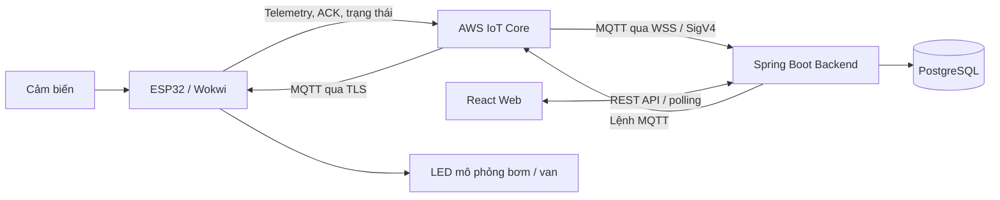

# Smart Farm IoT Management System — Mô tả dự án

| Mục | Nội dung |
|---|---|
| Loại tài liệu | Mô tả dự án do chủ dự án tự viết (không phải README, mã nguồn hay báo cáo test) |
| Người cung cấp | Chủ repository |
| Chủ sở hữu dự án / phạm vi đóng góp cá nhân | Chưa ghi rõ (`needs-verification`) |
| Ngày đưa vào repo | 2026-10-22 (commit `0388e51`) |
| Quyền sử dụng | Được cung cấp để biên soạn sách này; chưa có điều khoản riêng |
| Trạng thái | `author-experience—unverified` — chưa đối chiếu mã nguồn, log test hay ảnh demo |
| Bản tổng hợp | [knowledge-base/case-studies/smart-farm-iot.md](../../knowledge-base/case-studies/smart-farm-iot.md) |

---

**Smart Farm IoT Management System** là hệ thống quản lý vườn thông minh, kết hợp thiết bị IoT, nền tảng AWS và ứng dụng web để giám sát môi trường, quản lý thiết bị theo khu vực và điều khiển tưới. Dự án được phát triển xuyên suốt từ firmware ESP32, giao tiếp MQTT, backend xử lý nghiệp vụ đến giao diện quản lý.

**Công nghệ sử dụng**

| Thành phần | Công nghệ và vai trò |
|---|---|
| Thiết bị IoT | **ESP32, C/C++, Arduino Framework, PlatformIO** — đọc cảm biến, gửi dữ liệu và xử lý lệnh điều khiển |
| Mô phỏng | **Wokwi** — mô phỏng cảm biến nhiệt độ, độ ẩm, độ ẩm đất, nguồn nước, lưu lượng, thời tiết và actuator |
| Kết nối thiết bị | **AWS IoT Core, MQTT, TLS, chứng chỉ X.509** — truyền telemetry và lệnh điều khiển qua kết nối xác thực |
| Backend | **Java 21, Spring Boot, Spring JDBC, AWS IoT Device SDK** — cung cấp REST API, tiếp nhận dữ liệu, xử lý cảnh báo và quy trình tưới |
| Frontend | **React, TypeScript, Vite, Tailwind CSS** — dashboard, quản lý khu vực, giám sát cảm biến và điều khiển thiết bị |
| Cơ sở dữ liệu | **PostgreSQL 16, Flyway** — lưu dữ liệu cảm biến, cấu hình, lệnh, ACK, sự kiện và lịch sử phiên tưới |
| Công cụ hỗ trợ | **Python, Docker Compose, Git, Maven** — chuẩn bị thiết bị, môi trường phát triển và tự động hóa thao tác |
| Kiểm thử | **JUnit, Spring Boot Test, PostgreSQL integration tests, Playwright** — kiểm tra nghiệp vụ, API và giao diện |

**Kiến trúc hệ thống**

Backend tổ chức theo **modular monolith**, phân chia các module thiết bị, telemetry, cảnh báo, tự động hóa, điều khiển và báo cáo trong một ứng dụng Spring Boot. Giao tiếp với thiết bị sử dụng cơ chế publish/subscribe bất đồng bộ; giao diện web truy cập dữ liệu qua REST API.

Thiết bị gửi bản tin có mã thiết bị, boot ID, sequence và thời gian đo. Backend xác thực dữ liệu, xử lý trùng lặp, lưu lịch sử và đánh giá điều kiện cảnh báo. Khi điều khiển, hệ thống lưu mã lệnh và ý định trước khi gửi, sau đó đối chiếu riêng **kết quả gửi, ACK và trạng thái thiết bị**.

Các chức năng IoT đã phát triển gồm:

- Quản lý node, kênh cảm biến, khu vực và nhánh tưới gắn với trạm nước.
- Theo dõi dữ liệu gần thời gian thực, lịch sử, cảnh báo và xuất CSV.
- Điều khiển bật/tắt có thời hạn; quy tắc tưới theo độ ẩm đất và lịch cho phép.
- Quy trình tưới có xác nhận từng bước, kiểm tra phản hồi van và điều kiện nước/mưa/lưu lượng.
- Theo dõi phiên tưới, sự kiện và ước tính lượng nước tại trạm, kèm độ phủ dữ liệu.

Hiện backend và PostgreSQL chủ yếu chạy trong môi trường phát triển local, kết nối AWS IoT Core. Luồng ESP32/Wokwi–AWS–backend đã có bằng chứng chạy thử; các chức năng nâng cao vẫn cần nghiệm thu thêm. Dự án chưa triển khai production hoặc xác nhận vận hành bơm, van nông nghiệp thực tế.